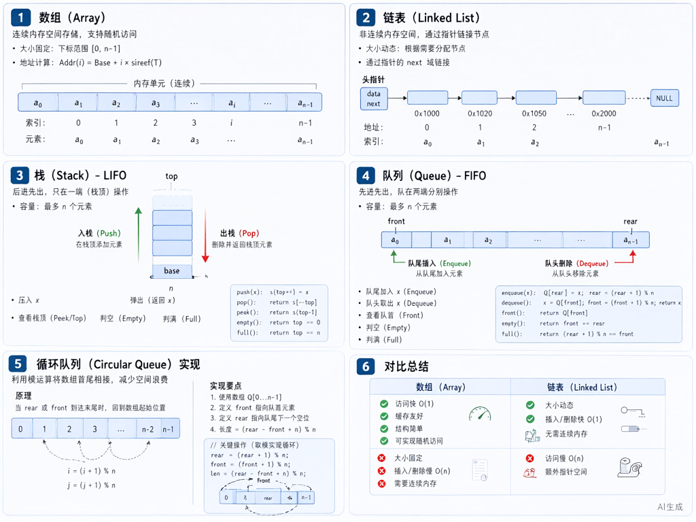

# 数据结构：线性表与栈队列



> 内容更新时间：2026-10-06 · 学习阶段：冲刺 · 预计用时：40 分钟

## 本节知识框架

**课程定位**：所属分类 `408_exam`（考研 408 冲刺专题），课程主题 `数据结构：线性表与栈队列`，学习阶段 冲刺，建议用时 40 分钟。

本课主线：顺序表与链表对比、栈与队列应用、特殊矩阵压缩存储。

**学完本课应当能够**
- 说清 `顺序表` 与 `链表` 的时间复杂度差异，并各举一个适用场景。
- 用 `栈` 实现表达式求值，记录输入、输出与中间状态。
- 遇到「判断括号匹配」这类问题时，能说出算法思路与代码框架。

### 复习清单

- [ ] 能不看正文复述 顺序表与链表对比，并指出 随机访问 的一个边界或反例。
- [ ] 能推演 栈实现表达式求值 的示例：先写预期输出，再运行并记录差异与失败现象。
- [ ] 能完成一次自测，并把错题对照错误表定位原因。

## 核心概念定义

| 术语 | 操作性定义 | 常见边界与风险 |
| --- | --- | --- |
| 顺序表 | 用连续存储空间存放线性表元素，支持随机访问。 | 易错：插入删除需移动大量元素，时间复杂度 O(n)；不适合频繁插入删除的场景。 |
| 链表 | 用指针链接分散存储的节点，不支持随机访问。 | 易错：访问第 i 个元素需从头遍历，时间复杂度 O(n)；适合频繁插入删除的场景。 |
| 栈 | 后进先出（LIFO）的线性表，只允许在一端（栈顶）进行插入删除。 | 易错：混淆栈顶与栈底；应用包括括号匹配、表达式求值、递归调用栈。 |
| 队列 | 先进先出（FIFO）的线性表，允许在一端（队尾）插入，另一端（队头）删除。 | 易错：混淆队头与队尾；应用包括广度优先搜索、缓冲区、排队系统。 |
| 循环队列 | 用数组实现的队列，通过取模运算实现循环使用空间。 | 易错：判空判满条件混淆；常用"牺牲一个存储单元"法判满：(rear+1)%maxSize == front。 |
| 特殊矩阵 | 对称矩阵、三角矩阵、对角矩阵等，可用压缩存储节省空间。 | 易错：压缩后地址计算公式记错；需熟练掌握下标映射关系。 |

## 原理与运行机制

### 机制总览

**教材衔接：顺序表与链表对比**

| 操作 | 顺序表 | 链表 |
| --- | --- | --- |
| 随机访问第 i 个元素 | O(1) | O(n) |
| 在位置 i 插入元素 | O(n) | O(1)（已知指针） |
| 删除位置 i 的元素 | O(n) | O(1)（已知指针） |
| 存储空间 | 连续，需预分配 | 分散，动态分配 |
| 适用场景 | 频繁访问，少插入删除 | 频繁插入删除，少访问 |

**教材衔接：栈的应用**

1. **括号匹配**：遇到左括号入栈，遇到右括号检查栈顶是否匹配，匹配则出栈，不匹配则失败。最后栈为空则匹配成功。
2. **表达式求值**：中缀转后缀用栈，后缀表达式求值也用栈。操作数入栈，遇到运算符弹出两个操作数计算，结果入栈。
3. **递归调用栈**：每次函数调用压栈，返回时出栈。栈溢出是因为递归层数过深。

**教材衔接：队列的应用**

1. **广度优先搜索（BFS）**：用队列存储待访问节点，每次出队一个节点，将其未访问的邻接点入队。
2. **缓冲区**：生产者消费者模型中，用队列缓冲数据，平衡生产与消费速度。
3. **排队系统**：如打印队列、任务调度队列。

**教材衔接：循环队列判空判满**

```c
// 循环队列结构
typedef struct {
    int data[MAXSIZE];
    int front, rear;
} SqQueue;

// 判空：front == rear
// 判满：(rear + 1) % MAXSIZE == front（牺牲一个存储单元）
// 入队：Q.data[Q.rear] = x; Q.rear = (Q.rear + 1) % MAXSIZE;
// 出队：x = Q.data[Q.front]; Q.front = (Q.front + 1) % MAXSIZE;
```

## 典型应用场景

| 场景 | 典型输入或前提 | 期望产物 |
| --- | --- | --- |
| 括号匹配 | 输入字符串 `"{[()]}"` | 输出 true，栈操作序列正确 |
| 表达式求值 | 输入后缀表达式 `"3 4 + 2 *"` | 输出 14，栈状态变化正确 |
| BFS 遍历图 | 输入邻接表表示的图 | 输出访问顺序，队列状态正确 |

- **顺序存储频繁插入删除**：典型现象是大量元素移动，性能差；正确做法是改用链表。
- **链表频繁随机访问**：典型现象是每次都要从头遍历，时间复杂度高；正确做法是改用顺序表。
- **栈未清空就结束**：典型现象是括号匹配失败但未检测；正确做法是最后检查栈是否为空。

### 最小验证场景

- 准备：保留 `括号匹配` 示例的原始输入，先记录 `"{[()]}"` 的基线输出和完整运行命令。
- 观察：先核对 调用了 `栈`，再改变一个与 `括号类型` 相关的条件。
- 判定：新结果与 `括号匹配` 的基线不同不等于错误；只有当差异破坏了 `栈` 的定义或错误表中的约束，才判定为失败。

## 代码/协议/SQL 示例

**教材衔接：括号匹配算法**

```c
bool isValid(char* s) {
    char stack[10000];
    int top = -1;
    
    for (int i = 0; s[i] != '\0'; i++) {
        if (s[i] == '(' || s[i] == '[' || s[i] == '{') {
            stack[++top] = s[i];  // 左括号入栈
        } else {
            if (top == -1) return false;  // 栈空，匹配失败
            char topChar = stack[top--];
            if (s[i] == ')' && topChar != '(') return false;
            if (s[i] == ']' && topChar != '[') return false;
            if (s[i] == '}' && topChar != '{') return false;
        }
    }
    return top == -1;  // 最后栈应为空
}
```

**教材衔接：后缀表达式求值**

```c
int evalRPN(char** tokens, int tokensSize) {
    int stack[1000];
    int top = -1;
    
    for (int i = 0; i < tokensSize; i++) {
        if (strcmp(tokens[i], "+") == 0) {
            int b = stack[top--];
            int a = stack[top--];
            stack[++top] = a + b;
        } else if (strcmp(tokens[i], "-") == 0) {
            int b = stack[top--];
            int a = stack[top--];
            stack[++top] = a - b;
        } else if (strcmp(tokens[i], "*") == 0) {
            int b = stack[top--];
            int a = stack[top--];
            stack[++top] = a * b;
        } else if (strcmp(tokens[i], "/") == 0) {
            int b = stack[top--];
            int a = stack[top--];
            stack[++top] = a / b;
        } else {
            stack[++top] = atoi(tokens[i]);  // 操作数入栈
        }
    }
    return stack[0];
}
```

**教材衔接：循环队列实现**

```c
typedef struct {
    int data[MAXSIZE];
    int front, rear;
} SqQueue;

void initQueue(SqQueue* Q) {
    Q->front = Q->rear = 0;
}

bool isEmpty(SqQueue Q) {
    return Q.front == Q.rear;
}

bool isFull(SqQueue Q) {
    return (Q.rear + 1) % MAXSIZE == Q.front;
}

bool enqueue(SqQueue* Q, int x) {
    if (isFull(*Q)) return false;
    Q->data[Q->rear] = x;
    Q->rear = (Q->rear + 1) % MAXSIZE;
    return true;
}

bool dequeue(SqQueue* Q, int* x) {
    if (isEmpty(*Q)) return false;
    *x = Q->data[Q->front];
    Q->front = (Q->front + 1) % MAXSIZE;
    return true;
}
```

## 时间/空间复杂度或性能分析

**性能关注点（线性表）**：访问、插入、删除的时间复杂度是主要指标。

**测量方法**：
- 顺序表随机访问 O(1)，链表随机访问 O(n)。
- 顺序表插入删除 O(n)，链表插入删除 O(1)（已知指针）。
- 空间复杂度：顺序表需预分配，可能浪费；链表动态分配，但有指针开销。

## 常见误区与易错点

| 容易写错的做法 | 实际现象 | 原因与正确做法 |
| --- | --- | --- |
| 顺序表频繁插入删除 | 大量元素移动，性能差 | 改用链表 |
| 链表频繁随机访问 | 每次都要从头遍历 | 改用顺序表 |
| 括号匹配栈未清空 | 漏检未匹配的左括号 | 最后检查栈是否为空 |
| 循环队列判满条件错 | 误判队列满或空 | 用 (rear+1)%maxSize == front 判满 |
| 后缀表达式操作数顺序错 | 计算结果错误 | 先弹出的是右操作数，后弹出的是左操作数 |
| 栈溢出未处理 | 程序崩溃 | 检查栈容量，递归深度过大改用迭代 |

### 现场 1：顺序表频繁插入删除

**症状**：大量元素移动，性能差。

**根因与修复**：改用链表。

**自检**：在本课示例里复现 `顺序表频繁插入删除`，改成 `链表` 后重跑；如果症状消失且失败路径按预期变化，说明定位正确。

### 现场 2：循环队列判满条件错

**症状**：误判队列满或空。

**根因与修复**：用 (rear+1)%maxSize == front 判满。

**自检**：在本课示例里复现 `循环队列判满条件错`，改成 `(rear+1)%maxSize == front` 后重跑；如果症状消失且失败路径按预期变化，说明定位正确。

## 与其他知识点的关系

**前置知识**：线性表的逻辑结构（`algorithms` 分类中的 `线性查找入门`、`链表`）。

**横向关联**：
- 树与图（`408_ds_tree_graph`）：树的遍历用栈或队列。
- 排序与查找（`408_ds_sort_search`）：排序算法中用到栈（如快速排序递归栈）。

**后续延伸**：
- 算法设计题（`408_ds_sort_search`）：链表操作是常考题型。

## 自测题与参考答案

### 自测 1

不看正文，说出顺序表和链表在随机访问、插入删除操作上的时间复杂度差异。

**参考答案**：顺序表随机访问 O(1)，链表随机访问 O(n)；顺序表插入删除 O(n)（需移动元素），链表插入删除 O(1)（已知指针位置）。

### 自测 2

用栈判断括号字符串 `"{[()]}"` 是否匹配，写出栈的操作序列。

**参考答案**：
- `{` 入栈，栈：`{`
- `[` 入栈，栈：`{[`
- `(` 入栈，栈：`{[(`
- `)` 与栈顶 `(` 匹配，出栈，栈：`{[`
- `]` 与栈顶 `[` 匹配，出栈，栈：`{`
- `}` 与栈顶 `{` 匹配，出栈，栈：空
- 最后栈为空，匹配成功。

### 自测 3

循环队列用数组实现，MAXSIZE=5，当前 front=2，rear=1，队列中有几个元素？

**参考答案**：元素个数 = (rear - front + MAXSIZE) % MAXSIZE = (1 - 2 + 5) % 5 = 4。队列中有 4 个元素。

### 自测 4

后缀表达式 `"3 4 + 2 * 5 -"` 的求值过程是什么？

**参考答案**：
- 3 入栈，栈：`[3]`
- 4 入栈，栈：`[3, 4]`
- `+` 弹出 4 和 3，计算 3+4=7，7 入栈，栈：`[7]`
- 2 入栈，栈：`[7, 2]`
- `*` 弹出 2 和 7，计算 7*2=14，14 入栈，栈：`[14]`
- 5 入栈，栈：`[14, 5]`
- `-` 弹出 5 和 14，计算 14-5=9，9 入栈，栈：`[9]`
- 结果为 9。

### 自测 5

某算法需要判断一个链表中是否有环，如何设计？

**参考答案**：用快慢指针法。快指针每次走 2 步，慢指针每次走 1 步。如果有环，快指针最终会追上慢指针（两者相遇）；如果无环，快指针会先到达链表末尾。时间复杂度 O(n)，空间复杂度 O(1)。

## 考点精讲

**教材衔接：高频考点**

1. **顺序表与链表对比**：几乎年年考选择题，需熟练掌握时间复杂度与适用场景。
2. **栈的应用**：括号匹配、表达式求值是常考算法题，需能手写代码。
3. **循环队列**：判空判满条件是易错点，常考选择题。
4. **特殊矩阵压缩**：对称矩阵、三角矩阵的地址计算常考选择题。

**教材衔接：命题规律**

- 选择题常考概念辨析（如顺序表 vs 链表的时间复杂度）。
- 算法题常考栈的应用（括号匹配、表达式求值）或链表操作（反转、合并）。
- 计算题常考循环队列的元素个数、特殊矩阵的地址计算。

**教材衔接：常见考点**

问：顺序表与链表相比，主要优点是？答：支持随机访问，时间复杂度 O(1)。

问：用栈判断括号字符串 "{[()]}" 是否匹配，最后栈的状态应该是？答：栈为空。

问：循环队列用数组实现，MAXSIZE=5，front=2，rear=1，队列中有多少元素？答：4 个元素。

问：后缀表达式 "3 4 + 2 *" 的求值结果是？答：14。

问：循环队列判满的条件是（牺牲一个存储单元法）？答：(rear + 1) % MAXSIZE == front。

问：单链表节点定义如下，要在头节点后插入新节点 p，正确的操作序列是？
typedef struct Node {
    int data;
    struct Node* next;
} Node;
答：p->next = head->next; head->next = p;（头插法先连新节点的 next，再连头节点的 next）。

## 术语速查

| 术语 | 一句话说明 |
| --- | --- |
| 顺序表 | 用连续存储空间存放线性表元素，支持随机访问，时间复杂度 O(1)。 |
| 链表 | 用指针链接分散存储的节点，不支持随机访问，访问第 i 个元素需 O(n)。 |
| 栈 | 后进先出（LIFO）的线性表，只允许在栈顶进行插入删除。 |
| 队列 | 先进先出（FIFO）的线性表，队尾插入，队头删除。 |
| 循环队列 | 用数组实现的队列，通过取模运算实现循环使用空间，避免"假溢出"。 |
| 特殊矩阵 | 对称矩阵、三角矩阵、对角矩阵等，可用压缩存储节省空间。 |

## 内容元数据

- 内容版本：v2.0
- 最后更新：2026-11-09
- 学习阶段：冲刺
- 适用环境：通用备考环境；本课聚焦 线性表与栈队列。
- 内容来源：内置结构化课程与 408 考研真题整理
- 相关主题：linear lists stacks and queues
- 质量版本：P0 测验标准 + P1 覆盖扩展 + P2 体验补全

## 参考资料与复核

- [LeetCode 20 有效的括号](https://leetcode.cn/problems/valid-parentheses/)
- [LeetCode 150 逆波兰表达式求值](https://leetcode.cn/problems/evaluate-reverse-polish-notation/)
- [LeetCode 622 设计循环队列](https://leetcode.cn/problems/design-circular-queue/)
- 最后复核：2026-10-04
- 下次复核：2026-11-10

- [ ] 能不看正文复述本课核心概念，并指出一个边界或反例。
- [ ] 能推演本课示例：先写预期输出，再运行并记录差异。
- [ ] 能完成一次自测，并把错题对照错误表定位原因。
