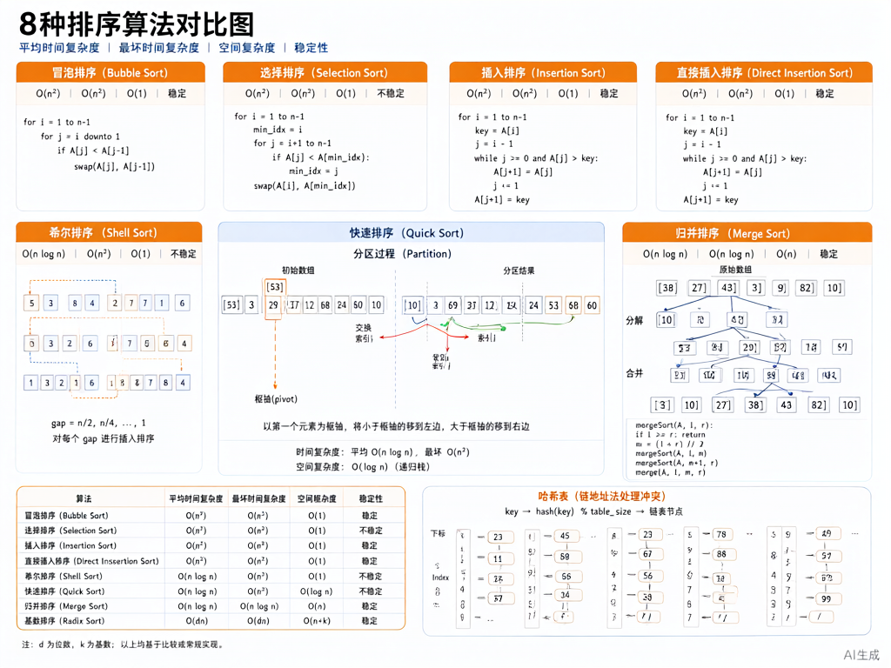

# 数据结构：排序与查找



> 内容更新时间：2026-10-06 · 学习阶段：冲刺 · 预计用时：40 分钟

## 本节知识框架

**课程定位**：所属分类 `408_exam`（考研 408 冲刺专题），课程主题 `数据结构：排序与查找`，学习阶段 冲刺，建议用时 40 分钟。

本课主线：内部排序算法对比、外部排序概念、查找算法与散列表。

**学完本课应当能够**
- 说清 `快速排序` 与 `归并排序` 的时间复杂度差异，并各举一个适用场景。
- 用 `散列表` 实现查找，记录哈希函数选择与冲突处理。
- 遇到「选择排序算法」这类问题时，能说出各算法的稳定性与适用场景。

### 复习清单

- [ ] 能不看正文复述 八大排序算法对比，并指出 快速排序 的一个边界或反例。
- [ ] 能推演 散列表查找 的示例：先写预期输出，再运行并记录差异与失败现象。
- [ ] 能完成一次自测，并把错题对照错误表定位原因。

## 核心概念定义

| 术语 | 操作性定义 | 常见边界与风险 |
| --- | --- | --- |
| 内部排序 | 整个排序过程在内存中完成，不涉及外部存储。 | 易错：数据量大时内存不足，需用外部排序。 |
| 外部排序 | 数据量大，需借助外部存储（如磁盘）进行排序。 | 易错：I/O 操作是主要时间开销，需优化归并策略。 |
| 稳定排序 | 相等元素的相对顺序在排序后保持不变。 | 易错：快速排序、堆排序、希尔排序不稳定；归并排序、冒泡排序稳定。 |
| 散列表 | 根据关键字直接计算地址的查找表，理想情况 O(1)。 | 易错：哈希冲突处理不当会导致性能退化；装填因子过大需扩容。 |
| 哈希函数 | 将关键字映射到散列地址的函数。 | 易错：选择不当会导致大量冲突；常用方法有直接定址、除留余数、数字分析。 |
| 冲突处理 | 不同关键字映射到同一地址时的解决方法。 | 易错：开放定址法易产生堆积；链地址法需额外存储空间。 |

## 原理与运行机制

### 机制总览

**教材衔接：八大排序算法对比**

| 排序算法 | 平均时间复杂度 | 最坏时间复杂度 | 空间复杂度 | 稳定性 |
| --- | --- | --- | --- | --- |
| 冒泡排序 | O(n²) | O(n²) | O(1) | 稳定 |
| 选择排序 | O(n²) | O(n²) | O(1) | 不稳定 |
| 插入排序 | O(n²) | O(n²) | O(1) | 稳定 |
| 希尔排序 | O(n^1.3) | O(n²) | O(1) | 不稳定 |
| 快速排序 | O(nlogn) | O(n²) | O(logn) | 不稳定 |
| 归并排序 | O(nlogn) | O(nlogn) | O(n) | 稳定 |
| 堆排序 | O(nlogn) | O(nlogn) | O(1) | 不稳定 |
| 基数排序 | O(d(n+r)) | O(d(n+r)) | O(r) | 稳定 |

**教材衔接：快速排序**

1. 选择一个基准元素（通常选第一个或随机）。
2. 将小于基准的放左边，大于基准的放右边（分区操作）。
3. 递归对左右两部分进行快速排序。
4. 最坏情况（已排序）时间复杂度 O(n²)，平均 O(nlogn)。

**教材衔接：归并排序**

1. 将序列分成两半，递归排序每一半。
2. 合并两个有序序列。
3. 时间复杂度始终 O(nlogn)，空间复杂度 O(n)。
4. 适合外部排序和链表排序。

**教材衔接：散列表查找**

1. 选择哈希函数 H(key)，如除留余数法 H(key) = key % p。
2. 处理冲突：开放定址法（线性探测、二次探测）或链地址法。
3. 装填因子 α = 表中元素数 / 表长，α 越大冲突越多。
4. 查找成功平均长度（ASL）与装填因子正相关。

## 典型应用场景

| 场景 | 典型输入或前提 | 期望产物 |
| --- | --- | --- |
| 小规模数据排序 | 输入 n<50 的数组 | 插入排序或冒泡排序，简单高效 |
| 大规模数据排序 | 输入 n>10000 的数组 | 快速排序或归并排序，时间复杂度低 |
| 要求稳定性排序 | 输入相等元素需保持原序 | 归并排序或冒泡排序 |
| 快速查找 | 输入大量键值对 | 散列表，平均 O(1) 查找 |

- **快速排序最坏情况**：典型现象是已排序数组退化为 O(n²)；正确做法是随机选择基准或三数取中。
- **散列表装填因子过大**：典型现象是冲突增多，查找变慢；正确做法是扩容或换哈希函数。
- **外部排序 I/O 瓶颈**：典型现象是磁盘读写次数过多；正确做法是增加归并路数或减少初始归并段数。

## 代码/协议/SQL 示例

**教材衔接：快速排序实现**

```c
void quickSort(int arr[], int low, int high) {
    if (low < high) {
        int pivot = partition(arr, low, high);
        quickSort(arr, low, pivot - 1);
        quickSort(arr, pivot + 1, high);
    }
}

int partition(int arr[], int low, int high) {
    int pivot = arr[high];  // 选最后一个作为基准
    int i = low - 1;
    
    for (int j = low; j < high; j++) {
        if (arr[j] < pivot) {
            i++;
            swap(&arr[i], &arr[j]);
        }
    }
    swap(&arr[i + 1], &arr[high]);
    return i + 1;
}

void swap(int* a, int* b) {
    int temp = *a;
    *a = *b;
    *b = temp;
}
```

**教材衔接：归并排序实现**

```c
void merge(int arr[], int left, int mid, int right) {
    int n1 = mid - left + 1;
    int n2 = right - mid;
    int L[n1], R[n2];
    
    for (int i = 0; i < n1; i++) L[i] = arr[left + i];
    for (int j = 0; j < n2; j++) R[j] = arr[mid + 1 + j];
    
    int i = 0, j = 0, k = left;
    while (i < n1 && j < n2) {
        if (L[i] <= R[j]) arr[k++] = L[i++];
        else arr[k++] = R[j++];
    }
    while (i < n1) arr[k++] = L[i++];
    while (j < n2) arr[k++] = R[j++];
}

void mergeSort(int arr[], int left, int right) {
    if (left < right) {
        int mid = left + (right - left) / 2;
        mergeSort(arr, left, mid);
        mergeSort(arr, mid + 1, right);
        merge(arr, left, mid, right);
    }
}
```

**教材衔接：散列表（链地址法）**

```c
#define TABLE_SIZE 10

typedef struct Node {
    int key;
    struct Node* next;
} Node;

Node* hashTable[TABLE_SIZE];

int hash(int key) {
    return key % TABLE_SIZE;
}

void insert(int key) {
    int index = hash(key);
    Node* newNode = (Node*)malloc(sizeof(Node));
    newNode->key = key;
    newNode->next = hashTable[index];
    hashTable[index] = newNode;
}

bool search(int key) {
    int index = hash(key);
    Node* current = hashTable[index];
    while (current != NULL) {
        if (current->key == key) return true;
        current = current->next;
    }
    return false;
}
```

## 时间/空间复杂度或性能分析

**性能关注点（排序算法）**：时间复杂度、空间复杂度、稳定性是主要指标。

**测量方法**：
- 快速排序平均 O(nlogn)，最坏 O(n²)（已排序时），空间 O(logn)。
- 归并排序始终 O(nlogn)，空间 O(n)。
- 堆排序始终 O(nlogn)，空间 O(1)。
- 散列表查找平均 O(1)，最坏 O(n)（冲突严重时）。

## 常见误区与易错点

| 容易写错的做法 | 实际现象 | 原因与正确做法 |
| --- | --- | --- |
| 快速排序选固定基准 | 已排序数组退化为 O(n²) | 随机选择基准或三数取中 |
| 散列表装填因子过大 | 冲突增多，查找变慢 | 扩容或换哈希函数 |
| 混淆稳定与不稳定排序 | 选择题出错 | 记忆口诀：快选希堆不稳定 |
| 归并排序空间复杂度记错 | 误认为 O(1) | 归并需额外 O(n) 空间 |
| 外部排序忽视 I/O 开销 | 性能分析错误 | 外部排序主要瓶颈是磁盘 I/O |
| 链地址法忘记释放内存 | 内存泄漏 | 删除节点时 free 内存 |

## 与其他知识点的关系

**前置知识**：线性表（`408_ds_linear`）、树与图（`408_ds_tree_graph`）。

**横向关联**：
- 散列表用于实现集合与字典。
- 排序算法是其他算法（如查找、图算法）的基础。

**后续延伸**：
- 算法设计题（`408_ds_sort_search`）：排序与查找是常考题型。

## 自测题与参考答案

### 自测 1

快速排序在最坏情况下的时间复杂度是多少？什么情况下会出现最坏情况？

**参考答案**：最坏时间复杂度 O(n²)。当数组已经有序（升序或降序）且每次选择第一个或最后一个元素作为基准时，分区操作会将数组分成一个空子数组和一个 n-1 的子数组，递归深度为 n，每层时间 O(n)，总时间 O(n²)。

### 自测 2

归并排序和快速排序哪个更稳定？为什么？

**参考答案**：归并排序稳定，快速排序不稳定。稳定性指相等元素的相对顺序在排序后是否保持不变。归并排序在合并时，相等元素优先取左边的，保持原序；快速排序在分区时，相等元素可能交换位置，破坏原序。

### 自测 3

散列表装填因子 α=0.75，表长 100，表中有多少元素？查找成功的平均比较次数大约是多少？

**参考答案**：元素数 = α × 表长 = 0.75 × 100 = 75。线性探测法下，查找成功平均比较次数 ≈ (1 + 1/(1-α)) / 2 = (1 + 1/0.25) / 2 = 2.5。链地址法下 ≈ 1 + α/2 = 1.375。

### 自测 4

对序列 {50, 20, 80, 10, 30, 70, 40} 进行快速排序（选最后一个为基准），写出第一趟排序后的结果。

**参考答案**：
- 基准 pivot = 40。
- i = -1，j 从 0 到 5 遍历：
  - j=0: 50>40，不交换
  - j=1: 20<40，i=0，交换 arr[0]和arr[1]，序列变为 {20, 50, 80, 10, 30, 70, 40}
  - j=2: 80>40，不交换
  - j=3: 10<40，i=1，交换 arr[1]和arr[3]，序列变为 {20, 10, 80, 50, 30, 70, 40}
  - j=4: 30<40，i=2，交换 arr[2]和arr[4]，序列变为 {20, 10, 30, 50, 80, 70, 40}
  - j=5: 70>40，不交换
- 最后交换 arr[i+1]和arr[high]，即 arr[3]和arr[6]，序列变为 {20, 10, 30, 40, 80, 70, 50}。
- 第一趟结果：{20, 10, 30, 40, 80, 70, 50}，基准 40 在位置 3。

### 自测 5

外部排序中，如何减少 I/O 次数？

**参考答案**：外部排序主要瓶颈是磁盘 I/O。减少 I/O 次数的方法：
1. 增加归并路数 k：k 路归并可将归并趟数从 log₂n 降为 logₖn。
2. 减少初始归并段数：用置换-选择排序代替简单的内部排序生成初始归并段，可使归并段长度不均匀，减少归并段数。
3. 利用多缓冲区：边读边写，减少等待时间。

## 考点精讲

**教材衔接：高频考点**

1. **八大排序算法对比**：时间复杂度、空间复杂度、稳定性，几乎年年考选择题。
2. **快速排序**：分区过程、最坏情况分析、优化方法，常考算法题或选择题。
3. **归并排序**：合并过程、空间复杂度，常考选择题。
4. **散列表**：哈希函数选择、冲突处理、装填因子与 ASL 的关系，常考选择题或计算题。
5. **外部排序**：归并策略、I/O 优化，常考选择题。

**教材衔接：常见考点**

问：下列排序算法中，哪个是不稳定的？答：快速排序。

问：快速排序最坏情况的时间复杂度是？答：O(n²)。

问：归并排序的空间复杂度是？答：O(n)。

问：散列表装填因子 α 越大，说明什么？答：冲突越多。

问：外部排序的主要瓶颈是？答：磁盘 I/O 次数。

## 术语速查

| 术语 | 一句话说明 |
| --- | --- |
| 内部排序 | 整个排序过程在内存中完成。 |
| 外部排序 | 数据量大，需借助外部存储进行排序。 |
| 稳定排序 | 相等元素的相对顺序在排序后保持不变。 |
| 散列表 | 根据关键字直接计算地址的查找表，理想情况 O(1)。 |
| 哈希函数 | 将关键字映射到散列地址的函数。 |
| 装填因子 | 表中元素数与表长的比值，反映冲突程度。 |

## 内容元数据

- 内容版本：v2.0
- 最后更新：2026-11-09
- 学习阶段：冲刺
- 适用环境：通用备考环境；本课聚焦 排序与查找。
- 内容来源：内置结构化课程与 408 考研真题整理
- 相关主题：sorting and searching
- 质量版本：P0 测验标准 + P1 覆盖扩展 + P2 体验补全

## 参考资料与复核

- [LeetCode 912 排序数组](https://leetcode.cn/problems/sort-an-array/)
- [LeetCode 705 设计哈希集合](https://leetcode.cn/problems/design-hashset/)
- [LeetCode 347 前 K 个高频元素](https://leetcode.cn/problems/top-k-frequent-elements/)
- 最后复核：2026-10-04
- 下次复核：2026-11-10

- [ ] 能不看正文复述本课核心概念，并指出一个边界或反例。
- [ ] 能推演本课示例：先写预期输出，再运行并记录差异。
- [ ] 能完成一次自测，并把错题对照错误表定位原因。
