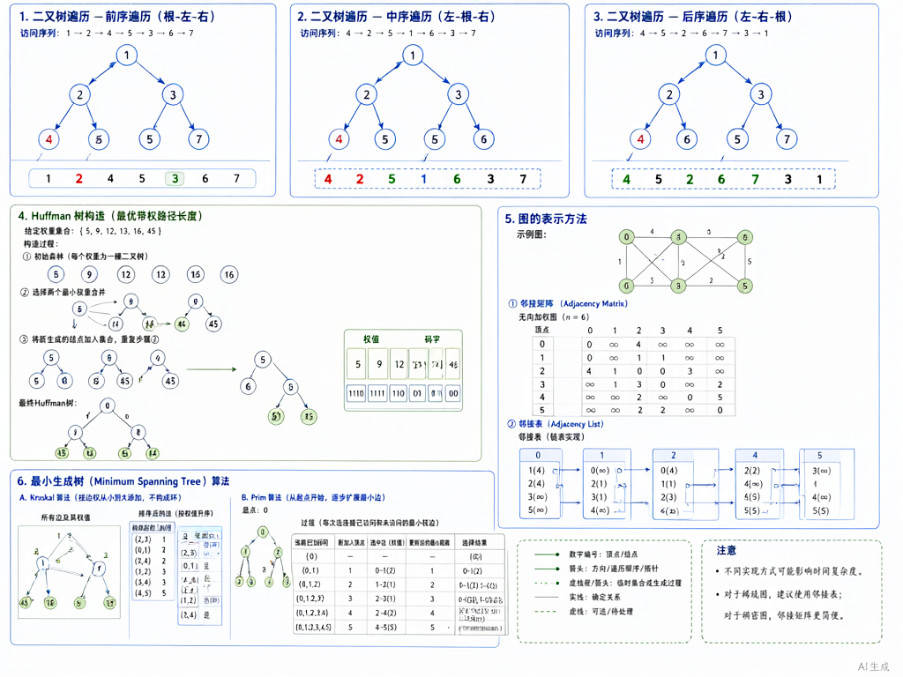

# 数据结构：树与图



> 内容更新时间：2026-10-06 · 学习阶段：冲刺 · 预计用时：45 分钟

## 本节知识框架

**课程定位**：所属分类 `408_exam`（考研 408 冲刺专题），课程主题 `数据结构：树与图`，学习阶段 冲刺，建议用时 45 分钟。

本课主线：二叉树性质与遍历、哈夫曼树、图的存储与遍历、最小生成树、最短路算法。

**学完本课应当能够**
- 说清 `二叉树` 的五种性质，并计算节点数与度的关系。
- 用 `先序/中序/后序` 遍历二叉树，记录遍历序列与递归栈状态。
- 遇到「求最小生成树」这类问题时，能说出 Prim 与 Kruskal 的区别与适用场景。

### 复习清单

- [ ] 能不看正文复述 二叉树性质，并指出 完全二叉树 的一个边界或反例。
- [ ] 能推演 二叉树遍历 的示例：先写预期序列，再运行并记录差异与失败现象。
- [ ] 能完成一次自测，并把错题对照错误表定位原因。

## 核心概念定义

| 术语 | 操作性定义 | 常见边界与风险 |
| --- | --- | --- |
| 二叉树 | 每个节点最多有两个子树的树结构，子树有左右之分。 | 易错：混淆二叉树与度为 2 的有序树；二叉树可以是空树。 |
| 完全二叉树 | 深度为 k 的二叉树，除第 k 层外各层都是满的，且第 k 层节点都集中在最左边。 | 易错：混淆完全二叉树与满二叉树；完全二叉树适合用数组存储。 |
| 哈夫曼树 | 带权路径长度（WPL）最短的二叉树，用于数据压缩。 | 易错：构造时每次选两个最小权值节点合并；哈夫曼编码是前缀编码。 |
| 图的邻接矩阵 | 用二维数组表示图中顶点间的邻接关系，空间复杂度 O(n²)。 | 易错：无向图矩阵对称，有向图不对称；适合稠密图。 |
| 图的邻接表 | 用链表表示每个顶点的邻接点，空间复杂度 O(n+e)。 | 易错：适合稀疏图；无向图同一条边出现两次。 |
| 最小生成树 | 连通图中权值之和最小的生成树，含 n-1 条边。 | 易错：Prim 适合稠密图 O(n²)，Kruskal 适合稀疏图 O(eloge)。 |

## 原理与运行机制

### 机制总览

**教材衔接：二叉树性质**

1. 第 i 层最多有 2^(i-1) 个节点（i≥1）。
2. 深度为 k 的二叉树最多有 2^k - 1 个节点。
3. 对任何二叉树，叶子节点数 n0 = 度为 2 的节点数 n2 + 1，即 n0 = n2 + 1。
4. 具有 n 个节点的完全二叉树深度为 ⌊log₂n⌋ + 1。
5. 完全二叉树中，节点 i 的父节点为 ⌊i/2⌋，左孩子为 2i，右孩子为 2i+1。

**教材衔接：二叉树遍历**

| 遍历方式 | 访问顺序 | 应用 |
| --- | --- | --- |
| 先序遍历 | 根 → 左 → 右 | 复制二叉树、前缀表达式 |
| 中序遍历 | 左 → 根 → 右 | 二叉排序树的有序序列 |
| 后序遍历 | 左 → 右 → 根 | 后缀表达式、内存释放 |
| 层序遍历 | 按层从上到下、从左到右 | 求宽度、完全二叉树判定 |

**教材衔接：哈夫曼树构造**

1. 将 n 个权值作为 n 棵二叉树组成森林。
2. 选取权值最小的两棵树合并为新树，新树根权值为两子树权值之和。
3. 重复步骤 2，直到只剩一棵树。

**教材衔接：图的存储**

| 存储方式 | 空间复杂度 | 适用场景 |
| --- | --- | --- |
| 邻接矩阵 | O(n²) | 稠密图，快速判断边是否存在 |
| 邻接表 | O(n+e) | 稀疏图，遍历邻接点高效 |
| 十字链表 | O(n+e) | 有向图，便于求入度 |
| 邻接多重表 | O(n+e) | 无向图，便于删除边 |

**教材衔接：最小生成树算法**

- **Prim 算法**：从某一顶点开始，每次选择连接树与非树顶点的最小权值边，时间复杂度 O(n²)，适合稠密图。
- **Kruskal 算法**：每次选择权值最小且不构成回路的边，时间复杂度 O(eloge)，适合稀疏图。

## 典型应用场景

| 场景 | 典型输入或前提 | 期望产物 |
| --- | --- | --- |
| 哈夫曼编码 | 输入字符频率 | 输出最优前缀编码，WPL 最小 |
| 最短路径 | 输入带权图与源点 | 输出源点到各点的最短路径与长度 |
| 拓扑排序 | 输入有向无环图 | 输出线性序列，检测是否有环 |

- **混淆完全二叉树与满二叉树**：典型现象是节点数计算错误；正确做法是记住完全二叉树允许最后一层不满。
- **Prim 与 Kruskal 混用**：典型现象是时间复杂度分析错误；正确做法是根据图的稠密程度选择算法。
- **哈夫曼编码不是前缀编码**：典型现象是解码歧义；正确做法是哈夫曼编码保证任一编码不是另一编码的前缀。

## 代码/协议/SQL 示例

**教材衔接：二叉树遍历递归实现**

```c
typedef struct BiTNode {
    char data;
    struct BiTNode *lchild, *rchild;
} BiTNode, *BiTree;

// 先序遍历
void preOrder(BiTree T) {
    if (T != NULL) {
        printf("%c ", T->data);
        preOrder(T->lchild);
        preOrder(T->rchild);
    }
}

// 中序遍历
void inOrder(BiTree T) {
    if (T != NULL) {
        inOrder(T->lchild);
        printf("%c ", T->data);
        inOrder(T->rchild);
    }
}

// 后序遍历
void postOrder(BiTree T) {
    if (T != NULL) {
        postOrder(T->lchild);
        postOrder(T->rchild);
        printf("%c ", T->data);
    }
}
```

**教材衔接：Dijkstra 最短路径**

```c
#define MAX 99999

void Dijkstra(int graph[MAX][MAX], int src, int dist[], int n) {
    int visited[n];
    for (int i = 0; i < n; i++) {
        dist[i] = MAX;
        visited[i] = 0;
    }
    dist[src] = 0;
    
    for (int count = 0; count < n - 1; count++) {
        int u = -1, min = MAX;
        for (int v = 0; v < n; v++)
            if (!visited[v] && dist[v] < min) {
                min = dist[v];
                u = v;
            }
        visited[u] = 1;
        
        for (int v = 0; v < n; v++)
            if (!visited[v] && graph[u][v] && dist[u] != MAX 
                && dist[u] + graph[u][v] < dist[v])
                dist[v] = dist[u] + graph[u][v];
    }
}
```

**教材衔接：Kruskal 最小生成树**

```c
typedef struct {
    int u, v, weight;
} Edge;

int parent[100];

int find(int i) {
    if (parent[i] == i) return i;
    return parent[i] = find(parent[i]);
}

void unionSet(int i, int j) {
    parent[find(i)] = find(j);
}

int compare(const void* a, const void* b) {
    return ((Edge*)a)->weight - ((Edge*)b)->weight;
}

void Kruskal(Edge edges[], int E, int V) {
    qsort(edges, E, sizeof(Edge), compare);
    for (int i = 0; i < V; i++) parent[i] = i;
    
    int mstWeight = 0, count = 0;
    for (int i = 0; i < E && count < V - 1; i++) {
        int u = find(edges[i].u);
        int v = find(edges[i].v);
        if (u != v) {
            unionSet(u, v);
            mstWeight += edges[i].weight;
            count++;
        }
    }
}
```

## 时间/空间复杂度或性能分析

**性能关注点（树与图算法）**：遍历、最短路径、最小生成树的时间复杂度是主要指标。

**测量方法**：
- 二叉树遍历 O(n)，n 为节点数。
- Dijkstra 朴素实现 O(n²)，堆优化 O((n+e)logn)。
- Prim 朴素实现 O(n²)，适合稠密图。
- Kruskal O(eloge)，适合稀疏图。

## 常见误区与易错点

| 容易写错的做法 | 实际现象 | 原因与正确做法 |
| --- | --- | --- |
| 混淆完全二叉树与满二叉树 | 节点数计算错误 | 完全二叉树允许最后一层不满 |
| 哈夫曼编码不是前缀编码 | 解码有歧义 | 保证任一编码不是另一编码的前缀 |
| Dijkstra 处理负权边 | 结果错误 | Dijkstra 不能处理负权边，用 Bellman-Ford |
| Prim 与 Kruskal 混用 | 时间复杂度分析错误 | 稠密图用 Prim，稀疏图用 Kruskal |
| 拓扑排序不检测环 | 漏判有环图 | 排序后检查是否包含所有顶点 |
| 二叉树遍历递归栈溢出 | 程序崩溃 | 树过深时改用迭代或 Morris 遍历 |

## 与其他知识点的关系

**前置知识**：线性表（`408_ds_linear`）、树的基本概念（`algorithms` 分类中的 `树与二叉搜索树`）。

**横向关联**：
- 排序与查找（`408_ds_sort_search`）：二叉排序树用于查找。
- 操作系统（`408_os_process`）：进程调度用树或图建模。

**后续延伸**：
- 算法设计题（`408_ds_sort_search`）：树的遍历与构造是常考题型。

## 自测题与参考答案

### 自测 1

一棵二叉树有 10 个度为 2 的节点，问叶子节点有多少个？

**参考答案**：根据性质 n0 = n2 + 1，叶子节点数 = 10 + 1 = 11。

### 自测 2

对二叉树进行先序遍历得到 ABDEGCFH，中序遍历得到 DBGEAFHC，画出该二叉树。

**参考答案**：
- 先序第一个 A 是根。
- 中序中 A 左边 DBGE 是左子树，右边 FHC 是右子树。
- 左子树先序 BDEG，B 是左子树根；中序 DBGE，D 在 B 左边是左孩子，GE 在 B 右边是右子树。
- 以此类推，最终树结构为：A 的左孩子 B，右孩子 C；B 的左孩子 D，右孩子 E（E 的左孩子 G）；C 的左孩子 F，右孩子 H。

### 自测 3

用 Kruskal 算法求最小生成树，边按权值排序为 (1,2,1), (2,3,2), (1,3,3), (3,4,4)，顶点数 4，写出选边过程。

**参考答案**：
- 选 (1,2,1)，不构成回路，加入。
- 选 (2,3,2)，不构成回路，加入。
- 选 (1,3,3)，1 和 3 已连通（通过 2），构成回路，跳过。
- 选 (3,4,4)，不构成回路，加入。
- 最小生成树包含边 (1,2), (2,3), (3,4)，总权值 7。

### 自测 4

Dijkstra 算法能否处理负权边？为什么？

**参考答案**：不能。因为 Dijkstra 基于贪心思想，每次选择距离最小的顶点加入集合，并假设该距离已是最短。如果有负权边，后续可能通过负权边使已确定的最短距离变得更小，破坏贪心选择性质。处理负权边应使用 Bellman-Ford 算法。

### 自测 5

某二叉树的中序遍历为 DBGEHJACIF，后序遍历为 DGJHEBIFCA，求先序遍历。

**参考答案**：
- 后序最后一个 A 是根。
- 中序中 A 左边 DBGEHJ 是左子树，右边 CIF 是右子树。
- 左子树后序 DGJHEB，B 是左子树根；右子树后序 IFC，C 是右子树根。
- 以此类推，先序遍历为：ABDEGHJCFI。

## 考点精讲

**教材衔接：高频考点**

1. **二叉树性质**：节点数与度的关系、完全二叉树特性，几乎年年考选择题。
2. **二叉树遍历**：给定两种遍历求第三种，或画出二叉树，常考算法题。
3. **哈夫曼树与编码**：构造哈夫曼树、计算 WPL、写出哈夫曼编码，常考选择题或简答题。
4. **图的存储**：邻接矩阵与邻接表的对比，常考选择题。
5. **最小生成树**：Prim 与 Kruskal 算法的区别与适用场景，常考选择题。
6. **最短路径**：Dijkstra 算法思想与不能处理负权边的原因，常考选择题。

**教材衔接：常见考点**

问：一棵二叉树有 10 个度为 2 的节点，叶子节点有多少个？答：11 个。

问：先序遍历为 ABDEGCFH，中序遍历为 DBGEAFHC，根节点是？答：A。

问：Kruskal 算法适合什么类型的图？答：稀疏图。

问：Dijkstra 算法不能处理什么类型的边？答：负权边。

问：哈夫曼编码是什么类型的编码？答：前缀编码。

## 术语速查

| 术语 | 一句话说明 |
| --- | --- |
| 二叉树 | 每个节点最多有两个子树的树结构，子树有左右之分。 |
| 完全二叉树 | 深度为 k 的二叉树，除第 k 层外各层都是满的，且第 k 层节点都集中在最左边。 |
| 哈夫曼树 | 带权路径长度（WPL）最短的二叉树，用于数据压缩。 |
| 邻接矩阵 | 用二维数组表示图中顶点间的邻接关系，空间复杂度 O(n²)。 |
| 邻接表 | 用链表表示每个顶点的邻接点，空间复杂度 O(n+e)。 |
| 最小生成树 | 连通图中权值之和最小的生成树，含 n-1 条边。 |

## 内容元数据

- 内容版本：v2.0
- 最后更新：2026-11-09
- 学习阶段：冲刺
- 适用环境：通用备考环境；本课聚焦 树与图。
- 内容来源：内置结构化课程与 408 考研真题整理
- 相关主题：trees and graphs
- 质量版本：P0 测验标准 + P1 覆盖扩展 + P2 体验补全

## 参考资料与复核

- [LeetCode 94 二叉树中序遍历](https://leetcode.cn/problems/binary-tree-inorder-traversal/)
- [LeetCode 743 网络延迟时间](https://leetcode.cn/problems/network-delay-time/)
- [LeetCode 1584 连接所有点的最小费用](https://leetcode.cn/problems/min-cost-to-connect-all-points/)
- 最后复核：2026-10-04
- 下次复核：2026-11-10

- [ ] 能不看正文复述本课核心概念，并指出一个边界或反例。
- [ ] 能推演本课示例：先写预期输出，再运行并记录差异。
- [ ] 能完成一次自测，并把错题对照错误表定位原因。
