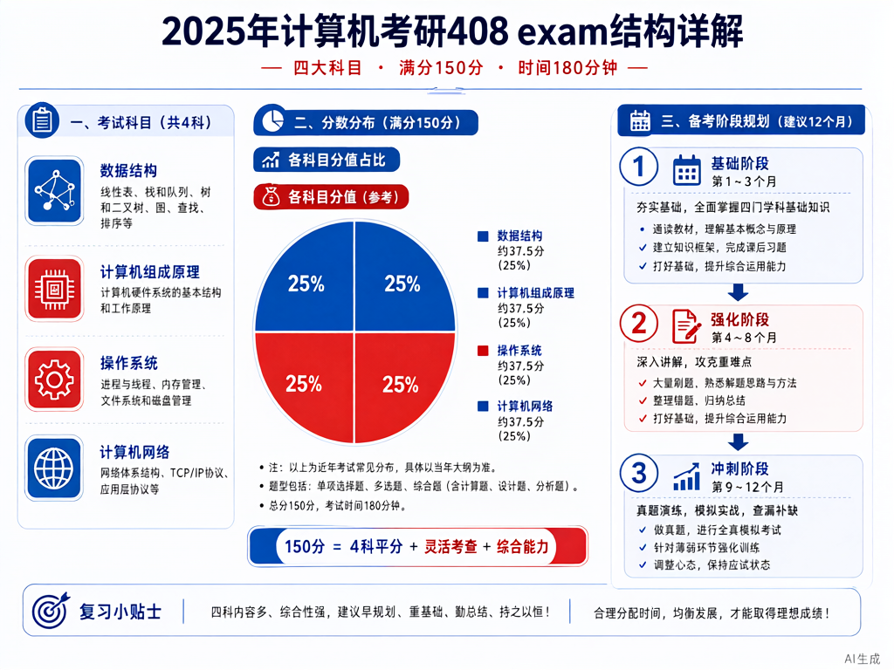

# 408 考纲全景与复习策略



> 内容更新时间：2026-10-06 · 学习阶段：冲刺 · 预计用时：25 分钟

## 本节知识框架

**课程定位**：所属分类 `408_exam`（考研 408 冲刺专题），课程主题 `考纲全景与复习策略`，学习阶段 冲刺，建议用时 25 分钟。

本课主线：408 四科分值分布、命题规律与三轮复习法。

**学完本课应当能够**
- 说清 408 四科（数据结构、计算机组成原理、操作系统、计算机网络）的分值占比与题型分布。
- 用三轮复习法（基础→强化→冲刺）规划自己的备考节奏，并指出每轮的核心任务。
- 遇到「时间不够」这类问题时，能说出优先级策略与取舍原则。

### 复习清单

- [ ] 能不看正文复述 408 四科分值分布，并指出 数据结构 的一个高频考点或易错点。
- [ ] 能推演 三轮复习法 的时间分配：先写预期计划，再对照实际进度记录差异与调整策略。
- [ ] 能完成一次自测，并把错题对照错误表定位原因。

## 核心概念定义

| 术语 | 操作性定义 | 常见边界与风险 |
| --- | --- | --- |
| 408 | 计算机学科专业基础综合考试，满分 150 分，考试时间 180 分钟。 | 易错：只关注总分忽略单科线；部分院校有单科最低分要求，总分过线但单科不达标仍会被刷。 |
| 数据结构 | 408 科目之一，约 45 分，考查线性表、树、图、排序、查找等核心算法与数据结构。 | 易错：只背代码不理解复杂度；真题常考手写算法并分析时间/空间复杂度，纯记忆无法应对变式题。 |
| 计算机组成原理 | 408 科目之一，约 45 分，考查数据表示、运算器、存储系统、CPU、总线与 I/O。 | 易错：混淆 Cache 映射方式与替换算法；真题常考计算题（如 Cache 命中率、指令执行时间），需熟练掌握公式。 |
| 操作系统 | 408 科目之一，约 35 分，考查进程管理、同步互斥、死锁、内存管理、文件系统。 | 易错：PV 操作只背模板不理解场景；真题常考新场景下的同步互斥设计，需理解信号量语义与进程关系。 |
| 计算机网络 | 408 科目之一，约 25 分，考查物理层、数据链路层、网络层、传输层、应用层。 | 易错：混淆 TCP 与 UDP 的应用场景；真题常考协议细节（如 TCP 三次握手、滑动窗口），需理解设计原理。 |
| 三轮复习法 | 基础轮（3-6 月）→强化轮（7-9 月）→冲刺轮（10-12 月）的分阶段备考策略。 | 易错：基础轮拖太久导致强化轮时间不足；每轮应有明确目标与检验标准，避免"假努力"。 |

## 原理与运行机制

### 机制总览

**教材衔接：408 分值分布与题型**

408 满分 150 分，考试时间 180 分钟，四科分值分布如下：

| 科目 | 分值 | 题型分布 |
| --- | --- | --- |
| 数据结构 | 约 45 分 | 单选 11 题（22 分）+ 简答 2 题（14 分）+ 算法设计 1 题（9 分） |
| 计算机组成原理 | 约 45 分 | 单选 11 题（22 分）+ 综合应用 2 题（23 分） |
| 操作系统 | 约 35 分 | 单选 10 题（20 分）+ 简答 2 题（10 分）+ 综合应用 1 题（5 分） |
| 计算机网络 | 约 25 分 | 单选 8 题（16 分）+ 综合应用 1 题（9 分） |

**教材衔接：命题规律**

1. **数据结构**：线性表、树、排序是高频考点；算法设计题常考链表、二叉树、图的操作，要求手写代码并分析复杂度。
2. **计算机组成原理**：Cache、指令系统、CPU 数据通路是重点；计算题占比高，需熟练掌握性能指标计算。
3. **操作系统**：进程同步、内存管理是核心；PV 操作几乎年年考，需理解经典同步问题（生产者消费者、读者写者等）。
4. **计算机网络**：TCP/IP 协议族是重点；常考协议细节（如 TCP 拥塞控制、IP 子网划分），需理解设计原理而非死记硬背。

**教材衔接：三轮复习法**

1. **基础轮（3-6 月）**：逐章过教材，理解核心概念，完成课后习题。目标是建立知识框架，不追求速度。
2. **强化轮（7-9 月）**：做真题分类汇编，按考点专项突破。目标是熟悉命题风格，查漏补缺。
3. **冲刺轮（10-12 月）**：做套卷模拟，限时训练。目标是提高答题速度与准确率，调整心态。

**教材衔接：优先级策略**

时间不足时的取舍原则：
- 优先保证数据结构和计算机组成原理（各 45 分，占比最高）。
- 操作系统重点抓进程同步与内存管理（占 OS 分值 60% 以上）。
- 计算机网络重点抓 TCP/IP 协议族（占网络分值 70% 以上）。
- 放弃偏题怪题，保证基础题不丢分。

## 典型应用场景

| 场景 | 典型输入或前提 | 期望产物 |
| --- | --- | --- |
| 学习验证 | 使用本课最小示例和 408 四科分值分布 | 能复现正文结论，并解释每一步。 |
| 工程落地 | 把「三轮复习法」放入真实备考计划 | 输出可观测、失败可定位、参数可配置。 |
| 故障排查 | 只改一个版本、规模、输入或依赖条件 | 能区分概念错误、实现错误和环境差异。 |

- **基础轮拖太久**：典型现象是强化轮时间不足，真题做不完；正确做法是 6 月底前完成基础轮，7 月准时进入强化。
- **只背代码不理解复杂度**：典型现象是算法题变式就懵；正确做法是每写一段代码都分析时间/空间复杂度，理解设计思想。
- **PV 操作只背模板**：典型现象是遇到新场景不会设计信号量；正确做法是理解信号量语义，从进程关系图出发设计同步方案。

### 最小验证场景

- 准备：保留 `text` 示例的原始输入，先记录 `408 分值分布` 的基线输出和完整运行命令。
- 观察：先核对 调用了 `三轮复习法`，再改变一个与 `时间分配` 相关的条件。
- 判定：新结果与 `408 分值分布` 的基线不同不等于错误；只有当差异破坏了 `三轮复习法` 的定义或错误表中的约束，才判定为失败。

### 选择与边界

- 使用 `408` 时，满分 150 分，考试时间 180 分钟；四科分值与题型分布会改变结论，单科线或总分要求不同需调整策略。
- 使用 `数据结构` 时，约 45 分，考查线性表、树、图、排序、查找；算法设计题要求手写代码并分析复杂度，纯记忆无法应对。
- 使用 `三轮复习法` 时，基础轮（3-6 月）→强化轮（7-9 月）→冲刺轮（10-12 月）；每轮应有明确目标与检验标准。

## 代码/协议/SQL 示例

**教材衔接：什么是 408 复习计划**

408 复习计划的核心是把 150 分、180 分钟的考试拆解为四科、多轮、可执行的任务。

```text
基础轮（3-6 月）：
  数据结构：教材 + 课后习题
  计算机组成原理：教材 + 课后习题
  操作系统：教材 + 课后习题
  计算机网络：教材 + 课后习题

强化轮（7-9 月）：
  真题分类汇编（按考点专项突破）
  错题整理（记录错因与正确思路）

冲刺轮（10-12 月）：
  套卷模拟（限时 180 分钟）
  查漏补缺（重点抓高频考点）
```

**教材衔接：时间分配示例**

假设每天复习 6 小时，基础轮 4 个月，如何分配？

```python
# 基础轮时间分配（按分值权重）
daily_hours = 6
months = 4
total_hours = daily_hours * 30 * months  # 720 小时

# 四科分值权重
ds_weight = 45 / 150      # 0.30
co_weight = 45 / 150      # 0.30
os_weight = 35 / 150      # 0.23
net_weight = 25 / 150     # 0.17

# 各科分配时间
ds_hours = total_hours * ds_weight    # 216 小时
co_hours = total_hours * co_weight    # 216 小时
os_hours = total_hours * os_weight    # 168 小时
net_hours = total_hours * net_weight  # 120 小时

print(f"数据结构：{ds_hours} 小时")
print(f"计算机组成原理：{co_hours} 小时")
print(f"操作系统：{os_hours} 小时")
print(f"计算机网络：{net_hours} 小时")
```

**教材衔接：优先级策略**

时间不足时的取舍原则：

```text
优先级 1：数据结构 + 计算机组成原理（共 90 分，占 60%）
优先级 2：操作系统（进程同步 + 内存管理，约 20 分）
优先级 3：计算机网络（TCP/IP 协议族，约 18 分）
放弃：偏题怪题，保证基础题不丢分
```

## 时间/空间复杂度或性能分析

**性能关注点（408 复习）**：时间与精力是主要成本：记录每日学习时长、完成章节数、真题正确率与波动范围。

**测量方法**：以 `三轮复习法` 的 `基础轮` 场景为对象，固定每日时长跑一遍记录基线，再把强度或时间提高一个等级复测；两次结果的差值与波动范围才是结论依据。

## 常见误区与易错点

| 容易写错的做法 | 实际现象 | 原因与正确做法 |
| --- | --- | --- |
| 基础轮拖太久 | 强化轮时间不足 | 6 月底前完成基础轮，7 月准时进入强化 |
| 只背代码不理解复杂度 | 算法题变式就懵 | 每写一段代码都分析时间/空间复杂度 |
| PV 操作只背模板 | 遇到新场景不会设计 | 理解信号量语义，从进程关系图出发设计 |
| 混淆 Cache 映射方式 | 计算题出错 | 熟练掌握直接映射、全相联、组相联的区别与计算 |
| 只关注总分忽略单科线 | 总分过线但单科不达标 | 查目标院校是否有单科最低分要求 |
| 冲刺轮不做套卷模拟 | 考试时时间分配失衡 | 10 月起每周至少 1 套限时模拟 |
| 错题只记答案不记错因 | 同类题反复错 | 记录错因（概念不清/审题失误/计算错误） |
| 只刷题不回归教材 | 知识体系碎片化 | 强化轮每做一道题都对照教材对应章节 |
| 忽视计算机网络 | 丢失 25 分中的 10+ 分 | TCP/IP 协议族是重点，不能放弃 |
| 考前熬夜突击 | 考试时状态低迷 | 冲刺轮调整作息，保证考试时段精力充沛 |

### 现场 1：基础轮拖太久

**症状**：强化轮时间不足，真题做不完。

**根因与修复**：6 月底前完成基础轮，7 月准时进入强化。

**自检**：在本课示例里复现 `基础轮拖太久`，改成 `6 月底前完成基础轮` 后重跑；如果症状消失且失败路径按预期变化，说明定位正确。

### 现场 2：只背代码不理解复杂度

**症状**：算法题变式就懵。

**根因与修复**：每写一段代码都分析时间/空间复杂度。

**自检**：在本课示例里复现 `只背代码不理解复杂度`，改成 `每写一段代码都分析时间/空间复杂度` 后重跑；如果症状消失且失败路径按预期变化，说明定位正确。

### 现场 3：PV 操作只背模板

**症状**：遇到新场景不会设计信号量。

**根因与修复**：理解信号量语义，从进程关系图出发设计同步方案。

**自检**：在本课示例里复现 `PV 操作只背模板`，改成 `理解信号量语义，从进程关系图出发设计` 后重跑；如果症状消失且失败路径按预期变化，说明定位正确。

## 与其他知识点的关系

**前置知识**：无（本课为 408 备考导论）。

**横向关联**：
- 数据结构（`ds_linear`、`ds_tree_graph`、`ds_sort_search`）：408 分值最高的科目之一。
- 计算机组成原理（`co_data`、`co_cpu`）：408 分值最高的科目之一。
- 操作系统（`os_process`、`os_memory`）：进程同步与内存管理是核心考点。
- 计算机网络（`net_layer`、`net_app`）：TCP/IP 协议族是重点。

**后续延伸**：
- 408 冲刺模拟卷（`exam_mock1`、`exam_mock2`）：限时训练与查漏补缺。

## 自测题与参考答案

### 自测 1

不看正文，说出 408 四科的分值分布与题型分布。

**参考答案**：数据结构约 45 分（单选 11 题 22 分 + 简答 2 题 14 分 + 算法设计 1 题 9 分），计算机组成原理约 45 分（单选 11 题 22 分 + 综合应用 2 题 23 分），操作系统约 35 分（单选 10 题 20 分 + 简答 2 题 10 分 + 综合应用 1 题 5 分），计算机网络约 25 分（单选 8 题 16 分 + 综合应用 1 题 9 分）。

### 自测 2

为什么说基础轮应在 6 月底前完成？

**参考答案**：因为强化轮（7-9 月）需要做真题分类汇编按考点专项突破，冲刺轮（10-12 月）需要做套卷模拟限时训练。如果基础轮拖到 7 月以后，强化轮时间不足，真题做不完，冲刺轮就无法进入模拟阶段，导致考试时时间分配失衡。

### 自测 3

时间不足时，应优先保证哪两科？为什么？

**参考答案**：优先保证数据结构和计算机组成原理。因为这两科各占 45 分，合计 90 分，占总分 150 分的 60%。在时间有限的情况下，抓住高分值科目能保证基础分不丢，避免"捡了芝麻丢了西瓜"。

### 自测 4

PV 操作只背模板会有什么问题？正确做法是什么？

**参考答案**：问题是遇到新场景不会设计信号量。因为真题常考新场景下的同步互斥设计，纯背模板无法应对变式题。正确做法是理解信号量语义（P 操作申请资源，V 操作释放资源），从进程关系图出发分析哪些进程需要互斥、哪些需要同步，再设计信号量初值与 P/V 操作位置。

### 自测 5

某考生基础轮用了 7 个月（3-9 月），强化轮用了 2 个月（10-11 月），冲刺轮只用了 1 个月（12 月）。这种分配有什么问题？如何调整？

**参考答案**：问题是基础轮拖太久，导致冲刺轮时间不足，无法充分模拟。调整方案：基础轮压缩到 4 个月（3-6 月），强化轮保持 3 个月（7-9 月），冲刺轮延长到 3 个月（10-12 月）。这样能保证每轮都有充足时间，特别是冲刺轮的套卷模拟至少能做 10 套以上。

## 考点精讲

**教材衔接：408 考试结构**

408 计算机学科专业基础综合考试满分 150 分，考试时间 180 分钟。各科目分值分布：
- **数据结构**：约 45 分，占总分的 30%
- **计算机组成原理**：约 45 分，占总分的 30%
- **操作系统**：约 35 分，占总分的 23%
- **计算机网络**：约 25 分，占总分的 17%

常见问题：408 考试中，数据结构科目约占总分的百分比是？答案是 30%（45/150）。

操作系统科目的核心考点包括 PV 操作（信号量机制），几乎年年必考。

**教材衔接：408 命题趋势**

近年来 408 命题呈现以下趋势：
1. **数据结构**：算法设计题难度上升，常考链表、二叉树、图的综合操作，要求手写代码并分析复杂度。
2. **计算机组成原理**：计算题占比增加，常考 Cache 命中率、指令执行时间、总线带宽等。
3. **操作系统**：PV 操作几乎年年考，且场景越来越新颖，需要理解信号量语义而非死记模板。
4. **计算机网络**：协议细节考查增多，如 TCP 拥塞控制、IP 子网划分、DNS 解析过程等。

**教材衔接：复习建议**

1. **数据结构**：每天至少手写 1 道算法题，分析时间/空间复杂度。重点掌握链表、二叉树、图的遍历与操作。
2. **计算机组成原理**：熟练掌握性能指标计算公式（CPI、MIPS、Cache 命中率等），每天至少做 2 道计算题。
3. **操作系统**：理解信号量语义，从进程关系图出发设计同步方案。重点掌握生产者消费者、读者写者、哲学家进餐等经典问题。
4. **计算机网络**：理解 TCP/IP 协议族的设计原理，而非死记硬背。重点掌握 TCP 三次握手、滑动窗口、拥塞控制、IP 子网划分等。

**教材衔接：常见考点**

三轮复习法中，强化轮的主要任务是？做真题分类汇编，按考点专项突破。时间不足时，应优先保证哪两科？数据结构与计算机组成原理（两者合计占 60% 分值）。408 考试总时间为多少分钟？180 分钟。PV 操作几乎年年考，它属于哪个科目的核心考点？操作系统。

## 术语速查

| 术语 | 一句话说明 |
| --- | --- |
| 408 | 计算机学科专业基础综合考试代码，满分 150 分，考试时间 180 分钟。 |
| 数据结构 | 研究数据的逻辑结构、存储结构及其上的运算。408 中约 45 分。 |
| 计算机组成原理 | 研究计算机系统的硬件组成与工作原理。408 中约 45 分。 |
| 操作系统 | 管理计算机硬件与软件资源的系统软件。408 中约 35 分。 |
| 计算机网络 | 研究计算机之间通信与数据交换的技术。408 中约 25 分。 |
| 三轮复习法 | 基础轮（理解概念）→强化轮（专项突破）→冲刺轮（套卷模拟）的分阶段备考策略。 |
| 优先级策略 | 时间不足时优先保证高分值科目（数据结构 + 计组），放弃偏题怪题。 |

## 内容元数据

- 内容版本：v2.0
- 最后更新：2026-11-09
- 学习阶段：冲刺
- 适用环境：通用备考环境；本课聚焦 408 考纲全景与复习策略。
- 内容来源：内置结构化课程与 408 考研真题整理
- 相关主题：408 exam overview and study strategy
- 质量版本：P0 测验标准 + P1 覆盖扩展 + P2 体验补全

## 参考资料与复核

- [研招网 408 考试大纲](https://yz.chsi.com.cn/kyzx/jyxd/)
- [王道 408 全科辅导](https://www.wangdao.cn/408)
- 最后复核：2026-10-04
- 下次复核：2026-11-10

- [ ] 能不看正文复述本课核心概念，并指出一个边界或反例。
- [ ] 能推演本课示例：先写预期输出，再运行并记录差异。
- [ ] 能完成一次自测，并把错题对照错误表定位原因。
