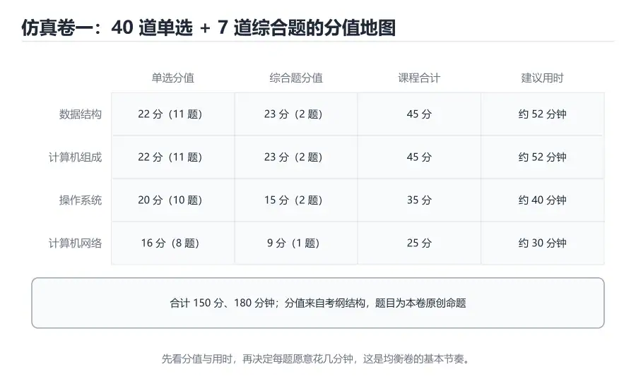

# 408 仿真模拟卷（一）：全卷分值地图与四科均衡题



> 内容更新时间：2026-10-06 · 学习阶段：冲刺 · 预计用时：50 分钟

本套卷是本仓库自主编写的仿真卷，题目、数据、干扰项全部为原创命题，不引用、不复制任何官方命题内容。使用时先按 180 分钟的整卷节奏做完，再回来看逐题考点定位。

## 本节知识框架

**课程定位**：所属分类 `408_mock`（考研 408 仿真试卷），课程主题 `408 仿真模拟卷（一）：全卷分值地图与四科均衡题`，学习阶段 冲刺，建议用时 50 分钟。

本课主线：把仿真卷一的卷面结构（四科分值、题量、建议用时）先摊开，再用 6 道题覆盖数据结构、计算机组成原理、操作系统、计算机网络四科的基本盘，练的是「先认清分值，再决定投入」。

打个比方：整张卷子是 150 分的一桌菜，数据结构与计算机组成原理各占 45 分是两道硬菜，操作系统 35 分是主食，计算机网络 25 分是汤。汤不好喝不代表可以不吃，但把半小时全花在捞汤里的葱花上就一定亏。仿真卷一故意把四科都压在最低档难度上，让你先把「每分值分钟」这笔账算顺。

**学完本课应当能够**
- 背出本仿真卷沿用的卷面结构：40 道单选每题 2 分共 80 分，7 道综合题共 70 分，四科分别是 45/45/35/25 分。
- 说明顺序表插入、补码表示范围、进程三态转换、以太网 MAC 地址长度这四道基础题的考点落点与出题变形方式。
- 用装载因子解释散列表冲突为什么随表变满而变多，并说清开放定址法删除元素为什么要打「删除标记」。
- 给 6 道题各自的考点定位与易错点列成一张表，并据此安排 180 分钟里前 90 分钟的单选节奏。

### 复习清单

- [ ] 合上正文，把四科单选分值与综合题分值各写一遍，再核对总分是否等于 150 分。
- [ ] 用 n=5 的具体表长手算顺序表插入的平均移动次数，与自己记忆里的 n/2 对照。
- [ ] 手推 8 位补码从 -127 到 127 的排列，指出 -128 为什么只有补码没有原码。
- [ ] 把 6 道题按「考点—分值—用时」三栏整理成一行速查表，写进冲刺笔记本。
- [ ] 复述一遍散列表链地址法与开放定址法在删除动作上的差别。

## 核心概念定义

| 术语 | 白话解释与操作性定义 | 常见边界与风险 |
| --- | --- | --- |
| 卷面结构 | 本仿真卷沿用的 40 道单选（每题 2 分）加 7 道综合题（共 70 分）的排版，总分 150 分、限时 180 分钟。 | 易错：把综合题当选修题，最后 20 分钟才动笔，步骤分几乎拿不到。 |
| 顺序表插入 | 把线性表放进一段连续内存里，插入时要先把插入点之后的元素整体后移一格。 | 易错：只记得「移动元素」不算平均次数；表满时还要额外扩容一次，代价另算。 |
| 补码 | 让减法变成加法的一套编码：最高位带权为负，其余位带权为正。 | 易错：8 位补码范围是 -128 到 127，正负不对称，-128 没有对应的 8 位原码。 |
| 进程三态 | 运行、就绪、阻塞三种状态的切换图，就绪是「等 CPU」，阻塞是「等事件」。 | 易错：时间片用完是回到就绪，不是阻塞；阻塞被唤醒后先进就绪队列。 |
| 散列冲突 | 两个关键字被同一个哈希函数算到同一个地址。 | 易错：冲突是必然事件，只能处理不能消灭；表越满冲突越多。 |
| 装载因子 | 记录个数与表长之比 α = 记录数 / 表长，取值一般控制在 1 以内。 | 易错：α 越大平均探测次数越大；对开放定址法 α→1 时探测次数发散。 |
| MAC 地址 | 数据链路层使用的 48 位物理地址，写成 12 个十六进制字符。 | 易错：与 32 位 IP 地址、16 位端口号混淆；帧里同时出现的其实是两种地址。 |
| 建议用时 | 按分值折算的时间预算，本卷把单选段定为平均每题约 2 分钟。 | 易错：不区分「会做的题」与「要跳过的题」，用同一预算硬扛。 |

## 原理与运行机制

### 机制一：先看分值地图，再决定每题几分钟

本仿真卷沿用的四科结构是：数据结构 45 分（单选 11 题 22 分 + 综合 2 题 23 分）、计算机组成原理 45 分（单选 11 题 22 分 + 综合 2 题 23 分）、操作系统 35 分（单选 10 题 20 分 + 综合 2 题 15 分）、计算机网络 25 分（单选 8 题 16 分 + 综合 1 题 9 分）。配图里的四行四列网格就是把这张表摊开：单选合计 40 题 80 分，综合合计 7 题 70 分。

把分值换算成时间就得到「分/分钟汇率」。整卷 150 分对 180 分钟，平均每分 1.2 分钟。数据结构与组成原理各 45 分，按同汇率各给约 52 分钟；操作系统 35 分给约 40 分钟；计算机网络 25 分给约 30 分钟。这个数字不是规定，而是一条参照线：一旦某道组成原理单选已经耗掉 6 分钟，就意味着你从后面所有组成原理题里借钱，必须当场决定是止损还是继续。

### 机制二：顺序表插入的平均移动次数怎么算

先算最小可数的例子。表长 n=5，元素 a1 到 a5。等概率在第 1 到第 6 个位置插入，插入位置 i 之后要移动的元素个数是 n-i+1（约定在最前面插入时 i=1，移动全部 5 个）：

- 在最前面插入：移动 5 个；
- 第 2 个位置：移动 4 个；
- 第 3 个位置：移动 3 个；
- 第 4 个位置：移动 2 个；
- 第 5 个位置：移动 1 个；
- 表尾插入：移动 0 个。

平均 =（5+4+3+2+1+0）/6 = 2.5 = n/2。一般式同理：n+1 个等可能位置，平均移动 (0+1+…+n)/(n+1) = n/2。所以顺序表插入是 O(n)，而链表改指针是 O(1)——但链表那 O(1) 之前要先花 O(n) 找到插入点，总账还是 O(n)。差别在于：顺序表的代价是整块内存搬运，链表的代价是指针跳转与额外的结点空间。

### 机制三：补码为什么把 -128 白捡给 8 位

n 位二进制共有 2^n 个码型。原码里 0 占了两个码型（+0 与 -0），于是 8 位原码带符号数的范围是 -(2^7-1) 到 +(2^7-1)，即 -127 到 127，还剩一个码型浪费。补码把 -0 的码型回收给最小负数，于是范围变成 -2^(n-1) 到 2^(n-1)-1，也就是 -128 到 127。检查方法很朴素：-128 的补码写法是 1000 0000，把它按「最高位带负权」解释就是 -128 + 0 = -128；而它的原码要写成 -(0111 1111 + 1) = -128，超出 7 位数值域，所以 8 位原码写不出来。

### 机制四：三态转换里最容易记反的两条边

进程时间片用完，是被调度器「请下来」的，它没有等待任何事件，所以进就绪队列，状态从运行变就绪。进程请求磁盘 I/O，CPU 对它没有意义了，于是阻塞；I/O 完成后由中断处理程序把它唤醒，唤醒动作只是把它挂进就绪队列，什么时候再上 CPU 由调度器决定。两条边记成一句话：等 CPU 是就绪，等事件是阻塞，被唤醒永远先回就绪。

### 机制五：装载因子与冲突次数的关系

链地址法（把算到同一地址的关键字串成一条单链表）在 α=3 时平均查找长度约为 1 + α/2，即找一次要看约 2.5 个结点；开放定址法的探测次数随 α 变大而急剧上升，因为一次冲突后要顺着地址序列继续试探，表越满空槽越少。删除操作上两者差别很大：链地址法直接从链表里摘掉结点即可；开放定址法不能把槽位置空，否则后来者顺着探测序列遇到空槽就误判「不存在」，必须打一个「已删除」标记，让探测继续走过去。

## 典型应用场景

**场景一：整卷开场的前 90 分钟。** 单选段 40 题 80 分，预算平均每题 2 分钟。仿真卷一这种「四科基础题混排」的用法就是练这条预算线：读题 30 秒内判断是「直接会」还是「要想」，前者立刻作答，后者先标记题号再继续，回头补。

**场景二：综合题的分值优先。** 数据结构与组成原理的综合题各 23 分，操作系统 15 分，计算机网络 9 分。步骤分按点给，写清思路即使最终数值错也能拿到大部分，所以「不会算」也要「先写式子」。

**场景三：错题复盘的分类。** 把本课 6 道题的考点定位整理成下表，复习时按列而不是按行看，能更快发现自己是哪一科的哪种能力在漏水。

| 本课题号 | 科目 | 考点 | 对应教材章节 | 常见失分方式 |
| --- | --- | --- | --- | --- |
| 第 1 题 | 全卷结构 | 单选与综合的分值构成 | 考试说明与大纲的试卷结构部分 | 记住总分却记错单选每题几分 |
| 第 2 题 | 数据结构 | 顺序表插入的平均移动次数 | 线性表一章的顺序表运算 | 把「移动元素」与「比较次数」混成一件事 |
| 第 3 题 | 计算机组成原理 | 补码的表示范围 | 数据表示与运算一章 | 把 -127 当最小值，丢掉 -128 |
| 第 4 题 | 操作系统 | 时间片到期的状态转换 | 进程管理一章的进程描述与控制 | 把「被抢占」写成「阻塞」 |
| 第 5 题 | 数据结构 | 散列冲突处理与装载因子 | 查找一章的散列表 | 认为装载因子越大越省空间就越划算 |
| 第 6 题 | 计算机网络 | 以太网 MAC 地址长度 | 数据链路层一章的点对点与局域网 | 与 IP 地址位数串题 |

## 代码/协议/SQL 示例

下面这段 C 程序做两件事：把顺序表插入的平均移动次数用枚举法算出来，同时打印 8 位补码能表示的最小值。它的价值在于让你「亲手看到」两个数字，而不是背两个结论。

```c
#include <stdio.h>

int main(void) {
    int n = 5;
    long moves = 0;
    /* 枚举 n+1 个插入位置：位置 i 之后要移动 n-i 个元素（i 从 0 到 n） */
    for (int i = 0; i <= n; i++) {
        moves += (long)(n - i);
    }
    double avg = (double)moves / (n + 1);
    printf("n=%d 平均移动 %.2f 个元素（理论值 n/2=%.2f）\n", n, avg, n / 2.0);

    signed char v = -128;          /* 8 位有符号类型的下界 */
    printf("signed char 范围 %d ~ %d\n", v, 127);
    printf("码型 0x%02X 按带负权最高位解释 = %d\n", (unsigned char)v, v);
    return 0;
}
```

运行结果应当是 `2.50` 与 `-128 ~ 127`。把 `n` 改成 9、99 再跑一次，平均值会跟着变成 4.5、49.5，这条「平均值恰好是 n/2」的规律就记住了。补码那段还顺手演示了一个易错点：`signed char v = -128` 在 C 里合法，因为实现把 8 位有符号类型的下限定成 -2^7，而不是 -(2^7-1)。

## 时间/空间复杂度或性能分析

**题面性能。** 单选 40 题 80 分按平均 2 分钟一题算需要 80 分钟；综合 7 题 70 分给 90 分钟，平均每分约 1.3 分钟，比单选题略宽，因为要写步骤。本卷 6 道题的自测建议用时：单选每题 2 分钟，多选 4 分钟，填空 2 分钟，合计 16 分钟。

**顺序表与链表的性能对照。** 顺序表访问第 i 个元素是 O(1)（基地址加偏移），插入删除平均 O(n)；链表插入删除本身 O(1)，但定位 O(n)，且每个结点要多存一个指针。408 的选择题常把「按位序访问」与「按值查找」两件事拆开问，先确认问的是哪一种，再谈复杂度。

**散列表性能。** 链地址法在 α 固定时期望比较次数约为 1 + α/2（查找成功），是 O(1 + α)；开放定址法在同等 α 下还要考虑聚集，探测序列会一段段粘连，实测平均探测次数比理论下界高。空间上链地址法多出 n 个指针，开放定址法多出「删除标记」这一位信息。

**换算单位也是性能。** 48 位 MAC 地址可容纳 2^48 个物理地址，约 2.8 × 10^14；32 位 IPv4 地址约 4.3 × 10^9。数量级差五个量级，这是「链路层地址不能拿来当全局寻址用」的根本原因，也是本题三个干扰项的共同破绽。

## 常见误区与易错点

- **误把「分值平均分配」当「时间平均分配」**：四科分值不等，综合题步骤分密度也不同。按题号顺序平均用时会把计算机网络 25 分拖成 45 分钟。
- **顺序表插入只答「要移动元素」**：题干若问平均移动多少个，答案量纲是「元素个数」，不是「时间复杂度阶」。选项里出现 log2 n 就是在等你把二分查找塞进来。
- **补码范围对称化**：写 -127 到 127 或 -128 到 128 都不对，正确是 -128 到 127，多出来的一个码型给了最小负数。
- **抢占写成阻塞**：时间片到期没有事件在等，只能是就绪。看到「阻塞」就去题干里找它在等什么，找不到就是错的。
- **认为装载因子越大越好**：省了空间，换来探测次数飙升，而且开放定址法在表满时根本无法继续插入。
- **地址位数串味**：MAC 48 位、IPv4 32 位、端口 16 位、ASN 32 位（早期 16 位），一次记错连锁影响后面好几道计算题。
- **多选题的漏选与多选同样扣分**：本卷按大纲口径处理，宁少选别乱选，不确定的选项先放掉。

## 与其他知识点的关系

本课的卷面结构是后面七套仿真卷的时间标尺：仿真卷二把数据结构综合题单独放大，仿真卷三、四、五分别把组成原理、操作系统、计算机网络的分值线压到极限，仿真卷六练跨科串联，仿真卷七专攻四类计算题，仿真卷八收口到 180 分钟节奏表。

知识点上下游：顺序表插入连着「时间复杂度摊销」与「内存对齐」；补码连着「溢出判断」与「ALU 的进位链」；进程三态连着「调度队列」与「中断处理」；散列表连着「查找一章的平均查找长度」与「堆/树的动态查找」；MAC 地址连着「ARP 的地址解析」与「以太网帧格式」，这条线会在仿真卷五里被完整走一遍。

四科之间最常见的串题点在「位数」：数据结构算的是比较次数，组成原理算的是地址位数与带宽，操作系统算的是页表项与缺页次数，计算机网络算的是主机数与窗口。列一张「单位表」贴在草稿纸角上，是本套卷最实用的收获。

## 自测题与参考答案

本套仿真卷共 6 道题，先按建议用时闭卷做完，再逐题核对选项原文与解析。

### 题目 1（单选题）

本仿真卷沿用 408 大纲的卷面结构：单项选择题 40 小题、综合应用题 7 大题。单项选择题部分合计多少分？

1. 80 分，综合应用题占余下 70 分
2. 100 分，综合应用题占余下 50 分
3. 60 分，综合应用题占余下 90 分
4. 90 分，综合应用题占余下 60 分

**参考答案**：80 分，综合应用题占余下 70 分

本题正确项是「80 分，综合应用题占余下 70 分」。40 道单选每题 2 分即 80 分，剩下的 7 道综合应用题承担 70 分，两部分相加才是满分 150 分。干扰项「100 分，综合应用题占余下 50 分」等于把单选写成了每题 2.5 分的规模，与本卷每题 2 分的约定不符。

### 题目 2（单选题）

在长度为 n 的有序顺序表中随机插入一个元素并保持有序，平均需要移动多少个元素？

1. 约 n 个元素，即整表后移
2. 约 n/2 个元素，即插入位置之后的一半
3. 约 1 个元素，只需改动一个指针
4. 约 log2 n 个元素，与查找次数同阶

**参考答案**：约 n/2 个元素，即插入位置之后的一半

本题正确项是「约 n/2 个元素，即插入位置之后的一半」。n+1 个等可能插入位置的移动数依次是 0 到 n，期望值恰好是 n/2，用 n=5 手算得到 2.5 个。干扰项「约 1 个元素，只需改动一个指针」说的是链表插入的动作，顺序表要搬的是连续内存里的元素，不是改一根指针。

### 题目 3（单选题）

机器字长为 8 位、用补码表示带符号整数时，能够表示的最小值是多少？

1. -127
2. -255
3. -128
4. -64

**参考答案**：-128

本题正确项是「-128」。8 位补码把原码里浪费掉的 -0 码型回收给最小负数，范围是 -2^7 到 2^7-1，也就是 -128 到 127，正负两端天然不对称。干扰项「-127」是 8 位原码与反码的下界，用在补码上就漏掉了 1000 0000 这个码型；按带负权最高位解释，它恰好等于 -128。

### 题目 4（单选题）

单核 CPU 上，一个正在运行的进程因时间片用完被调度器换下，它的状态怎样变化？

1. 运行态转为阻塞态，等待磁盘 I/O 完成
2. 运行态转为终止态，PCB 随即被回收
3. 运行态保持不变，只是优先级被下调
4. 运行态转为就绪态，重新排入就绪队列

**参考答案**：运行态转为就绪态，重新排入就绪队列

本题正确项是「运行态转为就绪态，重新排入就绪队列」。时间片到期属于被抢占，进程并没有在等待任何事件，只能回到就绪队列等下一次调度。干扰项「运行态转为阻塞态，等待磁盘 I/O 完成」把被抢占写成主动等待 I/O，可题干里找不到它在等谁的线索。

### 题目 5（多选题）

关于散列表处理冲突的方法与装载因子，下列说法中正确的有哪些？

1. 线性探测法属于开放定址法，冲突后按地址序列逐个试探
2. 链地址法把同义词结点挂在同一单链表下，删除操作较方便
3. 装载因子越大，散列表发生冲突的可能性就越小
4. 开放定址法删除元素时可直接把该槽位置空，不影响后续查找

**参考答案**：线性探测法属于开放定址法，冲突后按地址序列逐个试探；链地址法把同义词结点挂在同一单链表下，删除操作较方便

本题要同时选中「线性探测法属于开放定址法，冲突后按地址序列逐个试探」和「链地址法把同义词结点挂在同一单链表下，删除操作较方便」这两条。装载因子 α 是记录数除以表长，α 越大表越满，探测序列要走得越远，所以「装载因子越大，散列表发生冲突的可能性就越小」把关系说反了；开放定址法把槽位置空会截断别人的探测链，必须打删除标记，因此「开放定址法删除元素时可直接把该槽位置空，不影响后续查找」不成立。

### 题目 6（填空题）

填空：本仿真卷满分 150 分、限时 180 分钟，单项选择题 40 小题共 80 分，综合应用题 7 大题合计 ________ 分。

**参考答案**：70

本题正确项是「70」。满分 150 分扣掉单选的 80 分，余下 70 分落在 7 道综合应用题上，平均每题 10 分。本卷把 70 分拆成数据结构 23 分、计算机组成原理 23 分、操作系统 15 分、计算机网络 9 分，四段相加正好回到 70。写成 60 或 80 都会让两部分相加对不上满分，检查时把两部分加回 150 就能自证。

## 考点精讲

本套仿真卷题库共 6 道题，下面逐题复述题干原文、答案字母（A 是第 1 个选项）与判断依据，字段内容与题库完全一致。

### 考点 1（单选题 · 全卷结构）

- **题目**：本仿真卷沿用 408 大纲的卷面结构：单项选择题 40 小题、综合应用题 7 大题。单项选择题部分合计多少分？
- **答案**：A
- **正确项**：80 分，综合应用题占余下 70 分
- **判断依据**：本题正确项是「80 分，综合应用题占余下 70 分」。40 道单选每题 2 分即 80 分，剩下的 7 道综合应用题承担 70 分，两部分相加才是满分 150 分。干扰项「100 分，综合应用题占余下 50 分」等于把单选写成了每题 2.5 分的规模，与本卷每题 2 分的约定不符。

### 考点 2（单选题 · 数据结构）

- **题目**：在长度为 n 的有序顺序表中随机插入一个元素并保持有序，平均需要移动多少个元素？
- **答案**：B
- **正确项**：约 n/2 个元素，即插入位置之后的一半
- **判断依据**：本题正确项是「约 n/2 个元素，即插入位置之后的一半」。n+1 个等可能插入位置的移动数依次是 0 到 n，期望值恰好是 n/2，用 n=5 手算得到 2.5 个。干扰项「约 1 个元素，只需改动一个指针」说的是链表插入的动作，顺序表要搬的是连续内存里的元素，不是改一根指针。

### 考点 3（单选题 · 计算机组成原理）

- **题目**：机器字长为 8 位、用补码表示带符号整数时，能够表示的最小值是多少？
- **答案**：C
- **正确项**：-128
- **判断依据**：本题正确项是「-128」。8 位补码把原码里浪费掉的 -0 码型回收给最小负数，范围是 -2^7 到 2^7-1，也就是 -128 到 127，正负两端天然不对称。干扰项「-127」是 8 位原码与反码的下界，用在补码上就漏掉了 1000 0000 这个码型；按带负权最高位解释，它恰好等于 -128。

### 考点 4（单选题 · 操作系统）

- **题目**：单核 CPU 上，一个正在运行的进程因时间片用完被调度器换下，它的状态怎样变化？
- **答案**：D
- **正确项**：运行态转为就绪态，重新排入就绪队列
- **判断依据**：本题正确项是「运行态转为就绪态，重新排入就绪队列」。时间片到期属于被抢占，进程并没有在等待任何事件，只能回到就绪队列等下一次调度。干扰项「运行态转为阻塞态，等待磁盘 I/O 完成」把被抢占写成主动等待 I/O，可题干里找不到它在等谁的线索。

### 考点 5（多选题 · 数据结构）

- **题目**：关于散列表处理冲突的方法与装载因子，下列说法中正确的有哪些？
- **答案**：A、B
- **正确项**：线性探测法属于开放定址法，冲突后按地址序列逐个试探；链地址法把同义词结点挂在同一单链表下，删除操作较方便
- **判断依据**：本题要同时选中「线性探测法属于开放定址法，冲突后按地址序列逐个试探」和「链地址法把同义词结点挂在同一单链表下，删除操作较方便」这两条。装载因子 α 是记录数除以表长，α 越大表越满，探测序列要走得越远，所以「装载因子越大，散列表发生冲突的可能性就越小」把关系说反了；开放定址法把槽位置空会截断别人的探测链，必须打删除标记，因此「开放定址法删除元素时可直接把该槽位置空，不影响后续查找」不成立。

### 考点 6（填空题 · 计算机网络）

- **题目**：填空：本仿真卷满分 150 分、限时 180 分钟，单项选择题 40 小题共 80 分，综合应用题 7 大题合计 ________ 分。
- **答案**：70
- **正确项**：70
- **判断依据**：本题正确项是「70」。满分 150 分扣掉单选的 80 分，余下 70 分落在 7 道综合应用题上，平均每题 10 分。本卷把 70 分拆成数据结构 23 分、计算机组成原理 23 分、操作系统 15 分、计算机网络 9 分，四段相加正好回到 70。写成 60 或 80 都会让两部分相加对不上满分，检查时把两部分加回 150 就能自证。

## 术语速查

| 术语 | 一句话说明 |
| --- | --- |
| 卷面结构 | 40 道单选每题 2 分加 7 道综合共 70 分的排版。记忆抓手：80 + 70 = 150。 |
| 顺序表 | 用连续内存存的线性表，靠下标直接定位。记忆抓手：读得快，插得慢。 |
| 平均移动次数 | 所有等可能插入位置上移动元素数的期望。记忆抓手：n=5 时是 2.5。 |
| 补码 | 最高位带负权的编码，让减法用加法器完成。记忆抓手：-128 到 127 不对称。 |
| 就绪态 | 一切就绪，只等 CPU 分配时间片。记忆抓手：等 CPU。 |
| 阻塞态 | 在等某个事件完成，给它 CPU 也没用。记忆抓手：等事件。 |
| 散列冲突 | 不同关键字被映到同一个地址。记忆抓手：必然发生，只能处理。 |
| 装载因子 | 表里记录数除以表长。记忆抓手：越大越满越慢。 |
| 链地址法 | 同一地址挂一条单链表装同义词。记忆抓手：删除方便。 |
| 删除标记 | 开放定址法里代替置空的墓碑。记忆抓手：探测要继续走过去。 |
| MAC 地址 | 链路层的 48 位物理地址。记忆抓手：12 个十六进制字符。 |
| 分/分钟汇率 | 分值除以建议用时得到的时间预算。记忆抓手：约 1.2 分钟一分。 |

## 参考资料与复核

- 最后复核：2026-10-04
- 下次复核：2027-01-24
- 复核范围：卷面结构与分值换算、顺序表插入平均移动次数推导、8 位补码表示范围、进程三态转换边、散列冲突处理方法、以太网地址长度。
- 来源性质：教材与标准文档的公开页；本课核对关键词：80 分与 70 分、n/2、-128、就绪队列、装载因子、48 位。

| 参考资料 | 本课用途 |
| --- | --- |
| [严蔚敏《数据结构》课程讲义页（耶鲁 PineWiki 数据结构条目）](https://www.cs.yale.edu/homes/aspnes/pinewiki/DataStructures.html) | 顺序表与链表的插入代价、平均移动次数口径 |
| [MIT OpenCourseWare 6.004 Computation Structures](https://ocw.mit.edu/courses/6-004-computation-structures-spring-2017/) | 数据表示与补码范围、位宽与编号关系 |
| [Operating Systems: Three Easy Pieces 目录页](https://pages.cs.wisc.edu/~remzi/OSTEP/) | 进程状态机与调度队列的白话表述 |
| [IEEE 802.3 CSMA/CD 标准页](https://standards.ieee.org/ieee/802.3/7747/) | 以太网 MAC 地址长度与帧格式出处 |

## 内容元数据

> 内容更新时间：2026-10-06 · 学习阶段：冲刺 · 预计用时：50 分钟

- 内容版本：v2.0
- 分类归属：`408_mock`（考研 408 仿真试卷），本套为仿真卷一
- 命题性质：自主命题的仿真卷，题干、数据、干扰项均为原创，不来自任何官方命题内容
- 四科分值：数据结构 45 分 / 计算机组成原理 45 分 / 操作系统 35 分 / 计算机网络 25 分，合计 150 分
- 题量与题型：6 题（单选 4 题、多选 1 题、填空 1 题），单选答案下标覆盖 0/1/2/3 各一次
- 建议使用方式：限时 16 分钟完成自测，再按逐题考点定位表回读正文与考点精讲
- 相关主题：卷面结构、顺序表、补码、进程三态、散列表、装载因子、MAC 地址、时间预算
