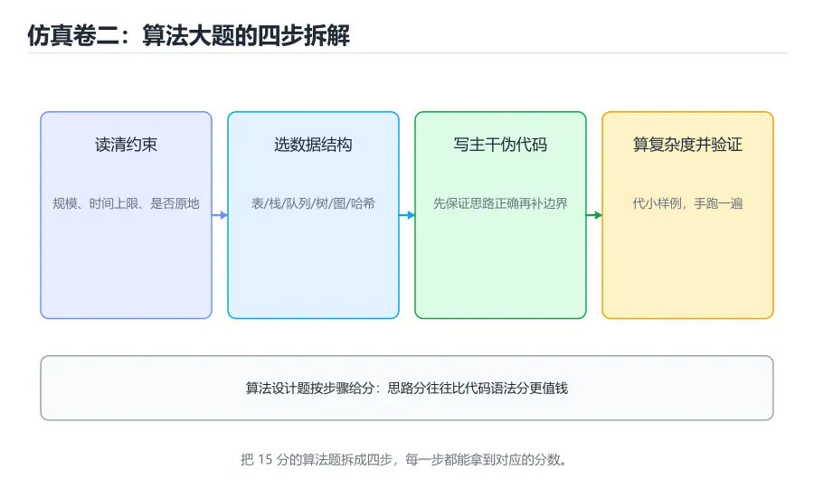

# 408 仿真模拟卷（二）：数据结构与算法设计题专攻



> 内容更新时间：2026-10-06 · 学习阶段：冲刺 · 预计用时：55 分钟

本套卷是自主编写的仿真卷，题干、数据与干扰项均为原创命题，不来自任何官方命题内容。仿真卷二把火力集中在数据结构 45 分上，尤其是那道最容易失分的算法设计题。

## 本节知识框架

**课程定位**：所属分类 `408_mock`（考研 408 仿真试卷），课程主题 `408 仿真模拟卷（二）：数据结构与算法设计题专攻`，学习阶段 冲刺，建议用时 55 分钟。

本课主线：按配图的四步拆解（读清约束、选数据结构、写主干伪代码、算复杂度并验证）重做一遍算法大题，再用 6 道题把归并排序的层代价、完全二叉树深度、组相联地址划分、停等协议利用率串成一条线。

算法设计题像做菜：约束是「几人吃、几点开饭、能不能用烤箱」，结构选择是「用炒锅还是蒸锅」，伪代码是「先下油再下菜」，复杂度验证是「出锅前尝一口」。跳过第一步直接写代码，是 15 分题只拿 4 分的主要原因。

**学完本课应当能够**
- 用四步拆解把一道 15 分的算法设计题改写成能拿步骤分的作答骨架。
- 说明归并排序为什么是「每层 O(n)、共 O(n log n)」，并把它与快排最坏情况对比。
- 手算含 n 个结点完全二叉树的深度公式，并用程序验证 n=1 到 8 的全部取值。
- 按主存容量、块大小、路数三步算出组相联映射的组号位数。
- 用发送时延与往返传播时延估出停等协议的信道利用率。

### 复习清单

- [ ] 默写算法题四步拆解，并给自己上次那道错题重新按四步打一遍分。
- [ ] 手算 n=6 的完全二叉树深度，再与 ⌊log2 n⌋+1 对照，记下哪一层开始放不下。
- [ ] 用本课的 1 MB 主存、32 B 块、8 路组相联例子，独立推一遍组号 3 位。
- [ ] 复述归并、快排、堆排序、选择排序各自的稳定性与空间代价。
- [ ] 把停等协议利用率的分子分母各用一句话讲清是什么时间。

## 核心概念定义

| 术语 | 白话解释与操作性定义 | 常见边界与风险 |
| --- | --- | --- |
| 算法设计题 | 要求写出求解过程并分析复杂度的大题，本卷按 15 分设置，思路分与代码分分开给。 | 易错：只写结论不写过程，或死抠语法细节导致没时间写思路。 |
| 归并排序 | 先把序列对半分、各自排好，再线性合并；递归树共 log n 层，每层合并总量约 n。 | 易错：忽略辅助数组空间 O(n)，也易把「每层 O(n)」记成「每层 O(log n)」。 |
| 完全二叉树 | 除最后一层外每层排满，最后一层从左往右连续排列的二叉树。 | 易错：深度是 ⌊log2 n⌋+1，别漏掉根自己那一层。 |
| 组相联映射 | Cache 分成若干组，每组放 k 块；主存块按「块号 mod 组数」落进某一组，组内可任意放。 | 易错：取模的对象是组数而不是块数，路数会吃掉 log2 k 位。 |
| 停等协议 | 发一帧就必须等一个确认，链路在这段时间里空转。 | 易错：分母要算往返两次传播时延，不是单向。 |
| 信道利用率 | 有效发送时间占整个周期时间的比例。 | 易错：忽略确认帧的发送时间会带来偏差，题干会说明是否忽略。 |
| 稳定性 | 相等关键字的相对次序在排序后是否保持不变。 | 易错：把「平均性能好」与「稳定」混成一件事。 |
| 装载因子与路数 | 组内允许放几块叫路数；组内越满，替换越频繁。 | 易错：路数增加降低冲突率，但比较器开销上升。 |

## 原理与运行机制

### 机制一：四步拆解为什么能保住步骤分

仿真卷的算法大题按四步给分：说清约束（约 2 分）、选定结构并说明理由（约 4 分）、写出主干伪代码（约 6 分）、给出复杂度并代小样例验证（约 3 分）。判卷看的是链条是否完整，因此即便最后一行代码写不出来，前三步的文字与伪代码也是能落袋的分。反过来，直接写一段无注释代码，判卷找不到得分点，就只好看运气。

### 机制二：归并排序的每层代价

把 n 个元素对半分，递归树有 log2 n 层。第 0 层要合并 1 对（共 n 个元素参与），第 1 层要合并 2 对（每对约 n/2 个，合计仍是 n），依此每层合并的总元素数都是 n，所以总代价是 n·log2 n。用 n=8 数一遍：8 → 4+4 → 2+2+2+2 → 1×8，合并发生在层间，参与的元素总数每层都是 8，共 3 层，24 次元素搬运。这个数一遍的习惯同样适用于快排：快排每层的分区总扫描量也是 n，只是层数在「划分不均」时会退化到 n 层，于是最坏 O(n^2)。

### 机制三：完全二叉树的深度公式怎么落地

深度指从根到最深叶子的结点层数。第 d 层最多能放 2^(d-1) 个结点，前 d 层最多放 2^d - 1 个。给定 n，最深的 d 满足 2^(d-1) ≤ n ≤ 2^d - 1，两端取对数就得到 d = ⌊log2 n⌋ + 1。n=6 时 ⌊log2 6⌋+1 = 2+1 = 3 层，前两层放满 3 个（根 1 个 + 第二层 2 个），第三层放剩下 3 个，从左往右连续排布 ✓。n=8 时 ⌊log2 8⌋+1 = 4 层，最后一层只有 5 个结点。

### 机制四：组相联地址的三段划分

地址划分永远是「从后往前切」：先按块大小切块内地址，再按组数切组号，剩下的都归标记。本卷的例子是 1 MB 主存按字节编址，块大小 32 B，Cache 共 64 块、8 路组相联。

1. 主存地址位数：1 MB = 2^20 B，按字节编址需要 20 位。
2. 块内地址：32 B = 2^5，占 5 位。
3. 组数：64 块 ÷ 8 路 = 8 组 = 2^3，组号占 3 位。
4. 标记：20 - 5 - 3 = 12 位。

如果题目直接问组号，答案是 3 位；把 64 当成组数去取模就会算成 6 位，这正是本课干扰项的来源。

### 机制五：停等协议的利用率公式

一个完整周期 = 发送时延 + 帧的传播时延 + 确认帧的传播时延（本题忽略确认帧长度与处理时间）。数据帧 512 bit、带宽 1 Mbps，发送时延 0.512 ms；单向传播 20 ms，往返 40 ms，周期 40.512 ms。利用率 = 0.512 / 40.512 ≈ 1.26%。这个数量级本身也是知识点：地面链路往返几十毫秒时，停等方式几乎浪费带宽，这就是滑动窗口存在的理由。把窗口写成 W，周期里的有效发送时间就变成 W 帧，利用率大致按 W 倍改善（还要扣掉仍存在的传播开销）。

## 典型应用场景

四步拆解适合一切「手写算法」型大题：链表原地调整、树的层序变形、图的遍历改写、数组的分区类问题。本课 6 道题的考点定位如下。

| 本卷题位 | 科目 | 考点 | 对应教材章节 | 建议用时 |
| --- | --- | --- | --- | --- |
| 第 1 题 | 数据结构 | 归并排序的层代价与总代价 | 内部排序一章的归并排序 | 2 分钟 |
| 第 2 题 | 数据结构 | 完全二叉树的深度公式 | 树与二叉树一章的存储结构 | 2 分钟 |
| 第 3 题 | 计算机组成原理 | 组相联映射的地址位数划分 | 存储系统一章的 Cache 映射 | 3 分钟 |
| 第 4 题 | 计算机网络 | 停等协议的信道利用率 | 数据链路层的流量控制与可靠传输 | 3 分钟 |
| 第 5 题 | 数据结构 | 算法设计题的解题流程排序 | 算法与数据结构定义一章的算法评价 | 2 分钟 |
| 第 6 题 | 数据结构 | 内部排序算法的稳定性与空间 | 内部排序一章的算法比较 | 4 分钟 |

数据结构 45 分里，单选 11 题 22 分平均每题只有 2 分钟，综合题 23 分建议给 25 到 30 分钟。本课把 DS 题密度提高到四道，就是在练「读约束—选结构」这一层的条件反射。

## 代码/协议/SQL 示例

下面这段 C 程序用两种方式算同一件事：从 1 到 8 逐个打印完全二叉树的深度，一种按「逐层填满」模拟，一种按位移等价于 ⌊log2 n⌋+1。两者结果应当完全一致。

```c
#include <stdio.h>

int main(void) {
    for (int n = 1; n <= 8; n++) {
        int depth = 0, cap = 1;
        while (cap <= n) {          /* 第 depth 层最多 2^depth 个起点 */
            depth++;
            cap <<= 1;
        }
        int layers = 0, m = n;
        while (m > 0) {             /* 右移次数就是 floor(log2 n)+1 */
            layers++;
            m >>= 1;
        }
        printf("n=%d 深度 %d / %d %s\n", n, depth, layers,
               depth == layers ? "一致" : "不一致");
    }
    return 0;
}
```

输出应是 `n=1 深度 1 / 1 一致` 直到 `n=8 深度 4 / 4 一致`。把这道题的验证做成 10 行的程序，比在草稿纸上反复推公式更可靠：公式记错时，程序会立刻给你反例（例如漏加 1 时 n=1 就会算成 0 层）。

## 时间/空间复杂度或性能分析

**排序算法对照（本卷第 6 题的判卷依据）**

| 算法 | 平均时间 | 最坏时间 | 附加空间 | 稳定性 |
| --- | --- | --- | --- | --- |
| 直接插入 | O(n^2) | O(n^2) | O(1) | 稳定 |
| 简单选择 | O(n^2) | O(n^2) | O(1) | 不稳定 |
| 冒泡 | O(n^2) | O(n^2) | O(1) | 稳定 |
| 归并 | O(n log n) | O(n log n) | O(n) | 稳定 |
| 快速 | O(n log n) | O(n^2) | O(log n) | 不稳定 |
| 堆排序 | O(n log n) | O(n log n) | O(1) | 不稳定 |

堆排序建堆是 O(n) 而不是 O(n log n)（自底向上按结点高度求和收敛到线性），且它天然适合「只求前 k 大」这一类问题——这是本卷干扰项设计的落点。

**用时性能。** 本课 6 题建议 16 分钟：单选 4 题各 2 到 3 分钟，排序题 2 分钟，多选题 4 分钟。综合大题按四步拆解写满 15 分的作答骨架，实测耗时约 18 分钟，比整题重写得快，因为省掉了反复调试语法的时间。

**组相联的性能含义。** 路数从 1 增到 8，冲突失效率下降，但一次查找要同时比较 8 个标记，比较器数量与功耗上升；这也解释了卷面上常见的「组相联是直接映射与全相联的折中」这一问法。

## 常见误区与易错点

- **算法题只写代码不写思路**：判卷按得分点给分，缺少「约束 + 结构选择理由」会直接丢掉前面的步骤分。
- **边界情况不写**：空表、单元素、全相等关键字这三种情况各写一行说明，就是白捡的分。
- **把归并的每层代价记成 O(log n)**：参与合并的元素总数每层都是 n，层数才是 log n。
- **完全二叉树深度少算一层**：⌊log2 n⌋+1 里的 +1 是根那一层，n 恰为 2 的幂时最容易漏。
- **组相联拿块数取模**：应拿组数取模；先算组数（块数 ÷ 路数），再取对数。
- **停等协议只算单向传播**：确认帧也要走回来，分母必须是往返两趟。
- **多选题把「平均性能好」当成「稳定」**：稳定性只关心相等关键字的相对次序。
- **看到 top-k 就建满排序**：用容量为 k 的堆或快速选择即可，排序整个数组是浪费。

## 与其他知识点的关系

本课的归并代价分析与仿真卷七的流水线时间公式共用一条思维方式：把总量拆成「每层代价 × 层数」。完全二叉树深度连着散列表的探测层次与磁盘 B+ 树的层数；组相联的地址划分是仿真卷三 Cache 大题的前置；停等协议利用率连着仿真卷五的滑动窗口与 TCP 超时；排序稳定性表在仿真卷八的复盘环节用于统计「哪一类失分最多」。

教材之间的衔接也要留意：数据结构部分对应严蔚敏教材的第 2 到第 7 章（线性表、栈队列数组、串与树、图、查找、内部排序），组成原理的地址划分对应存储系统一章，网络利用率对应数据链路层一章。三条线在同一次限时训练里出现，正是 408 综合卷的日常形态。

## 术语速查

| 术语 | 一句话说明 |
| --- | --- |
| 四步拆解 | 读约束、选结构、写主干、算复杂度验证。记忆抓手：思路分先拿到。 |
| 合并总代价 | 归并每一层参与合并的元素总数。记忆抓手：每层都是 n。 |
| 完全二叉树深度 | 根到最深叶子的层数，⌊log2 n⌋+1。记忆抓手：n=8 得 4 层。 |
| 组号位数 | log2(块数 ÷ 路数)。记忆抓手：先算组数再取模。 |
| 块内地址 | log2(块大小)。记忆抓手：32 B 是 5 位。 |
| 标记位数 | 总位数减块内地址减组号。记忆抓手：从后往前切。 |
| 发送时延 | 帧长除以带宽。记忆抓手：512 bit / 1 Mbps = 0.512 ms。 |
| 往返传播时延 | 单向传播时延乘 2。记忆抓手：20 ms 变 40 ms。 |
| 信道利用率 | 发送时延除以整个周期。记忆抓手：停等约 1.3%。 |
| 稳定性 | 相等关键字的相对次序是否不变。记忆抓手：归并稳定、快排不稳定。 |
| 建堆代价 | 自底向上建堆是线性时间。记忆抓手：O(n) 不是 O(n log n)。 |

## 参考资料与复核

- 最后复核：2026-10-04
- 下次复核：2027-01-24
- 复核范围：归并排序层代价推导、完全二叉树深度公式、组相联地址位数计算、停等协议利用率数值、排序算法性质表。
- 来源性质：公开教材与课程页面；本课核对关键词：每层 O(n)、⌊log2 n⌋+1、64 块 8 路、0.512 ms、稳定性。

| 参考资料 | 本课用途 |
| --- | --- |
| [Algorithms by Jeff Erickson（伊利诺伊大学讲义书站）](https://jeffe.cs.illinois.edu/teaching/algorithms/) | 归并排序与递归树代价分析、渐进复杂度口径 |
| [耶鲁 PineWiki 数据结构条目页](https://www.cs.yale.edu/homes/aspnes/pinewiki/DataStructures.html) | 树的层数与线性表性质对照 |
| [MIT OpenCourseWare 6.004 Computation Structures](https://ocw.mit.edu/courses/6-004-computation-structures-spring-2017/) | 存储层次与地址划分的讲解顺序 |
| [Linux man page: memcpy(3)](https://man7.org/linux/man-pages/man3/memcpy.3.html) | 顺序表后移元素时的内存搬运动作参考 |

## 内容元数据

> 内容更新时间：2026-10-06 · 学习阶段：冲刺 · 预计用时：55 分钟

- 内容版本：v2.0
- 分类归属：`408_mock`（考研 408 仿真试卷），本套为仿真卷二
- 命题性质：自主命题的仿真卷，题干、数据与干扰项均为原创，不引用官方命题内容
- 科目权重：数据结构 4 题、计算机组成原理 1 题、计算机网络 1 题
- 题量与题型：6 题（单选 4 题、排序 1 题、多选 1 题），单选答案下标覆盖 0/1/2/3 各一次
- 建议使用方式：16 分钟闭卷完成自测，再把算法大题按四步拆解手写一遍
- 相关主题：归并排序、完全二叉树、组相联映射、停等协议、排序稳定性、步骤分

## 自测题与参考答案

本套仿真卷共 6 道题，先按建议用时闭卷做完，再逐题核对选项原文与解析。

### 题目 1（单选题）

对 n 个元素做归并排序，递归树每一层的合并总代价与整棵树的总代价各是什么量级？

1. 每层约 O(n)，总计 O(n log n)
2. 每层约 O(log n)，总计 O(n log n)
3. 每层约 O(n)，总计 O(n^2)
4. 每层约 O(n^2)，总计 O(n log n)

**参考答案**：每层约 O(n)，总计 O(n log n)

本题正确项是「每层约 O(n)，总计 O(n log n)」。n=8 时逐层数一遍：8 个元素合成两半、两半再各合成四对四分之一，每层参与合并的元素总数都是 8，层数是 3，于是 24 次搬运，量级 n·log2 n。干扰项「每层约 O(log n)，总计 O(n log n)」把层数和每层代价两个量写反了，层数才是 log2 n。

### 题目 2（单选题）

含有 n 个结点、根结点位于第一层的完全二叉树，其深度是多少？

1. log2 n
2. ⌊log2 n⌋ + 1
3. ⌈log2 n⌉ - 1
4. n/2 + 1

**参考答案**：⌊log2 n⌋ + 1

本题正确项是「⌊log2 n⌋ + 1」。第 d 层最多放 2^(d-1) 个结点，前 d 层最多放 2^d - 1 个，令 2^(d-1) ≤ n ≤ 2^d - 1 取对数即得该式；n=8 代入得 4 层，与逐层摆放的结果一致。干扰项「log2 n」丢掉了根自己那一层，恰好在 n 是 2 的幂时少算 1。

### 题目 3（单选题）

主存 1 MB 按字节编址，Cache 共 64 块、块大小 32 B、采用 8 路组相联，组号字段需要多少位？

1. 5 位
2. 6 位
3. 3 位
4. 12 位

**参考答案**：3 位

本题正确项是「3 位」。地址从后往前切：1 MB 是 2^20 B 共 20 位，块内地址由 32 B 决定占 5 位，组数是 64 块除以 8 路等于 8 组即 2^3，所以组号占 3 位，剩下 12 位是标记。干扰项「6 位」是直接把 64 块当组数取对数的结果，忘了先除以路数。

### 题目 4（单选题）

停等协议下链路带宽 1 Mbps、单向传播时延 20 ms、数据帧长 512 bit，忽略确认帧与处理时间，信道利用率约为多少？

1. 约 50%
2. 约 25%
3. 约 13%
4. 约 1.3%

**参考答案**：约 1.3%

本题正确项是「约 1.3%」。发送时延是 512 bit 除以 1 Mbps 得 0.512 ms，一个周期还要加上数据帧与确认帧各走一趟的 40 ms 传播时延，合计 40.512 ms，利用率 0.512 除以 40.512 约等于 1.26%。干扰项「约 13%」相当于把往返传播时延只算了一趟，分母从 40.512 ms 缩到约 20.5 ms。

### 题目 5（排序题）

按本仿真卷给的算法大题四步拆解，把下面四个动作按做题先后排成一条流水：

1. 先算复杂度并用小样例手工跑一遍验证
2. 读清题目约束：数据规模、时间上限、是否允许原地修改
3. 在表、栈、队列、树、图、散列之间选定结构并说明理由
4. 写出主干伪代码，先保证思路正确再补边界情况

**参考答案**：读清题目约束：数据规模、时间上限、是否允许原地修改 → 在表、栈、队列、树、图、散列之间选定结构并说明理由 → 写出主干伪代码，先保证思路正确再补边界情况 → 先算复杂度并用小样例手工跑一遍验证

本题顺序是「读清题目约束：数据规模、时间上限、是否允许原地修改」→「在表、栈、队列、树、图、散列之间选定结构并说明理由」→「写出主干伪代码，先保证思路正确再补边界情况」→「先算复杂度并用小样例手工跑一遍验证」。约束决定结构，结构决定代码骨架，复杂度与样例验证放在最后收尾；判卷按这四段给分，顺序颠倒时思路分往往已经丢了。

### 题目 6（多选题）

关于内部排序算法的时间、空间与稳定性，下列说法正确的有哪些？

1. 归并排序稳定，但需要与原数组等长的辅助空间
2. 快速排序平均 O(n log n)，最坏情况可退化到 O(n^2)
3. 简单选择排序是稳定排序，交换次数恒为 n
4. 堆排序建堆需要 O(n log n) 时间，因此不适合求前 k 大

**参考答案**：归并排序稳定，但需要与原数组等长的辅助空间；快速排序平均 O(n log n)，最坏情况可退化到 O(n^2)

本题要同时选中「归并排序稳定，但需要与原数组等长的辅助空间」和「快速排序平均 O(n log n)，最坏情况可退化到 O(n^2)」这两条。简单选择排序每轮把最小元素换到前面，相等关键字的相对次序会被打乱，交换次数也不恒为 n，故「简单选择排序是稳定排序，交换次数恒为 n」不成立；自底向上建堆的总代价是 O(n)，并且用容量为 k 的堆恰好适合求前 k 大，「堆排序建堆需要 O(n log n) 时间，因此不适合求前 k 大」两处都错。

## 考点精讲

本套仿真卷题库共 6 道题，下面逐题复述题干原文、答案字母（A 是第 1 个选项）与判断依据，字段内容与题库完全一致。

### 考点 1（单选题 · 数据结构）

- **题目**：对 n 个元素做归并排序，递归树每一层的合并总代价与整棵树的总代价各是什么量级？
- **答案**：A
- **正确项**：每层约 O(n)，总计 O(n log n)
- **判断依据**：本题正确项是「每层约 O(n)，总计 O(n log n)」。n=8 时逐层数一遍：8 个元素合成两半、两半再各合成四对四分之一，每层参与合并的元素总数都是 8，层数是 3，于是 24 次搬运，量级 n·log2 n。干扰项「每层约 O(log n)，总计 O(n log n)」把层数和每层代价两个量写反了，层数才是 log2 n。

### 考点 2（单选题 · 数据结构）

- **题目**：含有 n 个结点、根结点位于第一层的完全二叉树，其深度是多少？
- **答案**：B
- **正确项**：⌊log2 n⌋ + 1
- **判断依据**：本题正确项是「⌊log2 n⌋ + 1」。第 d 层最多放 2^(d-1) 个结点，前 d 层最多放 2^d - 1 个，令 2^(d-1) ≤ n ≤ 2^d - 1 取对数即得该式；n=8 代入得 4 层，与逐层摆放的结果一致。干扰项「log2 n」丢掉了根自己那一层，恰好在 n 是 2 的幂时少算 1。

### 考点 3（单选题 · 计算机组成原理）

- **题目**：主存 1 MB 按字节编址，Cache 共 64 块、块大小 32 B、采用 8 路组相联，组号字段需要多少位？
- **答案**：C
- **正确项**：3 位
- **判断依据**：本题正确项是「3 位」。地址从后往前切：1 MB 是 2^20 B 共 20 位，块内地址由 32 B 决定占 5 位，组数是 64 块除以 8 路等于 8 组即 2^3，所以组号占 3 位，剩下 12 位是标记。干扰项「6 位」是直接把 64 块当组数取对数的结果，忘了先除以路数。

### 考点 4（单选题 · 计算机网络）

- **题目**：停等协议下链路带宽 1 Mbps、单向传播时延 20 ms、数据帧长 512 bit，忽略确认帧与处理时间，信道利用率约为多少？
- **答案**：D
- **正确项**：约 1.3%
- **判断依据**：本题正确项是「约 1.3%」。发送时延是 512 bit 除以 1 Mbps 得 0.512 ms，一个周期还要加上数据帧与确认帧各走一趟的 40 ms 传播时延，合计 40.512 ms，利用率 0.512 除以 40.512 约等于 1.26%。干扰项「约 13%」相当于把往返传播时延只算了一趟，分母从 40.512 ms 缩到约 20.5 ms。

### 考点 5（排序题 · 数据结构）

- **题目**：按本仿真卷给的算法大题四步拆解，把下面四个动作按做题先后排成一条流水：
- **答案**：B → C → D → A
- **正确项**：读清题目约束：数据规模、时间上限、是否允许原地修改 → 在表、栈、队列、树、图、散列之间选定结构并说明理由 → 写出主干伪代码，先保证思路正确再补边界情况 → 先算复杂度并用小样例手工跑一遍验证
- **判断依据**：本题顺序是「读清题目约束：数据规模、时间上限、是否允许原地修改」→「在表、栈、队列、树、图、散列之间选定结构并说明理由」→「写出主干伪代码，先保证思路正确再补边界情况」→「先算复杂度并用小样例手工跑一遍验证」。约束决定结构，结构决定代码骨架，复杂度与样例验证放在最后收尾；判卷按这四段给分，顺序颠倒时思路分往往已经丢了。

### 考点 6（多选题 · 数据结构）

- **题目**：关于内部排序算法的时间、空间与稳定性，下列说法正确的有哪些？
- **答案**：A、B
- **正确项**：归并排序稳定，但需要与原数组等长的辅助空间；快速排序平均 O(n log n)，最坏情况可退化到 O(n^2)
- **判断依据**：本题要同时选中「归并排序稳定，但需要与原数组等长的辅助空间」和「快速排序平均 O(n log n)，最坏情况可退化到 O(n^2)」这两条。简单选择排序每轮把最小元素换到前面，相等关键字的相对次序会被打乱，交换次数也不恒为 n，故「简单选择排序是稳定排序，交换次数恒为 n」不成立；自底向上建堆的总代价是 O(n)，并且用容量为 k 的堆恰好适合求前 k 大，「堆排序建堆需要 O(n log n) 时间，因此不适合求前 k 大」两处都错。
