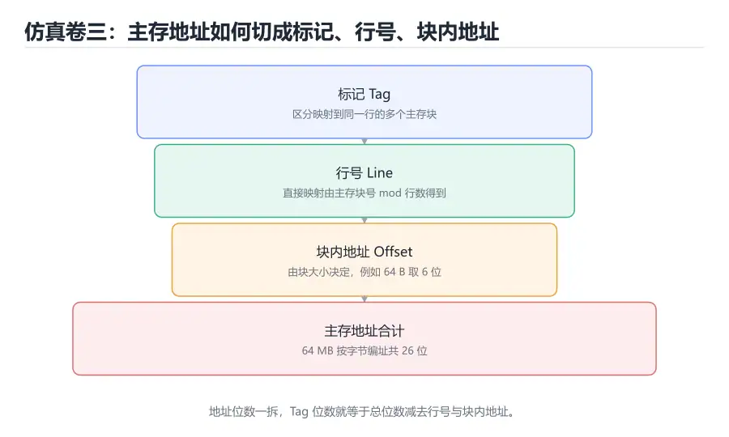

# 408 仿真模拟卷（三）：存储层次与 Cache 地址划分



> 内容更新时间：2026-10-06 · 学习阶段：冲刺 · 预计用时：55 分钟

本套卷为自主编写的仿真卷，所有数值、代码与干扰项均为原创命题，与任何官方命题内容无关。仿真卷三主攻计算机组成原理的存储系统，兼顾数据结构的折半查找。

## 本节知识框架

**课程定位**：所属分类 `408_mock`（考研 408 仿真试卷），课程主题 `408 仿真模拟卷（三）：存储层次与 Cache 地址划分`，学习阶段 冲刺，建议用时 55 分钟。

本课主线：把一条 26 位主存地址切成标记、行号、块内地址三段，再用命中率反推平均访问时间，最后用一段 C 代码验证「切段」这件事在程序里是怎么发生的。

打个比方：主存地址像小区门牌号。块内地址是「门牌里的房间号」，由一栋楼（块）有多大决定；行号是「第几栋楼」，由 Cache 里有几行决定；标记是「小区名」，用来区分所有被映射到同一栋楼的不同小区。三段位数相加必须等于地址总位数，这条恒等式能检验你算对没有。

**学完本课应当能够**
- 用 2^n 的口诀把容量直接翻译成地址位数，说明 64 MB 按字节编址为什么是 26 位。
- 对给定的块大小与行数，三步切出块内地址、行号、标记的位数并验证总和。
- 区分「同时访问」与「先查 Cache 再访主存」两种口径下的平均访问时间公式。
- 说清写回法脏位、直接映射不需要替换算法这两个硬件事实。
- 手算 25 个元素折半查找的最大比较次数并与判定树层数对应。

### 复习清单

- [ ] 不看正文把 64 MB、64 B、1024 行这组数据重算一遍，写出三段位数并检查总和是 26。
- [ ] 用 h=0.9、tc=10 ns、tm=100 ns 分别按两种口径算一次平均访问时间，记下差值来源。
- [ ] 画出 25 个元素的折半查找判定树层数，说明最坏比较次数为何等于树高。
- [ ] 复述写回法与全写法在「替换时是否需要写主存」上的区别。
- [ ] 把本课 C 代码的三个掩码（0x3F、0x3FF、右移 16）与三段位数一一对应起来。

## 核心概念定义

| 术语 | 白话解释与操作性定义 | 常见边界与风险 |
| --- | --- | --- |
| 主存地址位数 | 按字节编址时，log2(主存容量) 就是地址位数；64 MB 得 26 位。 | 易错：容量单位换成 KB/MB 时漏掉 2^10 的换算，或把「按字编址」当「按字节编址」。 |
| 块内地址 | 由块大小决定的低位段，块大小 64 B 取 6 位。 | 易错：块大小改变时这一段跟着变，标记位数是被减出来的，不是背出来的。 |
| 行号 | 直接映射里主存块号 mod Cache 行数所得到的位置编号。 | 易错：组相联时要先算组数再取模，直接用块数会多算 log2(路数) 位。 |
| 标记 Tag | 地址里除去行号与块内地址剩下的最高位段。 | 易错：同一行里多个主存块靠标记区分，标记相同且有效位为 1 才算命中。 |
| 命中率 h | 访问在 Cache 中成功的比例。 | 易错：命中率与缺失率相加是 1，套公式时不要把百分数写成 90 而不是 0.9。 |
| 平均访问时间 | 串行口径 ta = h·tc + (1-h)·(tc+tm)。 | 易错：同时访问口径是 h·tc + (1-h)·tm，题干会说明是哪种。 |
| 写回法 | 只写 Cache，被改过的块在替换时才写回主存，需要脏位。 | 易错：读操作也可能因为替换旧块而触发写主存。 |
| 判定树 | 折半查找的所有比较路径组成的二叉树，层数即最坏比较次数。 | 易错：n 个结点的最坏比较次数是 ⌊log2 n⌋+1。 |

## 原理与运行机制

### 机制一：地址切段的通用流程

本卷用的例子是主存 64 MB、块大小 64 B、Cache 1024 行的直接映射。切段顺序永远是「从低位往高位」：

1. 地址总位数：64 MB = 2^26 B，按字节编址需要 26 位。
2. 块内地址：64 B = 2^6，占最低 6 位。
3. 行号：1024 = 2^10 行，占接着的 10 位。
4. 标记：26 - 6 - 10 = 10 位，占最高段。

主存共有 2^26 / 2^6 = 2^20 个块，它们按「块号 mod 1024」落进 1024 行，因此每行平均住 2^10 个主存块，靠 10 位标记把它们区分开。这条互检关系（同址映射的块数 = 2^标记位数）是选择题最爱的验证点。

### 机制二：平均访问时间的两种口径

串行（先查 Cache，命中就返回；未命中再花 tm 访问主存）：ta = h·tc + (1-h)·(tc+tm)。代入 h=0.9、tc=10 ns、tm=100 ns 得 0.9×10 + 0.1×110 = 20 ns。同时（Cache 与主存一起启动，命中则打断主存访问）：ta = h·tc + (1-h)·tm = 9 + 10 = 19 ns。两个数只差 1 ns，但选择题会同时放进选项，因此做题时要先问一句「未命中时那 10 ns 的 Cache 判定时间算不算」。

再补一条常考的变形：题目给的是「Cache 周期 1 个时钟周期、主存需 10 个时钟周期」，则同样的公式直接用时钟周期做单位；如果给的时间单位混了 ns 与 μs，必须先统一量纲。

### 机制三：用位运算复现硬件切段

硬件靠连线切段，程序靠掩码与移位。`addr & 0x3F` 取低 6 位（块内地址），`(addr >> 6) & 0x3FF` 取中间 10 位（行号），`addr >> 16` 取剩下的高位（标记）。三者能反向拼回原地址：tag×1024 + line 得到主存块号，块号×64 + off 得到字节地址。任何一次手算都可以用这条回拼式自检。

### 机制四：折半查找的比较次数上限

25 个元素的有序表做折半查找，第一次比较把范围缩到约一半。判定树的层数等于最坏比较次数：⌊log2 25⌋+1 = 4+1 = 5 层。手推一遍：25 → 12 → 6 → 3 → 1，共比较 5 次。若表长是 31，则 ⌊log2 31⌋+1 = 5 次；若表长是 32，就要 6 次。这类题的陷阱在「±1」，用 2^k-1 的边界值代一遍最稳。

## 典型应用场景

真实考卷把存储系统放在组成原理 45 分的中段：单选常考位数与公式，综合题常给「主存容量 + 块大小 + 映射方式 + 命中率」四件套，让你算 Tag 位数与平均访问时间，再问一句替换算法。本课 6 道题的考点定位：

| 本卷题位 | 科目 | 考点 | 对应教材章节 | 常见失分方式 |
| --- | --- | --- | --- | --- |
| 第 1 题 | 计算机组成原理 | 容量与地址位数换算 | 存储系统一章的主存 | 单位换算漏乘 2^10 或 2^20 |
| 第 2 题 | 计算机组成原理 | 直接映射三段位数 | 存储系统一章的 Cache 映射 | 把块数当组数、忘了减块内地址 |
| 第 3 题 | 计算机组成原理 | 平均访问时间两种口径 | 存储系统一章的性能指标 | 题干说串行却用了并行公式 |
| 第 4 题 | 数据结构 | 折半查找最坏比较次数 | 查找一章的动态与静态查找 | 边界值 25 与 31 之间混判 |
| 第 5 题 | 计算机组成原理 | 掩码与移位实现地址切段 | 存储系统 + C 语言位运算 | 移位位数与段宽不一致 |
| 第 6 题 | 计算机组成原理 | 写策略与替换算法的适用条件 | 存储系统一章的 Cache 更新策略 | 认为直接映射也要 LRU |

## 代码/协议/SQL 示例

```c
#include <stdio.h>

int main(void) {
    unsigned addr = 0x00C3F8A7u;          /* 落在 26 位地址空间内 */
    unsigned off  = addr & 0x3Fu;                    /* 低 6 位：块内地址 */
    unsigned line = (addr >> 6) & 0x3FFu;            /* 中间 10 位：行号 */
    unsigned tag  = addr >> 16;                      /* 高 10 位：标记 */
    printf("%u %u %u\n", tag, line, off);

    unsigned block = tag * 1024u + line;             /* 主存块号 */
    unsigned back  = block * 64u + off;              /* 回拼字节地址 */
    printf("block=%u back=%u %s\n", block, back,
           back == (addr & 0x3FFFFFFu) ? "与低 26 位一致" : "不一致");
    return 0;
}
```

第一行输出 `195 994 39`。推导过程：0xC3 = 195 是最高 10 位段的值；低 6 位取 0xA7 的后 6 位得 0x27 = 39；中间 10 位是 (addr >> 6) mod 1024 = 200674 mod 1024 = 994。回拼验算：195×1024 + 994 = 200674 号主存块，200674×64 + 39 = 12843175，正好等于 0x00C3F8A7 的低 26 位数值。程序里那句 `与低 26 位一致` 就是这条恒等式的自动化版本。

## 时间/空间复杂度或性能分析

**存储层次的性能账。** 命中率 0.9 看起来不高，但因为 tm 是 tc 的 10 倍，10% 的缺失把平均时间从 10 ns 抬到 20 ns，整整翻倍。把 h 提到 0.98，ta 降到 0.98×10 + 0.02×110 = 12 ns。这条曲线说明「命中率的边际价值在高位段急剧上升」，也是综合题让你「说明改进效果」时的标准答法。

**容量与位数。** 26 位地址可寻址 2^26 = 67,108,864 个字节 = 64 MB；标记 10 位意味着每行最多区分 1024 个主存块。Cache 本身还要存有效位、脏位与替换算法需要的计数器：直接映射每行仅需 1 位有效位（加写回法的脏位共 2 位），2 路组相联要 1 位 LRU 位，4 路要 2 位。这些额外位是「Cache 总容量」类题目的隐藏项。

**折半查找的性能。** 顺序查找在 25 个元素上平均比较约 13 次，折半最多 5 次；代价是必须有序且随机可访问，插入删除时又要整体搬移，因此静态查找表才用它，动态场景改用二叉排序树或 B 树。

**用时建议。** 本课 6 题合计 16 分钟：位数换算与公式题各 2 到 3 分钟，代码阅读题 4 分钟（务必把三段值回拼验一次），多选题 3 分钟。

## 常见误区与易错点

- **单位混用**：容量给 MB、块给 B、时间给 ns 与 μs，动笔前先把所有量换算到同一量纲。
- **按字编址当按字节编址**：若按 32 位字编址，地址位数要减去 log2(字长/字节数) = 2 位。
- **组相联当直接映射**：路数为 2^r 时组号位数比块号位数少 r，先除后取对数。
- **口径不明就套公式**：串行与同时访问差一个 tc，题干用词决定用哪个式子。
- **认为直接映射需要替换算法**：位置唯一，冲突只能把同行旧块换掉；LRU 是组相联与全相联才需要。
- **写回法忘了脏位**：没被改过的块被替换时不需要写主存，脏位正是用来分辨这两种情况。
- **折半查找边界算错**：n=25 是 5 次，n=31 也是 5 次，n=32 变 6 次，代 2^k-1 检查最稳。
- **代码题只盯移位不看掩码**：`(addr >> 6) & 0x3FF` 里的掩码宽度必须与行号位数一致。

## 与其他知识点的关系

本课的地址切段方法与仿真卷二的组相联题是同一套流程的不同参数；到仿真卷四，同一套「先算状态再算代价」的推理会被搬到操作系统的页表与置换算法上——把 10 位行号换成 10 位页号，机制几乎一模一样。数据结构的折半查找与 B 树、Trie 的层数分析共用「⌊log2 n⌋+1」这条式子，也会在仿真卷七的公式清单里和第 4 类计算题并排出现。

跨科连接点：一次未命中要访问主存，主存访问走总线与存储器层次，缺页时还要操作系统介入磁盘 I/O。所以「地址」这个概念在四科里分别是：数据结构关心它在数组下标里的意义，组成原理关心它怎么翻译，操作系统关心它是否有效，计算机网络关心它怎么变成路由前缀。本卷把这四种问法的前三种练熟，第四种留给仿真卷五。

## 术语速查

| 术语 | 一句话说明 |
| --- | --- |
| 地址位数 | log2(按字节编址的容量)。记忆抓手：64 MB 是 26 位。 |
| 块内地址 | log2(块大小) 位，位于地址最低端。记忆抓手：64 B 取 6 位。 |
| 行号 | log2(Cache 行数) 位，直接映射由块号取模得到。记忆抓手：1024 行取 10 位。 |
| 标记 | 地址最高段，等于总位数减另两段。记忆抓手：被减出来的数。 |
| 同址块数 | 映射到同一行的主存块个数。记忆抓手：2^标记位数。 |
| 命中率 | Cache 命中的访问比例。记忆抓手：与缺失率和为 1。 |
| 串行平均时间 | h·tc + (1-h)·(tc+tm)。记忆抓手：未命中多付一次 tc。 |
| 写回法 | 替换脏块时才写主存。记忆抓手：需要脏位。 |
| 全写法 | 写 Cache 同时写主存。记忆抓手：带宽开销上升。 |
| 判定树层数 | 折半查找的最坏比较次数。记忆抓手：⌊log2 n⌋+1。 |

## 参考资料与复核

- 最后复核：2026-10-04
- 下次复核：2027-02-10
- 复核范围：容量与地址位数换算、直接映射三段位数、平均访问时间两种口径、写回法与全写法、折半查找最坏比较次数、代码输出的手工验算。
- 来源性质：公开课程页面与教材配套页；本课核对关键词：26 位、6 位、10 位、10 位、20 ns、195 994 39。

| 参考资料 | 本课用途 |
| --- | --- |
| [MIT 6.004 讲义笔记页](https://ocw.mit.edu/courses/6-004-computation-structures-spring-2017/pages/lecture-notes/) | 存储层次、Cache 映射与地址切段的讲义口径 |
| [Operating Systems: Three Easy Pieces 目录页](https://pages.cs.wisc.edu/~remzi/OSTEP/) | 地址空间与内存管理的关系，衔接仿真卷四 |
| [Linux man page: mmap(2)](https://man7.org/linux/man-pages/man2/mmap.2.html) | 页框与地址映射的系统调用侧证据 |

## 内容元数据

> 内容更新时间：2026-10-06 · 学习阶段：冲刺 · 预计用时：55 分钟

- 内容版本：v2.0
- 分类归属：`408_mock`（考研 408 仿真试卷），本套为仿真卷三
- 命题性质：自主命题的仿真卷，数值与代码均为原创，不引用任何官方命题内容
- 科目权重：计算机组成原理 5 题、数据结构 1 题
- 题量与题型：6 题（单选 4 题、代码阅读 1 题、多选 1 题），单选答案下标覆盖 0/1/2/3 各一次
- 建议使用方式：16 分钟闭卷作答，代码题必须用回拼式自检一次
- 相关主题：主存容量、块内地址、行号、标记、命中率、写回法、判定树

## 自测题与参考答案

本套仿真卷共 6 道题，先按建议用时闭卷做完，再逐题核对选项原文与解析。

### 题目 1（单选题）

主存容量为 64 MB 且按字节编址时，主存地址需要多少位？

1. 26 位
2. 24 位
3. 32 位
4. 64 位

**参考答案**：26 位

本题正确项是「26 位」。64 MB 等于 64×2^20 B = 2^26 B，按字节编址时每个字节要有唯一编号，因此地址需要 26 位。干扰项「24 位」是把 64 MB 当成 16 MB 或漏乘了 2^10 与 2^20 的换算，32 位则是机器字长常见的地址宽度而不是这块主存的容量位数。

### 题目 2（单选题）

主存 64 MB、Cache 块大小 64 B、Cache 共 1024 行且采用直接映射，标记字段应占多少位？

1. 6 位
2. 10 位
3. 16 位
4. 20 位

**参考答案**：10 位

本题正确项是「10 位」。地址从低位往高位切：64 B 的块决定块内地址 6 位，1024 行决定行号 10 位，26 位总长减去这两段得到标记 10 位。干扰项「16 位」是只减掉块内地址 6 位、把行号也算进标记的结果，属于漏切一段的典型错误。

### 题目 3（单选题）

命中率 0.9、Cache 存取时间 10 ns、主存存取时间 100 ns，命中判定完成后才访问主存，平均访问时间是多少？

1. 19 ns
2. 11 ns
3. 20 ns
4. 110 ns

**参考答案**：20 ns

本题正确项是「20 ns」。串行口径下未命中要先把 Cache 的 10 ns 花掉再加主存的 100 ns，即 0.9×10 + 0.1×(10+100) = 9 + 11 = 20 ns。干扰项「19 ns」对应同时启动 Cache 与主存的口径 0.9×10 + 0.1×100，题干写明判定完成后才访问主存，因此这个口径不成立。

### 题目 4（单选题）

在 25 个元素构成的有序顺序表上做折半查找，最坏情况下需要比较多少次？

1. 4 次
2. 8 次
3. 25 次
4. 5 次

**参考答案**：5 次

本题正确项是「5 次」。折半查找的比较次数等于判定树层数，⌊log2 25⌋+1 = 4+1 = 5，手工缩区间可数出 25、12、6、3、1 五次。干扰项「4 次」是把 log2 25 向下取整后忘了补上根那一层；「8 次」则更接近 256 个元素的规模。

### 题目 5（代码阅读题）

对块大小 64 B、Cache 1024 行的直接映射，用下面这段 C 代码的位运算切地址，printf 的输出对应哪一项？

```c
unsigned addr = 0x00C3F8A7u;          /* 落在 26 位地址空间内 */
unsigned off  = addr & 0x3Fu;         /* 低 6 位：块内地址 */
unsigned line = (addr >> 6) & 0x3FFu; /* 中间 10 位：行号 */
unsigned tag  = addr >> 16;           /* 高 10 位：标记 */
printf("%u %u %u\n", tag, line, off);
```

1. 输出 195 994 39，三段依次是标记、行号、块内地址
2. 输出 195 200674 39，把整块号当成了行号写出来
3. 输出 994 195 39，标记与行号的打印顺序被写反了
4. 输出 0 994 39，因为地址的高位段本来就是零

**参考答案**：输出 195 994 39，三段依次是标记、行号、块内地址

本题正确项是「输出 195 994 39，三段依次是标记、行号、块内地址」。addr 的低 6 位取 0xA7 的后六位得 0x27 即 39；右移 6 位后是 200674，再对 1024 取余得 994；右移 16 位得到 0xC3 即 195。回拼验证 195×1024+994=200674 号块，200674×64+39 正好还原原地址。干扰项「输出 195 200674 39，把整块号当成了行号写出来」漏掉了掩码 0x3FF 这一步，输出的其实是主存块号。

### 题目 6（多选题）

关于 Cache 的写策略与替换规则，下列说法正确的有哪些？

1. 写回法要为每个块设置脏位，替换时只把被改过的块写回主存
2. 直接映射不需要替换算法，因为每个主存块只有一个可能的位置
3. 增大 Cache 块一定能提高命中率，所以块越大性能越好
4. 全写法要把数据同时写入 Cache 与主存，因此访存带宽需求下降

**参考答案**：写回法要为每个块设置脏位，替换时只把被改过的块写回主存；直接映射不需要替换算法，因为每个主存块只有一个可能的位置

本题要同时选中「写回法要为每个块设置脏位，替换时只把被改过的块写回主存」和「直接映射不需要替换算法，因为每个主存块只有一个可能的位置」这两条。块变大虽然能提高顺序预取的效果，但块内地址位数随之增加、同址块变少，还会拉长一次缺失的传输时间，所以「增大 Cache 块一定能提高命中率，所以块越大性能越好」是把折中当成了单调关系；全写法每写一次就多一笔主存写入，占用的是总线带宽，「全写法要把数据同时写入 Cache 与主存，因此访存带宽需求下降」的结论方向写反了。

## 考点精讲

本套仿真卷题库共 6 道题，下面逐题复述题干原文、答案字母（A 是第 1 个选项）与判断依据，字段内容与题库完全一致。

### 考点 1（单选题 · 计算机组成原理）

- **题目**：主存容量为 64 MB 且按字节编址时，主存地址需要多少位？
- **答案**：A
- **正确项**：26 位
- **判断依据**：本题正确项是「26 位」。64 MB 等于 64×2^20 B = 2^26 B，按字节编址时每个字节要有唯一编号，因此地址需要 26 位。干扰项「24 位」是把 64 MB 当成 16 MB 或漏乘了 2^10 与 2^20 的换算，32 位则是机器字长常见的地址宽度而不是这块主存的容量位数。

### 考点 2（单选题 · 计算机组成原理）

- **题目**：主存 64 MB、Cache 块大小 64 B、Cache 共 1024 行且采用直接映射，标记字段应占多少位？
- **答案**：B
- **正确项**：10 位
- **判断依据**：本题正确项是「10 位」。地址从低位往高位切：64 B 的块决定块内地址 6 位，1024 行决定行号 10 位，26 位总长减去这两段得到标记 10 位。干扰项「16 位」是只减掉块内地址 6 位、把行号也算进标记的结果，属于漏切一段的典型错误。

### 考点 3（单选题 · 计算机组成原理）

- **题目**：命中率 0.9、Cache 存取时间 10 ns、主存存取时间 100 ns，命中判定完成后才访问主存，平均访问时间是多少？
- **答案**：C
- **正确项**：20 ns
- **判断依据**：本题正确项是「20 ns」。串行口径下未命中要先把 Cache 的 10 ns 花掉再加主存的 100 ns，即 0.9×10 + 0.1×(10+100) = 9 + 11 = 20 ns。干扰项「19 ns」对应同时启动 Cache 与主存的口径 0.9×10 + 0.1×100，题干写明判定完成后才访问主存，因此这个口径不成立。

### 考点 4（单选题 · 数据结构）

- **题目**：在 25 个元素构成的有序顺序表上做折半查找，最坏情况下需要比较多少次？
- **答案**：D
- **正确项**：5 次
- **判断依据**：本题正确项是「5 次」。折半查找的比较次数等于判定树层数，⌊log2 25⌋+1 = 4+1 = 5，手工缩区间可数出 25、12、6、3、1 五次。干扰项「4 次」是把 log2 25 向下取整后忘了补上根那一层；「8 次」则更接近 256 个元素的规模。

### 考点 5（代码阅读题 · 计算机组成原理）

- **题目**：对块大小 64 B、Cache 1024 行的直接映射，用下面这段 C 代码的位运算切地址，printf 的输出对应哪一项？
- **答案**：A
- **正确项**：输出 195 994 39，三段依次是标记、行号、块内地址
- **判断依据**：本题正确项是「输出 195 994 39，三段依次是标记、行号、块内地址」。addr 的低 6 位取 0xA7 的后六位得 0x27 即 39；右移 6 位后是 200674，再对 1024 取余得 994；右移 16 位得到 0xC3 即 195。回拼验证 195×1024+994=200674 号块，200674×64+39 正好还原原地址。干扰项「输出 195 200674 39，把整块号当成了行号写出来」漏掉了掩码 0x3FF 这一步，输出的其实是主存块号。

### 考点 6（多选题 · 计算机组成原理）

- **题目**：关于 Cache 的写策略与替换规则，下列说法正确的有哪些？
- **答案**：A、B
- **正确项**：写回法要为每个块设置脏位，替换时只把被改过的块写回主存；直接映射不需要替换算法，因为每个主存块只有一个可能的位置
- **判断依据**：本题要同时选中「写回法要为每个块设置脏位，替换时只把被改过的块写回主存」和「直接映射不需要替换算法，因为每个主存块只有一个可能的位置」这两条。块变大虽然能提高顺序预取的效果，但块内地址位数随之增加、同址块变少，还会拉长一次缺失的传输时间，所以「增大 Cache 块一定能提高命中率，所以块越大性能越好」是把折中当成了单调关系；全写法每写一次就多一笔主存写入，占用的是总线带宽，「全写法要把数据同时写入 Cache 与主存，因此访存带宽需求下降」的结论方向写反了。
