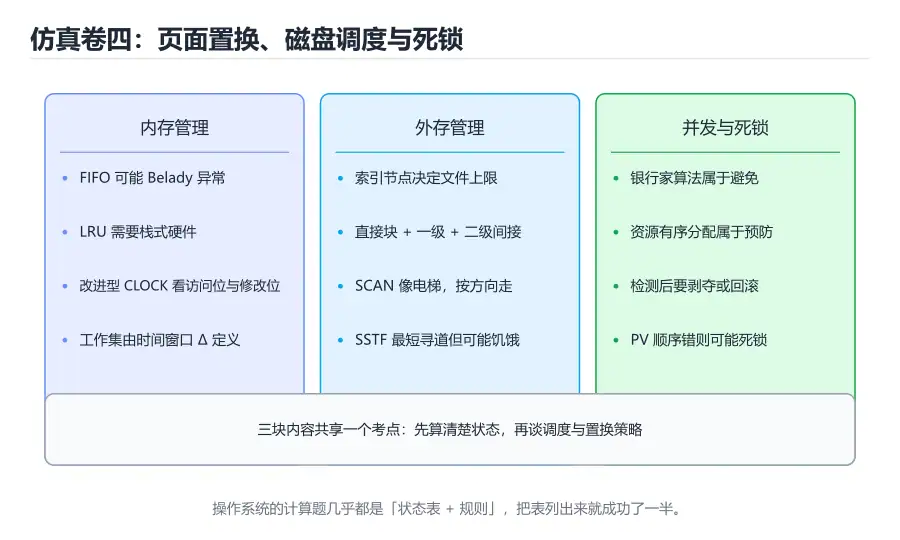

# 408 仿真模拟卷（四）：页面置换、磁盘调度与死锁计算



> 内容更新时间：2026-10-06 · 学习阶段：冲刺 · 预计用时：55 分钟

本套卷为自主编写的仿真卷，引用串、磁道号、资源矩阵等全部数据均为原创命题，不来自任何官方命题内容。仿真卷四把操作系统的三根计算支柱一次打穿。

## 本节知识框架

**课程定位**：所属分类 `408_mock`（考研 408 仿真试卷），课程主题 `408 仿真模拟卷（四）：页面置换、磁盘调度与死锁计算`，学习阶段 冲刺，建议用时 55 分钟。

本课主线：页面置换、磁盘调度与死锁这三类题共享同一个套路——先把状态表列出来，再按规则推演。配图把三列并排摆开，本页把它们的算法拉直。

类比：置换算法像宿舍床位管理，引用串是每天来敲门的学生名单，床位数就是物理块数；磁盘调度像电梯，先定方向再顺路捎人；银行家算法像信贷审批，先把这笔钱假想放出去，再看后面所有欠款人还能不能依次还清。

**学完本课应当能够**
- 给定引用串与物理块数，手工列出 FIFO 与 LRU 的逐次状态并数出缺页次数。
- 用「先算同方向最远请求，再算折返距离」的口诀复现 LOOK 算法的磁道移动量。
- 说明资源有序分配属于预防、银行家算法属于避免，两者不能互换标签。
- 把银行家算法在一次请求中的四个判断动作排出严格先后。
- 区分 DMA 传送与程序查询方式下 CPU 分别在做什么。

### 复习清单

- [ ] 用引用串 7,0,1,2,0,3,0,4,2,3,0 与 3 个物理块，重跑一遍 FIFO 与 LRU 表格并核对 10 与 9。
- [ ] 把磁道请求改成 90、130、60、160、110、起点 100，手算 LOOK 与 FCFS、走到端点再回头的三种移动量。
- [ ] 默写死锁四个必要条件，并逐条对应到预防策略上。
- [ ] 说明为什么 Belady 异常在 LRU 这类栈式算法上不会出现。
- [ ] 复述拓扑排序判断有向图有无环的完整逻辑与失败表现。

## 核心概念定义

| 术语 | 白话解释与操作性定义 | 常见边界与风险 |
| --- | --- | --- |
| 引用串 | 进程依次访问的页面编号序列，置换算法就按它逐条推演。 | 易错：把页面号相同的两次访问当成一次，会漏掉中间被换出的情况。 |
| 缺页次数 | 引用串中目标页不在内存、需要调入的次数。 | 易错：题干常问「缺页次数」而不是「缺页率」，别顺手除以串长。 |
| FIFO | 换出最先进入内存的页，与最近是否用过无关。 | 易错：可能出现物理块增加、缺页反而增多的 Belady 异常。 |
| LRU | 换出最近最久没被访问的页，需要记录访问历史。 | 易错：命中也要更新历史，只在新页调入时排序会算错。 |
| 工作集 | 时间窗口 Δ 内进程访问过的页面集合。 | 易错：窗口 Δ 取多大直接决定驻留页数量，题目会指定。 |
| LOOK / SCAN | 磁盘调度按方向服务请求；SCAN 要走到端点，LOOK 只走到本方向最后一个请求。 | 易错：两者的移动量差一段空行程，题干写哪个就按哪个算。 |
| 死锁四条件 | 互斥、请求与保持、不可剥夺、循环等待同时成立。 | 易错：破坏条件属于预防，判断安全状态属于避免。 |
| 安全序列 | 存在一种次序让所有进程都能依次拿到最大需求并释放。 | 易错：找不到安全序列不等于已经死锁，只是不能放行这次请求。 |

## 原理与运行机制

### 机制一：列表推演置换算法

本卷引用串为 7,0,1,2,0,3,0,4,2,3,0，分配 3 个物理块。FIFO 用一个队列记住进入顺序：

| 引用 | 是否缺页 | 内存中的页 | 说明 |
| --- | --- | --- | --- |
| 7 | 是 | 7 | 空位直接放 |
| 0 | 是 | 7,0 | 空位直接放 |
| 1 | 是 | 7,0,1 | 放满 |
| 2 | 是 | 0,1,2 | 换出最早的 7 |
| 0 | 否 | 0,1,2 | 命中，队列不变 |
| 3 | 是 | 1,2,3 | 换出 0 |
| 0 | 是 | 2,3,0 | 换出 1 |
| 4 | 是 | 3,0,4 | 换出 2 |
| 2 | 是 | 0,4,2 | 换出 3 |
| 3 | 是 | 4,2,3 | 换出 0 |
| 0 | 是 | 2,3,0 | 换出 4 |

数下来缺页 10 次。LRU 的差别只在「命中也要把该页挪到最新」这一条规则上：第 5 步命中 0 之后，最久未用的是 1 而不是 0，于是第 6 步换出 1，整串缺页 9 次。若用 OPT（换出以后最远才用的页），同一串只要 7 次——这三个数并排写在本页表格里，就是这类题的完整答案形态。

### 机制二：磁盘调度的三段账

请求队列（按到达顺序）90、130、60、160、110，磁头起始 100，柱面范围 0 到 199。

- FCFS 依次服务：|90-100| + |130-90| + |60-130| + |160-60| + |110-160| = 10+40+70+100+50 = 270 条磁道。
- LOOK 先向增大方向：顺路 110、130、160，再反向 90、60。总移动量 =(160-100)+(160-60)= 60+100 = 160 条。
- SCAN 要一路走到端点 199 再回头：到 199 花 99，回 90 花 109，再 60 花 30，合计 238 条。

口诀：LOOK 的总距离 = 起点到本方向最远请求 + 最远请求到另一端最远请求。SSTF 每次挑最近的，可能让远端请求长期挨饿。

### 机制三：死锁的四种处理姿态

破坏四个必要条件之一叫预防，是静态策略：资源有序分配要求进程按编号递增顺序申请，环路因此不可能形成，它破坏的是循环等待。银行家算法是避免：它允许三个条件同时存在，只在试探分配后仍能找到安全序列时才真分配。检测与解除是事后策略：定期跑资源分配图化简或等待图找环，找到之后要剥夺资源或回滚进程，而不是只能重启机器。

### 机制四：DMA 与程序查询的差别落在 CPU 身上

程序查询方式下 CPU 反复读状态寄存器，传一个字节搬一个字节；DMA 方式下 DMA 控制器成批搬运，只在整块传完时发一次中断，期间 CPU 可以去执行别的指令，只有与 DMA 争用主存时按周期窃取让路。数据结构的拓扑排序放在本课，是因为它同样考「状态表 + 规则」：反复摘除入度为 0 的顶点，若摘不完就说明图里有环。

## 典型应用场景

| 本卷题位 | 科目 | 考点 | 对应教材章节 | 常见失分方式 |
| --- | --- | --- | --- | --- |
| 第 1 题 | 操作系统 | FIFO 与 LRU 的缺页次数 | 内存管理一章的页面置换算法 | 命中时忘记更新 LRU 历史 |
| 第 2 题 | 操作系统 | LOOK 与 FCFS 的磁道移动量 | 文件管理一章的外存管理 | 把 LOOK 当成要走到端点 |
| 第 3 题 | 计算机组成原理 | DMA 传送时 CPU 的动作 | 输入输出系统的 DMA 方式 | 与程序查询方式混为一谈 |
| 第 4 题 | 数据结构 | 拓扑排序判断有向图有无环 | 图一章的有向无环图 | 以为广度优先遍历也能判环 |
| 第 5 题 | 操作系统 | 银行家算法的判断顺序 | 死锁一章的安全状态 | 先做安全性检查再核对需求量 |
| 第 6 题 | 操作系统 | 死锁预防、避免、检测解除的边界 | 死锁一章的处理策略 | 把银行家算法写成预防 |

操作系统 35 分里单选 10 题 20 分、综合 2 题 15 分。本课把三根支柱同时摆上桌，目的就是练「换壳不换核」：题面从虚拟内存换成磁盘，动作仍然是列表与算距离。

## 代码/协议/SQL 示例

用 Python 把本课两组数据复算一遍，运行结果应与手推表格一致：

```python
ref = [7, 0, 1, 2, 0, 3, 0, 4, 2, 3, 0]

def fifo(seq, frames):
    queue, mem, faults = [], set(), 0
    for p in seq:
        if p in mem:
            continue
        faults += 1
        if len(queue) == frames:
            mem.discard(queue.pop(0))
        queue.append(p)
        mem.add(p)
    return faults

def lru(seq, frames):
    rec, faults = [], 0
    for p in seq:
        if p in rec:
            rec.remove(p)
            rec.append(p)
            continue
        faults += 1
        if len(rec) == frames:
            rec.pop(0)
        rec.append(p)
    return faults

def look(start, requests):
    up = sorted(r for r in requests if r >= start)
    down = sorted((r for r in requests if r < start), reverse=True)
    pos, move = start, 0
    for t in up + down:
        move += abs(t - pos)
        pos = t
    return move

print("FIFO", fifo(ref, 3), "LRU", lru(ref, 3), "LOOK", look(100, [90, 130, 60, 160, 110]))
```

输出应为 `FIFO 10 LRU 9 LOOK 160`。把这段脚本存进复习工具里，换引用串或换磁道序列就能自测：手推容易漏一次命中更新，程序不会。

## 时间/空间复杂度或性能分析

**置换算法的实现代价。** FIFO 只需一个队列，空间 O(块数)；LRU 要维护访问次序，命中也要动结构，硬件上通常用计数器或栈实现，代价高；改进型 CLOCK 只用访问位与修改位两个 bit，靠两轮扫描近似 LRU，是考试与真实系统都偏爱的折中。OPT 需要未来信息，只能当性能上限参照。

**磁盘调度的收益量级。** 本课数据里 FCFS 走 270 条、LOOK 走 160 条，减少约 41%；SCAN 因为多走一段到 199 端点的空行程，比 LOOK 多 78 条。平均存取时间由寻道 + 半转 + 传输三段组成，调度算法只压缩第一段，因此当转速成为瓶颈时，再好的调度也救不了多少。

**银行家算法的开销。** 每次请求都要跑一遍安全性检查，n 个进程、m 类资源时最坏 O(n^2 · m)。这也是为什么真实系统多用「先拒绝过度申请 + 检测回滚」而不追求完整避免。

**建议用时。** 本课 6 题 17 分钟：两道列表/距离计算题各 4 分钟，其余单选 2 到 3 分钟，排序题 2 分钟，多选题 3 分钟。

## 常见误区与易错点

- **LRU 命中不更新历史**：这是缺页次数算错的第一大原因，画表时命中行也要重排次序。
- **把缺页率当缺页次数**：题干问次数就不要除以引用串长度。
- **LOOK 走到端点**：LOOK 只到本方向最后一个请求，SCAN 才到端点，两者差一段空行程。
- **SSTF 当成最优**：它只保证当下最近，远端请求可能长期饥饿。
- **预防与避免混称**：银行家算法是避免，不是预防；资源有序分配才是预防。
- **认为不安全状态就是死锁**：不安全只是可能出现死锁的状态，还不等于已形成环路等待。
- **解除死锁只会重启**：剥夺资源、回滚进程都是常规手段，重启代价最大。
- **判环用广度优先**：BFS 本身不能判环，要靠拓扑排序能否覆盖全部顶点，或有向图 DFS 的回边。
- **DMA 期间 CPU 完全停住**：CPU 仍可执行指令，只在争用主存时按周期让路。

## 与其他知识点的关系

页面置换的表格推演与仿真卷三的 Cache 行号推演是同一动作的两种壳：Cache 由硬件按块管理、置换对用户透明，虚拟内存由操作系统按页管理、缺页会触发进程阻塞。磁盘调度的距离账在仿真卷七会和传输时间、旋转延迟拼成完整的存取时间公式。死锁的四个必要条件与 PV 操作的书写顺序直接相关——先 P(mutex) 再 P(full) 与反过来的结果可能一个是同步一个是死锁，这条线在仿真卷六的跨科题里会出现。

拓扑排序连着数据结构的图与编译原理的依赖分析；DMA 连着组成原理的总线与操作系统的 I/O 子系统，两个科目对同一件事的问法不同：组成原理问「谁控制数据通路」，操作系统问「进程此时处于什么状态」。

## 自测题与参考答案

本套仿真卷共 6 道题，先按建议用时闭卷做完，再逐题核对选项原文与解析。

### 题目 1（单选题）

引用串 7,0,1,2,0,3,0,4,2,3,0 在 3 个物理块下，FIFO 与 LRU 的缺页次数分别是多少？

1. FIFO 缺页 10 次，LRU 缺页 9 次
2. FIFO 缺页 9 次，LRU 缺页 10 次
3. 两种算法都缺页 11 次，即逐条都缺
4. FIFO 缺页 7 次，LRU 缺页 10 次

**参考答案**：FIFO 缺页 10 次，LRU 缺页 9 次

本题正确项是「FIFO 缺页 10 次，LRU 缺页 9 次」。FIFO 只在第 5 步引用 0 时命中一次，其余十条引用都要换页；LRU 的规则是命中也把该页挪到最新，因此第 5 步与第 7 步各命中一次，缺页降到 9 次。干扰项「FIFO 缺页 9 次，LRU 缺页 10 次」把两个数写反，通常是在命中行仍然按进入顺序淘汰 LRU 历史造成的。

### 题目 2（单选题）

磁头当前位于 100 号磁道，待服务请求依次到达为 90、130、60、160、110，采用先向磁道号增大方向移动的 LOOK 算法，磁头共移动多少条磁道？

1. 270 条，与按到达顺序服务的 FCFS 相同
2. 160 条，服务完 160 号请求后立即反向
3. 238 条，需要一路走到 199 号端点才回头
4. 100 条，只统计单方向的移动量

**参考答案**：160 条，服务完 160 号请求后立即反向

本题正确项是「160 条，服务完 160 号请求后立即反向」。LOOK 顺路服务 110、130、160，走 60 条，再折返经过 90 到 60，走 100 条，合计 160 条。干扰项「238 条，需要一路走到 199 号端点才回头」算的是 SCAN：多走了 160 到 199 这段没有请求的空行程，返回时再从 199 直插 90 与 60。

### 题目 3（单选题）

采用 DMA 方式从磁盘读取一批数据时，CPU 在传输期间通常在做什么？

1. 逐字节执行取数与存数指令，把数据搬进缓冲区
2. 暂停一切指令执行，直到 DMA 控制器发出结束中断
3. 继续执行其他指令，只在争用主存时让 DMA 窃取周期
4. 反复查询磁盘控制器的状态寄存器判断是否传完

**参考答案**：继续执行其他指令，只在争用主存时让 DMA 窃取周期

本题正确项是「继续执行其他指令，只在争用主存时让 DMA 窃取周期」。DMA 控制器负责成批的地址递增与数据搬运，CPU 只在启动传输和处理结束中断时介入，双方争用主存时按周期窃取或周期插空让 DMA 优先。干扰项「逐字节执行取数与存数指令，把数据搬进缓冲区」描述的是程序直接控制 I/O 的方式，正是 DMA 要省掉的那部分开销。

### 题目 4（单选题）

要判断一个有向图中是否存在环，下列做法中最合适的是？

1. 从任一顶点出发做一次广度优先遍历
2. 用 Kruskal 算法求出一棵最小生成树
3. 计算每对顶点之间的最短路径长度
4. 反复摘除入度为 0 的顶点，看能否覆盖所有顶点

**参考答案**：反复摘除入度为 0 的顶点，看能否覆盖所有顶点

本题正确项是「反复摘除入度为 0 的顶点，看能否覆盖所有顶点」。拓扑排序每轮取一个入度为 0 的顶点并删去它的出边，若还有顶点剩余，说明这些顶点彼此之间的入度永远降不到 0，也就存在环。干扰项「从任一顶点出发做一次广度优先遍历」只能给出层号与连通信息，单向图上遍历不到某些顶点并不等于有环。

### 题目 5（排序题）

把银行家算法处理一次资源请求的四个判断动作按先后排列：

1. 检查这次请求是否超过该进程声明的最大需求量
2. 假定分配后运行安全性算法，寻找一个安全序列
3. 检查系统当前可利用资源是否足够满足这次请求
4. 若找不到安全序列则撤销假定，让该进程继续等待

**参考答案**：检查这次请求是否超过该进程声明的最大需求量 → 检查系统当前可利用资源是否足够满足这次请求 → 假定分配后运行安全性算法，寻找一个安全序列 → 若找不到安全序列则撤销假定，让该进程继续等待

本题顺序是「检查这次请求是否超过该进程声明的最大需求量」→「检查系统当前可利用资源是否足够满足这次请求」→「假定分配后运行安全性算法，寻找一个安全序列」→「若找不到安全序列则撤销假定，让该进程继续等待」。先核对声明量与现有量这两个必要条件，才能讨论试探分配；安全性检查必须在真正改资源表之前完成，一旦发现进入不安全状态就回滚，让请求方排队等待而不是立刻判死。

### 题目 6（多选题）

关于死锁的预防、避免、检测与解除，下列说法正确的有哪些？

1. 资源有序分配属于死锁预防，它破坏的是循环等待条件
2. 银行家算法属于死锁避免，只在试探分配后仍处于安全状态才放行
3. 引入检测与解除机制属于死锁预防，可以完全省去额外开销
4. 一旦检测到死锁，就只能靠重新启动整台计算机来解除

**参考答案**：资源有序分配属于死锁预防，它破坏的是循环等待条件；银行家算法属于死锁避免，只在试探分配后仍处于安全状态才放行

本题要同时选中「资源有序分配属于死锁预防，它破坏的是循环等待条件」和「银行家算法属于死锁避免，只在试探分配后仍处于安全状态才放行」。检测与解除是允许死锁发生后再找环并剥夺资源的事后策略，与预防是两条不同的路线，而且它本身要定期跑化简算法，开销并不会消失，所以「引入检测与解除机制属于死锁预防，可以完全省去额外开销」两处都不对；解除死锁的常规手段是按代价最小原则剥夺资源或回滚进程，「一旦检测到死锁，就只能靠重新启动整台计算机来解除」把最粗暴的一种办法当成了唯一办法。

## 考点精讲

本套仿真卷题库共 6 道题，下面逐题复述题干原文、答案字母（A 是第 1 个选项）与判断依据，字段内容与题库完全一致。

### 考点 1（单选题 · 操作系统）

- **题目**：引用串 7,0,1,2,0,3,0,4,2,3,0 在 3 个物理块下，FIFO 与 LRU 的缺页次数分别是多少？
- **答案**：A
- **正确项**：FIFO 缺页 10 次，LRU 缺页 9 次
- **判断依据**：本题正确项是「FIFO 缺页 10 次，LRU 缺页 9 次」。FIFO 只在第 5 步引用 0 时命中一次，其余十条引用都要换页；LRU 的规则是命中也把该页挪到最新，因此第 5 步与第 7 步各命中一次，缺页降到 9 次。干扰项「FIFO 缺页 9 次，LRU 缺页 10 次」把两个数写反，通常是在命中行仍然按进入顺序淘汰 LRU 历史造成的。

### 考点 2（单选题 · 操作系统）

- **题目**：磁头当前位于 100 号磁道，待服务请求依次到达为 90、130、60、160、110，采用先向磁道号增大方向移动的 LOOK 算法，磁头共移动多少条磁道？
- **答案**：B
- **正确项**：160 条，服务完 160 号请求后立即反向
- **判断依据**：本题正确项是「160 条，服务完 160 号请求后立即反向」。LOOK 顺路服务 110、130、160，走 60 条，再折返经过 90 到 60，走 100 条，合计 160 条。干扰项「238 条，需要一路走到 199 号端点才回头」算的是 SCAN：多走了 160 到 199 这段没有请求的空行程，返回时再从 199 直插 90 与 60。

### 考点 3（单选题 · 计算机组成原理）

- **题目**：采用 DMA 方式从磁盘读取一批数据时，CPU 在传输期间通常在做什么？
- **答案**：C
- **正确项**：继续执行其他指令，只在争用主存时让 DMA 窃取周期
- **判断依据**：本题正确项是「继续执行其他指令，只在争用主存时让 DMA 窃取周期」。DMA 控制器负责成批的地址递增与数据搬运，CPU 只在启动传输和处理结束中断时介入，双方争用主存时按周期窃取或周期插空让 DMA 优先。干扰项「逐字节执行取数与存数指令，把数据搬进缓冲区」描述的是程序直接控制 I/O 的方式，正是 DMA 要省掉的那部分开销。

### 考点 4（单选题 · 数据结构）

- **题目**：要判断一个有向图中是否存在环，下列做法中最合适的是？
- **答案**：D
- **正确项**：反复摘除入度为 0 的顶点，看能否覆盖所有顶点
- **判断依据**：本题正确项是「反复摘除入度为 0 的顶点，看能否覆盖所有顶点」。拓扑排序每轮取一个入度为 0 的顶点并删去它的出边，若还有顶点剩余，说明这些顶点彼此之间的入度永远降不到 0，也就存在环。干扰项「从任一顶点出发做一次广度优先遍历」只能给出层号与连通信息，单向图上遍历不到某些顶点并不等于有环。

### 考点 5（排序题 · 操作系统）

- **题目**：把银行家算法处理一次资源请求的四个判断动作按先后排列：
- **答案**：A → C → B → D
- **正确项**：检查这次请求是否超过该进程声明的最大需求量 → 检查系统当前可利用资源是否足够满足这次请求 → 假定分配后运行安全性算法，寻找一个安全序列 → 若找不到安全序列则撤销假定，让该进程继续等待
- **判断依据**：本题顺序是「检查这次请求是否超过该进程声明的最大需求量」→「检查系统当前可利用资源是否足够满足这次请求」→「假定分配后运行安全性算法，寻找一个安全序列」→「若找不到安全序列则撤销假定，让该进程继续等待」。先核对声明量与现有量这两个必要条件，才能讨论试探分配；安全性检查必须在真正改资源表之前完成，一旦发现进入不安全状态就回滚，让请求方排队等待而不是立刻判死。

### 考点 6（多选题 · 操作系统）

- **题目**：关于死锁的预防、避免、检测与解除，下列说法正确的有哪些？
- **答案**：A、B
- **正确项**：资源有序分配属于死锁预防，它破坏的是循环等待条件；银行家算法属于死锁避免，只在试探分配后仍处于安全状态才放行
- **判断依据**：本题要同时选中「资源有序分配属于死锁预防，它破坏的是循环等待条件」和「银行家算法属于死锁避免，只在试探分配后仍处于安全状态才放行」。检测与解除是允许死锁发生后再找环并剥夺资源的事后策略，与预防是两条不同的路线，而且它本身要定期跑化简算法，开销并不会消失，所以「引入检测与解除机制属于死锁预防，可以完全省去额外开销」两处都不对；解除死锁的常规手段是按代价最小原则剥夺资源或回滚进程，「一旦检测到死锁，就只能靠重新启动整台计算机来解除」把最粗暴的一种办法当成了唯一办法。

## 术语速查

| 术语 | 一句话说明 |
| --- | --- |
| 引用串 | 进程依次访问的页面序列。记忆抓手：逐条推演的输入。 |
| 缺页次数 | 目标页不在内存需要调入的次数。记忆抓手：命中不计数。 |
| FIFO | 换出最先进来的页。记忆抓手：命中不改队列。 |
| LRU | 换出最久没用的页。记忆抓手：命中要挪到最新。 |
| Belady 异常 | 块数增加缺页反增多。记忆抓手：FIFO 才有。 |
| 改进型 CLOCK | 看访问位与修改位分两轮扫描。记忆抓手：近似 LRU 的省硬件方案。 |
| LOOK | 顺方向服务到最后一个请求即回头。记忆抓手：不走空行程。 |
| SCAN | 顺方向走到端点再回头。记忆抓手：电梯算法。 |
| 安全序列 | 让所有进程依次完成的申请次序。记忆抓手：有它才敢放行。 |
| 资源有序分配 | 按编号顺序申请，破坏循环等待。记忆抓手：属于预防。 |
| 拓扑排序 | 反复摘除入度为 0 的顶点。记忆抓手：摘不完就有环。 |

## 参考资料与复核

- 最后复核：2026-10-04
- 下次复核：2027-02-10
- 复核范围：引用串 7,0,1,2,0,3,0,4,2,3,0 的 FIFO/LRU/OPT 缺页次数、磁道 60 到 160 序列的 LOOK 与 FCFS 移动量、死锁策略归类、银行家算法步骤顺序、DMA 与程序查询的 CPU 行为。
- 来源性质：公开教材页面与系统文档；本课核对关键词：10 与 9、160 与 270、循环等待、安全序列、周期窃取。

| 参考资料 | 本课用途 |
| --- | --- |
| [Operating Systems: Three Easy Pieces 目录页](https://pages.cs.wisc.edu/~remzi/OSTEP/) | 页面置换、磁盘调度与死锁章节的推演口径 |
| [MIT 6.004 讲义笔记页](https://ocw.mit.edu/courses/6-004-computation-structures-spring-2017/pages/lecture-notes/) | DMA 与 I/O 层次在硬件侧的实现说明 |
| [Linux man page: memcpy(3)](https://man7.org/linux/man-pages/man3/memcpy.3.html) | 批量内存搬移的语义，用于对照 DMA 传输 |
| [耶鲁 PineWiki 数据结构条目页](https://www.cs.yale.edu/homes/aspnes/pinewiki/DataStructures.html) | 图的遍历与拓扑排序的等价判据 |

## 内容元数据

> 内容更新时间：2026-10-06 · 学习阶段：冲刺 · 预计用时：55 分钟

- 内容版本：v2.0
- 分类归属：`408_mock`（考研 408 仿真试卷），本套为仿真卷四
- 命题性质：自主命题的仿真卷，引用串与磁道序列等数据均为原创，不引用官方命题内容
- 科目权重：操作系统 4 题、计算机组成原理 1 题、数据结构 1 题
- 题量与题型：6 题（单选 4 题、排序 1 题、多选 1 题），单选答案下标覆盖 0/1/2/3 各一次
- 建议使用方式：17 分钟闭卷完成，置换表格与调度距离必须手推后再用脚本核对
- 相关主题：页面置换、Belady 异常、LOOK、安全序列、死锁四条件、DMA、拓扑排序
