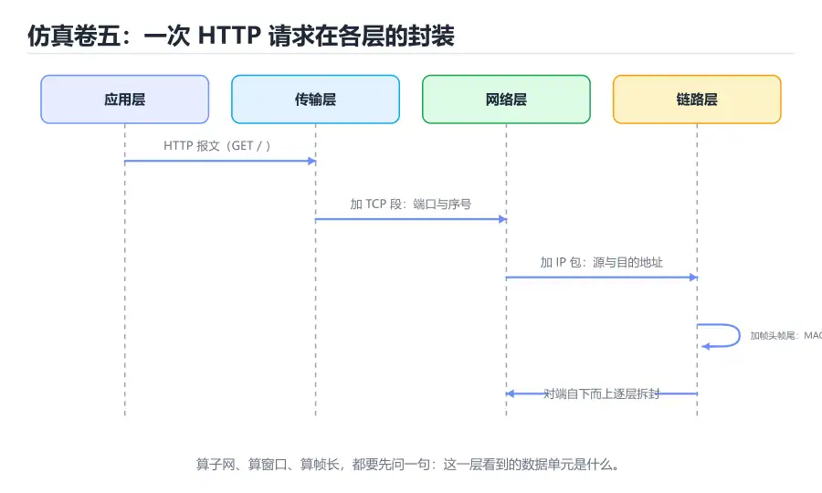

# 408 仿真模拟卷（五）：分层封装、子网划分与可靠传输



> 内容更新时间：2026-10-06 · 学习阶段：冲刺 · 预计用时：55 分钟

本套卷为自主编写的仿真卷，IP 前缀、帧长、报文序号等数据均为原创命题，不来自任何官方命题内容。仿真卷五把计算机网络 25 分撑到极限，并借此复习链路层的编码问题。

## 本节知识框架

**课程定位**：所属分类 `408_mock`（考研 408 仿真试卷），课程主题 `408 仿真模拟卷（五）：分层封装、子网划分与可靠传输`，学习阶段 冲刺，建议用时 55 分钟。

本课主线：一次 HTTP 请求自上而下要贴四次标签，配图的四个角色把这件事画成了时序图；本课所有计算题都从「这一层看到的数据单元是什么」这个问题开始。

类比：寄一件包裹。应用层是写信内容，传输层写上「收件人的门牌（端口）与快递单号（序号）」，网络层写上「省市地址（IP）并决定走哪条路由」，链路层把它装进这一跳的箱子（帧）并在箱口贴一条 CRC 校验胶带。每层只关心自己那一段地址，这种「地址视角」是网络题最省力的解法。

**学完本课应当能够**
- 画出 HTTP 请求在四层里的封装顺序，并说出每层加的头来自哪里。
- 用争用期公式算出给定总线长度与带宽下的最小帧长。
- 把 /24 地址块划分成若干个等长子网，写出掩码十进制值与可用主机数。
- 用序号与确认号解释「对方下一个期望的字节编号」这件事。
- 对一组带权字符构造哈夫曼树并算出带权路径长度。

### 复习清单

- [ ] 不看正文把四层封装顺序与每层的协议数据单元名称默写一遍。
- [ ] 用 1 km、2×10^8 m/s、10 Mbps 重算最小帧长，并把单位统一到 bit 与 μs。
- [ ] 手算 /24 借 3 位后的掩码、子网个数与每子网可用主机数，再核对 224 这个十进制数怎么来。
- [ ] 用 202.112.14.66/27 找出所在子网范围与广播地址，写下区间边界的算法。
- [ ] 用权重 1、2、3、4 构造哈夫曼树并数出每个叶子深度，验证 WPL 等于内部结点之和。

## 核心概念定义

| 术语 | 白话解释与操作性定义 | 常见边界与风险 |
| --- | --- | --- |
| 协议数据单元 | 每一层看到的数据单元名字：应用层报文、传输层段、网络层数据报、链路层帧。 | 易错：分片发生在网络层，分段发生在传输层，两者不是同一个动作。 |
| 争用期 2τ | 信号在最总线上往返一次的时间，以太网用它来决定最少要发多久才能检测到冲突。 | 易错：τ 是单程传播时延，公式里要用两倍。 |
| 最小帧长 | 带宽乘以争用期得到的比特数，短于它的帧无法可靠检测冲突。 | 易错：算完要检查单位，10 Mbps 是每秒 10^7 bit。 |
| 子网掩码 | 网络位与子网位为 1、主机位为 0 的 32 位模式。 | 易错：/27 对应 255.255.255.224，不是 192 或 240。 |
| 可用主机数 | 子网地址总数减掉全 0 的网络地址与全 1 的广播地址。 | 易错：主机位剩 3 位时是 8-2=6，不要写成 8。 |
| 序号与确认号 | TCP 序号标在数据第一个字节上，确认号是期望收到的下一个字节编号。 | 易错：确认号不等于「已收最后一个字节的序号」。 |
| 哈夫曼树 | 按权重自底向上合并，构造带权路径长度最小的二叉树。 | 易错：WPL 是叶子权重乘深度之和，不是所有结点深度之和。 |
| 带权路径长度 | 每个叶子的权重乘它到根的路径长度再求和。 | 易错：也等于所有内部结点权重之和，可用两种算法互检。 |

## 原理与运行机制

### 机制一：四层封装的逐层加头

浏览器输入域名后的第一个请求，在本卷例子里经过四步：应用层生成 `GET / HTTP/1.1` 报文；传输层加上 TCP 首部（源端口、目的端口、序号、确认号、窗口）形成段；网络层加上 IP 首部（源 IP、目的 IP、TTL、协议号）形成数据报；链路层加上帧起始定界符、目的与源 MAC、类型字段以及帧尾的 CRC 形成帧。对端反向逐层拆封，每层只处理自己的头。

由此产生一条重要结论：MTU 限制的是网络层数据报的总长度，因此当上层交付的数据超过 MTU 时，网络层要做分片，各片单独走路由、在目的主机重组；而传输层的分段（例如把字节流切成若干段）是在源头按 MSS 切，不需要目的端「重组分片」这一说。

### 机制二：最小帧长的两步算法

总线长度 1 km，信号传播速度取 2×10^8 m/s。单程传播时延 τ = 1000 ÷ 2×10^8 = 5×10^-6 s = 5 μs；争用期 2τ = 10 μs；带宽 10 Mbps = 10^7 bit/s，所以最小帧长 = 10^7 × 10×10^-6 = 100 bit。

一般式：最小帧长（bit）= 带宽 × 2 × 传播时延。标准以太网取 512 bit（64 B）是因为它的争用期定为 51.2 μs，与本卷的假设参数不同——做题时只看题干给的长度与速度，不要背 512。

### 机制三：子网划分的三种问法

问法一「要 K 个子网」：借 ⌈log2 K⌉ 位主机位。要 6 个等长子网就要借 3 位（2^3 = 8 ≥ 6），前缀从 /24 变成 /27，掩码最后一个字节是 1110 0000 = 224，于是掩码 255.255.255.224，实际得到 8 个子网、每子网 32 个地址、可用主机 30 台。

问法二「某地址属于哪个子网」：把主机号除以块大小 32 取整再乘回去。202.112.14.66 中 66 ÷ 32 = 2 余 2，所以网络号是 2×32 = 64，范围 64 到 95，广播地址 202.112.14.95。

问法三「要 N 台主机」：找最小的 h 使 2^h - 2 ≥ N，主机位留 h 位，前缀就是 32-h。这两种问法共用一条恒等式：块大小 = 2^主机位数。

### 机制四：TCP 序号与确认号的一对一关系

序号标在段中第一个数据字节上，确认号表示「我期望对方的下一个字节编号」。本卷例子：A 发出序号 501、携带 100 字节数据的段，B 完整收下后回复确认号 601。若中间丢了 30 字节，B 只能确认到 571，A 会从 571 起重发。这也是为什么确认号是累计确认，而选择性确认只能作为补充信息存在。

### 机制五：哈夫曼树的构造与 WPL 核对

权重 1、2、3、4 的四个叶子：先合并 1 与 2 得 3，再让这个新结点与权重 3 的叶子合并得 6，最后与 4 合并成根 10。叶子深度分别是 4→1 层、3→2 层、1 与 2→3 层，WPL = 4×1 + 3×2 + 1×3 + 2×3 = 19。用另一条式子核对：所有内部结点权重之和 = 3 + 6 + 10 = 19，两数相等说明合并过程没算错。

## 典型应用场景

| 本卷题位 | 科目 | 考点 | 对应教材章节 | 常见失分方式 |
| --- | --- | --- | --- | --- |
| 第 1 题 | 计算机网络 | 争用期与最小帧长 | 数据链路层的以太网 | 传播时延算成单程 |
| 第 2 题 | 计算机网络 | 等长子网划分的掩码 | 网络层的 IP 与子网 | 借位后掩码十进制写错 |
| 第 3 题 | 数据结构 | 哈夫曼树带权路径长度 | 树与二叉树一章的应用 | 把内部结点深度也乘进去 |
| 第 4 题 | 计算机网络 | TCP 序号与确认号 | 传输层的可靠传输 | 确认号写成最后一个字节序号 |
| 第 5 题 | 计算机网络 | 四层封装的先后顺序 | 网络体系结构一章 | 以为 MAC 头由应用层加 |
| 第 6 题 | 计算机网络 | 已知地址与前缀求广播地址 | 网络层的子网与地址聚合 | 主机位全 1 与掩码取反混用 |

计算机网络只有 25 分（单选 8 题 16 分 + 综合 1 题 9 分），但它的计算题几乎都在 2 分钟内可解，性价比最高，本课把六道题里的四道留给它就是在练「快、准、不背模板」。

## 代码/协议/SQL 示例

把封装顺序与子网计算写成脚本验证，比在草稿纸上转圈可靠：

```python
import ipaddress

# 1) 等长子网划分：/24 借 3 位
net = ipaddress.ip_network("202.112.14.0/24")
subs = list(net.subnets(prefixlen_diff=3))
print("子网个数", len(subs), "掩码", subs[0].netmask, "可用主机", len(list(subs[0].hosts())))

# 2) 已知主机地址与前缀，求所在子网与广播地址
host = ipaddress.ip_interface("202.112.14.66/27")
print("网络号", host.network.network_address, "广播", host.network.broadcast_address)

# 3) 争用期与最小帧长
length_m, speed_mps, bw_bps = 1000, 2e8, 10e6
tau_us = length_m / speed_mps * 1e6
print("单程 us", tau_us, "最小帧长 bit", 2 * tau_us * 1e-6 * bw_bps)
```

预期输出依次是 `子网个数 8 掩码 255.255.255.224 可用主机 30`、`网络号 202.112.14.64 广播 202.112.14.95`、`单程 us 5.0 最小帧长 bit 100.0`。三段各对应本课的一道题，改参数就能自造新题。

## 时间/空间复杂度或性能分析

**封装顺序的性能含义。** 每加一层头就多一份开销：本卷例子里 HTTP 报文加 20 B TCP 首部、20 B IP 首部、帧头帧尾约 18 B，40 B 的应用数据最终在线上跑 98 B，有效载荷比例 41%。这正是「小包不划算」的定量说法，也解释了为什么 TCP 与 IP 头部选项要尽量短。

**子网规模与地址浪费。** 借 3 位得到 8 个子网，只需要 6 个，多余的 2 个是浪费；若用可变长子网按 30、14、2 台的实际需求分配，能省下近半个 /24。CIDR 与 VLSM 的价值就在这一段。

**哈夫曼的性能。** 构造需要 n-1 次合并，用两个队列（一个存原权重有序表、一个存新结点）可做到 O(n log n) 排序 + O(n) 合并；WPL 是编码总长度，权重越大深度越浅，这是「高频字符短编码」的实现方式。

**建议用时。** 本课 6 题 16 分钟：两道换算题各 3 分钟，哈夫曼 4 分钟（必须手画树），排序 2 分钟，单选确认号 2 分钟，填空 2 分钟。

## 常见误区与易错点

- **层与数据单元名不对号**：段属于传输层、数据报与分片属于网络层、帧属于链路层。
- **争用期写成单程**：2τ 才是检测冲突所需的最短发送时间。
- **背 512 bit**：最小帧长由题干的带宽与传播时延决定，标准值只是特例。
- **掩码十进制记错**：/25 是 128、/26 是 192、/27 是 224、/28 是 240，一步错整题错。
- **可用主机数不减 2**：全 0 与全 1 的主机位分别被网络地址与广播地址占用。
- **确认号写偏**：它是期望的下一个字节编号，等于「已按序收到的最后一个字节序号加 1」。
- **WPL 乘错深度**：只有叶子参与，内部结点只是合并的中间量。
- **把分片当分段**：IP 分片在中间路由器也可能发生，TCP 分段只在发送端。

## 与其他知识点的关系

本课的封装链条会在仿真卷六被反过来问：一条 store 指令在机器内部走完地址翻译、Cache、总线与 I/O，而一条 HTTP 请求在网络里走完段、数据报、帧。两句话的共同点是「每一层由谁负责」，这也是 408 综合题最爱设的得分点。

链路层的 CRC 校验与仿真卷七的公式清单同属「先统一单位再算」；子网划分连着网络层的 ARP（把 IP 解析成 MAC，正好横跨两层的地址）与传输层的滑动窗口；哈夫曼树在数据结构里连着树的存储与最优二叉查找，在组成原理里连着指令的操作码编码长度设计。

## 自测题与参考答案

本套仿真卷共 6 道题，先按建议用时闭卷做完，再逐题核对选项原文与解析。

### 题目 1（单选题）

总线长度 1 km、信号传播速度 2×10^8 m/s、带宽 10 Mbps 的共享以太网，为了能检测到冲突，帧长至少应为多少比特？

1. 100 bit
2. 50 bit
3. 512 bit
4. 1000 bit

**参考答案**：100 bit

本题正确项是「100 bit」。单程传播时延 τ = 1000 ÷ 2×10^8 = 5 μs，争用期 2τ = 10 μs，最小帧长 = 10^7 bit/s × 10×10^-6 s = 100 bit。干扰项「512 bit」是标准以太网在 51.2 μs 争用期下算出的取值，与本卷给定的总线长度和传播速度无关，背常数而不看题干就会选它。

### 题目 2（单选题）

把 202.112.14.0/24 划分成 6 个等长子网且让每个子网的主机数尽量多，子网掩码应取多少？

1. 255.255.255.192
2. 255.255.255.224
3. 255.255.255.240
4. 255.255.255.128

**参考答案**：255.255.255.224

本题正确项是「255.255.255.224」。要 6 个等长子网至少要借 3 位（2^3 = 8 ≥ 6），前缀变成 /27，最后一个字节 1110 0000 即 224，每子网 32 个地址、可用主机 30 台。干扰项「255.255.255.192」只借了 2 位，只能切出 4 个子网，装不下 6 个需求；借 4 位的 240 虽然够用但每子网只剩 14 台，违背主机数尽量多。

### 题目 3（单选题）

对权重分别为 1、2、3、4 的四个字符构造哈夫曼树，其带权路径长度是多少？

1. 16
2. 18
3. 19
4. 20

**参考答案**：19

本题正确项是「19」。先合并 1 与 2 得 3，再让新结点 3 与叶子 3 合并得 6，最后与 4 合并成根 10；四个叶子的深度分别是 3、3、2、1，WPL = 1×3 + 2×3 + 3×2 + 4×1 = 19。用另一条式子核对：所有内部结点权重之和 3 + 6 + 10 = 19，两数一致才算构造无误。

### 题目 4（单选题）

主机 A 向 B 发送一个序号为 501、携带 100 字节数据的 TCP 段，B 完整收下后发出的确认号应该是多少？

1. 501
2. 600
3. 701
4. 601

**参考答案**：601

本题正确项是「601」。TCP 序号标在段中第一个数据字节上，501 加 100 字节覆盖到 600，确认号表示期望收到的下一个字节编号，因此是 601。干扰项「600」是已收到的最后一个字节序号，把它当确认号会把期望位置整体少算 1干扰项「701」则是把序号与长度相乘，TCP 没有这种口径。

### 题目 5（排序题）

把浏览器发出一个 HTTP 请求时数据自上而下经过各层的四个封装动作按先后排列：

1. 链路层封装成帧，加上 MAC 地址与帧尾的 CRC 校验序列
2. 应用层生成 HTTP 请求报文，写明方法与目标资源路径
3. 网络层加上 IP 首部，形成含源与目的 IP 地址的数据报
4. 传输层加上 TCP 首部，形成含端口号与序号的段

**参考答案**：应用层生成 HTTP 请求报文，写明方法与目标资源路径 → 传输层加上 TCP 首部，形成含端口号与序号的段 → 网络层加上 IP 首部，形成含源与目的 IP 地址的数据报 → 链路层封装成帧，加上 MAC 地址与帧尾的 CRC 校验序列

本题顺序是「应用层生成 HTTP 请求报文，写明方法与目标资源路径」→「传输层加上 TCP 首部，形成含端口号与序号的段」→「网络层加上 IP 首部，形成含源与目的 IP 地址的数据报」→「链路层封装成帧，加上 MAC 地址与帧尾的 CRC 校验序列」。端口解决进程到进程、IP 解决主机到主机、MAC 解决一跳之内，顺序颠倒时上一层的头就会被当成下一层的数据，对端拆封时错位；CRC 是帧尾，只有到了链路层才可能算出来。

### 题目 6（填空题）

填空：主机地址 202.112.14.66/27 所在子网的广播地址是 202.112.14.________。

**参考答案**：95

本题正确项是「95」。/27 的块大小是 2^5 = 32，66 落在第 2 块即 64 到 95 这个区间，网络地址是 202.112.14.64，主机位全 1 的广播地址就是 202.112.14.95，可用主机范围是 65 到 94 共 30 台。这类题最容易在区间边界上失手：把 66 当成第一块就会写成 31，把块大小当 64 又会写到 127。

## 考点精讲

本套仿真卷题库共 6 道题，下面逐题复述题干原文、答案字母（A 是第 1 个选项）与判断依据，字段内容与题库完全一致。

### 考点 1（单选题 · 计算机网络）

- **题目**：总线长度 1 km、信号传播速度 2×10^8 m/s、带宽 10 Mbps 的共享以太网，为了能检测到冲突，帧长至少应为多少比特？
- **答案**：A
- **正确项**：100 bit
- **判断依据**：本题正确项是「100 bit」。单程传播时延 τ = 1000 ÷ 2×10^8 = 5 μs，争用期 2τ = 10 μs，最小帧长 = 10^7 bit/s × 10×10^-6 s = 100 bit。干扰项「512 bit」是标准以太网在 51.2 μs 争用期下算出的取值，与本卷给定的总线长度和传播速度无关，背常数而不看题干就会选它。

### 考点 2（单选题 · 计算机网络）

- **题目**：把 202.112.14.0/24 划分成 6 个等长子网且让每个子网的主机数尽量多，子网掩码应取多少？
- **答案**：B
- **正确项**：255.255.255.224
- **判断依据**：本题正确项是「255.255.255.224」。要 6 个等长子网至少要借 3 位（2^3 = 8 ≥ 6），前缀变成 /27，最后一个字节 1110 0000 即 224，每子网 32 个地址、可用主机 30 台。干扰项「255.255.255.192」只借了 2 位，只能切出 4 个子网，装不下 6 个需求；借 4 位的 240 虽然够用但每子网只剩 14 台，违背主机数尽量多。

### 考点 3（单选题 · 数据结构）

- **题目**：对权重分别为 1、2、3、4 的四个字符构造哈夫曼树，其带权路径长度是多少？
- **答案**：C
- **正确项**：19
- **判断依据**：本题正确项是「19」。先合并 1 与 2 得 3，再让新结点 3 与叶子 3 合并得 6，最后与 4 合并成根 10；四个叶子的深度分别是 3、3、2、1，WPL = 1×3 + 2×3 + 3×2 + 4×1 = 19。用另一条式子核对：所有内部结点权重之和 3 + 6 + 10 = 19，两数一致才算构造无误。

### 考点 4（单选题 · 计算机网络）

- **题目**：主机 A 向 B 发送一个序号为 501、携带 100 字节数据的 TCP 段，B 完整收下后发出的确认号应该是多少？
- **答案**：D
- **正确项**：601
- **判断依据**：本题正确项是「601」。TCP 序号标在段中第一个数据字节上，501 加 100 字节覆盖到 600，确认号表示期望收到的下一个字节编号，因此是 601。干扰项「600」是已收到的最后一个字节序号，把它当确认号会把期望位置整体少算 1干扰项「701」则是把序号与长度相乘，TCP 没有这种口径。

### 考点 5（排序题 · 计算机网络）

- **题目**：把浏览器发出一个 HTTP 请求时数据自上而下经过各层的四个封装动作按先后排列：
- **答案**：B → D → C → A
- **正确项**：应用层生成 HTTP 请求报文，写明方法与目标资源路径 → 传输层加上 TCP 首部，形成含端口号与序号的段 → 网络层加上 IP 首部，形成含源与目的 IP 地址的数据报 → 链路层封装成帧，加上 MAC 地址与帧尾的 CRC 校验序列
- **判断依据**：本题顺序是「应用层生成 HTTP 请求报文，写明方法与目标资源路径」→「传输层加上 TCP 首部，形成含端口号与序号的段」→「网络层加上 IP 首部，形成含源与目的 IP 地址的数据报」→「链路层封装成帧，加上 MAC 地址与帧尾的 CRC 校验序列」。端口解决进程到进程、IP 解决主机到主机、MAC 解决一跳之内，顺序颠倒时上一层的头就会被当成下一层的数据，对端拆封时错位；CRC 是帧尾，只有到了链路层才可能算出来。

### 考点 6（填空题 · 计算机网络）

- **题目**：填空：主机地址 202.112.14.66/27 所在子网的广播地址是 202.112.14.________。
- **答案**：95
- **正确项**：95
- **判断依据**：本题正确项是「95」。/27 的块大小是 2^5 = 32，66 落在第 2 块即 64 到 95 这个区间，网络地址是 202.112.14.64，主机位全 1 的广播地址就是 202.112.14.95，可用主机范围是 65 到 94 共 30 台。这类题最容易在区间边界上失手：把 66 当成第一块就会写成 31，把块大小当 64 又会写到 127。

## 术语速查

| 术语 | 一句话说明 |
| --- | --- |
| 封装 | 每层给上层数据加上本层的首部（链路层还加尾部）。记忆抓手：自上而下贴标签。 |
| 分片 | 网络层把超过 MTU 的数据报切成多片传输。记忆抓手：目的主机重组。 |
| 争用期 | 信号往返一次的时间 2τ。记忆抓手：冲突检测窗口。 |
| 最小帧长 | 带宽乘以争用期。记忆抓手：单位先统一。 |
| 前缀长度 | 掩码里 1 的个数。记忆抓手：/27 是 224。 |
| 块大小 | 2^主机位数，决定子网边界。记忆抓手：64 到 95 是一组。 |
| 广播地址 | 主机位全 1 的地址。记忆抓手：每子网一个。 |
| 序号 | 段中第一个数据字节的编号。记忆抓手：标在首字节。 |
| 确认号 | 期望对方发送的下一个字节编号。记忆抓手：累计确认。 |
| 哈夫曼树 | 自底向上合并权重的最优二叉树。记忆抓手：大权重靠根近。 |
| 带权路径长度 | 叶子权重乘深度求和。记忆抓手：等于内部结点之和。 |

## 参考资料与复核

- 最后复核：2026-10-04
- 下次复核：2027-02-10
- 复核范围：四层封装顺序与协议数据单元命名、争用期与最小帧长的单位换算、/24 借 3 位后的掩码与可用主机数、202.112.14.66/27 的网络号与广播地址、TCP 确认号定义、权重 1 到 4 的哈夫曼 WPL。
- 来源性质：标准文档原文与公开教材页；本课核对关键词：2τ、255.255.255.224、601、19、95。

| 参考资料 | 本课用途 |
| --- | --- |
| [RFC 1122 因特网主机需求（端对端原则）](https://www.rfc-editor.org/rfc/rfc1122.txt) | 分层职责边界与端到端责任的原文依据 |
| [RFC 791 因特网协议 IP（含分片字段）](https://www.rfc-editor.org/rfc/rfc791.txt) | 数据报格式、分片与重组的字段定义 |
| [RFC 9293 TCP 规范](https://www.rfc-editor.org/rfc/rfc9293.txt) | 序号与确认号语义的权威表述 |
| [RFC 4632 CIDR 地址聚合](https://www.rfc-editor.org/rfc/rfc4632.txt) | 前缀长度与子网块大小的换算背景 |

## 内容元数据

> 内容更新时间：2026-10-06 · 学习阶段：冲刺 · 预计用时：55 分钟

- 内容版本：v2.0
- 分类归属：`408_mock`（考研 408 仿真试卷），本套为仿真卷五
- 命题性质：自主命题的仿真卷，地址块、帧长与权重数据均为原创，不引用官方命题内容
- 科目权重：计算机网络 5 题、数据结构 1 题
- 题量与题型：6 题（单选 4 题、排序 1 题、填空 1 题），单选答案下标覆盖 0/1/2/3 各一次
- 建议使用方式：16 分钟闭卷作答，子网题必须用脚本再核一遍边界
- 相关主题：分层封装、争用期、最小帧长、子网划分、广播地址、TCP 确认号、哈夫曼树
