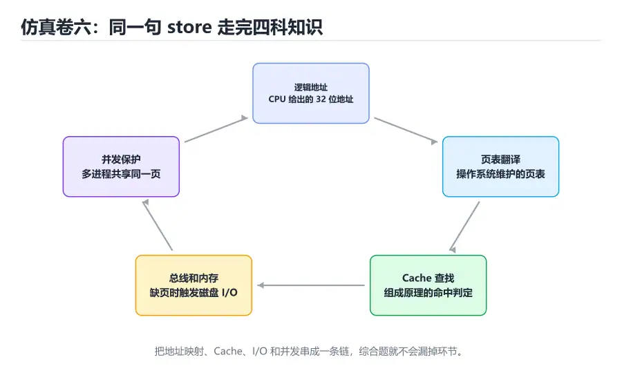

# 408 仿真模拟卷（六）：一条 store 指令串起四科知识



> 内容更新时间：2026-10-06 · 学习阶段：冲刺 · 预计用时：60 分钟

本套卷为自主编写的仿真卷，地址值、页大小与场景设定均为原创命题，不来自任何官方命题内容。仿真卷六练的是跨科综合题：同一句 store，四科各自负责哪一段。

## 本节知识框架

**课程定位**：所属分类 `408_mock`（考研 408 仿真试卷），课程主题 `408 仿真模拟卷（六）：一条 store 指令串起四科知识`，学习阶段 冲刺，建议用时 60 分钟。

本课主线：CPU 给出 32 位逻辑地址之后，这条地址要依次经过页表翻译、Cache 命中判定、总线与主存、必要时还要触发磁盘 I/O 与并发保护。配图把这条链画成五个环节的闭环，本课的 6 道题就分布在这条链上。

类比：取一个寄存包裹。逻辑地址是你写的「楼栋-单元-房号」，页表是物业维护的对照表，MMU 是那个查表的手，Cache 是小区门口的快递柜（在柜里就直接拿，不在才去仓库），磁盘是远郊总仓（要跑一趟物流），多进程共享页则是同一间房住了两个租户，动之前得先复印一份。

**学完本课应当能够**
- 把 32 位逻辑地址按 4 KB 页拆成页号与页内偏移，并用位运算验证拆分可逆。
- 说明地址翻译中「软件维护、硬件执行」的分工落在哪两个部件上。
- 按顺序讲清缺页中断处理的四个动作，并指出进程在其中的状态变化。
- 判断多级页表在数据结构上对应哪种组织方式，并说明为什么不是散列表。
- 区分超过 MTU 的 UDP 数据报和 TCP 字节流分别由哪一层切分。

### 复习清单

- [ ] 不看正文把五个环节按顺序复述，并给每个环节标出负责科目。
- [ ] 用 0x00A3B1C2 手算页号与页内偏移，再乘回去验证还原成原地址。
- [ ] 画出从逻辑地址到物理地址的两次拆分：页式管理的 10+10+12 与本课的 20+12。
- [ ] 复述缺页时进程状态的变迁路径，说明为什么唤醒后先回就绪队列。
- [ ] 说清 copy-on-write 在两个进程写同一物理页框时各自动作是什么。

## 核心概念定义

| 术语 | 白话解释与操作性定义 | 常见边界与风险 |
| --- | --- | --- |
| 逻辑地址 | 程序视角的地址，CPU 在执行指令时给出的就是它。 | 易错：它不等于物理地址，也不能直接送给主存。 |
| 页内偏移 | 页大小决定低位段，4 KB 页取 12 位。 | 易错：把 2^12 与 2^10 混淆会把偏移算成 10 位。 |
| 页表 | 页号到页框号的对照表，由操作系统维护、MMU 查读。 | 易错：页表项里除了页框号还有有效位、访问位、修改位、保护位。 |
| MMU | 地址翻译的硬件执行者，内含快表 TLB。 | 易错：MMU 只执行翻译，是否缺页要由异常处理程序决定。 |
| 缺页中断 | 访问无效页触发的内部异常，处理完从原指令继续执行。 | 易错：它是故障（fault），不是可以跳过的陷阱。 |
| Cache 命中 | 标记相符且有效位为 1，则数据已在高速缓存里。 | 易错：命中与否由硬件判定，程序无法感知，只能靠时间体现。 |
| 写回与一致性 | store 先写 Cache 并置脏位，替换时才写主存。 | 易错：多核共享数据要靠一致性协议，脏位不解决跨核可见性。 |
| 共享页与写时复制 | 多个页表项指向同一页框，写之前先复制一份。 | 易错：复制发生在第一次写入时，不是发生在使用该页时。 |
| IP 分片 | 数据报超过 MTU 时由网络层切片、目的主机重组。 | 易错：UDP 交给 IP 的数据报会被分片，TCP 则在源头按 MSS 切段。 |

## 原理与运行机制

### 机制一：五段流水的翻译链

本卷例子：32 位逻辑地址 0x00A3B1C2，页大小 4 KB（2^12 B）。低 12 位是页内偏移 0x1C2，高 20 位是页号 0x0A3B。回拼检查：0xA3B × 4096 + 0x1C2 = 0xA3B000 + 0x1C2 = 0x00A3B1C2 ✓。这条恒等式在所有分页题里都能用来验算。

拿到页号后，MMU 先查快表：命中就直接得到页框号，把页框号与拼接好的偏移送到地址总线上；快表未命中再访页表（若页表在内存中且启用多级页表，这一步本身可能又要几次内存访问）。若页表项的有效位是 0，硬件发起缺页中断，控制权交给操作系统。

### 机制二：缺页处理的四个动作

1. 硬件保存现场并进入缺页处理程序，进程状态从运行转为阻塞。
2. 处理程序在该进程的页表项里找到该页在外存的存放位置。
3. 分配空闲页框；内存已满时先按置换算法换出一页（脏页还要写回磁盘）。
4. 启动磁盘 I/O 把页读入页框，修改页表项的有效位与页框号，最后把进程放回就绪队列，等调度回来从引发缺页的那条指令重新执行。

整条链里，「谁负责」是判卷的关键词：页表内容与置换策略属于操作系统，地址拆分与快表属于硬件，磁盘搬运交给 DMA 通道，CPU 只在设置与收尾时介入。

### 机制三：写操作的三种终点

同一条 store，可能停在三个地方：命中 Cache 时写 Cache（写回法下置脏位，主存里暂时是旧值）；未命中但页在内存时先取整块再写；页不在内存时先补页再走前两条路径。对程序而言这三种情况语义一致，只有耗时差异——这也是「局部性原理值钱」的具体原因：命中路径短，程序就快，而程序本身写不出「命中」这两个字。

### 机制四：多进程共享同一页

父子进程通过 fork 得到指向同一页框的两个页表项，两侧都标成只读；任意一侧执行 store 时触发写保护异常，处理程序复制出新页框、改写该进程的页表项，再让它继续执行。这段逻辑同时用了本课的三块知识：页表（操作系统）、地址翻译（组成原理）、写保护异常（中断系统）。

## 典型应用场景

| 本卷题位 | 科目 | 考点 | 对应教材章节 | 常见失分方式 |
| --- | --- | --- | --- | --- |
| 第 1 题 | 操作系统 | 缺页中断处理的动作顺序 | 内存管理一章的虚拟内存 | 把分配页框排在读盘之后 |
| 第 2 题 | 计算机组成原理 | 地址翻译由哪个部件完成 | CPU 一章的存储管理与异常 | 把维护页表也安给硬件 |
| 第 3 题 | 数据结构 | 多级页表的组织方式 | 树与散列两章的对照 | 认为散列表查找更快就选它 |
| 第 4 题 | 计算机网络 | 超长数据报由谁切分 | 网络层的分片与 MTU | 把 IP 分片与 TCP 分段混淆 |
| 第 5 题 | 操作系统与组成原理 | 位运算拆分页号与偏移 | 内存管理 + 数据表示 | 移位位数与页大小不一致 |
| 第 6 题 | 跨科 | 各环节的责任归属 | 四科综合 | 让 CPU 逐字节搬 DMA 数据 |

跨科综合题通常出现在组成原理或操作系统的综合题里，分值 13 到 15 分，给分点常常就是「谁做这件事」。本课第 6 题专门练这一句式。

## 代码/协议/SQL 示例

```c
#include <stdio.h>

int main(void) {
    unsigned la = 0x00A3B1C2u;        /* 32 位逻辑地址，页大小 4 KB */
    unsigned page = la >> 12;         /* 高 20 位：页号 */
    unsigned off  = la & 0xFFFu;      /* 低 12 位：页内偏移 */
    unsigned frame = 0x21u;           /* 假设页表给出页框号 0x21 */
    unsigned pa = (frame << 12) | off;
    printf("page=%X off=%X pa=%X\n", page, off, pa);
    printf("回拼 %s\n", (page << 12) | off == la ? "等于原逻辑地址" : "不等于");
    return 0;
}
```

输出第一行是 `page=A3B off=1C2 pa=211C2`，第二行是 `回拼 等于原逻辑地址`。把 `la` 改成 0x00000FFF 可以立刻看到边界：页号 0、偏移 FFF；再改成 0x00001000 就进入第 1 页偏移 0。用 1 改 1 位的方式摸清位段边界，比背公式更耐用。

## 时间/空间复杂度或性能分析

**一次 store 的时间账。** 命中 Cache 约 1 到几个时钟周期；页在内存但 Cache 未命中要一次主存访问（几十 ns，再加上写回策略下可能的替换写主存）；缺页则要多一次磁盘平均存取（寻道 + 半转 + 传输，典型 10 ms 量级）再加读入整页的传输时间。三档之间相差六个数量级，这就是「一次缺页等于上千次 Cache 命中」这条经验数字的来源。

**多级页表的空间账。** 32 位地址、4 KB 页共 2^20 个页号，单级页表要 2^20 个表项；按 10+10+12 分成两级后，只有被真正用到的分支才需要建立，稀疏的地址空间因此省下大量表项，代价是一次翻译要走两次内存（靠快表掩盖）。数据结构上它是一棵按位段逐级分叉的多叉查找树，查找代价是层数乘每层表内定位。

**建议用时。** 本课 6 题 18 分钟：跨科单选各 2 到 3 分钟，代码阅读 4 分钟（务必回拼验证），多选 4 分钟。整卷留出 30 分钟给这类综合大题才有安全感。

## 常见误区与易错点

- **把页表维护交给硬件**：MMU 只查表与翻译，建表、置换、缺页处理都在操作系统。
- **移位位数随手写**：页内偏移位数 = log2(页大小)，4 KB 是 12 位不是 10 位。
- **缺页后从下一条指令继续**：缺页属于故障类异常，处理完要重新执行引发它的那条指令。
- **忽略 TLB 失效**：修改进程要切换页表，快表不清空就会拿到旧页框号。
- **认为写回法不需要一致性协议**：脏位只管主存副本新旧，多核可见性要靠监听机制。
- **让 CPU 搬 DMA 数据**：DMA 的意义就在于成批搬运期间 CPU 不逐字节介入。
- **UDP 交给 IP 的超长数据报指望链路层切**：链路层只会拒绝或报错，切分是网络层的活。
- **共享页一被访问就复制**：复制只发生在第一次写入时，只读访问完全共享。

## 与其他知识点的关系

本课是仿真卷三（Cache 地址划分）与仿真卷四（页面置换、磁盘调度）的合体：卷三教你怎么切地址，卷四教你页面不在时换谁出去，本课把两者串成一次完整访问。仿真卷五的封装链是本课的镜像——一个在机器内部纵向穿过层次，一个在网络里纵向穿过协议层，两条链的答题句式完全相同：这一层看到什么、谁负责、出错怎么办。

与数据结构的连接点在多级页表与树的对应关系；与组成原理的连接点在异常与中断的分类（内部异常、外中断）；与操作系统的连接点在进程状态图；与计算机网络的连接点在 MTU 与分片。四科的这四条边同时出现在一道 15 分大题里并不稀奇，本卷第 6 题就是它的单选版。

## 自测题与参考答案

本套仿真卷共 6 道题，先按建议用时闭卷做完，再逐题核对选项原文与解析。

### 题目 1（单选题）

进程访问的页面当前不在内存中，缺页中断处理程序应当首先完成哪一组动作？

1. 查明该页在外存的地址，分配空闲页框，必要时先置换再读盘
2. 直接终止该进程并回收它占用的全部资源
3. 把页表中该项的无效标志改成有效，无需读盘即可继续执行
4. 把该进程的页表整体加长一页，再重新执行引发中断的指令

**参考答案**：查明该页在外存的地址，分配空闲页框，必要时先置换再读盘

本题正确项是「查明该页在外存的地址，分配空闲页框，必要时先置换再读盘」。缺页处理的骨架是找外存位置、备页框、启动磁盘读入、改页表项并把进程放回就绪队列；内存已满时必须先按置换算法腾出页框，脏页还要写回。干扰项「把页表中该项的无效标志改成有效，无需读盘即可继续执行」跳过了真正的数据搬移，页框里是别的页的内容，改标志只会带来错误数据。

### 题目 2（单选题）

CPU 执行 store 指令时给出 32 位逻辑地址，把它翻译成主存物理地址的工作由哪个部件完成？

1. 主存芯片内部的地址译码器
2. CPU 中的 MMU，即内存管理单元
3. 磁盘控制器里的通道程序
4. Cache 控制器的一致性目录

**参考答案**：CPU 中的 MMU，即内存管理单元

本题正确项是「CPU 中的 MMU，即内存管理单元」。MMU 内含快表，负责把页号查成页框号并与页内偏移拼接，它执行翻译但不维护页表内容。干扰项「主存芯片内部的地址译码器」处理的是已经送到地址总线上的物理地址选中哪个存储单元，属于翻译的下游环节。

### 题目 3（单选题）

把页号再分成若干段逐级查表的多级页表，在数据结构上最接近下面哪种组织方式？

1. 把所有键直接映到地址的一张散列表
2. 一个只在栈顶做插入与删除的栈
3. 一棵按位段逐级分叉的多叉查找树
4. 一条尾指针指回头部的循环单链表

**参考答案**：一棵按位段逐级分叉的多叉查找树

本题正确项是「一棵按位段逐级分叉的多叉查找树」。一级表项指向二级表，二级表项指向页框，只有被用到的分支才真正建立，查找代价是层数乘以每层的表内定位，这正是多叉树按位段分叉的形状。干扰项「把所有键直接映到地址的一张散列表」忽略了地址是按位段分层解释的这一事实，散列也没有按需建树的能力。

### 题目 4（单选题）

一个 4000 字节的 UDP 用户数据报要经过 MTU 为 1500 字节的数据链路，正确的处理是哪一项？

1. 链路层发现帧装不下就丢弃，由应用层超时后重传
2. 传输层把它切成三段，各自编号后分别交给网络层
3. 网卡自动把帧长扩大直到能够装下整个数据报
4. 网络层的 IP 按 MTU 分片，交给目的主机负责重组

**参考答案**：网络层的 IP 按 MTU 分片，交给目的主机负责重组

本题正确项是「网络层的 IP 按 MTU 分片，交给目的主机负责重组」。UDP 报文原样交给 IP，超过 MTU 就由 IP 切片，分片头里的标识、偏移与更多分片标志支持目的主机重组。干扰项「传输层把它切成三段，各自编号后分别交给网络层」说的是 TCP 按 MSS 分段的做法，UDP 没有这一层切分，也就不会在传输层被编号。

### 题目 5（代码阅读题）

页大小为 4 KB，用下面这段 C 代码拆分逻辑地址 0x00A3B1C2，printf 的输出对应哪一项？

```c
unsigned la = 0x00A3B1C2u;        /* 32 位逻辑地址 */
unsigned page = la >> 12;         /* 高 20 位：页号 */
unsigned off  = la & 0xFFFu;      /* 低 12 位：页内偏移 */
printf("%X %X\n", page, off);
```

1. 输出 A3B 1C2，页号与页内偏移能回拼成原逻辑地址
2. 输出 A3B1 2，把最后一个十六进制位当成了页内偏移
3. 输出 1C2 A3B，两段的高低位置被打印反了
4. 输出 A3B000 1C2，页号里多带了偏移那三位十六进制

**参考答案**：输出 A3B 1C2，页号与页内偏移能回拼成原逻辑地址

本题正确项是「输出 A3B 1C2，页号与页内偏移能回拼成原逻辑地址」。右移 12 位即丢掉末尾三个十六进制位，得到 0xA3B；掩码 0xFFF 留下末三位 0x1C2；回拼 0xA3B 左移 12 位为 0xA3B000，加 0x1C2 正好还原 0x00A3B1C2。干扰项「输出 A3B1 2，把最后一个十六进制位当成了页内偏移」对应的移位位数是 8 位而不是 12 位，与 4 KB 页的偏移位数不符。

### 题目 6（多选题）

一条 store 指令从逻辑地址到数据落在主存，下列说法中关于职责分工正确的有哪些？

1. 页表由操作系统建立与维护，地址翻译由 MMU 硬件执行
2. Cache 的命中判定与块替换由硬件完成，对应用程序透明
3. 页面置换的结果取决于 CPU 时钟周期数，与操作系统无关
4. 磁盘与内存之间的大批数据必须由 CPU 逐字节执行指令搬运

**参考答案**：页表由操作系统建立与维护，地址翻译由 MMU 硬件执行；Cache 的命中判定与块替换由硬件完成，对应用程序透明

本题要同时选中「页表由操作系统建立与维护，地址翻译由 MMU 硬件执行」和「Cache 的命中判定与块替换由硬件完成，对应用程序透明」。置换策略是操作系统在页表与空闲页框链上做的决策，时钟周期只影响执行速度而不决定换出哪一页，所以「页面置换的结果取决于 CPU 时钟周期数，与操作系统无关」不成立；大批数据的搬运输入出由 DMA 控制器成批完成，CPU 只在启动与收尾时介入，「磁盘与内存之间的大批数据必须由 CPU 逐字节执行指令搬运」回到的是早被淘汰的程序查询方式。

## 考点精讲

本套仿真卷题库共 6 道题，下面逐题复述题干原文、答案字母（A 是第 1 个选项）与判断依据，字段内容与题库完全一致。

### 考点 1（单选题 · 操作系统）

- **题目**：进程访问的页面当前不在内存中，缺页中断处理程序应当首先完成哪一组动作？
- **答案**：A
- **正确项**：查明该页在外存的地址，分配空闲页框，必要时先置换再读盘
- **判断依据**：本题正确项是「查明该页在外存的地址，分配空闲页框，必要时先置换再读盘」。缺页处理的骨架是找外存位置、备页框、启动磁盘读入、改页表项并把进程放回就绪队列；内存已满时必须先按置换算法腾出页框，脏页还要写回。干扰项「把页表中该项的无效标志改成有效，无需读盘即可继续执行」跳过了真正的数据搬移，页框里是别的页的内容，改标志只会带来错误数据。

### 考点 2（单选题 · 计算机组成原理）

- **题目**：CPU 执行 store 指令时给出 32 位逻辑地址，把它翻译成主存物理地址的工作由哪个部件完成？
- **答案**：B
- **正确项**：CPU 中的 MMU，即内存管理单元
- **判断依据**：本题正确项是「CPU 中的 MMU，即内存管理单元」。MMU 内含快表，负责把页号查成页框号并与页内偏移拼接，它执行翻译但不维护页表内容。干扰项「主存芯片内部的地址译码器」处理的是已经送到地址总线上的物理地址选中哪个存储单元，属于翻译的下游环节。

### 考点 3（单选题 · 数据结构）

- **题目**：把页号再分成若干段逐级查表的多级页表，在数据结构上最接近下面哪种组织方式？
- **答案**：C
- **正确项**：一棵按位段逐级分叉的多叉查找树
- **判断依据**：本题正确项是「一棵按位段逐级分叉的多叉查找树」。一级表项指向二级表，二级表项指向页框，只有被用到的分支才真正建立，查找代价是层数乘以每层的表内定位，这正是多叉树按位段分叉的形状。干扰项「把所有键直接映到地址的一张散列表」忽略了地址是按位段分层解释的这一事实，散列也没有按需建树的能力。

### 考点 4（单选题 · 计算机网络）

- **题目**：一个 4000 字节的 UDP 用户数据报要经过 MTU 为 1500 字节的数据链路，正确的处理是哪一项？
- **答案**：D
- **正确项**：网络层的 IP 按 MTU 分片，交给目的主机负责重组
- **判断依据**：本题正确项是「网络层的 IP 按 MTU 分片，交给目的主机负责重组」。UDP 报文原样交给 IP，超过 MTU 就由 IP 切片，分片头里的标识、偏移与更多分片标志支持目的主机重组。干扰项「传输层把它切成三段，各自编号后分别交给网络层」说的是 TCP 按 MSS 分段的做法，UDP 没有这一层切分，也就不会在传输层被编号。

### 考点 5（代码阅读题 · 操作系统）

- **题目**：页大小为 4 KB，用下面这段 C 代码拆分逻辑地址 0x00A3B1C2，printf 的输出对应哪一项？
- **答案**：A
- **正确项**：输出 A3B 1C2，页号与页内偏移能回拼成原逻辑地址
- **判断依据**：本题正确项是「输出 A3B 1C2，页号与页内偏移能回拼成原逻辑地址」。右移 12 位即丢掉末尾三个十六进制位，得到 0xA3B；掩码 0xFFF 留下末三位 0x1C2；回拼 0xA3B 左移 12 位为 0xA3B000，加 0x1C2 正好还原 0x00A3B1C2。干扰项「输出 A3B1 2，把最后一个十六进制位当成了页内偏移」对应的移位位数是 8 位而不是 12 位，与 4 KB 页的偏移位数不符。

### 考点 6（多选题 · 跨科综合）

- **题目**：一条 store 指令从逻辑地址到数据落在主存，下列说法中关于职责分工正确的有哪些？
- **答案**：A、B
- **正确项**：页表由操作系统建立与维护，地址翻译由 MMU 硬件执行；Cache 的命中判定与块替换由硬件完成，对应用程序透明
- **判断依据**：本题要同时选中「页表由操作系统建立与维护，地址翻译由 MMU 硬件执行」和「Cache 的命中判定与块替换由硬件完成，对应用程序透明」。置换策略是操作系统在页表与空闲页框链上做的决策，时钟周期只影响执行速度而不决定换出哪一页，所以「页面置换的结果取决于 CPU 时钟周期数，与操作系统无关」不成立；大批数据的搬运输入出由 DMA 控制器成批完成，CPU 只在启动与收尾时介入，「磁盘与内存之间的大批数据必须由 CPU 逐字节执行指令搬运」回到的是早被淘汰的程序查询方式。

## 术语速查

| 术语 | 一句话说明 |
| --- | --- |
| 逻辑地址 | 程序看到的地址，由 CPU 交给 MMU。记忆抓手：不是物理地址。 |
| 页号 | 逻辑地址的高位段，除以页大小即得。记忆抓手：右移 12 位。 |
| 页内偏移 | 逻辑地址的低位段，页大小取对数。记忆抓手：掩码 0xFFF。 |
| 页表项 | 页框号加有效位等属性的一行记录。记忆抓手：硬件读、软件写。 |
| 快表 TLB | 页表热点项的高速缓冲。记忆抓手：切换进程要刷新。 |
| 缺页中断 | 访问无效页引发的故障类异常。记忆抓手：原指令重执行。 |
| 写回法 | 写只落 Cache，替换时才写主存。记忆抓手：脏位标记。 |
| 写时复制 | 首次写入才复制共享页。记忆抓手：fork 的经典用法。 |
| DMA | 外设与内存之间的成批数据搬运。记忆抓手：CPU 只在首尾介入。 |
| MTU | 链路层一帧能承载的最大数据字节数。记忆抓手：超了要 IP 分片。 |
| 多叉查找树 | 按位段逐级分叉的组织方式。记忆抓手：多级页表的结构对应。 |

## 参考资料与复核

- 最后复核：2026-10-04
- 下次复核：2027-02-10
- 复核范围：0x00A3B1C2 的页号与偏移拆分、缺页处理动作顺序、地址翻译的软硬件分工、fork 的写时复制时机、DMA 与程序查询的差别、超长 UDP 数据报的切分层。
- 来源性质：标准文档与公开教材页；本课核对关键词：A3B 与 1C2、有效位、周期窃取、写保护异常、1500 字节。

| 参考资料 | 本课用途 |
| --- | --- |
| [Operating Systems: Three Easy Pieces 目录页](https://pages.cs.wisc.edu/~remzi/OSTEP/) | 地址空间、翻译与越权访问处理的讲解顺序 |
| [Linux man page: mmap(2)](https://man7.org/linux/man-pages/man2/mmap.2.html) | 共享映射与写时复制的实际接口语义 |
| [MIT OpenCourseWare 6.004 Computation Structures](https://ocw.mit.edu/courses/6-004-computation-structures-spring-2017/) | 地址翻译与存储层次在硬件侧的实现 |
| [RFC 791 因特网协议（分片字段与 MTU）](https://www.rfc-editor.org/rfc/rfc791.txt) | 数据报分片与重组字段的原文依据 |

## 内容元数据

> 内容更新时间：2026-10-06 · 学习阶段：冲刺 · 预计用时：60 分钟

- 内容版本：v2.0
- 分类归属：`408_mock`（考研 408 仿真试卷），本套为仿真卷六
- 命题性质：自主命题的仿真卷，地址常量与场景设定均为原创，不引用官方命题内容
- 科目权重：操作系统 2 题、计算机组成原理 2 题、数据结构 1 题、计算机网络 1 题
- 题量与题型：6 题（单选 4 题、代码阅读 1 题、多选 1 题），单选答案下标覆盖 0/1/2/3 各一次
- 建议使用方式：18 分钟闭卷完成，代码题必须做一次回拼验算
- 相关主题：逻辑地址、页表、MMU、缺页中断、写时复制、DMA、MTU、跨科综合
