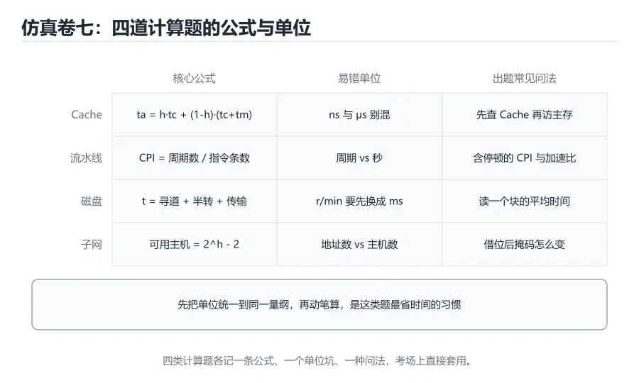

# 408 仿真模拟卷（七）：四类高难计算题的公式与单位



> 内容更新时间：2026-10-06 · 学习阶段：冲刺 · 预计用时：60 分钟

本套卷为自主编写的仿真卷，四类计算题的数据、地址常量与场景设定均为原创命题，不来自任何官方命题内容。仿真卷七练的是「同一套动作服务四道题」：把单位对齐，套一条公式，再检查量纲。

## 本节知识框架

**课程定位**：所属分类 `408_mock`（考研 408 仿真试卷），课程主题 `408 仿真模拟卷（七）：四类高难计算题的公式与单位`，学习阶段 冲刺，建议用时 60 分钟。Cache 平均访问时间、流水线时间与 CPI、磁盘平均存取时间、子网划分与掩码，是计算机组成原理与计算机网络两科里最容易「会做但算错」的四道题，合计在卷面上通常是 2 到 3 道单选加 1 道大题的一半篇幅。

配图是一张 4 行 3 列的清单表：行是 Cache、流水线、磁盘、子网四类题，列是「核心公式」「易错单位」「出题常见问法」。它想说的是这类题的知识量其实很小——每类记住一条公式、一个单位坑、一种问法就够了，分数丢在没把三件事同时记住：公式的前提、单位的换算、问法要的是哪一段。

类比：这四道题像四台刻度不同的仪表。Cache 那台的刻度是 ns，磁盘那台的刻度是 ms，流水线那台的刻度是「周期」，子网那台的刻度是「地址个数」。读数前先想清楚手上这个数是什么单位、要换算成什么单位，比背公式更容易决定对错。把 7200 r/min 当成 7200 r/s 去算，等于拿转速表读车速，数字看起来仍然像模像样，结果差了两百多个数量级里的一档。

**学完本课应当能够**

- 分别用串行的「先查 Cache 再访主存」和并行的「同时启动」两种假设写出平均访问时间，并说清两者差在哪一项。
- 给出段数、段长与指令条数，算出流水线执行时间与理想流水线的时间，并解释加速比为什么到不了段数。
- 从转速、平均寻道时间与传输率出发，算出读取一个块的平均存取时间，并把三段的单位统一到毫秒。
- 由「需要多少台主机」反推出前缀长度、掩码、块大小、网络号与广播地址，并说清可用主机数为什么要减 2。

### 复习清单

- [ ] 不看正文把四条公式各写一遍，并标出每个符号的单位。
- [ ] 用命中率 95%、命中时间 10 ns、主存 200 ns 手算两种假设下的平均访问时间，说出差值等于什么。
- [ ] 用 5 段、每段 2 ns、100 条指令手算流水线时间，并解释为什么加速比是 4.81 而不是 5。
- [ ] 把 7200 r/min 换成每转毫秒数，再算半转，说明为什么平均旋转延迟不是整转。
- [ ] 对 203.0.113.130/27 手算网络号、广播地址与可用地址区间，并验证两端各被扣掉了一个。

## 核心概念定义

| 术语 | 白话解释与操作性定义 | 常见边界与风险 |
| --- | --- | --- |
| 命中时间 tc | 数据在高速缓存里时，从发出请求到拿到数据花的时间。 | 易错：它只是访问过程的一段，不含后续主存时间。 |
| 缺失代价 tm | 未命中时为了从下一级取回数据额外付出的时间。 | 易错：写回法下还可能多一次替换块的写回，题面没给就不算。 |
| 命中率 h | 访问中命中的比例，通常由程序局部性与容量共同决定。 | 易错：命中率提高 1% 带来的收益按 tm 缩放，而不是按 tc。 |
| 平均访问时间 ta | 按命中与未命中各自的概率加权后的单次访问期望时间。 | 易错：串行与并行两种假设的式子不同，必须先确认题目用哪一种。 |
| 流水线段数 k | 一条指令被切成的子任务个数。 | 易错：段数只决定填充与排空代价，不直接等于加速比。 |
| 时钟周期 Δt | 流水线一拍的长度，取最长那一段的执行时间。 | 易错：段间不等长时不能取平均值，慢段决定整条流水线的节拍。 |
| CPI | 每条指令平均消耗的时钟周期数，等于周期总数除以指令条数。 | 易错：含停顿的 CPI 要在基础 CPI 上再加结构、数据、控制三类停顿。 |
| 加速比 S | 同样任务下顺序执行时间与流水执行时间的比值。 | 易错：指令条数不够多时，填充与排空吃掉大部分收益。 |
| 平均寻道时间 | 磁头移到目标柱面的平均机械移动时间。 | 易错：它由盘的平均移动距离决定，与转速无关。 |
| 旋转延迟 | 等目标扇区转到磁头下方的时间，平均取半转。 | 易错：整转时间是 60/rpm，平均等待要再乘二分之一。 |
| 传输时间 | 把指定字节数按传输率搬完所需时间。 | 易错：MB 到底按 2^20 还是 10^6 算，题面必须给口径。 |
| 主机位 h | 子网掩码右侧连续的 0 的个数。 | 易错：地址数是 2^h，可用主机数还要减掉网络地址与广播地址。 |
| 前缀长度 | CIDR 写法里斜杠后面的数字，等于掩码中连续 1 的位数。 | 易错：借 n 位则前缀长度增加 n，同时子网数变成 2^n。 |
| 块大小 | 一个子网覆盖的地址个数，等于 2^(32 − 前缀长度)。 | 易错：网络号要把主机段向下取整到块大小的整数倍，不是四舍五入。 |

## 原理与运行机制

### 机制一：平均访问时间是概率加权，不是两段平均

串行假设下，命中只付 tc，未命中先付 tc 才知道没有，再付 tm，所以 ta = h·tc + (1 − h)(tc + tm) = tc + (1 − h)·tm。并行假设下，Cache 与主存同时启动，命中在 tc 时刻结束，未命中直接等到主存返回的 tm，于是 ta = h·tc + (1 − h)·tm。两式相减得 (1 − h)·tc，正是「未命中时白等的那次检查」。命中率 95%、tc = 10 ns、tm = 200 ns 时，串行是 20.0 ns，并行是 19.5 ns，差的 0.5 ns 就是 0.05 × 10。谁大谁小不由公式的长相决定，而由「主存访问时间是从什么时候开始计时」这个约定决定，所以动笔前必须把假设写清楚。

命中率反解是最常见的变形：给出 ta、tc、tm 求 h。由 ta = tc + (1 − h)tm 得 1 − h = (ta − tc)/tm。把 ta = 25、tc = 10、tm = 200 代入，得 1 − h = 0.075，h = 0.925。注意 ta 小于 tc 时这个式子无解，说明题给的数不自洽，此时要检查是不是把 μs 当成了 ns。

### 机制二：流水线的收益被填充与排空扣税

k 段流水线执行 n 条指令，需要 k + n − 1 个周期：第 1 条指令要爬完全部 k 段，之后每拍出一条。不做流水线则每条指令独占 k 个周期，共 n·k 拍。加速比因此是 n·k/(k + n − 1)，n 趋于无穷时极限是 k，但有限条数时永远拿不到 k。k = 5、每段 2 ns、n = 100 时，流水时间是 104 × 2 = 208 ns，顺序时间是 100 × 5 × 2 = 1000 ns，加速比 4.8077，吞吐率 100 / 208 ns ≈ 480.77 M 条每秒——离理想值 5 差 3.85%，这 3.85% 就是填充与排空的税。

另一条主线是 CPI。时钟周期数 = 指令条数 × CPI，执行时间 = 周期数 / 主频。基础 CPI 为 1、数据冒险平均停顿 0.4、控制冒险平均停顿 0.1，则实际 CPI = 1.5；主频 2 GHz、指令 30 亿条时，周期数 45 亿、时间 2.25 s，等价地每秒执行 2e9 / 1.5 = 1333.33 M 条指令。这里最容易出错的是单位：题目问「秒」时要走完「乘 CPI、除主频」两步，问「周期数」时只走第一步，两个答案差着主频这个倍数。

### 机制三：磁盘时间三段拼接，转速只影响其中一段

平均存取时间 = 平均寻道 + 平均旋转延迟 + 传输时间，必要时再加控制器与排队开销（题面给了才加）。三段里只有旋转延迟与传输时间和转速、传输率有关。每转时间 = 60 / rpm 秒，平均旋转延迟取其一半；7200 r/min 得每转 8.3333 ms，平均 4.1667 ms。传输时间 = 字节数 / 传输率，按 1 MB = 2^20 字节口径，16 MB/s 下 4 KB 块的传输时间是 4096 / 16777216 s = 0.2441 ms。加上平均寻道 6 ms，合计 10.4108 ms。

三段的大小关系本身就是答题线索：寻道与旋转是毫秒级的机械运动，传输往往是十分之一毫秒级的电子运动，所以「只算传输时间」的答案必然偏小，「把整转当平均等待」的答案必然偏大约一个半转。若把 7200 r/min 误读成 7200 r/s，平均旋转延迟会算成 0.0694 ms，整整小了 60 倍，这个数量级差正好暴露单位没对齐。

### 机制四：子网划分的方向永远是先问主机数

正向问法给前缀求范围：/27 的主机位是 5 位，块大小 32 个地址，可用主机 2^5 − 2 = 30 台，掩码 255.255.255.224。203.0.113.130 落在哪个子网，就把末段向下取整到 32 的整数倍：130 − 130 % 32 = 128，于是网络号 203.0.113.128，广播地址 203.0.113.159，可用地址 129 到 158。

反向问法给主机数求前缀：要装下 25 台主机，需要 2^h − 2 ≥ 25，h 取 5 就够，前缀 32 − 5 = 27。要从 /24 划出若干块，借 3 位得到 8 个子网，每个子网 30 台可用主机，合计 240 台。之所以减 2，是因为主机段全 0 表示网络本身、全 1 表示该子网的广播地址，这两个值不能分配给接口；/31 这类特殊前缀是例外，题面若明确按点对点链路处理才允许不减。

## 典型应用场景

| 类别 | 核心公式 | 易错单位 | 出题常见问法 |
| --- | --- | --- | --- |
| Cache | ta = tc + (1 − h)·tm（串行），ta = h·tc + (1 − h)·tm（并行） | ns 与 μs 别混，1 μs = 1000 ns | 先查 Cache 再访主存时的平均访问时间 |
| 流水线 | 流水时间 = (k + n − 1)·Δt，周期数 = 指令条数 × CPI | 周期与秒之间差一个主频 | 含停顿的 CPI、加速比、每秒执行多少条 |
| 磁盘 | t = 寻道 + 半转 + 传输 | r/min 要先换成 ms，1 MB 口径要确认 | 读一个块的平均存取时间 |
| 子网 | 可用主机 = 2^h − 2，块大小 = 2^h | 地址数与主机数不是一回事 | 借位后掩码与前缀怎么变 |

场景差异体现在「问哪一段」。问平均访问时间时要把三段全给；问缺失代价时只取未命中那部分；问吞吐率时按条每秒而不是条每周期；问子网可用主机时务必在 2^h 之后减 2。大题里这四类题的评分点也按段给分，写出正确的分段式子即使最后算术出错，通常仍能拿到一半左右的分数。

## 代码/协议/SQL 示例

下面这段 Python 把四类题各算一遍，用来核对正文里的数字。函数只做加减乘除与取模，换成任何语言都能复现。

```python
MB = 2 ** 20

def cache(h, tc, tm):
    return tc + (1 - h) * tm, h * tc + (1 - h) * tm

def pipe(k, dt, n):
    return (k + n - 1) * dt, n * k * dt

def disk(rpm, seek, rate_mib, blk_kib):
    rot = 0.5 * 60 / rpm * 1000
    trans = blk_kib * 1024 / (rate_mib * MB) * 1000
    return rot, trans, seek + rot + trans

def subnet(prefix, last):
    size = 2 ** (32 - prefix)
    net = last - last % size
    return size, net, net + size - 1

ta_ser, ta_par = cache(0.95, 10, 200)
print(round(ta_ser, 4), round(ta_par, 4), round(ta_ser - ta_par, 4))
print(round(10 / ta_ser, 4), round(1 - (25 - 10) / 200, 4))

tp, ts = pipe(5, 2, 100)
print(int(tp), int(ts), round(ts / tp, 4), round(100 / tp * 1000, 2))
print(round(1 + 0.4 + 0.1, 4), round(3e9 * 1.5 / 2e9, 4), round(2e9 / 1.5 / 1e6, 2))

rot, trans, tot = disk(7200, 6, 16, 4)
print(round(rot, 4), round(trans, 4), round(tot, 4))

size, net, bcast = subnet(27, 130)
print(int(size), int(size - 2), int(net), int(bcast))
```

运行输出：

```text
20.0 19.5 0.5
0.5 0.925
208 1000 4.8077 480.77
1.5 2.25 1333.33
4.1667 0.2441 10.4108
32 30 128 159
```

逐行读法：第一行是串行 20.0 ns、并行 19.5 ns、差值 0.5 ns；第二行是命中时间占比 0.5（即效率 50%）和由 ta = 25 ns 反解出的命中率 0.925；第三行是流水时间 208、顺序时间 1000、加速比 4.8077、吞吐率 480.77 M 条每秒；第四行是含停顿的 CPI 1.5、45 亿周期在 2 GHz 下的 2.25 秒、以及每秒 1333.33 M 条；第五行是半转 4.1667 ms、传输 0.2441 ms、合计 10.4108 ms；第六行是块大小 32、可用主机 30、网络号末段 128、广播地址末段 159。

## 时间/空间复杂度或性能分析

**四类题的量级差别。** Cache 平均访问时间在 10 到几十 ns，流水线一段在个位数 ns 量级，磁盘平均存取在 10 ms 量级，子网划分则是纯整数运算没有耗时概念。把磁盘时间换成 ns 会多出六个数量级，这个跨度正是「一次缺页相当于上千次 Cache 命中」这类比较题的算法基础。

**公式的敏感度。** 串行式 ta = tc + (1 − h)·tm 里，命中率每提高 1 个百分点，平均时间下降 1% × tm：tm = 200 ns 时就是 2 ns。命中时间每减少 1 ns，平均时间恰好减少 1 ns，与命中率无关，因为 tc 的系数是 1。代入本卷的数字看，把命中率从 95% 提到 96% 换来 2 ns 的改进，比把命中时间从 10 ns 压到 9 ns 更划算。主存慢的机器上优先优化命中率，主存快的机器上优先优化命中时间，这条经验就是从两个系数的大小关系来的。

**建议用时。** 本课 6 题建议 20 分钟：四道数值单选每题不超过 3 分钟，代码阅读 4 分钟，多选与排序各 3 分钟。仿真卷的算数一律允许手算，练的时候就不要碰计算器，考场上的心算速度只能靠平时积累。

## 常见误区与易错点

- **把两种访问假设混用**：用串行式子算出 20 ns，又按「同时启动」的说法解释，两句话互相打架。
- **命中时间占比当成效率**：效率的定义是 tc / ta，20.0 ns 与 10 ns 相除得 0.5，不是 5%。
- **把整转时间当平均等待**：旋转延迟平均是半转，用整转会系统性偏大约一个半转。
- **MB 口径随手取**：同一道题按 2^20 与 10^6 算出的传输时间分别是 0.2441 ms 与 0.256 ms，题面没给口径时按 2^20 并在卷面写明假设。
- **加速比直接写段数**：指令条数有限时加速比必然小于段数，写 5 而实际是 4.81 会丢步骤分。
- **周期数与秒混答**：问「执行时间」还差一步除主频，问「周期数」则不能提前除。
- **地址数当主机数**：可用主机是 2^h − 2，把 32 写成可用主机数是最常见的单选失分点。
- **网络号四舍五入**：要把主机段向下取整到块大小的整数倍，130 取 128 而不是 128 或 160 里的任意一个。

## 与其他知识点的关系

本课的四条公式分别来自仿真卷三的 Cache 地址划分、仿真卷四的页面置换与磁盘调度、仿真卷五的分层封装与子网划分。三套卷各自讲清了「地址怎么切、页怎么换、包怎么走」，本课抽走场景只留下算的那一步，因此和它们的关系是「同一支笔的两面」：概念题考三套卷，计算题考本课。

与数据结构的关系较浅，只在两处露头：一是流水线各段的长度分布类似加权平均的求法，二是子网划分里的取模运算与散列表的取模定位同形。与操作系统的关系更实：磁盘平均存取时间直接进了页面置换大题的第 3 问，一次缺页的总代价 = 存取时间 + 传输整页时间 + 软件处理开销。

**前置知识**：`408_mock_set3`（Cache 地址三段划分与映射方式，本课只算时间不再算地址位）、`408_mock_set5`（子网划分与前缀记法，本课补上借位方向的反向问法）。

**横向关联**：

- 存储层次（`408_co_data`）：命中率、命中时间与缺失代价三个符号的定义出自这一课，本课负责把它们加权。
- 指令流水线（`408_co_cpu`）：三类冒险与停顿次数是 CPI 加出来的来源，本课负责把 CPI 换成时间与条数。
- 外存管理（`408_os_memory`）：磁盘调度算法决定平均寻道时间的取值，本课用的 6 ms 就是这个平均值的题面化。

## 自测题与参考答案

本仿真卷共 6 道题，先按建议用时 20 分钟闭卷做完，再逐题核对选项原文与解析。

### 自测 1（单选题 · 计算机组成原理）

Cache 命中时间 10 ns、访问主存的时间 200 ns、命中率 95%，按先查 Cache、未命中再访主存的假设，平均访问时间是多少？

- A. 19.5 ns，按 Cache 与主存同时启动的假设给两段加权
- B. 105.0 ns，把命中时间与主存时间直接取了算术平均
- C. 9.5 ns，只算命中那一项乘命中率，未命中的分支整个丢掉
- D. 20.0 ns，在命中时间之外再按 5% 的缺失率补一次主存时间

**参考答案**：D，即「20.0 ns，在命中时间之外再按 5% 的缺失率补一次主存时间」

### 自测 2（单选题 · 计算机组成原理）

5 段理想流水线、每段 2 ns、执行 100 条指令，与不做流水线相比，加速比最接近下列哪一项？

- A. 约 4.81，因为流水执行需要 5 + 100 − 1 拍而不是 100 拍
- B. 约 5.00，因为五段流水线能达到的加速上限就是段数
- C. 约 20.0，因为用 1000 ns 除以了 50 ns 的单条指令时间
- D. 约 1.04，因为拿流水执行的 104 拍去除指令条数 100 条

**参考答案**：A，即「约 4.81，因为流水执行需要 5 + 100 − 1 拍而不是 100 拍」

### 自测 3（代码阅读题 · 计算机网络）

下面这段 Python 求 203.0.113.130 在 /27 里的网络号与广播地址末段，输出对应哪一项？

题面代码：

```python
prefix, last = 27, 130
size = 2 ** (32 - prefix)
net = last - last % size
print(int(size), int(net), int(net + size - 1))
```

- A. 输出 32 130 161，网络号直接用了主机地址本身
- B. 输出 30 120 149，把可用主机数当成了块大小来取整
- C. 输出 32 128 159，主机位 5 位定出块 32 并把末段向下取整
- D. 输出 5 128 159，把主机位数当成了块大小打印出来

**参考答案**：C，即「输出 32 128 159，主机位 5 位定出块 32 并把末段向下取整」

### 自测 4（单选题 · 计算机组成原理）

转速 7200 r/min、平均寻道 6 ms、传输率 16 MB/s（1 MB 按 2^20 字节）读一个 4 KB 的块，平均存取时间最接近哪一项？

- A. 6.24 ms，只加寻道与传输，把旋转延迟当成已经并进寻道里
- B. 4.41 ms，只加平均旋转延迟与传输，漏掉 6 ms 的平均寻道
- C. 10.41 ms，半转约 4.17 ms，加 6 ms 寻道与不到 0.25 ms 的传输
- D. 14.58 ms，把每转 8.33 ms 当成平均等待，三段全部相加

**参考答案**：C，即「10.41 ms，半转约 4.17 ms，加 6 ms 寻道与不到 0.25 ms 的传输」

### 自测 5（多选题 · 跨科计算规范）

关于这四类计算题的单位与口径，下列说法正确的有哪些？

- A. 掩码 255.255.255.224 对应前缀 /27，一个子网的可用主机数是 30 而不是 32
- B. 转速 7200 r/min 的平均旋转延迟是 8.33 ms，因为它等于磁头转一圈的时间
- C. 流水线各段长度不一致时，时钟周期取最长那一段，不能按各段平均值算
- D. 平均访问时间里命中率每提高一个百分点，就一定让访问时间减少一个百分点
- E. 由 ta = tc + (1 − h)·tm 反解命中率时，应先用 ta 减去 tc，再除以 tm

**参考答案**：A C E，即 A「掩码 255.255.255.224 对应前缀 /27，一个子网的可用主机数是 30 而不是 32」 → C「流水线各段长度不一致时，时钟周期取最长那一段，不能按各段平均值算」 → E「由 ta = tc + (1 − h)·tm 反解命中率时，应先用 ta 减去 tc，再除以 tm」

### 自测 6（排序题 · 计算机网络）

把「给一个子网分配地址范围」的四个动作按先后顺序排列：

- A. 数清还需要的可用主机数，反推主机位 h 至少要取几位
- B. 用 2^h 定出块大小，把地址末段向下取整得到网络号
- C. 写出前缀长度与掩码，确认从原来的前缀借了几位、能划几个子网
- D. 列出可用地址区间与广播地址，检查两端各被扣掉了一个地址

**参考答案**：A C B D，即 A「数清还需要的可用主机数，反推主机位 h 至少要取几位」 → C「写出前缀长度与掩码，确认从原来的前缀借了几位、能划几个子网」 → B「用 2^h 定出块大小，把地址末段向下取整得到网络号」 → D「列出可用地址区间与广播地址，检查两端各被扣掉了一个地址」

## 考点精讲

本仿真卷题库共 6 道题，下面逐题复述题干原文、答案字母（A 是第 1 个选项）与判断依据，字段内容与题库完全一致。

### 考点 1（单选题 · 计算机组成原理）

- **题干**：Cache 命中时间 10 ns、访问主存的时间 200 ns、命中率 95%，按先查 Cache、未命中再访主存的假设，平均访问时间是多少？
- **选项原文**：A. 19.5 ns，按 Cache 与主存同时启动的假设给两段加权　B. 105.0 ns，把命中时间与主存时间直接取了算术平均　C. 9.5 ns，只算命中那一项乘命中率，未命中的分支整个丢掉　D. 20.0 ns，在命中时间之外再按 5% 的缺失率补一次主存时间
- **答案**：D
- **正确项原文**：D. 20.0 ns，在命中时间之外再按 5% 的缺失率补一次主存时间
- **判断依据**：本题正确项是「20.0 ns，在命中时间之外再按 5% 的缺失率补一次主存时间」。先查再访主存就是串行假设，式子写成 ta = h·tc + (1 − h)(tc + tm)，化简后等于 tc + (1 − h)·tm = 10 + 0.05 × 200 = 20.0 ns，含义是无论命中与否都要先付一次 tc，未命中再补整个 tm。干扰项「19.5 ns，按 Cache 与主存同时启动的假设给两段加权」用的数是对的，但那是并行假设下 h·tc + (1 − h)·tm 的结果，与题干写明的先后顺序不符；干扰项「105.0 ns，把命中时间与主存时间直接取了算术平均」压根没用命中率，两段各占一半；干扰项「9.5 ns，只算命中那一项乘命中率，未命中的分支整个丢掉」只留下 h·tc = 9.5 这一项，加权求和丢了第二项。

### 考点 2（单选题 · 计算机组成原理）

- **题干**：5 段理想流水线、每段 2 ns、执行 100 条指令，与不做流水线相比，加速比最接近下列哪一项？
- **选项原文**：A. 约 4.81，因为流水执行需要 5 + 100 − 1 拍而不是 100 拍　B. 约 5.00，因为五段流水线能达到的加速上限就是段数　C. 约 20.0，因为用 1000 ns 除以了 50 ns 的单条指令时间　D. 约 1.04，因为拿流水执行的 104 拍去除指令条数 100 条
- **答案**：A
- **正确项原文**：A. 约 4.81，因为流水执行需要 5 + 100 − 1 拍而不是 100 拍
- **判断依据**：本题正确项是「约 4.81，因为流水执行需要 5 + 100 − 1 拍而不是 100 拍」。k 段流水线跑 n 条指令要 k + n − 1 拍，即 5 + 100 − 1 = 104 拍、208 ns；顺序执行是 100 × 5 = 500 拍、1000 ns；两者相除得 4.8077。干扰项「约 5.00，因为五段流水线能达到的加速上限就是段数」说的是 n 趋于无穷时的极限，100 条指令还没进入那个渐近区；干扰项「约 20.0，因为用 1000 ns 除以了 50 ns 的单条指令时间」把分母换成了一条指令占满五段的 50 ns，除出来的既不是加速比也不是倍数关系；干扰项「约 1.04，因为拿流水执行的 104 拍去除指令条数 100 条」分子分母都取错了对象，104 与 100 相除和加速比没有关系。

### 考点 3（代码阅读题 · 计算机网络）

- **题干**：下面这段 Python 求 203.0.113.130 在 /27 里的网络号与广播地址末段，输出对应哪一项？
- **选项原文**：A. 输出 32 130 161，网络号直接用了主机地址本身　B. 输出 30 120 149，把可用主机数当成了块大小来取整　C. 输出 32 128 159，主机位 5 位定出块 32 并把末段向下取整　D. 输出 5 128 159，把主机位数当成了块大小打印出来
- **答案**：C
- **正确项原文**：C. 输出 32 128 159，主机位 5 位定出块 32 并把末段向下取整
- **判断依据**：本题正确项是「输出 32 128 159，主机位 5 位定出块 32 并把末段向下取整」。前缀 27 意味着主机位 32 − 27 = 5 位，size = 2^5 = 32；130 减去 130 % 32 = 2 得 net = 128；广播地址是 net + size − 1 = 159，所以三个数是 32、128、159。干扰项「输出 32 130 161，网络号直接用了主机地址本身」跳过了取整这一步，得到的 130 是主机地址而不是网络号，广播也相应偏了 2；干扰项「输出 30 120 149，把可用主机数当成了块大小来取整」用 2^h − 2 = 30 当基数，130 % 30 = 10，于是网络号落到 120、广播落到 149；干扰项「输出 5 128 159，把主机位数当成了块大小打印出来」打印的是位数 5 而不是 2^5 = 32，后两个数却还是按 32 算出来的，前后不一致。

### 考点 4（单选题 · 计算机组成原理）

- **题干**：转速 7200 r/min、平均寻道 6 ms、传输率 16 MB/s（1 MB 按 2^20 字节）读一个 4 KB 的块，平均存取时间最接近哪一项？
- **选项原文**：A. 6.24 ms，只加寻道与传输，把旋转延迟当成已经并进寻道里　B. 4.41 ms，只加平均旋转延迟与传输，漏掉 6 ms 的平均寻道　C. 10.41 ms，半转约 4.17 ms，加 6 ms 寻道与不到 0.25 ms 的传输　D. 14.58 ms，把每转 8.33 ms 当成平均等待，三段全部相加
- **答案**：C
- **正确项原文**：C. 10.41 ms，半转约 4.17 ms，加 6 ms 寻道与不到 0.25 ms 的传输
- **判断依据**：本题正确项是「10.41 ms，半转约 4.17 ms，加 6 ms 寻道与不到 0.25 ms 的传输」。每转时间 60 / 7200 s = 8.3333 ms，平均旋转延迟取半转 4.1667 ms；传输时间 4096 / (16 × 2^20) s = 0.2441 ms；与平均寻道 6 ms 相加得 10.4108 ms。干扰项「6.24 ms，只加寻道与传输，把旋转延迟当成已经并进寻道里」少的正是那 4.17 ms 的半转，寻道与旋转是两处独立的机械运动，不存在包含关系；干扰项「4.41 ms，只加平均旋转延迟与传输，漏掉 6 ms 的平均寻道」丢的是最大的一段，题面既然给了平均寻道就必须计入；干扰项「14.58 ms，把每转 8.33 ms 当成平均等待，三段全部相加」比正确答案多出恰好一个半转，错在整转与半转之差。

### 考点 5（多选题 · 跨科计算规范）

- **题干**：关于这四类计算题的单位与口径，下列说法正确的有哪些？
- **选项原文**：A. 掩码 255.255.255.224 对应前缀 /27，一个子网的可用主机数是 30 而不是 32　B. 转速 7200 r/min 的平均旋转延迟是 8.33 ms，因为它等于磁头转一圈的时间　C. 流水线各段长度不一致时，时钟周期取最长那一段，不能按各段平均值算　D. 平均访问时间里命中率每提高一个百分点，就一定让访问时间减少一个百分点　E. 由 ta = tc + (1 − h)·tm 反解命中率时，应先用 ta 减去 tc，再除以 tm
- **答案**：A C E
- **正确项原文**：A. 掩码 255.255.255.224 对应前缀 /27，一个子网的可用主机数是 30 而不是 32；C. 流水线各段长度不一致时，时钟周期取最长那一段，不能按各段平均值算；E. 由 ta = tc + (1 − h)·tm 反解命中率时，应先用 ta 减去 tc，再除以 tm
- **判断依据**：本题要同时选中「掩码 255.255.255.224 对应前缀 /27，一个子网的可用主机数是 30 而不是 32」、「流水线各段长度不一致时，时钟周期取最长那一段，不能按各段平均值算」与「由 ta = tc + (1 − h)·tm 反解命中率时，应先用 ta 减去 tc，再除以 tm」。第一项里 224 的二进制是 11100000，前三位属于网络段，所以前缀是 24 + 3 = 27，主机位 5 位、可用 2^5 − 2 = 30 台；第二项是流水线的节拍定义，一拍必须容得下最慢的那一段，取平均会让慢段溢出；第三项是同一式子的移项结果，代入 ta = 25、tc = 10、tm = 200 得 h = 0.925。干扰项「转速 7200 r/min 的平均旋转延迟是 8.33 ms，因为它等于磁头转一圈的时间」把整转当成了平均等待，平均值应当是半转 4.17 ms；干扰项「平均访问时间里命中率每提高一个百分点，就一定让访问时间减少一个百分点」把百分比的相对变化与绝对变化混为一谈，串行式里 ta 对 h 的变化幅度由 tm 决定，命中率涨 1 个百分点在 tm = 200 ns 时降 2 ns，与「一个百分点」毫无对应关系。

### 考点 6（排序题 · 计算机网络）

- **题干**：把「给一个子网分配地址范围」的四个动作按先后顺序排列：
- **选项原文**：A. 数清还需要的可用主机数，反推主机位 h 至少要取几位　B. 用 2^h 定出块大小，把地址末段向下取整得到网络号　C. 写出前缀长度与掩码，确认从原来的前缀借了几位、能划几个子网　D. 列出可用地址区间与广播地址，检查两端各被扣掉了一个地址
- **答案**：A C B D
- **正确序号**：A C B D
- **作答顺序原文**：A「数清还需要的可用主机数，反推主机位 h 至少要取几位」 → C「写出前缀长度与掩码，确认从原来的前缀借了几位、能划几个子网」 → B「用 2^h 定出块大小，把地址末段向下取整得到网络号」 → D「列出可用地址区间与广播地址，检查两端各被扣掉了一个地址」
- **判断依据**：本题顺序是「数清还需要的可用主机数，反推主机位 h 至少要取几位」 → 「写出前缀长度与掩码，确认从原来的前缀借了几位、能划几个子网」 → 「用 2^h 定出块大小，把地址末段向下取整得到网络号」 → 「列出可用地址区间与广播地址，检查两端各被扣掉了一个地址」。主机数需求打头，因为 h 一旦取小，后面所有计算都会推翻重来；确定 h 之后要先把它翻译成前缀与掩码，才能检查借位是否还满足「至少划出几个子网」这条约束；块大小定了才有向下取整的依据，网络号出来后两端地址才谈得上；把可用区间与广播地址的检查放最后，它既是验算也是答卷上要写出的结论。把 B 提到 C 前面是最常见的错序，代价是发现借位不够、掩码要重写一遍。

## 术语速查

| 术语 | 一句话说明 |
| --- | --- |
| 串行访问 | 先查 Cache，未命中才启动主存，ta = tc + (1 − h)·tm。 |
| 并行访问 | Cache 与主存同时启动，ta = h·tc + (1 − h)·tm。 |
| 命中率反解 | 由 ta 求 h：1 − h = (ta − tc) / tm。 |
| 流水总拍数 | k + n − 1，包含一次填充与一次排空。 |
| 加速比 | 顺序时间除以流水时间，渐近上限是段数 k。 |
| CPI | 周期数除以指令条数，含停顿的 CPI 要在基础上加三类停顿。 |
| 每转时间 | 60 / rpm 秒，7200 r/min 对应 8.3333 ms。 |
| 平均旋转延迟 | 每转时间的一半，不是整转。 |
| 传输时间 | 字节数除以传输率，口径要先确认 MB 是 2^20 还是 10^6。 |
| 块大小 | 子网覆盖的地址个数，等于 2^h。 |
| 可用主机数 | 2^h − 2，扣掉网络地址与广播地址。 |
| 前缀长度 | 掩码里连续 1 的位数，借 n 位就增加 n。 |

## 参考资料与复核

- 最后复核：2026-10-04
- 下次复核：2027-01-24
- 复核范围：串并与并行两种平均访问时间公式、5 段流水线 100 条指令的加速比、7200 r/min 下的三段磁盘时间、/27 的块大小与网络号取整。
- 来源性质：标准文档与公开教材页；本课核对关键词：20.0 与 19.5、4.8077、10.4108、32 与 159。

| 参考资料 | 本课用途 |
| --- | --- |
| [RFC 4632 无类域间路由（前缀与掩码记法）](https://www.rfc-editor.org/rfc/rfc4632.txt) | 前缀长度、掩码与地址块聚合的原文口径 |
| [RFC 1122 主机需求（子网与广播地址处理）](https://www.rfc-editor.org/rfc/rfc1122.txt) | 主机位全 0 与全 1 两个地址不可分配的原始规定 |
| [MIT OpenCourseWare 6.004 Computation Structures](https://ocw.mit.edu/courses/6-004-computation-structures-spring-2017/) | 存储层次加权平均访问时间与时钟周期的讲法 |
| [Operating Systems: Three Easy Pieces 目录页](https://pages.cs.wisc.edu/~remzi/OSTEP/) | 缓存三问（位置、时间、替换）与磁盘存取分解的对照 |

## 内容元数据

> 内容更新时间：2026-10-06 · 学习阶段：冲刺 · 预计用时：60 分钟

- 内容版本：v2.0
- 分类归属：`408_mock`（考研 408 仿真试卷），本套为仿真卷七
- 命题性质：自主命题的仿真卷，四类计算题的数据与场景设定均为原创，不引用官方命题内容
- 科目权重：计算机组成原理 3 题、计算机网络 2 题、跨科规范 1 题
- 题量与题型：6 题（单选 3 题、代码阅读 1 题、多选 1 题、排序 1 题），单选答案下标为 3、0、2
- 建议使用方式：20 分钟闭卷完成，全程手算，算完用本课代码段复核一遍
- 相关主题：平均访问时间、流水线加速比、CPI、磁盘平均存取时间、子网掩码、单位换算

- [ ] 默写四条公式并标出每个符号的单位。
- [ ] 手算 /27 的块大小、网络号与广播地址，并与代码输出核对。
- [ ] 说出串行与并行两种假设下平均访问时间相差的那一项是什么。
