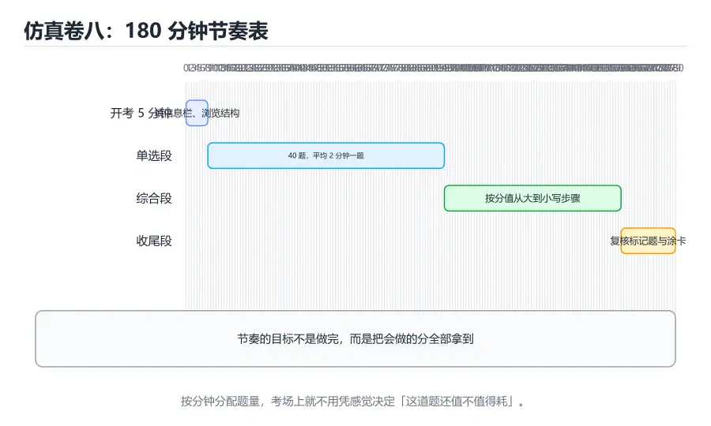

# 408 仿真模拟卷（八）：180 分钟节奏表与全卷复盘



> 内容更新时间：2026-10-06 · 学习阶段：冲刺 · 预计用时：60 分钟

本套卷为自主编写的仿真卷，题量、分值结构按公开考纲口径描述，具体题目、时间与场景设定均为原创命题，不来自任何官方命题内容。仿真卷八练的不是某一道题，而是 180 分钟这笔时间该怎么花、考完怎么复盘。

## 本节知识框架

**课程定位**：所属分类 `408_mock`（考研 408 仿真试卷），课程主题 `408 仿真模拟卷（八）：180 分钟节奏表与全卷复盘`，学习阶段 冲刺，建议用时 60 分钟。408 专业课一场 180 分钟，卷面 150 分：40 道单选题共 80 分，7 道综合应用题共 70 分；四科分值按公开大纲是数据结构 45、计算机组成原理 45、操作系统 35、计算机网络 25。前七套仿真卷练的是「会不会」，本套练的是「在时间压力下能不能把会做的分全部拿到」。

配图是一条时间轴，四段依次是开考 5 分钟（画到 8 分钟处）、单选段 87 分钟、综合段 65 分钟、收尾段 20 分钟，四段首尾相接正好 180。轴的读法是「先给分值定价，再按价格发时间」：单选每题 2 分、综合每题平均 10 分，但综合段的分钟数是按 70 分总量摊的，不是按 7 道题摊的，所以一段之内的题目顺序会显著影响得分。

类比：180 分钟像一张固定额度的预算表。把单选段当作「小额高频支出」，每笔 130 秒左右，超支一笔要立刻在项目内平账；把综合段当作「大额低频支出」，一笔平均 9 分钟，允许在题干明确的某一问上追加，但追加的钱必须从后面的题目里扣。收尾段是「预留金」，不动用它，考试的最后一个动作是核对而不是解题。

**学完本课应当能够**

- 按四段时间分配说出每段的起止时刻与时长，并解释为什么单选段要先于综合段完成。
- 用分钟数与分值算出两段的「每分耗时」，并据此判断时间压力落在哪一段。
- 把一道题的超时换算成丢掉的分数，从而在考场上做出「继续做还是跳过」的决策。
- 用六类失分归因复盘一套整卷，指出每类失分对应的下一步训练动作。

### 复习清单

- [ ] 默写四段时间分配的起止时刻，并说出每段结束时应该做到第几题。
- [ ] 手算单选段每题的时间预算与两段的每分耗时，比较哪个更紧。
- [ ] 把「一道题卡 5 分钟」换算成时间超支与对应的分数损失。
- [ ] 说出涂卡的两种做法各自的失败模式，并给出本课建议的做法。
- [ ] 用六类归因给上一套仿真卷的每道错题贴标签，统计各类数量。

## 核心概念定义

| 术语 | 白话解释与操作性定义 | 常见边界与风险 |
| --- | --- | --- |
| 单选段 | 40 道单选题的作答窗口，本课按 87 分钟计。 | 易错：把它当「先做完再说」的段落，综合段就会被压缩。 |
| 综合段 | 7 道综合应用题的作答窗口，本课按 65 分钟计。 | 易错：按题数而不是分值分配，容易在最后一题上重投入。 |
| 收尾段 | 最后 20 分钟，只用于复核标记题与补涂卡。 | 易错：把它当作「再解一道大题」的机动时间。 |
| 时间预算 | 每类题单位分值上允许花掉的分钟数。 | 易错：预算没有超支规则，等于没有预算。 |
| 每分耗时 | 一段的分钟数除以该段的分值总额。 | 易错：除以题量得到的是每题分钟数，两者不可混用。 |
| 有效作答时间 | 总时长扣掉浏览与收尾后真正解题的分钟数。 | 易错：用 180 分钟直接除题量，会系统性高估可用时间。 |
| 步骤分 | 综合题按过程给分，结果错不必然整题零分。 | 易错：只写最终数字不给公式，步骤分拿不到。 |
| 标记题 | 考场上主动跳过、留给收尾段再看的题号。 | 易错：标记超过 5 道题，收尾段就看不完。 |
| 平账 | 在某题上超支后，从后续同类题里扣回时间。 | 易错：只超支不平账，最后一段必然写不完。 |
| 六类归因 | 单位没换算、条件看漏、公式记错、步骤分丢、时间超支、方向蒙错。 | 易错：只按科目分类，看不出同一个错因反复出现。 |

## 原理与运行机制

### 机制一：先给分值定价，再按价格发时间

四段的时长依次是 8、87、65、20 分钟，加总正好 180。单选段 87 分钟对 40 道题，每题 2.175 分钟即约 130.5 秒；对 80 分则是 1.0875 分钟每分。综合段 65 分钟对 70 分，是 0.9286 分钟每分。综合段每一分允许的时间比单选段少 0.159 分钟，即约 9.5 秒，这就是「综合段更紧」的量化含义：不是题更难，而是单位分值上的时间更少。

因此综合段的正确打开方式不是从第 41 题按序做到第 47 题，而是按分值与把握度排序：先写有把握的高分大题的第一问，把步骤分拿到手，再回头补低分题的最后一问。把这段的顺序交给「题目印刷顺序」，等于把定价权交给出题人。

### 机制二：超支必须换算成分数才能决策

一道单选题的预算是 130.5 秒。做了 5 分钟（300 秒）还没头绪，超支 169.5 秒；这 169.5 秒在单选段等于 169.5 / 130.5 ≈ 1.3 道题，即约 2.6 分。也就是说，继续在一道题上耗下去的代价不是「这道题可能拿 2 分」，而是「用 2.6 分的确定性去换 2 分的可能性」。同样的换算适用于综合段：某一问多花 6 分钟，就少 6 分钟给后面按 0.93 分钟每分定价的问题，账面损失约 6.5 分。

这个换算的作用是把「再看看」这种情绪判断换成一个可比较的数字。考场上不需要算精确，只需要记住两条：单选一道题超时两倍就等于再丢一道题，综合段超时的损失比单选段更大。

### 机制三：收尾段是预留金，不是机动时间

最后 20 分钟要办三件事：把 40 个单选空核对一遍涂卡位置、回看标记题、补齐综合题里空着的公式行。只涂卡这一项，40 个空按每个 15 秒计是 600 秒即 10 分钟，占掉收尾段的一半。所以「做完再统一涂卡」在这张预算表里根本不成立——它需要的 10 分钟正是预留金本身。稳妥的做法是做完单选段就涂一次卡，收尾段只核对与补涂。

标记题的处理顺序也要预先定：先看题号回到原题，重读题干的一个关键条件，如果 60 秒内没有新思路就按已有判断保留，把时间给下一道标记题。收尾段最大的风险不是错，而是把时间还给已经确定的题反复改答案。

### 机制四：复盘按错因而非按科目分类

一套整卷做完，把每道错题贴上六类标签之一。单位没换算对应仿真卷七的四类计算题；条件看漏通常发生在「不计控制器开销」「页表初始为空」这类限定语上；公式记错要回到定义重写；步骤分丢是综合题特有的，训练动作是把评分点写进解答；时间超支要用本课的换算复算；方向蒙错则是概率题与判断题的第四种失分。六类的处置动作完全不同：前两类靠读题流程，中间两类靠知识，后两类靠时间与策略。只按科目统计，就永远看不出「这套卷 6 道错题里 4 道是读题漏条件」。

## 典型应用场景

| 场景 | 本课的做法 | 反例与代价 |
| --- | --- | --- |
| 单选段遇到没思路的题 | 超过 2.175 分钟两倍即标记跳过，段落结束前不回头。 | 耗 5 分钟不换等于丢掉约 2.6 分的确定分。 |
| 综合段起点 | 先扫 7 题的分值与小问数，按把握度排序作答。 | 按印刷顺序做，最后一题常常只剩 5 分钟。 |
| 涂卡 | 单选段结束涂一次，收尾段核对补涂。 | 交卷前统一涂，需要的 10 分钟正吃掉预留金。 |
| 目标分反推 | 用每分耗时算各段需要拿到多少分、花多少时间。 | 只写「考 120」不换算，时间与分数对不上。 |
| 整卷复盘 | 六类归因贴标签并统计数量，下一套只练最多的那类。 | 按科目统计，看不出反复出现的同一错因。 |

场景之外还有一条通用规则：任何一次模拟都要用真实时段闭卷连做 180 分钟。把整卷拆成三段分开做，练的是解题而不是节奏，考前最后一次拆卷练习往往会让真实考场的体感失控。

## 代码/协议/SQL 示例

下面这段 Python 把本课的四个数一次算出来：四段的分界时刻、有效作答时间、两段的每分耗时、超时换算与目标分反推。

```python
TOTAL, INTRO, TAIL = 180, 8, 20
MC_MIN, SUBJ_MIN = 87, 65
MC_Q, MC_MARK, SUBJ_MARK = 40, 80, 70

a, b, c, d = INTRO, INTRO + MC_MIN, INTRO + MC_MIN + SUBJ_MIN, TOTAL
print(int(a), int(b), int(c), int(d))

per_q = MC_MIN / MC_Q
print(round(per_q, 4), round(per_q * 60, 2))
print(round(MC_MIN / MC_MARK, 4), round(SUBJ_MIN / SUBJ_MARK, 4))
print(int(TOTAL - INTRO - TAIL))

over = (300 - per_q * 60) / (per_q * 60)
print(round(over, 4), round(over * 2, 2))

for target in (110, 120):
    need = (target - MC_MARK) / SUBJ_MARK * SUBJ_MIN
    print(target, round(need, 4))

sheet = MC_Q * 15 / 60
print(round(sheet, 2), round(TAIL - sheet, 2))
```

运行输出：

```text
8 95 160 180
2.175 130.5
1.0875 0.9286
152
1.2989 2.6
110 27.8571
120 37.1429
10.0 10.0
```

逐行读法：第一行是四段的分界时刻（单选段 8 到 95、综合段 95 到 160、收尾段 160 到 180）；第二行是单选每题 2.175 分钟与 130.5 秒；第三行是两段各自的每分耗时；第四行是扣掉浏览与收尾后的 152 分钟有效作答时间；第五行是超时 169.5 秒折成的题数与分数；第六、七行是目标 110 分与 120 分时综合段需要投入的分钟数；第八行是涂卡需要的 10 分钟与剩下的 10 分钟复核时间。

## 时间/空间复杂度或性能分析

**整卷时间账。** 180 分钟里真正解题的只有 152 分钟：浏览 8 分钟、收尾 20 分钟是固定支出。152 分钟按两段定价展开，单选 80 分与综合 70 分各自拿到的时间是 87 与 65 分钟。如果把浏览压到 3 分钟、收尾压到 10 分钟，看似多出 17 分钟，但涂卡与漏读条件的代价通常大于这 17 分钟的期望收益。

**目标分的可行性。** 想在单选拿满 80 分的前提下考到 120 分，综合段需要 40 分；按 0.9286 分钟每分定价，这需要 37.14 分钟，占综合段 65 分钟的 57%。目标 110 分只需 27.86 分钟。两条结论合起来说明：120 分的时间瓶颈不在总量而在综合段的排序，把最有把握的两道大题放在前面完成，37 分钟的产出目标才是现实的。

**建议用时。** 本课 6 题建议 18 分钟：四道数值单选每题 2 分钟，代码阅读 4 分钟，多选与排序各 3 分钟。本课的题不要边查表边做——考场上没有节奏表可查，数字要能默写出来才算掌握。

## 常见误区与易错点

- **用 180 分钟除题量**：得 2.25 分钟每题，看起来和单选预算差不多，实际把浏览与收尾都算进了解题时间。
- **按题量给综合段分配**：7 道题各 9 分钟，与按分值摊的 0.93 分钟每分不是一回事，遇到 14 分的大题就会瞬间超支。
- **超时不平账**：一道题多花 3 分钟，不在段落内扣回，最后一定牺牲综合题的最后一问。
- **把步骤分想成全有或全无**：结果错但公式与代入正确，通常仍能拿到该问的一半分，前提是过程写全。
- **交卷前统一涂卡**：40 个空要 10 分钟，正好是收尾段的一半，一旦综合题没写完，涂卡时间也保不住。
- **标记题不设上限**：标 10 道题等于收尾段每题只有 2 分钟，什么都看不完。
- **复盘按科目分类**：看不出「6 道错题里 4 道是读题漏条件」这种集中在错因上的问题。

## 与其他知识点的关系

本课是前七套仿真卷的收口。卷一给分值地图，卷二到卷七分别专攻算法设计、Cache 地址、页面置换与磁盘调度、分层封装与子网、跨科综合、四类计算公式，本课把这些专攻放回 180 分钟的约束里：同一道题会不会做与来不来得及做是两件事，必须分别练。

与仿真卷七的连接最直接：那里丢分的主因是单位没对齐，这里丢分的主因是时间没平账，两者在考场上互为放大器——时间紧的人会跳过单位检查，单位反复出错的人会超时。仿真卷二的算法大题则是最容易超支的一题，因为它的一问「证明正确性」既费时间又难以半途收分，节奏上通常放在综合段的中段而不是开头。

**前置知识**：`408_mock_set1`（全卷分值地图与四科均衡题，本课的时间分配建立在那张分值地图上）、`408_mock_set7`（四类高难计算题的公式与单位，超时最常见的现场就是算错单位后重算）。

**横向关联**：

- 综合题步骤分（`408_mock_set2`）：算法大题的小问分值与作答范式决定了综合段的排序策略。
- 跨科综合题（`408_mock_set6`）：一条链式大题里四个环节的耗时差异极大，跳过某一问的代价要用本课的换算衡量。
- 考纲与题型（`408_exam_overview`）：40 单选 80 分、7 综合 70 分、四科 45/45/35/25 的口径出自这一课，本课不重复论证。

## 自测题与参考答案

本仿真卷共 6 道题，先按建议用时 18 分钟闭卷做完，再逐题核对选项原文与解析。

### 自测 1（单选题 · 考试节奏）

按本课节奏表，单选段用 87 分钟做完 40 道单选题，平均每道题的时间预算是多少？

- A. 1.09 分钟，由每道题的分值 2 分除以总分钟数得到
- B. 2.00 分钟，因为每道单选题在卷面上值 2 分
- C. 3.50 分钟，因为把综合段的 65 分钟也摊进了单选题
- D. 2.175 分钟约 130.5 秒，由 87 分钟除以 40 道题得出

**参考答案**：D，即「2.175 分钟约 130.5 秒，由 87 分钟除以 40 道题得出」

### 自测 2（单选题 · 跨科规范）

综合段用 65 分钟争 70 分，单选段用 87 分钟争 80 分，两段的每分耗时相比是哪一项？

- A. 综合段约 0.93 分钟每分，比单选段约 1.09 分钟每分更紧
- B. 综合段约 1.09 分钟每分，比单选段约 0.93 分钟每分更紧
- C. 两段相同，都是 1 分钟争 1 分，区别只在题量与题型
- D. 单选段约 0.93 分钟每分，比综合段约 1.09 分钟每分更宽松

**参考答案**：A，即「综合段约 0.93 分钟每分，比单选段约 1.09 分钟每分更紧」

### 自测 3（代码阅读题 · 考试节奏）

下面这段 Python 算四段分界时刻与两段的每分耗时，输出对应哪一项？

题面代码：

```python
TOTAL, INTRO, TAIL = 180, 8, 20
MC, SUBJ = 87, 65
print(INTRO + MC + SUBJ + TAIL, TOTAL - INTRO - TAIL)
print(round(MC / 40, 4), round(SUBJ / 70, 4))
```

- A. 输出 180 152 与 2.175 0.9286，后一行是每道综合题的平均分钟数
- B. 输出 180 160 与 2.175 0.9286，第二个数只减收尾段而没减浏览段
- C. 输出 180 152 与 2.175 0.9286，前一行后一个数是扣掉浏览与收尾的作答分钟数
- D. 输出 172 152 与 2.175 1.0875，把综合段的耗时按单选段口径摊了一遍

**参考答案**：C，即「输出 180 152 与 2.175 0.9286，前一行后一个数是扣掉浏览与收尾的作答分钟数」

### 自测 4（单选题 · 考试节奏）

一道单选题耗掉 5 分钟而预算是 130.5 秒，超出的时间相当于丢掉多少单选分数？

- A. 约 1.3 分，因为超出的时间正好折成 1.3 道题
- B. 约 3.0 分，因为每道题值 2 分，超时的题必定做错
- C. 约 5.0 分，因为这道题本身的分值加上下一题的分值
- D. 约 2.6 分，超出的 169.5 秒相当于 1.3 道题的时间预算

**参考答案**：D，即「约 2.6 分，超出的 169.5 秒相当于 1.3 道题的时间预算」

### 自测 5（多选题 · 跨科规范）

关于整卷模拟与考后复盘，下列说法正确的有哪些？

- A. 把错题按单位没换算、条件看漏、公式记错、步骤分丢、时间超支、方向蒙错六类归因，比只按科目分类更能指出训练动作
- B. 综合应用题只要最终结果算错就整题零分，过程写在答题纸上没有意义
- C. 模拟要用真实时段闭卷连做满 180 分钟，拆成三段分开做练不出节奏
- D. 单选题全部做完后统一涂卡更省时间，也更能避免涂错位
- E. 收尾段先看标记题的题号回到原题，重读一个关键条件，60 秒内没新思路就保留已有判断

**参考答案**：A C E，即 A「把错题按单位没换算、条件看漏、公式记错、步骤分丢、时间超支、方向蒙错六类归因，比只按科目分类更能指出训练动作」 → C「模拟要用真实时段闭卷连做满 180 分钟，拆成三段分开做练不出节奏」 → E「收尾段先看标记题的题号回到原题，重读一个关键条件，60 秒内没新思路就保留已有判断」

### 自测 6（排序题 · 考试节奏）

把「开考后前 8 分钟」的四个动作按先后顺序排列：

- A. 填姓名、准考证号与科目栏，先把身份信息落实
- B. 翻到综合题，按分值与小问数扫一遍，心里排出作答顺序
- C. 通览单选部分的页数与题数，确认没有缺页漏印
- D. 把明显没思路的题号先标出来，正式作答时按标记跳过

**参考答案**：A C B D，即 A「填姓名、准考证号与科目栏，先把身份信息落实」 → C「通览单选部分的页数与题数，确认没有缺页漏印」 → B「翻到综合题，按分值与小问数扫一遍，心里排出作答顺序」 → D「把明显没思路的题号先标出来，正式作答时按标记跳过」

## 考点精讲

本仿真卷题库共 6 道题，下面逐题复述题干原文、答案字母（A 是第 1 个选项）与判断依据，字段内容与题库完全一致。

### 考点 1（单选题 · 考试节奏）

- **题干**：按本课节奏表，单选段用 87 分钟做完 40 道单选题，平均每道题的时间预算是多少？
- **选项原文**：A. 1.09 分钟，由每道题的分值 2 分除以总分钟数得到　B. 2.00 分钟，因为每道单选题在卷面上值 2 分　C. 3.50 分钟，因为把综合段的 65 分钟也摊进了单选题　D. 2.175 分钟约 130.5 秒，由 87 分钟除以 40 道题得出
- **答案**：D
- **正确项原文**：D. 2.175 分钟约 130.5 秒，由 87 分钟除以 40 道题得出
- **判断依据**：本题正确项是「2.175 分钟约 130.5 秒，由 87 分钟除以 40 道题得出」。时间预算只跟本段的分钟数与本段的题量有关，87 / 40 = 2.175 分钟，换算成秒再乘 60 得 130.5 秒。干扰项「1.09 分钟，由每道题的分值 2 分除以总分钟数得到」把「分钟除以分值」当成了「分钟除以题量」，1.0875 这个数字本身是每分耗时而不是每题预算；干扰项「2.00 分钟，因为每道单选题在卷面上值 2 分」把分值与分钟数直接对齐，两者之间没有任何换算关系；干扰项「3.50 分钟，因为把综合段的 65 分钟也摊进了单选题」用的是全卷总时长而不是单选段时长，等于取消了分段预算。

### 考点 2（单选题 · 跨科规范）

- **题干**：综合段用 65 分钟争 70 分，单选段用 87 分钟争 80 分，两段的每分耗时相比是哪一项？
- **选项原文**：A. 综合段约 0.93 分钟每分，比单选段约 1.09 分钟每分更紧　B. 综合段约 1.09 分钟每分，比单选段约 0.93 分钟每分更紧　C. 两段相同，都是 1 分钟争 1 分，区别只在题量与题型　D. 单选段约 0.93 分钟每分，比综合段约 1.09 分钟每分更宽松
- **答案**：A
- **正确项原文**：A. 综合段约 0.93 分钟每分，比单选段约 1.09 分钟每分更紧
- **判断依据**：本题正确项是「综合段约 0.93 分钟每分，比单选段约 1.09 分钟每分更紧」。65 / 70 = 0.9286，87 / 80 = 1.0875，综合段每一分允许的时间少了约 9.5 秒，所以更紧；注意「更紧」说的是单位分值的时间余量，不是题目难度。干扰项「综合段约 1.09 分钟每分，比单选段约 0.93 分钟每分更紧」把两段的分子分母对调了，比值随之颠倒；干扰项「两段相同，都是 1 分钟争 1 分，区别只在题量与题型」把两段近似看成相等，抹掉了那 0.16 分钟每分的差；干扰项「单选段约 0.93 分钟每分，比综合段约 1.09 分钟每分更宽松」不仅数值挂错了段，结论方向也反了，宽松的一方应是每分耗时更大的单选段。

### 考点 3（代码阅读题 · 考试节奏）

- **题干**：下面这段 Python 算四段分界时刻与两段的每分耗时，输出对应哪一项？
- **选项原文**：A. 输出 180 152 与 2.175 0.9286，后一行是每道综合题的平均分钟数　B. 输出 180 160 与 2.175 0.9286，第二个数只减收尾段而没减浏览段　C. 输出 180 152 与 2.175 0.9286，前一行后一个数是扣掉浏览与收尾的作答分钟数　D. 输出 172 152 与 2.175 1.0875，把综合段的耗时按单选段口径摊了一遍
- **答案**：C
- **正确项原文**：C. 输出 180 152 与 2.175 0.9286，前一行后一个数是扣掉浏览与收尾的作答分钟数
- **判断依据**：本题正确项是「输出 180 152 与 2.175 0.9286，前一行后一个数是扣掉浏览与收尾的作答分钟数」。第一行 8 + 87 + 65 + 20 = 180 是四段总长，180 − 8 − 20 = 152 是有效作答分钟数；第二行 87 / 40 = 2.175 是每题预算，65 / 70 = 0.9286 是综合段的每分耗时。干扰项「输出 180 152 与 2.175 0.9286，后一行是每道综合题的平均分钟数」数字全对但解释错了一半：第二个数是 65 除以分值 70 而不是除以题量 7，按题量摊应是约 9.3 分钟每题；干扰项「输出 180 160 与 2.175 0.9286，第二个数只减收尾段而没减浏览段」给出的 160 对应 180 − 20，代码里 INTRO 也参与了减法；干扰项「输出 172 152 与 2.175 1.0875，把综合段的耗时按单选段口径摊了一遍」的两个数分别对应漏减收尾段（180 − 8 = 172）与用 87 除以分值 80，都不是这段代码实际算出的结果。

### 考点 4（单选题 · 考试节奏）

- **题干**：一道单选题耗掉 5 分钟而预算是 130.5 秒，超出的时间相当于丢掉多少单选分数？
- **选项原文**：A. 约 1.3 分，因为超出的时间正好折成 1.3 道题　B. 约 3.0 分，因为每道题值 2 分，超时的题必定做错　C. 约 5.0 分，因为这道题本身的分值加上下一题的分值　D. 约 2.6 分，超出的 169.5 秒相当于 1.3 道题的时间预算
- **答案**：D
- **正确项原文**：D. 约 2.6 分，超出的 169.5 秒相当于 1.3 道题的时间预算
- **判断依据**：本题正确项是「约 2.6 分，超出的 169.5 秒相当于 1.3 道题的时间预算」。5 分钟是 300 秒，减去 130.5 秒的预算得超支 169.5 秒；再除以每题预算得 169.5 / 130.5 = 1.2989 道题，每题值 2 分，所以账面损失约 2.6 分。干扰项「约 1.3 分，因为超出的时间正好折成 1.3 道题」把题数当成分数，1.2989 的单位是道题而不是分；干扰项「约 3.0 分，因为每道题值 2 分，超时的题必定做错」引入了一条题面没有的假设，超时与做错之间没有必然关系，损失只应算被占用的时间；干扰项「约 5.0 分，因为这道题本身的分值加上下一题的分值」把已经花在这道题上的 2 分也算进损失，而这 2 分是预算内本就要付出的。

### 考点 5（多选题 · 跨科规范）

- **题干**：关于整卷模拟与考后复盘，下列说法正确的有哪些？
- **选项原文**：A. 把错题按单位没换算、条件看漏、公式记错、步骤分丢、时间超支、方向蒙错六类归因，比只按科目分类更能指出训练动作　B. 综合应用题只要最终结果算错就整题零分，过程写在答题纸上没有意义　C. 模拟要用真实时段闭卷连做满 180 分钟，拆成三段分开做练不出节奏　D. 单选题全部做完后统一涂卡更省时间，也更能避免涂错位　E. 收尾段先看标记题的题号回到原题，重读一个关键条件，60 秒内没新思路就保留已有判断
- **答案**：A C E
- **正确项原文**：A. 把错题按单位没换算、条件看漏、公式记错、步骤分丢、时间超支、方向蒙错六类归因，比只按科目分类更能指出训练动作；C. 模拟要用真实时段闭卷连做满 180 分钟，拆成三段分开做练不出节奏；E. 收尾段先看标记题的题号回到原题，重读一个关键条件，60 秒内没新思路就保留已有判断
- **判断依据**：本题要同时选中「把错题按单位没换算、条件看漏、公式记错、步骤分丢、时间超支、方向蒙错六类归因，比只按科目分类更能指出训练动作」、「模拟要用真实时段闭卷连做满 180 分钟，拆成三段分开做练不出节奏」与「收尾段先看标记题的题号回到原题，重读一个关键条件，60 秒内没新思路就保留已有判断」。第一项的要点是不同错因的处置动作不同，按科目分堆会让四类本可避免的失分混在一起；第二项里节奏感只能来自连续 180 分钟的体力与决策压力，拆开做时段的疲劳因素不存在；第三项给收尾段定了可执行的两步——回到题干条件与设定止损时间，避免在已确定答案上反复改动。干扰项「综合应用题只要最终结果算错就整题零分，过程写在答题纸上没有意义」与按步骤给分的评分方式相反，公式、代入、结论分别是独立评分点；干扰项「单选题全部做完后统一涂卡更省时间，也更能避免涂错位」恰恰放大了风险，40 个空按每空 15 秒算要 10 分钟，一旦综合题没写完就同时失去涂卡时间与检查时间。

### 考点 6（排序题 · 考试节奏）

- **题干**：把「开考后前 8 分钟」的四个动作按先后顺序排列：
- **选项原文**：A. 填姓名、准考证号与科目栏，先把身份信息落实　B. 翻到综合题，按分值与小问数扫一遍，心里排出作答顺序　C. 通览单选部分的页数与题数，确认没有缺页漏印　D. 把明显没思路的题号先标出来，正式作答时按标记跳过
- **答案**：A C B D
- **正确序号**：A C B D
- **作答顺序原文**：A「填姓名、准考证号与科目栏，先把身份信息落实」 → C「通览单选部分的页数与题数，确认没有缺页漏印」 → B「翻到综合题，按分值与小问数扫一遍，心里排出作答顺序」 → D「把明显没思路的题号先标出来，正式作答时按标记跳过」
- **判断依据**：本题顺序是「填姓名、准考证号与科目栏，先把身份信息落实」 → 「通览单选部分的页数与题数，确认没有缺页漏印」 → 「翻到综合题，按分值与小问数扫一遍，心里排出作答顺序」 → 「把明显没思路的题号先标出来，正式作答时按标记跳过」。身份信息必须第一个填，因为答题卡一旦漏填或填错，后面所有努力都无处可用；接着核对卷面完整，缺页漏印要在开考前举手而不是做完才发现；之后再扫综合题，因为排序的前提是知道每道题的分值与小问数；最后一步的放弃标记必须建立在已经通览全部题面之后，先标记再浏览会把「其实会做」的题也划进放弃名单。把 B 放到最前面是最常见的错序，代价是填信息与核对完整性被推迟到动笔之后。

## 术语速查

| 术语 | 一句话说明 |
| --- | --- |
| 单选段 | 40 道单选题的作答窗口，本课按 87 分钟计。 |
| 综合段 | 7 道综合题的作答窗口，本课按 65 分钟计。 |
| 收尾段 | 最后 20 分钟，只做核对、补涂与看标记题。 |
| 每题预算 | 本段分钟数除以本段题量，单选段是 2.175 分钟。 |
| 每分耗时 | 本段分钟数除以本段分值，综合段是 0.9286。 |
| 有效作答时间 | 180 减去浏览 8 与收尾 20，得 152 分钟。 |
| 平账 | 超时后在同段内扣回时间，而不是全局挪用。 |
| 标记题 | 主动跳过、留给收尾段再看，数量应控制在 5 道内。 |
| 步骤分 | 综合题按公式、代入、结论分别给分的过程分。 |
| 六类归因 | 单位、条件、公式、步骤、时间、蒙题方向六种错因。 |

## 参考资料与复核

- 最后复核：2026-10-04
- 下次复核：2027-01-24
- 复核范围：四段 8/87/65/20 的时长与分界时刻、两段的每分耗时、超时 3 分钟的分数换算、110 与 120 分目标下的综合段时间需求。
- 来源性质：官方招考页与公开教材页；本课核对关键词：152、2.175、0.9286、1.2989、37.1429。

| 参考资料 | 本课用途 |
| --- | --- |
| [中国研究生招生信息网 研招频道](https://yz.chsi.com.cn/kyzx/) | 初试科目时长与组织安排的官方口径 |
| [中国研究生招生信息网 招考动态](https://yz.chsi.com.cn/kyzx/jyxd/) | 考试时间安排与考场规则的发布页 |
| [Jeff Edmonds 算法教材目录页](https://jeffe.cs.illinois.edu/teaching/algorithms/) | 综合题「先陈述再证明」的作答范式与评分点写法 |

## 内容元数据

> 内容更新时间：2026-10-06 · 学习阶段：冲刺 · 预计用时：60 分钟

- 内容版本：v2.0
- 分类归属：`408_mock`（考研 408 仿真试卷），本套为仿真卷八，是前七套的时间约束收口
- 命题性质：自主命题的仿真卷，时长分配与复盘口径为本课建议值，不引用官方命题内容
- 科目权重：考试节奏 4 题、跨科规范 2 题
- 题量与题型：6 题（单选 3 题、代码阅读 1 题、多选 1 题、排序 1 题），单选答案下标为 3、0、3
- 建议使用方式：18 分钟闭卷完成，随后用本课代码段复算一遍四段时长
- 相关主题：180 分钟节奏、分值定价、时间超支换算、涂卡与收尾、六类失分归因

- [ ] 默写四段的起止时刻与时长，说出每段结束时应做到第几题。
- [ ] 手算两段每分耗时与一道单选题每题预算，并比较时间压力。
- [ ] 给最近一套模拟卷的错题贴六类标签，统计各类数量。
