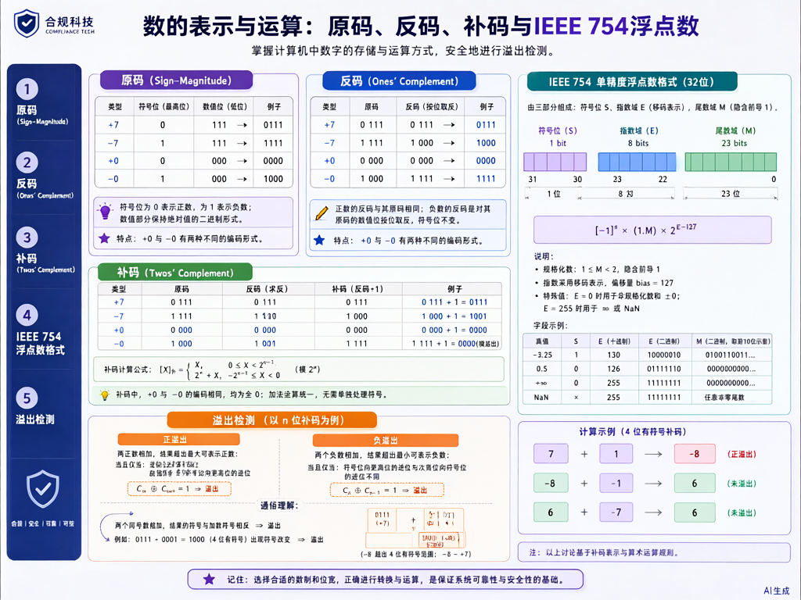

# 操作系统：内存管理



> 内容更新时间：2026-10-06 · 学习阶段：冲刺 · 预计用时：45 分钟

## 本节知识框架

**课程定位**：所属分类 `408_exam`（考研 408 冲刺专题），课程主题 `操作系统：内存管理`，学习阶段 冲刺，建议用时 45 分钟。

本课主线：连续分配方式（单一/多重分区）、离散分配方式（分页/分段）、页面置换算法（FIFO/LRU/OPT/CLOCK）、虚拟内存机制。

**学完本课应当能够**
- 说清 `分页存储` 与 `分段存储` 的核心区别，并各举一个适用场景。
- 用 `OPT`、`FIFO`、`LRU`、`CLOCK` 算法模拟页面置换过程，计算缺页次数。
- 遇到「逻辑地址到物理地址转换」这类问题时，能画出页表查找的完整流程。

### 复习清单

- [ ] 能不看正文复述本课核心概念，并指出一个边界或反例。
- [ ] 能推演本课示例：先写预期输出，再运行并记录差异。
- [ ] 能完成一次自测，并把错题对照错误表定位原因。

## 核心概念定义

| 术语 | 一句话说明 |
| --- | --- |
| 连续分配 | 为进程分配一段连续的内存空间，包括单一连续分配和多重分区分配两种方式。 |
| 分页存储 | 将物理内存和逻辑地址空间分别划分为固定大小的页框和页面，通过页表实现地址映射。 |
| 分段存储 | 按程序的逻辑结构划分为若干段，每段有独立的名字和长度，段表记录基址和段长。 |
| 页面置换算法 | 当发生缺页中断且内存已满时，选择某个页面淘汰以腾出空间的策略。 |
| 虚拟内存 | 利用部分装入和部分置换技术，使进程在比实际物理内存更大的逻辑地址空间上运行。 |
| 缺页中断 | 当进程访问的页面不在物理内存中时，由硬件触发的异常，操作系统接管后将页面调入。 |
| 页表 | 记录页面到页框映射关系的数据结构，每个进程拥有独立的页表。 |
| TLB | 快表（Translation Lookaside Buffer），页表的高速缓存，加速地址转换过程。 |

## 原理与运行机制

### 机制总览：内存管理层次

内存管理从简单到复杂可分为三个层次：连续分配、离散分配、虚拟内存。连续分配是最早的方式，包括单一连续分配（只支持单道程序）和多重分区分配（支持多道程序）。离散分配允许进程分散地分布在物理内存中，包括分页、分段和段页式。虚拟内存则在离散分配的基础上，利用磁盘扩展逻辑内存，实现按需调页。

### 连续分配管理方式

**单一连续分配**：整个用户空间只有一道程序占用，内存分为系统区和用户区，系统区在低地址，用户区占全部剩余空间。优点是简单、无外部碎片；缺点是只能串行执行，内存利用率极低。

**固定分区分配**：将用户空间预先划分为若干固定大小的分区，每个分区装入一道程序。分区大小可以相同（内部碎片严重）或不同（减少内部碎片）。当所有分区都满时，新程序必须等待。

**动态分区分配**：根据进程实际需要动态分配内存，不预先划分分区。常用分配算法如下：

| 算法 | 策略 | 优点 | 缺点 |
| --- | --- | --- | --- |
| 首次适应（FF） | 从低地址开始找第一个够大的空闲分区 | 优先利用低地址，保留高地址大块 | 低地址碎片多 |
| 最佳适应（BF） | 找最小的够大的空闲分区 | 尽量不浪费大块 | 产生大量无法利用的小碎片 |
| 最坏适应（WF） | 找最大的空闲分区 | 剩余部分仍可能较大可用 | 破坏大块，后续大需求无法满足 |
| 循环首次适应（NF） | 从上次分配位置开始查找 | 分配更均匀 | 难以利用大块空闲区 |

空闲分区管理方式：链表法（按地址递增或按容量递增）和位示图法。

### 分页存储管理

分页存储管理将内存分为固定大小的物理块（页框），逻辑地址空间分为同样大小的页。页表记录每页对应的物理块号。

**逻辑地址结构**：逻辑地址 = 页号 P + 页内偏移 W。若页面大小为 4KB（2^12），则低 12 位为页内偏移，高位为页号。

**地址转换过程**：
1. 从逻辑地址提取页号 P 和页内偏移 W。
2. 查页表得到物理块号 B。
3. 物理地址 = B × 页面大小 + W。

```c
/* 分页地址转换模拟 */
#define PAGE_SIZE 4096  /* 4KB 页面 */
#define PAGE_OFFSET_MASK 0xFFF

typedef struct {
    unsigned int frame_number;  /* 物理块号 */
    int valid;                  /* 有效位：1=在内存，0=不在 */
} PageTableEntry;

unsigned int translate(PageTableEntry page_table[], unsigned int logical_addr) {
    unsigned int page_number = logical_addr / PAGE_SIZE;
    unsigned int offset = logical_addr & PAGE_OFFSET_MASK;

    if (!page_table[page_number].valid) {
        /* 触发缺页中断，由操作系统处理 */
        return 0xFFFFFFFF;
    }

    unsigned int physical_addr =
        page_table[page_number].frame_number * PAGE_SIZE + offset;
    return physical_addr;
}
```

**多级页表**：当地址空间很大时，页表本身占用大量内存。多级页表将页表分页，只将活跃部分驻留内存。例如 32 位地址空间，4KB 页面，一级页表需 2^20 项 = 4MB，而两级页表可将常驻部分降到几 KB。

**TLB（快表）**：硬件级缓存，存储最近使用的页表项。地址转换时先查 TLB，命中则直接得到物理块号，无需访问内存中的页表。TLB 命中率通常为 98%~99%，有效访问时间 = 命中率 × 1次内存访问 + 未命中率 × (1次页表访问 + 1次数据访问)。

### 分段存储管理

分段按程序的逻辑结构划分，每段有名字和长度。段表项包含段基址和段长。

**逻辑地址结构**：逻辑地址 = 段号 S + 段内偏移 d。

**地址转换**：
1. 用段号 S 查段表得到段基址 b 和段长 l。
2. 检查 d < l，若越界则触发越界中断。
3. 物理地址 = b + d。

**段页式**：结合分段和分页的优点。先将程序分为若干段，每段再分为若干页。段表项指向页表起始地址，页表项记录物理块号。地址转换需要三次访存：查段表 → 查页表 → 访问数据（无 TLB 时）。

### 页面置换算法

当发生缺页且物理块已满时，需要选择一个页面淘汰。核心目标是最小化缺页率。

**OPT（最佳置换算法）**：淘汰将来最长时间不会被访问的页面。这是理论最优算法，无法实际实现，但用作评价其他算法的标准。

**FIFO（先进先出）**：淘汰最早进入内存的页面。实现简单，但可能淘汰频繁使用的页面，性能较差。存在 Belady 异常：增加物理块数反而缺页率上升。

**LRU（最近最久未使用）**：淘汰最近最长时间未被访问的页面。性能接近 OPT，但实现开销大。常用实现方式有计数器法和栈法。

**CLOCK（时钟算法/二次机会算法）**：LRU 的近似实现。每个页面设一个访问位，按环形队列扫描：若访问位为 1，置 0 并跳过；若为 0，淘汰该页面。改进版本增加修改位，优先淘汰未修改页面（减少磁盘写回开销）。

```python
def lru_page_replacement(pages, frames):
    """LRU 页面置换算法模拟"""
    memory = []
    page_faults = 0

    for page in pages:
        if page in memory:
            # 页面已在内存中，更新为最近使用
            memory.remove(page)
            memory.append(page)
        else:
            page_faults += 1
            if len(memory) >= frames:
                # 淘汰最久未使用的页面（队首）
                memory.pop(0)
            memory.append(page)
        print(f"访问页面 {page}: 内存状态 {memory}, 缺页次数 {page_faults}")

    return page_faults

# 示例：引用串 [7,0,1,2,0,3,0,4]，3 个物理块
result = lru_page_replacement([7,0,1,2,0,3,0,4], 3)
print(f"LRU 总缺页次数: {result}")
```

**OPT 算法模拟示例**：引用串 7,0,1,2,0,3,0,4，3 个物理块。

| 步骤 | 访问页面 | 内存状态 | 是否缺页 | 淘汰页面 | 理由 |
| --- | --- | --- | --- | --- | --- |
| 1 | 7 | [7,-,-] | 是 | - | 空位直接装入 |
| 2 | 0 | [7,0,-] | 是 | - | 空位直接装入 |
| 3 | 1 | [7,0,1] | 是 | - | 空位直接装入 |
| 4 | 2 | [2,0,1] | 是 | 7 | 7 将来不再使用，最远 |
| 5 | 0 | [2,0,1] | 否 | - | 0 已在内存 |
| 6 | 3 | [2,0,3] | 是 | 1 | 1 比 0 和 2 更晚使用 |
| 7 | 0 | [2,0,3] | 否 | - | 0 已在内存 |
| 8 | 4 | [4,0,3] | 是 | 2 | 2 将来不再使用 |

OPT 总缺页次数 = 7。

### 虚拟内存

虚拟内存的核心思想是「部分装入」和「部分置换」：进程无需全部装入内存即可运行，运行中按需将页面从磁盘调入。

**请求分页系统**：在分页系统基础上增加请求调页功能和置换功能。页表项增加状态位（是否在内存）、访问字段（LRU 用）、修改位（脏页需写回磁盘）和外存地址（页面在磁盘上的位置）。

**工作集模型**：进程在某段时间内频繁访问的页面集合称为工作集。操作系统根据工作集大小为进程分配足够的物理块，避免频繁缺页。当所有进程的工作集之和不超过物理内存总量时，系统运行效率最高。

**抖动（颠簸）**：当分配给进程的物理块数不足以容纳其工作集时，进程频繁缺页、刚调出的页面马上又要调入，导致 CPU 利用率急剧下降的现象。解决方法是增大物理块分配或降低多道程序度。

## 时间/空间复杂度或性能分析

**性能关注点（内存管理）**：缺页率、地址转换时间、内存利用率是核心指标。

**测量方法**：
- 地址转换时间：无 TLB 时每次访问需查页表（1 次内存访问）+ 取数据（1 次内存访问）= 2 次内存访问。有 TLB 且命中时仅 1 次内存访问。
- 有效访问时间 EAT = h × (t_TLB + t_mem) + (1-h) × (t_TLB + 2×t_mem + t_page_fault)，其中 h 为 TLB 命中率。
- 缺页率与页面置换算法密切相关：OPT < LRU < CLOCK < FIFO（通常情况）。
- 内存利用率：分页存储存在内部碎片（页内浪费），分段存储存在外部碎片（段间空隙）。

| 算法 | 缺页率（相对） | 实现开销 | 是否可实现 |
| --- | --- | --- | --- |
| OPT | 最低（理论值） | 需预知未来 | 不可实现 |
| LRU | 接近 OPT | 需硬件支持（计数器/栈） | 可实现但开销大 |
| CLOCK | 略高于 LRU | 仅需访问位 | 可实现，开销小 |
| FIFO | 可能 Belady 异常 | 仅需队列 | 可实现，最简单 |

## 常见误区与易错点

| 容易写错的做法 | 实际现象 | 原因与正确做法 |
| --- | --- | --- |
| 分页地址转换忘记加页内偏移 | 得到页框首地址而非正确物理地址 | 物理地址 = 页框首地址 + 页内偏移 |
| 认为 FIFO 不会出现 Belady 异常 | 增加物理块反而缺页增多 | FIFO 是经典反例，OPT 和 LRU 不会出现 |
| 混淆内部碎片和外部碎片 | 选择题丢分 | 分页→内部碎片（最后一页浪费）；分段→外部碎片（空隙无法利用） |
| LRU 用访问时间戳实现时忘记更新 | 淘汰的不是最久未使用的页面 | 每次访问都要更新计数器或栈顶位置 |
| 认为虚拟内存可以无限大 | 忽视磁盘空间和页表开销 | 虚拟地址空间受地址位数限制，实际受磁盘交换区大小限制 |
| 抖动时盲目增加多道程序度 | 抖动更严重 | 应降低多道程序度，给每个进程分配更多物理块 |
| 段页式地址转换只查一次页表 | 忽略段表查找 | 需要先查段表得到页表基址，再查页表得到物理块号 |
| CLOCK 算法只检查访问位一次 | 漏掉改进型 CLOCK 的修改位 | 改进型 CLOCK 优先淘汰未访问且未修改的页面 |

### 误区现场 1：地址转换中的页号计算错误

**症状**：逻辑地址 0x1234，页面大小 4KB，算出页号为 0x12。

**根因**：页面大小 4KB = 2^12 = 4096，页号 = 0x1234 / 4096 = 0x1234 >> 12 = 1（不是 0x12）。正确做法是右移 12 位取高位作为页号，低 12 位作为页内偏移。

**修复**：0x1234 = 4660（十进制），页号 = 4660 / 4096 = 1，偏移 = 4660 % 4096 = 564 = 0x234。

**自检**：地址转换后，物理地址 = 页框号 × 4096 + 偏移，验证偏移是否小于页面大小。

### 误区现场 2：OPT 算法模拟时未看完整引用串

**症状**：判断淘汰页面时只看下一步访问，而非未来所有访问。

**根因**：OPT 要求选择「将来最长时间不被访问」的页面，必须扫描整个未来引用串。

**修复**：对每个内存中的页面，找到它下一次被访问的位置，淘汰下次访问最远的页面。如果某页面将来不再被访问，则优先淘汰它。

**自检**：每步淘汰决策后，确认被淘汰页面在未来引用串中的首次出现位置确实是所有页面中最远的。

### 误区现场 3：混淆分页与分段的地址结构

**症状**：将段内偏移当作页内偏移处理，或反过来。

**根因**：分页的页内偏移由硬件自动拆分（低位），分段的段内偏移需要与段长比较做越界检查。

**修复**：分页——页号 + 页内偏移，偏移无需越界检查（固定大小）；分段——段号 + 段内偏移，偏移必须 < 段长否则越界中断。

### 误区现场 4：认为 LRU 一定比 FIFO 好

**症状**：所有场景都选 LRU。

**根因**：LRU 在大多数情况下优于 FIFO，但存在特殊引用串使两者缺页率相同。且 LRU 实现开销远大于 FIFO。

**修复**：LRU 性能接近 OPT，但需要硬件支持（寄存器或栈），成本高。CLOCK 是 LRU 的低成本近似，实际系统中更常用。

## 典型应用场景

1. **现代操作系统的虚拟内存机制**：Linux/Windows 均采用请求分页式虚拟内存管理，每个进程拥有独立的虚拟地址空间（32 位系统为 4GB），通过多级页表映射到物理内存。当物理内存不足时，利用页面置换算法将不活跃页面换出到磁盘交换区（swap），使系统能运行总内存需求超过物理内存的程序。
2. **数据库缓冲池管理**：MySQL InnoDB、PostgreSQL 等数据库使用缓冲池（Buffer Pool）缓存热点数据页，采用改进的 LRU 算法（如 InnoDB 的 midpoint LRU）管理页面淘汰，避免全表扫描等操作冲刷掉真正的热点数据，显著提升数据库 I/O 性能。
3. **浏览器缓存策略**：浏览器内存缓存和磁盘缓存本质上是页面置换思想的应用。浏览器维护有限大小的缓存空间，当缓存满时根据访问历史决定淘汰哪些页面，LRU 及其变体（如 LFU）是常用策略，直接影响网页加载速度和用户体验。
4. **TLB 在高性能计算中的关键作用**：在大规模矩阵运算、科学计算等场景中，TLB 命中率直接决定地址转换开销。大页（Huge Page，2MB 或 1GB）技术通过减少页表项数量提高 TLB 命中率，是高性能计算和数据库服务器的常见优化手段。

## 代码/协议/SQL 示例

```c
/* 分页存储管理 —— 逻辑地址到物理地址的完整转换流程 */
#include <stdio.h>
#include <stdint.h>

#define PAGE_SIZE    4096   /* 4KB 页面大小 */
#define NUM_PAGES    1024   /* 逻辑页数 */
#define PAGE_OFFSET_MASK (PAGE_SIZE - 1)

typedef struct {
    uint32_t frame_number;  /* 物理块号 */
    uint8_t  valid;         /* 有效位：1=在内存中，0=不在 */
    uint8_t  dirty;         /* 修改位：1=页面被修改过 */
    uint8_t  ref;           /* 引用位：近期被访问过 */
} PageTableEntry;

/* 地址转换：逻辑地址 → 物理地址 */
uint32_t address_translate(PageTableEntry pt[], uint32_t logical_addr,
                           int *page_fault) {
    uint32_t page   = logical_addr / PAGE_SIZE;   /* 高位：页号 */
    uint32_t offset = logical_addr & PAGE_OFFSET_MASK; /* 低位：页内偏移 */

    if (!pt[page].valid) {
        *page_fault = 1;  /* 缺页中断，需操作系统介入 */
        return 0xFFFFFFFF;
    }

    *page_fault = 0;
    return pt[page].frame_number * PAGE_SIZE + offset;
}

/* CLOCK 页面置换算法实现 */
int clock_replace(uint8_t ref_bits[], int frames, int n_pages) {
    int hand = 0, page_faults = 0;
    uint8_t in_mem[frames];
    for (int i = 0; i < frames; i++) in_mem[i] = 0xFF; /* 0xFF=空位 */

    for (int i = 0; i < n_pages; i++) {
        int found = 0;
        for (int j = 0; j < frames; j++) {
            if (in_mem[j] == ref_bits[i]) { found = 1; break; }
        }
        if (!found) {
            page_faults++;
            while (1) {
                if (in_mem[hand] == 0xFF) {
                    in_mem[hand] = ref_bits[i];
                    hand = (hand + 1) % frames;
                    break;
                }
                /* 扫描环形队列，给二次机会 */
                if (ref_bits[hand] == 1) {
                    ref_bits[hand] = 0;
                    hand = (hand + 1) % frames;
                } else {
                    in_mem[hand] = ref_bits[i];
                    hand = (hand + 1) % frames;
                    break;
                }
            }
        }
    }
    return page_faults;
}
```

```python
def opt_page_replacement(pages, frames):
    """OPT 最佳页面置换算法模拟 —— 计算缺页次数"""
    memory = []
    page_faults = 0

    for i, page in enumerate(pages):
        if page in memory:
            continue  # 命中，不缺页
        page_faults += 1
        if len(memory) < frames:
            memory.append(page)
        else:
            # 找出将来最晚被访问的页面进行淘汰
            farthest = -1
            victim = 0
            for j, m_page in enumerate(memory):
                try:
                    next_use = pages[i+1:].index(m_page)
                except ValueError:
                    next_use = float('inf')
                if next_use > farthest:
                    farthest = next_use
                    victim = j
            memory[victim] = page
        print(f"访问 {page}: 内存 {memory}, 缺页 {page_faults}")

    return page_faults

# 示例：引用串 [7,0,1,2,0,3,0,4]，3 个物理块
result = opt_page_replacement([7,0,1,2,0,3,0,4], 3)
print(f"OPT 总缺页次数: {result}")  # 输出: 7
```

## 与其他知识点的关系

| 关联课程/知识点 | 关联内容 | 关联说明 |
| --- | --- | --- |
| 408 计算机组成原理 | Cache 映射与主存-Cache 层次 | 页表与 TLB 的关系类似于主存与 Cache 的映射，TLB 本质是页表的 Cache |
| 408 操作系统：进程管理 | 进程地址空间与上下文切换 | 进程切换时需要切换页表基址寄存器（如 CR3），内存管理与进程管理紧密耦合 |
| 408 计算机组成原理 | 存储器层次结构 | 寄存器→Cache→主存→磁盘的层次结构与虚拟内存的页面调入调出思想一致 |
| 408 数据结构 | 链表与位示图 | 空闲分区管理使用链表法或位示图法，页面置换算法需要队列/栈等数据结构支持 |
| 408 操作系统：进程管理 | 缺页中断与进程调度 | 缺页中断触发后进程进入阻塞态，页面调入就绪后重新参与调度，涉及进程状态转换 |

## 自测题与参考答案

**题 1**：分页存储管理中，逻辑地址到物理地址的转换依靠？

**答**：页表。页表记录了每个逻辑页面与物理页框之间的映射关系。CPU 发出逻辑地址后，硬件自动将其拆分为页号和页内偏移，然后通过页号查页表获得对应的物理页框号，最后将页框号与页内偏移拼接得到物理地址。为了加速这一过程，现代系统引入 TLB（快表）作为页表的高速缓存，使得大多数地址转换无需访问内存中的页表，TLB 命中率通常为 98%~99%。

**题 2**：LRU 页面置换算法淘汰？

**答**：最近最久未使用的页面。LRU（Least Recently Used）的核心思想是「如果一页最近被访问过，它将来被访问的可能性也较大」。实现方式通常有两种：一是为每个页面维护一个访问时间戳，淘汰时间戳最小的页面；二是使用栈结构，每次访问页面时将其压入栈顶，淘汰栈底页面。LRU 的性能接近理论最优的 OPT 算法，但硬件实现成本较高，因此实际系统中常使用其近似算法 CLOCK（时钟算法）。

**题 3**：某系统有 3 个物理块，页面引用串为 7,0,1,2,0,3,0,4，用 OPT 算法缺页次数是？

**答**：7 次。OPT 算法淘汰将来最长时间不被访问的页面。逐步模拟如下：
- ①访问 7，缺页，内存 [7,-,-]
- ②访问 0，缺页，内存 [7,0,-]
- ③访问 1，缺页，内存 [7,0,1]
- ④访问 2，缺页，查未来引用串 [0,3,0,4]，页面 7 不再被访问，淘汰 7，内存 [2,0,1]
- ⑤访问 0，命中，内存不变 [2,0,1]
- ⑥访问 3，缺页，查未来 [0,4]，页面 1 不再被访问，淘汰 1，内存 [2,0,3]
- ⑦访问 0，命中，内存不变 [2,0,3]
- ⑧访问 4，缺页，查未来 []，页面 2 不再被访问，淘汰 2，内存 [4,0,3]

总缺页次数 = 7。注意 OPT 是理论最优算法，实际无法实现，用作评价其他算法性能的上界标准。

**题 4**：分段与分页的主要区别是？

**答**：段是逻辑单位，页是物理单位。分段按程序的逻辑结构划分，每段对应一组逻辑上完整的信息（如主程序段、子程序段、数据段），段长由程序逻辑决定，不固定；分页将地址空间划分为固定大小的页（如 4KB），由系统划分，与程序逻辑结构无关。分段便于实现信息共享和保护（以逻辑模块为单位），但会产生外部碎片；分页消除外部碎片，但可能有内部碎片（最后一页未用满的浪费）。段式地址转换需查段表获取基址和段长，并做越界检查；页式只需查页表获取页框号，偏移由硬件自动拆分。

**题 5**：抖动（颠簸）现象的原因是？

**答**：分配给进程的物理块数不足。抖动的根本原因是分配给进程的物理块数不足以容纳其工作集（在某段时间内频繁访问的页面集合），导致进程频繁缺页，刚被换出的页面马上又要被换入，大量时间花在页面调换上，CPU 利用率急剧下降。这通常是因为多道程序度过高，每个进程分到的物理块太少。解决方法包括：降低多道程序度、增大物理块分配、使用工作集模型动态调整分配策略。注意区分：抖动不是页面置换算法本身的问题，而是物理块分配策略不当导致的系统级问题。

## 考点精讲

**教材衔接：高频考点**

1. **分页存储管理**：逻辑地址到物理地址的转换过程，页表结构，多级页表，TLB。
2. **页面置换算法**：OPT、FIFO、LRU、CLOCK 的模拟与缺页次数计算。
3. **分段与分页的区别**：逻辑单位 vs 物理单位，地址结构差异，碎片类型。
4. **虚拟内存与抖动**：工作集模型，缺页中断处理流程，抖动原因与对策。
5. **段页式管理**：地址转换过程，多次访存分析。

**教材衔接：常见考点**

问：分页存储管理中，逻辑地址到物理地址的转换依靠？答：页表。

解析：分页存储管理中，逻辑地址到物理地址的转换依靠页表。页表记录了每个逻辑页面与物理页框之间的映射关系。CPU 发出逻辑地址后，硬件自动将其拆分为页号和页内偏移，然后通过页号查页表获得对应的物理页框号，最后将页框号与页内偏移拼接得到物理地址。为了加速这一过程，现代系统引入了 TLB（快表）作为页表的缓存，使得大多数地址转换无需访问内存中的页表。

问：LRU 页面置换算法淘汰？答：最近最久未使用的页面。

解析：LRU（Least Recently Used）页面置换算法淘汰的是最近最久未使用的页面。其核心思想是「如果一页 recently 被访问过，它将来被访问的可能性也较大」。实现方式通常有两种：一是为每个页面维护一个访问时间戳，淘汰时间戳最小的页面；二是使用栈结构，每次访问页面时将其压入栈顶，淘汰栈底页面。LRU 的性能接近理论最优的 OPT 算法，但硬件实现成本较高，因此实际系统中常使用其近似算法 CLOCK。

问：某系统有 3 个物理块，页面引用串为 7,0,1,2,0,3,0,4，用 OPT 算法缺页次数是？答：7。

解析：OPT 算法淘汰将来最长时间不被访问的页面。模拟过程如下：①访问 7，缺页，内存 [7,-,-]；②访问 0，缺页，内存 [7,0,-]；③访问 1，缺页，内存 [7,0,1]；④访问 2，缺页，查未来引用串 0,3,0,4，页面 7 不再被访问，淘汰 7，内存 [2,0,1]；⑤访问 0，命中，内存不变；⑥访问 3，缺页，查未来 0,4，页面 1 在 0 之后不再被访问（0 在位置 6，1 不再出现，2 不再出现），淘汰 1，内存 [2,0,3]；⑦访问 0，命中；⑧访问 4，缺页，淘汰 2（2 不再被访问），内存 [4,0,3]。总缺页次数为 7。

问：分段与分页的主要区别是？答：段是逻辑单位，页是物理单位。

解析：分段与分页的主要区别在于：段是程序的逻辑单位，每个段对应一组逻辑上完整的信息（如主程序段、子程序段、数据段等），段长由程序逻辑决定，是不固定的；页是物理单位，每页大小固定（如 4KB），由系统划分，与程序逻辑结构无关。分段便于实现信息共享和保护（以逻辑模块为单位），分页便于提高内存利用率（消除外部碎片）。段式地址转换需查段表获取基址和段长，并做越界检查；页式只需查页表获取页框号。

问：抖动（颠簸）现象的原因是？答：分配给进程的物理块数不足。

解析：抖动（颠簸）是指分配给进程的物理块数不足以容纳其工作集时，进程频繁发生缺页中断，刚被换出的页面马上又要被换入，导致大量时间花在页面调换上，CPU 利用率急剧下降的现象。根本原因是多道程序度过高，每个进程分到的物理块太少，无法维持其正常工作所需的最小页面集合。解决方法包括降低多道程序度、增大物理块分配、使用工作集模型动态调整分配策略等。

## 术语速查

| 术语 | 一句话说明 |
| --- | --- |
| 连续分配 | 为进程分配一段连续的内存空间。 |
| 分页存储 | 将内存划分为固定大小的页框，通过页表映射逻辑页到物理页框。 |
| 分段存储 | 按程序逻辑结构划分段，每段有独立的名字和长度。 |
| 页面置换 | 内存满时选择淘汰某个页面以腾出空间的策略。 |
| 虚拟内存 | 利用磁盘扩展逻辑地址空间，实现按需调页的技术。 |
| 缺页中断 | 访问的页面不在内存时触发的异常事件。 |
| 工作集 | 进程在某段时间内频繁访问的页面集合。 |
| 抖动 | 物理块不足导致频繁缺页、CPU 利用率下降的现象。 |

## 内容元数据

- 分类：408_exam
- 主题：操作系统：内存管理
- 难度：进阶
- 先修：计算机组成原理数据表示（`408_co_data`）、数据结构基础
- 关联：进程管理（PV 操作）、计算机组成（Cache 映射）
- 内容版本：v2.0
- 最后更新：2026-10-06
- 学习阶段：冲刺
- 适用环境：通用备考环境；本课聚焦 内存管理。
- 内容来源：内置结构化课程与 408 考研真题整理
- 相关主题：memory management
- 质量版本：P0 测验标准 + P1 覆盖扩展 + P2 体验补全

## 参考资料与复核

- [操作系统内存管理详解 - Tutorialspoint](https://www.tutorialspoint.com/operating_system/os_memory_management.htm)
- [页面置换算法可视化演示 - OS-Virtual-Memory](https://www.geeksforgeeks.org/page-replacement-algorithms-in-operating-systems/)
- [虚拟内存与工作集模型 - Carnegie Mellon University](https://www.cs.cmu.edu/~410-notebooks/09-VirtMem.pdf)
- 最后复核：2026-10-04
- 下次复核：2026-11-10

- [ ] 能不看正文复述本课核心概念，并指出一个边界或反例。
- [ ] 能推演本课示例：先写预期输出，再运行并记录差异。
- [ ] 能完成一次自测，并把错题对照错误表定位原因。
