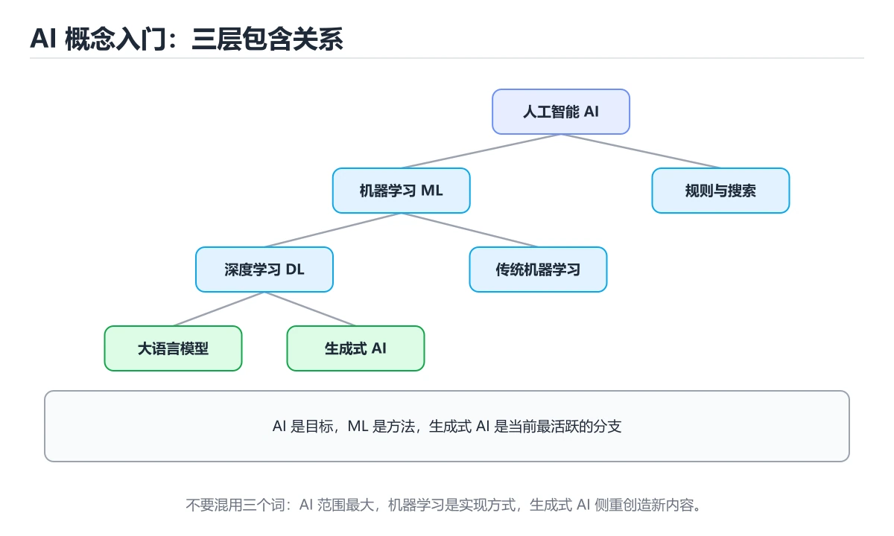
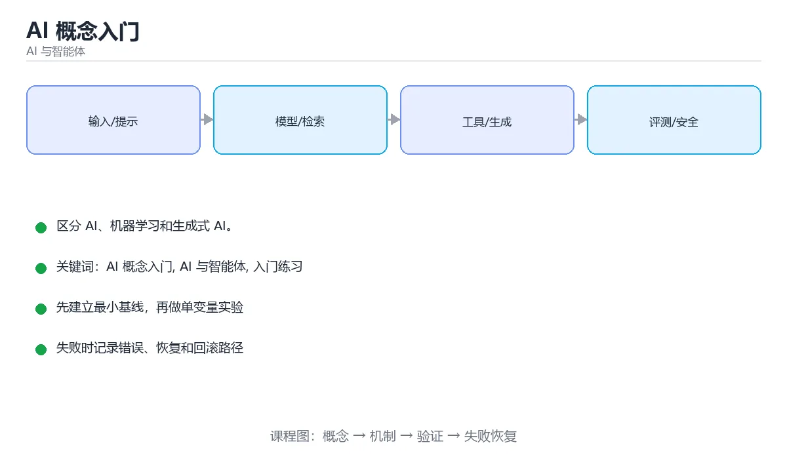

# AI 概念入门

> 内容更新时间：2026-10-06 · 学习阶段：基础 · 预计用时：30 分钟





## 本节知识框架

**课程定位**：所属分类 `ai`（AI 与智能体），课程主题 `AI 概念入门`，学习阶段 基础，建议用时 40 分钟。

本课主线：区分 AI、机器学习和生成式 AI。

**学完本课应当能够**
- 说清 `模型与参数` 与 `训练与推理` 的含义与区别，并各举一个正例和一个反例。
- 用本课示例验证 `特征与标签` 的行为，记录输入、输出与失败条件。
- 遇到「把模型输出当事实」这类问题时，能说出触发条件与修复顺序。

### 复习清单

- [ ] 能不看正文复述本课核心术语，并指出一个边界或反例。
- [ ] 能运行或推演本课示例，记录输入、输出与失败现象。
- [ ] 能完成一次自测，并把错题对照错误表定位原因。

## 核心概念定义

| 术语 | 操作性定义 | 常见边界与风险 |
| --- | --- | --- |
| 模型与参数 | 模型是带大量可调参数的函数，训练就是调整这些参数。 | 易错：参数只拟合了训练数据的分布，换到没见过的输入预测就不牢；演示样本表现好不等于真实输入可靠。 |
| 训练与推理 | 训练用数据调整参数，推理用固定参数对新输入给出结果。 | 易错：推理阶段参数是冻结的，模型不会在提问时学新知识；要让新信息生效得走检索或重训，别以为一次对话就能记住。 |
| 特征与标签 | 特征描述样本，标签是希望模型预测的答案。 | 易错：特征若含只有预测时才拿得到的信息就构成答案泄漏，训练指标虚高、真实推理时那一列根本取不到。 |
| 大语言模型 | 在海量文本上训练、按上下文逐词预测的语言模型。 | 易错：逐词预测只保证像样不保证为真，缺依据时会编出流畅却错的内容；输出要当草稿去核对来源。 |
| 提示词 | 交给模型的输入文本，决定任务描述与输出格式。 | 易错：提示词只约束任务与输出格式，改措辞并不能注入新知识；靠提示喂不进的事实得走检索或微调。 |
| 训练 | 训练阶段用数据调整参数，计算量大、可离线完成；推理阶段固定参数处理新输入 | 易错：训练离线又吃算力，改参数要重训再验证；不能把它和随时可做的推理混为一谈，别以为改个提示就等于重训。 |
| 数据 | AI 概念入门 的训练或检索数据从哪来、质量如何 | 易错：训练或检索数据来路不清、有偏或含隐私，模型会把偏差学进去；划分不当还会造成数据泄露、抬虚离线指标。 |
| 模型 | AI 与智能体 的能力边界与成本是多少 | 易错：不做检索与核对就直接采用；正确做法是把输出当草稿，用来源、测试或人工复核验证。 |
| 评测 | 如何证明改动真的有效 | 测试集划分不当会数据泄露、让指标虚高，评测要按时间或实体分开才可信。 |
| 安全 | 失败时会不会泄露或越权 | 易错：只看准确率，忽略延迟、成本与安全；正确做法是同时记录质量、延迟、成本与安全四类指标。 |
| 模型输入是否经过长度、格式与敏感信息检查？ | 日志、输入样例、测试或指标 | 只看有没有报错不够，超窗会被截断、敏感字段会违规，要按长度与脱敏逐项验证。 |
| 工具调用是否最小权限、可超时、可取消？ | 日志、输入样例、测试或指标 | 工具会改外部状态，权限不给小、不设超时和取消，一次失控调用就难以回滚。 |
| 输出是否有引用、置信度或人工复核兜底？ | 日志、输入样例、测试或指标 | 不要求引用位置、不做人工复核，幻觉会直接进生产，关键字段要能回溯到来源。 |
| 成本、延迟与失败率是否有指标？ | 日志、输入样例、测试或指标 | 只报平均值会掩盖长尾，重试与超时放大尾延迟，应按 P99 记录成本与失败率。 |

## 原理与运行机制

### 机制总览

**教材衔接：一句话入门**

区分 AI、机器学习和生成式 AI。

**教材衔接：智能体时代的系统边界**

大语言模型可以作为智能体的推理核心，但智能体不等于模型。一个可用的智能体通常还包含工具调用、记忆、规划、执行循环、权限控制和评估机制。模型负责理解和生成，工具负责访问外部世界，记忆保存跨步骤状态，规划把目标拆成动作，护栏限制高风险操作，日志和指标让失败可追踪。缺少任何一环，系统都可能表现为“会说但做不成”或“能执行但不可控”。

设计 AI 功能时，先明确任务是否真的需要模型：规则可以稳定解决的问题不要交给概率模型；需要自然语言理解、内容生成或模糊判断时再引入模型。然后定义输入输出边界、失败时的降级策略和人工接管方式。对于高影响场景，必须保留证据链和可回滚操作，不能让模型直接执行不可逆动作。

可以用一个分类任务走完整个流程：收集样本、划分数据集、选择基线、训练或调用模型、计算指标、分析错误、部署监控。再把这个任务改造成生成任务，比较两类系统的输入输出、评估方式和失败模式。这样你掌握的是 AI 系统的结构，而不是一堆孤立名词。

## 典型应用场景

**教材衔接：代码实验：把示例跑成证据**

### 实验一：建立基线

```python
def classify(task):
    return "生成式 AI" if "创作" in task else "传统 AI"

print(classify("请帮我创作一首诗"))
print(classify("识别这张图片里的猫"))
```

### 实验二：只改一个输入

沿用「AI 概念入门」的最小示例做一次单变量实验：

做完后用一句话写出「AI 概念入门」的结论：输入怎么变，结果才怎么变。

### 实验三：制造一个可控错误

把 classify 的一个参数换成不兼容的类型，先预测报错位置再实际运行；预测与实际的差异就是本课的考点。

### 实验四：用三句话复述

1. AI 概念入门 的输入是什么，哪些取值合法，哪些属于边界或非法范围？
2. AI 概念入门 按什么顺序处理输入，在哪一步产生了状态变化或副作用？
3. 输出如何验证，失败时第一条可观察证据是什么？

- **把模型输出当事实**：典型现象是不做检索与核对就直接采用；正确做法是把输出当草稿，用来源、测试或人工复核验证。
- **混淆提示、检索与微调**：典型现象是以为不改权重模型就能稳定记住新知识；正确做法是按知识时效与稳定性选择提示、检索或微调。
- **只用单一指标评价系统**：典型现象是只看准确率，忽略延迟、成本与安全；正确做法是同时记录质量、延迟、成本与安全四类指标。

### 最小验证场景

- 准备：保留 `python` 示例的原始输入，先记录 `AI 概念入门` 的基线输出和完整运行命令。
- 观察：先核对 调用了 `classify()`，再改变一个与 `模型与参数` 相关的条件。
- 判定：新结果与 `AI 概念入门` 的基线不同不等于错误；只有当差异破坏了 `模型与参数` 的定义或错误表中的约束，才判定为失败。

### 选择与边界

- 使用 `模型与参数` 时，先满足它的定义：模型是带大量可调参数的函数，训练就是调整这些参数；结果依赖数据分布、模型版本与算力预算，换数据集或换硬件都要重新评估。
- 使用 `训练与推理` 时，先满足它的定义：训练用数据调整参数，推理用固定参数对新输入给出结果；结果依赖数据分布、模型版本与算力预算，换数据集或换硬件都要重新评估。
- 使用 `特征与标签` 时，先满足它的定义：特征描述样本，标签是希望模型预测的答案；结果依赖数据分布、模型版本与算力预算，换数据集或换硬件都要重新评估。
- 使用 `大语言模型` 时，先满足它的定义：在海量文本上训练、按上下文逐词预测的语言模型；结果依赖数据分布、模型版本与算力预算，换数据集或换硬件都要重新评估。
- 使用 `提示词` 时，先满足它的定义：交给模型的输入文本，决定任务描述与输出格式；结果依赖数据分布、模型版本与算力预算，换数据集或换硬件都要重新评估。

## 代码/协议/SQL 示例

**教材衔接：最小示例**

**教材衔接：预期输出**

```text
生成式 AI
传统 AI
```

**运行方式**：运行 `AI 概念入门` 的示例时，保存为 `.py` 文件后用 `python 文件名.py` 运行；第三方依赖先在虚拟环境里安装。

## 时间/空间复杂度或性能分析

**性能关注点（AI 概念入门）**：算力与显存决定可行规模：记录训练或推理耗时、显存峰值与模型精度，换数据集要重新评估。

**本课特有开销（AI 概念入门 · AI 概念入门）**：小文件看元数据开销，大文件看吞吐，两者要分别测量。

**测量方法**：以 `AI 概念入门` 的 `AI 概念入门` 场景为对象，固定输入跑一遍记录基线，再把规模或并发度提高一个数量级复测；两次结果的差值与波动范围才是结论依据。

## 常见误区与易错点

| 容易写错的做法 | 实际现象 | 原因与正确做法 |
| --- | --- | --- |
| 把模型输出当事实 | 不做检索与核对就直接采用。 | 把输出当草稿，用来源、测试或人工复核验证。 |
| 混淆提示、检索与微调 | 以为不改权重模型就能稳定记住新知识。 | 按知识时效与稳定性选择提示、检索或微调。 |
| 只用单一指标评价系统 | 只看准确率，忽略延迟、成本与安全。 | 同时记录质量、延迟、成本与安全四类指标。 |

### 现场 1：把模型输出当事实

**症状**：不做检索与核对就直接采用。

**根因与修复**：把输出当草稿，用来源、测试或人工复核验证。

**自检**：在本课示例里复现「把模型输出当事实」，改成把输出当草稿，用来源、测试或人工复核验证后重跑；如果症状消失且失败路径按预期变化，说明定位正确。

### 现场 2：混淆提示、检索与微调

**症状**：以为不改权重模型就能稳定记住新知识。

**根因与修复**：按知识时效与稳定性选择提示、检索或微调。

**自检**：在本课示例里复现「混淆提示、检索与微调」，改成按知识时效与稳定性选择提示、检索或微调后重跑；如果症状消失且失败路径按预期变化，说明定位正确。

### 现场 3：只用单一指标评价系统

**症状**：只看准确率，忽略延迟、成本与安全。

**根因与修复**：同时记录质量、延迟、成本与安全四类指标。

**自检**：在本课示例里复现「只用单一指标评价系统」，改成同时记录质量、延迟、成本与安全四类指标后重跑；如果症状消失且失败路径按预期变化，说明定位正确。

## 与其他知识点的关系

**教材衔接：AI、机器学习、深度学习与生成式 AI 的关系**

人工智能是最大的概念，目标是让机器完成通常需要人类智能的任务；机器学习是实现 AI 的一类方法，通过数据学习规律而不是手写全部规则；深度学习是机器学习的子集，使用多层神经网络自动学习特征；生成式 AI 则强调输出新内容，例如文本、图像、音频和代码。它们不是四个并列的盒子，而是层层包含、彼此交叉的关系。一个系统可能使用深度学习模型，但不是生成式；也可能使用生成式模型，却不算完整的智能体。

传统机器学习常见三类任务：监督学习根据带标签样本预测结果，无监督学习发现数据中的结构，强化学习通过与环境交互和奖励信号学习策略。判别式模型学习“输入属于哪一类”，生成式模型学习“数据如何产生”。评估指标也随任务变化：分类看准确率、精确率、召回率和 F1，排序看命中率和 NDCG，生成任务还要看事实性、连贯性、格式合规和人工偏好。

数据和评估是 AI 系统里最容易被低估的部分。训练集、验证集和测试集必须按时间或实体正确划分，否则会发生数据泄露，让离线指标虚高。真实系统还要关注分布漂移、长尾输入、偏差、可解释性、成本和隐私。一个模型在演示样本上表现好，不代表它在真实用户输入上可靠。

- **相关或后续**：`提示词入门`。本课术语会在这些课程里继续使用。
- **术语归属**：`模型与参数`、`训练与推理`、`特征与标签` 的定义以本课「核心概念定义」为准，换到其他课程时先确认定义是否被改写。
- 同一分类的《提示词入门》也涉及 `AI 与智能体`；两课衔接时先确认这个术语的定义是否一致。

## 自测题与参考答案

> 先独立作答，再对照参考答案；答案都能在本课正文、术语表或错误表里找到依据。

### 自测 1（概念复述）

不看正文，写出 `模型与参数` 的操作性定义，并说明它与 `训练与推理` 的区别。

**参考答案**：模型是带大量可调参数的函数，训练就是调整这些参数。

`训练与推理` 的定位是：训练用数据调整参数，推理用固定参数对新输入给出结果；两者的差别要从适用对象与失败模式上说明。

### 自测 2（排错）

本课错误表记录了「把模型输出当事实」这类做法。请写出它会出现的现象、根因，以及修复顺序。

**参考答案**：现象是不做检索与核对就直接采用；正确做法是把输出当草稿，用来源、测试或人工复核验证。修复时先复现现象并保留证据，再改动一处假设重跑，确认现象消失。

### 自测 3（动手验证）

运行本课的 `python` 示例，把其中的 `"生成式 AI"` 换成一个边界值后重新运行，记录输出与错误信息。

**参考答案**：正常输入下 `python` 示例应当复现正文给出的结果；把 `"生成式 AI"` 换成边界值后，如果结果改变或报错，先核对它是否满足 `AI 概念入门` 中`模型与参数` 的适用范围，再检查错误表里是否有同类现象。

### 自测 4（代码阅读）

阅读本课开头的 `python` 示例，说明它体现了`模型与参数` 的哪一条性质，并指出改动哪个输入会让这条性质不再成立。

**参考答案**：`模型与参数` 的定义是 模型是带大量可调参数的函数，训练就是调整这些参数，示例正是在实现这条定义。改动与 `模型与参数` 有关的一个输入后，如果结果不再符合 `AI 概念入门` 的正文描述，就说明该性质只在当前前提成立。

### 自测 5（迁移）

把 `AI 概念入门` 的方法迁移到自己的项目：围绕 `模型与参数` 写出一个与错误表同类的风险点，并说明触发条件和检验方式。

**参考答案**：例如「只用单一指标评价系统」，它会导致只看准确率，忽略延迟、成本与安全；检验方式是按同时记录质量、延迟、成本与安全四类指标改一处再复现，确认现象消失且没有引入新的失败分支。

### 自测 6（对比）

用一个表格对比 `模型与参数` 与 `训练与推理`：各写一行适用场景、一行失败表现。

**参考答案**：`模型与参数` 的定义是模型是带大量可调参数的函数，训练就是调整这些参数；`训练与推理` 的定义是训练用数据调整参数，推理用固定参数对新输入给出结果。两者的失败表现分别对应本课错误表里与本术语相关的行。

### 自测 7（排错顺序）

面对「把模型输出当事实」引发的问题，请把“复现 不做检索与核对就直接采用 → 保留证据 → 把输出当草稿，用来源、测试或人工复核验证 → 回归验证”四步写成可执行的检查清单。

**参考答案**：第一步按不做检索与核对就直接采用复现；第二步记录输入、版本与完整报错；第三步按把输出当草稿，用来源、测试或人工复核验证只改一处；第四步重跑并确认失败路径也按预期变化。

### 自测 8（边界判断）

针对 `训练`，分别写出“可以使用”的条件和“结论不再成立”的条件。

**参考答案**：结果依赖数据分布、模型版本与算力预算，换数据集或换硬件都要重新评估。 同时要把 `训练` 的定义 训练阶段用数据调整参数，计算量大、可离线完成；推理阶段固定参数处理新输入 与实际输入逐项对照。

### 自测 9（机制重建）

不看正文，按输入、转换、输出、验证四段重建 `模型与参数` → `训练与推理` → `特征与标签` → `大语言模型` 的作用链。

**参考答案**：起点是 `模型与参数` 的定义 模型是带大量可调参数的函数，训练就是调整这些参数；中间每一步都保留可观察状态；终点由 `训练` 检查，失败时回到错误表定位第一个偏离定义的步骤。

### 自测 10（综合排错）

在 `AI 概念入门` 中，现象是 只看准确率，忽略延迟、成本与安全。请围绕 只用单一指标评价系统 写出最小复现、关键证据、修复动作和回归验证，并说明为什么不能只凭一次运行下结论。

**参考答案**：先复现 只用单一指标评价系统，记录输入与完整错误；再按 同时记录质量、延迟、成本与安全四类指标 只改一处。回归时同时跑正常路径和边界路径，只有两次结果都可解释，才把修复视为完成。

### 自测 11（一分钟复述）

用每分钟约 200 字的速度复述 `AI 概念入门`：先给主问题，再按顺序说出 `模型与参数`、`训练与推理`、`特征与标签`、`大语言模型`，最后给一个失败案例。

**自评标准**：主问题必须对应 区分 AI、机器学习和生成式 AI；每个术语都要能接上一句定义或边界；失败案例必须写成可观察现象，不能用“可能有风险”代替证据。

## 术语速查

| 术语 | 一句话说明 |
| --- | --- |
| `模型与参数` | 模型是带大量可调参数的函数，训练就是调整这些参数。 |
| `训练与推理` | 训练用数据调整参数，推理用固定参数对新输入给出结果。 |
| `特征与标签` | 特征描述样本，标签是希望模型预测的答案。 |
| `大语言模型` | 在海量文本上训练、按上下文逐词预测的语言模型。 |
| `提示词` | 交给模型的输入文本，决定任务描述与输出格式。 |
| `训练` | 训练阶段用数据调整参数，计算量大、可离线完成；推理阶段固定参数处理新输入。 |

**术语关系**：`模型与参数`（模型是带大量可调参数的函数） → `训练与推理`（训练用数据调整参数） → `特征与标签`（特征描述样本） → `大语言模型`（在海量文本上训练、按上下文逐词预测的语言模型）。

## 考点精讲

`AI 概念入门` 的题库有 6 道题，下面逐题给出题干、正确项与判断依据：先自己作答，再核对正确项，最后回到正文对应小节复核。

### 考点 1：第 1 题

- **题目**：AI、机器学习与生成式 AI 三者的关系是？
- **正确项**：机器学习是 AI 的一个分支
- **判断依据**：本题正确项是「机器学习是 AI 的一个分支」。术语 模型与参数（AI 概念入门）：模型是带大量可调参数的函数，训练就是调整这些参数，本题取「机器学习是 AI 的一个分支」这条。易错点是把模型输出当事实，会造成不做检索与核对就直接采用，改法是把输出当草稿，用来源、测试或人工复核验证。

### 考点 2：第 2 题

- **题目**：判别式模型与生成式模型的核心差异是？
- **正确项**：前者侧重判断类别或数值，后者侧重生成新的内容
- **判断依据**：本题正确项是「前者侧重判断类别或数值，后者侧重生成新的内容」。术语 模型与参数（AI 概念入门）：模型是带大量可调参数的函数，训练就是调整这些参数，本题取「前者侧重判断类别或数值，后者侧重生成新的内容」这条。易错点是混淆提示、检索与微调，会造成以为不改权重模型就能稳定记住新知识，改法是按知识时效与稳定性选择提示、检索或微调。

### 考点 3：第 3 题

- **题目**：示例中两次调用 classify 的输出分别是什么？
- **正确项**：先生成式 AI，再传统 AI，按任务关键词分类
- **判断依据**：本题正确项是「先生成式 AI，再传统 AI，按任务关键词分类」。术语 模型与参数（AI 概念入门）：模型是带大量可调参数的函数，训练就是调整这些参数，本题取「先生成式 AI，再传统 AI，按任务关键词分类」这条。易错点是只用单一指标评价系统，会造成只看准确率，忽略延迟、成本与安全，改法是同时记录质量、延迟、成本与安全四类指标。

### 考点 4：第 4 题

- **题目**：围绕“AI 概念入门”中的 AI 概念入门、AI 与智能体、入门练习，下列哪两项是本课强调的实践判断？
- **正确项**：学习 AI 概念入门 时要同时说明输入、输出和失败路径，不能只看正常流程；验证 AI 与智能体 时要固定版本并覆盖边界输入，结论才可复现
- **判断依据**：按《AI 概念入门》的正文口径，本题要同时选中「学习 AI 概念入门 时要同时说明输入、输出和失败路径，不能只看正常流程」、「验证 AI 与智能体 时要固定版本并覆盖边界输入，结论才可复现」，漏掉任一项都算没答全。术语 模型与参数（AI 概念入门）：模型是带大量可调参数的函数，训练就是调整这些参数。易错点是把模型输出当事实，会造成不做检索与核对就直接采用，改法是把输出当草稿，用来源、测试或人工复核验证。

### 考点 5：第 5 题

- **题目**：填空：补齐下面这段术语说明中的空缺。课程 `区分 AI、机器学习和生成式 AI。`，这段说明是：`____`：在海量文本上训练、按上下文逐词预测的语言模型。空缺处应填哪个术语？
- **正确项**：大语言模型
- **判断依据**：涉及术语 大语言模型：在海量文本上训练、按上下文逐词预测的语言模型。易错点：把模型输出当事实会造成不做检索与核对就直接采用。正确做法：把输出当草稿，用来源、测试或人工复核验证。判断时先确认输入和适用范围，对照 `AI 概念入门`、`AI 与智能体`、`入门练习` 复现一次，最后把错误表现与正确做法逐项对照。

### 考点 6：第 6 题

- **题目**：`AI 概念入门` 的示例代码服务于“区分 AI、机器学习和生成式 AI。”哪一条判断是正确的？
- **正确项**：机器学习是 AI 的一个分支
- **判断依据**：本题正确项是「机器学习是 AI 的一个分支」。术语 模型与参数（AI 概念入门）：模型是带大量可调参数的函数，训练就是调整这些参数，本题取「机器学习是 AI 的一个分支」这条。易错点是只用单一指标评价系统，会造成只看准确率，忽略延迟、成本与安全，改法是同时记录质量、延迟、成本与安全四类指标。

### 考点 7：`模型与参数`

- **要点**：模型是带大量可调参数的函数，训练就是调整这些参数。
- **模型与参数 的边界**：结果依赖数据分布、模型版本与算力预算，换数据集或换硬件都要重新评估。

### 考点 8：`训练与推理`

- **要点**：训练用数据调整参数，推理用固定参数对新输入给出结果。
- **训练与推理 的边界**：结果依赖数据分布、模型版本与算力预算，换数据集或换硬件都要重新评估。

### 考点 9：`特征与标签`

- **要点**：特征描述样本，标签是希望模型预测的答案。
- **特征与标签 的边界**：结果依赖数据分布、模型版本与算力预算，换数据集或换硬件都要重新评估。

### 考点 10：`大语言模型`

- **要点**：在海量文本上训练、按上下文逐词预测的语言模型。
- **大语言模型 的边界**：结果依赖数据分布、模型版本与算力预算，换数据集或换硬件都要重新评估。

### 考点 11：`提示词`

- **要点**：交给模型的输入文本，决定任务描述与输出格式。
- **提示词 的边界**：结果依赖数据分布、模型版本与算力预算，换数据集或换硬件都要重新评估。

### 考点 12：`训练`

- **要点**：训练阶段用数据调整参数，计算量大、可离线完成；推理阶段固定参数处理新输入
- **训练 的边界**：结果依赖数据分布、模型版本与算力预算，换数据集或换硬件都要重新评估。

### 考点 13：排错——把模型输出当事实

- **现象**：不做检索与核对就直接采用。
- **处理**：把输出当草稿，用来源、测试或人工复核验证。

### 考点 14：排错——混淆提示、检索与微调

- **现象**：以为不改权重模型就能稳定记住新知识。
- **处理**：按知识时效与稳定性选择提示、检索或微调。

### 考点 15：综合辨析——`模型与参数` 与 `训练`

- **辨析点**：`模型与参数` 的定义是 模型是带大量可调参数的函数，训练就是调整这些参数；`训练` 的定义是 训练阶段用数据调整参数，计算量大、可离线完成；推理阶段固定参数处理新输入。
- **答题要求**：面对 `AI 概念入门` 的题目，先判断描述的是 `模型与参数` 还是 `训练`，再归到对应定义，最后写出一个会让该定义失效的边界输入。

### 考点 16：排错评分点

- **现象分**：能写出 不做检索与核对就直接采用，而不是只写“程序有错”。
- **证据分**：保留触发 把模型输出当事实 的输入、版本和错误原文。
- **修复分**：按 把输出当草稿，用来源、测试或人工复核验证 只改一处，并同时回归正常路径与边界路径。

## 内容元数据

- 内容版本：v2.0
- 最后更新：2026-10-06
- 学习阶段：基础
- 适用环境：主流大模型 API、开源模型与向量数据库；本课聚焦 AI 概念入门。
- 内容来源：内置结构化课程与工程实践整理
- 相关主题：AI 概念入门、AI 与智能体、入门练习
- 质量版本：P0 测验标准 + P1 覆盖扩展 + P2 体验补全

## 参考资料与复核

- 最后复核：2026-10-04
- 下次复核：2026-12-24
- 复核范围：版本兼容、API 行为、安全建议与工程实践
- 来源性质：官方文档、标准或权威教材；本课核对关键词：AI 概念入门、AI 与智能体、入门练习。

| 参考资料 | 本课用途 |
| --- | --- |
| [scikit-learn 文档](https://scikit-learn.org/stable/documentation.html) | 经典机器学习算法 |
| [Model Context Protocol](https://modelcontextprotocol.io/) | Agent 工具与上下文协议 |
| [Ollama 文档](https://ollama.com/) | 本地模型运行与部署 |

| [本课术语索引：AI 概念入门](#核心概念定义) | 按本课输入、术语边界和错误表现逐项核对 |
> 「AI 概念入门」的链接用于离线阅读后的延伸核对；App 不会自动联网。