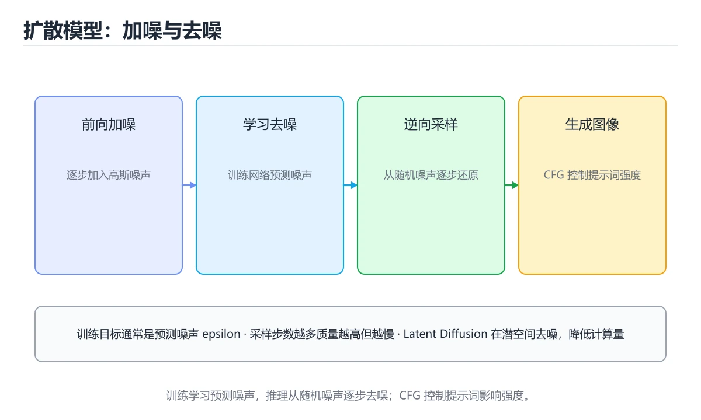
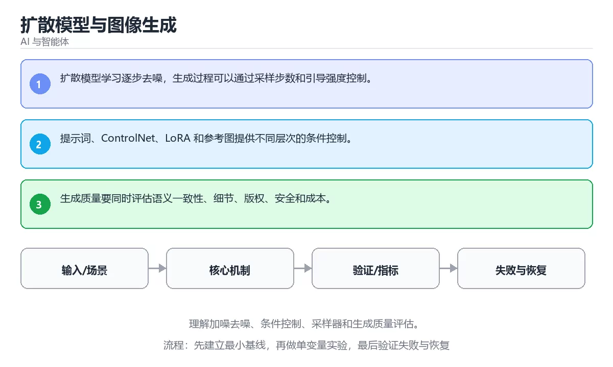

# 扩散模型与图像生成

> 内容更新时间：2026-10-06 · 学习阶段：进阶 · 预计用时：30 分钟





## 本节知识框架

**课程定位**：所属分类 `ai`（AI 与智能体），课程主题 `扩散模型与图像生成`，学习阶段 进阶，建议用时 40 分钟。

本课主线：理解加噪去噪、条件控制、采样器和生成质量评估。

**学完本课应当能够**
- 说清 `扩散模型` 与 `图像生成` 的含义与区别，并各举一个正例和一个反例。
- 用本课示例验证 `采样器` 的行为，记录输入、输出与失败条件。
- 遇到「把采样步数当成越高越好」这类问题时，能说出触发条件与修复顺序。

### 复习清单

- [ ] 能不看正文复述本课核心术语，并指出一个边界或反例。
- [ ] 能运行或推演本课示例，记录输入、输出与失败现象。
- [ ] 能完成一次自测，并把错题对照错误表定位原因。

## 核心概念定义

| 术语 | 操作性定义 | 常见边界与风险 |
| --- | --- | --- |
| 扩散模型 | 通过逐步去噪从随机噪声生成图像或音频的生成模型。 | 结果依赖数据分布、模型版本与算力预算，换数据集或换硬件都要重新评估。 |
| 图像生成 | 根据文本、噪声或条件生成符合语义的图像。 | 只在「根据文本、噪声或条件生成符合语义的图像」这一前提下成立，换输入或换环境要重新验证。 |
| 采样器 | 按“扩散模型与图像生成”中 扩散模型、图像生成、采样器 的实践顺序，把四个步骤排成从准备到复盘的合理顺序。 | 易错：同一提示词每次结果都不同，无法比较；正确做法是固定种子、尺寸、引导系数与采样器后再比较效果。 |
| 条件控制 | 在去噪过程中加入文本、深度或姿态等条件，引导模型生成指定内容。 | 结果依赖数据分布、模型版本与算力预算，换数据集或换硬件都要重新评估。 |
| 数据 | 扩散模型 的训练或检索数据从哪来、质量如何 | 结果依赖数据分布、模型版本与算力预算，换数据集或换硬件都要重新评估。 |
| 模型 | 图像生成 的能力边界与成本是多少 | 易错：生成模型不保证文字和布局精确；正确做法是需要精确控制时改用条件图、遮罩或后期编辑。 |
| 评测 | 如何证明改动真的有效 | 只在「如何证明改动真的有效」这一前提下成立，换输入或换环境要重新验证。 |
| 安全 | 失败时会不会泄露或越权 | 只在「失败时会不会泄露或越权」这一前提下成立，换输入或换环境要重新验证。 |
| 模型输入是否经过长度、格式与敏感信息检查？ | 日志、输入样例、测试或指标 | 只在「日志、输入样例、测试或指标」这一前提下成立，换输入或换环境要重新验证。 |
| 工具调用是否最小权限、可超时、可取消？ | 日志、输入样例、测试或指标 | 只在「日志、输入样例、测试或指标」这一前提下成立，换输入或换环境要重新验证。 |
| 输出是否有引用、置信度或人工复核兜底？ | 日志、输入样例、测试或指标 | 只在「日志、输入样例、测试或指标」这一前提下成立，换输入或换环境要重新验证。 |
| 成本、延迟与失败率是否有指标？ | 日志、输入样例、测试或指标 | 只在「日志、输入样例、测试或指标」这一前提下成立，换输入或换环境要重新验证。 |

## 原理与运行机制

### 机制总览

**教材衔接：核心知识**

### 1. 扩散模型学习逐步去噪，生成过程可以通过采样步数和引导强度控制。

- 关键做法：基线只保留 图像生成 必需的部分，其余条件一次加一个。
- 验证标准：扩散模型 的结果可复现、错误可解释、失败能恢复。

### 2. 提示词、ControlNet、LoRA 和参考图提供不同层次的条件控制。

把这条结论放回「扩散模型与图像生成」的完整流程里展开：

- 正文依据：能用自己的话解释：扩散模型学习逐步去噪，生成过程可以通过采样步数和引导强度控制。
- 落地检查：把「2. 提示词、ControlNet、LoRA 和参考图提供不同层次的条件控制。」改写成一条可执行的核对项，逐条验证输入、超时与失败路径。

### 3. 生成质量要同时评估语义一致性、细节、版权、安全和成本。

把这条结论放回「扩散模型与图像生成」的完整流程里展开：

- 正文依据：能用自己的话解释：提示词、ControlNet、LoRA 和参考图提供不同层次的条件控制。
- 落地检查：把「3. 生成质量要同时评估语义一致性、细节、版权、安全和成本。」改写成一条可执行的核对项，逐条验证输入、超时与失败路径。

### 4. 前向加噪是一条写得出来的曲线，反向去噪才需要模型

把两件事分开看，很多"玄学调参"就变成算术了：

```text
前向（不用训练，公式直接算）
干净图 x0 ──加一点噪── x1 ──再加一点── ... ── x999 ≈ 纯噪声
        每步保留 alpha 的信号，累计下来第 t 步只剩 sqrt(alpha_bar_t)

反向（模型学出来的部分）
纯噪声 ──┐
文本向量 ├→ 网络猜"这一步该减去哪一团噪声" → 得到 x(t-1) → 循环到 x0
条件图  ──┘
```

关键直觉：第 t 步留下的信号越少，网络要猜的东西就越模糊，所以**步数带来的收益是递减的**——前几轮从马赛克变成人形，后面几十轮只是在磨纹理。这正是本课错误表第一条「把采样步数当成越高越好」的成因，也是判断"该不该再加 10 步"的依据：画一条步数-质量曲线，看它在哪儿躺平。

**教材衔接：关键流程**

**教材衔接：实践路径**

**教材衔接：验证步骤**

## 典型应用场景

- **把采样步数当成越高越好**：典型现象是收益递减还成倍拉长生成时间；正确做法是按质量曲线选步数，并配合调度器统一调参。
- **不固定随机种子与参数**：典型现象是同一提示词每次结果都不同，无法比较；正确做法是固定种子、尺寸、引导系数与采样器后再比较效果。
- **用提示词要求精确文字与结构**：典型现象是生成模型不保证文字和布局精确；正确做法是需要精确控制时改用条件图、遮罩或后期编辑。

### 最小验证场景

- 准备：保留 `text` 示例的原始输入，先记录 `扩散模型与图像生成` 的基线输出和完整运行命令。
- 观察：先核对 调用了 `score()`，再改变一个与 `扩散模型` 相关的条件。
- 判定：新结果与 `扩散模型与图像生成` 的基线不同不等于错误；只有当差异破坏了 `扩散模型` 的定义或错误表中的约束，才判定为失败。

### 选择与边界

- 使用 `扩散模型` 时，先满足它的定义：通过逐步去噪从随机噪声生成图像或音频的生成模型；结果依赖数据分布、模型版本与算力预算，换数据集或换硬件都要重新评估。
- 使用 `图像生成` 时，先满足它的定义：根据文本、噪声或条件生成符合语义的图像；只在「根据文本、噪声或条件生成符合语义的图像」这一前提下成立，换输入或换环境要重新验证。
- 使用 `采样器` 时，先满足它的定义：按“扩散模型与图像生成”中 扩散模型、图像生成、采样器 的实践顺序，把四个步骤排成从准备到复盘的合理顺序；易错：同一提示词每次结果都不同，无法比较；正确做法是固定种子、尺寸、引导系数与采样器后再比较效果。
- 使用 `条件控制` 时，先满足它的定义：在去噪过程中加入文本、深度或姿态等条件，引导模型生成指定内容；结果依赖数据分布、模型版本与算力预算，换数据集或换硬件都要重新评估。

### 排错现场：A 图比 B 图好，重跑一次却反过来了

- **现象**：为了比较两条提示词，各生成一张图，结论是 A 更好；第二天同样的提示词重跑，B 反超，你几乎要去换模型。
- **根因**：种子、分辨率、引导系数、采样器这四个变量里至少有一个没写死（比如换了台机器、后端默认调度器变了），两次比较根本不在同一条起跑线上。
- **修复**：把这四项连同模型版本一起落到一份配置里，一次实验只允许提示词这一项变化；每个配置固定出 3 张，图和配置一起存档。
- **自检**：同一份配置连跑两次。可复现的后端应当逐像素一致；GPU 上开了加速内核时往往只能做到近似，那就别比像素，改成同一批人按"更像/更不像"给排序，看排序是否稳定。

## 代码/协议/SQL 示例

**教材衔接：最小可运行示例**

先用 answer 跑通最小示例，然后只改一个与 扩散模型 相关的取值：

```python
def score(answer: str) -> int:
    return 1 if answer.strip() else 0

print(score("agent"))
```

**教材衔接：预期输出**

```text
1
```

### 完整示例：把"信号还剩多少"算出来

前向过程不用训练，一行乘法就能算出每一步还剩多少信号、掺了多少噪声：

```python
alpha = 0.9   # 每往噪声方向走一步，保留下来的信号比例
bar = 1.0     # alpha_bar：从第 0 步到当前步的累乘

for step in range(1, 5):
    bar *= alpha
    print(f"第 {step} 步：信号保留 {(bar ** 0.5):.3f}，噪声强度 {((1 - bar) ** 0.5):.3f}")
```

```text
第 1 步：信号保留 0.949，噪声强度 0.316
第 2 步：信号保留 0.900，噪声强度 0.436
第 3 步：信号保留 0.854，噪声强度 0.521
第 4 步：信号保留 0.810，噪声强度 0.586
```

盯两列的增速就明白了：噪声强度从 0.316 到 0.436 涨了 0.12，从 0.521 到 0.586 只涨 0.065——越往后每步的变化越小，网络要修的差异也越小。把 `range(1, 5)` 改成 `range(1, 21)` 跑一遍，看第 20 步的噪声强度逼近多少，再回想为什么"再加十步"常常看不出区别。

### 动手练习

1. 把 `alpha` 从 `0.9` 调到 `0.99`，四行输出会整体往"信号多、噪声少"挪；这正是噪声调度里"同样步数、画面还没收敛"的那类配置问题。
2. 用 `score()` 那段最小示例改一次输入：把 `"agent"` 换成空串 `""`，输出从 1 变 0——记下来，这就是本课"改动一个输入看失败路径"的标准做法。

## 时间/空间复杂度或性能分析

**性能关注点（扩散模型与图像生成）**：算力与显存决定可行规模：记录训练或推理耗时、显存峰值与模型精度，换数据集要重新评估。

**测量方法**：以 `扩散模型与图像生成` 的 `扩散模型` 场景为对象，固定输入跑一遍记录基线，再把规模或并发度提高一个数量级复测；两次结果的差值与波动范围才是结论依据。

## 常见误区与易错点

| 容易写错的做法 | 实际现象 | 原因与正确做法 |
| --- | --- | --- |
| 把采样步数当成越高越好 | 收益递减还成倍拉长生成时间。 | 按质量曲线选步数，并配合调度器统一调参。 |
| 不固定随机种子与参数 | 同一提示词每次结果都不同，无法比较。 | 固定种子、尺寸、引导系数与采样器后再比较效果。 |
| 用提示词要求精确文字与结构 | 生成模型不保证文字和布局精确。 | 需要精确控制时改用条件图、遮罩或后期编辑。 |

### 现场 1：把采样步数当成越高越好

**症状**：收益递减还成倍拉长生成时间。

**根因与修复**：按质量曲线选步数，并配合调度器统一调参。

**自检**：在本课示例里复现「把采样步数当成越高越好」，改成按质量曲线选步数，并配合调度器统一调参后重跑；如果症状消失且失败路径按预期变化，说明定位正确。

### 现场 2：不固定随机种子与参数

**症状**：同一提示词每次结果都不同，无法比较。

**根因与修复**：固定种子、尺寸、引导系数与采样器后再比较效果。

**自检**：在本课示例里复现「不固定随机种子与参数」，改成固定种子、尺寸、引导系数与采样器后再比较效果后重跑；如果症状消失且失败路径按预期变化，说明定位正确。

### 现场 3：用提示词要求精确文字与结构

**症状**：生成模型不保证文字和布局精确。

**根因与修复**：需要精确控制时改用条件图、遮罩或后期编辑。

**自检**：在本课示例里复现「用提示词要求精确文字与结构」，改成需要精确控制时改用条件图、遮罩或后期编辑后重跑；如果症状消失且失败路径按预期变化，说明定位正确。

## 与其他知识点的关系

**教材衔接：复习与迁移**

- **先修**：《视觉语言模型 VLM》——本课的文本条件要先把提示词编码成向量，那一步的编码器在 VLM 那节已经讲过；条件控制只是把它接到去噪过程的交叉注意力里。
- **后续**：《Realtime API 与语音交互》——扩散思路同样用在语音生成上，只是把"图像像素"换成"声谱帧"，采样器与步数的权衡可以直接搬过去。
- **相关**：《模型评测与选型》——本课考点"生成质量要同时评估语义一致性、细节、版权、安全和成本"里的"评估"怎么落地，需要那节课的对比实验设计：固定变量、留证据、看排序稳定性。
- **相关**：《AI 治理、合规与风险》——图像生成额外带两份风险：训练素材的版权，以及成品的可辨认性（真人脸、商标、水印）。发布前要过的检查项在那节课列得更全。
- **容易混**：`条件控制` 与 `微调`。前者在推理时喂额外信号（提示词、深度图、姿态），后者改的是权重本身（LoRA 属于后者）；排查"改了不生效"时，先确认自己动的是哪一层。

## 自测题与参考答案

> 先独立作答，再对照参考答案；答案都能在本课正文、术语表或错误表里找到依据。

### 自测 1（概念复述）

不看正文，写出 `扩散模型` 的操作性定义，并说明它与 `图像生成` 的区别。

**参考答案**：通过逐步去噪从随机噪声生成图像或音频的生成模型。

`图像生成` 的定位是：根据文本、噪声或条件生成符合语义的图像；两者的差别要从适用对象与失败模式上说明。

### 自测 2（排错）

本课错误表记录了「把采样步数当成越高越好」这类做法。请写出它会出现的现象、根因，以及修复顺序。

**参考答案**：现象是收益递减还成倍拉长生成时间；正确做法是按质量曲线选步数，并配合调度器统一调参。修复时先复现现象并保留证据，再改动一处假设重跑，确认现象消失。

### 自测 3（动手验证）

运行本课的 `text` 示例，改动其中一个输入后重新运行，记录输出与错误信息。

**参考答案**：正常输入下 `text` 示例应当复现正文给出的结果；改动输入后，如果结果改变或报错，先核对它是否满足 `扩散模型与图像生成` 中`扩散模型` 的适用范围，再检查错误表里是否有同类现象。

### 自测 4（代码阅读）

阅读本课开头的 `text` 示例，说明它体现了`扩散模型` 的哪一条性质，并指出改动哪个输入会让这条性质不再成立。

**参考答案**：`扩散模型` 的定义是 通过逐步去噪从随机噪声生成图像或音频的生成模型，示例正是在实现这条定义。改动与 `扩散模型` 有关的一个输入后，如果结果不再符合 `扩散模型与图像生成` 的正文描述，就说明该性质只在当前前提成立。

### 自测 5（迁移）

把 `扩散模型与图像生成` 的方法迁移到自己的项目：围绕 `扩散模型` 写出一个与错误表同类的风险点，并说明触发条件和检验方式。

**参考答案**：例如「用提示词要求精确文字与结构」，它会导致生成模型不保证文字和布局精确；检验方式是按需要精确控制时改用条件图、遮罩或后期编辑改一处再复现，确认现象消失且没有引入新的失败分支。

### 自测 6（对比）

用一个表格对比 `扩散模型` 与 `图像生成`：各写一行适用场景、一行失败表现。

**参考答案**：`扩散模型` 的定义是通过逐步去噪从随机噪声生成图像或音频的生成模型；`图像生成` 的定义是根据文本、噪声或条件生成符合语义的图像。两者的失败表现分别对应本课错误表里与本术语相关的行。

### 自测 7（排错顺序）

面对「把采样步数当成越高越好」引发的问题，请把“复现 收益递减还成倍拉长生成时间 → 保留证据 → 按质量曲线选步数，并配合调度器统一调参 → 回归验证”四步写成可执行的检查清单。

**参考答案**：第一步按收益递减还成倍拉长生成时间复现；第二步记录输入、版本与完整报错；第三步按质量曲线选步数，并配合调度器统一调参只改一处；第四步重跑并确认失败路径也按预期变化。

### 自测 8（边界判断）

针对 `条件控制`，分别写出“可以使用”的条件和“结论不再成立”的条件。

**参考答案**：结果依赖数据分布、模型版本与算力预算，换数据集或换硬件都要重新评估。 同时要把 `条件控制` 的定义 在去噪过程中加入文本、深度或姿态等条件，引导模型生成指定内容 与实际输入逐项对照。

### 自测 9（机制重建）

不看正文，按输入、转换、输出、验证四段重建 `扩散模型` → `图像生成` → `采样器` → `条件控制` 的作用链。

**参考答案**：起点是 `扩散模型` 的定义 通过逐步去噪从随机噪声生成图像或音频的生成模型；中间每一步都保留可观察状态；终点由 `条件控制` 检查，失败时回到错误表定位第一个偏离定义的步骤。

### 自测 10（综合排错）

在 `扩散模型与图像生成` 中，现象是 生成模型不保证文字和布局精确。请围绕 用提示词要求精确文字与结构 写出最小复现、关键证据、修复动作和回归验证，并说明为什么不能只凭一次运行下结论。

**参考答案**：先复现 用提示词要求精确文字与结构，记录输入与完整错误；再按 需要精确控制时改用条件图、遮罩或后期编辑 只改一处。回归时同时跑正常路径和边界路径，只有两次结果都可解释，才把修复视为完成。

### 自测 11（一分钟复述）

用每分钟约 200 字的速度复述 `扩散模型与图像生成`：先给主问题，再按顺序说出 `扩散模型`、`图像生成`、`采样器`、`条件控制`，最后给一个失败案例。

**自评标准**：主问题必须对应 理解加噪去噪、条件控制、采样器和生成质量评估；每个术语都要能接上一句定义或边界；失败案例必须写成可观察现象，不能用“可能有风险”代替证据。

## 延伸阅读

想更直观地理解本课概念？推荐参阅以下图解专题：

- [图解大模型推理与显存占用](visual_llm_inference.md)

## 术语速查

| 术语 | 一句话说明 |
| --- | --- |
| `扩散模型` | 通过逐步去噪从随机噪声生成图像或音频的生成模型。 |
| `图像生成` | 根据文本、噪声或条件生成符合语义的图像。 |
| `采样器` | 按“扩散模型与图像生成”中 扩散模型、图像生成、采样器 的实践顺序，把四个步骤排成从准备到复盘的合理顺序。 |
| `条件控制` | 在去噪过程中加入文本、深度或姿态等条件，引导模型生成指定内容。 |
| `噪声调度` | 每一步掺多少噪声的曲线，决定同样步数下画面收敛得快不快。 |
| `引导系数` | 控制模型"多听提示词"的程度，调高颜色更浓、结构更硬，过头就失真。 |
| `潜空间` | 生成先在压缩过的特征空间里做，最后一步才解码回像素，显存因此省下一个量级。 |
| `采样步数` | 反向去噪迭代多少轮；超过某个点之后每轮换来的差别肉眼几乎看不出。 |

**术语关系**：`扩散模型`（通过逐步去噪从随机噪声生成图像或音频的生成模型） → `图像生成`（根据文本、噪声或条件生成符合语义的图像） → `采样器`（按“扩散模型与图像生成”中 扩散模型、图像生成、采样器 的实践顺序） → `条件控制`（在去噪过程中加入文本、深度或姿态等条件）。

## 考点精讲

`扩散模型与图像生成` 的题库有 5 道题，下面逐题给出题干、正确项与判断依据：先自己作答，再核对正确项，最后回到正文对应小节复核。

### 考点 1：第 1 题

- **题目**：按“扩散模型与图像生成”中 扩散模型、图像生成、采样器 的实践顺序，把四个步骤排成从准备到复盘的合理顺序。
- **正确项**：先明确 扩散模型 的输入、输出与约束 → 写出最小示例并核对 图像生成 的基线结果 → 只改一个变量，记录边界与失败路径的变化 → 固定版本与证据，把“扩散模型与图像生成”的结论写成可复现记录
- **判断依据**：按《扩散模型与图像生成》正文的先后，本题顺序是「先明确 扩散模型 的输入、输出与约束」 → 「写出最小示例并核对 图像生成 的基线结果」 → 「只改一个变量，记录边界与失败路径的变化」 → 「固定版本与证据，把“扩散模型与图像生成”的结论写成可复现记录」。术语 扩散模型（扩散模型与图像生成）：通过逐步去噪从随机噪声生成图像或音频的生成模型。易错点是把采样步数当成越高越好会造成收益递减还成倍拉长生成时间，改法是按质量曲线选步数，并配合调度器统一调参。

### 考点 2：第 2 题

- **题目**：代码语言为 `python`，选自 `扩散模型与图像生成` 的 `扩散模型` 部分。课程问题为理解加噪去噪、条件控制、采样器和生成质量评估。哪一项描述与代码一致？
- **正确项**：出现字面量 `agent`
- **判断依据**：本题正确项是「出现字面量 `agent`」（扩散模型与图像生成）。术语 扩散模型（扩散模型与图像生成）：通过逐步去噪从随机噪声生成图像或音频的生成模型，本题取「出现字面量 `agent`」这条。易错点是不固定随机种子与参数，会造成同一提示词每次结果都不同，无法比较，改法是固定种子、尺寸、引导系数与采样器后再比较效果。本题干扰项「出现字面量 `显存估算与优化组合，判断是否需要量化或分片。`」不成立：展示代码里找不到 `显存估算与优化组合，判断是否需要量化或分片`。

### 考点 3：第 3 题

- **题目**：在 `扩散模型与图像生成` 里，与 `扩散模型` 有关的说法中，哪一项最符合理解加噪去噪、条件控制、采样器和生成质量评估？
- **正确项**：生成质量要同时评估语义一致性、细节、版权、安全和成本。
- **判断依据**：本题正确项是「生成质量要同时评估语义一致性、细节、版权、安全和成本」。术语 扩散模型（扩散模型与图像生成）：通过逐步去噪从随机噪声生成图像或音频的生成模型，本题取「生成质量要同时评估语义一致性、细节、版权、安全和成本」这条。易错点是用提示词要求精确文字与结构，会造成生成模型不保证文字和布局精确，改法是需要精确控制时改用条件图、遮罩或后期编辑。

### 考点 4：第 4 题

- **题目**：`扩散模型与图像生成` 的主线是：理解加噪去噪、条件控制、采样器和生成质量评估。下面哪一项与这条主线一致？
- **正确项**：理解加噪去噪、条件控制、采样器和生成质量评估。
- **判断依据**：本题正确项是「理解加噪去噪、条件控制、采样器和生成质量评估」。术语 扩散模型（扩散模型与图像生成）：通过逐步去噪从随机噪声生成图像或音频的生成模型，本题取「理解加噪去噪、条件控制、采样器和生成质量评估」这条。易错点是把采样步数当成越高越好，会造成收益递减还成倍拉长生成时间，改法是按质量曲线选步数，并配合调度器统一调参。

### 考点 5：第 5 题

- **题目**：课程 `理解加噪去噪、条件控制、采样器和生成质量评估。`。在 `扩散模型与图像生成` 里，`扩散模型`、`图像生成` 与下面哪些选项属于同一层概念？（多选）
- **正确项**：扩散模型；图像生成
- **判断依据**：按《扩散模型与图像生成》的正文口径，本题要同时选中「扩散模型」、「图像生成」，漏掉任一项都算没答全。术语 扩散模型（扩散模型与图像生成）：通过逐步去噪从随机噪声生成图像或音频的生成模型。易错点是不固定随机种子与参数，会造成同一提示词每次结果都不同，无法比较，改法是固定种子、尺寸、引导系数与采样器后再比较效果。本课《扩散模型与图像生成》要解决的是理解加噪去噪、条件控制、采样器和生成质量评估。

### 考点 6：`扩散模型`

- **要点**：通过逐步去噪从随机噪声生成图像或音频的生成模型。
- **扩散模型 的边界**：结果依赖数据分布、模型版本与算力预算，换数据集或换硬件都要重新评估。

### 考点 7：`图像生成`

- **要点**：根据文本、噪声或条件生成符合语义的图像。
- **图像生成 的边界**：只在「根据文本、噪声或条件生成符合语义的图像」这一前提下成立，换输入或换环境要重新验证。

### 考点 8：`采样器`

- **要点**：按“扩散模型与图像生成”中 扩散模型、图像生成、采样器 的实践顺序，把四个步骤排成从准备到复盘的合理顺序。
- **采样器 的边界**：易错：同一提示词每次结果都不同，无法比较；正确做法是固定种子、尺寸、引导系数与采样器后再比较效果。

### 考点 9：`条件控制`

- **要点**：在去噪过程中加入文本、深度或姿态等条件，引导模型生成指定内容。
- **条件控制 的边界**：结果依赖数据分布、模型版本与算力预算，换数据集或换硬件都要重新评估。

### 考点 10：排错——把采样步数当成越高越好

- **现象**：收益递减还成倍拉长生成时间。
- **处理**：按质量曲线选步数，并配合调度器统一调参。

### 考点 11：排错——不固定随机种子与参数

- **现象**：同一提示词每次结果都不同，无法比较。
- **处理**：固定种子、尺寸、引导系数与采样器后再比较效果。

### 考点 12：综合辨析——`扩散模型` 与 `条件控制`

- **辨析点**：`扩散模型` 的定义是 通过逐步去噪从随机噪声生成图像或音频的生成模型；`条件控制` 的定义是 在去噪过程中加入文本、深度或姿态等条件，引导模型生成指定内容。
- **答题要求**：面对 `扩散模型与图像生成` 的题目，先判断描述的是 `扩散模型` 还是 `条件控制`，再归到对应定义，最后写出一个会让该定义失效的边界输入。

### 考点 13：排错评分点

- **现象分**：能写出 收益递减还成倍拉长生成时间，而不是只写“程序有错”。
- **证据分**：保留触发 把采样步数当成越高越好 的输入、版本和错误原文。
- **修复分**：按 按质量曲线选步数，并配合调度器统一调参 只改一处，并同时回归正常路径与边界路径。

## 内容元数据

- 内容版本：v2.0
- 最后更新：2026-10-06
- 学习阶段：进阶
- 适用环境：主流大模型 API、开源模型与向量数据库；本课聚焦 扩散模型。
- 内容来源：内置结构化课程与工程实践整理
- 相关主题：扩散模型、图像生成、采样器、条件控制
- 质量版本：P0 测验标准 + P1 覆盖扩展 + P2 体验补全

## 参考资料与复核

- 最后复核：2026-10-04
- 下次复核：2026-12-24
- 复核范围：版本兼容、API 行为、安全建议与工程实践
- 来源性质：官方文档、标准或权威教材；本课核对关键词：扩散模型、图像生成、采样器、条件控制。

| 参考资料 | 本课用途 |
| --- | --- |
| [OpenAI Cookbook](https://cookbook.openai.com/) | RAG、Agent 与工程示例 |
| [LlamaIndex 文档](https://docs.llamaindex.ai/) | 索引、检索与数据框架 |
| [TensorFlow 文档](https://www.tensorflow.org/api_docs) | 模型构建与部署 |

| [本课术语索引：扩散模型与图像生成](#核心概念定义) | 按本课输入、术语边界和错误表现逐项核对 |
> 「扩散模型与图像生成」的链接用于离线阅读后的延伸核对；App 不会自动联网。