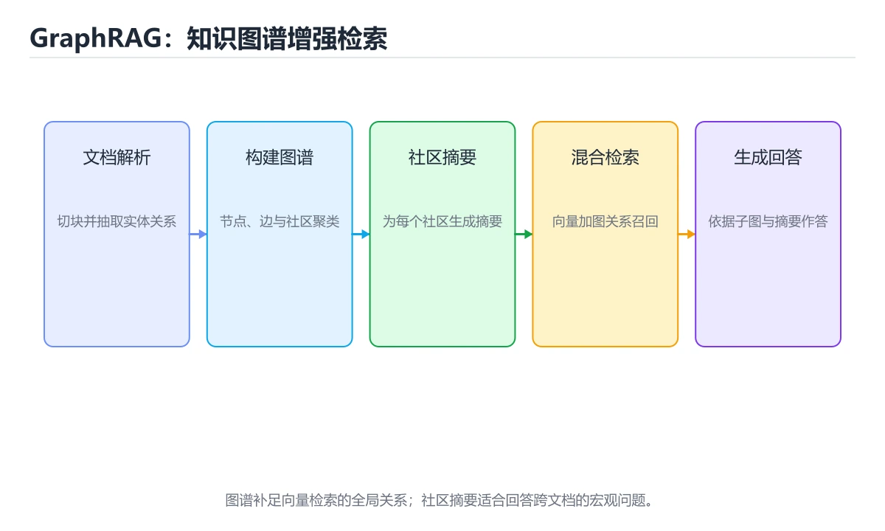
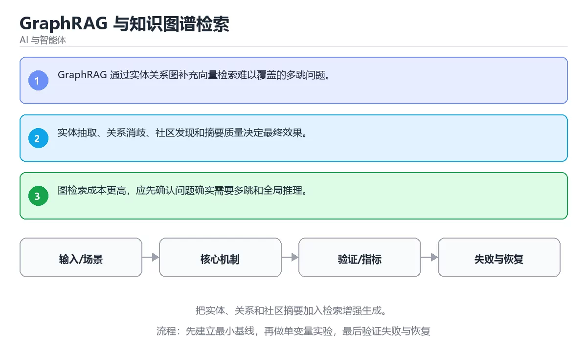

# GraphRAG 与知识图谱检索

> 内容更新时间：2026-10-06 · 学习阶段：进阶 · 预计用时：30 分钟





## 本节知识框架

**课程定位**：所属分类 `ai`（AI 与智能体），课程主题 `GraphRAG 与知识图谱检索`，学习阶段 进阶，建议用时 45 分钟。

本课主线：把实体、关系和社区摘要加入检索增强生成。

**学完本课应当能够**
- 说清 `GraphRAG` 与 `知识图谱` 的含义与区别，并各举一个正例和一个反例。
- 用本课示例验证 `实体` 的行为，记录输入、输出与失败条件。
- 遇到「抽取图谱不做校验」这类问题时，能说出触发条件与修复顺序。

### 复习清单

- [ ] 能不看正文复述 GraphRAG，并指出 知识图谱 的一个边界或反例。
- [ ] 能用「GraphRAG 与知识图谱检索」的示例复现结果，并说明知识图谱出错时输出的第一条信息。
- [ ] 能完成一次自测，并把错题对照错误表定位原因。

## 核心概念定义

| 术语 | 操作性定义 | 常见边界与风险 |
| --- | --- | --- |
| GraphRAG | GraphRAG 通过实体关系图补充向量检索难以覆盖的多跳问题。 | 易错：单跳事实问题也走图检索；它更贵，且抽取错的边会被当成事实反复引用。 |
| 知识图谱 | 用实体、关系和属性组织的结构化知识网络。 | 易错：抽取的实体与关系不做消歧、不抽样核对就当作可信知识网络；图谱效果取决于抽取、关系消歧与摘要质量，任一环漏了都会答错。 |
| 实体 | 按“GraphRAG 与知识图谱检索”中 GraphRAG、知识图谱、实体 的实践顺序，把四个步骤排成从准备到复盘的合理顺序。 | 易错：错误实体和关系会被当成事实反复引用；正确做法是对抽取结果抽样核对，并保留原文出处。 |
| 社区摘要 | 对图结构中一组紧密节点生成概括，用于回答全局性问题并连接局部事实。 | 易错：跨文档的总结类问题答不全；正确做法是全局问题用社区摘要与分层摘要回答，再回到原文核对。 |

## 原理与运行机制

### 机制总览

**教材衔接：核心知识**

### 1. GraphRAG 通过实体关系图补充向量检索难以覆盖的多跳问题。

- 关键做法：先让 GraphRAG 的最小示例可复现，再加入并发或规模条件。
- 验证标准：GraphRAG 的结果可复现、错误可解释、失败能恢复。

### 2. 实体抽取、关系消歧、社区发现和摘要质量决定最终效果。

把这条结论放回「GraphRAG 与知识图谱检索」的完整流程里展开：

- 正文依据：能用自己的话解释：GraphRAG 通过实体关系图补充向量检索难以覆盖的多跳问题。
- 落地检查：把「2. 实体抽取、关系消歧、社区发现和摘要质量决定最终效果。」改写成一条可执行的核对项，逐条验证输入、超时与失败路径。

### 3. 图检索成本更高，应先确认问题确实需要多跳和全局推理。

把这条结论放回「GraphRAG 与知识图谱检索」的完整流程里展开：

- 正文依据：能用自己的话解释：实体抽取、关系消歧、社区发现和摘要质量决定最终效果。
- 落地检查：把「3. 图检索成本更高，应先确认问题确实需要多跳和全局推理。」改写成一条可执行的核对项，逐条验证输入、超时与失败路径。

**教材衔接：关键流程**

**教材衔接：实践路径**

**教材衔接：深入补充：GraphRAG 与知识图谱检索 的取舍与边界**

### 四、自测清单

- 能否用一句话说出GraphRAG 与知识图谱检索解决的核心问题与不适用场景？
- 能否画出 GraphRAG 的数据流或状态变化，并标出失败路径？
- 把 answer 的输入推到边界，说明本课哪一条结论会先失效。
- 能否写出一条可复现的验证命令，让别人独立得到相同结论？

### 五、AI 工程补充

**教材衔接：零基础精讲：把GraphRAG 与知识图谱检索真正讲透**

### 先建立一个直觉

把「GraphRAG 与知识图谱检索」看成一条可评测的流水线：输入经过 GraphRAG 处理，产出候选结果，再由 知识图谱 决定哪些结果可以真正执行；每一环都要有可测的输入、输出与失败处理。

本课的摘要可以当作一张地图：把实体、关系和社区摘要加入检索增强生成。

### 逐步拆解

1. 澄清输入与目标。先写清「GraphRAG 与知识图谱检索」要解决的问题、合法输入范围和成功标准，再进入后续步骤。
2. 描述处理过程。把「GraphRAG、知识图谱、实体、社区摘要」映射到具体步骤，每步都要求能单独验证。
3. 定义输出。把 answer 的返回值、日志和失败信号都写清楚，缺一项都不算完整。
4. 让「GraphRAG 与知识图谱检索」的失败路径尽早暴露：把GraphRAG推到边界值，记录错误信息、重试或降级动作，以及人工兜底条件。
5. 选一个只有两三步的GraphRAG例子，先写出预期输出，再运行确认；不一致时先怀疑前提而不是代码。

### 把正文串成一条执行链

- **1. GraphRAG 通过实体关系图补充向量检索难以覆盖的多跳问题。**：在「GraphRAG 与知识图谱检索」里，「1. GraphRAG 通过实体关系图补充向量检索难以覆盖的多跳问题。」这一步要先写清输入与预期，再记录实际结果和差异；结果不符时回到对应小节核对前提。
- **2. 实体抽取、关系消歧、社区发现和摘要质量决定最终效果。**：在「GraphRAG 与知识图谱检索」里，「2. 实体抽取、关系消歧、社区发现和摘要质量决定最终效果。」这一步要先写清输入与预期，再记录实际结果和差异；结果不符时回到对应小节核对前提。
- **3. 图检索成本更高，应先确认问题确实需要多跳和全局推理。**：在「GraphRAG 与知识图谱检索」里，「3. 图检索成本更高，应先确认问题确实需要多跳和全局推理。」这一步要先写清输入与预期，再记录实际结果和差异；结果不符时回到对应小节核对前提。
- **考点 1：按“GraphRAG 与知识图谱检索”中 GraphRAG、知识图谱、实体 的实践顺序，把四个步骤排成从准备到复盘的合理顺序。**：先独立作答，再回到本课对应小节核对判断依据；答错时记录是哪一个前提被忽略。
- **考点 2：关于「实体抽取、关系消歧、社区发现和摘要质量决定最终效果。」，下列说法正确的是？**：先独立作答，再回到本课对应小节核对判断依据；答错时记录是哪一个前提被忽略。
- **考点 3：关于「图检索成本更高，应先确认问题确实需要多跳和全局推理。」，下列说法正确的是？**：先独立作答，再回到本课对应小节核对判断依据；答错时记录是哪一个前提被忽略。

### 从测验反推易错点

- 参考判断：GraphRAG 通过实体关系图补充向量检索难以覆盖的多跳问题。
- 自问：如果去掉题干里的一个限定词，结论还成立吗？

- 参考判断：实体抽取、关系消歧、社区发现和摘要质量决定最终效果。

- 参考判断：图检索成本更高，应先确认问题确实需要多跳和全局推理。

**检查点 4：本课的核心学习目标是什么？**

- 参考判断：把实体、关系和社区摘要加入检索增强生成。

- 参考判断：GraphRAG、知识图谱

### 工程排错顺序

| 先查什么 | 要得到的证据 | 判断标准 |
| --- | --- | --- |
| 模型输入是否经过长度、格式与敏感信息检查？ | 日志、输入样例、测试或指标 | 能复现并解释，才算定位 |
| 工具调用是否最小权限、可超时、可取消？ | 日志、输入样例、测试或指标 | 能复现并解释，才算定位 |
| 输出是否有引用、置信度或人工复核兜底？ | 日志、输入样例、测试或指标 | 能复现并解释，才算定位 |
| 成本、延迟与失败率是否有指标？ | 日志、输入样例、测试或指标 | 能复现并解释，才算定位 |

### 变式训练

1. 把 GraphRAG 放进一个只有单机、没有额外依赖的小项目，先保证正确再扩展。
2. 把 answer 的数据量提高一个数量级，观察延迟与内存的变化拐点。
3. 制造一次 GraphRAG 相关的依赖超时或错误输入，要求错误可解释且不留半完成状态。
5. 减少一个输入字段后重跑 answer，记录失败信息出现在哪一层，据此判断这个字段是必填还是可推导。
6. 在低带宽或低算力条件下重跑 知识图谱，记录降级路径是否仍然可用。

### 迁移案例库

围绕 answer 重复同一套方法，每完成一轮就把差异写进笔记。

#### 迁移案例 1：围绕「GraphRAG」做一次小实验

**验收**：GraphRAG的结论要有证据、差异可解释、失败可恢复；做不到时回到「核心知识」缩小问题范围。

#### 迁移案例 2：围绕「知识图谱」做一次小实验

**步骤**：
1. 复述当前方案对「知识图谱」的假设，写成一句可证伪的话。

#### 迁移案例 3：围绕「实体」做一次小实验

**步骤**：
1. 复述当前方案对「实体」的假设，写成一句可证伪的话。

#### 迁移案例 4：围绕「社区摘要」做一次小实验

**步骤**：
1. 复述当前方案对「社区摘要」的假设，写成一句可证伪的话。

#### 迁移案例 5：围绕「GraphRAG」做一次小实验

**步骤**：

#### 迁移案例 6：围绕「知识图谱」做一次小实验

**步骤**：

#### 迁移案例 7：围绕「实体」做一次小实验

**步骤**：

#### 迁移案例 8：围绕「社区摘要」做一次小实验

**步骤**：

#### 迁移案例 9：围绕「GraphRAG」做一次小实验

**步骤**：

#### 迁移案例 10：围绕「知识图谱」做一次小实验

**步骤**：

#### 迁移案例 11：围绕「实体」做一次小实验

**步骤**：

#### 迁移案例 12：围绕「社区摘要」做一次小实验

**步骤**：

#### 迁移案例 13：围绕「GraphRAG」做一次小实验

**步骤**：

#### 迁移案例 14：围绕「知识图谱」做一次小实验

**步骤**：

#### 迁移案例 15：围绕「实体」做一次小实验

**步骤**：

#### 迁移案例 16：围绕「社区摘要」做一次小实验

**步骤**：

<!-- p0-depth-v2:end -->

**教材衔接：验证步骤**

## 典型应用场景

- **抽取图谱不做校验**：典型现象是错误实体和关系会被当成事实反复引用；正确做法是对抽取结果抽样核对，并保留原文出处。
- **只抽实体不定义关系**：典型现象是图检索退化回关键词匹配；正确做法是定义关系 schema 与方向，为边标注置信度和来源。
- **全局问题仍走子图检索**：典型现象是跨文档的总结类问题答不全；正确做法是全局问题用社区摘要与分层摘要回答，再回到原文核对。

### 最小验证场景

- 准备：保留 `text` 示例的原始输入，先记录 `GraphRAG 与知识图谱检索` 的基线输出和完整运行命令。
- 观察：先核对 调用了 `score()`，再改变一个与 `GraphRAG` 相关的条件。
- 判定：新结果与 `GraphRAG 与知识图谱检索` 的基线不同不等于错误；只有当差异破坏了 `GraphRAG` 的定义或错误表中的约束，才判定为失败。

### 选择与边界

- 使用 `GraphRAG` 时，GraphRAG 通过实体关系图补充向量检索难以覆盖的多跳问题。
- 使用 `知识图谱` 时，用实体、关系和属性组织的结构化知识网络；网络延迟、超时与版本协商会改变行为，只在真实链路或多版本客户端上验证才算数。
- 使用 `实体` 时，按“GraphRAG 与知识图谱检索”中 GraphRAG、知识图谱、实体 的实践顺序，把四个步骤排成从准备到复盘的合理顺序；易错：错误实体和关系会被当成事实反复引用；正确做法是对抽取结果抽样核对，并保留原文出处。
- 使用 `社区摘要` 时，对图结构中一组紧密节点生成概括，用于回答全局性问题并连接局部事实；易错：跨文档的总结类问题答不全；正确做法是全局问题用社区摘要与分层摘要回答，再回到原文核对。

## 代码/协议/SQL 示例

**教材衔接：最小可运行示例**

先用下面的示例确认 GraphRAG 的基线，再只改一个与 知识图谱 相关的值：

```python
def score(answer: str) -> int:
    return 1 if answer.strip() else 0

print(score("agent"))
```

**教材衔接：预期输出**

```text
1
```

## 时间/空间复杂度或性能分析

**性能关注点（GraphRAG 与知识图谱检索）**：算力与显存决定可行规模：记录训练或推理耗时、显存峰值与模型精度，换数据集要重新评估。

**本课特有开销（GraphRAG 与知识图谱检索 · GraphRAG）**：重试与超时会成倍放大尾延迟，记录 P99 而不是平均值。

**测量方法**：以 `GraphRAG 与知识图谱检索` 的 `GraphRAG` 场景为对象，固定输入跑一遍记录基线，再把规模或并发度提高一个数量级复测；两次结果的差值与波动范围才是结论依据。

## 常见误区与易错点

| 容易写错的做法 | 实际现象 | 原因与正确做法 |
| --- | --- | --- |
| 抽取图谱不做校验 | 错误实体和关系会被当成事实反复引用。 | 对抽取结果抽样核对，并保留原文出处。 |
| 只抽实体不定义关系 | 图检索退化回关键词匹配。 | 定义关系 schema 与方向，为边标注置信度和来源。 |
| 全局问题仍走子图检索 | 跨文档的总结类问题答不全。 | 全局问题用社区摘要与分层摘要回答，再回到原文核对。 |

### 现场 1：抽取图谱不做校验

**症状**：错误实体和关系会被当成事实反复引用。

**根因与修复**：对抽取结果抽样核对，并保留原文出处。

**自检**：在本课示例里复现「抽取图谱不做校验」，改成对抽取结果抽样核对，并保留原文出处后重跑；如果症状消失且失败路径按预期变化，说明定位正确。

### 现场 2：只抽实体不定义关系

**症状**：图检索退化回关键词匹配。

**根因与修复**：定义关系 schema 与方向，为边标注置信度和来源。

**自检**：在本课示例里复现「只抽实体不定义关系」，改成定义关系 schema 与方向，为边标注置信度和来源后重跑；如果症状消失且失败路径按预期变化，说明定位正确。

### 现场 3：全局问题仍走子图检索

**症状**：跨文档的总结类问题答不全。

**根因与修复**：全局问题用社区摘要与分层摘要回答，再回到原文核对。

**自检**：在本课示例里复现「全局问题仍走子图检索」，改成全局问题用社区摘要与分层摘要回答，再回到原文核对后重跑；如果症状消失且失败路径按预期变化，说明定位正确。

## 与其他知识点的关系

**教材衔接：复习与迁移**

## 自测题与参考答案

> 先独立作答，再对照参考答案；答案都能在本课正文、术语表或错误表里找到依据。

### 自测 1（概念复述）

不看正文，写出 `GraphRAG` 的操作性定义，并说明它与 `知识图谱` 的区别。

**参考答案**：GraphRAG 通过实体关系图补充向量检索难以覆盖的多跳问题。

`知识图谱` 的定位是：用实体、关系和属性组织的结构化知识网络；两者的差别要从适用对象与失败模式上说明。

### 自测 2（排错）

本课错误表记录了「抽取图谱不做校验」这类做法。请写出它会出现的现象、根因，以及修复顺序。

**参考答案**：现象是错误实体和关系会被当成事实反复引用；正确做法是对抽取结果抽样核对，并保留原文出处。修复时先复现现象并保留证据，再改动一处假设重跑，确认现象消失。

### 自测 3（动手验证）

运行本课的 `text` 示例，只改 GraphRAG 的一个输入并比较两次输出，抄下第一条错误信息。

**参考答案**：正常输入下 `text` 示例应当复现正文给出的结果；改动输入后，如果结果改变或报错，先核对它是否满足 `GraphRAG 与知识图谱检索` 中`GraphRAG` 的适用范围，再检查错误表里是否有同类现象。

### 自测 4（代码阅读）

阅读本课开头的 `text` 示例，说明它体现了`GraphRAG` 的哪一条性质，并指出改动哪个输入会让这条性质不再成立。

**参考答案**：`GraphRAG` 的定义是 GraphRAG 通过实体关系图补充向量检索难以覆盖的多跳问题，示例正是在实现这条定义。改动与 `GraphRAG` 有关的一个输入后，如果结果不再符合 `GraphRAG 与知识图谱检索` 的正文描述，就说明该性质只在当前前提成立。

### 自测 5（迁移）

把 `GraphRAG 与知识图谱检索` 的方法迁移到自己的项目：围绕 `GraphRAG` 写出一个与错误表同类的风险点，并说明触发条件和检验方式。

**参考答案**：例如「全局问题仍走子图检索」，它会导致跨文档的总结类问题答不全；检验方式是按全局问题用社区摘要与分层摘要回答，再回到原文核对改一处再复现，确认现象消失且没有引入新的失败分支。

### 自测 6（对比）

用一个表格对比 `GraphRAG` 与 `知识图谱`：各写一行适用场景、一行失败表现。

**参考答案**：`GraphRAG` 的定义是GraphRAG 通过实体关系图补充向量检索难以覆盖的多跳问题；`知识图谱` 的定义是用实体、关系和属性组织的结构化知识网络。两者的失败表现分别对应本课错误表里与本术语相关的行。

### 自测 7（排错顺序）

面对「抽取图谱不做校验」引发的问题，请把“复现 错误实体和关系会被当成事实反复引用 → 保留证据 → 对抽取结果抽样核对，并保留原文出处 → 回归验证”四步写成可执行的检查清单。

**参考答案**：第一步按错误实体和关系会被当成事实反复引用复现；第二步记录输入、版本与完整报错；第三步按对抽取结果抽样核对，并保留原文出处只改一处；第四步重跑并确认失败路径也按预期变化。

### 自测 8（边界判断）

针对 `社区摘要`，分别写出“可以使用”的条件和“结论不再成立”的条件。

**参考答案**：易错：跨文档的总结类问题答不全；正确做法是全局问题用社区摘要与分层摘要回答，再回到原文核对。 同时要把 `社区摘要` 的定义 对图结构中一组紧密节点生成概括，用于回答全局性问题并连接局部事实 与实际输入逐项对照。

### 自测 9（机制重建）

不看正文，按输入、转换、输出、验证四段重建 `GraphRAG` → `知识图谱` → `实体` → `社区摘要` 的作用链。

**参考答案**：起点是 `GraphRAG` 的定义 GraphRAG 通过实体关系图补充向量检索难以覆盖的多跳问题；中间每一步都保留可观察状态；终点由 `社区摘要` 检查，失败时回到错误表定位第一个偏离定义的步骤。

### 自测 10（综合排错）

在 `GraphRAG 与知识图谱检索` 中，现象是 跨文档的总结类问题答不全。请围绕 全局问题仍走子图检索 写出最小复现、关键证据、修复动作和回归验证，并说明为什么不能只凭一次运行下结论。

**参考答案**：先复现 全局问题仍走子图检索，记录输入与完整错误；再按 全局问题用社区摘要与分层摘要回答，再回到原文核对 只改一处。回归时同时跑正常路径和边界路径，只有两次结果都可解释，才把修复视为完成。

### 自测 11（一分钟复述）

用每分钟约 200 字的速度复述 `GraphRAG 与知识图谱检索`：先给主问题，再按顺序说出 `GraphRAG`、`知识图谱`、`实体`、`社区摘要`，最后给一个失败案例。

**自评标准**：主问题必须对应 把实体、关系和社区摘要加入检索增强生成；每个术语都要能接上一句定义或边界；失败案例必须写成可观察现象，不能用“可能有风险”代替证据。

## 延伸阅读

想更直观地理解本课概念？推荐参阅以下图解专题：

- [图解 RAG 检索增强生成流程](visual_rag_pipeline.md)
- [图解向量检索与 HNSW 索引](visual_vector_index.md)

## 术语速查

| 术语 | 一句话说明 |
| --- | --- |
| `GraphRAG` | GraphRAG 通过实体关系图补充向量检索难以覆盖的多跳问题。 |
| `知识图谱` | 用实体、关系和属性组织的结构化知识网络。 |
| `实体` | 按“GraphRAG 与知识图谱检索”中 GraphRAG、知识图谱、实体 的实践顺序，把四个步骤排成从准备到复盘的合理顺序。 |
| `社区摘要` | 对图结构中一组紧密节点生成概括，用于回答全局性问题并连接局部事实。 |

**术语关系**：`GraphRAG`（GraphRAG 通过实体关系图补充向量检索难以覆盖的多跳问题） → `知识图谱`（用实体、关系和属性组织的结构化知识网络） → `实体`（按“GraphRAG 与知识图谱检索”中 GraphRAG、知识图谱、实体 的实践顺序） → `社区摘要`（对图结构中一组紧密节点生成概括）。

## 考点精讲

`GraphRAG 与知识图谱检索` 的题库有 5 道题，下面逐题给出题干、正确项与判断依据：先自己作答，再核对正确项，最后回到正文对应小节复核。

### 考点 1：第 1 题

- **题目**：按“GraphRAG 与知识图谱检索”中 GraphRAG、知识图谱、实体 的实践顺序，把四个步骤排成从准备到复盘的合理顺序。
- **正确项**：先明确 GraphRAG 的输入、输出与约束 → 写出最小示例并核对 知识图谱 的基线结果 → 只改一个变量，记录边界与失败路径的变化 → 固定版本与证据，把“GraphRAG 与知识图谱检索”的结论写成可复现记录
- **判断依据**：按《GraphRAG 与知识图谱检索》正文的先后，本题顺序是「先明确 GraphRAG 的输入、输出与约束」 → 「写出最小示例并核对 知识图谱 的基线结果」 → 「只改一个变量，记录边界与失败路径的变化」 → 「固定版本与证据，把“GraphRAG 与知识图谱检索”的结论写成可复现记录」。术语 GraphRAG（GraphRAG 与知识图谱检索）：GraphRAG 通过实体关系图补充向量检索难以覆盖的多跳问题。易错点是抽取图谱不做校验会造成错误实体和关系会被当成事实反复引用，改法是对抽取结果抽样核对，并保留原文出处。

### 考点 2：第 2 题

- **题目**：在 `GraphRAG 与知识图谱检索` 里，与 `GraphRAG` 有关的说法中，哪一项最符合把实体、关系和社区摘要加入检索增强生成？
- **正确项**：实体抽取、关系消歧、社区发现和摘要质量决定最终效果。
- **判断依据**：本题正确项是「实体抽取、关系消歧、社区发现和摘要质量决定最终效果」。术语 GraphRAG（GraphRAG 与知识图谱检索）：GraphRAG 通过实体关系图补充向量检索难以覆盖的多跳问题，本题取「实体抽取、关系消歧、社区发现和摘要质量决定最终效果」这条。易错点是只抽实体不定义关系，会造成图检索退化回关键词匹配，改法是定义关系 schema 与方向，为边标注置信度和来源。

### 考点 3：第 3 题

- **题目**：在 `GraphRAG 与知识图谱检索` 里，与 `GraphRAG` 有关的说法中，哪一项最符合把实体、关系和社区摘要加入检索增强生成？（GraphRAG 与知识图谱检索·AI 与智能体 第 3 题）
- **正确项**：图检索成本更高，应先确认问题确实需要多跳和全局推理。
- **判断依据**：本题正确项是「图检索成本更高，应先确认问题确实需要多跳和全局推理」。术语 GraphRAG（GraphRAG 与知识图谱检索）：GraphRAG 通过实体关系图补充向量检索难以覆盖的多跳问题，本题取「图检索成本更高，应先确认问题确实需要多跳和全局推理」这条。易错点是全局问题仍走子图检索，会造成跨文档的总结类问题答不全，改法是全局问题用社区摘要与分层摘要回答，再回到原文核对。

### 考点 4：第 4 题

- **题目**：`GraphRAG 与知识图谱检索` 的示例代码用于验证 `GraphRAG`，其背景是把实体、关系和社区摘要加入检索增强生成。代码的真实内容是下面哪一项？
- **正确项**：出现字面量 `agent`
- **判断依据**：本题正确项是「出现字面量 `agent`」（GraphRAG 与知识图谱检索）。术语 GraphRAG（GraphRAG 与知识图谱检索）：GraphRAG 通过实体关系图补充向量检索难以覆盖的多跳问题，本题取「出现字面量 `agent`」这条。易错点是抽取图谱不做校验，会造成错误实体和关系会被当成事实反复引用，改法是对抽取结果抽样核对，并保留原文出处。本题干扰项「出现字面量 `${DB_PORT:-5432}`」不成立：展示代码里找不到 `${DB_PORT:-5432}`。

### 考点 5：第 5 题

- **题目**：课程 `把实体、关系和社区摘要加入检索增强生成。`。在 `GraphRAG 与知识图谱检索` 里，`GraphRAG`、`知识图谱` 与下面哪些选项属于同一层概念？（多选）
- **正确项**：GraphRAG；知识图谱
- **判断依据**：按《GraphRAG 与知识图谱检索》的正文口径，本题要同时选中「GraphRAG」、「知识图谱」，漏掉任一项都算没答全。术语 GraphRAG（GraphRAG 与知识图谱检索）：GraphRAG 通过实体关系图补充向量检索难以覆盖的多跳问题。易错点是只抽实体不定义关系，会造成图检索退化回关键词匹配，改法是定义关系 schema 与方向，为边标注置信度和来源。

### 考点 6：`GraphRAG`

- **要点**：GraphRAG 通过实体关系图补充向量检索难以覆盖的多跳问题。

### 考点 7：`知识图谱`

- **要点**：用实体、关系和属性组织的结构化知识网络。
- **知识图谱 的边界**：网络延迟、超时与版本协商会改变行为，只在真实链路或多版本客户端上验证才算数。

### 考点 8：`实体`

- **要点**：按“GraphRAG 与知识图谱检索”中 GraphRAG、知识图谱、实体 的实践顺序，把四个步骤排成从准备到复盘的合理顺序。
- **实体 的边界**：易错：错误实体和关系会被当成事实反复引用；正确做法是对抽取结果抽样核对，并保留原文出处。

### 考点 9：`社区摘要`

- **要点**：对图结构中一组紧密节点生成概括，用于回答全局性问题并连接局部事实。
- **社区摘要 的边界**：易错：跨文档的总结类问题答不全；正确做法是全局问题用社区摘要与分层摘要回答，再回到原文核对。

### 考点 10：排错——抽取图谱不做校验

- **现象**：错误实体和关系会被当成事实反复引用。
- **处理**：对抽取结果抽样核对，并保留原文出处。

### 考点 11：排错——只抽实体不定义关系

- **现象**：图检索退化回关键词匹配。
- **处理**：定义关系 schema 与方向，为边标注置信度和来源。

### 考点 12：综合辨析——`GraphRAG` 与 `社区摘要`

- **辨析点**：`GraphRAG` 的定义是 GraphRAG 通过实体关系图补充向量检索难以覆盖的多跳问题；`社区摘要` 的定义是 对图结构中一组紧密节点生成概括，用于回答全局性问题并连接局部事实。
- **答题要求**：面对 `GraphRAG 与知识图谱检索` 的题目，先判断描述的是 `GraphRAG` 还是 `社区摘要`，再归到对应定义，最后写出一个会让该定义失效的边界输入。

### 考点 13：排错评分点

- **现象分**：能写出 错误实体和关系会被当成事实反复引用，而不是只写“程序有错”。
- **证据分**：保留触发 抽取图谱不做校验 的输入、版本和错误原文。
- **修复分**：按 对抽取结果抽样核对，并保留原文出处 只改一处，并同时回归正常路径与边界路径。

## 内容元数据

- 内容版本：v2.0
- 最后更新：2026-10-06
- 学习阶段：进阶
- 适用环境：主流大模型 API、开源模型与向量数据库；本课聚焦 GraphRAG。
- 内容来源：内置结构化课程与工程实践整理
- 相关主题：GraphRAG、知识图谱、实体、社区摘要
- 质量版本：P0 测验标准 + P1 覆盖扩展 + P2 体验补全

## 参考资料与复核

- 最后复核：2026-10-04
- 下次复核：2026-12-24
- 复核范围：版本兼容、API 行为、安全建议与工程实践
- 来源性质：官方文档、标准或权威教材；本课核对关键词：GraphRAG、知识图谱、实体、社区摘要。

| 参考资料 | 本课用途 |
| --- | --- |
| [LlamaIndex 文档](https://docs.llamaindex.ai/) | 索引、检索与数据框架 |
| [Anthropic 文档](https://docs.anthropic.com/) | Claude API 与 Agent 安全 |
| [scikit-learn 文档](https://scikit-learn.org/stable/documentation.html) | 经典机器学习算法 |

| [本课术语索引：GraphRAG 与知识图谱检索](#核心概念定义) | 按本课输入、术语边界和错误表现逐项核对 |
> 「GraphRAG 与知识图谱检索」的链接用于离线阅读后的延伸核对；App 不会自动联网。