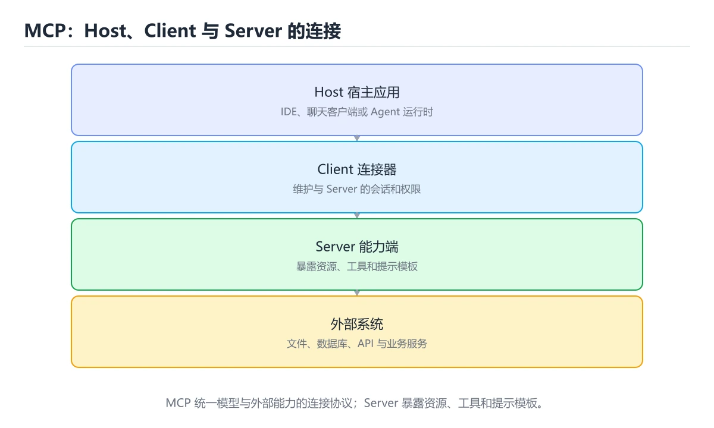
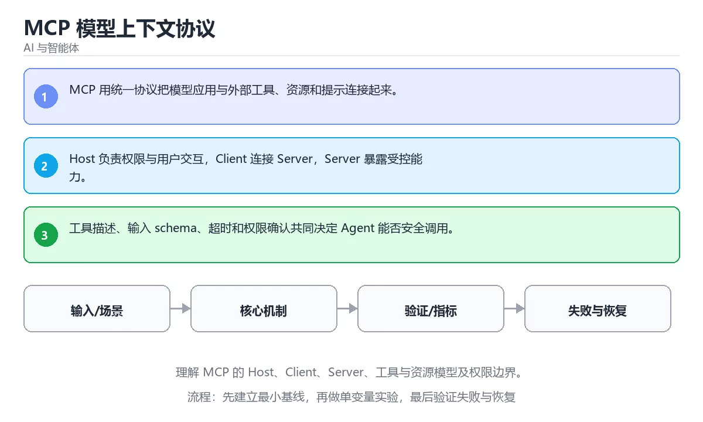

# MCP 模型上下文协议

> 内容更新时间：2026-10-06 · 学习阶段：进阶 · 预计用时：25 分钟





## 本节知识框架

**课程定位**：所属分类 `ai`（AI 与智能体），课程主题 `MCP 模型上下文协议`，学习阶段 进阶，建议用时 45 分钟。

本课主线：理解 MCP 的 Host、Client、Server、工具与资源模型及权限边界。

**学完本课应当能够**
- 说清 `MCP` 与 `工具协议` 的含义与区别，并各举一个正例和一个反例。
- 用本课示例验证 `资源` 的行为，记录输入、输出与失败条件。
- 遇到「把 MCP 当普通 REST 接口」这类问题时，能说出触发条件与修复顺序。

### 复习清单

- [ ] 能不看正文复述本课核心术语，并指出一个边界或反例。
- [ ] 能运行或推演本课示例，记录输入、输出与失败现象。
- [ ] 能完成一次自测，并把错题对照错误表定位原因。

## 核心概念定义

| 术语 | 操作性定义 | 常见边界与风险 |
| --- | --- | --- |
| MCP | Model Context Protocol，用统一协议把工具和数据源暴露给模型客户端。 | 易错：忽略初始化、能力协商与工具 schema；正确做法是按协议先声明能力，再按 schema 暴露工具与资源。 |
| 工具协议 | 约定工具名称、参数结构、权限和返回格式，使模型与外部能力可靠交互。 | 权限与密钥策略变化会让结论失效，按最小权限并用真实凭据流程复验。 |
| 资源 | Agent 可通过协议读取或操作的受控对象，访问范围必须经过授权。 | 易错：忽略初始化、能力协商与工具 schema；正确做法是按协议先声明能力，再按 schema 暴露工具与资源。 |
| 权限 | 主体对资源允许执行的操作集合，访问时必须在服务端校验。 | 易错：上下文膨胀且权限过大；正确做法是按任务动态挂载所需工具，并做最小权限授权。 |
| 数据 | MCP 的训练或检索数据从哪来、质量如何 | 结果依赖数据分布、模型版本与算力预算，换数据集或换硬件都要重新评估。 |
| 模型 | 工具协议 的能力边界与成本是多少 | 易错：模型选错工具或传错参数；正确做法是为每个工具写清名称、参数类型、约束与示例。 |
| 评测 | 如何证明改动真的有效 | 只跑通一次正常调用不算证明：要用同一输入比对改动前后，异常路径也得留下明确错误信息与恢复动作才可对照。 |
| 安全 | 失败时会不会泄露或越权 | 越权多发生在客户端自己判权限：授权必须在服务端校验，一次挂载全部工具等于把不该给的读写口子一并交出去。 |

## 原理与运行机制

### 机制总览

**教材衔接：核心知识**

### 1. MCP 用统一协议把模型应用与外部工具、资源和提示连接起来。

- 关键做法：先用 answer 建立 MCP 的基线，再逐步加入边界与失败条件。
- 验证标准：工具协议 的异常路径有明确错误信息与恢复动作。

### 2. Host 负责权限与用户交互，Client 连接 Server，Server 暴露受控能力。

把这条结论放回「MCP 模型上下文协议」的完整流程里展开：

- 正文依据：能用自己的话解释：MCP 用统一协议把模型应用与外部工具、资源和提示连接起来。
- 落地检查：把「2. Host 负责权限与用户交互，Client 连接 Server，Server 暴露受控能力。」改写成一条可执行的核对项，逐条验证输入、超时与失败路径。

### 3. 工具描述、输入 schema、超时和权限确认共同决定 Agent 能否安全调用。

把这条结论放回「MCP 模型上下文协议」的完整流程里展开：

- 正文依据：能用自己的话解释：Host 负责权限与用户交互，Client 连接 Server，Server 暴露受控能力。
- 落地检查：把「3. 工具描述、输入 schema、超时和权限确认共同决定 Agent 能否安全调用。」改写成一条可执行的核对项，逐条验证输入、超时与失败路径。

**教材衔接：关键流程**

**教材衔接：实践路径**

**教材衔接：验证步骤**

## 典型应用场景

- **把 MCP 当普通 REST 接口**：典型现象是忽略初始化、能力协商与工具 schema；正确做法是按协议先声明能力，再按 schema 暴露工具与资源。
- **工具描述写得含糊**：典型现象是模型选错工具或传错参数；正确做法是为每个工具写清名称、参数类型、约束与示例。
- **一次暴露全部工具**：典型现象是上下文膨胀且权限过大；正确做法是按任务动态挂载所需工具，并做最小权限授权。

### 最小验证场景

- 准备：保留 `text` 示例的原始输入，先记录 `MCP 模型上下文协议` 的基线输出和完整运行命令。
- 观察：先核对 调用了 `score()`，再改变一个与 `MCP` 相关的条件。
- 判定：新结果与 `MCP 模型上下文协议` 的基线不同不等于错误；只有当差异破坏了 `MCP` 的定义或错误表中的约束，才判定为失败。

### 选择与边界

- 使用 `MCP` 时，先满足它的定义：Model Context Protocol，用统一协议把工具和数据源暴露给模型客户端；易错：忽略初始化、能力协商与工具 schema；正确做法是按协议先声明能力，再按 schema 暴露工具与资源。
- 使用 `工具协议` 时，先满足它的定义：约定工具名称、参数结构、权限和返回格式，使模型与外部能力可靠交互；权限与密钥策略变化会让结论失效，按最小权限并用真实凭据流程复验。
- 使用 `资源` 时，先满足它的定义：Agent 可通过协议读取或操作的受控对象，访问范围必须经过授权；易错：忽略初始化、能力协商与工具 schema；正确做法是按协议先声明能力，再按 schema 暴露工具与资源。
- 使用 `权限` 时，先满足它的定义：主体对资源允许执行的操作集合，访问时必须在服务端校验；易错：上下文膨胀且权限过大；正确做法是按任务动态挂载所需工具，并做最小权限授权。

## 代码/协议/SQL 示例

**教材衔接：最小可运行示例**

先用 answer 跑通最小示例，然后只改一个与 MCP 相关的取值：

```python
def score(answer: str) -> int:
    return 1 if answer.strip() else 0

print(score("agent"))
```

**教材衔接：预期输出**

```text
1
```

## 时间/空间复杂度或性能分析

**性能关注点（MCP 模型上下文协议）**：算力与显存决定可行规模：记录训练或推理耗时、显存峰值与模型精度，换数据集要重新评估。

**测量方法**：以 `MCP 模型上下文协议` 的 `MCP` 场景为对象，固定输入跑一遍记录基线，再把规模或并发度提高一个数量级复测；两次结果的差值与波动范围才是结论依据。

## 常见误区与易错点

| 容易写错的做法 | 实际现象 | 原因与正确做法 |
| --- | --- | --- |
| 把 MCP 当普通 REST 接口 | 忽略初始化、能力协商与工具 schema。 | 按协议先声明能力，再按 schema 暴露工具与资源。 |
| 工具描述写得含糊 | 模型选错工具或传错参数。 | 为每个工具写清名称、参数类型、约束与示例。 |
| 一次暴露全部工具 | 上下文膨胀且权限过大。 | 按任务动态挂载所需工具，并做最小权限授权。 |

### 现场 1：把 MCP 当普通 REST 接口

**症状**：忽略初始化、能力协商与工具 schema。

**根因与修复**：按协议先声明能力，再按 schema 暴露工具与资源。

**自检**：在本课示例里复现「把 MCP 当普通 REST 接口」，改成按协议先声明能力，再按 schema 暴露工具与资源后重跑；如果症状消失且失败路径按预期变化，说明定位正确。

### 现场 2：工具描述写得含糊

**症状**：模型选错工具或传错参数。

**根因与修复**：为每个工具写清名称、参数类型、约束与示例。

**自检**：在本课示例里复现「工具描述写得含糊」，改成为每个工具写清名称、参数类型、约束与示例后重跑；如果症状消失且失败路径按预期变化，说明定位正确。

### 现场 3：一次暴露全部工具

**症状**：上下文膨胀且权限过大。

**根因与修复**：按任务动态挂载所需工具，并做最小权限授权。

**自检**：在本课示例里复现「一次暴露全部工具」，改成按任务动态挂载所需工具，并做最小权限授权后重跑；如果症状消失且失败路径按预期变化，说明定位正确。

## 与其他知识点的关系

把「MCP 模型上下文协议」放回知识体系时，不只要记住“前面学过什么”，还要说明两个主题在输入、机制、资源边界和失败模式上的差异。这样才能把单课知识迁移到项目、排障和后续课程。

**教材衔接：复习与迁移**

## 自测题与参考答案

> 先独立作答，再对照参考答案；答案都能在本课正文、术语表或错误表里找到依据。

### 自测 1（概念复述）

不看正文，写出 `MCP` 的操作性定义，并说明它与 `工具协议` 的区别。

**参考答案**：Model Context Protocol，用统一协议把工具和数据源暴露给模型客户端。

`工具协议` 的定位是：约定工具名称、参数结构、权限和返回格式，使模型与外部能力可靠交互；两者的差别要从适用对象与失败模式上说明。

### 自测 2（排错）

本课错误表记录了「把 MCP 当普通 REST 接口」这类做法。请写出它会出现的现象、根因，以及修复顺序。

**参考答案**：现象是忽略初始化、能力协商与工具 schema；正确做法是按协议先声明能力，再按 schema 暴露工具与资源。修复时先复现现象并保留证据，再改动一处假设重跑，确认现象消失。

### 自测 3（动手验证）

运行本课的 `text` 示例，改动其中一个输入后重新运行，记录输出与错误信息。

**参考答案**：正常输入下 `text` 示例应当复现正文给出的结果；改动输入后，如果结果改变或报错，先核对它是否满足 `MCP 模型上下文协议` 中`MCP` 的适用范围，再检查错误表里是否有同类现象。

### 自测 4（代码阅读）

阅读本课开头的 `text` 示例，说明它体现了`MCP` 的哪一条性质，并指出改动哪个输入会让这条性质不再成立。

**参考答案**：`MCP` 的定义是 Model Context Protocol，用统一协议把工具和数据源暴露给模型客户端，示例正是在实现这条定义。改动与 `MCP` 有关的一个输入后，如果结果不再符合 `MCP 模型上下文协议` 的正文描述，就说明该性质只在当前前提成立。

### 自测 5（迁移）

把 `MCP 模型上下文协议` 的方法迁移到自己的项目：围绕 `MCP` 写出一个与错误表同类的风险点，并说明触发条件和检验方式。

**参考答案**：例如「一次暴露全部工具」，它会导致上下文膨胀且权限过大；检验方式是按任务动态挂载所需工具，并做最小权限授权改一处再复现，确认现象消失且没有引入新的失败分支。

### 自测 6（对比）

用一个表格对比 `MCP` 与 `工具协议`：各写一行适用场景、一行失败表现。

**参考答案**：`MCP` 的定义是Model Context Protocol，用统一协议把工具和数据源暴露给模型客户端；`工具协议` 的定义是约定工具名称、参数结构、权限和返回格式，使模型与外部能力可靠交互。两者的失败表现分别对应本课错误表里与本术语相关的行。

### 自测 7（排错顺序）

面对「把 MCP 当普通 REST 接口」引发的问题，请把“复现 忽略初始化、能力协商与工具 schema → 保留证据 → 按协议先声明能力，再按 schema 暴露工具与资源 → 回归验证”四步写成可执行的检查清单。

**参考答案**：第一步按忽略初始化、能力协商与工具 schema复现；第二步记录输入、版本与完整报错；第三步按协议先声明能力，再按 schema 暴露工具与资源只改一处；第四步重跑并确认失败路径也按预期变化。

### 自测 8（边界判断）

针对 `权限`，分别写出“可以使用”的条件和“结论不再成立”的条件。

**参考答案**：易错：上下文膨胀且权限过大；正确做法是按任务动态挂载所需工具，并做最小权限授权。 同时要把 `权限` 的定义 主体对资源允许执行的操作集合，访问时必须在服务端校验 与实际输入逐项对照。

### 自测 9（机制重建）

不看正文，按输入、转换、输出、验证四段重建 `MCP` → `工具协议` → `资源` → `权限` 的作用链。

**参考答案**：起点是 `MCP` 的定义 Model Context Protocol，用统一协议把工具和数据源暴露给模型客户端；中间每一步都保留可观察状态；终点由 `权限` 检查，失败时回到错误表定位第一个偏离定义的步骤。

### 自测 10（综合排错）

在 `MCP 模型上下文协议` 中，现象是 上下文膨胀且权限过大。请围绕 一次暴露全部工具 写出最小复现、关键证据、修复动作和回归验证，并说明为什么不能只凭一次运行下结论。

**参考答案**：先复现 一次暴露全部工具，记录输入与完整错误；再按 按任务动态挂载所需工具，并做最小权限授权 只改一处。回归时同时跑正常路径和边界路径，只有两次结果都可解释，才把修复视为完成。

### 自测 11（一分钟复述）

用每分钟约 200 字的速度复述 `MCP 模型上下文协议`：先给主问题，再按顺序说出 `MCP`、`工具协议`、`资源`、`权限`，最后给一个失败案例。

**自评标准**：主问题必须对应 理解 MCP 的 Host、Client、Server、工具与资源模型及权限边界；每个术语都要能接上一句定义或边界；失败案例必须写成可观察现象，不能用“可能有风险”代替证据。

## 延伸阅读

想更直观地理解本课概念？推荐参阅以下图解专题：

- [图解 RAG 检索增强生成流程](visual_rag_pipeline.md)

## 术语速查

| 术语 | 一句话说明 |
| --- | --- |
| `MCP` | Model Context Protocol，用统一协议把工具和数据源暴露给模型客户端。 |
| `工具协议` | 约定工具名称、参数结构、权限和返回格式，使模型与外部能力可靠交互。 |
| `资源` | Agent 可通过协议读取或操作的受控对象，访问范围必须经过授权。 |
| `权限` | 主体对资源允许执行的操作集合，访问时必须在服务端校验。 |

**术语关系**：`MCP`（Model Context Protocol） → `工具协议`（约定工具名称、参数结构、权限和返回格式） → `资源`（Agent 可通过协议读取或操作的受控对象） → `权限`（主体对资源允许执行的操作集合）。

## 考点精讲

`MCP 模型上下文协议` 的题库有 6 道题，下面逐题给出题干、正确项与判断依据：先自己作答，再核对正确项，最后回到正文对应小节复核。

### 考点 1：第 1 题

- **题目**：代码语言为 `python`，选自 `MCP 模型上下文协议` 的 `MCP` 部分。课程问题为理解 MCP 的 Host、Client、Server、工具与资源模型及权限边界。哪一项描述与代码一致？
- **正确项**：调用了 `strip()`
- **判断依据**：本题正确项是「调用了 `strip()`」（MCP 模型上下文协议）。术语 MCP（MCP 模型上下文协议）：Model Context Protocol，用统一协议把工具和数据源暴露给模型客户端，本题取「调用了 `strip()`」这条。易错点是把 MCP 当普通 REST 接口，会造成忽略初始化、能力协商与工具 schema，改法是按协议先声明能力，再按 schema 暴露工具与资源。本题干扰项「调用了 `greet()`」不成立：展示代码里找不到 `greet()`。

### 考点 2：第 2 题

- **题目**：围绕“MCP 模型上下文协议”中的 MCP、工具协议、资源，下列哪两项是本课强调的实践判断？
- **正确项**：验证 工具协议 时要固定版本并覆盖边界输入，结论才可复现；学习 MCP 时要同时说明输入、输出和失败路径，不能只看正常流程
- **判断依据**：按《MCP 模型上下文协议》的正文口径，本题要同时选中「验证 工具协议 时要固定版本并覆盖边界输入，结论才可复现」、「学习 MCP 时要同时说明输入、输出和失败路径，不能只看正常流程」，漏掉任一项都算没答全。术语 MCP（MCP 模型上下文协议）：Model Context Protocol，用统一协议把工具和数据源暴露给模型客户端。易错点是工具描述写得含糊，会造成模型选错工具或传错参数，改法是为每个工具写清名称、参数类型、约束与示例。

### 考点 3：第 3 题

- **题目**：在 `MCP 模型上下文协议` 里，与 `MCP` 有关的说法中，哪一项最符合理解 MCP 的 Host、Client、Server、工具与资源模型及权限边界？
- **正确项**：工具描述、输入 schema、超时和权限确认共同决定 Agent 能否安全调用。
- **判断依据**：本题正确项是「工具描述、输入 schema、超时和权限确认共同决定 Agent 能否安全调用」。术语 MCP（MCP 模型上下文协议）：Model Context Protocol，用统一协议把工具和数据源暴露给模型客户端，本题取「工具描述、输入 schema、超时和权限确认共同决定 Agent 能否安全调用」这条。易错点是一次暴露全部工具，会造成上下文膨胀且权限过大，改法是按任务动态挂载所需工具，并做最小权限授权。

### 考点 4：第 4 题

- **题目**：`MCP 模型上下文协议` 的主线是：理解 MCP 的 Host、Client、Server、工具与资源模型及权限边界。下面哪一项与这条主线一致？
- **正确项**：理解 MCP 的 Host，Client，Server
- **判断依据**：本题正确项是「理解 MCP 的 Host，Client，Server」。术语 MCP（MCP 模型上下文协议）：Model Context Protocol，用统一协议把工具和数据源暴露给模型客户端，本题取「理解 MCP 的 Host，Client，Server」这条。易错点是把 MCP 当普通 REST 接口，会造成忽略初始化、能力协商与工具 schema，改法是按协议先声明能力，再按 schema 暴露工具与资源。

### 考点 5：第 5 题

- **题目**：填空：补齐下面这段术语说明中的空缺。课程 `理解 MCP 的 Host、Client、Server、工具与资源模型及权限边界。`，这段说明是：`____`：Agent 可通过协议读取或操作的受控对象，访问范围必须经过授权。空缺处应填哪个术语？
- **正确项**：资源
- **判断依据**：涉及术语 MCP：Model Context Protocol，用统一协议把工具和数据源暴露给模型客户端。易错点：把 MCP 当普通 REST 接口会造成忽略初始化、能力协商与工具 schema。正确做法：按协议先声明能力，再按 schema 暴露工具与资源。本课《MCP 模型上下文协议》要解决的是理解 MCP 的 Host、Client、Server、工具与资源模型及权限边界

### 考点 6：第 6 题

- **题目**：下面几项都与 `MCP` 有关，请按 `MCP 模型上下文协议` 的正文顺序排列；该课主线是理解 MCP 的 Host、Client、Server、工具与资源模型及权限边界。
- **正确项**：核心知识 → 关键流程 → 实践路径 → 常见误区
- **判断依据**：按《MCP 模型上下文协议》正文的先后，本题顺序是「核心知识」 → 「关键流程」 → 「实践路径」 → 「常见误区」。术语「MCP」在本课里的界定是Model Context Protocol，用统一协议把工具和数据源暴露给模型客户端，题干「下面几项都与 `MCP` 有关，请按 `MCP 模型上下文协议` 的正文顺序排列；该课主线是理解 MCP 的 Host、Client、Server、工具与资源模型及权限边界。」问的就是这一条。常见错法是把 MCP 当普通 REST 接口，其后果是忽略初始化、能力协商与工具 schema。正确做法是按协议先声明能力，再按 schema 暴露工具与资源。

### 考点 7：`MCP`

- **要点**：Model Context Protocol，用统一协议把工具和数据源暴露给模型客户端。
- **MCP 的边界**：易错：忽略初始化、能力协商与工具 schema；正确做法是按协议先声明能力，再按 schema 暴露工具与资源。

### 考点 8：`工具协议`

- **要点**：约定工具名称、参数结构、权限和返回格式，使模型与外部能力可靠交互。
- **工具协议 的边界**：权限与密钥策略变化会让结论失效，按最小权限并用真实凭据流程复验。

### 考点 9：`资源`

- **要点**：Agent 可通过协议读取或操作的受控对象，访问范围必须经过授权。
- **资源 的边界**：易错：忽略初始化、能力协商与工具 schema；正确做法是按协议先声明能力，再按 schema 暴露工具与资源。

### 考点 10：`权限`

- **要点**：主体对资源允许执行的操作集合，访问时必须在服务端校验。
- **权限 的边界**：易错：上下文膨胀且权限过大；正确做法是按任务动态挂载所需工具，并做最小权限授权。

### 考点 11：排错——把 MCP 当普通 REST 接口

- **现象**：忽略初始化、能力协商与工具 schema。
- **处理**：按协议先声明能力，再按 schema 暴露工具与资源。

### 考点 12：排错——工具描述写得含糊

- **现象**：模型选错工具或传错参数。
- **处理**：为每个工具写清名称、参数类型、约束与示例。

### 考点 13：综合辨析——`MCP` 与 `权限`

- **辨析点**：`MCP` 的定义是 Model Context Protocol，用统一协议把工具和数据源暴露给模型客户端；`权限` 的定义是 主体对资源允许执行的操作集合，访问时必须在服务端校验。
- **答题要求**：面对 `MCP 模型上下文协议` 的题目，先判断描述的是 `MCP` 还是 `权限`，再归到对应定义，最后写出一个会让该定义失效的边界输入。

### 考点 14：排错评分点

- **现象分**：能写出 忽略初始化、能力协商与工具 schema，而不是只写“程序有错”。
- **证据分**：保留触发 把 MCP 当普通 REST 接口 的输入、版本和错误原文。
- **修复分**：按 按协议先声明能力，再按 schema 暴露工具与资源 只改一处，并同时回归正常路径与边界路径。

## 内容元数据

- 内容版本：v2.0
- 最后更新：2026-10-06
- 学习阶段：进阶
- 适用环境：主流大模型 API、开源模型与向量数据库；本课聚焦 MCP。
- 内容来源：内置结构化课程与工程实践整理
- 相关主题：MCP、工具协议、资源、权限
- 质量版本：P0 测验标准 + P1 覆盖扩展 + P2 体验补全

## 参考资料与复核

- 最后复核：2026-10-04
- 下次复核：2026-12-24
- 复核范围：版本兼容、API 行为、安全建议与工程实践
- 来源性质：官方文档、标准或权威教材；本课核对关键词：MCP、工具协议、资源、权限。

| 参考资料 | 本课用途 |
| --- | --- |
| [Model Context Protocol](https://modelcontextprotocol.io/) | Agent 工具与上下文协议 |
| [Google AI 文档](https://ai.google.dev/gemini-api/docs) | Gemini API 与多模态 |
| [Ollama 文档](https://ollama.com/) | 本地模型运行与部署 |

| [本课术语索引：MCP 模型上下文协议](#核心概念定义) | 按本课输入、术语边界和错误表现逐项核对 |
> 「MCP 模型上下文协议」的链接用于离线阅读后的延伸核对；App 不会自动联网。