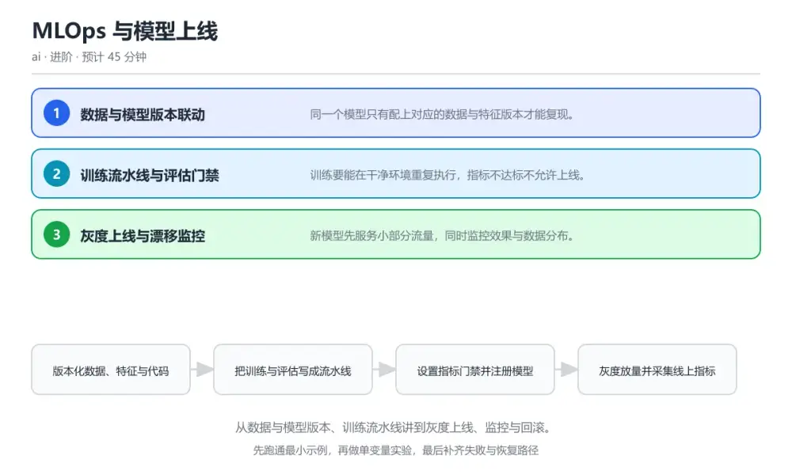
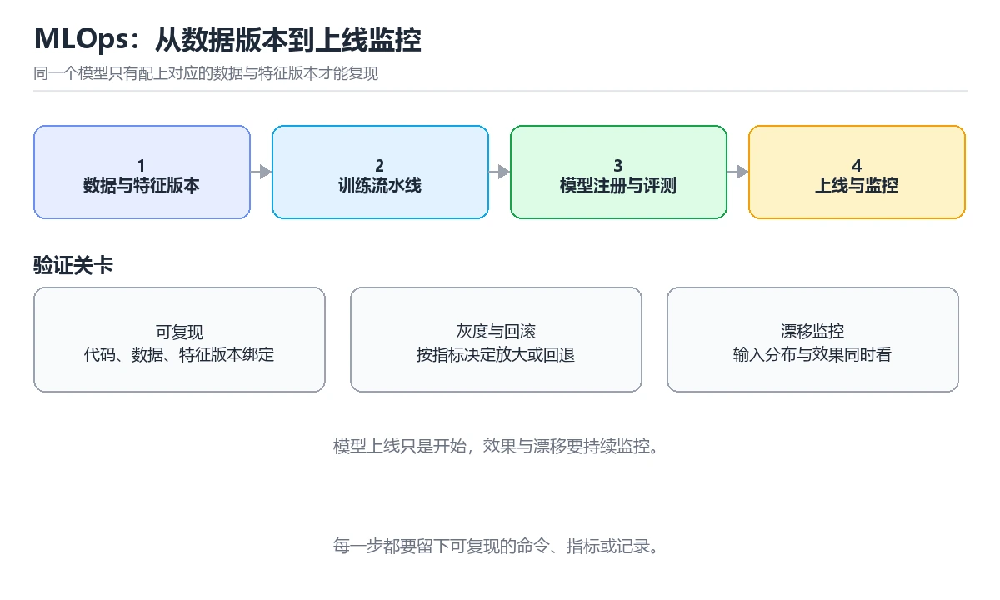

# MLOps 与模型上线

> 内容更新时间：2026-10-06 · 学习阶段：进阶 · 预计用时：30 分钟

分类：ai。关键词：MLOps、模型版本、训练流水线、灰度上线、数据漂移。从数据与模型版本、训练流水线讲到灰度上线、监控与回滚。



## 本节知识框架

**课程定位**：所属分类 `ai`（AI 与智能体），课程主题 `MLOps 与模型上线`，学习阶段 进阶，建议用时 40 分钟。

本课主线：从数据与模型版本、训练流水线讲到灰度上线、监控与回滚。

**学完本课应当能够**
- 说清 `模型注册表` 与 `特征一致性` 的含义与区别，并各举一个正例和一个反例。
- 用本课示例验证 `灰度上线` 的行为，记录输入、输出与失败条件。
- 遇到「线上效果与离线评估不符」这类问题时，能说出触发条件与修复顺序。

### 复习清单

- [ ] 能用自己的话说明「MLOps 与模型上线」里的 MLOps，再举一个它不成立的场景。
- [ ] 能跑通 MLOps 的最小示例，记录一组正常输出和一组失败输出。
- [ ] 能完成一次自测，并把错题对照错误表定位原因。

**本课配图**



## 核心概念定义

| 术语 | 操作性定义 | 常见边界与风险 |
| --- | --- | --- |
| 模型注册表 | 集中管理模型版本与元数据的服务。 | 易错：只保存模型文件，数据与代码版本没有记录；正确做法是模型注册表强制记录数据快照、特征版本与代码提交号，缺失元数据不允许上线。 |
| 特征一致性 | 训练与服务使用同一套特征计算逻辑。 | 易错：两侧标准化口径不同，训练用当批统计而服务用历史统计，线上效果系统性偏移、离线评估失真；要共用同一份特征定义代码并做一致性校验。 |
| 灰度上线 | 新版本先服务部分流量再逐步放量。 | 要按比例分流并把请求与预测记入日志比较新旧指标，漂移触发告警时暂停放量；一次性全量上线且无回滚路径，模型变差会直接影响全部用户。 |
| 数据漂移 | 线上输入分布与训练分布发生偏移。 | 离线指标达标不代表线上有效，分布不一致会让线上表现显著低于离线评估；要监控输入特征分布，漂移触发告警时暂停放量。 |
| 回滚 | 异常时切回上一个稳定版本。 | 易错：一次性全量上线且没有灰度与回滚方案；正确做法是按比例灰度并设定观察窗口，回退命令与阈值在上线前就准备好。 |

## 原理与运行机制

### 机制总览

**教材衔接：核心知识**

### 1. 数据与模型版本联动

同一个模型只有配上对应的数据与特征版本才能复现。

训练时记录数据快照标识、特征定义版本、超参数与代码提交号，模型注册表把它们作为元数据一起保存。

在MLOps 与模型上线里可以这样验证：在本课示例里用两次不同的数据快照训练同一份代码，对比评估指标的差异。

边界：只保存模型文件而丢失数据版本，出了问题时无法判断是数据变化还是代码变化。

工程视角：模型注册表强制填写数据与特征版本，缺失元数据的产物不允许进入上线流程。

### 2. 训练流水线与评估门禁

训练要能在干净环境重复执行，指标不达标不允许上线。

流水线依次完成取数、特征生成、训练与离线评估，评估结果写入记录；门禁校验指标阈值与数据质量后决定是否注册新版本。

在MLOps 与模型上线里可以这样验证：在本课示例里让一次训练指标低于基线，观察流水线在门禁处阻止注册。

边界：离线指标达标不代表线上有效，分布不一致会让线上表现显著低于离线评估。

工程视角：门禁同时检查整体指标与关键切片指标，任何切片显著退化都需要说明。

### 3. 灰度上线与漂移监控

新模型先服务小部分流量，同时监控效果与数据分布。

按比例分流并把请求与预测结果记录到日志，比较新旧模型的关键指标；输入特征的分布漂移触发告警并暂停放量。

在MLOps 与模型上线里可以这样验证：在本课示例里让两个模型各服务一部分流量，观察分流比例与效果差异。

边界：一次性全量上线且没有回滚路径，模型变差时会直接影响全部用户。

工程视角：上线流程固定包含灰度比例、观察窗口与回滚命令，指标回退时能在分钟级完成切换。

## 典型应用场景

**教材衔接：深度拓展与实战**

### 机制对照表

| 概念 | 解决什么问题 | 关键前提 | 失败信号 |
| --- | --- | --- | --- |
| 数据与模型版本联动 | 同一个模型只有配上对应的数据与特征版本才能复现。 | 只保存模型文件而丢失数据版本，出了问题时无法判断是数据变化还是代码变化。 | 模型注册表强制填写数据与特征版本，缺失元数据的产物不允许进入上线流程。 |
| 训练流水线与评估门禁 | 训练要能在干净环境重复执行，指标不达标不允许上线。 | 离线指标达标不代表线上有效，分布不一致会让线上表现显著低于离线评估。 | 门禁同时检查整体指标与关键切片指标，任何切片显著退化都需要说明。 |
| 灰度上线与漂移监控 | 新模型先服务小部分流量，同时监控效果与数据分布。 | 一次性全量上线且没有回滚路径，模型变差时会直接影响全部用户。 | 上线流程固定包含灰度比例、观察窗口与回滚命令，指标回退时能在分钟级完成切 |

### 自测问答

**问 1**：模型注册表必须记录数据与特征版本的原因是？

**答**：出现问题时能复现当时的训练条件。只有数据、特征与代码版本一起记录，才能复现模型行为并判断指标变化来自哪一侧。 正确选项「出现问题时能复现当时的训练条件」对应《MLOps 与模型上线》的要点「数据与模型版本联动」：同一个模型只有配上对应的数据与特征版本才能复现。判断「数据与模型版本联动」时先确认前提是否成立，再回到《MLOps 与模型上线》的示例核对一次；把别的语言或框架的默认做法直接搬到数据与模型版本联动上，往往会在本课的边界条件里失效。

**问 2**：离线指标达标但线上效果差，最常见的原因是？

**答**：训练与服务特征计算不一致。特征在训练与线上使用两套实现时，输入分布会系统性偏移，离线评估无法反映真实服务效果。 正确选项「训练与服务特征计算不一致」对应《MLOps 与模型上线》的要点「训练流水线与评估门禁」：训练要能在干净环境重复执行，指标不达标不允许上线。判断「训练流水线与评估门禁」时先确认前提是否成立，再回到《MLOps 与模型上线》的示例核对一次；借鉴相邻主题的经验之前，先核对训练流水线与评估门禁的前提是否成立。

**问 3**：一次可回滚的上线应具备哪些要素？（多选）

**答**：按比例灰度放量；明确的观察窗口与阈值；已验证的回滚命令。灰度、观察与回滚构成安全上线闭环；删除旧版本会让回滚无路可走。 正确选项「按比例灰度放量；明确的观察窗口与阈值；已验证的回滚命令」对应《MLOps 与模型上线》的要点「灰度上线与漂移监控」：新模型先服务小部分流量，同时监控效果与数据分布。判断「灰度上线与漂移监控」时先确认前提是否成立，再回到《MLOps 与模型上线》的示例核对一次；记住灰度上线与漂移监控的结论之外还要记住适用条件，换一个输入往往就不成立了。

**问 4**：请按一次模型上线的顺序排列。

**答**：固化数据与代码版本并训练。先训练并注册，再灰度观察，指标稳定才逐步放量，异常时按预案回滚，保证用户影响可控。 正确选项「固化数据与代码版本并训练；评估通过门禁后注册模型；部署新版本并按比例灰度；观察线上指标与漂移情况；逐步放量或按需回滚」对应《MLOps 与模型上线》的要点「数据与模型版本联动」：同一个模型只有配上对应的数据与特征版本才能复现。判断「数据与模型版本联动」时先确认前提是否成立，再回到《MLOps 与模型上线》的示例核对一次；干扰项常常是相邻主题里成立的结论，只有按数据与模型版本联动的输入与约束判断才能排除。

**问 5**：阅读这段上线代码，风险是什么？

**答**：训练与服务特征处理不一致，线上效果会明显偏移。两侧的标准化口径不同，训练时用当批统计而服务用历史统计，特征分布不一致会让模型在线上产生系统性误差。 正确选项「训练与服务特征处理不一致，线上效果会明显偏移」对应《MLOps 与模型上线》的要点「训练流水线与评估门禁」：训练要能在干净环境重复执行，指标不达标不允许上线。判断「训练流水线与评估门禁」时先确认前提是否成立，再回到《MLOps 与模型上线》的示例核对一次；把训练流水线与评估门禁的做法换到别的约束下未必成立，先确认边界再决定答案。

### 工程检查表

- [ ] 版本化数据、特征与代码
- [ ] 把训练与评估写成流水线
- [ ] 设置指标门禁并注册模型
- [ ] 灰度放量并采集线上指标
- [ ] 监控漂移并准备回滚
- [ ] 【数据与模型版本联动】模型注册表强制填写数据与特征版本，缺失元数据的产物不允许进入上线流程。
- [ ] 【训练流水线与评估门禁】门禁同时检查整体指标与关键切片指标，任何切片显著退化都需要说明。
- [ ] 【灰度上线与漂移监控】上线流程固定包含灰度比例、观察窗口与回滚命令，指标回退时能在分钟级完成切换。

### 结论与下一步

- **线上效果与离线评估不符**：典型现象是离线与线上使用不同的特征计算实现；正确做法是训练与服务共用同一份特征定义代码，并对线上特征做一致性校验。
- **出问题无法复现**：典型现象是只保存模型文件，数据与代码版本没有记录；正确做法是模型注册表强制记录数据快照、特征版本与代码提交号，缺失元数据不允许上线。
- **模型变差无从回退**：典型现象是一次性全量上线且没有灰度与回滚方案；正确做法是按比例灰度并设定观察窗口，回退命令与阈值在上线前就准备好。

### 最小验证场景

- 准备：保留 `text` 示例的原始输入，先记录 `MLOps 与模型上线` 的基线输出和完整运行命令。
- 观察：先核对 调用了 `train_and_register()`，再改变一个与 `模型注册表` 相关的条件。
- 判定：新结果与 `MLOps 与模型上线` 的基线不同不等于错误；只有当差异破坏了 `模型注册表` 的定义或错误表中的约束，才判定为失败。

### 选择与边界

- 使用 `模型注册表` 时，集中管理模型版本与元数据的服务；易错：只保存模型文件，数据与代码版本没有记录；正确做法是模型注册表强制记录数据快照、特征版本与代码提交号，缺失元数据不允许上线。
- 使用 `特征一致性` 时，训练与服务使用同一套特征计算逻辑；结果依赖数据分布、模型版本与算力预算，换数据集或换硬件都要重新评估。
- 使用 `灰度上线` 时，新版本先服务部分流量再逐步放量；不同版本与依赖组合的行为可能不同，升级或换环境前要按官方变更说明重新验证。
- 使用 `数据漂移` 时，线上输入分布与训练分布发生偏移；结果依赖数据分布、模型版本与算力预算，换数据集或换硬件都要重新评估。
- 使用 `回滚` 时，异常时切回上一个稳定版本；易错：一次性全量上线且没有灰度与回滚方案；正确做法是按比例灰度并设定观察窗口，回退命令与阈值在上线前就准备好。

## 代码/协议/SQL 示例

**教材衔接：关键流程**

```text
版本化数据、特征与代码 → 把训练与评估写成流水线 → 设置指标门禁并注册模型 → 灰度放量并采集线上指标 → 监控漂移并准备回滚
```

1. 版本化数据、特征与代码
2. 把训练与评估写成流水线
3. 设置指标门禁并注册模型
4. 灰度放量并采集线上指标
5. 监控漂移并准备回滚

```python
# 训练记录与门禁：把数据版本、指标与产物绑定在一起
import mlflow

def train_and_register(data_version: str, feature_version: str, commit: str):
    with mlflow.start_run() as run:
        mlflow.log_params({"data_version": data_version,
                           "feature_version": feature_version,
                           "code_commit": commit})
        model, metrics = train()                       # 训练并返回评估指标
        mlflow.log_metrics(metrics)

        # 门禁：准确率与关键切片都必须不低于阈值
        if metrics["auc"] < 0.86:
            raise SystemExit(f"gate failed: auc={metrics['auc']:.3f} < 0.86")
        if metrics["auc_new_user"] < 0.74:
            raise SystemExit("gate failed: new-user slice regressed")

        mlflow.log_artifact(model.path)
        mlflow.register_model(f"runs:/{run.info.run_id}/model", "reco_ranker")
```

## 时间/空间复杂度或性能分析

**性能关注点（MLOps 与模型上线）**：算力与显存决定可行规模：记录训练或推理耗时、显存峰值与模型精度，换数据集要重新评估。

**本课特有开销（MLOps 与模型上线 · MLOps）**：比较次数与内存移动决定开销，注意稳定性与额外空间。

**测量方法**：以 `MLOps 与模型上线` 的 `MLOps` 场景为对象，固定输入跑一遍记录基线，再把规模或并发度提高一个数量级复测；两次结果的差值与波动范围才是结论依据。

## 常见误区与易错点

| 容易写错的做法 | 实际现象 | 原因与正确做法 |
| --- | --- | --- |
| 线上效果与离线评估不符 | 离线与线上使用不同的特征计算实现。 | 训练与服务共用同一份特征定义代码，并对线上特征做一致性校验。 |
| 出问题无法复现 | 只保存模型文件，数据与代码版本没有记录。 | 模型注册表强制记录数据快照、特征版本与代码提交号，缺失元数据不允许上线。 |
| 模型变差无从回退 | 一次性全量上线且没有灰度与回滚方案。 | 按比例灰度并设定观察窗口，回退命令与阈值在上线前就准备好。 |

### 现场 1：线上效果与离线评估不符

**症状**：离线与线上使用不同的特征计算实现。

**根因与修复**：训练与服务共用同一份特征定义代码，并对线上特征做一致性校验。

**自检**：在本课示例里复现「线上效果与离线评估不符」，改成训练与服务共用同一份特征定义代码，并对线上特征做一致性校验后重跑；如果症状消失且失败路径按预期变化，说明定位正确。

### 现场 2：出问题无法复现

**症状**：只保存模型文件，数据与代码版本没有记录。

**根因与修复**：模型注册表强制记录数据快照、特征版本与代码提交号，缺失元数据不允许上线。

**自检**：在本课示例里复现「出问题无法复现」，改成模型注册表强制记录数据快照、特征版本与代码提交号，缺失元数据不允许上线后重跑；如果症状消失且失败路径按预期变化，说明定位正确。

### 现场 3：模型变差无从回退

**症状**：一次性全量上线且没有灰度与回滚方案。

**根因与修复**：按比例灰度并设定观察窗口，回退命令与阈值在上线前就准备好。

**自检**：在本课示例里复现「模型变差无从回退」，改成按比例灰度并设定观察窗口，回退命令与阈值在上线前就准备好后重跑；如果症状消失且失败路径按预期变化，说明定位正确。

## 与其他知识点的关系

**教材衔接：复习与迁移**

## 自测题与参考答案

> 先独立作答，再对照参考答案；答案都能在本课正文、术语表或错误表里找到依据。

### 自测 1（概念复述）

不看正文，写出 `模型注册表` 的操作性定义，并说明它与 `特征一致性` 的区别。

**参考答案**：集中管理模型版本与元数据的服务。

`特征一致性` 的定位是：训练与服务使用同一套特征计算逻辑；两者的差别要从适用对象与失败模式上说明。

### 自测 2（排错）

本课错误表记录了「线上效果与离线评估不符」这类做法。请写出它会出现的现象、根因，以及修复顺序。

**参考答案**：现象是离线与线上使用不同的特征计算实现；正确做法是训练与服务共用同一份特征定义代码，并对线上特征做一致性校验。修复时先复现现象并保留证据，再改动一处假设重跑，确认现象消失。

### 自测 3（动手验证）

运行本课的 `text` 示例，把 模型版本 相关的一个值换成边界值，记录输出差异与错误信息。

**参考答案**：正常输入下 `text` 示例应当复现正文给出的结果；改动输入后，如果结果改变或报错，先核对它是否满足 `MLOps 与模型上线` 中`模型注册表` 的适用范围，再检查错误表里是否有同类现象。

### 自测 4（代码阅读）

阅读本课开头的 `text` 示例，说明它体现了`模型注册表` 的哪一条性质，并指出改动哪个输入会让这条性质不再成立。

**参考答案**：`模型注册表` 的定义是 集中管理模型版本与元数据的服务，示例正是在实现这条定义。改动与 `模型注册表` 有关的一个输入后，如果结果不再符合 `MLOps 与模型上线` 的正文描述，就说明该性质只在当前前提成立。

### 自测 5（迁移）

把 `MLOps 与模型上线` 的方法迁移到自己的项目：围绕 `模型注册表` 写出一个与错误表同类的风险点，并说明触发条件和检验方式。

**参考答案**：例如「模型变差无从回退」，它会导致一次性全量上线且没有灰度与回滚方案；检验方式是按比例灰度并设定观察窗口，回退命令与阈值在上线前就准备好改一处再复现，确认现象消失且没有引入新的失败分支。

### 自测 6（对比）

用一个表格对比 `模型注册表` 与 `特征一致性`：各写一行适用场景、一行失败表现。

**参考答案**：`模型注册表` 的定义是集中管理模型版本与元数据的服务；`特征一致性` 的定义是训练与服务使用同一套特征计算逻辑。两者的失败表现分别对应本课错误表里与本术语相关的行。

### 自测 7（排错顺序）

面对「线上效果与离线评估不符」引发的问题，请把“复现 离线与线上使用不同的特征计算实现 → 保留证据 → 训练与服务共用同一份特征定义代码，并对线上特征做一致性校验 → 回归验证”四步写成可执行的检查清单。

**参考答案**：第一步按离线与线上使用不同的特征计算实现复现；第二步记录输入、版本与完整报错；第三步按训练与服务共用同一份特征定义代码，并对线上特征做一致性校验只改一处；第四步重跑并确认失败路径也按预期变化。

### 自测 8（边界判断）

针对 `回滚`，分别写出“可以使用”的条件和“结论不再成立”的条件。

**参考答案**：易错：一次性全量上线且没有灰度与回滚方案；正确做法是按比例灰度并设定观察窗口，回退命令与阈值在上线前就准备好。 同时要把 `回滚` 的定义 异常时切回上一个稳定版本 与实际输入逐项对照。

### 自测 9（机制重建）

不看正文，按输入、转换、输出、验证四段重建 `模型注册表` → `特征一致性` → `灰度上线` → `数据漂移` 的作用链。

**参考答案**：起点是 `模型注册表` 的定义 集中管理模型版本与元数据的服务；中间每一步都保留可观察状态；终点由 `回滚` 检查，失败时回到错误表定位第一个偏离定义的步骤。

### 自测 10（综合排错）

在 `MLOps 与模型上线` 中，现象是 一次性全量上线且没有灰度与回滚方案。请围绕 模型变差无从回退 写出最小复现、关键证据、修复动作和回归验证，并说明为什么不能只凭一次运行下结论。

**参考答案**：先复现 模型变差无从回退，记录输入与完整错误；再按 按比例灰度并设定观察窗口，回退命令与阈值在上线前就准备好 只改一处。回归时同时跑正常路径和边界路径，只有两次结果都可解释，才把修复视为完成。

### 自测 11（一分钟复述）

用每分钟约 200 字的速度复述 `MLOps 与模型上线`：先给主问题，再按顺序说出 `模型注册表`、`特征一致性`、`灰度上线`、`数据漂移`，最后给一个失败案例。

**自评标准**：主问题必须对应 从数据与模型版本、训练流水线讲到灰度上线、监控与回滚；每个术语都要能接上一句定义或边界；失败案例必须写成可观察现象，不能用“可能有风险”代替证据。

## 延伸阅读

想更直观地理解本课概念？推荐参阅以下图解专题：

- [图解大模型推理与显存占用](visual_llm_inference.md)
- [图解 Kubernetes 调度与探针](visual_k8s_scheduling.md)

## 术语速查

| 术语 | 一句话说明 |
| --- | --- |
| `模型注册表` | 集中管理模型版本与元数据的服务。 |
| `特征一致性` | 训练与服务使用同一套特征计算逻辑。 |
| `灰度上线` | 新版本先服务部分流量再逐步放量。 |
| `数据漂移` | 线上输入分布与训练分布发生偏移。 |
| `回滚` | 异常时切回上一个稳定版本。 |

**术语关系**：`模型注册表`（集中管理模型版本与元数据的服务） → `特征一致性`（训练与服务使用同一套特征计算逻辑） → `灰度上线`（新版本先服务部分流量再逐步放量） → `数据漂移`（线上输入分布与训练分布发生偏移）。

## 考点精讲

`MLOps 与模型上线` 的题库有 5 道题，下面逐题给出题干、正确项与判断依据：先自己作答，再核对正确项，最后回到正文对应小节复核。

### 考点 1：第 1 题

- **题目**：模型注册表必须记录数据与特征版本的原因是？
- **正确项**：出现问题时能复现当时的训练条件
- **判断依据**：本题正确项是「出现问题时能复现当时的训练条件」。术语 模型注册表（MLOps 与模型上线）：集中管理模型版本与元数据的服务，本题取「出现问题时能复现当时的训练条件」这条。易错点是线上效果与离线评估不符，会造成离线与线上使用不同的特征计算实现，改法是训练与服务共用同一份特征定义代码，并对线上特征做一致性校验。

### 考点 2：第 2 题

- **题目**：离线指标达标但线上效果差，最常见的原因是？
- **正确项**：训练与服务特征计算不一致
- **判断依据**：本题正确项是「训练与服务特征计算不一致」。术语 模型注册表（MLOps 与模型上线）：集中管理模型版本与元数据的服务，本题取「训练与服务特征计算不一致」这条。易错点是出问题无法复现，会造成只保存模型文件，数据与代码版本没有记录，改法是模型注册表强制记录数据快照、特征版本与代码提交号，缺失元数据不允许上线。

### 考点 3：第 3 题

- **题目**：一次可回滚的上线应具备哪些要素？（多选）
- **正确项**：按比例灰度放量；明确的观察窗口与阈值；已验证的回滚命令
- **判断依据**：按《MLOps 与模型上线》的正文口径，本题要同时选中「按比例灰度放量」、「明确的观察窗口与阈值」、「已验证的回滚命令」，漏掉任一项都算没答全。术语 回滚（MLOps 与模型上线）：异常时切回上一个稳定版本。易错点是模型变差无从回退，会造成一次性全量上线且没有灰度与回滚方案，改法是按比例灰度并设定观察窗口，回退命令与阈值在上线前就准备好。

### 考点 4：第 4 题

- **题目**：请按一次模型上线的顺序排列。
- **正确项**：固化数据与代码版本并训练 → 评估通过门禁后注册模型 → 部署新版本并按比例灰度 → 观察线上指标与漂移情况 → 逐步放量或按需回滚
- **判断依据**：按《MLOps 与模型上线》正文的先后，本题顺序是「固化数据与代码版本并训练」 → 「评估通过门禁后注册模型」 → 「部署新版本并按比例灰度」 → 「观察线上指标与漂移情况」 → 「逐步放量或按需回滚」。术语 回滚（MLOps 与模型上线）：异常时切回上一个稳定版本。易错点是线上效果与离线评估不符会造成离线与线上使用不同的特征计算实现，改法是训练与服务共用同一份特征定义代码，并对线上特征做一致性校验。

### 考点 5：第 5 题

- **题目**：阅读这段上线代码，风险是什么？
- **正确项**：训练与服务特征处理不一致，线上效果会明显偏移
- **判断依据**：本题正确项是「训练与服务特征处理不一致，线上效果会明显偏移」。术语 模型注册表（MLOps 与模型上线）：集中管理模型版本与元数据的服务，本题取「训练与服务特征处理不一致，线上效果会明显偏移」这条。易错点是出问题无法复现，会造成只保存模型文件，数据与代码版本没有记录，改法是模型注册表强制记录数据快照、特征版本与代码提交号，缺失元数据不允许上线。

### 考点 6：`模型注册表`

- **要点**：集中管理模型版本与元数据的服务。
- **模型注册表 的边界**：易错：只保存模型文件，数据与代码版本没有记录；正确做法是模型注册表强制记录数据快照、特征版本与代码提交号，缺失元数据不允许上线。

### 考点 7：`特征一致性`

- **要点**：训练与服务使用同一套特征计算逻辑。
- **特征一致性 的边界**：结果依赖数据分布、模型版本与算力预算，换数据集或换硬件都要重新评估。

### 考点 8：`灰度上线`

- **要点**：新版本先服务部分流量再逐步放量。
- **灰度上线 的边界**：不同版本与依赖组合的行为可能不同，升级或换环境前要按官方变更说明重新验证。

### 考点 9：`数据漂移`

- **要点**：线上输入分布与训练分布发生偏移。
- **数据漂移 的边界**：结果依赖数据分布、模型版本与算力预算，换数据集或换硬件都要重新评估。

### 考点 10：`回滚`

- **要点**：异常时切回上一个稳定版本。
- **回滚 的边界**：易错：一次性全量上线且没有灰度与回滚方案；正确做法是按比例灰度并设定观察窗口，回退命令与阈值在上线前就准备好。

### 考点 11：排错——线上效果与离线评估不符

- **现象**：离线与线上使用不同的特征计算实现。
- **处理**：训练与服务共用同一份特征定义代码，并对线上特征做一致性校验。

### 考点 12：排错——出问题无法复现

- **现象**：只保存模型文件，数据与代码版本没有记录。
- **处理**：模型注册表强制记录数据快照、特征版本与代码提交号，缺失元数据不允许上线。

### 考点 13：综合辨析——`模型注册表` 与 `回滚`

- **辨析点**：`模型注册表` 的定义是 集中管理模型版本与元数据的服务；`回滚` 的定义是 异常时切回上一个稳定版本。
- **答题要求**：面对 `MLOps 与模型上线` 的题目，先判断描述的是 `模型注册表` 还是 `回滚`，再归到对应定义，最后写出一个会让该定义失效的边界输入。

### 考点 14：排错评分点

- **现象分**：能写出 离线与线上使用不同的特征计算实现，而不是只写“程序有错”。
- **证据分**：保留触发 线上效果与离线评估不符 的输入、版本和错误原文。
- **修复分**：按 训练与服务共用同一份特征定义代码，并对线上特征做一致性校验 只改一处，并同时回归正常路径与边界路径。

## 内容元数据

- 内容版本：v2.0
- 最后更新：2026-10-06
- 学习阶段：进阶

| 字段 | 值 |
| --- | --- |
| 课程 ID | `ai_mlops` |
| 所属分类 | `ai` |
| 难度 | 进阶 |
| 预计用时 | 45 分钟 |
| 关键词 | MLOps、模型版本、训练流水线、灰度上线、数据漂移 |
| 配图 | `images/lesson_ai_mlops.webp` |
| 参考资料 | 2 条 |
| 内容更新时间 | 2026-10-06 |

## 参考资料与复核

- 来源性质：官方文档、标准或权威教材；本课核对关键词：MLOps、模型版本、训练流水线、灰度上线、数据漂移。
- 最后复核：2026-10-04
- 下次复核：2026-12-24
- 复核范围：版本兼容、API 行为与工程实践

下面列出的资料用于核对本课结论，复习时可以对照阅读：
- [MLflow 官方文档：模型注册表](https://mlflow.org/docs/latest/model-registry.html)
- [Google 机器学习运维实践指南](https://cloud.google.com/architecture/mlops-continuous-delivery-and-automation-pipelines-in-machine-learning)

| [本课术语索引：MLOps 与模型上线](#核心概念定义) | 按本课输入、术语边界和错误表现逐项核对 |
> 复核提示：《MLOps 与模型上线》的结论如与资料冲突，以资料中的规范文本为准，并在笔记里记录差异与日期。