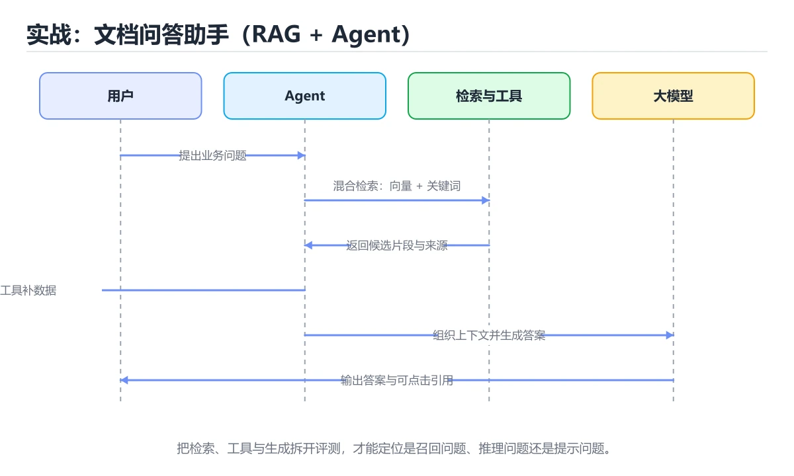
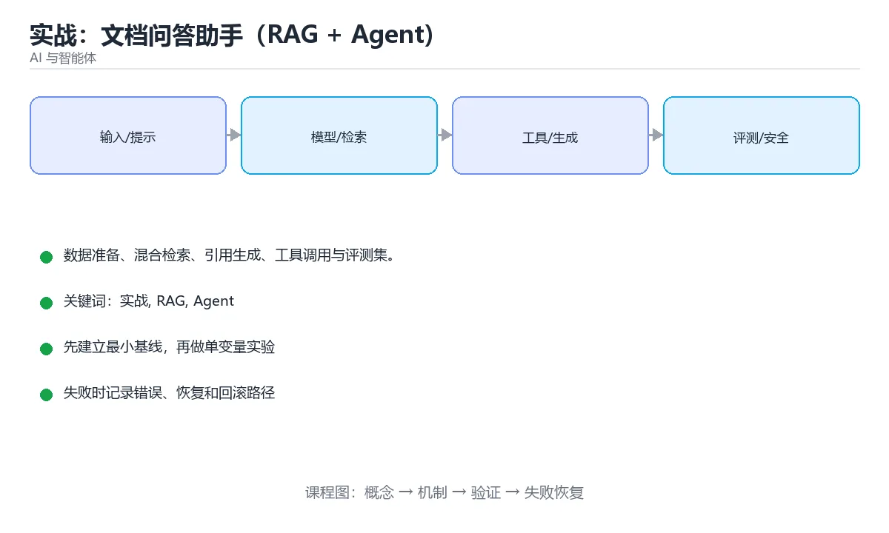

# 实战：文档问答助手（RAG + Agent）





> 内容更新时间：2026-10-06 · 学习阶段：进阶 · 预计用时：60 分钟

## 本节知识框架

**课程定位**：所属分类 `ai`（AI 与智能体），课程主题 `实战：文档问答助手（RAG + Agent）`，学习阶段 进阶，建议用时 60 分钟。

本课主线：数据准备、混合检索、引用生成、工具调用与评测集。

**学完本课应当能够**
- 说清 `实战` 与 `RAG` 的含义与区别，并各举一个正例和一个反例。
- 用本课示例验证 `Agent` 的行为，记录输入、输出与失败条件。
- 遇到「检索无权限过滤」这类问题时，能说出触发条件与修复顺序。

### 复习清单

- [ ] 能不看正文复述本课核心术语，并指出一个边界或反例。
- [ ] 能运行或推演本课示例，记录输入、输出与失败现象。
- [ ] 能完成一次自测，并把错题对照错误表定位原因。

## 核心概念定义

| 术语 | 操作性定义 | 常见边界与风险 |
| --- | --- | --- |
| 实战 | 实战：文档问答助手（RAG + Agent）解决了什么问题，而不是只背术语。 | 只在「实战：文档问答助手（RAG + Agent）解决了什么问题，而不是只背术语」这一前提下成立，换输入或换环境要重新验证。 |
| RAG | 先检索外部知识，再把证据与问题一起交给模型生成可引用的回答。 | 越界、悬垂引用与释放顺序会破坏结论，必须在边界输入下复验。 |
| Agent | 用 RAG + Agent 做一个能回答"我们自己的文档"的助手，并配一套评测集验证效果，而不是靠感觉。 | 只在「用 RAG + Agent 做一个能回答"我们自己的文档"的助手，并配一套评测集验证效果，而不是靠感觉」这一前提下成立，换输入或换环境要重新验证。 |
| 评测 | 用固定样本、指标和基线衡量模型或系统的能力与回归。 | 易错：问题定位困难；正确做法是召回与作答分别评测。 |

## 原理与运行机制

### 机制总览

**教材衔接：目标**

用 RAG + Agent 做一个能回答"我们自己的文档"的助手，并配一套**评测集**验证效果，而不是靠感觉。

**教材衔接：步骤一：数据准备**

收集文档（Markdown/PDF）→ 解析（PDF 需版面分析，保留页码与 bbox）→ 清洗（去页眉页脚、去重）→ 分块（300~800 token，重叠 10%~20%，按标题切分保持语义完整）。**元数据必留**：来源、页码、标题路径，供引用。

**教材衔接：步骤二：索引与检索**

向量化后存入向量库（FAISS/Chroma/pgvector 任选）；检索阶段用混合策略：BM25 关键词 + 向量语义，再加重排序（cross-encoder）。Top-K 建议 5~8 条，重排后取 3~5 条喂给模型。

**教材衔接：步骤三：生成与引用**

提示要求：仅依据资料回答、不足时明说"资料中没有"、结论后标注来源编号。把命中的原文片段一并返回给用户，便于核对。

**教材衔接：步骤四：加上 Agent 能力**

给助手两个工具：① 检索文档；② 计算/查询结构化数据（如从表格取数）。用 ReAct 循环让模型自己决定是否检索，并限制最大步数（如 5 步）与总预算。工具执行必须做权限校验与超时。

**教材衔接：步骤五：评测**

| 指标 | 怎么测 |
| --- | --- |
| 检索命中率 | 标准问题对应的文档是否进入 Top-K |
| 答案正确率 | 要点覆盖度或 LLM-as-Judge 打分 |
| 引用准确率 | 标注的来源是否真的支撑结论 |
| 幻觉率 | 无答案问题上是否编造 |
| 成本与延迟 | 每问题 token、P95 延迟 |

评测集至少 50 条，覆盖：可直接查到、需要跨文档综合、无答案、含对抗性表述四类。

**教材衔接：评测集模板与打分脚本结构**

**评测集字段**（JSON Lines，一行一条）：id、question、expected_points（标准答案要点数组）、expected_doc_ids（应命中的文档）、no_answer（布尔，表示资料中确实没有答案）、adversarial（布尔，含提示注入）。

**打分流程五步**：

1. 跑检索，记录 Top-K 命中文档 ID → 计算**命中率**（expected_doc_ids 是否被包含）。
2. 跑生成，拿到答案与引用列表 → 计算**要点覆盖率**（expected_points 中按语义匹配到的比例）。
3. 校验**引用准确率**（引用编号对应的原文是否真的支撑结论）。
4. 对 no_answer 用例检查是否正确拒答 → **幻觉率**。
5. 记录每问的 token 数与耗时 → **成本与 P95 延迟**。

**四类用例的参考配比**：可直接查到 50%、需跨文档综合 25%、无答案 15%、对抗性输入 10%。每类都要有，否则指标会失真——只测"能查到"的用例会掩盖幻觉问题。

**回归与门禁**：把评测脚本接入 CI（或每次发布前手动跑），对比基线的命中率、正确率与成本；任一指标下降超过阈值（如 5%）就阻断发布。改动分块策略、嵌入模型、提示词或重排参数后都必须重跑。

**教材衔接：交付物与评分标准**

**交付物**：文档解析与分块脚本、向量库索引（可重建）、检索+生成链路代码、50 条评测集（JSON Lines）、评测报告（命中率/要点覆盖/引用准确/幻觉率/成本与延迟五项指标）。

**评分标准**：检索质量 30%（命中率有数据）、生成可靠 30%（引用可溯源、无答案问题能拒答）、工程完整 25%（索引可重建、配置外置、异常有兜底）、评测规范 15%（评测集冻结且四类用例齐全）。

**常见失败案例**：① 只调提示不优化检索，命中率低却以为模型不行；② 分块过大导致噪声淹没答案；③ 不保留页码，回答无法溯源；④ 没有评测集，改动后凭感觉判断效果。

**教材衔接：端到端架构速查**

| 层 | 组件 | 关键点 |
| --- | --- | --- |
| 接入 | 鉴权、限流、会话 | 用户与租户隔离 |
| 解析 | PDF、表格、图片 | 保留结构与页码 |
| 索引 | 分块、嵌入、向量库 | 元数据含权限与位置 |
| 检索 | 混合检索 + 重排 | 先过滤再打分 |
| 编排 | Agent 循环 + 工具 | 步数上限与超时 |
| 生成 | 提示 + 引用 | 只依据资料作答 |
| 评测 | 召回与作答分开 | 持续回归 |
| 观测 | 日志、指标、追踪 | 记录提示版本与轨迹 |

**教材衔接：上线与运营速查**

| 阶段 | 动作 |
| --- | --- |
| 内测 | 用评测集跑通，修复明显问题 |
| 灰度 | 小流量上线，观察指标与反馈 |
| 全量 | 达标后放量，保留回滚开关 |
| 运营 | 收集未命中问题，持续补文档与调参 |
| 迭代 | 提示、分块、模型分别独立实验 |
| 复盘 | 定期看坏例与成本趋势 |

**教材衔接：交付评审：评分表、决策记录与证据链**

### 一、「实战：文档问答助手（RAG + Agent）」的交付物评分表

| 交付物 | 权重 | 合格线 | 需要的证据 |
| --- | ---: | --- | --- |
| 文档解析与分块脚本 | 20% | 能在干净环境复现，且失败路径有明确处理 | 命令与输出、对应测试、一次失败与恢复记录 |
| 向量库索引（可重建） | 20% | 能在干净环境复现，且失败路径有明确处理 | 命令与输出、对应测试、一次失败与恢复记录 |
| 检索+生成链路代码 | 20% | 能在干净环境复现，且失败路径有明确处理 | 命令与输出、对应测试、一次失败与恢复记录 |
| 50 条评测集（JSON Lines） | 20% | 能在干净环境复现，且失败路径有明确处理 | 命令与输出、对应测试、一次失败与恢复记录 |
| 评测报告（命中率/要点覆盖/引用准确/幻觉率/成本与延迟五项指标）。 | 20% | 能在干净环境复现，且失败路径有明确处理 | 命令与输出、对应测试、一次失败与恢复记录 |

### 二、需要写下来的决策（ADR）

| 决策点 | 本课给出的做法 | 备选方案 | 代价与回滚 |
| --- | --- | --- | --- |
| 二、三个容易混淆的边界 | 先写清「实战：文档问答助手（RAG + Agent）」要解决的问题、合法输入范围和成功标准，再进入后续步骤。 | 不做「二、三个容易混淆的边界」，沿用最朴素的实现（需要额外补一次对照实验） | 若「二、三个容易混淆的边界」出问题，回到上一版本并按本课验收场景重跑 |
| 架构与数据流 | 用户/输入 → 接口或命令 → 领域逻辑 → 存储/外部依赖 → 输出与监控 | 不做「架构与数据流」，沿用最朴素的实现（需要额外补一次对照实验） | 若「架构与数据流」出问题，回到上一版本并按本课验收场景重跑 |

### 三、「实战：文档问答助手（RAG + Agent）」的交付证据链

本课未给出可执行命令，用下面的最小证据集代替：

### 四、「实战：文档问答助手（RAG + Agent）」的验收指标

| 指标 | 目标值 | 测量方式 | 不达标时的动作 |
| --- | --- | --- | --- |
| | 成本与延迟 | 每问题 token、P95 延迟 | | 用本课正文给出的阈值，没有就写实测基线 | 固定环境重复三次取中位数 | 回到对应小节定位，先修原因再重测 |
| 记录每问的 token 数与耗时 → 成本与 P95 延迟。 | 用本课正文给出的阈值，没有就写实测基线 | 固定环境重复三次取中位数 | 回到对应小节定位，先修原因再重测 |
| | 端到端 P95 延迟 | 从提问到首字 | 小于 3 秒 | | 用本课正文给出的阈值，没有就写实测基线 | 固定环境重复三次取中位数 | 回到对应小节定位，先修原因再重测 |

### 五、评审记录模板

| 记录项 | 填写要求 |
| --- | --- |
| 项目标识 | `ai_rag_agent_project` |
| 本次范围 | 说明这一轮交付了「实战：文档问答助手（RAG + Agent）」的哪些部分 |
| 未完成项 | 列出与 实战 相关但本轮未做的内容 |
| 证据位置 | 指向 evidence/ 目录下的具体文件 |
| 风险与回滚 | 写清剩余风险、回滚步骤和验证方式 |
| 结论 | 通过 / 有条件通过 / 不通过，三者选一 |

## 典型应用场景

**教材衔接：深入补充：实战：文档问答助手（RAG + Agent） 的取舍与边界**

### 一、把概念放回真实约束

| 维度 | 要回答的问题 | 常见做法 | 失败信号 |
| --- | --- | --- | --- |
| 数据 | 实战 的训练或检索数据从哪来、质量如何 | 清洗、去重、标注与版本化 | 评测集泄漏或分布漂移 |
| 模型 | RAG 的能力边界与成本是多少 | 基线对比、离线评测、灰度发布 | 指标好看但线上任务失败 |
| 评测 | 如何证明改动真的有效 | 固定评测集、人工抽检、A/B | 只比较单例输出 |
| 安全 | 失败时会不会泄露或越权 | 权限校验、内容过滤、审计 | 提示注入或数据外泄 |

### 四、自测清单

- 能否用一句话说出实战：文档问答助手（RAG + Agent）解决的核心问题与不适用场景？
- 能否画出 实战 的数据流或状态变化，并标出失败路径？
- 把 default_factory 的输入推到边界，说明本课哪一条结论会先失效。
- 能否写出一条可复现的验证命令，让别人独立得到相同结论？

### 五、AI 工程补充

在实战：文档问答助手（RAG + Agent）里，模型输出只是系统的一部分：输入要先经过权限与数据质量检查，检索或工具调用要有超时和降级，输出要经过引用核验或规则校验，最后记录 token、延迟、失败类型和人工反馈。评测时至少准备固定题、边界题和对抗题，并把 实战 与 RAG 的指标分开记录；否则一次提示词改动看似提升体验，实际可能只是评测样本泄漏或随机波动。

**教材衔接：项目专属规格：实战：文档问答助手（RAG + Agent）**

### 核心场景

数据准备、混合检索、引用生成、工具调用与评测集。 项目目标是把「实战、RAG、Agent、评测、引用」落实为可运行、可测试、可回滚的交付物。

### 验收场景

1. 正常路径：最小输入得到预期输出，并留下日志与指标。
2. 边界路径：RAG 在重复提交与超长输入下不产生额外副作用。
3. 失败路径：依赖超时或不可用时能快速失败、重试或降级。
4. 幂等路径：同一请求执行两次不会产生重复副作用。
5. 回滚路径：撤掉 default_factory 的变更后，数据与资源都回到变更前的状态。

**教材衔接：项目交付物**

### 建议仓库结构

```text
src/
tests/
docs/
README.md
```

### 验收数据

```json
{
  "project": "ai_rag_agent_project",
  "scenario": "实战的正常路径",
  "input": {"case": "normal", "value": "default_factory"},
  "expected": {"ok": true, "checks": ["实战可复现", "RAG有记录"]},
  "failure_case": {"case": "RAG越界或缺失", "error": "validation_error"},
  "idempotency_key": "ai_rag_agent_project-001"
}
```

### 复盘模板

- **检索无权限过滤**：典型现象是越权返回他人资料；正确做法是检索阶段强制过滤。
- **只做端到端评测**：典型现象是问题定位困难；正确做法是召回与作答分别评测。
- **不做坏例分析**：典型现象是问题反复出现；正确做法是定期复盘 weak cases。

### 最小验证场景

- 准备：保留 `text` 示例的原始输入，先记录 `实战：文档问答助手（RAG + Agent）` 的基线输出和完整运行命令。
- 观察：先核对 出现字面量 `project`，再改变一个与 `实战` 相关的条件。
- 判定：新结果与 `实战：文档问答助手（RAG + Agent）` 的基线不同不等于错误；只有当差异破坏了 `实战` 的定义或错误表中的约束，才判定为失败。

### 选择与边界

- 使用 `实战` 时，先满足它的定义：实战：文档问答助手（RAG + Agent）解决了什么问题，而不是只背术语；只在「实战：文档问答助手（RAG + Agent）解决了什么问题，而不是只背术语」这一前提下成立，换输入或换环境要重新验证。
- 使用 `RAG` 时，先满足它的定义：先检索外部知识，再把证据与问题一起交给模型生成可引用的回答；越界、悬垂引用与释放顺序会破坏结论，必须在边界输入下复验。
- 使用 `Agent` 时，先满足它的定义：用 RAG + Agent 做一个能回答"我们自己的文档"的助手，并配一套评测集验证效果，而不是靠感觉；只在「用 RAG + Agent 做一个能回答"我们自己的文档"的助手，并配一套评测集验证效果，而不是靠感觉」这一前提下成立，换输入或换环境要重新验证。
- 使用 `评测` 时，先满足它的定义：用固定样本、指标和基线衡量模型或系统的能力与回归；易错：问题定位困难；正确做法是召回与作答分别评测。

## 代码/协议/SQL 示例

**教材衔接：关键指标速查**

| 指标 | 说明 | 目标示例 |
| --- | --- | --- |
| 检索 Recall@5 | 前 5 条是否含正确片段 | 大于 0.9 |
| 引用准确率 | 引用是否真的支持结论 | 大于 0.95 |
| 忠实度 | 回答是否只基于资料 | 大于 0.95 |
| 拒答正确率 | 资料不足时是否明确说明 | 大于 0.9 |
| 端到端 P95 延迟 | 从提问到首字 | 小于 3 秒 |
| 单次问答成本 | 平均 Token 费用 | 按预算设定 |

```python
from dataclasses import dataclass, field

@dataclass
class QAResult:
    question: str
    answer: str
    citations: list
    retrieved: int
    steps: int
    tokens: int
    latency_ms: float
    refused: bool = False

@dataclass
class ProjectMetrics:
    results: list = field(default_factory=list)

    def add(self, result: QAResult) -> None:
        self.results.append(result)

    def summary(self) -> dict:
        total = len(self.results)
        if not total:
            return {"cases": 0}
        with_citation = sum(1 for r in self.results if r.citations)
        latencies = sorted(r.latency_ms for r in self.results)
        return {
            "cases": total,
            "citation_rate": round(with_citation / total, 4),
            "refusal_rate": round(sum(r.refused for r in self.results) / total, 4),
            "avg_steps": round(sum(r.steps for r in self.results) / total, 2),
            "avg_tokens": round(sum(r.tokens for r in self.results) / total, 1),
            "p95_ms": latencies[int(total * 0.95) - 1],
        }

    def weak_cases(self, min_citations: int = 1) -> list:
        """挑出引用不足或步骤过多的用例，作为优化输入。"""
        return [
            r.question for r in self.results
            if len(r.citations) < min_citations or r.steps > 6
        ]

def answer_policy(retrieved: int, top_score: float, min_score: float = 0.35) -> str:
    """兜底策略：检索质量不足时直接拒答，避免编造。"""
    if retrieved == 0 or top_score < min_score:
        return "资料不足，建议补充文档或换个问法"
    return "正常作答并要求引用来源"

metrics = ProjectMetrics()
metrics.add(QAResult("报销标准是多少", "按 [1] 说明……", [1], 5, 3, 3200, 2100))
metrics.add(QAResult("明年预算", "无法从现有资料确认", [], 2, 2, 900, 800, refused=True))
print(metrics.summary())
print(metrics.weak_cases())
print(answer_policy(retrieved=0, top_score=0.0))
```

**教材衔接：验证命令与预期输出**

先让 default_factory 的结果可复现，再谈扩展。下表给出最低验证集：

### 验收证据

- [ ] 保存依赖安装和启动命令的完整输出。
- [ ] 为 default_factory 补三条测试：正常、边界、失败各一条。
- [ ] 重复执行 实战 的操作两次，确认没有重复写入或副作用。
- [ ] 记录一次失败状态码、错误日志和恢复步骤。
- [ ] 记录 default_factory 的运行环境与复现命令，并补一段回滚说明。

### 回归与回滚

1. 先在可丢弃的目录或临时库里跑 实战，避免污染真实数据。
2. 修改一处逻辑后重跑全部验证命令，确认没有回归。
3. 若失败，回滚到上一个可运行版本并保留失败日志。
4. 定位原因后补一条自动化测试，再重新执行发布流程。
5. 把教训写入项目复盘或本课笔记，形成下一次的检查项。

## 时间/空间复杂度或性能分析

**性能关注点（实战：文档问答助手（RAG + Agent））**：算力与显存决定可行规模：记录训练或推理耗时、显存峰值与模型精度，换数据集要重新评估。

**测量方法**：以 `实战：文档问答助手（RAG + Agent）` 的 `实战` 场景为对象，固定输入跑一遍记录基线，再把规模或并发度提高一个数量级复测；两次结果的差值与波动范围才是结论依据。

## 常见误区与易错点

| 容易写错的做法 | 实际现象 | 原因与正确做法 |
| --- | --- | --- |
| 检索无权限过滤 | 越权返回他人资料。 | 检索阶段强制过滤。 |
| 只做端到端评测 | 问题定位困难。 | 召回与作答分别评测。 |
| 不做坏例分析 | 问题反复出现。 | 定期复盘 weak cases。 |

### 现场 1：检索无权限过滤

**症状**：越权返回他人资料。

**根因与修复**：检索阶段强制过滤。

**自检**：在本课示例里复现「检索无权限过滤」，改成检索阶段强制过滤后重跑；如果症状消失且失败路径按预期变化，说明定位正确。

### 现场 2：只做端到端评测

**症状**：问题定位困难。

**根因与修复**：召回与作答分别评测。

**自检**：在本课示例里复现「只做端到端评测」，改成召回与作答分别评测后重跑；如果症状消失且失败路径按预期变化，说明定位正确。

### 现场 3：不做坏例分析

**症状**：问题反复出现。

**根因与修复**：定期复盘 weak cases。

**自检**：在本课示例里复现「不做坏例分析」，改成定期复盘 weak cases后重跑；如果症状消失且失败路径按预期变化，说明定位正确。

## 与其他知识点的关系

- **先修**：`数据工程与标注`。本课默认这些内容已经掌握。
- **相关或后续**：`向量数据库选型与调优`、`图解 RAG 检索增强生成流程`、`实战：本地 RAG 客服 Agent`。本课术语会在这些课程里继续使用。
- **术语归属**：`实战`、`RAG`、`Agent` 的定义以本课「核心概念定义」为准，换到其他课程时先确认定义是否被改写。
- 同一分类的《AI Agent 基础》也涉及 `Agent`；两课衔接时先确认这个术语的定义是否一致。
- 同一分类的《嵌入、向量检索与 RAG》也涉及 `RAG`；两课衔接时先确认这个术语的定义是否一致。

## 自测题与参考答案

> 先独立作答，再对照参考答案；答案都能在本课正文、术语表或错误表里找到依据。

### 自测 1（概念复述）

不看正文，写出 `实战` 的操作性定义，并说明它与 `RAG` 的区别。

**参考答案**：实战：文档问答助手（RAG + Agent）解决了什么问题，而不是只背术语。

`RAG` 的定位是：先检索外部知识，再把证据与问题一起交给模型生成可引用的回答；两者的差别要从适用对象与失败模式上说明。

### 自测 2（排错）

本课错误表记录了「检索无权限过滤」这类做法。请写出它会出现的现象、根因，以及修复顺序。

**参考答案**：现象是越权返回他人资料；正确做法是检索阶段强制过滤。修复时先复现现象并保留证据，再改动一处假设重跑，确认现象消失。

### 自测 3（动手验证）

运行本课的 `text` 示例，改动其中一个输入后重新运行，记录输出与错误信息。

**参考答案**：正常输入下 `text` 示例应当复现正文给出的结果；改动输入后，如果结果改变或报错，先核对它是否满足 `实战：文档问答助手（RAG + Agent）` 中`实战` 的适用范围，再检查错误表里是否有同类现象。

### 自测 4（代码阅读）

阅读本课开头的 `text` 示例，说明它体现了`实战` 的哪一条性质，并指出改动哪个输入会让这条性质不再成立。

**参考答案**：`实战` 的定义是 实战：文档问答助手（RAG + Agent）解决了什么问题，而不是只背术语，示例正是在实现这条定义。改动与 `实战` 有关的一个输入后，如果结果不再符合 `实战：文档问答助手（RAG + Agent）` 的正文描述，就说明该性质只在当前前提成立。

### 自测 5（迁移）

把 `实战：文档问答助手（RAG + Agent）` 的方法迁移到自己的项目：围绕 `实战` 写出一个与错误表同类的风险点，并说明触发条件和检验方式。

**参考答案**：例如「不做坏例分析」，它会导致问题反复出现；检验方式是按定期复盘 weak cases改一处再复现，确认现象消失且没有引入新的失败分支。

### 自测 6（对比）

用一个表格对比 `实战` 与 `RAG`：各写一行适用场景、一行失败表现。

**参考答案**：`实战` 的定义是实战：文档问答助手（RAG + Agent）解决了什么问题，而不是只背术语；`RAG` 的定义是先检索外部知识，再把证据与问题一起交给模型生成可引用的回答。两者的失败表现分别对应本课错误表里与本术语相关的行。

### 自测 7（排错顺序）

面对「检索无权限过滤」引发的问题，请把“复现 越权返回他人资料 → 保留证据 → 检索阶段强制过滤 → 回归验证”四步写成可执行的检查清单。

**参考答案**：第一步按越权返回他人资料复现；第二步记录输入、版本与完整报错；第三步按检索阶段强制过滤只改一处；第四步重跑并确认失败路径也按预期变化。

### 自测 8（边界判断）

针对 `评测`，分别写出“可以使用”的条件和“结论不再成立”的条件。

**参考答案**：易错：问题定位困难；正确做法是召回与作答分别评测。 同时要把 `评测` 的定义 用固定样本、指标和基线衡量模型或系统的能力与回归 与实际输入逐项对照。

### 自测 9（机制重建）

不看正文，按输入、转换、输出、验证四段重建 `实战` → `RAG` → `Agent` → `评测` 的作用链。

**参考答案**：起点是 `实战` 的定义 实战：文档问答助手（RAG + Agent）解决了什么问题，而不是只背术语；中间每一步都保留可观察状态；终点由 `评测` 检查，失败时回到错误表定位第一个偏离定义的步骤。

### 自测 10（综合排错）

在 `实战：文档问答助手（RAG + Agent）` 中，现象是 问题反复出现。请围绕 不做坏例分析 写出最小复现、关键证据、修复动作和回归验证，并说明为什么不能只凭一次运行下结论。

**参考答案**：先复现 不做坏例分析，记录输入与完整错误；再按 定期复盘 weak cases 只改一处。回归时同时跑正常路径和边界路径，只有两次结果都可解释，才把修复视为完成。

### 自测 11（一分钟复述）

用每分钟约 200 字的速度复述 `实战：文档问答助手（RAG + Agent）`：先给主问题，再按顺序说出 `实战`、`RAG`、`Agent`、`评测`，最后给一个失败案例。

**自评标准**：主问题必须对应 数据准备、混合检索、引用生成、工具调用与评测集；每个术语都要能接上一句定义或边界；失败案例必须写成可观察现象，不能用“可能有风险”代替证据。

## 延伸阅读

想更直观地理解本课概念？推荐参阅以下图解专题：

- [图解 RAG 检索增强生成流程](visual_rag_pipeline.md)

## 术语速查

| 术语 | 一句话说明 |
| --- | --- |
| `实战` | 实战：文档问答助手（RAG + Agent）解决了什么问题，而不是只背术语。 |
| `RAG` | 先检索外部知识，再把证据与问题一起交给模型生成可引用的回答。 |
| `Agent` | 用 RAG + Agent 做一个能回答"我们自己的文档"的助手，并配一套评测集验证效果，而不是靠感觉。 |
| `评测` | 用固定样本、指标和基线衡量模型或系统的能力与回归。 |

**术语关系**：`实战`（实战：文档问答助手（RAG + Agent）解决了什么问题） → `RAG`（先检索外部知识） → `Agent`（用 RAG + Agent 做一个能回答"我们自己的文档"的助手） → `评测`（用固定样本、指标和基线衡量模型或系统的能力与回归）。

## 考点精讲

`实战：文档问答助手（RAG + Agent）` 的题库有 6 道题，下面逐题给出题干、正确项与判断依据：先自己作答，再核对正确项，最后回到正文对应小节复核。

### 考点 1：第 1 题

- **题目**：按“实战：文档问答助手（RAG + Agent）”中 实战、RAG、Agent 的实践顺序，把四个步骤排成从准备到复盘的合理顺序。
- **正确项**：先明确 实战 的输入、输出与约束 → 写出最小示例并核对 RAG 的基线结果 → 只改一个变量，记录边界与失败路径的变化 → 固定版本与证据，把“实战：文档问答助手（RAG + Agent）”的结论写成可复现记录
- **判断依据**：按《实战：文档问答助手（RAG + Agent）》正文的先后，本题顺序是「先明确 实战 的输入、输出与约束」 → 「写出最小示例并核对 RAG 的基线结果」 → 「只改一个变量，记录边界与失败路径的变化」 → 「固定版本与证据，把“实战：文档问答助手（RAG + Agent）”的结论写成可复现记录」。这四步就是正文里项目推进的主线：先定范围与约束，再跑通最小示例拿到基线，然后逐项改变量观察边界与失败路径，最后把结论固化成可复现记录。常见错法是把固定版本与证据放在第一步，还没跑通示例就固化，记录下来的只是没验证过的假设；也有人先只改一个变量再补最小示例，没有基线就没有可对比的变化，等于白跑一轮。按《实战：文档问答助手（RAG + Agent）》正文的先后，本题顺序是「只改一个变量，记录边界与失败路径的变化」。术语「，易错点」在本课里的界定是检索无权限过滤会造成越权返回他人资料，改法：检索阶段强制过滤，题干「按“实战：文档问答助手（RAG + Agent）”中 实战、RAG、」问的就是这一条。做「按实战文档问答助手（RAG+Ag」这类判断时，常踩的坑是检索无权限过滤，其后果是越权返回他人资料。按本课口径，「按实战文档问答助手（RAG+Ag」这类题应检索阶段强制过滤。

### 考点 2：第 2 题

- **题目**：围绕“实战：文档问答助手（RAG + Agent）”中的 实战、RAG、Agent，下列哪两项是本课强调的实践判断？
- **正确项**：学习 实战 时要同时说明输入、输出和失败路径，不能只看正常流程；验证 RAG 时要固定版本并覆盖边界输入，结论才可复现
- **判断依据**：按《实战：文档问答助手（RAG + Agent）》的正文口径，本题要同时选中「学习 实战 时要同时说明输入、输出和失败路径，不能只看正常流程」、「验证 RAG 时要固定版本并覆盖边界输入，结论才可复现」，漏掉任一项都算没答全。《实战：文档问答助手（RAG + Agent）》整课的主线是数据准备、混合检索、引用生成、工具调用与评测集，本题按这条主线判定。做「围绕实战文档问答助手（RAG+A」这类判断时，常踩的坑是检索无权限过滤，其后果是越权返回他人资料。按本课口径，「围绕实战文档问答助手（RAG+A」这类题应检索阶段强制过滤。干扰项「把 RAG 的单次运行结果当成所有版本和规模都成立」与题干「围绕“实战：文档问答助手（RAG + Agent）”中的 实战、RA」的要求对不上，应排除。

### 考点 3：第 3 题

- **题目**：为问答系统建评测集时，题目应该覆盖下面哪些类型？
- **正确项**：可直接查到，需跨文档综合
- **判断依据**：按《实战：文档问答助手（RAG + Agent）》的正文口径，本题正确项是「可直接查到，需跨文档综合」。《实战：文档问答助手（RAG + Agent）》整课的主线是数据准备、混合检索、引用生成、工具调用与评测集，本题按这条主线判定。做「评测集应覆盖哪些类型」这类判断时，常踩的坑是检索无权限过滤，其后果是越权返回他人资料。按本课口径，「评测集应覆盖哪些类型」这类题应检索阶段强制过滤。干扰项「只有无答案问题，但这会让用例变得脆弱」与题干「评测集应覆盖哪些类型」的要求对不上，应排除。

### 考点 4：第 4 题

- **题目**：RAG 中重排序（rerank）的作用是？
- **正确项**：对初筛出的候选做精排
- **判断依据**：按《实战：文档问答助手（RAG + Agent）》的正文口径，本题正确项是「对初筛出的候选做精排」。《实战：文档问答助手（RAG + Agent）》整课的主线是数据准备、混合检索、引用生成、工具调用与评测集，本题按这条主线判定。做「RAG中重排序（rerank）的」这类判断时，常踩的坑是检索无权限过滤，其后果是越权返回他人资料。按本课口径，「RAG中重排序（rerank）的」这类题应检索阶段强制过滤。干扰项「压缩文档体积」与题干「RAG 中重排序（rerank）的作用是」的要求对不上，应排除。

### 考点 5：第 5 题

- **题目**：让回答可溯源应如何实现？
- **正确项**：检索片段携带文档 ID 与位置
- **判断依据**：按《实战：文档问答助手（RAG + Agent）》的正文口径，本题正确项是「检索片段携带文档 ID 与位置」。术语「，本题取「检索片段携带文档 ID 与位置」这条，易错点」在本课里的界定是检索无权限过滤会造成越权返回他人资料，改法：检索阶段强制过滤，题干「让回答可溯源应如何实现」问的就是这一条。做「让回答可溯源应如何实现」这类判断时，常踩的坑是检索无权限过滤，其后果是越权返回他人资料。按本课口径，「让回答可溯源应如何实现」这类题应检索阶段强制过滤。

### 考点 6：第 6 题

- **题目**：结合 `实战：文档问答助手（RAG + Agent）` 中围绕 `实战` 的代码，哪一项说法与“数据准备、混合检索、引用生成、工具调用与评测集。”一致？
- **正确项**：模型缺少依据而编造答案
- **判断依据**：按《实战：文档问答助手（RAG + Agent）》的正文口径，本题正确项是「模型缺少依据而编造答案」。术语「，本题取「模型缺少依据而编造答案」这条，易错点」在本课里的界定是检索无权限过滤会造成越权返回他人资料，改法：检索阶段强制过滤，题干「结合 `实战：文档问答助手（RAG + Agent）` 中围绕 `实」问的就是这一条。常见错法是检索无权限过滤，其后果是越权返回他人资料。正确做法是检索阶段强制过滤。

### 考点 7：`实战`

- **要点**：实战：文档问答助手（RAG + Agent）解决了什么问题，而不是只背术语。
- **实战 的边界**：只在「实战：文档问答助手（RAG + Agent）解决了什么问题，而不是只背术语」这一前提下成立，换输入或换环境要重新验证。

### 考点 8：`RAG`

- **要点**：先检索外部知识，再把证据与问题一起交给模型生成可引用的回答。
- **RAG 的边界**：越界、悬垂引用与释放顺序会破坏结论，必须在边界输入下复验。

### 考点 9：`Agent`

- **要点**：用 RAG + Agent 做一个能回答"我们自己的文档"的助手，并配一套评测集验证效果，而不是靠感觉。
- **Agent 的边界**：只在「用 RAG + Agent 做一个能回答"我们自己的文档"的助手，并配一套评测集验证效果，而不是靠感觉」这一前提下成立，换输入或换环境要重新验证。

### 考点 10：`评测`

- **要点**：用固定样本、指标和基线衡量模型或系统的能力与回归。
- **评测 的边界**：易错：问题定位困难；正确做法是召回与作答分别评测。

### 考点 11：排错——检索无权限过滤

- **现象**：越权返回他人资料。
- **处理**：检索阶段强制过滤。

### 考点 12：排错——只做端到端评测

- **现象**：问题定位困难。
- **处理**：召回与作答分别评测。

### 考点 13：综合辨析——`实战` 与 `评测`

- **辨析点**：`实战` 的定义是 实战：文档问答助手（RAG + Agent）解决了什么问题，而不是只背术语；`评测` 的定义是 用固定样本、指标和基线衡量模型或系统的能力与回归。
- **答题要求**：面对 `实战：文档问答助手（RAG + Agent）` 的题目，先判断描述的是 `实战` 还是 `评测`，再归到对应定义，最后写出一个会让该定义失效的边界输入。

### 考点 14：排错评分点

- **现象分**：能写出 越权返回他人资料，而不是只写“程序有错”。
- **证据分**：保留触发 检索无权限过滤 的输入、版本和错误原文。
- **修复分**：按 检索阶段强制过滤 只改一处，并同时回归正常路径与边界路径。

## 内容元数据

- 内容版本：v2.0
- 最后更新：2026-10-06
- 学习阶段：进阶
- 适用环境：主流大模型 API、开源模型与向量数据库；本课聚焦 实战。
- 内容来源：内置结构化课程与工程实践整理
- 相关主题：实战、RAG、Agent、评测、引用
- 质量版本：P0 测验标准 + P1 覆盖扩展 + P2 体验补全

## 参考资料与复核

- 最后复核：2026-10-04
- 下次复核：2027-04-17
- 复核范围：版本兼容、API 行为、安全建议与工程实践
- 来源性质：官方文档、标准或权威教材；本课核对关键词：实战、RAG、Agent、评测、引用。

| 参考资料 | 本课用途 |
| --- | --- |
| [Model Context Protocol](https://modelcontextprotocol.io/) | Agent 工具与上下文协议 |
| [OpenAI Cookbook](https://cookbook.openai.com/) | RAG、Agent 与工程示例 |
| [scikit-learn 文档](https://scikit-learn.org/stable/documentation.html) | 经典机器学习算法 |

| [本课术语索引：实战：文档问答助手（RAG + Agent）](#核心概念定义) | 按本课输入、术语边界和错误表现逐项核对 |
> 「实战：文档问答助手（RAG + Agent）」的链接用于离线阅读后的延伸核对；App 不会自动联网。

<!-- p1-project-review:start -->