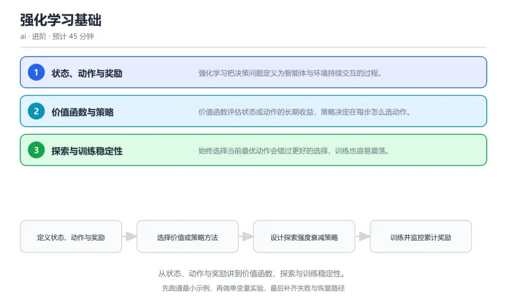
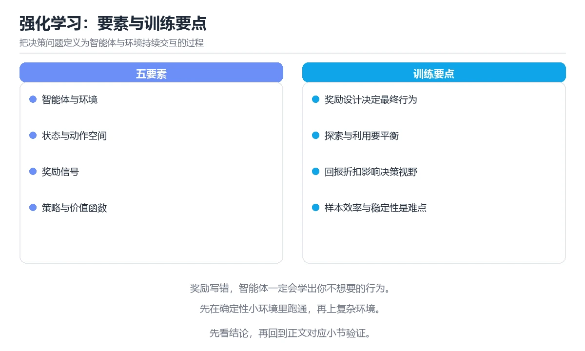

# 强化学习基础

> 内容更新时间：2026-10-06 · 学习阶段：进阶 · 预计用时：30 分钟

分类：ai。关键词：强化学习、奖励、价值函数、探索与利用、策略。从状态、动作与奖励讲到价值函数、探索与训练稳定性。



## 本节知识框架

**课程定位**：所属分类 `ai`（AI 与智能体），课程主题 `强化学习基础`，学习阶段 进阶，建议用时 40 分钟。

本课主线：从状态、动作与奖励讲到价值函数、探索与训练稳定性。

**学完本课应当能够**
- 说清 `智能体` 与 `累计奖励` 的含义与区别，并各举一个正例和一个反例。
- 用本课示例验证 `价值函数` 的行为，记录输入、输出与失败条件。
- 遇到「奖励持续上升但行为不符合目标」这类问题时，能说出触发条件与修复顺序。

### 复习清单

- [ ] 能复述 强化学习 的职责，并给出一个输入越界时的反例。
- [ ] 能推演 强化学习 的示例：先写预期输出，再运行并记录差异与失败现象。
- [ ] 能完成一次自测，并把错题对照错误表定位原因。

**本课配图**



## 核心概念定义

| 术语 | 操作性定义 | 常见边界与风险 |
| --- | --- | --- |
| 智能体 | 在环境中做决策并学习的实体。 | 易错：智能体利用奖励设计的漏洞走捷径，原地反复触发小奖励而不完成目标；要看它的轨迹行为判断，不能只看奖励曲线上涨。 |
| 累计奖励 | 折扣后从当前时刻起获得的奖励总和。 | 折扣因子一改，两条曲线就不可比：要分别记录不同取值下的行为差异，上涨还得核对轨迹是否真完成目标。 |
| 价值函数 | 衡量状态或动作长期收益的函数。 | 只按一步贪心估收益会陷入局部最优，为即时奖励放弃更高收益路径；价值估计要加折扣因子，并把不同折扣下的行为差异写进实验记录。 |
| 探索与利用 | 尝试新动作与使用已知最优动作之间的权衡。 | 示例里探索强度按 0.999 衰减但留了 0.05 下限：直接归零就锁死在初始价值估计，指标退化时还要临时抬高。 |
| 经验回放 | 复用历史交互样本以降低更新相关性的方法。 | 易错：学习率过大且没有任何稳定性手段；正确做法是降低学习率并引入目标网络或经验回放，记录奖励方差定位震荡原因。 |
| 奖励 | 奖励函数按业务目标拆成主奖励与约束惩罚，训练中检查轨迹行为是否符合预期 | 奖励只是目标的代理，若能被更简单的方式反复获取，策略就会优化捷径而非完成任务；应按业务目标拆主奖励与约束惩罚，用轨迹校验。 |

## 原理与运行机制

### 机制总览

**教材衔接：核心知识**

### 1. 状态、动作与奖励

强化学习把决策问题定义为智能体与环境持续交互的过程。

智能体在状态 s 选择动作 a，环境返回奖励 r 与下一个状态 s'，目标是最大化长期累计奖励。

在强化学习基础里可以这样验证：在本课示例里把一个小车保持平衡的任务写成状态、动作与奖励三元组。

边界：奖励设计不当会诱导智能体钻空子，例如原地反复触发小奖励而不完成目标。

工程视角：奖励函数按业务目标拆成主奖励与约束惩罚，训练中检查轨迹行为是否符合预期。

### 2. 价值函数与策略

价值函数评估状态或动作的长期收益，策略决定在每步怎么选动作。

状态价值表示从该状态出发的期望回报，动作价值表示在状态下选择某动作的期望回报，策略可以基于价值函数间接导出，也可以直接参数化并优化。

在强化学习基础里可以这样验证：在本课示例里观察同一状态下不同动作的价值差异并据此选动作。

边界：只做一步贪心而不考虑长期回报会陷入局部最优，例如为了即时奖励放弃更高收益路径。

工程视角：价值估计加入折扣因子并记录不同折扣下的行为差异，把选择依据写进实验记录。

### 3. 探索与训练稳定性

始终选择当前最优动作会错过更好的选择，训练也容易震荡。

按概率选择随机动作或使用带噪声的策略保持探索，同时用目标网络、经验回放等手段降低更新相关性。

在强化学习基础里可以这样验证：在本课示例里对比纯贪心与带探索策略的累计奖励曲线。

边界：探索过少会锁死在次优策略，探索过多则长期表现不稳定。

工程视角：探索强度随训练进程衰减并记录奖励方差，出现持续震荡时检查学习率与目标更新频率。

## 典型应用场景

**教材衔接：深度拓展与实战**

### 机制对照表

| 概念 | 解决什么问题 | 关键前提 | 失败信号 |
| --- | --- | --- | --- |
| 状态、动作与奖励 | 强化学习把决策问题定义为智能体与环境持续交互的过程。 | 奖励设计不当会诱导智能体钻空子，例如原地反复触发小奖励而不完成目标。 | 奖励函数按业务目标拆成主奖励与约束惩罚，训练中检查轨迹行为是否符合预期。 |
| 价值函数与策略 | 价值函数评估状态或动作的长期收益，策略决定在每步怎么选动作。 | 只做一步贪心而不考虑长期回报会陷入局部最优，例如为了即时奖励放弃更高收益 | 价值估计加入折扣因子并记录不同折扣下的行为差异，把选择依据写进实验记录。 |
| 探索与训练稳定性 | 始终选择当前最优动作会错过更好的选择，训练也容易震荡。 | 探索过少会锁死在次优策略，探索过多则长期表现不稳定。 | 探索强度随训练进程衰减并记录奖励方差，出现持续震荡时检查学习率与目标更新 |

### 自测问答

**问 1**：强化学习与监督学习最本质的差别是？

**答**：没有直接给出正确答案，只能通过奖励反馈学习。监督学习有标签指明正确输出，强化学习只有奖励信号，需要自己权衡长期收益并处理探索问题。 正确选项「没有直接给出正确答案，只能通过奖励反馈学习」对应《强化学习基础》的要点「状态、动作与奖励」：强化学习把决策问题定义为智能体与环境持续交互的过程。判断「状态、动作与奖励」时先确认前提是否成立，再回到《强化学习基础》的示例核对一次；把别的语言或框架的默认做法直接搬到状态、动作与奖励上，往往会在本课的边界条件里失效。

**问 2**：奖励曲线很高但任务没有完成，最可能的原因是？

**答**：奖励设计存在漏洞被智能体利用。奖励只是目标的代理，如果它可以被更简单的方式反复获取，智能体会优化这个捷径而不是完成真实任务。 正确选项「奖励设计存在漏洞被智能体利用」对应《强化学习基础》的要点「价值函数与策略」：价值函数评估状态或动作的长期收益，策略决定在每步怎么选动作。判断「价值函数与策略」时先确认前提是否成立，再回到《强化学习基础》的示例核对一次；借鉴相邻主题的经验之前，先核对价值函数与策略的前提是否成立。

**问 3**：提升训练稳定性可以采取哪些做法？（多选）

**答**：使用目标网络稳定更新目标；使用经验回放降低样本相关性；适当降低学习率。目标网络、经验回放与合理学习率都能减少震荡；探索降为零会锁死策略并失去改进机会。 正确选项「使用目标网络稳定更新目标；使用经验回放降低样本相关性；适当降低学习率」对应《强化学习基础》的要点「探索与训练稳定性」：始终选择当前最优动作会错过更好的选择，训练也容易震荡。判断「探索与训练稳定性」时先确认前提是否成立，再回到《强化学习基础》的示例核对一次；记住探索与训练稳定性的结论之外还要记住适用条件，换一个输入往往就不成立了。

**问 4**：请按一次训练交互的顺序排列。

**答**：观察当前状态。观察、动作、反馈、更新、调整构成一次完整交互，循环往复直到策略收敛。 正确选项「观察当前状态；按策略选择动作；环境返回奖励与新状态；计算目标并更新价值；调整探索强度继续下一轮」对应《强化学习基础》的要点「状态、动作与奖励」：强化学习把决策问题定义为智能体与环境持续交互的过程。判断「状态、动作与奖励」时先确认前提是否成立，再回到《强化学习基础》的示例核对一次；干扰项常常是相邻主题里成立的结论，只有按状态、动作与奖励的输入与约束判断才能排除。

**问 5**：阅读这段更新代码，问题是什么？

**答**：探索强度直接归零，策略失去改进机会。探索强度一开始就为零，智能体会始终沿初始价值估计行动，无法发现更优路径，容易锁死在次优策略。 正确选项「探索强度直接归零，策略失去改进机会」对应《强化学习基础》的要点「价值函数与策略」：价值函数评估状态或动作的长期收益，策略决定在每步怎么选动作。判断「价值函数与策略」时先确认前提是否成立，再回到《强化学习基础》的示例核对一次；把价值函数与策略的做法换到别的约束下未必成立，先确认边界再决定答案。

### 工程检查表

- [ ] 定义状态、动作与奖励
- [ ] 选择价值或策略方法
- [ ] 设计探索强度衰减策略
- [ ] 训练并监控累计奖励
- [ ] 验证行为符合业务约束
- [ ] 【状态、动作与奖励】奖励函数按业务目标拆成主奖励与约束惩罚，训练中检查轨迹行为是否符合预期。
- [ ] 【价值函数与策略】价值估计加入折扣因子并记录不同折扣下的行为差异，把选择依据写进实验记录。
- [ ] 【探索与训练稳定性】探索强度随训练进程衰减并记录奖励方差，出现持续震荡时检查学习率与目标更新频率。

### 结论与下一步

- **奖励持续上升但行为不符合目标**：典型现象是奖励函数存在漏洞，智能体反复触发小奖励；正确做法是重新设计奖励：明确主目标奖励与约束惩罚，训练中检查轨迹行为而非只看奖励曲线。
- **训练长期不收敛**：典型现象是学习率过大且没有任何稳定性手段；正确做法是降低学习率并引入目标网络或经验回放，记录奖励方差定位震荡原因。
- **性能突然崩塌**：典型现象是探索强度降到接近零后再也无法恢复；正确做法是为探索强度设置下限并在指标退化时临时提高，保留恢复空间。

### 最小验证场景

- 准备：保留 `text` 示例的原始输入，先记录 `强化学习基础` 的基线输出和完整运行命令。
- 观察：先核对 调用了 `__init__()`，再改变一个与 `智能体` 相关的条件。
- 判定：新结果与 `强化学习基础` 的基线不同不等于错误；只有当差异破坏了 `智能体` 的定义或错误表中的约束，才判定为失败。

### 选择与边界

- 使用 `智能体` 时，在环境中做决策并学习的实体；易错：奖励函数存在漏洞，智能体反复触发小奖励；正确做法是重新设计奖励：明确主目标奖励与约束惩罚，训练中检查轨迹行为而非只看奖励曲线。
- 使用 `累计奖励` 时，折扣后从当前时刻起获得的奖励总和。
- 使用 `价值函数` 时，衡量状态或动作长期收益的函数；缓存与状态残留会让结果过期，先明确失效策略再判断正确性。
- 使用 `探索与利用` 时，尝试新动作与使用已知最优动作之间的权衡。
- 使用 `经验回放` 时，复用历史交互样本以降低更新相关性的方法；易错：学习率过大且没有任何稳定性手段；正确做法是降低学习率并引入目标网络或经验回放，记录奖励方差定位震荡原因。

## 代码/协议/SQL 示例

**教材衔接：关键流程**

```text
定义状态、动作与奖励 → 选择价值或策略方法 → 设计探索强度衰减策略 → 训练并监控累计奖励 → 验证行为符合业务约束
```

1. 定义状态、动作与奖励
2. 选择价值或策略方法
3. 设计探索强度衰减策略
4. 训练并监控累计奖励
5. 验证行为符合业务约束

```python
import random

class Agent:
    def __init__(self, n_states, n_actions, alpha=0.1, gamma=0.95):
        self.q = [[0.0] * n_actions for _ in range(n_states)]
        self.alpha, self.gamma = alpha, gamma
        self.epsilon = 1.0      # 初始高探索

    def act(self, state):
        if random.random() < self.epsilon:
            return random.randrange(len(self.q[state]))   # 探索
        return max(range(len(self.q[state])), key=lambda a: self.q[state][a])  # 利用

    def update(self, s, a, r, s_next):
        # 时序差分更新：用下一状态的最大动作价值估计长期回报
        best_next = max(self.q[s_next])
        target = r + self.gamma * best_next
        self.q[s][a] += self.alpha * (target - self.q[s][a])

        # 探索强度随训练衰减，后期更依赖已学到的价值
        self.epsilon = max(0.05, self.epsilon * 0.999)

# 训练循环：与环境的交互顺序固定，便于复现实验
for episode in range(2000):
    s, done = env.reset(), False
    while not done:
        a = agent.act(s)
        s_next, r, done = env.step(a)
        agent.update(s, a, r, s_next)
        s = s_next
```

## 时间/空间复杂度或性能分析

**性能关注点（强化学习基础）**：算力与显存决定可行规模：记录训练或推理耗时、显存峰值与模型精度，换数据集要重新评估。

**本课特有开销（强化学习基础 · 强化学习）**：重试与超时会成倍放大尾延迟，记录 P99 而不是平均值。

**测量方法**：以 `强化学习基础` 的 `强化学习` 场景为对象，固定输入跑一遍记录基线，再把规模或并发度提高一个数量级复测；两次结果的差值与波动范围才是结论依据。

## 常见误区与易错点

| 容易写错的做法 | 实际现象 | 原因与正确做法 |
| --- | --- | --- |
| 奖励持续上升但行为不符合目标 | 奖励函数存在漏洞，智能体反复触发小奖励。 | 重新设计奖励：明确主目标奖励与约束惩罚，训练中检查轨迹行为而非只看奖励曲线。 |
| 训练长期不收敛 | 学习率过大且没有任何稳定性手段。 | 降低学习率并引入目标网络或经验回放，记录奖励方差定位震荡原因。 |
| 性能突然崩塌 | 探索强度降到接近零后再也无法恢复。 | 为探索强度设置下限并在指标退化时临时提高，保留恢复空间。 |

### 现场 1：奖励持续上升但行为不符合目标

**症状**：奖励函数存在漏洞，智能体反复触发小奖励。

**根因与修复**：重新设计奖励：明确主目标奖励与约束惩罚，训练中检查轨迹行为而非只看奖励曲线。

**自检**：在本课示例里复现「奖励持续上升但行为不符合目标」，改成重新设计奖励：明确主目标奖励与约束惩罚，训练中检查轨迹行为而非只看奖励曲线后重跑；如果症状消失且失败路径按预期变化，说明定位正确。

### 现场 2：训练长期不收敛

**症状**：学习率过大且没有任何稳定性手段。

**根因与修复**：降低学习率并引入目标网络或经验回放，记录奖励方差定位震荡原因。

**自检**：在本课示例里复现「训练长期不收敛」，改成降低学习率并引入目标网络或经验回放，记录奖励方差定位震荡原因后重跑；如果症状消失且失败路径按预期变化，说明定位正确。

### 现场 3：性能突然崩塌

**症状**：探索强度降到接近零后再也无法恢复。

**根因与修复**：为探索强度设置下限并在指标退化时临时提高，保留恢复空间。

**自检**：在本课示例里复现「性能突然崩塌」，改成为探索强度设置下限并在指标退化时临时提高，保留恢复空间后重跑；如果症状消失且失败路径按预期变化，说明定位正确。

## 与其他知识点的关系

**教材衔接：复习与迁移**

## 自测题与参考答案

> 先独立作答，再对照参考答案；答案都能在本课正文、术语表或错误表里找到依据。

### 自测 1（概念复述）

不看正文，写出 `智能体` 的操作性定义，并说明它与 `累计奖励` 的区别。

**参考答案**：在环境中做决策并学习的实体。

`累计奖励` 的定位是：折扣后从当前时刻起获得的奖励总和；两者的差别要从适用对象与失败模式上说明。

### 自测 2（排错）

本课错误表记录了「奖励持续上升但行为不符合目标」这类做法。请写出它会出现的现象、根因，以及修复顺序。

**参考答案**：现象是奖励函数存在漏洞，智能体反复触发小奖励；正确做法是重新设计奖励：明确主目标奖励与约束惩罚，训练中检查轨迹行为而非只看奖励曲线。修复时先复现现象并保留证据，再改动一处假设重跑，确认现象消失。

### 自测 3（动手验证）

运行本课的 `text` 示例，把 奖励 相关的一个值换成边界值，记录输出差异与错误信息。

**参考答案**：正常输入下 `text` 示例应当复现正文给出的结果；改动输入后，如果结果改变或报错，先核对它是否满足 `强化学习基础` 中`智能体` 的适用范围，再检查错误表里是否有同类现象。

### 自测 4（代码阅读）

阅读本课开头的 `text` 示例，说明它体现了`智能体` 的哪一条性质，并指出改动哪个输入会让这条性质不再成立。

**参考答案**：`智能体` 的定义是 在环境中做决策并学习的实体，示例正是在实现这条定义。改动与 `智能体` 有关的一个输入后，如果结果不再符合 `强化学习基础` 的正文描述，就说明该性质只在当前前提成立。

### 自测 5（迁移）

把 `强化学习基础` 的方法迁移到自己的项目：围绕 `智能体` 写出一个与错误表同类的风险点，并说明触发条件和检验方式。

**参考答案**：例如「性能突然崩塌」，它会导致探索强度降到接近零后再也无法恢复；检验方式是按为探索强度设置下限并在指标退化时临时提高，保留恢复空间改一处再复现，确认现象消失且没有引入新的失败分支。

### 自测 6（对比）

用一个表格对比 `智能体` 与 `累计奖励`：各写一行适用场景、一行失败表现。

**参考答案**：`智能体` 的定义是在环境中做决策并学习的实体；`累计奖励` 的定义是折扣后从当前时刻起获得的奖励总和。两者的失败表现分别对应本课错误表里与本术语相关的行。

### 自测 7（排错顺序）

面对「奖励持续上升但行为不符合目标」引发的问题，请把“复现 奖励函数存在漏洞，智能体反复触发小奖励 → 保留证据 → 重新设计奖励：明确主目标奖励与约束惩罚，训练中检查轨迹行为而非只看奖励曲线 → 回归验证”四步写成可执行的检查清单。

**参考答案**：第一步按奖励函数存在漏洞，智能体反复触发小奖励复现；第二步记录输入、版本与完整报错；第三步按重新设计奖励：明确主目标奖励与约束惩罚，训练中检查轨迹行为而非只看奖励曲线只改一处；第四步重跑并确认失败路径也按预期变化。

### 自测 8（边界判断）

针对 `奖励`，分别写出“可以使用”的条件和“结论不再成立”的条件。

**参考答案**：易错：奖励函数存在漏洞，智能体反复触发小奖励；正确做法是重新设计奖励：明确主目标奖励与约束惩罚，训练中检查轨迹行为而非只看奖励曲线。 同时要把 `奖励` 的定义 奖励函数按业务目标拆成主奖励与约束惩罚，训练中检查轨迹行为是否符合预期 与实际输入逐项对照。

### 自测 9（机制重建）

不看正文，按输入、转换、输出、验证四段重建 `智能体` → `累计奖励` → `价值函数` → `探索与利用` 的作用链。

**参考答案**：起点是 `智能体` 的定义 在环境中做决策并学习的实体；中间每一步都保留可观察状态；终点由 `奖励` 检查，失败时回到错误表定位第一个偏离定义的步骤。

### 自测 10（综合排错）

在 `强化学习基础` 中，现象是 探索强度降到接近零后再也无法恢复。请围绕 性能突然崩塌 写出最小复现、关键证据、修复动作和回归验证，并说明为什么不能只凭一次运行下结论。

**参考答案**：先复现 性能突然崩塌，记录输入与完整错误；再按 为探索强度设置下限并在指标退化时临时提高，保留恢复空间 只改一处。回归时同时跑正常路径和边界路径，只有两次结果都可解释，才把修复视为完成。

### 自测 11（一分钟复述）

用每分钟约 200 字的速度复述 `强化学习基础`：先给主问题，再按顺序说出 `智能体`、`累计奖励`、`价值函数`、`探索与利用`，最后给一个失败案例。

**自评标准**：主问题必须对应 从状态、动作与奖励讲到价值函数、探索与训练稳定性；每个术语都要能接上一句定义或边界；失败案例必须写成可观察现象，不能用“可能有风险”代替证据。

## 术语速查

| 术语 | 一句话说明 |
| --- | --- |
| `智能体` | 在环境中做决策并学习的实体。 |
| `累计奖励` | 折扣后从当前时刻起获得的奖励总和。 |
| `价值函数` | 衡量状态或动作长期收益的函数。 |
| `探索与利用` | 尝试新动作与使用已知最优动作之间的权衡。 |
| `经验回放` | 复用历史交互样本以降低更新相关性的方法。 |
| `奖励` | 奖励函数按业务目标拆成主奖励与约束惩罚，训练中检查轨迹行为是否符合预期。 |

**术语关系**：`智能体`（在环境中做决策并学习的实体） → `累计奖励`（折扣后从当前时刻起获得的奖励总和） → `价值函数`（衡量状态或动作长期收益的函数） → `探索与利用`（尝试新动作与使用已知最优动作之间的权衡）。

## 考点精讲

`强化学习基础` 的题库有 5 道题，下面逐题给出题干、正确项与判断依据：先自己作答，再核对正确项，最后回到正文对应小节复核。

### 考点 1：第 1 题

- **题目**：强化学习与监督学习最本质的差别是？
- **正确项**：没有直接给出正确答案，只能通过奖励反馈学习
- **判断依据**：本题正确项是「没有直接给出正确答案，只能通过奖励反馈学习」。术语 奖励（强化学习基础）：奖励函数按业务目标拆成主奖励与约束惩罚，训练中检查轨迹行为是否符合预期，本题取「没有直接给出正确答案，只能通过奖励反馈学习」这条。易错点是奖励持续上升但行为不符合目标，会造成奖励函数存在漏洞，智能体反复触发小奖励，改法是重新设计奖励：明确主目标奖励与约束惩罚，训练中检查轨迹行为而非只看奖励曲线。

### 考点 2：第 2 题

- **题目**：奖励曲线很高但任务没有完成，最可能的原因是？
- **正确项**：奖励设计存在漏洞被智能体利用
- **判断依据**：本题正确项是「奖励设计存在漏洞被智能体利用」。术语 智能体（强化学习基础）：在环境中做决策并学习的实体，本题取「奖励设计存在漏洞被智能体利用」这条。易错点是训练长期不收敛，会造成学习率过大且没有任何稳定性手段，改法是降低学习率并引入目标网络或经验回放，记录奖励方差定位震荡原因。

### 考点 3：第 3 题

- **题目**：提升训练稳定性可以采取哪些做法？（多选）
- **正确项**：使用目标网络稳定更新目标；使用经验回放降低样本相关性；适当降低学习率
- **判断依据**：按《强化学习基础》的正文口径，本题要同时选中「使用目标网络稳定更新目标」、「使用经验回放降低样本相关性」、「适当降低学习率」，漏掉任一项都算没答全。术语 经验回放（强化学习基础）：复用历史交互样本以降低更新相关性的方法。易错点是性能突然崩塌，会造成探索强度降到接近零后再也无法恢复，改法是为探索强度设置下限并在指标退化时临时提高，保留恢复空间。

### 考点 4：第 4 题

- **题目**：请按一次训练交互的顺序排列。
- **正确项**：观察当前状态 → 按策略选择动作 → 环境返回奖励与新状态 → 计算目标并更新价值 → 调整探索强度继续下一轮
- **判断依据**：按《强化学习基础》正文的先后，本题顺序是「观察当前状态」 → 「按策略选择动作」 → 「环境返回奖励与新状态」 → 「计算目标并更新价值」 → 「调整探索强度继续下一轮」。术语 奖励（强化学习基础）：奖励函数按业务目标拆成主奖励与约束惩罚，训练中检查轨迹行为是否符合预期。易错点是奖励持续上升但行为不符合目标会造成奖励函数存在漏洞，智能体反复触发小奖励，改法是重新设计奖励：明确主目标奖励与约束惩罚，训练中检查轨迹行为而非只看奖励曲线。

### 考点 5：第 5 题

- **题目**：阅读这段更新代码，问题是什么？
- **正确项**：探索强度直接归零，策略失去改进机会
- **判断依据**：本题正确项是「探索强度直接归零，策略失去改进机会」。术语 智能体（强化学习基础）：在环境中做决策并学习的实体，本题取「探索强度直接归零，策略失去改进机会」这条。易错点是训练长期不收敛，会造成学习率过大且没有任何稳定性手段，改法是降低学习率并引入目标网络或经验回放，记录奖励方差定位震荡原因。

### 考点 6：`智能体`

- **要点**：在环境中做决策并学习的实体。
- **智能体 的边界**：易错：奖励函数存在漏洞，智能体反复触发小奖励；正确做法是重新设计奖励：明确主目标奖励与约束惩罚，训练中检查轨迹行为而非只看奖励曲线。

### 考点 7：`累计奖励`

- **要点**：折扣后从当前时刻起获得的奖励总和。

### 考点 8：`价值函数`

- **要点**：衡量状态或动作长期收益的函数。
- **价值函数 的边界**：缓存与状态残留会让结果过期，先明确失效策略再判断正确性。

### 考点 9：`探索与利用`

- **要点**：尝试新动作与使用已知最优动作之间的权衡。

### 考点 10：`经验回放`

- **要点**：复用历史交互样本以降低更新相关性的方法。
- **经验回放 的边界**：易错：学习率过大且没有任何稳定性手段；正确做法是降低学习率并引入目标网络或经验回放，记录奖励方差定位震荡原因。

### 考点 11：`奖励`

- **要点**：奖励函数按业务目标拆成主奖励与约束惩罚，训练中检查轨迹行为是否符合预期
- **奖励 的边界**：易错：奖励函数存在漏洞，智能体反复触发小奖励；正确做法是重新设计奖励：明确主目标奖励与约束惩罚，训练中检查轨迹行为而非只看奖励曲线。

### 考点 12：排错——奖励持续上升但行为不符合目标

- **现象**：奖励函数存在漏洞，智能体反复触发小奖励。
- **处理**：重新设计奖励：明确主目标奖励与约束惩罚，训练中检查轨迹行为而非只看奖励曲线。

### 考点 13：排错——训练长期不收敛

- **现象**：学习率过大且没有任何稳定性手段。
- **处理**：降低学习率并引入目标网络或经验回放，记录奖励方差定位震荡原因。

### 考点 14：综合辨析——`智能体` 与 `奖励`

- **辨析点**：`智能体` 的定义是 在环境中做决策并学习的实体；`奖励` 的定义是 奖励函数按业务目标拆成主奖励与约束惩罚，训练中检查轨迹行为是否符合预期。
- **答题要求**：面对 `强化学习基础` 的题目，先判断描述的是 `智能体` 还是 `奖励`，再归到对应定义，最后写出一个会让该定义失效的边界输入。

### 考点 15：排错评分点

- **现象分**：能写出 奖励函数存在漏洞，智能体反复触发小奖励，而不是只写“程序有错”。
- **证据分**：保留触发 奖励持续上升但行为不符合目标 的输入、版本和错误原文。
- **修复分**：按 重新设计奖励：明确主目标奖励与约束惩罚，训练中检查轨迹行为而非只看奖励曲线 只改一处，并同时回归正常路径与边界路径。

## 内容元数据

- 内容版本：v2.0
- 最后更新：2026-10-06
- 学习阶段：进阶

| 字段 | 值 |
| --- | --- |
| 课程 ID | `ai_reinforcement_learning` |
| 所属分类 | `ai` |
| 难度 | 进阶 |
| 预计用时 | 45 分钟 |
| 关键词 | 强化学习、奖励、价值函数、探索与利用、策略 |
| 配图 | `images/lesson_ai_reinforcement_learning.webp` |
| 参考资料 | 2 条 |
| 内容更新时间 | 2026-10-06 |

## 参考资料与复核

- 来源性质：官方文档、标准或权威教材；本课核对关键词：强化学习、奖励、价值函数、探索与利用、策略。
- 最后复核：2026-10-04
- 下次复核：2027-04-17
- 复核范围：版本兼容、API 行为与工程实践

下面列出的资料用于核对本课结论，复习时可以对照阅读：
- [OpenAI Spinning Up：强化学习入门](https://spinningup.openai.com/en/latest/spinningup/rl_intro.html)
- [DeepMind 强化学习课程材料](https://www.deepmind.com/learning-resources)

| [本课术语索引：强化学习基础](#核心概念定义) | 按本课输入、术语边界和错误表现逐项核对 |
> 复核提示：《强化学习基础》的结论如与资料冲突，以资料中的规范文本为准，并在笔记里记录差异与日期。