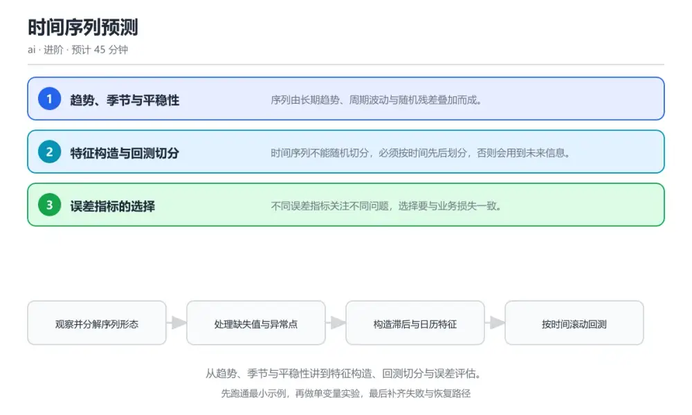
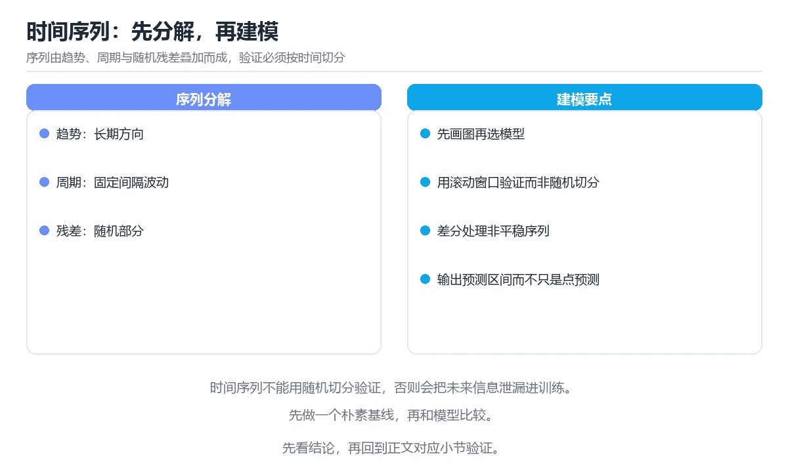

# 时间序列预测

> 内容更新时间：2026-10-06 · 学习阶段：进阶 · 预计用时：30 分钟

分类：ai。关键词：时间序列、季节性、平稳性、回测、误差指标。从趋势、季节与平稳性讲到特征构造、回测切分与误差评估。



## 本节知识框架

**课程定位**：所属分类 `ai`（AI 与智能体），课程主题 `时间序列预测`，学习阶段 进阶，建议用时 40 分钟。

本课主线：从趋势、季节与平稳性讲到特征构造、回测切分与误差评估。

**学完本课应当能够**
- 说清 `平稳性` 与 `滞后特征` 的含义与区别，并各举一个正例和一个反例。
- 用本课示例验证 `回测` 的行为，记录输入、输出与失败条件。
- 遇到「离线指标虚高」这类问题时，能说出触发条件与修复顺序。

### 复习清单

- [ ] 能不看正文复述本课核心术语，并指出一个边界或反例。
- [ ] 能运行或推演本课示例，记录输入、输出与失败现象。
- [ ] 能完成一次自测，并把错题对照错误表定位原因。

**本课配图**



## 核心概念定义

| 术语 | 操作性定义 | 常见边界与风险 |
| --- | --- | --- |
| 平稳性 | 序列的统计特性不随时间变化。 | 只在「序列的统计特性不随时间变化」这一前提下成立，换输入或换环境要重新验证。 |
| 滞后特征 | 使用过去时刻的值作为输入特征。 | 只在「使用过去时刻的值作为输入特征」这一前提下成立，换输入或换环境要重新验证。 |
| 回测 | 按时间顺序滚动切分训练与验证集评估模型。 | 易错：训练一次后长期不更新，忽略分布变化；正确做法是按固定周期滚动重训并用回测监控误差趋势，超过阈值触发重训。 |
| 数据泄露 | 特征中包含了预测时点之后的信息。 | 只在「特征中包含了预测时点之后的信息」这一前提下成立，换输入或换环境要重新验证。 |
| 平均绝对误差 | 预测值与真实值差值的绝对平均。 | 只在「预测值与真实值差值的绝对平均」这一前提下成立，换输入或换环境要重新验证。 |

## 原理与运行机制

### 机制总览

**教材衔接：核心知识**

### 1. 趋势、季节与平稳性

序列由长期趋势、周期波动与随机残差叠加而成。

通过差分或分解得到平稳序列，平稳性意味着统计特性不随时间变化，是许多经典模型的假设前提。

在时间序列预测里可以这样验证：在本课示例里对含季节性的序列做一阶差分，观察均值与方差的稳定性变化。

边界：对非平稳序列直接建模会得到看似拟合但外推失效的结果。

工程视角：建模前先画分解图并做平稳性检验，把处理方式记录在特征说明里。

### 2. 特征构造与回测切分

时间序列不能随机切分，必须按时间先后划分，否则会用到未来信息。

滞后特征只使用当前时刻之前的值，日历特征提供周期性信息，滚动窗口逐步向前推进完成回测。

在时间序列预测里可以这样验证：在本课示例里用滚动窗口做三次回测，观察每次训练集与验证集的时间边界。

边界：把未来数据泄露进特征会让离线指标虚高，上线后效果骤降。

工程视角：特征生成函数统一约束可用时间范围，回测流程固定并纳入自动检查。

### 3. 误差指标的选择

不同误差指标关注不同问题，选择要与业务损失一致。

绝对误差反映平均偏差大小，百分比误差便于跨量级比较，但在真实值接近零时会放大；分位数损失适合关注极端情况的场景。

在时间序列预测里可以这样验证：在本课示例里用两种指标评估同一预测，观察结论是否一致。

边界：用百分比误差评估含零值的序列会得到无穷大或极端值，误导模型选择。

工程视角：指标与业务口径一起评审，把选定的指标与阈值写进模型验收标准。

## 典型应用场景

**教材衔接：深度拓展与实战**

### 机制对照表

| 概念 | 解决什么问题 | 关键前提 | 失败信号 |
| --- | --- | --- | --- |
| 趋势、季节与平稳性 | 序列由长期趋势、周期波动与随机残差叠加而成。 | 对非平稳序列直接建模会得到看似拟合但外推失效的结果。 | 建模前先画分解图并做平稳性检验，把处理方式记录在特征说明里。 |
| 特征构造与回测切分 | 时间序列不能随机切分，必须按时间先后划分，否则会用到未来信息。 | 把未来数据泄露进特征会让离线指标虚高，上线后效果骤降。 | 特征生成函数统一约束可用时间范围，回测流程固定并纳入自动检查。 |
| 误差指标的选择 | 不同误差指标关注不同问题，选择要与业务损失一致。 | 用百分比误差评估含零值的序列会得到无穷大或极端值，误导模型选择。 | 指标与业务口径一起评审，把选定的指标与阈值写进模型验收标准。 |

### 自测问答

**问 1**：时间序列建模时最常见的错误是？

**答**：随机切分导致未来信息泄露到训练集。时间序列有先后依赖，随机切分会让模型在训练时看到未来数据，离线指标虚高而线上失效。 正确选项「随机切分导致未来信息泄露到训练集」对应《时间序列预测》的要点「趋势、季节与平稳性」：序列由长期趋势、周期波动与随机残差叠加而成。判断「趋势、季节与平稳性」时先确认前提是否成立，再回到《时间序列预测》的示例核对一次；把别的语言或框架的默认做法直接搬到趋势、季节与平稳性上，往往会在本课的边界条件里失效。

**问 2**：构造滚动均值特征时正确顺序是？

**答**：先移位再滚动计算。先移位保证计算时不包含当期值，否则当期真实值会通过特征泄漏进模型，造成评估偏高。 正确选项「先移位再滚动计算」对应《时间序列预测》的要点「特征构造与回测切分」：时间序列不能随机切分，必须按时间先后划分，否则会用到未来信息。判断「特征构造与回测切分」时先确认前提是否成立，再回到《时间序列预测》的示例核对一次；借鉴相邻主题的经验之前，先核对特征构造与回测切分的前提是否成立。

**问 3**：选择误差指标时需要考虑哪些因素？（多选）

**答**：业务损失对偏差的敏感方式；序列是否存在接近零的真实值；是否关注极端情况。指标要与业务损失一致并适配数据特征；缩写长短与评估有效性无关。 正确选项「业务损失对偏差的敏感方式；序列是否存在接近零的真实值；是否关注极端情况」对应《时间序列预测》的要点「误差指标的选择」：不同误差指标关注不同问题，选择要与业务损失一致。判断「误差指标的选择」时先确认前提是否成立，再回到《时间序列预测》的示例核对一次；记住误差指标的选择的结论之外还要记住适用条件，换一个输入往往就不成立了。

**问 4**：请按一次时间序列建模的顺序排列。

**答**：分解并检查平稳性。先理解序列形态，再清洗与构造特征，通过回测验证效果，最后固化指标与重训周期完成闭环。 正确选项「分解并检查平稳性；处理缺失与异常值；构造滞后与日历特征；按时间滚动回测；选定指标并定期重训」对应《时间序列预测》的要点「趋势、季节与平稳性」：序列由长期趋势、周期波动与随机残差叠加而成。判断「趋势、季节与平稳性」时先确认前提是否成立，再回到《时间序列预测》的示例核对一次；干扰项常常是相邻主题里成立的结论，只有按趋势、季节与平稳性的输入与约束判断才能排除。

**问 5**：阅读这段特征代码，会造成什么问题？

**答**：滚动均值包含当期真实值，特征泄露导致指标虚高。滚动窗口包含当前时刻的真实值，模型可以直接从特征中读出答案，离线误差会异常小而上线后表现崩塌。 正确选项「滚动均值包含当期真实值，特征泄露导致指标虚高」对应《时间序列预测》的要点「特征构造与回测切分」：时间序列不能随机切分，必须按时间先后划分，否则会用到未来信息。判断「特征构造与回测切分」时先确认前提是否成立，再回到《时间序列预测》的示例核对一次；把特征构造与回测切分的做法换到别的约束下未必成立，先确认边界再决定答案。

### 工程检查表

- [ ] 观察并分解序列形态
- [ ] 处理缺失值与异常点
- [ ] 构造滞后与日历特征
- [ ] 按时间滚动回测
- [ ] 选定误差指标并滚动更新模型
- [ ] 【趋势、季节与平稳性】建模前先画分解图并做平稳性检验，把处理方式记录在特征说明里。
- [ ] 【特征构造与回测切分】特征生成函数统一约束可用时间范围，回测流程固定并纳入自动检查。
- [ ] 【误差指标的选择】指标与业务口径一起评审，把选定的指标与阈值写进模型验收标准。

### 结论与下一步

- **离线指标虚高**：典型现象是随机切分或使用包含当期值的滚动统计作为特征；正确做法是严格按时间切分并先移位再计算滚动统计，保证特征只使用历史信息。
- **百分比误差失控**：典型现象是对真实值可能为零的序列使用百分比误差；正确做法是改用绝对误差或对称百分比误差，并在验收标准里写明分母处理方式。
- **模型无法适应变化**：典型现象是训练一次后长期不更新，忽略分布变化；正确做法是按固定周期滚动重训并用回测监控误差趋势，超过阈值触发重训。

### 最小验证场景

- 准备：保留 `text` 示例的原始输入，先记录 `时间序列预测` 的基线输出和完整运行命令。
- 观察：先核对 调用了 `make_features()`，再改变一个与 `平稳性` 相关的条件。
- 判定：新结果与 `时间序列预测` 的基线不同不等于错误；只有当差异破坏了 `平稳性` 的定义或错误表中的约束，才判定为失败。

### 选择与边界

- 使用 `平稳性` 时，先满足它的定义：序列的统计特性不随时间变化。
- 使用 `滞后特征` 时，先满足它的定义：使用过去时刻的值作为输入特征。
- 使用 `回测` 时，先满足它的定义：按时间顺序滚动切分训练与验证集评估模型；易错：训练一次后长期不更新，忽略分布变化；正确做法是按固定周期滚动重训并用回测监控误差趋势，超过阈值触发重训。
- 使用 `数据泄露` 时，先满足它的定义：特征中包含了预测时点之后的信息。
- 使用 `平均绝对误差` 时，先满足它的定义：预测值与真实值差值的绝对平均。

## 代码/协议/SQL 示例

**教材衔接：关键流程**

```text
观察并分解序列形态 → 处理缺失值与异常点 → 构造滞后与日历特征 → 按时间滚动回测 → 选定误差指标并滚动更新模型
```

1. 观察并分解序列形态
2. 处理缺失值与异常点
3. 构造滞后与日历特征
4. 按时间滚动回测
5. 选定误差指标并滚动更新模型

```python
import pandas as pd

# 特征构造：只使用当前时刻之前的信息，避免未来数据泄露
def make_features(series: pd.Series) -> pd.DataFrame:
    df = pd.DataFrame({"y": series})
    df["lag_1"] = series.shift(1)          # 昨天真实值
    df["lag_7"] = series.shift(7)          # 上周同期
    df["roll_mean_7"] = series.shift(1).rolling(7).mean()   # 先移位再滚动
    df["roll_std_7"] = series.shift(1).rolling(7).std()
    df["dow"] = series.index.dayofweek      # 星期几，捕捉周周期
    df["is_weekend"] = (df["dow"] >= 5).astype(int)
    return df.dropna()

# 滚动回测：每次只用过去数据训练，再预测未来一段
def backtest(series, horizon=7, folds=3):
    scores = []
    for fold in range(folds):
        split = len(series) - (fold + 1) * horizon
        train, valid = series[:split], series[split:split + horizon]
        model = fit(make_features(train))
        pred = model.predict(make_features(valid.join(train.tail(horizon))))
        mae = (pred - valid).abs().mean()
        scores.append(mae)
        print(f"fold {fold}: train_end={train.index[-1].date()} mae={mae:.2f}")
    return scores
```

## 时间/空间复杂度或性能分析

**性能关注点（时间序列预测）**：算力与显存决定可行规模：记录训练或推理耗时、显存峰值与模型精度，换数据集要重新评估。

**本课特有开销（时间序列预测 · 时间序列）**：比较次数与内存移动决定开销，注意稳定性与额外空间。

**测量方法**：以 `时间序列预测` 的 `时间序列` 场景为对象，固定输入跑一遍记录基线，再把规模或并发度提高一个数量级复测；两次结果的差值与波动范围才是结论依据。

## 常见误区与易错点

| 容易写错的做法 | 实际现象 | 原因与正确做法 |
| --- | --- | --- |
| 离线指标虚高 | 随机切分或使用包含当期值的滚动统计作为特征。 | 严格按时间切分并先移位再计算滚动统计，保证特征只使用历史信息。 |
| 百分比误差失控 | 对真实值可能为零的序列使用百分比误差。 | 改用绝对误差或对称百分比误差，并在验收标准里写明分母处理方式。 |
| 模型无法适应变化 | 训练一次后长期不更新，忽略分布变化。 | 按固定周期滚动重训并用回测监控误差趋势，超过阈值触发重训。 |

### 现场 1：离线指标虚高

**症状**：随机切分或使用包含当期值的滚动统计作为特征。

**根因与修复**：严格按时间切分并先移位再计算滚动统计，保证特征只使用历史信息。

**自检**：在本课示例里复现「离线指标虚高」，改成严格按时间切分并先移位再计算滚动统计，保证特征只使用历史信息后重跑；如果症状消失且失败路径按预期变化，说明定位正确。

### 现场 2：百分比误差失控

**症状**：对真实值可能为零的序列使用百分比误差。

**根因与修复**：改用绝对误差或对称百分比误差，并在验收标准里写明分母处理方式。

**自检**：在本课示例里复现「百分比误差失控」，改成改用绝对误差或对称百分比误差，并在验收标准里写明分母处理方式后重跑；如果症状消失且失败路径按预期变化，说明定位正确。

### 现场 3：模型无法适应变化

**症状**：训练一次后长期不更新，忽略分布变化。

**根因与修复**：按固定周期滚动重训并用回测监控误差趋势，超过阈值触发重训。

**自检**：在本课示例里复现「模型无法适应变化」，改成按固定周期滚动重训并用回测监控误差趋势，超过阈值触发重训后重跑；如果症状消失且失败路径按预期变化，说明定位正确。

## 与其他知识点的关系

**教材衔接：复习与迁移**

## 自测题与参考答案

> 先独立作答，再对照参考答案；答案都能在本课正文、术语表或错误表里找到依据。

### 自测 1（概念复述）

不看正文，写出 `平稳性` 的操作性定义，并说明它与 `滞后特征` 的区别。

**参考答案**：序列的统计特性不随时间变化。

`滞后特征` 的定位是：使用过去时刻的值作为输入特征；两者的差别要从适用对象与失败模式上说明。

### 自测 2（排错）

本课错误表记录了「离线指标虚高」这类做法。请写出它会出现的现象、根因，以及修复顺序。

**参考答案**：现象是随机切分或使用包含当期值的滚动统计作为特征；正确做法是严格按时间切分并先移位再计算滚动统计，保证特征只使用历史信息。修复时先复现现象并保留证据，再改动一处假设重跑，确认现象消失。

### 自测 3（动手验证）

运行本课的 `text` 示例，改动其中一个输入后重新运行，记录输出与错误信息。

**参考答案**：正常输入下 `text` 示例应当复现正文给出的结果；改动输入后，如果结果改变或报错，先核对它是否满足 `时间序列预测` 中`平稳性` 的适用范围，再检查错误表里是否有同类现象。

### 自测 4（代码阅读）

阅读本课开头的 `text` 示例，说明它体现了`平稳性` 的哪一条性质，并指出改动哪个输入会让这条性质不再成立。

**参考答案**：`平稳性` 的定义是 序列的统计特性不随时间变化，示例正是在实现这条定义。改动与 `平稳性` 有关的一个输入后，如果结果不再符合 `时间序列预测` 的正文描述，就说明该性质只在当前前提成立。

### 自测 5（迁移）

把 `时间序列预测` 的方法迁移到自己的项目：围绕 `平稳性` 写出一个与错误表同类的风险点，并说明触发条件和检验方式。

**参考答案**：例如「模型无法适应变化」，它会导致训练一次后长期不更新，忽略分布变化；检验方式是按固定周期滚动重训并用回测监控误差趋势，超过阈值触发重训改一处再复现，确认现象消失且没有引入新的失败分支。

### 自测 6（对比）

用一个表格对比 `平稳性` 与 `滞后特征`：各写一行适用场景、一行失败表现。

**参考答案**：`平稳性` 的定义是序列的统计特性不随时间变化；`滞后特征` 的定义是使用过去时刻的值作为输入特征。两者的失败表现分别对应本课错误表里与本术语相关的行。

### 自测 7（排错顺序）

面对「离线指标虚高」引发的问题，请把“复现 随机切分或使用包含当期值的滚动统计作为特征 → 保留证据 → 严格按时间切分并先移位再计算滚动统计，保证特征只使用历史信息 → 回归验证”四步写成可执行的检查清单。

**参考答案**：第一步按随机切分或使用包含当期值的滚动统计作为特征复现；第二步记录输入、版本与完整报错；第三步按严格按时间切分并先移位再计算滚动统计，保证特征只使用历史信息只改一处；第四步重跑并确认失败路径也按预期变化。

### 自测 8（边界判断）

针对 `平均绝对误差`，分别写出“可以使用”的条件和“结论不再成立”的条件。

**参考答案**：要把 `平均绝对误差` 的定义 预测值与真实值差值的绝对平均 与实际输入逐项对照。

### 自测 9（机制重建）

不看正文，按输入、转换、输出、验证四段重建 `平稳性` → `滞后特征` → `回测` → `数据泄露` 的作用链。

**参考答案**：起点是 `平稳性` 的定义 序列的统计特性不随时间变化；中间每一步都保留可观察状态；终点由 `平均绝对误差` 检查，失败时回到错误表定位第一个偏离定义的步骤。

### 自测 10（综合排错）

在 `时间序列预测` 中，现象是 训练一次后长期不更新，忽略分布变化。请围绕 模型无法适应变化 写出最小复现、关键证据、修复动作和回归验证，并说明为什么不能只凭一次运行下结论。

**参考答案**：先复现 模型无法适应变化，记录输入与完整错误；再按 按固定周期滚动重训并用回测监控误差趋势，超过阈值触发重训 只改一处。回归时同时跑正常路径和边界路径，只有两次结果都可解释，才把修复视为完成。

### 自测 11（一分钟复述）

用每分钟约 200 字的速度复述 `时间序列预测`：先给主问题，再按顺序说出 `平稳性`、`滞后特征`、`回测`、`数据泄露`，最后给一个失败案例。

**自评标准**：主问题必须对应 从趋势、季节与平稳性讲到特征构造、回测切分与误差评估；每个术语都要能接上一句定义或边界；失败案例必须写成可观察现象，不能用“可能有风险”代替证据。

## 术语速查

| 术语 | 一句话说明 |
| --- | --- |
| `平稳性` | 序列的统计特性不随时间变化。 |
| `滞后特征` | 使用过去时刻的值作为输入特征。 |
| `回测` | 按时间顺序滚动切分训练与验证集评估模型。 |
| `数据泄露` | 特征中包含了预测时点之后的信息。 |
| `平均绝对误差` | 预测值与真实值差值的绝对平均。 |

**术语关系**：`平稳性`（序列的统计特性不随时间变化） → `滞后特征`（使用过去时刻的值作为输入特征） → `回测`（按时间顺序滚动切分训练与验证集评估模型） → `数据泄露`（特征中包含了预测时点之后的信息）。

## 考点精讲

`时间序列预测` 的题库有 5 道题，下面逐题给出题干、正确项与判断依据：先自己作答，再核对正确项，最后回到正文对应小节复核。

### 考点 1：第 1 题

- **题目**：时间序列建模时最常见的错误是？
- **正确项**：随机切分导致未来信息泄露到训练集
- **判断依据**：本题正确项是「随机切分导致未来信息泄露到训练集」。术语 平稳性（时间序列预测）：序列的统计特性不随时间变化，本题取「随机切分导致未来信息泄露到训练集」这条。易错点是离线指标虚高，会造成随机切分或使用包含当期值的滚动统计作为特征，改法是严格按时间切分并先移位再计算滚动统计，保证特征只使用历史信息。

### 考点 2：第 2 题

- **题目**：构造滚动均值特征时正确顺序是？
- **正确项**：先移位再滚动计算
- **判断依据**：本题正确项是「先移位再滚动计算」。术语 平稳性（时间序列预测）：序列的统计特性不随时间变化，本题取「先移位再滚动计算」这条。易错点是百分比误差失控，会造成对真实值可能为零的序列使用百分比误差，改法是改用绝对误差或对称百分比误差，并在验收标准里写明分母处理方式。

### 考点 3：第 3 题

- **题目**：选择误差指标时需要考虑哪些因素？（多选）
- **正确项**：业务损失对偏差的敏感方式；序列是否存在接近零的真实值；是否关注极端情况
- **判断依据**：按《时间序列预测》的正文口径，本题要同时选中「业务损失对偏差的敏感方式」、「序列是否存在接近零的真实值」、「是否关注极端情况」，漏掉任一项都算没答全。术语 平稳性（时间序列预测）：序列的统计特性不随时间变化。易错点是模型无法适应变化，会造成训练一次后长期不更新，忽略分布变化，改法是按固定周期滚动重训并用回测监控误差趋势，超过阈值触发重训。

### 考点 4：第 4 题

- **题目**：请按一次时间序列建模的顺序排列。
- **正确项**：分解并检查平稳性 → 处理缺失与异常值 → 构造滞后与日历特征 → 按时间滚动回测 → 选定指标并定期重训
- **判断依据**：按《时间序列预测》正文的先后，本题顺序是「分解并检查平稳性」 → 「处理缺失与异常值」 → 「构造滞后与日历特征」 → 「按时间滚动回测」 → 「选定指标并定期重训」。术语 平稳性（时间序列预测）：序列的统计特性不随时间变化。易错点是离线指标虚高会造成随机切分或使用包含当期值的滚动统计作为特征，改法是严格按时间切分并先移位再计算滚动统计，保证特征只使用历史信息。

### 考点 5：第 5 题

- **题目**：阅读这段特征代码，会造成什么问题？
- **正确项**：滚动均值包含当期真实值，特征泄露导致指标虚高
- **判断依据**：本题正确项是「滚动均值包含当期真实值，特征泄露导致指标虚高」。术语 平稳性（时间序列预测）：序列的统计特性不随时间变化，本题取「滚动均值包含当期真实值，特征泄露导致指标虚高」这条。易错点是百分比误差失控，会造成对真实值可能为零的序列使用百分比误差，改法是改用绝对误差或对称百分比误差，并在验收标准里写明分母处理方式。

### 考点 6：`平稳性`

- **要点**：序列的统计特性不随时间变化。

### 考点 7：`滞后特征`

- **要点**：使用过去时刻的值作为输入特征。

### 考点 8：`回测`

- **要点**：按时间顺序滚动切分训练与验证集评估模型。
- **回测 的边界**：易错：训练一次后长期不更新，忽略分布变化；正确做法是按固定周期滚动重训并用回测监控误差趋势，超过阈值触发重训。

### 考点 9：`数据泄露`

- **要点**：特征中包含了预测时点之后的信息。

### 考点 10：`平均绝对误差`

- **要点**：预测值与真实值差值的绝对平均。

### 考点 11：排错——离线指标虚高

- **现象**：随机切分或使用包含当期值的滚动统计作为特征。
- **处理**：严格按时间切分并先移位再计算滚动统计，保证特征只使用历史信息。

### 考点 12：排错——百分比误差失控

- **现象**：对真实值可能为零的序列使用百分比误差。
- **处理**：改用绝对误差或对称百分比误差，并在验收标准里写明分母处理方式。

### 考点 13：综合辨析——`平稳性` 与 `平均绝对误差`

- **辨析点**：`平稳性` 的定义是 序列的统计特性不随时间变化；`平均绝对误差` 的定义是 预测值与真实值差值的绝对平均。
- **答题要求**：面对 `时间序列预测` 的题目，先判断描述的是 `平稳性` 还是 `平均绝对误差`，再归到对应定义，最后写出一个会让该定义失效的边界输入。

### 考点 14：排错评分点

- **现象分**：能写出 随机切分或使用包含当期值的滚动统计作为特征，而不是只写“程序有错”。
- **证据分**：保留触发 离线指标虚高 的输入、版本和错误原文。
- **修复分**：按 严格按时间切分并先移位再计算滚动统计，保证特征只使用历史信息 只改一处，并同时回归正常路径与边界路径。

## 内容元数据

- 内容版本：v2.0
- 最后更新：2026-10-06
- 学习阶段：进阶

| 字段 | 值 |
| --- | --- |
| 课程 ID | `ai_time_series` |
| 所属分类 | `ai` |
| 难度 | 进阶 |
| 预计用时 | 45 分钟 |
| 关键词 | 时间序列、季节性、平稳性、回测、误差指标 |
| 配图 | `images/lesson_ai_time_series.webp` |
| 参考资料 | 2 条 |
| 内容更新时间 | 2026-10-06 |

## 参考资料与复核

- 来源性质：官方文档、标准或权威教材；本课核对关键词：时间序列、季节性、平稳性、回测、误差指标。
- 最后复核：2026-10-04
- 下次复核：2027-04-17
- 复核范围：版本兼容、API 行为与工程实践

下面列出的资料用于核对本课结论，复习时可以对照阅读：
- [Nixtla 时间序列实践指南](https://nixtlaverse.nixtla.io/statsforecast/docs/getting-started/getting_started_complete.html)
- [Facebook Prophet 官方文档](https://facebook.github.io/prophet/docs/quick_start.html)

| [本课术语索引：时间序列预测](#核心概念定义) | 按本课输入、术语边界和错误表现逐项核对 |
> 复核提示：《时间序列预测》的结论如与资料冲突，以资料中的规范文本为准，并在笔记里记录差异与日期。