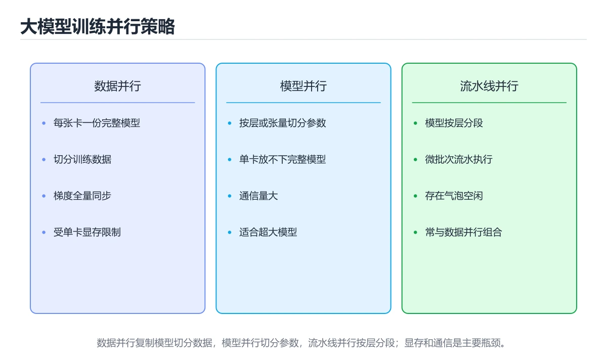
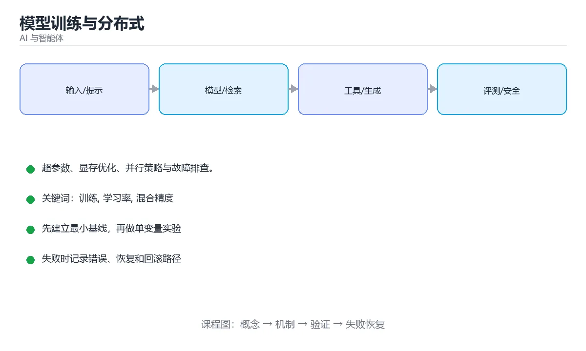

# 模型训练与分布式





> 内容更新时间：2026-10-06 · 学习阶段：高级 · 预计用时：30 分钟

## 本节知识框架

**课程定位**：所属分类 `ai`（AI 与智能体），课程主题 `模型训练与分布式`，学习阶段 高级，建议用时 35 分钟。

本课主线：超参数、显存优化、并行策略与故障排查。

**学完本课应当能够**
- 说清 `训练` 与 `学习率` 的含义与区别，并各举一个正例和一个反例。
- 用本课示例验证 `混合精度` 的行为，记录输入、输出与失败条件。
- 遇到「损失变 NaN」这类问题时，能说出触发条件与修复顺序。

### 复习清单

- [ ] 能不看正文复述本课核心术语，并指出一个边界或反例。
- [ ] 能运行或推演本课示例，记录输入、输出与失败现象。
- [ ] 能完成一次自测，并把错题对照错误表定位原因。

## 核心概念定义

| 术语 | 操作性定义 | 常见边界与风险 |
| --- | --- | --- |
| 训练 | 用数据计算损失并更新模型参数，使模型逐步拟合任务。 | 易错：训练过久或学习率过大；正确做法是减少步数、混入通用数据。 |
| 学习率 | 训练时每次按梯度更新参数的步长，过大会震荡，过小会收敛缓慢。 | 易错：学习率过大、精度问题；正确做法是降低学习率、用 BF16、加梯度裁剪。 |
| 混合精度 | 混合精度（FP16/BF16）：显存减半、速度提升，需配合损失缩放。 | 易错：学习率过大、数值溢出；正确做法是降学习率、混合精度加损失缩放。 |
| LoRA | 参数高效微调（LoRA/QLoRA）：只训练少量参数，单卡可微调大模型。 | 结果依赖数据分布、模型版本与算力预算，换数据集或换硬件都要重新评估。 |
| 分布式 | 计算、存储或服务分布在多个节点上，通过网络协作完成同一任务。 | 网络延迟、超时与版本协商会改变行为，只在真实链路或多版本客户端上验证才算数。 |
| 数据 | 训练 的训练或检索数据从哪来、质量如何 | 易错：学习率过小、数据或模板错误；正确做法是检查模板与标签，提高学习率。 |
| 模型 | 学习率 的能力边界与成本是多少 | 易错：数据少、模型大；正确做法是数据增强、正则化、早停。 |
| 评测 | 如何证明改动真的有效 | 易错：无法判断训练是否有效；正确做法是先测未训练模型。 |
| 安全 | 失败时会不会泄露或越权 | 只在「失败时会不会泄露或越权」这一前提下成立，换输入或换环境要重新验证。 |

## 原理与运行机制

### 机制总览

**教材衔接：训练全流程**

数据准备与清洗 → 划分训练/验证集 → 定义模型与损失 → 训练循环（前向、反向、更新）→ 评估与调参 → 保存与导出。工业界真正耗时的是**数据与评测**，而不是调参。

**教材衔接：关键超参数**

| 超参数 | 作用 | 经验 |
| --- | --- | --- |
| 学习率 | 每步更新幅度 | 最重要；过大发散、过小收敛慢 |
| 批大小 | 每次更新的样本数 | 越大越稳但显存占用高，可用梯度累积模拟 |
| 优化器 | 更新策略 | AdamW 通用，SGD+Momentum 泛化常更好 |
| 权重衰减 | 正则化强度 | 抑制过拟合 |
| 学习率调度 | 动态调整 | 预热 + 余弦退火常用 |

**教材衔接：分布式训练**

| 并行方式 | 切分对象 | 适用 |
| --- | --- | --- |
| 数据并行 DDP | 切分数据，各卡持有完整模型 | 最常用，模型能放进单卡 |
| 张量并行 | 切分单层矩阵运算 | 单层过大 |
| 流水线并行 | 按层切分到不同设备 | 超深模型 |
| 混合并行 | 上述组合 | 千亿参数级训练 |

数据并行的关键是**梯度同步**（AllReduce）；ZeRO/FSDP 通过分片优化器状态、梯度与参数进一步省显存。

**教材衔接：实践建议**

1. 先在极小数据集上跑通全流程（能过拟合），再放大规模。
2. 固定随机种子并记录配置，保证实验可复现。
3. 用实验跟踪工具记录超参数、指标与产物。
4. 训练与推理环境保持一致（依赖版本、精度、分词器）。
5. 保存检查点并支持断点续训，长任务必须能恢复。

**教材衔接：训练流程速查**

| 阶段 | 关键动作 | 产出 |
| --- | --- | --- |
| 数据准备 | 清洗、去重、划分、模板化 | 训练与验证集 |
| 基线评测 | 未训练模型在同一评测集上的表现 | 基线指标 |
| 试跑 | 小步数验证流程与显存 | 损失曲线与样例输出 |
| 正式训练 | 监控损失、学习率、梯度范数 | 检查点 |
| 评测 | 验证集与任务指标 | 是否达标 |
| 上线 | 灰度与回滚方案 | 线上版本 |

**教材衔接：训练稳定性速查**

| 现象 | 可能原因 | 处理 |
| --- | --- | --- |
| 损失变 NaN | 学习率过大、精度问题 | 降低学习率、用 BF16、加梯度裁剪 |
| 损失不下降 | 学习率过小、数据或模板错误 | 检查模板与标签，提高学习率 |
| 验证集变差 | 过拟合 | 早停、加数据、加正则 |
| 输出重复 | 采样参数或数据问题 | 检查数据质量与惩罚项 |
| 灾难性遗忘 | 训练过久或学习率过大 | 减少步数、混入通用数据 |
| 吞吐异常低 | 数据加载或通信瓶颈 | 增加加载并行、检查网络带宽 |

## 典型应用场景

- **损失变 NaN**：典型现象是学习率过大、精度问题；正确做法是降低学习率、用 BF16、加梯度裁剪。
- **损失不下降**：典型现象是学习率过小、数据或模板错误；正确做法是检查模板与标签，提高学习率。
- **验证集变差**：典型现象是过拟合；正确做法是早停、加数据、加正则。
- **输出重复**：典型现象是采样参数或数据问题；正确做法是检查数据质量与惩罚项。

### 最小验证场景

- 准备：保留 `python` 示例的原始输入，先记录 `模型训练与分布式` 的基线输出和完整运行命令。
- 观察：先核对 调用了 `weights_gb()`，再改变一个与 `训练` 相关的条件。
- 判定：新结果与 `模型训练与分布式` 的基线不同不等于错误；只有当差异破坏了 `训练` 的定义或错误表中的约束，才判定为失败。

### 选择与边界

- 使用 `训练` 时，先满足它的定义：用数据计算损失并更新模型参数，使模型逐步拟合任务；易错：训练过久或学习率过大；正确做法是减少步数、混入通用数据。
- 使用 `学习率` 时，先满足它的定义：训练时每次按梯度更新参数的步长，过大会震荡，过小会收敛缓慢；易错：学习率过大、精度问题；正确做法是降低学习率、用 BF16、加梯度裁剪。
- 使用 `混合精度` 时，先满足它的定义：混合精度（FP16/BF16）：显存减半、速度提升，需配合损失缩放；易错：学习率过大、数值溢出；正确做法是降学习率、混合精度加损失缩放。
- 使用 `LoRA` 时，先满足它的定义：参数高效微调（LoRA/QLoRA）：只训练少量参数，单卡可微调大模型；结果依赖数据分布、模型版本与算力预算，换数据集或换硬件都要重新评估。
- 使用 `分布式` 时，先满足它的定义：计算、存储或服务分布在多个节点上，通过网络协作完成同一任务；网络延迟、超时与版本协商会改变行为，只在真实链路或多版本客户端上验证才算数。

## 代码/协议/SQL 示例

**教材衔接：超参数速查**

| 超参数 | 常用范围 | 说明 |
| --- | --- | --- |
| 学习率 | 1e-5 到 2e-4（全参更小） | 过大导致发散或遗忘 |
| 批大小 | 按显存最大化 | 配合梯度累积 |
| warmup | 总步数的 1% 到 5% | 避免初期破坏预训练权重 |
| 调度器 | 余弦或线性衰减 | 后期稳定收敛 |
| 权重衰减 | 0.01 到 0.1 | 抑制过拟合 |
| 训练轮数 | 1 到 3 轮（指令微调） | 过多易过拟合 |
| LoRA rank | 8 到 64 | 越大容量越高、显存越多 |
| LoRA alpha | 通常为 rank 的 1 到 2 倍 | 控制缩放 |
| 梯度裁剪 | 1.0 | 防止梯度爆炸 |

```python
from dataclasses import dataclass

@dataclass
class MemoryPlan:
    """显存估算与优化组合，判断是否需要量化或分片。"""

    params_b: float
    bytes_per_param_train: float = 16      # 权重 + 梯度 + 优化器状态约 16 字节
    seq_len: int = 4096
    batch_size: int = 4
    activation_per_sample_gb: float = 0.6

    @property
    def weights_gb(self) -> float:
        return self.params_b * 1e9 * self.bytes_per_param_train / (1024 ** 3)

    @property
    def activations_gb(self) -> float:
        return self.activation_per_sample_gb * self.batch_size * (self.seq_len / 4096)

    def total_gb(self) -> float:
        return round(self.weights_gb + self.activations_gb, 2)

    def suggestions(self, vram_gb: float) -> list:
        tips = []
        if self.total_gb() > vram_gb:
            tips.append("启用梯度检查点（用时间换显存）")
            tips.append("用梯度累积降低 micro-batch")
            tips.append("改用 LoRA 或 QLoRA 减少可训练参数")
            if self.seq_len > 2048:
                tips.append("缩短序列长度或使用分块注意力")
            if self.params_b >= 13:
                tips.append("考虑 ZeRO / 张量并行做分片")
        return tips or ["当前配置显存充足"]

def effective_batch_size(micro_batch: int, grad_accum: int, world_size: int = 1) -> int:
    """有效批大小：用于对齐实验与论文配置。"""
    return micro_batch * grad_accum * world_size

plan = MemoryPlan(params_b=7, batch_size=4)
print(plan.total_gb(), plan.suggestions(vram_gb=24))
print(effective_batch_size(micro_batch=2, grad_accum=8, world_size=4))
```

**运行方式**：运行 `模型训练与分布式` 的示例时，保存为 `.py` 文件后用 `python 文件名.py` 运行；第三方依赖先在虚拟环境里安装。

## 时间/空间复杂度或性能分析

**性能关注点（模型训练与分布式）**：算力与显存决定可行规模：记录训练或推理耗时、显存峰值与模型精度，换数据集要重新评估。

**本课特有开销（模型训练与分布式 · 训练）**：重试与超时会成倍放大尾延迟，记录 P99 而不是平均值。

**测量方法**：以 `模型训练与分布式` 的 `训练` 场景为对象，固定输入跑一遍记录基线，再把规模或并发度提高一个数量级复测；两次结果的差值与波动范围才是结论依据。

## 常见误区与易错点

| 容易写错的做法 | 实际现象 | 原因与正确做法 |
| --- | --- | --- |
| 损失变 NaN | 学习率过大、精度问题 | 降低学习率、用 BF16、加梯度裁剪 |
| 损失不下降 | 学习率过小、数据或模板错误 | 检查模板与标签，提高学习率 |
| 验证集变差 | 过拟合 | 早停、加数据、加正则 |
| 输出重复 | 采样参数或数据问题 | 检查数据质量与惩罚项 |
| 灾难性遗忘 | 训练过久或学习率过大 | 减少步数、混入通用数据 |
| 吞吐异常低 | 数据加载或通信瓶颈 | 增加加载并行、检查网络带宽 |
| Loss 变 NaN | 学习率过大、数值溢出 | 降学习率、混合精度加损失缩放 |
| 不收敛 | 数据未归一化、标签错误 | 先在小样本上过拟合验证管线 |
| 显存溢出 | 批过大、未释放中间变量 | 减小批、梯度检查点、及时释放 |
| 训练慢 | 数据加载瓶颈 | 增加 DataLoader 并发、预取、缓存 |
| 过拟合 | 数据少、模型大 | 数据增强、正则化、早停 |
| 不做基线评测 | 无法判断训练是否有效 | 先测未训练模型 |
| 不做小规模试跑 | 正式训练中途报错 | 先跑几十步验证流程 |
| 训练与推理模板不一致 | 效果明显下降 | 严格复用同一模板 |
| 学习率直接取最大值 | 损失爆炸或遗忘 | 从小学习率开始并观察曲线 |
| 只看训练损失 | 过拟合无感知 | 同时看验证集与任务指标 |
| 不用梯度检查点 | 显存不足 | 用时间换显存 |
| 不保存中间检查点 | 中断后重头再来 | 定期保存并保留最优 |
| 不记录超参与数据版本 | 结果无法复现 | 配置与数据版本一起记录 |
| 单一随机种子 | 结论不稳 | 多 seed 验证稳定性 |
| 训练完直接全量上线 | 风险高 | 灰度 + 回滚方案 |

### 现场 1：损失变 NaN

**症状**：学习率过大、精度问题。

**根因与修复**：降低学习率、用 BF16、加梯度裁剪。

**自检**：在本课示例里复现「损失变 NaN」，改成降低学习率、用 BF16、加梯度裁剪后重跑；如果症状消失且失败路径按预期变化，说明定位正确。

### 现场 2：损失不下降

**症状**：学习率过小、数据或模板错误。

**根因与修复**：检查模板与标签，提高学习率。

**自检**：在本课示例里复现「损失不下降」，改成检查模板与标签，提高学习率后重跑；如果症状消失且失败路径按预期变化，说明定位正确。

### 现场 3：验证集变差

**症状**：过拟合。

**根因与修复**：早停、加数据、加正则。

**自检**：在本课示例里复现「验证集变差」，改成早停、加数据、加正则后重跑；如果症状消失且失败路径按预期变化，说明定位正确。

### 现场 4：输出重复

**症状**：采样参数或数据问题。

**根因与修复**：检查数据质量与惩罚项。

**自检**：在本课示例里复现「输出重复」，改成检查数据质量与惩罚项后重跑；如果症状消失且失败路径按预期变化，说明定位正确。

### 现场 5：灾难性遗忘

**症状**：训练过久或学习率过大。

**根因与修复**：减少步数、混入通用数据。

**自检**：在本课示例里复现「灾难性遗忘」，改成减少步数、混入通用数据后重跑；如果症状消失且失败路径按预期变化，说明定位正确。

### 现场 6：吞吐异常低

**症状**：数据加载或通信瓶颈。

**根因与修复**：增加加载并行、检查网络带宽。

**自检**：在本课示例里复现「吞吐异常低」，改成增加加载并行、检查网络带宽后重跑；如果症状消失且失败路径按预期变化，说明定位正确。

### 现场 7：Loss 变 NaN

**症状**：学习率过大、数值溢出。

**根因与修复**：降学习率、混合精度加损失缩放。

**自检**：在本课示例里复现「Loss 变 NaN」，改成降学习率、混合精度加损失缩放后重跑；如果症状消失且失败路径按预期变化，说明定位正确。

### 现场 8：不收敛

**症状**：数据未归一化、标签错误。

**根因与修复**：先在小样本上过拟合验证管线。

**自检**：在本课示例里复现「不收敛」，改成先在小样本上过拟合验证管线后重跑；如果症状消失且失败路径按预期变化，说明定位正确。

### 现场 9：显存溢出

**症状**：批过大、未释放中间变量。

**根因与修复**：减小批、梯度检查点、及时释放。

**自检**：在本课示例里复现「显存溢出」，改成减小批、梯度检查点、及时释放后重跑；如果症状消失且失败路径按预期变化，说明定位正确。

## 与其他知识点的关系

- **先修**：`Agent 记忆系统`。本课默认这些内容已经掌握。
- **相关或后续**：`数据工程与标注`。本课术语会在这些课程里继续使用。
- **术语归属**：`训练`、`学习率`、`混合精度` 的定义以本课「核心概念定义」为准，换到其他课程时先确认定义是否被改写。
- 同一分类的《模型微调与本地部署》也涉及 `LoRA`；两课衔接时先确认这个术语的定义是否一致。

## 自测题与参考答案

> 先独立作答，再对照参考答案；答案都能在本课正文、术语表或错误表里找到依据。

### 自测 1（概念复述）

不看正文，写出 `训练` 的操作性定义，并说明它与 `学习率` 的区别。

**参考答案**：用数据计算损失并更新模型参数，使模型逐步拟合任务。

`学习率` 的定位是：训练时每次按梯度更新参数的步长，过大会震荡，过小会收敛缓慢；两者的差别要从适用对象与失败模式上说明。

### 自测 2（排错）

本课错误表记录了「损失变 NaN」这类做法。请写出它会出现的现象、根因，以及修复顺序。

**参考答案**：现象是学习率过大、精度问题；正确做法是降低学习率、用 BF16、加梯度裁剪。修复时先复现现象并保留证据，再改动一处假设重跑，确认现象消失。

### 自测 3（动手验证）

运行本课的 `python` 示例，把其中的 `"显存估算与优化组合，判断是否需要量化或分片。"` 换成一个边界值后重新运行，记录输出与错误信息。

**参考答案**：正常输入下 `python` 示例应当复现正文给出的结果；把 `"显存估算与优化组合，判断是否需要量化或分片。"` 换成边界值后，如果结果改变或报错，先核对它是否满足 `模型训练与分布式` 中`训练` 的适用范围，再检查错误表里是否有同类现象。

### 自测 4（代码阅读）

阅读本课开头的 `python` 示例，说明它体现了`训练` 的哪一条性质，并指出改动哪个输入会让这条性质不再成立。

**参考答案**：`训练` 的定义是 用数据计算损失并更新模型参数，使模型逐步拟合任务，示例正是在实现这条定义。改动与 `训练` 有关的一个输入后，如果结果不再符合 `模型训练与分布式` 的正文描述，就说明该性质只在当前前提成立。

### 自测 5（迁移）

把 `模型训练与分布式` 的方法迁移到自己的项目：围绕 `训练` 写出一个与错误表同类的风险点，并说明触发条件和检验方式。

**参考答案**：例如「训练完直接全量上线」，它会导致风险高；检验方式是按灰度 + 回滚方案改一处再复现，确认现象消失且没有引入新的失败分支。

### 自测 6（对比）

用一个表格对比 `训练` 与 `学习率`：各写一行适用场景、一行失败表现。

**参考答案**：`训练` 的定义是用数据计算损失并更新模型参数，使模型逐步拟合任务；`学习率` 的定义是训练时每次按梯度更新参数的步长，过大会震荡，过小会收敛缓慢。两者的失败表现分别对应本课错误表里与本术语相关的行。

### 自测 7（排错顺序）

面对「损失变 NaN」引发的问题，请把“复现 学习率过大、精度问题 → 保留证据 → 降低学习率、用 BF16、加梯度裁剪 → 回归验证”四步写成可执行的检查清单。

**参考答案**：第一步按学习率过大、精度问题复现；第二步记录输入、版本与完整报错；第三步按降低学习率、用 BF16、加梯度裁剪只改一处；第四步重跑并确认失败路径也按预期变化。

### 自测 8（边界判断）

针对 `分布式`，分别写出“可以使用”的条件和“结论不再成立”的条件。

**参考答案**：网络延迟、超时与版本协商会改变行为，只在真实链路或多版本客户端上验证才算数。 同时要把 `分布式` 的定义 计算、存储或服务分布在多个节点上，通过网络协作完成同一任务 与实际输入逐项对照。

### 自测 9（机制重建）

不看正文，按输入、转换、输出、验证四段重建 `训练` → `学习率` → `混合精度` → `LoRA` 的作用链。

**参考答案**：起点是 `训练` 的定义 用数据计算损失并更新模型参数，使模型逐步拟合任务；中间每一步都保留可观察状态；终点由 `分布式` 检查，失败时回到错误表定位第一个偏离定义的步骤。

### 自测 10（综合排错）

在 `模型训练与分布式` 中，现象是 风险高。请围绕 训练完直接全量上线 写出最小复现、关键证据、修复动作和回归验证，并说明为什么不能只凭一次运行下结论。

**参考答案**：先复现 训练完直接全量上线，记录输入与完整错误；再按 灰度 + 回滚方案 只改一处。回归时同时跑正常路径和边界路径，只有两次结果都可解释，才把修复视为完成。

### 自测 11（一分钟复述）

用每分钟约 200 字的速度复述 `模型训练与分布式`：先给主问题，再按顺序说出 `训练`、`学习率`、`混合精度`、`LoRA`，最后给一个失败案例。

**自评标准**：主问题必须对应 超参数、显存优化、并行策略与故障排查；每个术语都要能接上一句定义或边界；失败案例必须写成可观察现象，不能用“可能有风险”代替证据。

## 延伸阅读

想更直观地理解本课概念？推荐参阅以下图解专题：

- [图解大模型推理与显存占用](visual_llm_inference.md)

## 术语速查

| 术语 | 一句话说明 |
| --- | --- |
| `训练` | 用数据计算损失并更新模型参数，使模型逐步拟合任务。 |
| `学习率` | 训练时每次按梯度更新参数的步长，过大会震荡，过小会收敛缓慢。 |
| `混合精度` | 混合精度（FP16/BF16）：显存减半、速度提升，需配合损失缩放。 |
| `LoRA` | 参数高效微调（LoRA/QLoRA）：只训练少量参数，单卡可微调大模型。 |
| `分布式` | 计算、存储或服务分布在多个节点上，通过网络协作完成同一任务。 |

**术语关系**：`训练`（用数据计算损失并更新模型参数） → `学习率`（训练时每次按梯度更新参数的步长） → `混合精度`（混合精度（FP16/BF16）：显存减半、速度提升） → `LoRA`（参数高效微调（LoRA/QLoRA）：只训练少量参数）。

## 考点精讲

`模型训练与分布式` 的题库有 6 道题，下面逐题给出题干、正确项与判断依据：先自己作答，再核对正确项，最后回到正文对应小节复核。

### 考点 1：第 1 题

- **题目**：阅读这段显存估算代码，下面哪项判断是正确的？
- **正确项**：训练显存主要来自参数、梯度、优化器状态与激活值，估算后才能决定分片或量化策略
- **判断依据**：本题正确项是训练显存主要来自参数、梯度、优化器状态与激活值，估算后才能决定分片或量化策略。术语 训练（模型训练与分布式）：用数据计算损失并更新模型参数，使模型逐步拟合任务，本题取训练显存主要来自参数、梯度、优化器状态与激活值，估算后才能决定分片或量化策略这条。易错点是损失变 NaN会造成学习率过大、精度问题，改法是降低学习率、用 BF16、加梯度裁剪，干扰项训练显存只取决于模型参数量，序列长度与批量大小可以忽略正踩在这条上。

### 考点 2：第 2 题

- **题目**：按“模型训练与分布式”中 训练、学习率、混合精度 的实践顺序，把四个步骤排成从准备到复盘的合理顺序。
- **正确项**：先明确 训练 的输入、输出与约束 → 写出最小示例并核对 学习率 的基线结果 → 只改一个变量，记录边界与失败路径的变化 → 固定版本与证据，把“模型训练与分布式”的结论写成可复现记录
- **判断依据**：本题正确项是先明确 训练 的输入、输出与约束。术语 训练（模型训练与分布式）：用数据计算损失并更新模型参数，使模型逐步拟合任务，本题取先明确 训练 的输入、输出与约束这条。易错点是损失变 NaN会造成学习率过大、精度问题，改法是降低学习率、用 BF16、加梯度裁剪，干扰项写出最小示例并核对 学习率 的基线结果正踩在这条上。

### 考点 3：第 3 题

- **题目**：开始训练前最应该做的一件事是？
- **正确项**：先用极小数据集跑通全流程并确认能过拟合
- **判断依据**：本题正确项是先用极小数据集跑通全流程并确认能过拟合。术语 训练（模型训练与分布式）：用数据计算损失并更新模型参数，使模型逐步拟合任务，本题取先用极小数据集跑通全流程并确认能过拟合这条。易错点是过拟合会造成数据少、模型大，改法是数据增强、正则化、早停，干扰项先调大模型正踩在这条上。

### 考点 4：第 4 题

- **题目**：学习率预热（warmup）的作用是？
- **正确项**：训练初期使用较小学习率逐步升高，避免大更新破坏预训练权重
- **判断依据**：本题正确项是训练初期使用较小学习率逐步升高，避免大更新破坏预训练权重。术语 训练（模型训练与分布式）：用数据计算损失并更新模型参数，使模型逐步拟合任务，本题取训练初期使用较小学习率逐步升高，避免大更新破坏预训练权重这条。易错点是损失变 NaN会造成学习率过大、精度问题，改法是降低学习率、用 BF16、加梯度裁剪，干扰项加快数据加载，但这会引入新的复杂度，需要额外的验证与维护正踩在这条上。

### 考点 5：第 5 题

- **题目**：梯度累积与梯度检查点的区别是？
- **正确项**：累积等效大批量，检查点用重算换显存
- **判断依据**：本题正确项是累积等效大批量，检查点用重算换显存。术语 训练（模型训练与分布式）：用数据计算损失并更新模型参数，使模型逐步拟合任务，本题取累积等效大批量，检查点用重算换显存这条。易错点是损失变 NaN会造成学习率过大、精度问题，改法是降低学习率、用 BF16、加梯度裁剪，干扰项两者完全相同正踩在这条上。

### 考点 6：第 6 题

- **题目**：课程 `超参数、显存优化、并行策略与故障排查。`。在 `模型训练与分布式` 里，`训练`、`学习率` 与下面哪些选项属于同一层概念？（多选）
- **正确项**：训练；学习率
- **判断依据**：术语 训练（模型训练与分布式）：用数据计算损失并更新模型参数，使模型逐步拟合任务，本题取训练这条。易错点是损失变 NaN会造成学习率过大、精度问题，改法是降低学习率、用 BF16、加梯度裁剪，判断时先确认输入和适用范围，对照 `训练`、`学习率`、`混合精度`、`LoRA` 复现一次，最后把错误表现与正确做法逐项对照。

### 考点 7：`训练`

- **要点**：用数据计算损失并更新模型参数，使模型逐步拟合任务。
- **训练 的边界**：易错：训练过久或学习率过大；正确做法是减少步数、混入通用数据。

### 考点 8：`学习率`

- **要点**：训练时每次按梯度更新参数的步长，过大会震荡，过小会收敛缓慢。
- **学习率 的边界**：易错：学习率过大、精度问题；正确做法是降低学习率、用 BF16、加梯度裁剪。

### 考点 9：`混合精度`

- **要点**：混合精度（FP16/BF16）：显存减半、速度提升，需配合损失缩放。
- **混合精度 的边界**：易错：学习率过大、数值溢出；正确做法是降学习率、混合精度加损失缩放。

### 考点 10：`LoRA`

- **要点**：参数高效微调（LoRA/QLoRA）：只训练少量参数，单卡可微调大模型。
- **LoRA 的边界**：结果依赖数据分布、模型版本与算力预算，换数据集或换硬件都要重新评估。

### 考点 11：`分布式`

- **要点**：计算、存储或服务分布在多个节点上，通过网络协作完成同一任务。
- **分布式 的边界**：网络延迟、超时与版本协商会改变行为，只在真实链路或多版本客户端上验证才算数。

### 考点 12：排错——损失变 NaN

- **现象**：学习率过大、精度问题。
- **处理**：降低学习率、用 BF16、加梯度裁剪。

### 考点 13：排错——损失不下降

- **现象**：学习率过小、数据或模板错误。
- **处理**：检查模板与标签，提高学习率。

### 考点 14：综合辨析——`训练` 与 `分布式`

- **辨析点**：`训练` 的定义是 用数据计算损失并更新模型参数，使模型逐步拟合任务；`分布式` 的定义是 计算、存储或服务分布在多个节点上，通过网络协作完成同一任务。
- **答题要求**：面对 `模型训练与分布式` 的题目，先判断描述的是 `训练` 还是 `分布式`，再归到对应定义，最后写出一个会让该定义失效的边界输入。

### 考点 15：排错评分点

- **现象分**：能写出 学习率过大、精度问题，而不是只写“程序有错”。
- **证据分**：保留触发 损失变 NaN 的输入、版本和错误原文。
- **修复分**：按 降低学习率、用 BF16、加梯度裁剪 只改一处，并同时回归正常路径与边界路径。

## 内容元数据

- 内容版本：v2.0
- 最后更新：2026-10-06
- 学习阶段：高级
- 适用环境：主流大模型 API、开源模型与向量数据库；本课聚焦 训练。
- 内容来源：内置结构化课程与工程实践整理
- 相关主题：训练、学习率、混合精度、LoRA、分布式
- 质量版本：P0 测验标准 + P1 覆盖扩展 + P2 体验补全

## 参考资料与复核

- [本课资料锚点 ai_training](https://zh.wikipedia.org/w/index.php?search=ai_training)

- 最后复核：2026-10-04
- 下次复核：2027-04-17
- 复核范围：版本兼容、API 行为、安全建议与工程实践
- 来源性质：官方文档、标准或权威教材；本课核对关键词：训练、学习率、混合精度、LoRA、分布式。

| 参考资料 | 本课用途 |
| --- | --- |
| [Hugging Face 文档](https://huggingface.co/docs) | 模型、数据集与推理 |
| [TensorFlow 文档](https://www.tensorflow.org/api_docs) | 模型构建与部署 |
| [LangChain 文档](https://python.langchain.com/docs/) | Agent、RAG 与工作流编排 |

| [本课术语索引：模型训练与分布式](#核心概念定义) | 按本课输入、术语边界和错误表现逐项核对 |
> 「模型训练与分布式」的链接用于离线阅读后的延伸核对；App 不会自动联网。