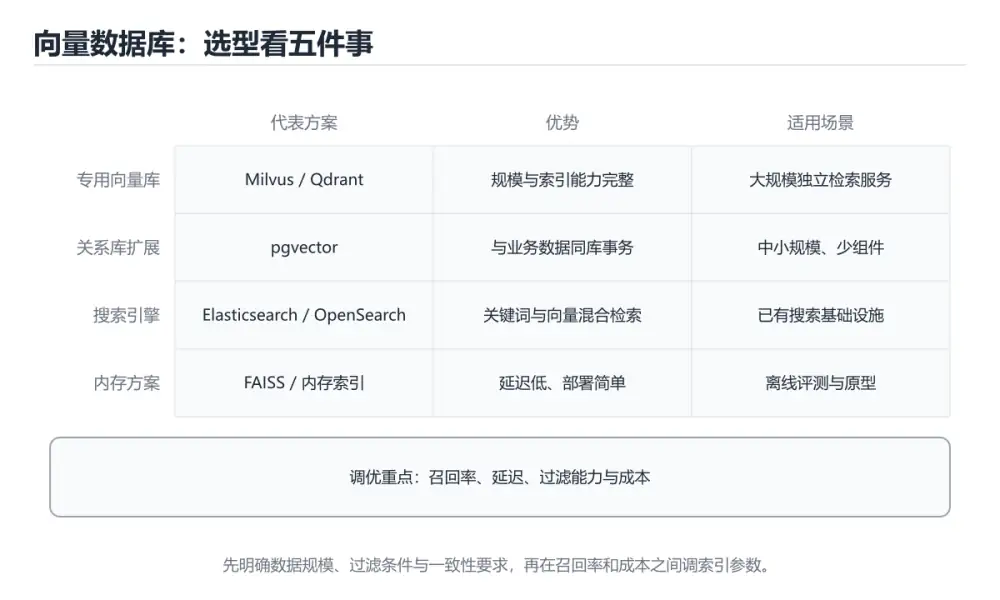
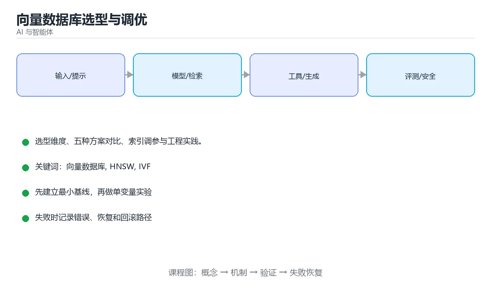

# 向量数据库选型与调优

> 内容更新时间：2026-10-06 · 学习阶段：进阶 · 预计用时：30 分钟





## 本节知识框架

**课程定位**：所属分类 `ai`（AI 与智能体），课程主题 `向量数据库选型与调优`，学习阶段 进阶，建议用时 40 分钟。

本课主线：选型维度、五种方案对比、索引调参与工程实践。

**学完本课应当能够**
- 说清 `嵌入向量` 与 `近似最近邻` 的含义与区别，并各举一个正例和一个反例。
- 用本课示例验证 `元数据过滤` 的行为，记录输入、输出与失败条件。
- 遇到「换嵌入模型不重建索引」这类问题时，能说出触发条件与修复顺序。

### 复习清单

- [ ] 能不看正文复述本课核心术语，并指出一个边界或反例。
- [ ] 能运行或推演本课示例，记录输入、输出与失败现象。
- [ ] 能完成一次自测，并把错题对照错误表定位原因。

## 核心概念定义

| 术语 | 操作性定义 | 常见边界与风险 |
| --- | --- | --- |
| 嵌入向量 | 把文本或图片映射成的高维数值数组，语义相近的内容在向量空间里距离更近。 | 只在「把文本或图片映射成的高维数值数组，语义相近的内容在向量空间里距离更近」这一前提下成立，换输入或换环境要重新验证。 |
| 近似最近邻 | 用图索引或量化换取速度的检索方式，牺牲少量召回率把全量比对的延迟压到可接受范围。 | 结论随输入规模变化，小规模成立不代表大规模成立，需要重新测量。 |
| 元数据过滤 | 在向量比对前后按时间、来源等字段筛掉不合格数据，避免只凭相似度召回无关结果。 | 易错：越权或结果不相关；正确做法是元数据过滤 + 相似度。 |
| 召回率 | 检索结果里真正相关的比例，用来判断索引参数与过滤条件有没有漏掉本该命中的文档。 | 索引命中与数据分布决定实际开销，判断前先看执行计划而不是只看结果是否正确。 |

## 原理与运行机制

### 机制总览

**教材衔接：选型维度**

| 维度 | 关键问题 |
| --- | --- |
| 规模 | 向量条数是千级、百万级还是十亿级 |
| 索引类型 | 需要多快、可接受多少召回损失（HNSW/IVF/PQ） |
| 过滤能力 | 是否要"先按标签过滤再检索"（预过滤 vs 后过滤） |
| 一致性 | 写入后多久能被检索到（近实时 vs 批量） |
| 运维成本 | 自建还是托管，是否需要与现有数据库复用 |
| 生态 | 是否需要混合检索（向量 + 关键词）与重排 |

**教材衔接：常见方案对比**

| 方案 | 特点 | 适用 |
| --- | --- | --- |
| FAISS | 库而非服务，速度极快，需自己管理持久化与并发 | 离线实验、单机检索 |
| Chroma | 轻量易用，Python 友好 | 原型与小规模应用 |
| pgvector | 长在 PostgreSQL 上，事务与 SQL 过滤天然可用 | 已有 PG、规模中等 |
| Milvus / Qdrant | 专业向量库，支持分片与多种索引 | 大规模生产 |
| 托管服务 | 免运维、按量计费 | 团队无运维能力 |

**关键取舍**：如果业务已经在用 PostgreSQL 且向量在百万级以内，pgvector 往往是最省事的选择；十亿级或需要复杂索引调优时才引入专用向量库。

**教材衔接：工程实践**

1. 过滤与检索的顺序：先过滤会缩小候选但可能破坏索引效率，后过滤可能召回不足；支持"预过滤"的库优先。
2. 元数据与向量分表管理：向量库存向量，业务数据仍在关系库，用 ID 关联，避免把向量库当主数据库。
3. 批量写入优于逐条写入；写入后要等索引刷新（近实时）才能检索到新数据。
4. 监控召回率（用评测集抽样）、P95 延迟、内存占用与索引重建耗时。
5. 变更嵌入模型时必须**全量重建索引**，新旧向量不可混用。

## 典型应用场景

- **换嵌入模型不重建索引**：典型现象是检索结果混乱；正确做法是模型更换必须全量重建。
- **只用相似度不做过滤**：典型现象是越权或结果不相关；正确做法是元数据过滤 + 相似度。
- **先检索后过滤**：典型现象是候选不足、精度差；正确做法是支持过滤的索引或先过滤再检索。
- **不做召回基线**：典型现象是不知道近似索引损失多少；正确做法是用 Flat 索引测召回。

### 最小验证场景

- 准备：保留 `python` 示例的原始输入，先记录 `向量数据库选型与调优` 的基线输出和完整运行命令。
- 观察：先核对 调用了 `ivf_nlist()`，再改变一个与 `嵌入向量` 相关的条件。
- 判定：新结果与 `向量数据库选型与调优` 的基线不同不等于错误；只有当差异破坏了 `嵌入向量` 的定义或错误表中的约束，才判定为失败。

### 选择与边界

- 使用 `嵌入向量` 时，先满足它的定义：把文本或图片映射成的高维数值数组，语义相近的内容在向量空间里距离更近；只在「把文本或图片映射成的高维数值数组，语义相近的内容在向量空间里距离更近」这一前提下成立，换输入或换环境要重新验证。
- 使用 `近似最近邻` 时，先满足它的定义：用图索引或量化换取速度的检索方式，牺牲少量召回率把全量比对的延迟压到可接受范围；结论随输入规模变化，小规模成立不代表大规模成立，需要重新测量。
- 使用 `元数据过滤` 时，先满足它的定义：在向量比对前后按时间、来源等字段筛掉不合格数据，避免只凭相似度召回无关结果；易错：越权或结果不相关；正确做法是元数据过滤 + 相似度。
- 使用 `召回率` 时，先满足它的定义：检索结果里真正相关的比例，用来判断索引参数与过滤条件有没有漏掉本该命中的文档；索引命中与数据分布决定实际开销，判断前先看执行计划而不是只看结果是否正确。

## 代码/协议/SQL 示例

**教材衔接：索引类型速查**

| 索引 | 原理 | 召回率 | 内存 | 适用 |
| --- | --- | --- | --- | --- |
| 平铺（Flat） | 暴力精确搜索 | 100% | 高 | 小数据、评测基线 |
| HNSW | 分层小世界图 | 高 | 高 | 低延迟高召回 |
| IVF-Flat | 先聚类再搜桶 | 中高 | 中 | 大数据、内存有限 |
| IVF-PQ | 聚类 + 乘积量化 | 中 | 低 | 超大规模、可接受精度损失 |
| DiskANN | 磁盘图索引 | 中高 | 低 | 数据量超过内存 |

关键参数：

| 参数 | 含义 | 调大后的影响 |
| --- | --- | --- |
| `M`（HNSW） | 每层连接数 | 召回升高、内存与构建时间增加 |
| `efConstruction` | 构建时的候选宽度 | 索引质量更高、构建更慢 |
| `efSearch` | 查询时的候选宽度 | 召回升高、延迟增加 |
| `nlist`（IVF） | 聚类桶数量 | 桶更细、训练更久 |
| `nprobe` | 查询扫描的桶数 | 召回升高、延迟增加 |

```python
import math
from dataclasses import dataclass

def ivf_nlist(num_vectors: int) -> int:
    """IVF 的 nlist 经验值：约为向量数的平方根量级。"""
    return max(1, int(4 * math.sqrt(num_vectors)))

def hnsw_m(dims: int) -> int:
    """HNSW 的 M 经验值：维度越高需要越大（通常 16 到 64）。"""
    if dims <= 256:
        return 16
    if dims <= 1024:
        return 32
    return 48

@dataclass
class RecallReport:
    """用暴力搜索作基线，评估近似索引的召回率。"""

    exact: list
    approx: list

    def recall(self) -> float:
        if not self.exact:
            return 0.0
        return round(len(set(self.exact) & set(self.approx)) / len(self.exact), 4)

    def verdict(self, target: float = 0.95) -> str:
        value = self.recall()
        if value >= target:
            return "达标"
        return f"未达标：提高 efSearch 或 nprobe（当前 {value}）"

def memory_gb(num_vectors: int, dims: int, bytes_per_value: int = 4, overhead: float = 1.3) -> float:
    """向量数据内存估算（含索引开销）。"""
    raw = num_vectors * dims * bytes_per_value / (1024 ** 3)
    return round(raw * overhead, 2)

print(ivf_nlist(1_000_000), hnsw_m(768))
print(RecallReport(exact=[1, 2, 3, 4, 5], approx=[1, 2, 3, 9, 10]).recall())
print(memory_gb(1_000_000, 768))
```

**运行方式**：运行 `向量数据库选型与调优` 的示例时，保存为 `.py` 文件后用 `python 文件名.py` 运行；第三方依赖先在虚拟环境里安装。

## 时间/空间复杂度或性能分析

| 索引 | 原理 | 参数影响 |
| --- | --- | --- |
| 平铺（Flat） | 精确暴力搜索 | 召回 100%，速度随规模线性下降 |
| IVF | 聚类分桶，只搜部分桶 | nprobe 越大召回越高、越慢 |
| HNSW | 分层可导航小世界图 | efSearch 越大召回越高、延迟越高 |
| PQ / 量化 | 压缩向量降内存 | 压缩率越高内存越省、精度损失越大 |

调优方法：固定一批查询与标准答案，画**召回率-延迟曲线**，选满足延迟预算下的最高召回配置；不要只看厂商 benchmark。

| 目标 | 手段 | 代价 |
| --- | --- | --- |
| 提高召回 | 提高 `efSearch` 或 `nprobe` | 延迟上升 |
| 降低延迟 | 降维、量化、减少返回条数 | 召回下降 |
| 降低内存 | PQ 量化、磁盘索引 | 精度与延迟取舍 |
| 提高过滤效率 | 常用过滤字段建标量索引 | 写入与存储增加 |
| 提高吞吐 | 分片 + 副本 | 运维复杂度 |
| 降低成本 | 冷热分层、压缩旧向量 | 实现复杂 |

必做的三件事：**用暴力搜索做召回基线、用真实查询分布压测、监控召回率与延迟趋势**。

**测量方法**：以 `向量数据库选型与调优` 的 `向量数据库` 场景为对象，固定输入跑一遍记录基线，再把规模或并发度提高一个数量级复测；两次结果的差值与波动范围才是结论依据。

## 常见误区与易错点

| 容易写错的做法 | 实际现象 | 原因与正确做法 |
| --- | --- | --- |
| 换嵌入模型不重建索引 | 检索结果混乱 | 模型更换必须全量重建 |
| 只用相似度不做过滤 | 越权或结果不相关 | 元数据过滤 + 相似度 |
| 先检索后过滤 | 候选不足、精度差 | 支持过滤的索引或先过滤再检索 |
| 不做召回基线 | 不知道近似索引损失多少 | 用 Flat 索引测召回 |
| 只调延迟不测召回 | 结果悄悄变差 | 两者同时监控 |
| 分片数与数据量不匹配 | 小分片过多或单分片过大 | 按数据量与并发规划 |
| 无维度与内存评估 | 上线后 OOM | 提前估算内存与索引开销 |
| 不做增量更新策略 | 数据陈旧 | 支持 upsert 与删除 |
| 忽略删除后的空间回收 | 存储持续增长 | 定期 compaction 或重建 |
| 只压测空载 | 生产表现不符 | 用真实数据量与查询分布压测 |

### 现场 1：换嵌入模型不重建索引

**症状**：检索结果混乱。

**根因与修复**：模型更换必须全量重建。

**自检**：在本课示例里复现「换嵌入模型不重建索引」，改成模型更换必须全量重建后重跑；如果症状消失且失败路径按预期变化，说明定位正确。

### 现场 2：只用相似度不做过滤

**症状**：越权或结果不相关。

**根因与修复**：元数据过滤 + 相似度。

**自检**：在本课示例里复现「只用相似度不做过滤」，改成元数据过滤 + 相似度后重跑；如果症状消失且失败路径按预期变化，说明定位正确。

### 现场 3：先检索后过滤

**症状**：候选不足、精度差。

**根因与修复**：支持过滤的索引或先过滤再检索。

**自检**：在本课示例里复现「先检索后过滤」，改成支持过滤的索引或先过滤再检索后重跑；如果症状消失且失败路径按预期变化，说明定位正确。

### 现场 4：不做召回基线

**症状**：不知道近似索引损失多少。

**根因与修复**：用 Flat 索引测召回。

**自检**：在本课示例里复现「不做召回基线」，改成用 Flat 索引测召回后重跑；如果症状消失且失败路径按预期变化，说明定位正确。

### 现场 5：只调延迟不测召回

**症状**：结果悄悄变差。

**根因与修复**：两者同时监控。

**自检**：在本课示例里复现「只调延迟不测召回」，改成两者同时监控后重跑；如果症状消失且失败路径按预期变化，说明定位正确。

### 现场 6：分片数与数据量不匹配

**症状**：小分片过多或单分片过大。

**根因与修复**：按数据量与并发规划。

**自检**：在本课示例里复现「分片数与数据量不匹配」，改成按数据量与并发规划后重跑；如果症状消失且失败路径按预期变化，说明定位正确。

### 现场 7：无维度与内存评估

**症状**：上线后 OOM。

**根因与修复**：提前估算内存与索引开销。

**自检**：在本课示例里复现「无维度与内存评估」，改成提前估算内存与索引开销后重跑；如果症状消失且失败路径按预期变化，说明定位正确。

### 现场 8：不做增量更新策略

**症状**：数据陈旧。

**根因与修复**：支持 upsert 与删除。

**自检**：在本课示例里复现「不做增量更新策略」，改成支持 upsert 与删除后重跑；如果症状消失且失败路径按预期变化，说明定位正确。

### 现场 9：忽略删除后的空间回收

**症状**：存储持续增长。

**根因与修复**：定期 compaction 或重建。

**自检**：在本课示例里复现「忽略删除后的空间回收」，改成定期 compaction 或重建后重跑；如果症状消失且失败路径按预期变化，说明定位正确。

## 与其他知识点的关系

**教材衔接：选型对照**

| 方案 | 数据规模 | 特点 | 适用 |
| --- | --- | --- | --- |
| pgvector | 百万级以内 | 复用现有 PostgreSQL，事务与过滤强 | 已有 PG、规模不大 |
| Elasticsearch kNN | 千万级 | 与全文检索同栈，混合检索方便 | 已有 ES 的搜索场景 |
| Milvus | 亿级 | 索引丰富、可水平扩展 | 大规模专用场景 |
| Qdrant | 千万到亿级 | 过滤能力强、部署简单 | 需要复杂元数据过滤 |
| Weaviate | 千万级 | 内置混合检索与模块 | 快速搭建 |
| FAISS | 单机 | 纯库、无服务，性能高 | 离线与嵌入式 |
| Redis Vector | 百万级 | 低延迟、与缓存同栈 | 实时性优先 |

选型顺序建议：**先用现有数据库的方案（如 pgvector）跑通，规模或功能不够时再迁移专用向量库。**

- **先修**：`实战：文档问答助手（RAG + Agent）`。本课默认这些内容已经掌握。
- **相关或后续**：`MCP 模型上下文协议`、`图解向量检索与 HNSW 索引`。本课术语会在这些课程里继续使用。
- **术语归属**：`嵌入向量`、`近似最近邻`、`元数据过滤` 的定义以本课「核心概念定义」为准，换到其他课程时先确认定义是否被改写。

## 自测题与参考答案

> 先独立作答，再对照参考答案；答案都能在本课正文、术语表或错误表里找到依据。

### 自测 1（概念复述）

不看正文，写出 `嵌入向量` 的操作性定义，并说明它与 `近似最近邻` 的区别。

**参考答案**：把文本或图片映射成的高维数值数组，语义相近的内容在向量空间里距离更近。

`近似最近邻` 的定位是：用图索引或量化换取速度的检索方式，牺牲少量召回率把全量比对的延迟压到可接受范围；两者的差别要从适用对象与失败模式上说明。

### 自测 2（排错）

本课错误表记录了「换嵌入模型不重建索引」这类做法。请写出它会出现的现象、根因，以及修复顺序。

**参考答案**：现象是检索结果混乱；正确做法是模型更换必须全量重建。修复时先复现现象并保留证据，再改动一处假设重跑，确认现象消失。

### 自测 3（动手验证）

运行本课的 `python` 示例，把其中的 `"IVF 的 nlist 经验值：约为向量数的平方根量级。"` 换成一个边界值后重新运行，记录输出与错误信息。

**参考答案**：正常输入下 `python` 示例应当复现正文给出的结果；把 `"IVF 的 nlist 经验值：约为向量数的平方根量级。"` 换成边界值后，如果结果改变或报错，先核对它是否满足 `向量数据库选型与调优` 中`嵌入向量` 的适用范围，再检查错误表里是否有同类现象。

### 自测 4（代码阅读）

阅读本课开头的 `python` 示例，说明它体现了`嵌入向量` 的哪一条性质，并指出改动哪个输入会让这条性质不再成立。

**参考答案**：`嵌入向量` 的定义是 把文本或图片映射成的高维数值数组，语义相近的内容在向量空间里距离更近，示例正是在实现这条定义。改动与 `嵌入向量` 有关的一个输入后，如果结果不再符合 `向量数据库选型与调优` 的正文描述，就说明该性质只在当前前提成立。

### 自测 5（迁移）

把 `向量数据库选型与调优` 的方法迁移到自己的项目：围绕 `嵌入向量` 写出一个与错误表同类的风险点，并说明触发条件和检验方式。

**参考答案**：例如「只压测空载」，它会导致生产表现不符；检验方式是按用真实数据量与查询分布压测改一处再复现，确认现象消失且没有引入新的失败分支。

### 自测 6（对比）

用一个表格对比 `嵌入向量` 与 `近似最近邻`：各写一行适用场景、一行失败表现。

**参考答案**：`嵌入向量` 的定义是把文本或图片映射成的高维数值数组，语义相近的内容在向量空间里距离更近；`近似最近邻` 的定义是用图索引或量化换取速度的检索方式，牺牲少量召回率把全量比对的延迟压到可接受范围。两者的失败表现分别对应本课错误表里与本术语相关的行。

### 自测 7（排错顺序）

面对「换嵌入模型不重建索引」引发的问题，请把“复现 检索结果混乱 → 保留证据 → 模型更换必须全量重建 → 回归验证”四步写成可执行的检查清单。

**参考答案**：第一步按检索结果混乱复现；第二步记录输入、版本与完整报错；第三步按模型更换必须全量重建只改一处；第四步重跑并确认失败路径也按预期变化。

### 自测 8（边界判断）

针对 `召回率`，分别写出“可以使用”的条件和“结论不再成立”的条件。

**参考答案**：索引命中与数据分布决定实际开销，判断前先看执行计划而不是只看结果是否正确。 同时要把 `召回率` 的定义 检索结果里真正相关的比例，用来判断索引参数与过滤条件有没有漏掉本该命中的文档 与实际输入逐项对照。

### 自测 9（机制重建）

不看正文，按输入、转换、输出、验证四段重建 `嵌入向量` → `近似最近邻` → `元数据过滤` → `召回率` 的作用链。

**参考答案**：起点是 `嵌入向量` 的定义 把文本或图片映射成的高维数值数组，语义相近的内容在向量空间里距离更近；中间每一步都保留可观察状态；终点由 `召回率` 检查，失败时回到错误表定位第一个偏离定义的步骤。

### 自测 10（综合排错）

在 `向量数据库选型与调优` 中，现象是 生产表现不符。请围绕 只压测空载 写出最小复现、关键证据、修复动作和回归验证，并说明为什么不能只凭一次运行下结论。

**参考答案**：先复现 只压测空载，记录输入与完整错误；再按 用真实数据量与查询分布压测 只改一处。回归时同时跑正常路径和边界路径，只有两次结果都可解释，才把修复视为完成。

### 自测 11（一分钟复述）

用每分钟约 200 字的速度复述 `向量数据库选型与调优`：先给主问题，再按顺序说出 `嵌入向量`、`近似最近邻`、`元数据过滤`、`召回率`，最后给一个失败案例。

**自评标准**：主问题必须对应 选型维度、五种方案对比、索引调参与工程实践；每个术语都要能接上一句定义或边界；失败案例必须写成可观察现象，不能用“可能有风险”代替证据。

## 延伸阅读

想更直观地理解本课概念？推荐参阅以下图解专题：

- [图解向量检索与 HNSW 索引](visual_vector_index.md)

## 术语速查

| 术语 | 一句话说明 |
| --- | --- |
| `嵌入向量` | 把文本或图片映射成的高维数值数组，语义相近的内容在向量空间里距离更近。 |
| `近似最近邻` | 用图索引或量化换取速度的检索方式，牺牲少量召回率把全量比对的延迟压到可接受范围。 |
| `元数据过滤` | 在向量比对前后按时间、来源等字段筛掉不合格数据，避免只凭相似度召回无关结果。 |
| `召回率` | 检索结果里真正相关的比例，用来判断索引参数与过滤条件有没有漏掉本该命中的文档。 |

**术语关系**：`嵌入向量`（把文本或图片映射成的高维数值数组） → `近似最近邻`（用图索引或量化换取速度的检索方式） → `元数据过滤`（在向量比对前后按时间、来源等字段筛掉不合格数据） → `召回率`（检索结果里真正相关的比例）。

## 考点精讲

`向量数据库选型与调优` 的题库有 6 道题，下面逐题给出题干、正确项与判断依据：先自己作答，再核对正确项，最后回到正文对应小节复核。

### 考点 1：第 1 题

- **题目**：已有 PostgreSQL 且向量在百万级以内，最省事的方案是？
- **正确项**：pgvector
- **判断依据**：本题正确项是「pgvector」。术语 嵌入向量（向量数据库选型与调优）：把文本或图片映射成的高维数值数组，语义相近的内容在向量空间里距离更近，本题取「pgvector」这条。易错点是换嵌入模型不重建索引，会造成检索结果混乱，改法是模型更换必须全量重建。

### 考点 2：第 2 题

- **题目**：围绕“向量数据库选型与调优”中的 向量数据库、HNSW、IVF，下列哪两项是本课强调的实践判断？
- **正确项**：学习 向量数据库 时要同时说明输入、输出和失败路径，不能只看正常流程；验证 HNSW 时要固定版本并覆盖边界输入，结论才可复现
- **判断依据**：按《向量数据库选型与调优》的正文口径，本题要同时选中「学习 向量数据库 时要同时说明输入、输出和失败路径，不能只看正常流程」、「验证 HNSW 时要固定版本并覆盖边界输入，结论才可复现」，漏掉任一项都算没答全。术语 嵌入向量（向量数据库选型与调优）：把文本或图片映射成的高维数值数组，语义相近的内容在向量空间里距离更近。易错点是只用相似度不做过滤，会造成越权或结果不相关，改法是元数据过滤 + 相似度。

### 考点 3：第 3 题

- **题目**：阅读这段索引参数代码，下面哪项判断是正确的？
- **正确项**：IVF 的 nlist 与 HNSW 的 M 决定召回与延迟的取舍，要拿自己的数据做基准测试
- **判断依据**：本题正确项是「IVF 的 nlist 与 HNSW 的 M 决定召回与延迟的取舍，要拿自己的数据做基准测试」。术语 嵌入向量（向量数据库选型与调优）：把文本或图片映射成的高维数值数组，语义相近的内容在向量空间里距离更近，本题取「IVF 的 nlist 与 HNSW 的 M 决定召回与延迟的取舍，要拿自己的数据做基准测试」这条。易错点是先检索后过滤，会造成候选不足、精度差，改法是支持过滤的索引或先过滤再检索。

### 考点 4：第 4 题

- **题目**：向量检索中召回率与延迟如何权衡？
- **正确项**：调大检索参数会提高召回但增加延迟
- **判断依据**：本题正确项是「调大检索参数会提高召回但增加延迟」。术语 召回率（向量数据库选型与调优）：检索结果里真正相关的比例，用来判断索引参数与过滤条件有没有漏掉本该命中的文档，本题取「调大检索参数会提高召回但增加延迟」这条。易错点是不做召回基线，会造成不知道近似索引损失多少，改法是用 Flat 索引测召回。

### 考点 5：第 5 题

- **题目**：元数据过滤在向量检索中的常见坑是？
- **正确项**：先过滤再检索与先检索再过滤的结果数量差异很大
- **判断依据**：本题正确项是「先过滤再检索与先检索再过滤的结果数量差异很大」。术语 元数据过滤（向量数据库选型与调优）：在向量比对前后按时间、来源等字段筛掉不合格数据，避免只凭相似度召回无关结果，本题取「先过滤再检索与先检索再过滤的结果数量差异很大」这条。易错点是只调延迟不测召回，会造成结果悄悄变差，改法是两者同时监控。

### 考点 6：第 6 题

- **题目**：填空：补齐下面这段术语说明中的空缺。课程 `选型维度、五种方案对比、索引调参与工程实践。`，这段说明是：`____`：在向量比对前后按时间、来源等字段筛掉不合格数据，避免只凭相似度召回无关结果。空缺处应填哪个术语？
- **正确项**：元数据过滤
- **判断依据**：涉及术语 元数据过滤：在向量比对前后按时间、来源等字段筛掉不合格数据，避免只凭相似度召回无关结果。易错点：换嵌入模型不重建索引会造成检索结果混乱。正确做法：模型更换必须全量重建。判断时先确认输入和适用范围，对照 `向量数据库`、`HNSW`、`IVF`、`pgvector` 复现一次，最后把错误表现与正确做法逐项对照。

### 考点 7：`嵌入向量`

- **要点**：把文本或图片映射成的高维数值数组，语义相近的内容在向量空间里距离更近。
- **嵌入向量 的边界**：只在「把文本或图片映射成的高维数值数组，语义相近的内容在向量空间里距离更近」这一前提下成立，换输入或换环境要重新验证。

### 考点 8：`近似最近邻`

- **要点**：用图索引或量化换取速度的检索方式，牺牲少量召回率把全量比对的延迟压到可接受范围。
- **近似最近邻 的边界**：结论随输入规模变化，小规模成立不代表大规模成立，需要重新测量。

### 考点 9：`元数据过滤`

- **要点**：在向量比对前后按时间、来源等字段筛掉不合格数据，避免只凭相似度召回无关结果。
- **元数据过滤 的边界**：易错：越权或结果不相关；正确做法是元数据过滤 + 相似度。

### 考点 10：`召回率`

- **要点**：检索结果里真正相关的比例，用来判断索引参数与过滤条件有没有漏掉本该命中的文档。
- **召回率 的边界**：索引命中与数据分布决定实际开销，判断前先看执行计划而不是只看结果是否正确。

### 考点 11：排错——换嵌入模型不重建索引

- **现象**：检索结果混乱。
- **处理**：模型更换必须全量重建。

### 考点 12：排错——只用相似度不做过滤

- **现象**：越权或结果不相关。
- **处理**：元数据过滤 + 相似度。

### 考点 13：综合辨析——`嵌入向量` 与 `召回率`

- **辨析点**：`嵌入向量` 的定义是 把文本或图片映射成的高维数值数组，语义相近的内容在向量空间里距离更近；`召回率` 的定义是 检索结果里真正相关的比例，用来判断索引参数与过滤条件有没有漏掉本该命中的文档。
- **答题要求**：面对 `向量数据库选型与调优` 的题目，先判断描述的是 `嵌入向量` 还是 `召回率`，再归到对应定义，最后写出一个会让该定义失效的边界输入。

### 考点 14：排错评分点

- **现象分**：能写出 检索结果混乱，而不是只写“程序有错”。
- **证据分**：保留触发 换嵌入模型不重建索引 的输入、版本和错误原文。
- **修复分**：按 模型更换必须全量重建 只改一处，并同时回归正常路径与边界路径。

## 内容元数据

- 内容版本：v2.0
- 最后更新：2026-10-06
- 学习阶段：进阶
- 适用环境：主流大模型 API、开源模型与向量数据库
；本课聚焦 向量数据库。
- 内容来源：内置结构化课程与工程实践整理
- 相关主题：向量数据库、HNSW、IVF、pgvector、召回率
- 质量版本：P0 测验标准 + P1 覆盖扩展 + P2 体验补全

## 参考资料与复核

- 最后复核：2026-10-04
- 下次复核：2027-04-17
- 复核范围：版本兼容、API 行为、安全建议与工程实践
- 来源性质：官方文档、标准或权威教材；本课核对关键词：向量数据库、HNSW、IVF、pgvector、召回率。

| 参考资料 | 本课用途 |
| --- | --- |
| [LlamaIndex 文档](https://docs.llamaindex.ai/) | 索引、检索与数据框架 |
| [Anthropic 文档](https://docs.anthropic.com/) | Claude API 与 Agent 安全 |
| [PyTorch 文档](https://pytorch.org/docs/stable/index.html) | 张量、训练与推理 |

| [本课术语索引：向量数据库选型与调优](#核心概念定义) | 按本课输入、术语边界和错误表现逐项核对 |
> 「向量数据库选型与调优」的链接用于离线阅读后的延伸核对；App 不会自动联网。