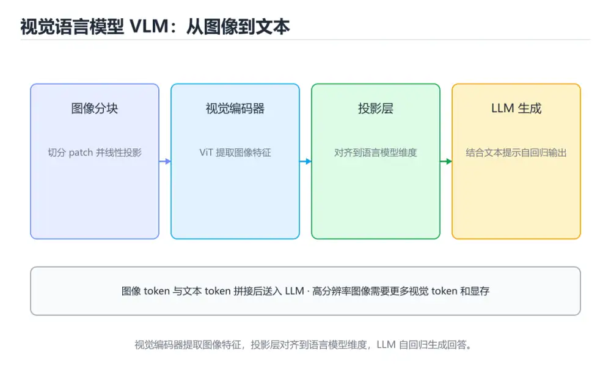
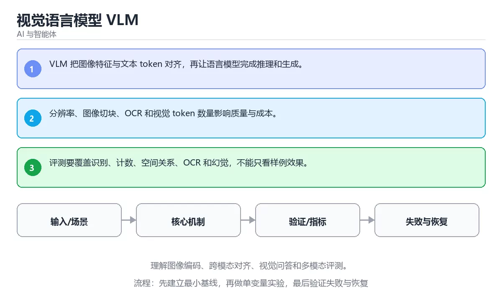

# 视觉语言模型 VLM

> 内容更新时间：2026-10-06 · 学习阶段：进阶 · 预计用时：30 分钟





## 本节知识框架

**课程定位**：所属分类 `ai`（AI 与智能体），课程主题 `视觉语言模型 VLM`，学习阶段 进阶，建议用时 40 分钟。

本课主线：理解图像编码、跨模态对齐、视觉问答和多模态评测。

**学完本课应当能够**
- 说清 `VLM` 与 `视觉编码` 的含义与区别，并各举一个正例和一个反例。
- 用本课示例验证 `跨模态` 的行为，记录输入、输出与失败条件。
- 遇到「把整张图当成完整信息源」这类问题时，能说出触发条件与修复顺序。

### 复习清单

- [ ] 能不看正文复述本课核心术语，并指出一个边界或反例。
- [ ] 能运行或推演本课示例，记录输入、输出与失败现象。
- [ ] 能完成一次自测，并把错题对照错误表定位原因。

## 核心概念定义

| 术语 | 操作性定义 | 常见边界与风险 |
| --- | --- | --- |
| VLM | VLM 把图像特征与文本 token 对齐，再让语言模型完成推理和生成。 | 易错：密集场景下数字不可靠；正确做法是精确任务交给 OCR 或结构化工具，再用视觉结果校验。 |
| 视觉编码 | 把图像或视频转换成模型可处理的向量表示，保留任务需要的视觉信息。 | 结果依赖数据分布、模型版本与算力预算，换数据集或换硬件都要重新评估。 |
| 跨模态 | 按“视觉语言模型 VLM”中 VLM、视觉编码、跨模态 的实践顺序，把四个步骤排成从准备到复盘的合理顺序。 | 换编码、换字节序或换平台都可能改变结果，处理前先固定输入编码。 |
| 多模态评测 | 同时检查文本、图像、音频等输入下的理解、生成和跨模态一致性。 | 隔离级别与并发事务会影响可见性，换级别或换存储引擎后要重新验证。 |
| 数据 | VLM 的训练或检索数据从哪来、质量如何 | 结果依赖数据分布、模型版本与算力预算，换数据集或换硬件都要重新评估。 |
| 模型 | 视觉编码 的能力边界与成本是多少 | 换编码、换字节序或换平台都可能改变结果，处理前先固定输入编码。 |
| 评测 | 如何证明改动真的有效 | 只在「如何证明改动真的有效」这一前提下成立，换输入或换环境要重新验证。 |
| 安全 | 失败时会不会泄露或越权 | 只在「失败时会不会泄露或越权」这一前提下成立，换输入或换环境要重新验证。 |
| 模型输入是否经过长度、格式与敏感信息检查？ | 日志、输入样例、测试或指标 | 只在「日志、输入样例、测试或指标」这一前提下成立，换输入或换环境要重新验证。 |
| 工具调用是否最小权限、可超时、可取消？ | 日志、输入样例、测试或指标 | 只在「日志、输入样例、测试或指标」这一前提下成立，换输入或换环境要重新验证。 |
| 输出是否有引用、置信度或人工复核兜底？ | 日志、输入样例、测试或指标 | 只在「日志、输入样例、测试或指标」这一前提下成立，换输入或换环境要重新验证。 |
| 成本、延迟与失败率是否有指标？ | 日志、输入样例、测试或指标 | 只在「日志、输入样例、测试或指标」这一前提下成立，换输入或换环境要重新验证。 |

## 原理与运行机制

### 机制总览

**教材衔接：核心知识**

### 1. VLM 把图像特征与文本 token 对齐，再让语言模型完成推理和生成。

- 关键做法：先用 answer 建立 VLM 的基线，再逐步加入边界与失败条件。
- 验证标准：视觉编码 的异常路径有明确错误信息与恢复动作。

### 2. 分辨率、图像切块、OCR 和视觉 token 数量影响质量与成本。

把这条结论放回「视觉语言模型 VLM」的完整流程里展开：

- 正文依据：能用自己的话解释：VLM 把图像特征与文本 token 对齐，再让语言模型完成推理和生成。
- 落地检查：把「2. 分辨率、图像切块、OCR 和视觉 token 数量影响质量与成本。」改写成一条可执行的核对项，逐条验证输入、超时与失败路径。

### 3. 评测要覆盖识别、计数、空间关系、OCR 和幻觉，不能只看样例效果。

把这条结论放回「视觉语言模型 VLM」的完整流程里展开：

- 正文依据：本课关键词：VLM、视觉编码、跨模态、多模态评测。
- 落地检查：把「3. 评测要覆盖识别、计数、空间关系、OCR 和幻觉，不能只看样例效果。」改写成一条可执行的核对项，逐条验证输入、超时与失败路径。

**教材衔接：关键流程**

**教材衔接：实践路径**

**教材衔接：验证步骤**

### 图像是怎么变成 token 送进语言模型的

主线里的「跨模态对齐」不神秘，拆开就是下面这条流水线，看懂它就能理解为什么分辨率会直接决定成本：

```text
原始图像(高 × 宽 × 3)
  → 视觉编码器(ViT / CLIP 那类)：把图切成 patch 网格，逐块编码成一串向量
  → 投影层：把视觉向量映射到和文字词嵌入同一个空间
  → 拼接成一条序列  [img_1 … img_n][你的提问 token …]
  → 语言模型照常自回归，输出答案 / 坐标 / 表格

投影层没对齐好，就会出现「图看对了、答的却是另一回事」，也就是答非所图。
```

## 典型应用场景

- **把整张图当成完整信息源**：典型现象是小字与细节被误读；正确做法是对关键区域裁剪放大后二次提问，并交叉核对。
- **忽略分辨率与长宽比**：典型现象是缩放后细节丢失，坐标偏移；正确做法是控制输入分辨率与分块方式，保留原始比例。
- **用 VLM 做精确计数与读表**：典型现象是密集场景下数字不可靠；正确做法是精确任务交给 OCR 或结构化工具，再用视觉结果校验。

### 最小验证场景

- 准备：保留 `text` 示例的原始输入，先记录 `视觉语言模型 VLM` 的基线输出和完整运行命令。
- 观察：先核对 调用了 `score()`，再改变一个与 `VLM` 相关的条件。
- 判定：新结果与 `视觉语言模型 VLM` 的基线不同不等于错误；只有当差异破坏了 `VLM` 的定义或错误表中的约束，才判定为失败。

### 选择与边界

- 使用 `VLM` 时，先满足它的定义：VLM 把图像特征与文本 token 对齐，再让语言模型完成推理和生成；易错：密集场景下数字不可靠；正确做法是精确任务交给 OCR 或结构化工具，再用视觉结果校验。
- 使用 `视觉编码` 时，先满足它的定义：把图像或视频转换成模型可处理的向量表示，保留任务需要的视觉信息；结果依赖数据分布、模型版本与算力预算，换数据集或换硬件都要重新评估。
- 使用 `跨模态` 时，先满足它的定义：按“视觉语言模型 VLM”中 VLM、视觉编码、跨模态 的实践顺序，把四个步骤排成从准备到复盘的合理顺序；换编码、换字节序或换平台都可能改变结果，处理前先固定输入编码。
- 使用 `多模态评测` 时，先满足它的定义：同时检查文本、图像、音频等输入下的理解、生成和跨模态一致性；隔离级别与并发事务会影响可见性，换级别或换存储引擎后要重新验证。

## 代码/协议/SQL 示例

**教材衔接：最小可运行示例**

先用 answer 跑通最小示例，然后只改一个与 VLM 相关的取值：

```python
def score(answer: str) -> int:
    return 1 if answer.strip() else 0

print(score("agent"))
```

**教材衔接：预期输出**

```text
1
```

### 完整示例：估算一张图占多少视觉 token

本课反复说「分辨率和切块影响质量与成本」，这里用一个不依赖任何库的小函数把这句话变成能算的数：先按 patch 切网格，再按 merge×merge 合并，得到的就是送进语言模型的视觉 token 数量级。

```python
def visual_tokens(width, height, patch=16, merge=2):
    """估算送进 LLM 的视觉 token 数：网格数除以 merge 的平方。"""
    cols = width // patch
    rows = height // patch
    return (cols // merge) * (rows // merge)

print(visual_tokens(448, 448))    # 常见的单图输入尺寸
print(visual_tokens(1024, 768))   # 换更大分辨率，token 涨得更凶
```

```text
196
768
```

动手练一练：把 merge 改成 1 再跑，观察 token 数正好变成四倍；这解释了为什么高清输入账单会跳涨。真做读表或密集小目标时，还会把整图切成若干 tile 分别提问，token 要再乘上块数——所以精确数字最好交给 OCR，视觉只负责定位与理解。

## 时间/空间复杂度或性能分析

**性能关注点（视觉语言模型 VLM）**：算力与显存决定可行规模：记录训练或推理耗时、显存峰值与模型精度，换数据集要重新评估。

**测量方法**：以 `视觉语言模型 VLM` 的 `VLM` 场景为对象，固定输入跑一遍记录基线，再把规模或并发度提高一个数量级复测；两次结果的差值与波动范围才是结论依据。

## 常见误区与易错点

| 容易写错的做法 | 实际现象 | 原因与正确做法 |
| --- | --- | --- |
| 把整张图当成完整信息源 | 小字与细节被误读。 | 对关键区域裁剪放大后二次提问，并交叉核对。 |
| 忽略分辨率与长宽比 | 缩放后细节丢失，坐标偏移。 | 控制输入分辨率与分块方式，保留原始比例。 |
| 用 VLM 做精确计数与读表 | 密集场景下数字不可靠。 | 精确任务交给 OCR 或结构化工具，再用视觉结果校验。 |

### 现场 1：把整张图当成完整信息源

**症状**：小字与细节被误读。

**根因与修复**：对关键区域裁剪放大后二次提问，并交叉核对。

**自检**：在本课示例里复现「把整张图当成完整信息源」，改成对关键区域裁剪放大后二次提问，并交叉核对后重跑；如果症状消失且失败路径按预期变化，说明定位正确。

### 现场 2：忽略分辨率与长宽比

**症状**：缩放后细节丢失，坐标偏移。

**根因与修复**：控制输入分辨率与分块方式，保留原始比例。

**自检**：在本课示例里复现「忽略分辨率与长宽比」，改成控制输入分辨率与分块方式，保留原始比例后重跑；如果症状消失且失败路径按预期变化，说明定位正确。

### 现场 3：用 VLM 做精确计数与读表

**症状**：密集场景下数字不可靠。

**根因与修复**：精确任务交给 OCR 或结构化工具，再用视觉结果校验。

**自检**：在本课示例里复现「用 VLM 做精确计数与读表」，改成精确任务交给 OCR 或结构化工具，再用视觉结果校验后重跑；如果症状消失且失败路径按预期变化，说明定位正确。

## 与其他知识点的关系

**教材衔接：复习与迁移**

VLM 站在纯文本 LLM 的肩膀上，多出来的只是视觉编码器和一层投影：把它接进 RAG 就成了图文混合检索，接进 Agent 就让它负责「看懂截图再决定点哪」。和 OCR 的分工要拎清楚——本课错误表里那条「精确计数与读表」正是提醒：数字、表格、小字这类要百分之百对的活交给 OCR 或结构化解析，VLM 只用来理解和定位，两边结果互相校验。评测维度也和 LLM 相通，只是额外多了空间关系和视觉幻觉这两类要专门盯的坑。

## 自测题与参考答案

> 先独立作答，再对照参考答案；答案都能在本课正文、术语表或错误表里找到依据。

### 自测 1（概念复述）

不看正文，写出 `VLM` 的操作性定义，并说明它与 `视觉编码` 的区别。

**参考答案**：VLM 把图像特征与文本 token 对齐，再让语言模型完成推理和生成。

`视觉编码` 的定位是：把图像或视频转换成模型可处理的向量表示，保留任务需要的视觉信息；两者的差别要从适用对象与失败模式上说明。

### 自测 2（排错）

本课错误表记录了「把整张图当成完整信息源」这类做法。请写出它会出现的现象、根因，以及修复顺序。

**参考答案**：现象是小字与细节被误读；正确做法是对关键区域裁剪放大后二次提问，并交叉核对。修复时先复现现象并保留证据，再改动一处假设重跑，确认现象消失。

### 自测 3（动手验证）

运行本课的 `text` 示例，改动其中一个输入后重新运行，记录输出与错误信息。

**参考答案**：正常输入下 `text` 示例应当复现正文给出的结果；改动输入后，如果结果改变或报错，先核对它是否满足 `视觉语言模型 VLM` 中`VLM` 的适用范围，再检查错误表里是否有同类现象。

### 自测 4（代码阅读）

阅读本课开头的 `text` 示例，说明它体现了`VLM` 的哪一条性质，并指出改动哪个输入会让这条性质不再成立。

**参考答案**：`VLM` 的定义是 VLM 把图像特征与文本 token 对齐，再让语言模型完成推理和生成，示例正是在实现这条定义。改动与 `VLM` 有关的一个输入后，如果结果不再符合 `视觉语言模型 VLM` 的正文描述，就说明该性质只在当前前提成立。

### 自测 5（迁移）

把 `视觉语言模型 VLM` 的方法迁移到自己的项目：围绕 `VLM` 写出一个与错误表同类的风险点，并说明触发条件和检验方式。

**参考答案**：例如「用 VLM 做精确计数与读表」，它会导致密集场景下数字不可靠；检验方式是按精确任务交给 OCR 或结构化工具，再用视觉结果校验改一处再复现，确认现象消失且没有引入新的失败分支。

### 自测 6（对比）

用一个表格对比 `VLM` 与 `视觉编码`：各写一行适用场景、一行失败表现。

**参考答案**：`VLM` 的定义是VLM 把图像特征与文本 token 对齐，再让语言模型完成推理和生成；`视觉编码` 的定义是把图像或视频转换成模型可处理的向量表示，保留任务需要的视觉信息。两者的失败表现分别对应本课错误表里与本术语相关的行。

### 自测 7（排错顺序）

面对「把整张图当成完整信息源」引发的问题，请把“复现 小字与细节被误读 → 保留证据 → 对关键区域裁剪放大后二次提问，并交叉核对 → 回归验证”四步写成可执行的检查清单。

**参考答案**：第一步按小字与细节被误读复现；第二步记录输入、版本与完整报错；第三步按对关键区域裁剪放大后二次提问，并交叉核对只改一处；第四步重跑并确认失败路径也按预期变化。

### 自测 8（边界判断）

针对 `多模态评测`，分别写出“可以使用”的条件和“结论不再成立”的条件。

**参考答案**：隔离级别与并发事务会影响可见性，换级别或换存储引擎后要重新验证。 同时要把 `多模态评测` 的定义 同时检查文本、图像、音频等输入下的理解、生成和跨模态一致性 与实际输入逐项对照。

### 自测 9（机制重建）

不看正文，按输入、转换、输出、验证四段重建 `VLM` → `视觉编码` → `跨模态` → `多模态评测` 的作用链。

**参考答案**：起点是 `VLM` 的定义 VLM 把图像特征与文本 token 对齐，再让语言模型完成推理和生成；中间每一步都保留可观察状态；终点由 `多模态评测` 检查，失败时回到错误表定位第一个偏离定义的步骤。

### 自测 10（综合排错）

在 `视觉语言模型 VLM` 中，现象是 密集场景下数字不可靠。请围绕 用 VLM 做精确计数与读表 写出最小复现、关键证据、修复动作和回归验证，并说明为什么不能只凭一次运行下结论。

**参考答案**：先复现 用 VLM 做精确计数与读表，记录输入与完整错误；再按 精确任务交给 OCR 或结构化工具，再用视觉结果校验 只改一处。回归时同时跑正常路径和边界路径，只有两次结果都可解释，才把修复视为完成。

### 自测 11（一分钟复述）

用每分钟约 200 字的速度复述 `视觉语言模型 VLM`：先给主问题，再按顺序说出 `VLM`、`视觉编码`、`跨模态`、`多模态评测`，最后给一个失败案例。

**自评标准**：主问题必须对应 理解图像编码、跨模态对齐、视觉问答和多模态评测；每个术语都要能接上一句定义或边界；失败案例必须写成可观察现象，不能用“可能有风险”代替证据。

## 延伸阅读

想更直观地理解本课概念？推荐参阅以下图解专题：

- [图解大模型推理与显存占用](visual_llm_inference.md)

## 术语速查

| 术语 | 一句话说明 |
| --- | --- |
| `VLM` | VLM 把图像特征与文本 token 对齐，再让语言模型完成推理和生成。 |
| `视觉编码` | 把图像或视频转换成模型可处理的向量表示，保留任务需要的视觉信息。 |
| `跨模态` | 按“视觉语言模型 VLM”中 VLM、视觉编码、跨模态 的实践顺序，把四个步骤排成从准备到复盘的合理顺序。 |
| `多模态评测` | 同时检查文本、图像、音频等输入下的理解、生成和跨模态一致性。 |

**术语关系**：`VLM`（VLM 把图像特征与文本 token 对齐） → `视觉编码`（把图像或视频转换成模型可处理的向量表示） → `跨模态`（按“视觉语言模型 VLM”中 VLM、视觉编码、跨模态 的实践顺序） → `多模态评测`（同时检查文本、图像、音频等输入下的理解、生成和跨模态一致性）。

## 考点精讲

`视觉语言模型 VLM` 的题库有 5 道题，下面逐题给出题干、正确项与判断依据：先自己作答，再核对正确项，最后回到正文对应小节复核。

### 考点 1：第 1 题

- **题目**：`视觉语言模型 VLM` 的示例代码用于验证 `VLM`，其背景是理解图像编码、跨模态对齐、视觉问答和多模态评测。代码的真实内容是下面哪一项？
- **正确项**：调用了 `score()`
- **判断依据**：本题正确项是「调用了 `score()`」。术语 VLM（视觉语言模型 VLM）：VLM 把图像特征与文本 token 对齐，再让语言模型完成推理和生成，本题取「调用了 `score()`」这条。易错点是把整张图当成完整信息源，会造成小字与细节被误读，改法是对关键区域裁剪放大后二次提问，并交叉核对。本题干扰项「调用了 `Notify()`」不成立：展示代码里找不到 `Notify()`。

### 考点 2：第 2 题

- **题目**：在 `视觉语言模型 VLM` 里，与 `VLM` 有关的说法中，哪一项最符合理解图像编码、跨模态对齐、视觉问答和多模态评测。？
- **正确项**：分辨率、图像切块、OCR 和视觉 token 数量影响质量与成本。
- **判断依据**：本题正确项是「分辨率、图像切块、OCR 和视觉 token 数量影响质量与成本」。术语 VLM（视觉语言模型 VLM）：VLM 把图像特征与文本 token 对齐，再让语言模型完成推理和生成，本题取「分辨率、图像切块、OCR 和视觉 token 数量影响质量与成本」这条。易错点是忽略分辨率与长宽比，会造成缩放后细节丢失，坐标偏移，改法是控制输入分辨率与分块方式，保留原始比例。

### 考点 3：第 3 题

- **题目**：在 `视觉语言模型 VLM` 里，与 `VLM` 有关的说法中，哪一项最符合理解图像编码、跨模态对齐、视觉问答和多模态评测。？（视觉语言模型 VLM·AI 与智能体 第 3 题）
- **正确项**：评测要覆盖识别、计数、空间关系、OCR 和幻觉，不能只看样例效果。
- **判断依据**：本题正确项是「评测要覆盖识别、计数、空间关系、OCR 和幻觉，不能只看样例效果」。术语 VLM（视觉语言模型 VLM）：VLM 把图像特征与文本 token 对齐，再让语言模型完成推理和生成，本题取「评测要覆盖识别、计数、空间关系、OCR 和幻觉，不能只看样例效果」这条。易错点是用 VLM 做精确计数与读表，会造成密集场景下数字不可靠，改法是精确任务交给 OCR 或结构化工具，再用视觉结果校验。

### 考点 4：第 4 题

- **题目**：按“视觉语言模型 VLM”中 VLM、视觉编码、跨模态 的实践顺序，把四个步骤排成从准备到复盘的合理顺序。
- **正确项**：先明确 VLM 的输入、输出与约束 → 写出最小示例并核对 视觉编码 的基线结果 → 只改一个变量，记录边界与失败路径的变化 → 固定版本与证据，把“视觉语言模型 VLM”的结论写成可复现记录
- **判断依据**：按《视觉语言模型 VLM》正文的先后，本题顺序是「先明确 VLM 的输入、输出与约束」 → 「写出最小示例并核对 视觉编码 的基线结果」 → 「只改一个变量，记录边界与失败路径的变化」 → 「固定版本与证据，把“视觉语言模型 VLM”的结论写成可复现记录」。术语 VLM（视觉语言模型 VLM）：VLM 把图像特征与文本 token 对齐，再让语言模型完成推理和生成。易错点是把整张图当成完整信息源会造成小字与细节被误读，改法是对关键区域裁剪放大后二次提问，并交叉核对。

### 考点 5：第 5 题

- **题目**：课程 `理解图像编码、跨模态对齐、视觉问答和多模态评测。`。在 `视觉语言模型 VLM` 里，`VLM`、`视觉编码` 与下面哪些选项属于同一层概念？（多选）
- **正确项**：VLM；视觉编码
- **判断依据**：按《视觉语言模型 VLM》的正文口径，本题要同时选中「VLM」、「视觉编码」，漏掉任一项都算没答全。术语 VLM（视觉语言模型 VLM）：VLM 把图像特征与文本 token 对齐，再让语言模型完成推理和生成。易错点是把整张图当成完整信息源会造成小字与细节被误读，改法是对关键区域裁剪放大后二次提问，并交叉核对。

### 考点 6：`VLM`

- **要点**：VLM 把图像特征与文本 token 对齐，再让语言模型完成推理和生成。
- **VLM 的边界**：易错：密集场景下数字不可靠；正确做法是精确任务交给 OCR 或结构化工具，再用视觉结果校验。

### 考点 7：`视觉编码`

- **要点**：把图像或视频转换成模型可处理的向量表示，保留任务需要的视觉信息。
- **视觉编码 的边界**：结果依赖数据分布、模型版本与算力预算，换数据集或换硬件都要重新评估。

### 考点 8：`跨模态`

- **要点**：按“视觉语言模型 VLM”中 VLM、视觉编码、跨模态 的实践顺序，把四个步骤排成从准备到复盘的合理顺序。
- **跨模态 的边界**：换编码、换字节序或换平台都可能改变结果，处理前先固定输入编码。

### 考点 9：`多模态评测`

- **要点**：同时检查文本、图像、音频等输入下的理解、生成和跨模态一致性。
- **多模态评测 的边界**：隔离级别与并发事务会影响可见性，换级别或换存储引擎后要重新验证。

### 考点 10：排错——把整张图当成完整信息源

- **现象**：小字与细节被误读。
- **处理**：对关键区域裁剪放大后二次提问，并交叉核对。

### 考点 11：排错——忽略分辨率与长宽比

- **现象**：缩放后细节丢失，坐标偏移。
- **处理**：控制输入分辨率与分块方式，保留原始比例。

### 考点 12：综合辨析——`VLM` 与 `多模态评测`

- **辨析点**：`VLM` 的定义是 VLM 把图像特征与文本 token 对齐，再让语言模型完成推理和生成；`多模态评测` 的定义是 同时检查文本、图像、音频等输入下的理解、生成和跨模态一致性。
- **答题要求**：面对 `视觉语言模型 VLM` 的题目，先判断描述的是 `VLM` 还是 `多模态评测`，再归到对应定义，最后写出一个会让该定义失效的边界输入。

### 考点 13：排错评分点

- **现象分**：能写出 小字与细节被误读，而不是只写“程序有错”。
- **证据分**：保留触发 把整张图当成完整信息源 的输入、版本和错误原文。
- **修复分**：按 对关键区域裁剪放大后二次提问，并交叉核对 只改一处，并同时回归正常路径与边界路径。

## 内容元数据

- 内容版本：v2.0
- 最后更新：2026-10-06
- 学习阶段：进阶
- 适用环境：主流大模型 API、开源模型与向量数据库；本课聚焦 VLM。
- 内容来源：内置结构化课程与工程实践整理
- 相关主题：VLM、视觉编码、跨模态、多模态评测
- 质量版本：P0 测验标准 + P1 覆盖扩展 + P2 体验补全

## 参考资料与复核

- 最后复核：2026-10-04
- 下次复核：2027-04-17
- 复核范围：版本兼容、API 行为、安全建议与工程实践
- 来源性质：官方文档、标准或权威教材；本课核对关键词：VLM、视觉编码、跨模态、多模态评测。

| 参考资料 | 本课用途 |
| --- | --- |
| [Google AI 文档](https://ai.google.dev/gemini-api/docs) | Gemini API 与多模态 |
| [Model Context Protocol](https://modelcontextprotocol.io/) | Agent 工具与上下文协议 |
| [OpenAI 开发者文档](https://platform.openai.com/docs/) | 模型 API、工具与评估 |

| [本课术语索引：视觉语言模型 VLM](#核心概念定义) | 按本课输入、术语边界和错误表现逐项核对 |
> 「视觉语言模型 VLM」的链接用于离线阅读后的延伸核对；App 不会自动联网。