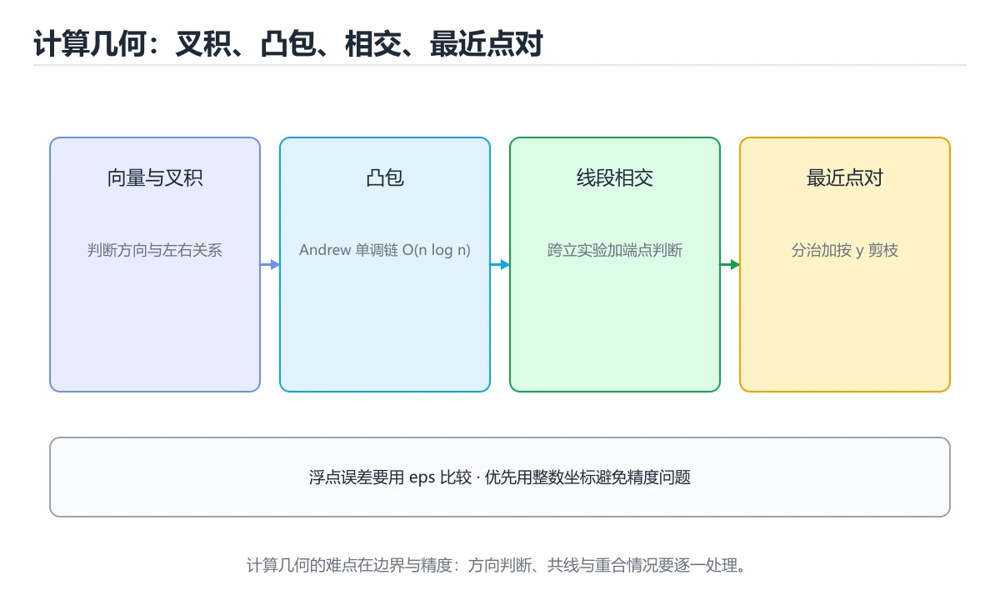
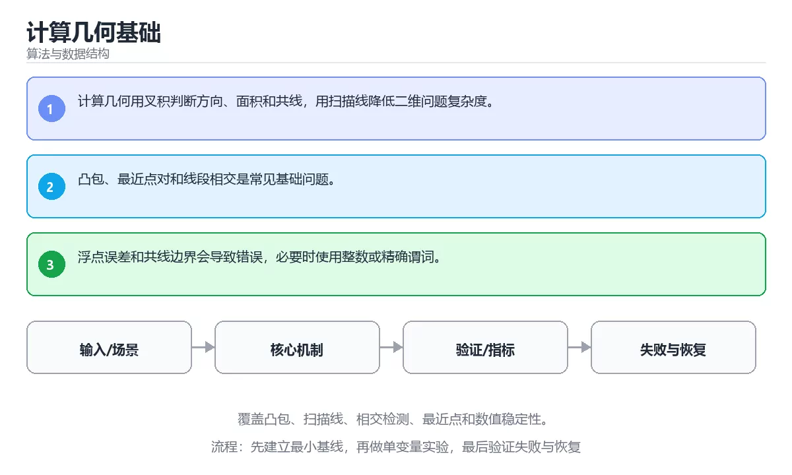

# 计算几何基础

> 内容更新时间：2026-10-06 · 学习阶段：高级 · 预计用时：30 分钟





## 本节知识框架

**课程定位**：所属分类 `algorithms`（算法与数据结构），课程主题 `计算几何基础`，学习阶段 高级，建议用时 40 分钟。

本课主线：覆盖凸包、扫描线、相交检测、最近点和数值稳定性。

**学完本课应当能够**
- 说清 `凸包` 与 `扫描线` 的含义与区别，并各举一个正例和一个反例。
- 用本课示例验证 `几何` 的行为，记录输入、输出与失败条件。
- 遇到「用浮点直接判断共线与相交」这类问题时，能说出触发条件与修复顺序。

### 复习清单

- [ ] 能不看正文复述本课核心术语，并指出一个边界或反例。
- [ ] 能运行或推演本课示例，记录输入、输出与失败现象。
- [ ] 能完成一次自测，并把错题对照错误表定位原因。

## 核心概念定义

| 术语 | 操作性定义 | 常见边界与风险 |
| --- | --- | --- |
| 凸包 | 凸包是很多几何任务的前置步骤：最远点对、最小外接矩形、碰撞检测。 | 求凸包要先按坐标排序、用叉积决定弹栈；三点共线与重合点这类退化输入不单独处理，就会漏掉或错算边界点。 |
| 扫描线 | 沿一个坐标轴按事件顺序推进，只维护当前截面状态来求解几何或区间问题。 | 易错：结果依赖输入顺序，无法复现；正确做法是按坐标排序事件，并定义同坐标事件的先后规则。 |
| 几何 | 按”计算几何基础”中 凸包、扫描线、几何 的实践顺序，把四个步骤排成从准备到复盘的合理顺序。 | 浮点误差会让叉积符号翻转，导致共线与相交判断结果不稳定，应优先使用整数坐标和整数叉积避免精度问题。 |
| 数值稳定 | 算法在浮点误差、极端输入或多次迭代下仍保持合理结果，避免误差被放大。 | 判方向要落到整数叉积上：用浮点比大小可能让符号翻转，容差阈值和退化分支不写清，结果就会随输入抖动。 |
| 旋转卡壳 | 旋转卡壳利用凸包的单调性，把最远点对从 O(n²) 降到 O(n) | 这里的 O(n) 说的是凸包顶点数，不是原始点集规模；得先用单调链 O(n log n) 求出凸包，才能在其上卡壳。 |

## 原理与运行机制

### 机制总览

**教材衔接：核心知识**

### 1. 计算几何用叉积判断方向、面积和共线，用扫描线降低二维问题复杂度。

- 关键做法：先用 linear_search 建立 凸包 的基线，再逐步加入边界与失败条件。
- 验证标准：凸包 的结果可复现、错误可解释、失败能恢复。

### 2. 凸包、最近点对和线段相交是常见基础问题。

把这条结论放回「计算几何基础」的完整流程里展开：

- 正文依据：能用自己的话解释：计算几何用叉积判断方向、面积和共线，用扫描线降低二维问题复杂度。
- 落地检查：把「2. 凸包、最近点对和线段相交是常见基础问题。」改写成一条可执行的核对项，逐条验证输入、超时与失败路径。

### 3. 浮点误差和共线边界会导致错误，必要时使用整数或精确谓词。

把这条结论放回「计算几何基础」的完整流程里展开：

- 正文依据：能用自己的话解释：凸包、最近点对和线段相交是常见基础问题。
- 落地检查：把「3. 浮点误差和共线边界会导致错误，必要时使用整数或精确谓词。」改写成一条可执行的核对项，逐条验证输入、超时与失败路径。

**教材衔接：关键流程**

**教材衔接：实践路径**

**教材衔接：深入理解：计算几何基础**

### 从叉积开始的符号判断

计算几何的第一步通常不是公式，而是把「方向」变成符号。二维向量 a、b 的叉积
a×b = ax·by − ay·bx：结果为正表示 b 在 a 的逆时针方向，为负表示顺时针，为零表示共线。
用它可以判断线段相交、点是否在凸多边形内，也能构造凸包。写代码时应尽量用整数坐标和
整数叉积，避免浮点误差让符号翻转。

### 凸包与旋转卡壳

Andrew 单调链算法先按 x、y 排序，再分别扫描上下凸壳，每一步用叉积判断「是否要弹栈」，
时间复杂度 O(n log n)。凸包是很多几何任务的前置步骤：最远点对、最小外接矩形、碰撞检测
都可以在凸包上继续做。旋转卡壳利用凸包的单调性，把最远点对从 O(n²) 降到 O(n)。

### 精度与退化情况

计算几何的难点大多不在算法，而在退化：三点共线、线段端点重合、两条线段部分重叠、
多边形自交。处理办法是统一使用整数运算、把「小于」写成带容差的比较，并为共线、重合
单独写分支与测试用例。先写随机对拍和边界用例，再谈优化。

「计算几何基础」的「凸包与旋转卡壳」一节补全如下：

- 定位：这一节说明凸包与旋转卡壳在「计算几何基础」知识体系里的位置。
- 要点：用它可以判断线段相交、点是否在凸多边形内，也能构造凸包。写代码时应尽量用整数坐标和
- 自检：能否用一个最小例子解释凸包与旋转卡壳？

<!-- p0-depth-v2:start -->

**教材衔接：零基础精讲：把计算几何基础真正讲透**

### 先建立一个直觉

把算法看成一张可复核的路线图：输入规模决定走哪条路，每一步都要说明为什么不会漏解、为什么最终会停下来，以及代价如何增长。落到本课，「计算几何基础」关心的是 凸包 与 扫描线 的配合，也就是说这条直觉要在 核心知识 里被具体验证。

本课的摘要可以当作一张地图：覆盖凸包、扫描线、相交检测、最近点和数值稳定性。

### 逐步拆解

1. 澄清输入与目标。先写清「计算几何基础」要解决的问题、合法输入范围和成功标准，再进入后续步骤。
2. 描述处理过程。把「凸包、扫描线、几何、数值稳定」映射到具体步骤，每步都要求能单独验证。
3. 定义输出。明确 凸包 与 扫描线 各自的产物，以及失败时留下什么证据。
4. 让「计算几何基础」的失败路径尽早暴露：把凸包推到边界值，记录错误信息、重试或降级动作，以及人工兜底条件。
5. 用同一个凸包输入跑两遍：一遍按正文步骤，一遍故意跳过一步，比较输出并解释为什么必须按顺序执行。

### 把正文串成一条执行链

- **精度与退化情况**：计算几何的难点大多不在算法，而在退化：三点共线、线段端点重合、两条线段部分重叠、

### 从测验反推易错点

- 参考判断：计算几何用叉积判断方向、面积和共线，用扫描线降低二维问题复杂度。
- 自问：如果去掉题干里的一个限定词，结论还成立吗？

- 参考判断：凸包、最近点对和线段相交是常见基础问题。

- 参考判断：浮点误差和共线边界会导致错误，必要时使用整数或精确谓词。

**检查点 4：本课的核心学习目标是什么？**

- 参考判断：覆盖凸包、扫描线、相交检测、最近点和数值稳定性。

**检查点 5：以下哪些术语与计算几何基础直接相关？（多选）**

- 参考判断：凸包、扫描线

### 工程排错顺序

| 先查什么 | 要得到的证据 | 判断标准 |
| --- | --- | --- |
| 问题规模与最坏情况是什么？ | 日志、输入样例、测试或指标 | 能复现并解释，才算定位 |
| 循环是否一定收缩并到达终止条件？ | 日志、输入样例、测试或指标 | 能复现并解释，才算定位 |
| 边界、重复元素和空输入是否覆盖？ | 日志、输入样例、测试或指标 | 能复现并解释，才算定位 |
| 时间与空间复杂度是否经过实测？ | 日志、输入样例、测试或指标 | 能复现并解释，才算定位 |

### 变式训练

1. 把 凸包 放进一个只有单机、没有额外依赖的小项目，先保证正确再扩展。
2. 把 linear_search 的数据量提高一个数量级，观察延迟与内存的变化拐点。
3. 把 扫描线 换成失败输入，记录错误信息与恢复动作。
5. 把 linear_search 的执行顺序调换一次，记录哪个中间结果先错；顺序敏感的地方就是本课的关键约束。
6. 在低带宽或低算力条件下重跑 扫描线，记录降级路径是否仍然可用。

### 迁移案例库

换一个 扫描线 约束重做一次，确认结论在新条件下是否仍然成立。

#### 迁移案例 1：围绕「凸包」做一次小实验

**目标**：在不改变课程主体的前提下，验证计算几何基础中的一个关键判断。

**验收**：至少给出一个反例，说明凸包在什么情况下会失效；只写成功案例不算通过。

#### 迁移案例 2：围绕「扫描线」做一次小实验

**步骤**：
1. 复述当前方案对「扫描线」的假设，写成一句可证伪的话。

#### 迁移案例 3：围绕「几何」做一次小实验

**步骤**：
1. 复述当前方案对「几何」的假设，写成一句可证伪的话。

#### 迁移案例 4：围绕「数值稳定」做一次小实验

**步骤**：
1. 复述当前方案对「数值稳定」的假设，写成一句可证伪的话。

#### 迁移案例 5：围绕「凸包」做一次小实验

**步骤**：

#### 迁移案例 6：围绕「扫描线」做一次小实验

**步骤**：

#### 迁移案例 7：围绕「几何」做一次小实验

**步骤**：

#### 迁移案例 8：围绕「数值稳定」做一次小实验

**步骤**：

#### 迁移案例 9：围绕「凸包」做一次小实验

**步骤**：

#### 迁移案例 10：围绕「扫描线」做一次小实验

**步骤**：

#### 迁移案例 11：围绕「几何」做一次小实验

**步骤**：

#### 迁移案例 12：围绕「数值稳定」做一次小实验

**步骤**：

#### 迁移案例 13：围绕「凸包」做一次小实验

**步骤**：

#### 迁移案例 14：围绕「扫描线」做一次小实验

**步骤**：

#### 迁移案例 15：围绕「几何」做一次小实验

**步骤**：

#### 迁移案例 16：围绕「数值稳定」做一次小实验

**步骤**：

<!-- p0-depth-v2:end -->

**教材衔接：验证步骤**

## 典型应用场景

**教材衔接：深度拓展与实战**

这一节把 凸包 的定义、linear_search 的代码与常见失败串成一条复习路线。

### 边界条件与常见反例

「计算几何基础」的边界不只包括最大最小值，还要覆盖空、重复和失败：

### 工程检查表

- [ ] 能否用自己的话说明计算几何基础解决什么问题，以及它不负责什么？
- [ ] 能否说明 凸包 的正常输出，以及失败时留下的错误信息？
- [ ] 能否解释本课关键词在真实项目中的边界与取舍？
- [ ] 换一个输入后，linear_search 的判断依据是否仍然成立？

### 最小验证场景

- 准备：保留 `text` 示例的原始输入，先记录 `计算几何基础` 的基线输出和完整运行命令。
- 观察：先核对 调用了 `linear_search()`，再改变一个与 `凸包` 相关的条件。
- 判定：新结果与 `计算几何基础` 的基线不同不等于错误；只有当差异破坏了 `凸包` 的定义或错误表中的约束，才判定为失败。

### 选择与边界

- 使用 `凸包` 时，先满足它的定义：凸包是很多几何任务的前置步骤：最远点对、最小外接矩形、碰撞检测。
- 使用 `扫描线` 时，先满足它的定义：沿一个坐标轴按事件顺序推进，只维护当前截面状态来求解几何或区间问题；易错：结果依赖输入顺序，无法复现；正确做法是按坐标排序事件，并定义同坐标事件的先后规则。
- 使用 `几何` 时，先满足它的定义：按“计算几何基础”中 凸包、扫描线、几何 的实践顺序，把四个步骤排成从准备到复盘的合理顺序；索引命中与数据分布决定实际开销，判断前先看执行计划而不是只看结果是否正确。
- 使用 `数值稳定` 时，先满足它的定义：算法在浮点误差、极端输入或多次迭代下仍保持合理结果，避免误差被放大。
- 使用 `旋转卡壳` 时，先满足它的定义：旋转卡壳利用凸包的单调性，把最远点对从 O(n²) 降到 O(n)。

## 代码/协议/SQL 示例

### 最小可验证示例

**教材衔接：最小可运行示例**

下面示例用于验证 凸包 的最小输入、处理和输出。先原样运行，再只修改一个值：

```python
def linear_search(items, target):
    for index, item in enumerate(items):
        if item == target:
            return index
    return -1

print(linear_search([3, 5, 8], 8))
```

**教材衔接：预期输出**

```text
2
```

## 时间/空间复杂度或性能分析

**复杂度证据**：本课正文出现 `O(n log n)`、`O(n²)`、`O(n)` 等量级表达式；使用前要同时确认输入规模、最好/平均/最坏情况以及常数项来源。

**测量方法**：以 `计算几何基础` 的 `凸包` 场景为对象，固定输入跑一遍记录基线，再把规模或并发度提高一个数量级复测；两次结果的差值与波动范围才是结论依据。

## 常见误区与易错点

| 容易写错的做法 | 实际现象 | 原因与正确做法 |
| --- | --- | --- |
| 用浮点直接判断共线与相交 | 精度误差让结果翻转。 | 用整数叉积判断方向，需要容差时写清阈值与退化处理。 |
| 忽略退化输入 | 重合点、共线或零长度向量导致死循环。 | 先单独处理退化情况，再进入主流程。 |
| 扫描线不排序事件 | 结果依赖输入顺序，无法复现。 | 按坐标排序事件，并定义同坐标事件的先后规则。 |

### 现场 1：用浮点直接判断共线与相交

**症状**：精度误差让结果翻转。

**根因与修复**：用整数叉积判断方向，需要容差时写清阈值与退化处理。

**自检**：在本课示例里复现「用浮点直接判断共线与相交」，改成用整数叉积判断方向，需要容差时写清阈值与退化处理后重跑；如果症状消失且失败路径按预期变化，说明定位正确。

### 现场 2：忽略退化输入

**症状**：重合点、共线或零长度向量导致死循环。

**根因与修复**：先单独处理退化情况，再进入主流程。

**自检**：在本课示例里复现「忽略退化输入」，改成先单独处理退化情况，再进入主流程后重跑；如果症状消失且失败路径按预期变化，说明定位正确。

### 现场 3：扫描线不排序事件

**症状**：结果依赖输入顺序，无法复现。

**根因与修复**：按坐标排序事件，并定义同坐标事件的先后规则。

**自检**：在本课示例里复现「扫描线不排序事件」，改成按坐标排序事件，并定义同坐标事件的先后规则后重跑；如果症状消失且失败路径按预期变化，说明定位正确。

## 与其他知识点的关系

**教材衔接：复习与迁移**

## 自测题与参考答案

> 先独立作答，再对照参考答案；答案都能在本课正文、术语表或错误表里找到依据。

### 自测 1（概念复述）

不看正文，写出 `凸包` 的操作性定义，并说明它与 `扫描线` 的区别。

**参考答案**：凸包是很多几何任务的前置步骤：最远点对、最小外接矩形、碰撞检测。

`扫描线` 的定位是：沿一个坐标轴按事件顺序推进，只维护当前截面状态来求解几何或区间问题；两者的差别要从适用对象与失败模式上说明。

### 自测 2（排错）

本课错误表记录了「用浮点直接判断共线与相交」这类做法。请写出它会出现的现象、根因，以及修复顺序。

**参考答案**：现象是精度误差让结果翻转；正确做法是用整数叉积判断方向，需要容差时写清阈值与退化处理。修复时先复现现象并保留证据，再改动一处假设重跑，确认现象消失。

### 自测 3（动手验证）

运行本课的 `text` 示例，改动其中一个输入后重新运行，记录输出与错误信息。

**参考答案**：正常输入下 `text` 示例应当复现正文给出的结果；改动输入后，如果结果改变或报错，先核对它是否满足 `计算几何基础` 中`凸包` 的适用范围，再检查错误表里是否有同类现象。

### 自测 4（代码阅读）

阅读本课开头的 `text` 示例，说明它体现了`凸包` 的哪一条性质，并指出改动哪个输入会让这条性质不再成立。

**参考答案**：`凸包` 的定义是 凸包是很多几何任务的前置步骤：最远点对、最小外接矩形、碰撞检测，示例正是在实现这条定义。改动与 `凸包` 有关的一个输入后，如果结果不再符合 `计算几何基础` 的正文描述，就说明该性质只在当前前提成立。

### 自测 5（迁移）

把 `计算几何基础` 的方法迁移到自己的项目：围绕 `凸包` 写出一个与错误表同类的风险点，并说明触发条件和检验方式。

**参考答案**：例如「扫描线不排序事件」，它会导致结果依赖输入顺序，无法复现；检验方式是按坐标排序事件，并定义同坐标事件的先后规则改一处再复现，确认现象消失且没有引入新的失败分支。

### 自测 6（对比）

用一个表格对比 `凸包` 与 `扫描线`：各写一行适用场景、一行失败表现。

**参考答案**：`凸包` 的定义是凸包是很多几何任务的前置步骤：最远点对、最小外接矩形、碰撞检测；`扫描线` 的定义是沿一个坐标轴按事件顺序推进，只维护当前截面状态来求解几何或区间问题。两者的失败表现分别对应本课错误表里与本术语相关的行。

### 自测 7（排错顺序）

面对「用浮点直接判断共线与相交」引发的问题，请把“复现 精度误差让结果翻转 → 保留证据 → 用整数叉积判断方向，需要容差时写清阈值与退化处理 → 回归验证”四步写成可执行的检查清单。

**参考答案**：第一步按精度误差让结果翻转复现；第二步记录输入、版本与完整报错；第三步按用整数叉积判断方向，需要容差时写清阈值与退化处理只改一处；第四步重跑并确认失败路径也按预期变化。

### 自测 8（边界判断）

针对 `旋转卡壳`，分别写出“可以使用”的条件和“结论不再成立”的条件。

**参考答案**：要把 `旋转卡壳` 的定义 旋转卡壳利用凸包的单调性，把最远点对从 O(n²) 降到 O(n) 与实际输入逐项对照。

### 自测 9（机制重建）

不看正文，按输入、转换、输出、验证四段重建 `凸包` → `扫描线` → `几何` → `数值稳定` 的作用链。

**参考答案**：起点是 `凸包` 的定义 凸包是很多几何任务的前置步骤：最远点对、最小外接矩形、碰撞检测；中间每一步都保留可观察状态；终点由 `旋转卡壳` 检查，失败时回到错误表定位第一个偏离定义的步骤。

### 自测 10（综合排错）

在 `计算几何基础` 中，现象是 结果依赖输入顺序，无法复现。请围绕 扫描线不排序事件 写出最小复现、关键证据、修复动作和回归验证，并说明为什么不能只凭一次运行下结论。

**参考答案**：先复现 扫描线不排序事件，记录输入与完整错误；再按 按坐标排序事件，并定义同坐标事件的先后规则 只改一处。回归时同时跑正常路径和边界路径，只有两次结果都可解释，才把修复视为完成。

### 自测 11（一分钟复述）

用每分钟约 200 字的速度复述 `计算几何基础`：先给主问题，再按顺序说出 `凸包`、`扫描线`、`几何`、`数值稳定`，最后给一个失败案例。

**自评标准**：主问题必须对应 覆盖凸包、扫描线、相交检测、最近点和数值稳定性；每个术语都要能接上一句定义或边界；失败案例必须写成可观察现象，不能用“可能有风险”代替证据。

## 术语速查

| 术语 | 一句话说明 |
| --- | --- |
| `凸包` | 凸包是很多几何任务的前置步骤：最远点对、最小外接矩形、碰撞检测。 |
| `扫描线` | 沿一个坐标轴按事件顺序推进，只维护当前截面状态来求解几何或区间问题。 |
| `几何` | 按“计算几何基础”中 凸包、扫描线、几何 的实践顺序，把四个步骤排成从准备到复盘的合理顺序。 |
| `数值稳定` | 算法在浮点误差、极端输入或多次迭代下仍保持合理结果，避免误差被放大。 |
| `旋转卡壳` | 旋转卡壳利用凸包的单调性，把最远点对从 O(n²) 降到 O(n)。 |

**术语关系**：`凸包`（凸包是很多几何任务的前置步骤：最远点对、最小外接矩形、碰撞检测） → `扫描线`（沿一个坐标轴按事件顺序推进） → `几何`（按“计算几何基础”中 凸包、扫描线、几何 的实践顺序） → `数值稳定`（算法在浮点误差、极端输入或多次迭代下仍保持合理结果）。

## 考点精讲

`计算几何基础` 的题库有 5 道题，下面逐题给出题干、正确项与判断依据：先自己作答，再核对正确项，最后回到正文对应小节复核。

### 考点 1：第 1 题

- **题目**：在 `计算几何基础` 里，与 `凸包` 有关的说法中，哪一项最符合覆盖凸包、扫描线、相交检测、最近点和数值稳定性？
- **正确项**：计算几何用叉积判断方向、面积和共线，用扫描线降低二维问题复杂度。
- **判断依据**：本题正确项是「计算几何用叉积判断方向、面积和共线，用扫描线降低二维问题复杂度」。术语 凸包（计算几何基础）：凸包是很多几何任务的前置步骤：最远点对、最小外接矩形、碰撞检测，本题取「计算几何用叉积判断方向、面积和共线，用扫描线降低二维问题复杂度」这条。易错点是用浮点直接判断共线与相交，会造成精度误差让结果翻转，改法是用整数叉积判断方向，需要容差时写清阈值与退化处理。

### 考点 2：第 2 题

- **题目**：阅读 `计算几何基础` 的 `凸包` 示例。它服务于覆盖凸包、扫描线、相交检测、最近点和数值稳定性。代码中实际包含下列哪一项？
- **正确项**：调用了 `linear_search()`
- **判断依据**：本题正确项是「调用了 `linear_search()`」。术语 凸包（计算几何基础）：凸包是很多几何任务的前置步骤：最远点对、最小外接矩形、碰撞检测，本题取「调用了 `linear_search()`」这条。易错点是忽略退化输入，会造成重合点、共线或零长度向量导致死循环，改法是先单独处理退化情况，再进入主流程。本题干扰项「调用了 `sum()`」不成立：展示代码里找不到 `sum()`。

### 考点 3：第 3 题

- **题目**：按“计算几何基础”中 凸包、扫描线、几何 的实践顺序，把四个步骤排成从准备到复盘的合理顺序。
- **正确项**：先明确 凸包 的输入、输出与约束 → 写出最小示例并核对 扫描线 的基线结果 → 只改一个变量，记录边界与失败路径的变化 → 固定版本与证据，把“计算几何基础”的结论写成可复现记录
- **判断依据**：按《计算几何基础》正文的先后，本题顺序是「先明确 凸包 的输入、输出与约束」 → 「写出最小示例并核对 扫描线 的基线结果」 → 「只改一个变量，记录边界与失败路径的变化」 → 「固定版本与证据，把“计算几何基础”的结论写成可复现记录」。术语 凸包（计算几何基础）：凸包是很多几何任务的前置步骤：最远点对、最小外接矩形、碰撞检测。易错点是用浮点直接判断共线与相交会造成精度误差让结果翻转，改法是用整数叉积判断方向，需要容差时写清阈值与退化处理。

### 考点 4：第 4 题

- **题目**：`计算几何基础` 的主线是：覆盖凸包、扫描线、相交检测、最近点和数值稳定性。下面哪一项与这条主线一致？
- **正确项**：覆盖凸包、扫描线、相交检测、最近点和数值稳定性。
- **判断依据**：本题正确项是「覆盖凸包、扫描线、相交检测、最近点和数值稳定性」。术语 凸包（计算几何基础）：凸包是很多几何任务的前置步骤：最远点对、最小外接矩形、碰撞检测，本题取「覆盖凸包、扫描线、相交检测、最近点和数值稳定性」这条。易错点是用浮点直接判断共线与相交，会造成精度误差让结果翻转，改法是用整数叉积判断方向，需要容差时写清阈值与退化处理。

### 考点 5：第 5 题

- **题目**：课程 `覆盖凸包、扫描线、相交检测、最近点和数值稳定性。`。在 `计算几何基础` 里，`凸包`、`扫描线` 与下面哪些选项属于同一层概念？（多选）
- **正确项**：凸包；扫描线
- **判断依据**：按《计算几何基础》的正文口径，本题要同时选中「凸包」、「扫描线」，漏掉任一项都算没答全。术语 凸包（计算几何基础）：凸包是很多几何任务的前置步骤：最远点对、最小外接矩形、碰撞检测。易错点是用浮点直接判断共线与相交会造成精度误差让结果翻转，改法是用整数叉积判断方向，需要容差时写清阈值与退化处理。本课《计算几何基础》要解决的是覆盖凸包、扫描线、相交检测、最近点和数值稳定性。

### 考点 6：`凸包`

- **要点**：凸包是很多几何任务的前置步骤：最远点对、最小外接矩形、碰撞检测。

### 考点 7：`扫描线`

- **要点**：沿一个坐标轴按事件顺序推进，只维护当前截面状态来求解几何或区间问题。
- **扫描线 的边界**：易错：结果依赖输入顺序，无法复现；正确做法是按坐标排序事件，并定义同坐标事件的先后规则。

### 考点 8：`几何`

- **要点**：按“计算几何基础”中 凸包、扫描线、几何 的实践顺序，把四个步骤排成从准备到复盘的合理顺序。
- **几何 的边界**：索引命中与数据分布决定实际开销，判断前先看执行计划而不是只看结果是否正确。

### 考点 9：`数值稳定`

- **要点**：算法在浮点误差、极端输入或多次迭代下仍保持合理结果，避免误差被放大。

### 考点 10：`旋转卡壳`

- **要点**：旋转卡壳利用凸包的单调性，把最远点对从 O(n²) 降到 O(n)

### 考点 11：排错——用浮点直接判断共线与相交

- **现象**：精度误差让结果翻转。
- **处理**：用整数叉积判断方向，需要容差时写清阈值与退化处理。

### 考点 12：排错——忽略退化输入

- **现象**：重合点、共线或零长度向量导致死循环。
- **处理**：先单独处理退化情况，再进入主流程。

### 考点 13：综合辨析——`凸包` 与 `旋转卡壳`

- **辨析点**：`凸包` 的定义是 凸包是很多几何任务的前置步骤：最远点对、最小外接矩形、碰撞检测；`旋转卡壳` 的定义是 旋转卡壳利用凸包的单调性，把最远点对从 O(n²) 降到 O(n)。
- **答题要求**：面对 `计算几何基础` 的题目，先判断描述的是 `凸包` 还是 `旋转卡壳`，再归到对应定义，最后写出一个会让该定义失效的边界输入。

### 考点 14：排错评分点

- **现象分**：能写出 精度误差让结果翻转，而不是只写“程序有错”。
- **证据分**：保留触发 用浮点直接判断共线与相交 的输入、版本和错误原文。
- **修复分**：按 用整数叉积判断方向，需要容差时写清阈值与退化处理 只改一处，并同时回归正常路径与边界路径。

## 内容元数据

- 内容版本：v2.0
- 最后更新：2026-10-06
- 学习阶段：高级
- 适用环境：任意主流语言（伪代码与复杂度为主）；本课聚焦 凸包。
- 内容来源：内置结构化课程与工程实践整理
- 相关主题：凸包、扫描线、几何、数值稳定
- 质量版本：P0 测验标准 + P1 覆盖扩展 + P2 体验补全

## 参考资料与复核

- 最后复核：2026-10-04
- 下次复核：2027-05-24
- 复核范围：版本兼容、API 行为、安全建议与工程实践
- 来源性质：官方文档、标准或权威教材；本课核对关键词：凸包、扫描线、几何、数值稳定。

| 参考资料 | 本课用途 |
| --- | --- |
| [LeetCode 学习](https://leetcode.com/explore/) | 算法题训练与模式 |
| [MIT 6.006](https://ocw.mit.edu/courses/6-006-introduction-to-algorithms-spring-2020/) | 算法设计与分析 |
| [Princeton Algorithms](https://algs4.cs.princeton.edu/home/) | 经典算法与数据结构教材 |

| [本课术语索引：计算几何基础](#核心概念定义) | 按本课输入、术语边界和错误表现逐项核对 |
> 「计算几何基础」的链接用于离线阅读后的延伸核对；App 不会自动联网。