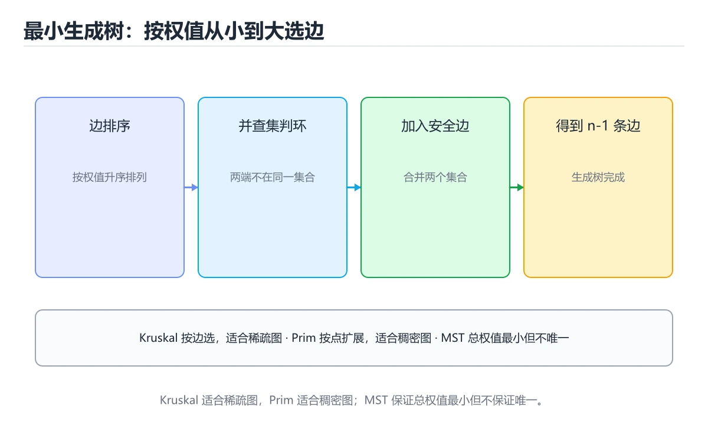
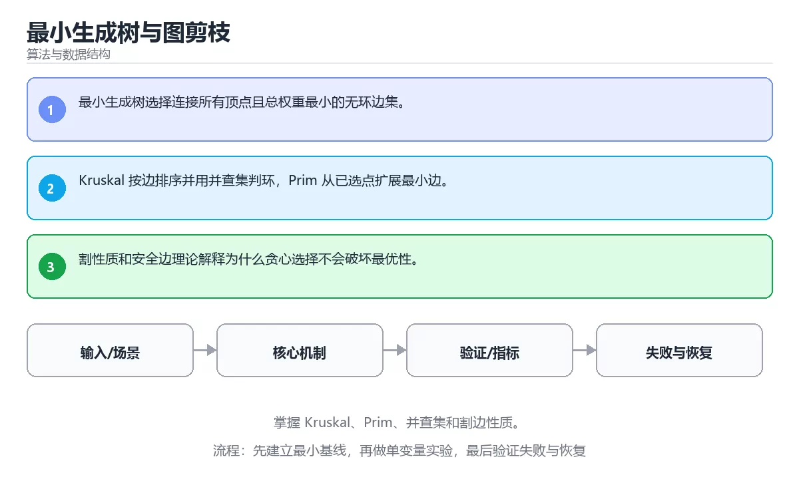

# 最小生成树与图剪枝

> 内容更新时间：2026-10-06 · 学习阶段：进阶 · 预计用时：30 分钟





## 本节知识框架

**课程定位**：所属分类 `algorithms`（算法与数据结构），课程主题 `最小生成树与图剪枝`，学习阶段 进阶，建议用时 45 分钟。

本课主线：掌握 Kruskal、Prim、并查集和割边性质。

**学完本课应当能够**
- 说清 `MST` 与 `Kruskal` 的含义与区别，并各举一个正例和一个反例。
- 用本课示例验证 `Prim` 的行为，记录输入、输出与失败条件。
- 遇到「默认图一定连通」这类问题时，能说出触发条件与修复顺序。

### 复习清单

- [ ] 能不看正文复述本课核心术语，并指出一个边界或反例。
- [ ] 能运行或推演本课示例，记录输入、输出与失败现象。
- [ ] 能完成一次自测，并把错题对照错误表定位原因。

## 核心概念定义

| 术语 | 操作性定义 | 常见边界与风险 |
| --- | --- | --- |
| MST | 最小生成树，在连通无向图中选择总权重最小的 n-1 条边。 | 只在「最小生成树，在连通无向图中选择总权重最小的 n-1 条边」这一前提下成立，换输入或换环境要重新验证。 |
| Kruskal | 按边权从小到大加边并用并查集避免成环的最小生成树算法。 | 易错：判环退化成遍历，复杂度失控；正确做法是用带路径压缩的并查集维护连通性。 |
| Prim | 最小生成树的加点算法：每次选连接已选集与外部的最短边，适合稠密图。 | 只在「最小生成树的加点算法：每次选连接已选集与外部的最短边，适合稠密图」这一前提下成立，换输入或换环境要重新验证。 |
| 并查集 | 维护不相交集合合并与查询的数据结构，用于连通性和环检测。 | 易错：判环退化成遍历，复杂度失控；正确做法是用带路径压缩的并查集维护连通性。 |
| 最小生成树 | 最小生成树选择连接所有顶点且总权重最小的无环边集 | 易错：不连通时结果不完整却当成最小生成树；正确做法是对每个连通分量分别求解，得到最小生成森林。 |

## 原理与运行机制

### 机制总览

**教材衔接：核心知识**

### 1. 最小生成树选择连接所有顶点且总权重最小的无环边集。

- 关键做法：先用 linear_search 建立 MST 的基线，再逐步加入边界与失败条件。
- 验证标准：linear_search 的输出能被他人复现，边界输入有对应用例。

### 2. Kruskal 按边排序并用并查集判环，Prim 从已选点扩展最小边。

把这条结论放回「最小生成树与图剪枝」的完整流程里展开：

- 正文依据：能用自己的话解释：Kruskal 按边排序并用并查集判环，Prim 从已选点扩展最小边。
- 落地检查：把「2. Kruskal 按边排序并用并查集判环，Prim 从已选点扩展最小边。」改写成一条可执行的核对项，逐条验证输入、超时与失败路径。

### 3. 割性质和安全边理论解释为什么贪心选择不会破坏最优性。

把这条结论放回「最小生成树与图剪枝」的完整流程里展开：

- 正文依据：本课关键词：MST、Kruskal、Prim、并查集。
- 落地检查：把「3. 割性质和安全边理论解释为什么贪心选择不会破坏最优性。」改写成一条可执行的核对项，逐条验证输入、超时与失败路径。

### 4. 水管接头：两条贪心路线怎么走

把顶点想成还没通水的小区，边是候选水管，权重是报价。Kruskal 像物价局批合同：低价先批，两头已接进同一套管网的驳回；Prim 从一栋楼起步，只铺已通水片区向外最便宜的一根管。割性质保证这条跨割最便宜的边（安全边）永远敢用。Kruskal 走法：

```text
      A
    /   \
   1     2
  B --3-- C
   \     /
    4   5
      D
取 1、2、4 驳 3、5（成环） 总权 7
```

**教材衔接：关键流程**

**教材衔接：实践路径**

**教材衔接：验证步骤**

## 典型应用场景

**教材衔接：深度拓展与实战**

这一节把 MST 的定义、linear_search 的代码与常见失败串成一条复习路线。

### 边界条件与常见反例

「最小生成树与图剪枝」的边界不只包括最大最小值，还要覆盖空、重复和失败：

### 工程检查表

- [ ] 能否用自己的话说明最小生成树与图剪枝解决什么问题，以及它不负责什么？
- [ ] 能否用「最小生成树与图剪枝」的最小示例复现一次失败并解释原因？
- [ ] 能否解释本课关键词在真实项目中的边界与取舍？
- [ ] 能否把 MST 的方法迁移到相近问题，并说明需要改哪一步？

### 最小验证场景

- 准备：保留 `text` 示例的原始输入，先记录 `最小生成树与图剪枝` 的基线输出和完整运行命令。
- 观察：先核对 调用了 `linear_search()`，再改变一个与 `MST` 相关的条件。
- 判定：新结果与 `最小生成树与图剪枝` 的基线不同不等于错误；只有当差异破坏了 `MST` 的定义或错误表中的约束，才判定为失败。

### 选择与边界

- 使用 `MST` 时，先满足它的定义：最小生成树，在连通无向图中选择总权重最小的 n-1 条边。
- 使用 `Kruskal` 时，先满足它的定义：按边权从小到大加边并用并查集避免成环的最小生成树算法；易错：判环退化成遍历，复杂度失控；正确做法是用带路径压缩的并查集维护连通性。
- 使用 `Prim` 时，先满足它的定义：最小生成树的加点算法：每次选连接已选集与外部的最短边，适合稠密图。
- 使用 `并查集` 时，先满足它的定义：维护不相交集合合并与查询的数据结构，用于连通性和环检测；易错：判环退化成遍历，复杂度失控；正确做法是用带路径压缩的并查集维护连通性。
- 使用 `最小生成树` 时，先满足它的定义：最小生成树选择连接所有顶点且总权重最小的无环边集；易错：不连通时结果不完整却当成最小生成树；正确做法是对每个连通分量分别求解，得到最小生成森林。

## 代码/协议/SQL 示例

### 最小可验证示例

**教材衔接：最小可运行示例**

先用下面的示例确认 MST 的基线，再只改一个与 Kruskal 相关的值：

```python
def linear_search(items, target):
    for index, item in enumerate(items):
        if item == target:
            return index
    return -1

print(linear_search([3, 5, 8], 8))
```

**教材衔接：预期输出**

```text
2
```

### 从最小示例到完整 Kruskal

下面是带路径压缩的 Kruskal 完整实现，数据与上面的水管图一致：

```python
edges = [(1,"A","B"), (2,"A","C"), (3,"B","C"), (4,"B","D"), (5,"C","D")]
parent = {v: v for v in "ABCD"}

def find(x):
    while parent[x] != x:
        parent[x] = parent[parent[x]]  # 路径压缩
        x = parent[x]
    return x

tree, total = [], 0
for w, u, v in sorted(edges):
    ru, rv = find(u), find(v)
    if ru != rv:  # 已连通就驳回
        parent[ru] = rv
        tree.append(f"{u}-{v}")
        total += w
print(tree, total)
```

保存为 `mst_kruskal.py`，运行 `python mst_kruskal.py`，预期输出：

```text
['A-B', 'A-C', 'B-D'] 7
```

B-C、C-D 被并查集拦下：两端已连通。把 A-B 改成 9 再跑，入选边换成 A-C、B-C、B-D，总和 9，仍是该图的最小值。

## 时间/空间复杂度或性能分析

**性能关注点（最小生成树与图剪枝）**：复杂度决定规模上限：同时记录时间与空间增长曲线，并区分最好、平均与最坏情况。

**本课特有开销（最小生成树与图剪枝 · MST）**：比较次数与内存移动决定开销，注意稳定性与额外空间。

**测量方法**：以 `最小生成树与图剪枝` 的 `MST` 场景为对象，固定输入跑一遍记录基线，再把规模或并发度提高一个数量级复测；两次结果的差值与波动范围才是结论依据。

## 常见误区与易错点

| 容易写错的做法 | 实际现象 | 原因与正确做法 |
| --- | --- | --- |
| 默认图一定连通 | 不连通时结果不完整却当成最小生成树。 | 对每个连通分量分别求解，得到最小生成森林。 |
| Kruskal 不用并查集 | 判环退化成遍历，复杂度失控。 | 用带路径压缩的并查集维护连通性。 |
| 认为最小生成树唯一 | 边权相同时与预期结果不一致。 | 只比较权重和，需要特定解时明确并列取舍规则。 |
| Kruskal 忘了先把边排序 | 树倒是生成树，总权重却比最小值大。 | 先按权重升序排边，再逐条试加。 |

### 现场 1：默认图一定连通

**症状**：不连通时结果不完整却当成最小生成树。

**根因与修复**：对每个连通分量分别求解，得到最小生成森林。

**自检**：在本课示例里复现「默认图一定连通」，改成对每个连通分量分别求解，得到最小生成森林后重跑；如果症状消失且失败路径按预期变化，说明定位正确。

### 现场 2：Kruskal 不用并查集

**症状**：判环退化成遍历，复杂度失控。

**根因与修复**：用带路径压缩的并查集维护连通性。

**自检**：在本课示例里复现「Kruskal 不用并查集」，改成用带路径压缩的并查集维护连通性后重跑；如果症状消失且失败路径按预期变化，说明定位正确。

### 现场 3：认为最小生成树唯一

**症状**：边权相同时与预期结果不一致。

**根因与修复**：只比较权重和，需要特定解时明确并列取舍规则。

**自检**：在本课示例里复现「认为最小生成树唯一」，改成只比较权重和，需要特定解时明确并列取舍规则后重跑；如果症状消失且失败路径按预期变化，说明定位正确。

## 与其他知识点的关系

**教材衔接：复习与迁移**

## 自测题与参考答案

> 先独立作答，再对照参考答案；答案都能在本课正文、术语表或错误表里找到依据。

### 自测 1（概念复述）

不看正文，写出 `MST` 的操作性定义，并说明它与 `Kruskal` 的区别。

**参考答案**：最小生成树，在连通无向图中选择总权重最小的 n-1 条边。

`Kruskal` 的定位是：按边权从小到大加边并用并查集避免成环的最小生成树算法；两者的差别要从适用对象与失败模式上说明。

### 自测 2（排错）

本课错误表记录了「默认图一定连通」这类做法。请写出它会出现的现象、根因，以及修复顺序。

**参考答案**：现象是不连通时结果不完整却当成最小生成树；正确做法是对每个连通分量分别求解，得到最小生成森林。修复时先复现现象并保留证据，再改动一处假设重跑，确认现象消失。

### 自测 3（动手验证）

运行本课的 `text` 示例，改动其中一个输入后重新运行，记录输出与错误信息。

**参考答案**：正常输入下 `text` 示例应当复现正文给出的结果；改动输入后，如果结果改变或报错，先核对它是否满足 `最小生成树与图剪枝` 中`MST` 的适用范围，再检查错误表里是否有同类现象。

### 自测 4（代码阅读）

阅读本课开头的 `text` 示例，说明它体现了`MST` 的哪一条性质，并指出改动哪个输入会让这条性质不再成立。

**参考答案**：`MST` 的定义是 最小生成树，在连通无向图中选择总权重最小的 n-1 条边，示例正是在实现这条定义。改动与 `MST` 有关的一个输入后，如果结果不再符合 `最小生成树与图剪枝` 的正文描述，就说明该性质只在当前前提成立。

### 自测 5（迁移）

把 `最小生成树与图剪枝` 的方法迁移到自己的项目：围绕 `MST` 写出一个与错误表同类的风险点，并说明触发条件和检验方式。

**参考答案**：例如「认为最小生成树唯一」，它会导致边权相同时与预期结果不一致；检验方式是按只比较权重和，需要特定解时明确并列取舍规则改一处再复现，确认现象消失且没有引入新的失败分支。

### 自测 6（对比）

用一个表格对比 `MST` 与 `Kruskal`：各写一行适用场景、一行失败表现。

**参考答案**：`MST` 的定义是最小生成树，在连通无向图中选择总权重最小的 n-1 条边；`Kruskal` 的定义是按边权从小到大加边并用并查集避免成环的最小生成树算法。两者的失败表现分别对应本课错误表里与本术语相关的行。

### 自测 7（排错顺序）

面对「默认图一定连通」引发的问题，请把“复现 不连通时结果不完整却当成最小生成树 → 保留证据 → 对每个连通分量分别求解，得到最小生成森林 → 回归验证”四步写成可执行的检查清单。

**参考答案**：第一步按不连通时结果不完整却当成最小生成树复现；第二步记录输入、版本与完整报错；第三步按对每个连通分量分别求解，得到最小生成森林只改一处；第四步重跑并确认失败路径也按预期变化。

### 自测 8（边界判断）

针对 `最小生成树`，分别写出“可以使用”的条件和“结论不再成立”的条件。

**参考答案**：易错：不连通时结果不完整却当成最小生成树；正确做法是对每个连通分量分别求解，得到最小生成森林。 同时要把 `最小生成树` 的定义 最小生成树选择连接所有顶点且总权重最小的无环边集 与实际输入逐项对照。

### 自测 9（机制重建）

不看正文，按输入、转换、输出、验证四段重建 `MST` → `Kruskal` → `Prim` → `并查集` 的作用链。

**参考答案**：起点是 `MST` 的定义 最小生成树，在连通无向图中选择总权重最小的 n-1 条边；中间每一步都保留可观察状态；终点由 `最小生成树` 检查，失败时回到错误表定位第一个偏离定义的步骤。

### 自测 10（综合排错）

在 `最小生成树与图剪枝` 中，现象是 边权相同时与预期结果不一致。请围绕 认为最小生成树唯一 写出最小复现、关键证据、修复动作和回归验证，并说明为什么不能只凭一次运行下结论。

**参考答案**：先复现 认为最小生成树唯一，记录输入与完整错误；再按 只比较权重和，需要特定解时明确并列取舍规则 只改一处。回归时同时跑正常路径和边界路径，只有两次结果都可解释，才把修复视为完成。

### 自测 11（一分钟复述）

用每分钟约 200 字的速度复述 `最小生成树与图剪枝`：先给主问题，再按顺序说出 `MST`、`Kruskal`、`Prim`、`并查集`，最后给一个失败案例。

**自评标准**：主问题必须对应 掌握 Kruskal、Prim、并查集和割边性质；每个术语都要能接上一句定义或边界；失败案例必须写成可观察现象，不能用“可能有风险”代替证据。

## 术语速查

| 术语 | 一句话说明 |
| --- | --- |
| `MST` | 最小生成树，在连通无向图中选择总权重最小的 n-1 条边。 |
| `Kruskal` | 按边权从小到大加边并用并查集避免成环的最小生成树算法。 |
| `Prim` | 最小生成树的加点算法：每次选连接已选集与外部的最短边，适合稠密图。 |
| `并查集` | 维护不相交集合合并与查询的数据结构，用于连通性和环检测。 |
| `最小生成树` | 最小生成树选择连接所有顶点且总权重最小的无环边集。 |

**术语关系**：`MST`（最小生成树） → `Kruskal`（按边权从小到大加边并用并查集避免成环的最小生成树算法） → `Prim`（最小生成树的加点算法：每次选连接已选集与外部的最短边） → `并查集`（维护不相交集合合并与查询的数据结构）。

## 考点精讲

`最小生成树与图剪枝` 的题库有 6 道题，下面逐题给出题干、正确项与判断依据：先自己作答，再核对正确项，最后回到正文对应小节复核。

### 考点 1：第 1 题

- **题目**：在 `最小生成树与图剪枝` 里，与 `MST` 有关的说法中，哪一项最符合掌握 Kruskal、Prim、并查集和割边性质？
- **正确项**：最小生成树选择连接所有顶点且总权重最小的无环边集。
- **判断依据**：本题正确项是「最小生成树选择连接所有顶点且总权重最小的无环边集」。术语 MST（最小生成树与图剪枝）：最小生成树，在连通无向图中选择总权重最小的 n-1 条边，本题取「最小生成树选择连接所有顶点且总权重最小的无环边集」这条。易错点是默认图一定连通，会造成不连通时结果不完整却当成最小生成树，改法是对每个连通分量分别求解，得到最小生成森林。

### 考点 2：第 2 题

- **题目**：下面这段 `python` 代码来自 `最小生成树与图剪枝`。课程主线是掌握 Kruskal、Prim、并查集和割边性质。代码与 `MST` 有关。哪一项是代码里真实出现的内容？
- **正确项**：调用了 `print()`
- **判断依据**：本题正确项是「调用了 `print()`」（最小生成树与图剪枝）。术语 MST（最小生成树与图剪枝）：最小生成树，在连通无向图中选择总权重最小的 n-1 条边，本题取「调用了 `print()`」这条。易错点是Kruskal 不用并查集，会造成判环退化成遍历，复杂度失控，改法是用带路径压缩的并查集维护连通性。本题干扰项「调用了 `round()`」不成立：展示代码里找不到 `round()`。

### 考点 3：第 3 题

- **题目**：在 `最小生成树与图剪枝` 里，与 `MST` 有关的说法中，哪一项最符合掌握 Kruskal、Prim、并查集和割边性质？（最小生成树与图剪枝·算法与数据结构 第 3 题）
- **正确项**：割性质和安全边理论解释为什么贪心选择不会破坏最优性。
- **判断依据**：本题正确项是「割性质和安全边理论解释为什么贪心选择不会破坏最优性」。术语 MST（最小生成树与图剪枝）：最小生成树，在连通无向图中选择总权重最小的 n-1 条边，本题取「割性质和安全边理论解释为什么贪心选择不会破坏最优性」这条。易错点是认为最小生成树唯一，会造成边权相同时与预期结果不一致，改法是只比较权重和，需要特定解时明确并列取舍规则。

### 考点 4：第 4 题

- **题目**：`最小生成树与图剪枝` 的主线是：掌握 Kruskal、Prim、并查集和割边性质。下面哪一项与这条主线一致？
- **正确项**：掌握 Kruskal、Prim、并查集和割边性质。
- **判断依据**：本题正确项是「掌握 Kruskal、Prim、并查集和割边性质」。术语 Kruskal（最小生成树与图剪枝）：按边权从小到大加边并用并查集避免成环的最小生成树算法，本题取「掌握 Kruskal、Prim、并查集和割边性质」这条。易错点是默认图一定连通，会造成不连通时结果不完整却当成最小生成树，改法是对每个连通分量分别求解，得到最小生成森林。

### 考点 5：第 5 题

- **题目**：课程 `掌握 Kruskal、Prim、并查集和割边性质。`。在 `最小生成树与图剪枝` 里，`MST`、`Kruskal` 与下面哪些选项属于同一层概念？（多选）
- **正确项**：MST；Kruskal
- **判断依据**：按《最小生成树与图剪枝》的正文口径，本题要同时选中「MST」、「Kruskal」，漏掉任一项都算没答全。术语 MST（最小生成树与图剪枝）：最小生成树，在连通无向图中选择总权重最小的 n-1 条边。易错点是Kruskal 不用并查集，会造成判环退化成遍历，复杂度失控，改法是用带路径压缩的并查集维护连通性。

### 考点 6：第 6 题

- **题目**：下面几项都与 `MST` 有关，请按 `最小生成树与图剪枝` 的正文顺序排列；该课主线是掌握 Kruskal、Prim、并查集和割边性质。
- **正确项**：核心知识 → 关键流程 → 实践路径 → 常见误区
- **判断依据**：按《最小生成树与图剪枝》正文的先后，本题顺序是「核心知识」 → 「关键流程」 → 「实践路径」 → 「常见误区」。术语「MST」在本课里的界定是最小生成树，在连通无向图中选择总权重最小的 n-1 条边，题干「下面几项都与 `MST` 有关，请按 `最小生成树与图剪枝` 的正文顺序排列；该课主线是掌握 Kruskal、Prim、并查集和割边性质。」问的就是这一条。常见错法是默认图一定连通，其后果是不连通时结果不完整却当成最小生成树。正确做法是对每个连通分量分别求解，得到最小生成森林。

### 考点 7：`MST`

- **要点**：最小生成树，在连通无向图中选择总权重最小的 n-1 条边。

### 考点 8：`Kruskal`

- **要点**：按边权从小到大加边并用并查集避免成环的最小生成树算法。
- **Kruskal 的边界**：易错：判环退化成遍历，复杂度失控；正确做法是用带路径压缩的并查集维护连通性。

### 考点 9：`Prim`

- **要点**：最小生成树的加点算法：每次选连接已选集与外部的最短边，适合稠密图。

### 考点 10：`并查集`

- **要点**：维护不相交集合合并与查询的数据结构，用于连通性和环检测。
- **并查集 的边界**：易错：判环退化成遍历，复杂度失控；正确做法是用带路径压缩的并查集维护连通性。

### 考点 11：`最小生成树`

- **要点**：最小生成树选择连接所有顶点且总权重最小的无环边集
- **最小生成树 的边界**：易错：不连通时结果不完整却当成最小生成树；正确做法是对每个连通分量分别求解，得到最小生成森林。

### 考点 12：排错——默认图一定连通

- **现象**：不连通时结果不完整却当成最小生成树。
- **处理**：对每个连通分量分别求解，得到最小生成森林。

### 考点 13：排错——Kruskal 不用并查集

- **现象**：判环退化成遍历，复杂度失控。
- **处理**：用带路径压缩的并查集维护连通性。

### 考点 14：综合辨析——`MST` 与 `最小生成树`

- **辨析点**：`MST` 的定义是 最小生成树，在连通无向图中选择总权重最小的 n-1 条边；`最小生成树` 的定义是 最小生成树选择连接所有顶点且总权重最小的无环边集。
- **答题要求**：面对 `最小生成树与图剪枝` 的题目，先判断描述的是 `MST` 还是 `最小生成树`，再归到对应定义，最后写出一个会让该定义失效的边界输入。

### 考点 15：排错评分点

- **现象分**：能写出 不连通时结果不完整却当成最小生成树，而不是只写“程序有错”。
- **证据分**：保留触发 默认图一定连通 的输入、版本和错误原文。
- **修复分**：按 对每个连通分量分别求解，得到最小生成森林 只改一处，并同时回归正常路径与边界路径。

## 内容元数据

- 内容版本：v2.0
- 最后更新：2026-10-06
- 学习阶段：进阶
- 适用环境：任意主流语言（伪代码与复杂度为主）；本课聚焦 MST。
- 内容来源：内置结构化课程与工程实践整理
- 相关主题：MST、Kruskal、Prim、并查集
- 质量版本：P0 测验标准 + P1 覆盖扩展 + P2 体验补全

## 参考资料与复核

- 最后复核：2026-10-04
- 下次复核：2027-05-24
- 复核范围：版本兼容、API 行为、安全建议与工程实践
- 来源性质：官方文档、标准或权威教材；本课核对关键词：MST、Kruskal、Prim、并查集。

| 参考资料 | 本课用途 |
| --- | --- |
| [CP-Algorithms](https://cp-algorithms.com/) | 算法实现与复杂度 |
| [GeeksforGeeks 算法](https://www.geeksforgeeks.org/fundamentals-of-algorithms/) | 算法专题与实现 |
| [MIT 6.006](https://ocw.mit.edu/courses/6-006-introduction-to-algorithms-spring-2020/) | 算法设计与分析 |

| [本课术语索引：最小生成树与图剪枝](#核心概念定义) | 按本课输入、术语边界和错误表现逐项核对 |
> 「最小生成树与图剪枝」的链接用于离线阅读后的延伸核对；App 不会自动联网。