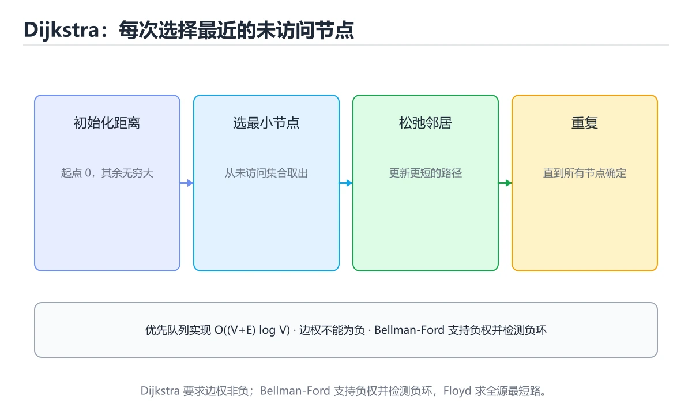
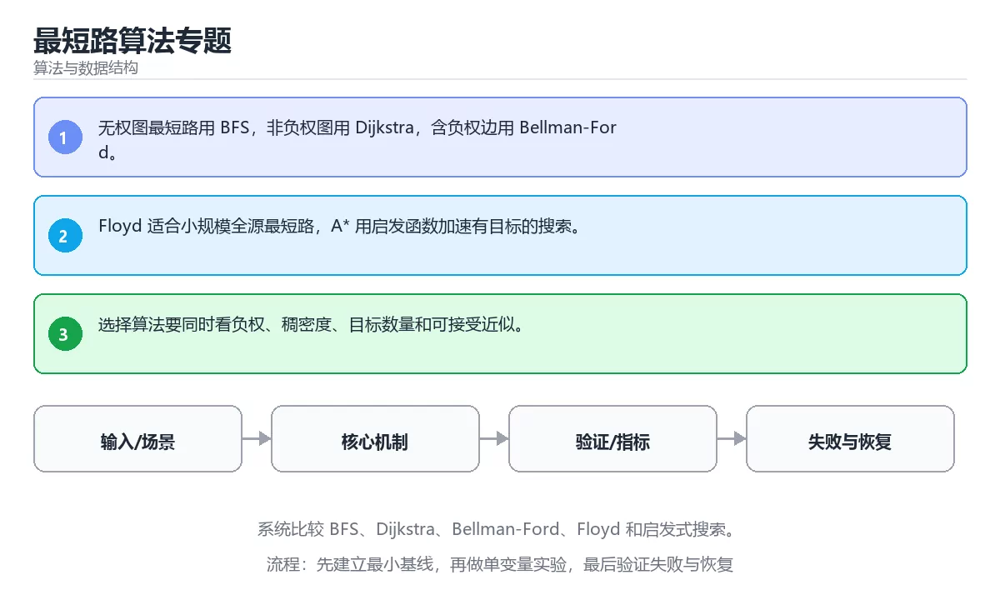

# 最短路算法专题





> 内容更新时间：2026-10-06 · 学习阶段：进阶 · 预计用时：25 分钟

## 本节知识框架

**课程定位**：所属分类 `algorithms`（算法与数据结构），课程主题 `最短路算法专题`，学习阶段 进阶，建议用时 45 分钟。

本课主线：系统比较 BFS、Dijkstra、Bellman-Ford、Floyd 和启发式搜索。

**学完本课应当能够**
- 说清 `Dijkstra` 与 `Bellman-Ford` 的含义与区别，并各举一个正例和一个反例。
- 用本课示例验证 `最短路` 的行为，记录输入、输出与失败条件。
- 遇到「有负权边还用 Dijkstra」这类问题时，能说出触发条件与修复顺序。

### 复习清单

- [ ] 能不看正文复述本课核心术语，并指出一个边界或反例。
- [ ] 能运行或推演本课示例，记录输入、输出与失败现象。
- [ ] 能完成一次自测，并把错题对照错误表定位原因。

## 核心概念定义

| 术语 | 操作性定义 | 常见边界与风险 |
| --- | --- | --- |
| Dijkstra | 适用于非负权图的单源最短路算法，每次确定当前距离最小的节点。 | 易错：距离一旦被定下来就可能算错；正确做法是负权边改用 Bellman-Ford，并检测负环。 |
| Bellman-Ford | 允许负权边的单源最短路算法，通过反复松弛并检测负环。 | 易错：距离一旦被定下来就可能算错；正确做法是负权边改用 Bellman-Ford，并检测负环。 |
| 最短路 | 在带权图中寻找两点或单源到其他点总代价最小的路径。 | 「总代价最小」不等于路径唯一：等权分支下会有多条答案，图里有负环时连下界都没有，要先按本课的负权判定选算法。 |
| 松弛 | 对每条边检查「经由它绕行是否更短」，是 Dijkstra 与 Bellman-Ford 共用的核心步骤。 | 单次松弛只更新候选距离，不代表已收敛；有负权边时要反复松弛并检测负环，否则绕行路径会被漏掉。 |

## 原理与运行机制

### 机制总览

**教材衔接：核心知识**

### 1. 无权图最短路用 BFS，非负权图用 Dijkstra，含负权边用 Bellman-Ford。

- 关键做法：基线只保留 Bellman-Ford 必需的部分，其余条件一次加一个。
- 验证标准：Dijkstra 的结果可复现、错误可解释、失败能恢复。

### 2. Floyd 适合小规模全源最短路，A* 用启发函数加速有目标的搜索。

把这条结论放回「最短路算法专题」的完整流程里展开：

- 正文依据：能用自己的话解释：无权图最短路用 BFS，非负权图用 Dijkstra，含负权边用 Bellman-Ford。
- 落地检查：把「2. Floyd 适合小规模全源最短路，A* 用启发函数加速有目标的搜索。」改写成一条可执行的核对项，逐条验证输入、超时与失败路径。

### 3. 选择算法要同时看负权、稠密度、目标数量和可接受近似。

把这条结论放回「最短路算法专题」的完整流程里展开：

- 正文依据：能用自己的话解释：Floyd 适合小规模全源最短路，A 用启发函数加速有目标的搜索。
- 落地检查：把「3. 选择算法要同时看负权、稠密度、目标数量和可接受近似。」改写成一条可执行的核对项，逐条验证输入、超时与失败路径。

**教材衔接：关键流程**

**教材衔接：实践路径**

**教材衔接：验证步骤**

## 典型应用场景

**教材衔接：深度拓展与实战**

这一节把「最短路算法专题」的判断依据、示例和反例整理成复习步骤。

### 边界条件与常见反例

「最短路算法专题」的边界不只包括最大最小值，还要覆盖空、重复和失败：

### 工程检查表

- [ ] 能否用自己的话说明最短路算法专题解决什么问题，以及它不负责什么？
- [ ] 能否用「最短路算法专题」的最小示例复现一次失败并解释原因？
- [ ] 能否解释本课关键词在真实项目中的边界与取舍？
- [ ] 换一个输入后，linear_search 的判断依据是否仍然成立？

### 最小验证场景

- 准备：保留 `text` 示例的原始输入，先记录 `最短路算法专题` 的基线输出和完整运行命令。
- 观察：先核对 调用了 `linear_search()`，再改变一个与 `Dijkstra` 相关的条件。
- 判定：新结果与 `最短路算法专题` 的基线不同不等于错误；只有当差异破坏了 `Dijkstra` 的定义或错误表中的约束，才判定为失败。

### 选择与边界

- 使用 `Dijkstra` 时，先满足它的定义：适用于非负权图的单源最短路算法，每次确定当前距离最小的节点；易错：距离一旦被定下来就可能算错；正确做法是负权边改用 Bellman-Ford，并检测负环。
- 使用 `Bellman-Ford` 时，先满足它的定义：允许负权边的单源最短路算法，通过反复松弛并检测负环；易错：距离一旦被定下来就可能算错；正确做法是负权边改用 Bellman-Ford，并检测负环。
- 使用 `最短路` 时，先满足它的定义：在带权图中寻找两点或单源到其他点总代价最小的路径。
- 使用 `松弛` 时，先满足它的定义：对每条边检查「经由它绕行是否更短」，是 Dijkstra 与 Bellman-Ford 共用的核心步骤。

## 代码/协议/SQL 示例

### 最小可验证示例

**教材衔接：最小可运行示例**

先用 linear_search 跑通最小示例，然后只改一个与 Dijkstra 相关的取值：

```python
def linear_search(items, target):
    for index, item in enumerate(items):
        if item == target:
            return index
    return -1

print(linear_search([3, 5, 8], 8))
```

**教材衔接：预期输出**

```text
2
```

## 时间/空间复杂度或性能分析

**性能关注点（最短路算法专题）**：复杂度决定规模上限：同时记录时间与空间增长曲线，并区分最好、平均与最坏情况。

**测量方法**：以 `最短路算法专题` 的 `Dijkstra` 场景为对象，固定输入跑一遍记录基线，再把规模或并发度提高一个数量级复测；两次结果的差值与波动范围才是结论依据。

**四条规模账**：把本课的四种选择放到同一张图上看，成本差在哪一目了然。无权图直接 BFS，一次队列遍历就够，不需要维护任何距离结构；`Dijkstra` 要为「每次确定当前距离最小的节点」付出堆操作，所以稀疏图上堆优化才划算，稠密图用朴素版反而省掉堆的开销；`Bellman-Ford` 每轮把全部边都松弛一遍，V-1 轮就意味着边数直接乘到时间上，边一多就慢得明显，但它换来的代价是可以接受负权；`Floyd` 是把所有点对的距离铺成一张二维表来更新，因此只在小规模全源场景里用，规模一大，表和更新次数同时涨。空间上也有一笔常被漏记的账：只要答案要还原成路径，就得为每个顶点留一个前驱，这部分和距离数组同阶，正像错误表里「只记距离不记前驱」那条所指向的问题。

## 常见误区与易错点

| 容易写错的做法 | 实际现象 | 原因与正确做法 |
| --- | --- | --- |
| 有负权边还用 Dijkstra | 距离一旦被定下来就可能算错。 | 负权边改用 Bellman-Ford，并检测负环。 |
| 只记距离不记前驱 | 算出最短距离却还原不出路径。 | 同步维护前驱数组，结束后回溯得到路径。 |
| 忽略重边与自环 | 距离被更大的重边覆盖。 | 建图时按题意保留最小权边或全部边，并单独处理自环。 |

### 现场 1：有负权边还用 Dijkstra

**症状**：距离一旦被定下来就可能算错。

**根因与修复**：负权边改用 Bellman-Ford，并检测负环。

**自检**：在本课示例里复现「有负权边还用 Dijkstra」，改成负权边改用 Bellman-Ford，并检测负环后重跑；如果症状消失且失败路径按预期变化，说明定位正确。

### 现场 2：只记距离不记前驱

**症状**：算出最短距离却还原不出路径。

**根因与修复**：同步维护前驱数组，结束后回溯得到路径。

**自检**：在本课示例里复现「只记距离不记前驱」，改成同步维护前驱数组，结束后回溯得到路径后重跑；如果症状消失且失败路径按预期变化，说明定位正确。

### 现场 3：忽略重边与自环

**症状**：距离被更大的重边覆盖。

**根因与修复**：建图时按题意保留最小权边或全部边，并单独处理自环。

**自检**：在本课示例里复现「忽略重边与自环」，改成建图时按题意保留最小权边或全部边，并单独处理自环后重跑；如果症状消失且失败路径按预期变化，说明定位正确。

## 与其他知识点的关系

**教材衔接：复习与迁移**

## 自测题与参考答案

> 先独立作答，再对照参考答案；答案都能在本课正文、术语表或错误表里找到依据。

### 自测 1（概念复述）

不看正文，写出 `Dijkstra` 的操作性定义，并说明它与 `Bellman-Ford` 的区别。

**参考答案**：适用于非负权图的单源最短路算法，每次确定当前距离最小的节点。

`Bellman-Ford` 的定位是：允许负权边的单源最短路算法，通过反复松弛并检测负环；两者的差别要从适用对象与失败模式上说明。

### 自测 2（排错）

本课错误表记录了「有负权边还用 Dijkstra」这类做法。请写出它会出现的现象、根因，以及修复顺序。

**参考答案**：现象是距离一旦被定下来就可能算错；正确做法是负权边改用 Bellman-Ford，并检测负环。修复时先复现现象并保留证据，再改动一处假设重跑，确认现象消失。

### 自测 3（动手验证）

运行本课的 `text` 示例，改动其中一个输入后重新运行，记录输出与错误信息。

**参考答案**：正常输入下 `text` 示例应当复现正文给出的结果；改动输入后，如果结果改变或报错，先核对它是否满足 `最短路算法专题` 中`Dijkstra` 的适用范围，再检查错误表里是否有同类现象。

### 自测 4（代码阅读）

阅读本课开头的 `text` 示例，说明它体现了`Dijkstra` 的哪一条性质，并指出改动哪个输入会让这条性质不再成立。

**参考答案**：`Dijkstra` 的定义是 适用于非负权图的单源最短路算法，每次确定当前距离最小的节点，示例正是在实现这条定义。改动与 `Dijkstra` 有关的一个输入后，如果结果不再符合 `最短路算法专题` 的正文描述，就说明该性质只在当前前提成立。

### 自测 5（迁移）

把 `最短路算法专题` 的方法迁移到自己的项目：围绕 `Dijkstra` 写出一个与错误表同类的风险点，并说明触发条件和检验方式。

**参考答案**：例如「忽略重边与自环」，它会导致距离被更大的重边覆盖；检验方式是按建图时按题意保留最小权边或全部边，并单独处理自环改一处再复现，确认现象消失且没有引入新的失败分支。

### 自测 6（对比）

用一个表格对比 `Dijkstra` 与 `Bellman-Ford`：各写一行适用场景、一行失败表现。

**参考答案**：`Dijkstra` 的定义是适用于非负权图的单源最短路算法，每次确定当前距离最小的节点；`Bellman-Ford` 的定义是允许负权边的单源最短路算法，通过反复松弛并检测负环。两者的失败表现分别对应本课错误表里与本术语相关的行。

### 自测 7（排错顺序）

面对「有负权边还用 Dijkstra」引发的问题，请把“复现 距离一旦被定下来就可能算错 → 保留证据 → 负权边改用 Bellman-Ford，并检测负环 → 回归验证”四步写成可执行的检查清单。

**参考答案**：第一步按距离一旦被定下来就可能算错复现；第二步记录输入、版本与完整报错；第三步按负权边改用 Bellman-Ford，并检测负环只改一处；第四步重跑并确认失败路径也按预期变化。

### 自测 8（边界判断）

针对 `松弛`，分别写出“可以使用”的条件和“结论不再成立”的条件。

**参考答案**：要把 `松弛` 的定义 对每条边检查「经由它绕行是否更短」，是 Dijkstra 与 Bellman-Ford 共用的核心步骤 与实际输入逐项对照。

### 自测 9（机制重建）

不看正文，按输入、转换、输出、验证四段重建 `Dijkstra` → `Bellman-Ford` → `最短路` → `松弛` 的作用链。

**参考答案**：起点是 `Dijkstra` 的定义 适用于非负权图的单源最短路算法，每次确定当前距离最小的节点；中间每一步都保留可观察状态；终点由 `松弛` 检查，失败时回到错误表定位第一个偏离定义的步骤。

### 自测 10（综合排错）

在 `最短路算法专题` 中，现象是 距离被更大的重边覆盖。请围绕 忽略重边与自环 写出最小复现、关键证据、修复动作和回归验证，并说明为什么不能只凭一次运行下结论。

**参考答案**：先复现 忽略重边与自环，记录输入与完整错误；再按 建图时按题意保留最小权边或全部边，并单独处理自环 只改一处。回归时同时跑正常路径和边界路径，只有两次结果都可解释，才把修复视为完成。

### 自测 11（一分钟复述）

用每分钟约 200 字的速度复述 `最短路算法专题`：先给主问题，再按顺序说出 `Dijkstra`、`Bellman-Ford`、`最短路`、`松弛`，最后给一个失败案例。

**自评标准**：主问题必须对应 系统比较 BFS、Dijkstra、Bellman-Ford、Floyd 和启发式搜索；每个术语都要能接上一句定义或边界；失败案例必须写成可观察现象，不能用“可能有风险”代替证据。

## 术语速查

| 术语 | 一句话说明 |
| --- | --- |
| `Dijkstra` | 适用于非负权图的单源最短路算法，每次确定当前距离最小的节点。 |
| `Bellman-Ford` | 允许负权边的单源最短路算法，通过反复松弛并检测负环。 |
| `最短路` | 在带权图中寻找两点或单源到其他点总代价最小的路径。 |
| `松弛` | 对每条边检查「经由它绕行是否更短」，是 Dijkstra 与 Bellman-Ford 共用的核心步骤。 |

**术语关系**：`Dijkstra`（适用于非负权图的单源最短路算法） → `Bellman-Ford`（允许负权边的单源最短路算法） → `最短路`（在带权图中寻找两点或单源到其他点总代价最小的路径） → `松弛`（对每条边检查「经由它绕行是否更短」）。

## 考点精讲

`最短路算法专题` 的题库有 6 道题，下面逐题给出题干、正确项与判断依据：先自己作答，再核对正确项，最后回到正文对应小节复核。

### 考点 1：第 1 题

- **题目**：在 `最短路算法专题` 里，与 `Dijkstra` 有关的说法中，哪一项最符合系统比较 BFS、Dijkstra、Bellman-Ford、Floyd 和启发式搜索？
- **正确项**：无权图最短路用 BFS，非负权图用 Dijkstra
- **判断依据**：本题正确项是「无权图最短路用 BFS，非负权图用 Dijkstra」。术语 Dijkstra（最短路算法专题）：适用于非负权图的单源最短路算法，每次确定当前距离最小的节点，本题取「无权图最短路用 BFS，非负权图用 Dijkstra」这条。易错点是有负权边还用 Dijkstra，会造成距离一旦被定下来就可能算错，改法是负权边改用 Bellman-Ford，并检测负环。

### 考点 2：第 2 题

- **题目**：`最短路算法专题` 的示例代码用于验证 `Dijkstra`，其背景是系统比较 BFS、Dijkstra、Bellman-Ford、Floyd 和启发式搜索。代码的真实内容是下面哪一项？
- **正确项**：调用了 `enumerate()`
- **判断依据**：本题正确项是「调用了 `enumerate()`」。术语 Dijkstra（最短路算法专题）：适用于非负权图的单源最短路算法，每次确定当前距离最小的节点，本题取「调用了 `enumerate()`」这条。易错点是只记距离不记前驱，会造成算出最短距离却还原不出路径，改法是同步维护前驱数组，结束后回溯得到路径。本题干扰项「调用了 `sort()`」不成立：展示代码里找不到 `sort()`。

### 考点 3：第 3 题

- **题目**：在 `最短路算法专题` 里，与 `Dijkstra` 有关的说法中，哪一项最符合系统比较 BFS、Dijkstra、Bellman-Ford、Floyd 和启发式搜索？（最短路算法专题·算法与数据结构 第 3 题）
- **正确项**：选择算法要同时看负权、稠密度、目标数量和可接受近似。
- **判断依据**：本题正确项是「选择算法要同时看负权、稠密度、目标数量和可接受近似」。术语 Dijkstra（最短路算法专题）：适用于非负权图的单源最短路算法，每次确定当前距离最小的节点，本题取「选择算法要同时看负权、稠密度、目标数量和可接受近似」这条。易错点是忽略重边与自环，会造成距离被更大的重边覆盖，改法是建图时按题意保留最小权边或全部边，并单独处理自环。

### 考点 4：第 4 题

- **题目**：`最短路算法专题` 的主线是：系统比较 BFS、Dijkstra、Bellman-Ford、Floyd 和启发式搜索。下面哪一项与这条主线一致？
- **正确项**：系统比较 BFS，Dijkstra，Bellman-Ford
- **判断依据**：本题正确项是「系统比较 BFS，Dijkstra，Bellman-Ford」。术语 Dijkstra（最短路算法专题）：适用于非负权图的单源最短路算法，每次确定当前距离最小的节点，本题取「系统比较 BFS，Dijkstra，Bellman-Ford」这条。易错点是有负权边还用 Dijkstra，会造成距离一旦被定下来就可能算错，改法是负权边改用 Bellman-Ford，并检测负环。

### 考点 5：第 5 题

- **题目**：课程 `系统比较 BFS、Dijkstra、Bellman-Ford、Floyd 和启发式搜索。`。在 `最短路算法专题` 里，`Dijkstra`、`Bellman-Ford` 与下面哪些选项属于同一层概念？（多选）
- **正确项**：Dijkstra；Bellman-Ford
- **判断依据**：按《最短路算法专题》的正文口径，本题要同时选中「Dijkstra」、「Bellman-Ford」，漏掉任一项都算没答全。术语 Dijkstra（最短路算法专题）：适用于非负权图的单源最短路算法，每次确定当前距离最小的节点。易错点是有负权边还用 Dijkstra会造成距离一旦被定下来就可能算错，改法是负权边改用 Bellman-Ford，并检测负环。

### 考点 6：第 6 题

- **题目**：下面几项都与 `Dijkstra` 有关，请按 `最短路算法专题` 的正文顺序排列；该课主线是系统比较 BFS、Dijkstra、Bellman-Ford、Floyd 和启发式搜索。
- **正确项**：核心知识 → 关键流程 → 实践路径 → 常见误区
- **判断依据**：按《最短路算法专题》正文的先后，本题顺序是「核心知识」 → 「关键流程」 → 「实践路径」 → 「常见误区」。术语「Dijkstra」在本课里的界定是适用于非负权图的单源最短路算法，每次确定当前距离最小的节点，题干「下面几项都与 `Dijkstra` 有关，请按 `最短路算法专题` 的正文顺序排列；该课主线是系统比较 BFS、Dijkstra、Bellman-Ford、Floyd 和启发式搜索。」问的就是这一条。常见错法是有负权边还用 Dijkstra，其后果是距离一旦被定下来就可能算错。正确做法是负权边改用 Bellman-Ford，并检测负环。

### 考点 7：`Dijkstra`

- **要点**：适用于非负权图的单源最短路算法，每次确定当前距离最小的节点。
- **Dijkstra 的边界**：易错：距离一旦被定下来就可能算错；正确做法是负权边改用 Bellman-Ford，并检测负环。

### 考点 8：`Bellman-Ford`

- **要点**：允许负权边的单源最短路算法，通过反复松弛并检测负环。
- **Bellman-Ford 的边界**：易错：距离一旦被定下来就可能算错；正确做法是负权边改用 Bellman-Ford，并检测负环。

### 考点 9：`最短路`

- **要点**：在带权图中寻找两点或单源到其他点总代价最小的路径。

### 考点 10：`松弛`

- **要点**：对每条边检查「经由它绕行是否更短」，是 Dijkstra 与 Bellman-Ford 共用的核心步骤。

### 考点 11：排错——有负权边还用 Dijkstra

- **现象**：距离一旦被定下来就可能算错。
- **处理**：负权边改用 Bellman-Ford，并检测负环。

### 考点 12：排错——只记距离不记前驱

- **现象**：算出最短距离却还原不出路径。
- **处理**：同步维护前驱数组，结束后回溯得到路径。

### 考点 13：综合辨析——`Dijkstra` 与 `松弛`

- **辨析点**：`Dijkstra` 的定义是 适用于非负权图的单源最短路算法，每次确定当前距离最小的节点；`松弛` 的定义是 对每条边检查「经由它绕行是否更短」，是 Dijkstra 与 Bellman-Ford 共用的核心步骤。
- **答题要求**：面对 `最短路算法专题` 的题目，先判断描述的是 `Dijkstra` 还是 `松弛`，再归到对应定义，最后写出一个会让该定义失效的边界输入。

### 考点 14：排错评分点

- **现象分**：能写出 距离一旦被定下来就可能算错，而不是只写“程序有错”。
- **证据分**：保留触发 有负权边还用 Dijkstra 的输入、版本和错误原文。
- **修复分**：按 负权边改用 Bellman-Ford，并检测负环 只改一处，并同时回归正常路径与边界路径。

## 内容元数据

- 内容版本：v2.0
- 最后更新：2026-10-06
- 学习阶段：进阶
- 适用环境：任意主流语言（伪代码与复杂度为主）；本课聚焦 Dijkstra。
- 内容来源：内置结构化课程与工程实践整理
- 相关主题：Dijkstra、Bellman-Ford、最短路、A*
- 质量版本：P0 测验标准 + P1 覆盖扩展 + P2 体验补全

## 参考资料与复核

- 最后复核：2026-10-04
- 下次复核：2027-05-24
- 复核范围：版本兼容、API 行为、安全建议与工程实践
- 来源性质：官方文档、标准或权威教材；本课核对关键词：Dijkstra、Bellman-Ford、最短路、A*。

| 参考资料 | 本课用途 |
| --- | --- |
| [LeetCode 学习](https://leetcode.com/explore/) | 算法题训练与模式 |
| [MIT 6.006](https://ocw.mit.edu/courses/6-006-introduction-to-algorithms-spring-2020/) | 算法设计与分析 |
| [RFC 算法与协议](https://www.rfc-editor.org/) | 协议中的算法约束 |

| [本课术语索引：最短路算法专题](#核心概念定义) | 按本课输入、术语边界和错误表现逐项核对 |
> 「最短路算法专题」的链接用于离线阅读后的延伸核对；App 不会自动联网。