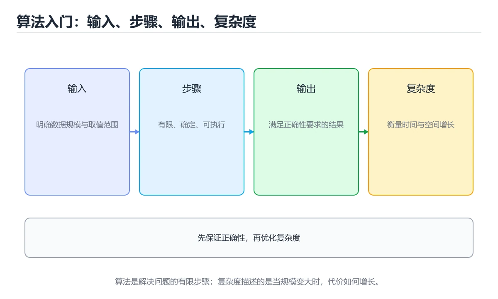
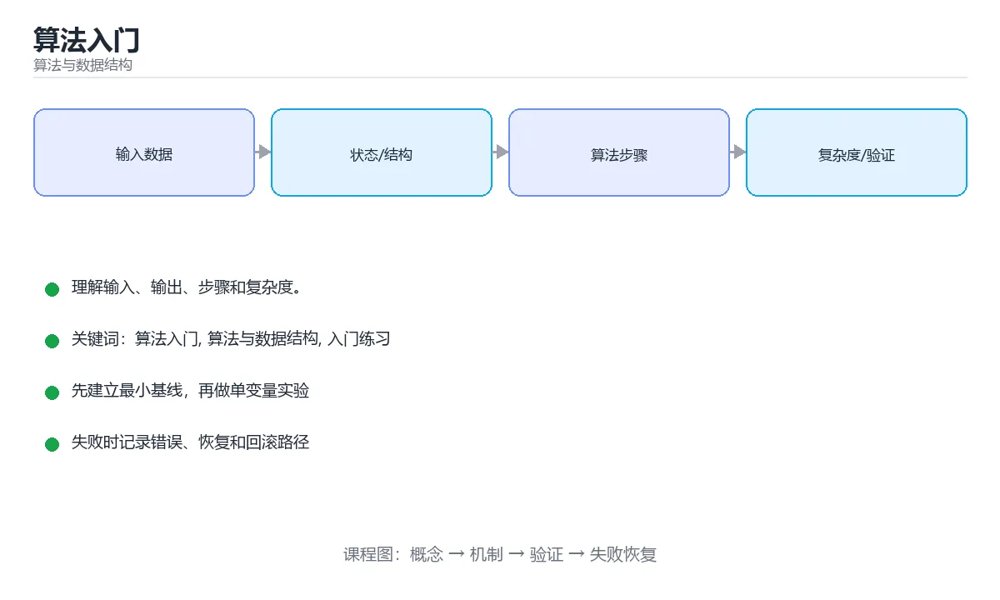

# 算法入门

> 内容更新时间：2026-10-06 · 学习阶段：入门 · 预计用时：25 分钟





## 本节知识框架

**课程定位**：所属分类 `algorithms`（算法与数据结构），课程主题 `算法入门`，学习阶段 入门，建议用时 40 分钟。

本课主线：理解输入、输出、步骤和复杂度。

**学完本课应当能够**
- 说清 `算法` 与 `正确性与边界` 的含义与区别，并各举一个正例和一个反例。
- 用本课示例验证 `时间复杂度` 的行为，记录输入、输出与失败条件。
- 遇到「只测正常样例」这类问题时，能说出触发条件与修复顺序。

### 复习清单

- [ ] 能讲清 算法入门 与 算法与数据结构 的分工，并指出其中一个前提失效的边界。
- [ ] 能跑通 算法入门 的最小示例，记录一组正常输出和一组失败输出。
- [ ] 能完成一次自测，并把错题对照错误表定位原因。

## 核心概念定义

| 术语 | 操作性定义 |
| --- | --- |
| 算法 | 把输入转换成输出的一组有限、确定的步骤。 |
| 正确性与边界 | 除了常规输入，还要验证空输入、单元素与极值。 |
| 时间复杂度 | 描述运行时间随输入规模增长的趋势，用大 O 表示上界。 |
| 空间复杂度 | 描述额外内存随输入规模增长的趋势。 |
| 暴力解法与优化 | 先写出能正确解决问题的朴素解法，再定位瓶颈做优化。 |

## 原理与运行机制

### 机制总览

**教材衔接：一句话入门**

理解输入、输出、步骤和复杂度。

**教材衔接：算法究竟是什么**

算法不是某一段代码，而是“把合法输入转换成期望输出的一组有限、明确、可执行的步骤”。判断一个算法是否成立，至少要同时回答四个问题：输入集合是什么、输出必须满足什么性质、每一步是否没有歧义、执行是否一定在有限步内结束。比如“求一组整数中的最大值”，输入可以是空列表、单元素列表或包含负数的列表；输出必须同时给出最大值和它的位置，才能覆盖重复元素的场景。

同一个问题可以有多个算法。求最大值既可以逐个比较，也可以先排序再取末尾元素。两者都能得到正确答案，但排序做了大量不必要的工作，复杂度从 O(n) 变成 O(n log n)。这说明“正确”和“高效”是两个独立维度：先证明答案正确，再讨论资源消耗，最后才谈代码是否优雅。工程中还要考虑输入规模、内存上限、数据是否已经排序、是否允许修改原数据，这些约束会直接改变算法选择。

验证算法不能只跑一个正常样例。至少要覆盖空输入、单元素、重复值、极值、已经有序和完全逆序等情况；对每个样例先写出预期结果，再运行代码对照。随机测试可以发现手写边界遗漏，但随机不能替代边界测试，因为极端输入出现的概率往往很低。

**教材衔接：从问题到程序**

可靠的解题顺序是：先用自己的话复述输入、输出和约束；再写出 3 个左右的具体样例，其中一个必须是边界样例；然后用伪代码描述步骤，而不是一开始就纠结语法；接着把伪代码翻译成最小可运行版本；最后分析时间与空间复杂度，并补充失败路径。

复杂度描述的是输入规模增大时资源如何增长，不是某台机器上的绝对秒数。O(1) 表示操作次数不随规模变化，O(log n) 表示每一步能排除固定比例的数据，O(n) 表示至少要看一遍输入，O(n²) 表示常见的双重循环。递归算法还可能要计算递归深度带来的栈空间。写复杂度时要说清 n 指什么，例如节点数、边数还是查询次数。

练习时可以采用“三行记录法”：第一行写预测，第二行写实际输出，第三行写差异和原因。只要实际结果与预测不一致，就不要急着改代码，先确认是输入理解错了、步骤设计错了，还是实现细节错了。这种习惯能让你从“碰巧跑通”过渡到“知道为什么正确”。

**教材衔接：零基础精讲：把算法入门真正讲透**

### 先建立一个直觉

把算法看成一张可复核的路线图：输入规模决定走哪条路，每一步都要说明为什么不会漏解、为什么最终会停下来，以及代价如何增长。落到本课，「算法入门」关心的是 算法入门 与 算法与数据结构 的配合，也就是说这条直觉要在 本节知识框架 里被具体验证。
落到本课，「算法入门」关心的是 算法入门 与 算法与数据结构 的配合，也就是说这条直觉要在 算法究竟是什么 里被具体验证。

本课的摘要可以当作一张地图：理解输入、输出、步骤和复杂度。

### 逐步拆解

1. 澄清输入与目标。先写清「算法入门」要解决的问题、合法输入范围和成功标准，再进入后续步骤。
2. 描述处理过程。把「算法入门、算法与数据结构、入门练习」映射到具体步骤，每步都要求能单独验证。
3. 定义输出。把 find_max 的返回值、日志和失败信号都写清楚，缺一项都不算完整。
4. 构造一次算法入门越界，记录系统是拒绝、降级还是静默出错；三者对应的修复策略完全不同。
5. 用 find_max 构造一个最小反例，证明「算法入门」的结论有边界。

### 把正文串成一条执行链

- **考点 2：一个算法的时间复杂度为 O(n) 通常意味着什么？**：针对「算法入门」，先自问「一个算法的时间复杂度为 O(n) 通常意味着什么」；作答后回到对应考点核对判断依据。

### 从测验反推易错点

**检查点 1：描述一个算法时，必须明确的基本要素是？**

- 参考判断：输入、输出、清晰的步骤以及终止条件
- 自问：如果去掉题干里的一个限定词，结论还成立吗？

**检查点 2：一个算法的时间复杂度为 O(n) 通常意味着什么？**

- 参考判断：执行步数随输入规模近似线性增长

**检查点 3：把「理解问题、设计步骤、实现、验证边界」排序，正确的顺序是？**

- 参考判断：先理解问题与输入输出，再设计步骤并实现

**检查点 4：把解决一个新算法问题的可靠步骤调整为正确顺序。**

- 参考判断：运行并验证边界情况

**检查点 5：阅读本课的代码片段，下面哪项判断是正确的？**

### 工程排错顺序

| 先查什么 | 要得到的证据 | 判断标准 |
| --- | --- | --- |
| 问题规模与最坏情况是什么？ | 日志、输入样例、测试或指标 | 能复现并解释，才算定位 |
| 循环是否一定收缩并到达终止条件？ | 日志、输入样例、测试或指标 | 能复现并解释，才算定位 |
| 边界、重复元素和空输入是否覆盖？ | 日志、输入样例、测试或指标 | 能复现并解释，才算定位 |
| 时间与空间复杂度是否经过实测？ | 日志、输入样例、测试或指标 | 能复现并解释，才算定位 |

### 变式训练

1. 把 算法入门 的实现压缩到一个进程内，去掉所有外部依赖后再谈扩展。
2. 扩大 算法与数据结构 的规模，记录本课结论在哪一个量级开始不成立。
3. 让 find_max 的外部依赖超时，确认系统能回滚或补偿，而不是留下脏数据。
5. 把「算法入门」里最容易被省略的一步去掉，用测试或指标证明它不可省略，而不是凭感觉判断。
6. 把 算法入门 的方案切换到低资源设备，重新评估默认参数、超时和降级策略。

### 本课自测

- [ ] 能用一句话解释算法入门在本课中的角色与边界。
- [ ] 能举出一个正常例子和一个失败例子。
- [ ] 能说出最小验证步骤，以及需要记录的证据。
- [ ] 能用一句话解释「算法与数据结构」在本课中的角色与边界。
- [ ] 能说出 算法与数据结构 与相邻概念的边界。

### 迁移案例库

围绕 find_max 重复同一套方法，每完成一轮就把差异写进笔记。

#### 迁移案例 1：围绕算法入门做一次小实验

**目标**：在不改变课程主体的前提下，验证算法入门中的一个关键判断。

**步骤**：
1. 复述当前方案对本课的假设，写成一句可证伪的话。
2. 设计一个正常输入和一个边界输入，分别预测输出。
3. 运行或逐步演算，记录实际输出、耗时和失败信息。
4. 只调整一个参数，比较前后差异并解释原因。
5. 补充一条测试或复习卡，确保下次能更快复现。

#### 迁移案例 3：围绕「入门练习」做一次小实验

**步骤**：
1. 复述当前方案对 算法入门 的假设，写成一句可证伪的话。

#### 迁移案例 4：围绕算法入门做一次小实验

**步骤**：

#### 迁移案例 5：围绕「算法与数据结构」做一次小实验

**步骤**：

#### 迁移案例 6：围绕「入门练习」做一次小实验

**步骤**：

#### 迁移案例 7：围绕算法入门做一次小实验

**步骤**：

#### 迁移案例 8：围绕「算法与数据结构」做一次小实验

**步骤**：

#### 迁移案例 9：围绕「入门练习」做一次小实验

**步骤**：

#### 迁移案例 10：围绕算法入门做一次小实验

**步骤**：

#### 迁移案例 11：围绕「算法与数据结构」做一次小实验

**步骤**：

#### 迁移案例 12：围绕「入门练习」做一次小实验

**步骤**：

#### 迁移案例 13：围绕算法入门做一次小实验

**步骤**：

#### 迁移案例 14：围绕「算法与数据结构」做一次小实验

**步骤**：

#### 迁移案例 15：围绕「入门练习」做一次小实验

**步骤**：

#### 迁移案例 16：围绕算法入门做一次小实验

**步骤**：

<!-- p0-depth-v2:end -->

## 典型应用场景

**教材衔接：代码实验：把示例跑成证据**

### 实验一：建立基线

```python
def find_max(values):
    best = values[0]
    for value in values[1:]:
        if value > best:
            best = value
    return best

print(find_max([3, -1, 7, 2]))
```

### 实验二：只改一个输入

沿用「算法入门」的最小示例做一次单变量实验：

做完后用一句话写出「算法入门」的结论：输入怎么变，结果才怎么变。

### 实验三：制造一个可控错误

把 find_max 的一个参数换成不兼容的类型，先预测报错位置再实际运行；预测与实际的差异就是本课的考点。

### 实验四：用三句话复述

1. 在「算法入门」里，find_max 接受哪些输入，非法输入应该在哪里被挡住？
2. 算法入门 按什么顺序处理输入，在哪一步产生了状态变化或副作用？
3. 输出如何验证，失败时第一条可观察证据是什么？

**教材衔接：深度拓展与实战**

这一节把「算法入门」正文里的定义、代码和失败模式串成一条可操作的复习路线。

### 边界条件与常见反例

「算法入门」的边界不只包括最大最小值，还要覆盖空、重复和失败：

### 工程检查表

- [ ] 能否用自己的话说明算法入门解决什么问题，以及它不负责什么？
- [ ] 能否指出 find_max 最小示例的输入、输出和一条失败路径？
- [ ] 能否解释本课关键词在真实项目中的边界与取舍？
- [ ] 能否说明 算法与数据结构 在新场景下需要补充什么前提？

### 最小验证场景

- 准备：保留 `python` 示例的原始输入，先记录 `算法入门` 的基线输出和完整运行命令。
- 观察：先核对 调用了 `find_max()`，再改变一个与 `算法` 相关的条件。
- 判定：新结果与 `算法入门` 的基线不同不等于错误；只有当差异破坏了 `算法` 的定义或错误表中的约束，才判定为失败。

### 选择与边界

- 使用 `算法` 时，把输入转换成输出的一组有限、确定的步骤。
- 使用 `正确性与边界` 时，除了常规输入，还要验证空输入、单元素与极值。
- 使用 `时间复杂度` 时，描述运行时间随输入规模增长的趋势，用大 O 表示上界；结论随输入规模变化，小规模成立不代表大规模成立，需要重新测量。
- 使用 `空间复杂度` 时，描述额外内存随输入规模增长的趋势；结论随输入规模变化，小规模成立不代表大规模成立，需要重新测量。
- 使用 `暴力解法与优化` 时，先写出能正确解决问题的朴素解法，再定位瓶颈做优化。

## 代码/协议/SQL 示例

### 最小可验证示例

**教材衔接：最小示例**

**教材衔接：预期输出**

```text
7
```

**运行方式**：运行 `算法入门` 的示例时，保存为 `.py` 文件后用 `python 文件名.py` 运行；第三方依赖先在虚拟环境里安装。

## 时间/空间复杂度或性能分析

**复杂度证据**：本课正文出现 `O(n)`、`O(n log n)`、`O(1)`、`O(log n)`、`O(n²)` 等量级表达式；使用前要同时确认输入规模、最好/平均/最坏情况以及常数项来源。

**测量方法**：以 `算法入门` 的 `算法入门` 场景为对象，固定输入跑一遍记录基线，再把规模或并发度提高一个数量级复测；两次结果的差值与波动范围才是结论依据。

## 常见误区与易错点

| 容易写错的做法 | 实际现象 | 原因与正确做法 |
| --- | --- | --- |
| 只测正常样例 | 边界缺陷要等上线才暴露。 | 覆盖空输入、单元素、重复值与极值。 |
| 用复杂度结论代替实测 | 常数因子与实现差异被忽略。 | 先估复杂度，再用基准测试确认实际表现。 |
| 把能跑通当成正确 | 缺少正确性论证，改动后容易回归。 | 用循环不变量或反例证明，并保留回归用例。 |

### 现场 1：只测正常样例

**症状**：边界缺陷要等上线才暴露。

**根因与修复**：覆盖空输入、单元素、重复值与极值。

**自检**：在本课示例里复现「只测正常样例」，改成覆盖空输入、单元素、重复值与极值后重跑；如果症状消失且失败路径按预期变化，说明定位正确。

### 现场 2：用复杂度结论代替实测

**症状**：常数因子与实现差异被忽略。

**根因与修复**：先估复杂度，再用基准测试确认实际表现。

**自检**：在本课示例里复现「用复杂度结论代替实测」，改成先估复杂度，再用基准测试确认实际表现后重跑；如果症状消失且失败路径按预期变化，说明定位正确。

### 现场 3：把能跑通当成正确

**症状**：缺少正确性论证，改动后容易回归。

**根因与修复**：用循环不变量或反例证明，并保留回归用例。

**自检**：在本课示例里复现「把能跑通当成正确」，改成用循环不变量或反例证明，并保留回归用例后重跑；如果症状消失且失败路径按预期变化，说明定位正确。

## 与其他知识点的关系

**教材衔接：复习与迁移**

## 自测题与参考答案

> 先独立作答，再对照参考答案；答案都能在本课正文、术语表或错误表里找到依据。

### 自测 1（概念复述）

不看正文，写出 `算法` 的操作性定义，并说明它与 `正确性与边界` 的区别。

**参考答案**：把输入转换成输出的一组有限、确定的步骤。

`正确性与边界` 的定位是：除了常规输入，还要验证空输入、单元素与极值；两者的差别要从适用对象与失败模式上说明。

### 自测 2（排错）

本课错误表记录了「只测正常样例」这类做法。请写出它会出现的现象、根因，以及修复顺序。

**参考答案**：现象是边界缺陷要等上线才暴露；正确做法是覆盖空输入、单元素、重复值与极值。修复时先复现现象并保留证据，再改动一处假设重跑，确认现象消失。

### 自测 3（动手验证）

运行本课的 `python` 示例，把其中的 `0` 换成一个边界值后重新运行，记录输出与错误信息。

**参考答案**：正常输入下 `python` 示例应当复现正文给出的结果；把 `0` 换成边界值后，如果结果改变或报错，先核对它是否满足 `算法入门` 中`算法` 的适用范围，再检查错误表里是否有同类现象。

### 自测 4（代码阅读）

阅读本课开头的 `python` 示例，说明它体现了`算法` 的哪一条性质，并指出改动哪个输入会让这条性质不再成立。

**参考答案**：`算法` 的定义是 把输入转换成输出的一组有限、确定的步骤，示例正是在实现这条定义。改动与 `算法` 有关的一个输入后，如果结果不再符合 `算法入门` 的正文描述，就说明该性质只在当前前提成立。

### 自测 5（迁移）

把 `算法入门` 的方法迁移到自己的项目：围绕 `算法` 写出一个与错误表同类的风险点，并说明触发条件和检验方式。

**参考答案**：例如「把能跑通当成正确」，它会导致缺少正确性论证，改动后容易回归；检验方式是按用循环不变量或反例证明，并保留回归用例改一处再复现，确认现象消失且没有引入新的失败分支。

### 自测 6（对比）

用一个表格对比 `算法` 与 `正确性与边界`：各写一行适用场景、一行失败表现。

**参考答案**：`算法` 的定义是把输入转换成输出的一组有限、确定的步骤；`正确性与边界` 的定义是除了常规输入，还要验证空输入、单元素与极值。两者的失败表现分别对应本课错误表里与本术语相关的行。

### 自测 7（排错顺序）

面对「只测正常样例」引发的问题，请把“复现 边界缺陷要等上线才暴露 → 保留证据 → 覆盖空输入、单元素、重复值与极值 → 回归验证”四步写成可执行的检查清单。

**参考答案**：第一步按边界缺陷要等上线才暴露复现；第二步记录输入、版本与完整报错；第三步按覆盖空输入、单元素、重复值与极值只改一处；第四步重跑并确认失败路径也按预期变化。

### 自测 8（边界判断）

针对 `暴力解法与优化`，分别写出“可以使用”的条件和“结论不再成立”的条件。

**参考答案**：要把 `暴力解法与优化` 的定义 先写出能正确解决问题的朴素解法，再定位瓶颈做优化 与实际输入逐项对照。

### 自测 9（机制重建）

不看正文，按输入、转换、输出、验证四段重建 `算法` → `正确性与边界` → `时间复杂度` → `空间复杂度` 的作用链。

**参考答案**：起点是 `算法` 的定义 把输入转换成输出的一组有限、确定的步骤；中间每一步都保留可观察状态；终点由 `暴力解法与优化` 检查，失败时回到错误表定位第一个偏离定义的步骤。

### 自测 10（综合排错）

在 `算法入门` 中，现象是 缺少正确性论证，改动后容易回归。请围绕 把能跑通当成正确 写出最小复现、关键证据、修复动作和回归验证，并说明为什么不能只凭一次运行下结论。

**参考答案**：先复现 把能跑通当成正确，记录输入与完整错误；再按 用循环不变量或反例证明，并保留回归用例 只改一处。回归时同时跑正常路径和边界路径，只有两次结果都可解释，才把修复视为完成。

### 自测 11（一分钟复述）

用每分钟约 200 字的速度复述 `算法入门`：先给主问题，再按顺序说出 `算法`、`正确性与边界`、`时间复杂度`、`空间复杂度`，最后给一个失败案例。

**自评标准**：主问题必须对应 理解输入、输出、步骤和复杂度；每个术语都要能接上一句定义或边界；失败案例必须写成可观察现象，不能用“可能有风险”代替证据。

## 术语速查

| 术语 | 一句话说明 |
| --- | --- |
| `算法` | 把输入转换成输出的一组有限、确定的步骤。 |
| `正确性与边界` | 除了常规输入，还要验证空输入、单元素与极值。 |
| `时间复杂度` | 描述运行时间随输入规模增长的趋势，用大 O 表示上界。 |
| `空间复杂度` | 描述额外内存随输入规模增长的趋势。 |
| `暴力解法与优化` | 先写出能正确解决问题的朴素解法，再定位瓶颈做优化。 |

**术语关系**：`算法`（把输入转换成输出的一组有限、确定的步骤） → `正确性与边界`（除了常规输入） → `时间复杂度`（描述运行时间随输入规模增长的趋势） → `空间复杂度`（描述额外内存随输入规模增长的趋势）。

## 考点精讲

`算法入门` 的题库有 5 道题，下面逐题给出题干、正确项与判断依据：先自己作答，再核对正确项，最后回到正文对应小节复核。

### 考点 1：第 1 题

- **题目**：围绕“算法入门”中的 算法入门、算法与数据结构、入门练习，下列哪两项是本课强调的实践判断？
- **正确项**：验证 算法与数据结构 时要固定版本并覆盖边界输入，结论才可复现；学习 算法入门 时要同时说明输入、输出和失败路径，不能只看正常流程
- **判断依据**：按《算法入门》的正文口径，本题要同时选中「验证 算法与数据结构 时要固定版本并覆盖边界输入，结论才可复现」、「学习 算法入门 时要同时说明输入、输出和失败路径，不能只看正常流程」，漏掉任一项都算没答全。术语 算法（算法入门）：把输入转换成输出的一组有限、确定的步骤。易错点是只测正常样例，会造成边界缺陷要等上线才暴露，改法是覆盖空输入、单元素、重复值与极值。

### 考点 2：第 2 题

- **题目**：一个算法的时间复杂度为 O(n) 通常意味着什么？
- **正确项**：执行步数随输入规模近似线性增长
- **判断依据**：本题正确项是「执行步数随输入规模近似线性增长」。术语 算法（算法入门）：把输入转换成输出的一组有限、确定的步骤，本题取「执行步数随输入规模近似线性增长」这条。易错点是用复杂度结论代替实测，会造成常数因子与实现差异被忽略，改法是先估复杂度，再用基准测试确认实际表现。

### 考点 3：第 3 题

- **题目**：把「理解问题、设计步骤、实现、验证边界」排序，正确的顺序是？
- **正确项**：先理解问题与输入输出，再设计步骤并实现
- **判断依据**：本题正确项是「先理解问题与输入输出，再设计步骤并实现」。术语 算法（算法入门）：把输入转换成输出的一组有限、确定的步骤，本题取「先理解问题与输入输出，再设计步骤并实现」这条。易错点是把能跑通当成正确，会造成缺少正确性论证，改动后容易回归，改法是用循环不变量或反例证明，并保留回归用例。

### 考点 4：第 4 题

- **题目**：把解决一个新算法问题的可靠步骤调整为正确顺序。
- **正确项**：明确输入、输出与约束 → 写出步骤或伪代码 → 运行并验证边界情况 → 分析复杂度并继续改进
- **判断依据**：按《算法入门》正文的先后，本题顺序是「明确输入、输出与约束」 → 「写出步骤或伪代码」 → 「运行并验证边界情况」 → 「分析复杂度并继续改进」。术语 算法（算法入门）：把输入转换成输出的一组有限、确定的步骤。易错点是只测正常样例会造成边界缺陷要等上线才暴露，改法是覆盖空输入、单元素、重复值与极值。

### 考点 5：第 5 题

- **题目**：`算法入门` 的示例代码服务于“理解输入、输出、步骤和复杂度。”哪一条判断是正确的？
- **正确项**：输入、输出、清晰的步骤以及终止条件
- **判断依据**：本题正确项是「输入、输出、清晰的步骤以及终止条件」。术语 算法（算法入门）：把输入转换成输出的一组有限、确定的步骤，本题取「输入、输出、清晰的步骤以及终止条件」这条。易错点是用复杂度结论代替实测，会造成常数因子与实现差异被忽略，改法是先估复杂度，再用基准测试确认实际表现。

### 考点 6：`算法`

- **要点**：把输入转换成输出的一组有限、确定的步骤。

### 考点 7：`正确性与边界`

- **要点**：除了常规输入，还要验证空输入、单元素与极值。

### 考点 8：`时间复杂度`

- **要点**：描述运行时间随输入规模增长的趋势，用大 O 表示上界。
- **时间复杂度 的边界**：结论随输入规模变化，小规模成立不代表大规模成立，需要重新测量。

### 考点 9：`空间复杂度`

- **要点**：描述额外内存随输入规模增长的趋势。
- **空间复杂度 的边界**：结论随输入规模变化，小规模成立不代表大规模成立，需要重新测量。

### 考点 10：`暴力解法与优化`

- **要点**：先写出能正确解决问题的朴素解法，再定位瓶颈做优化。

### 考点 11：排错——只测正常样例

- **现象**：边界缺陷要等上线才暴露。
- **处理**：覆盖空输入、单元素、重复值与极值。

### 考点 12：排错——用复杂度结论代替实测

- **现象**：常数因子与实现差异被忽略。
- **处理**：先估复杂度，再用基准测试确认实际表现。

### 考点 13：综合辨析——`算法` 与 `暴力解法与优化`

- **辨析点**：`算法` 的定义是 把输入转换成输出的一组有限、确定的步骤；`暴力解法与优化` 的定义是 先写出能正确解决问题的朴素解法，再定位瓶颈做优化。
- **答题要求**：面对 `算法入门` 的题目，先判断描述的是 `算法` 还是 `暴力解法与优化`，再归到对应定义，最后写出一个会让该定义失效的边界输入。

### 考点 14：排错评分点

- **现象分**：能写出 边界缺陷要等上线才暴露，而不是只写“程序有错”。
- **证据分**：保留触发 只测正常样例 的输入、版本和错误原文。
- **修复分**：按 覆盖空输入、单元素、重复值与极值 只改一处，并同时回归正常路径与边界路径。

## 内容元数据

- 内容版本：v2.0
- 最后更新：2026-10-06
- 学习阶段：入门
- 适用环境：任意主流语言（伪代码与复杂度为主）；本课聚焦 算法入门。
；本课聚焦 算法入门。
- 内容来源：内置结构化课程与工程实践整理
- 相关主题：算法入门、算法与数据结构、入门练习
- 质量版本：P0 测验标准 + P1 覆盖扩展 + P2 体验补全

## 参考资料与复核

- 最后复核：2026-10-04
- 下次复核：2027-05-24
- 复核范围：版本兼容、API 行为、安全建议与工程实践
- 来源性质：官方文档、标准或权威教材；本课核对关键词：算法入门、算法与数据结构、入门练习。

| 参考资料 | 本课用途 |
| --- | --- |
| [Princeton Algorithms](https://algs4.cs.princeton.edu/home/) | 经典算法与数据结构教材 |
| [LeetCode 学习](https://leetcode.com/explore/) | 算法题训练与模式 |
| [GeeksforGeeks 算法](https://www.geeksforgeeks.org/fundamentals-of-algorithms/) | 算法专题与实现 |

| [本课术语索引：算法入门](#核心概念定义) | 按本课输入、术语边界和错误表现逐项核对 |
> 「算法入门」的链接用于离线阅读后的延伸核对；App 不会自动联网。