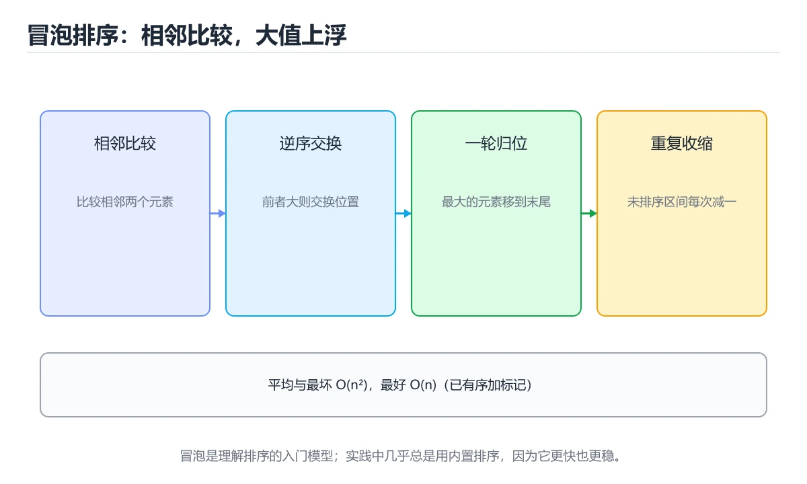
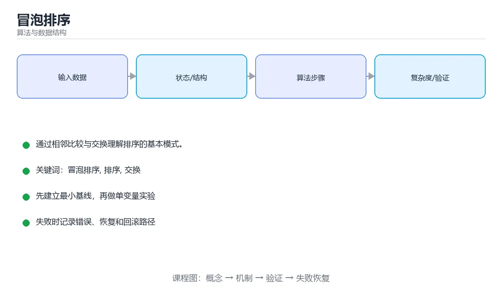

# 冒泡排序





> 内容更新时间：2026-10-06 · 学习阶段：基础 · 预计用时：35 分钟

## 本节知识框架

**课程定位**：所属分类 `algorithms`（算法与数据结构），课程主题 `冒泡排序`，学习阶段 基础，建议用时 45 分钟。

本课主线：通过相邻比较与交换理解排序的基本模式。

**学完本课应当能够**
- 说清 `冒泡排序` 与 `稳定性` 的含义与区别，并各举一个正例和一个反例。
- 用本课示例验证 `交换排序` 的行为，记录输入、输出与失败条件。
- 遇到「内层循环写成 `range(n)`」这类问题时，能说出触发条件与修复顺序。

### 复习清单

- [ ] 能不看正文复述本课核心术语，并指出一个边界或反例。
- [ ] 能运行或推演本课示例，记录输入、输出与失败现象。
- [ ] 能完成一次自测，并把错题对照错误表定位原因。

## 核心概念定义

| 术语 | 操作性定义 | 常见边界与风险 |
| --- | --- | --- |
| 冒泡排序 | 冒泡排序 = 相邻比较 + 交换 + 提前退出优化。 | 只在「冒泡排序 = 相邻比较 + 交换 + 提前退出优化」这一前提下成立，换输入或换环境要重新验证。 |
| 稳定性 | 相等元素在排序前后相对顺序不变；冒泡只在严格逆序时交换，所以是稳定的。 | 只在「相等元素在排序前后相对顺序不变；冒泡只在严格逆序时交换，所以是稳定的」这一前提下成立，换输入或换环境要重新验证。 |
| 交换排序 | 通过反复比较相邻元素并交换来消除逆序对的排序思路，冒泡与鸡尾酒排序都属于这一类。 | 只在「通过反复比较相邻元素并交换来消除逆序对的排序思路，冒泡与鸡尾酒排序都属于这一类」这一前提下成立，换输入或换环境要重新验证。 |
| 提前退出 | 某一轮没有发生任何交换就说明序列已经有序，可以直接结束循环。 | 易错：最好情况仍是 O(n²)；正确做法是加提前退出。 |

## 原理与运行机制

### 机制总览

**教材衔接：核心思想**

冒泡排序重复遍历数组，比较相邻两个元素，如果顺序不对就交换。每一轮结束后，最大的元素会像气泡一样「浮」到末尾。

**教材衔接：稳定性**

当 `nums[j] > nums[j+1]` 时才交换（注意不是 `>=`），相等元素不会互换位置，因此冒泡排序是**稳定排序**。

**教材衔接：什么时候用它**

冒泡排序效率低，实际工程中很少使用。它的价值在于：

- 理解「交换」和「多轮比较」的基本模式。
- 作为教学示例，帮助建立复杂度和稳定性的直觉。

实际排序请使用语言内置实现，例如 Python 的 `sorted()`，它采用 Timsort，平均 `O(n log n)`。

**教材衔接：冒泡排序实现要点**

```python
def bubble_sort(nums):
    """带提前退出与有序区收缩的冒泡排序。"""
    arr = nums[:]                      # 不改原数组
    n = len(arr)
    for end in range(n - 1, 0, -1):    # 每轮确定一个最大值
        swapped = False
        for i in range(end):
            if arr[i] > arr[i + 1]:
                arr[i], arr[i + 1] = arr[i + 1], arr[i]
                swapped = True
        if not swapped:                # 本轮无交换：已经有序
            break
    return arr

assert bubble_sort([5, 1, 4, 2, 8]) == [1, 2, 4, 5, 8]
assert bubble_sort([]) == []
assert bubble_sort([1]) == [1]
```

| 优化 | 收益 |
| --- | --- |
| `swapped` 标记 | 已有序时最好情况降到 O(n) |
| 收缩右边界 | 每轮少比较一次 |
| 记录最后交换位置 | 后面已有序，可一次跳过更多 |
| 鸡尾酒（双向）冒泡 | 缓解「小元素在末尾」的慢速移动 |

## 典型应用场景

- **内层循环写成 `range(n)`**：典型现象是多比较无效元素；正确做法是应为 `range(end)`。
- **比较写成 `>=`**：典型现象是相等元素被交换，不再稳定；正确做法是用 `>` 保持稳定。
- **忘写 `swapped` 判断**：典型现象是最好情况仍是 O(n²)；正确做法是加提前退出。
- **在函数内直接修改传入列表**：典型现象是调用方数据被改；正确做法是需要时先 `nums[:]` 复制。

### 最小验证场景

- 准备：保留 `python` 示例的原始输入，先记录 `冒泡排序` 的基线输出和完整运行命令。
- 观察：先核对 调用了 `bubble_sort()`，再改变一个与 `冒泡排序` 相关的条件。
- 判定：新结果与 `冒泡排序` 的基线不同不等于错误；只有当差异破坏了 `冒泡排序` 的定义或错误表中的约束，才判定为失败。

### 选择与边界

- 使用 `冒泡排序` 时，先满足它的定义：冒泡排序 = 相邻比较 + 交换 + 提前退出优化；只在「冒泡排序 = 相邻比较 + 交换 + 提前退出优化」这一前提下成立，换输入或换环境要重新验证。
- 使用 `稳定性` 时，先满足它的定义：相等元素在排序前后相对顺序不变；冒泡只在严格逆序时交换，所以是稳定的；只在「相等元素在排序前后相对顺序不变；冒泡只在严格逆序时交换，所以是稳定的」这一前提下成立，换输入或换环境要重新验证。
- 使用 `交换排序` 时，先满足它的定义：通过反复比较相邻元素并交换来消除逆序对的排序思路，冒泡与鸡尾酒排序都属于这一类；只在「通过反复比较相邻元素并交换来消除逆序对的排序思路，冒泡与鸡尾酒排序都属于这一类」这一前提下成立，换输入或换环境要重新验证。
- 使用 `提前退出` 时，先满足它的定义：某一轮没有发生任何交换就说明序列已经有序，可以直接结束循环；易错：最好情况仍是 O(n²)；正确做法是加提前退出。

## 代码/协议/SQL 示例

### 最小可验证示例

```text
初始: 5 3 8 1
第1轮: 3 5 1 8    (8 归位)
第2轮: 3 1 5 8    (5 归位)
第3轮: 1 3 5 8    (3 归位)
```

**教材衔接：手动模拟**

**教材衔接：代码实现**

```python
def bubble_sort(nums):
    n = len(nums)
    for i in range(n - 1):
        swapped = False
        # 每一轮比较到 n-1-i，后面已经有序
        for j in range(n - 1 - i):
            if nums[j] > nums[j + 1]:
                nums[j], nums[j + 1] = nums[j + 1], nums[j]
                swapped = True
        if not swapped:      # 本轮没有交换，说明已经有序
            break
    return nums

print(bubble_sort([5, 3, 8, 1]))  # [1, 3, 5, 8]
```

**教材衔接：深挖「冒泡排序」的边界与代价**

### 一、冒泡排序 的关键句与适用条件

| 正文出处 | 原句 | 用之前先确认 |
| --- | --- | --- |
| 核心思想 | 冒泡排序重复遍历数组，比较相邻两个元素，如果顺序不对就交换。 | 把 冒泡排序 换成边界值时，这一步是否仍然成立 |
| 稳定性 | 当 nums[j] > nums[j+1] 时才交换（注意不是 >=），相等元素不会互换位置，因此冒泡排序是稳定排序。 | 把 冒泡排序 换成边界值时，这一步是否仍然成立 |
| 什么时候用它 | 冒泡排序效率低，实际工程中很少使用。 | 把 冒泡排序 换成边界值时，这一步是否仍然成立 |
| 什么时候用它 | 理解「交换」和「多轮比较」的基本模式。 | 把 交换 换成边界值时，这一步是否仍然成立 |
| 什么时候用它 | 作为教学示例，帮助建立复杂度和稳定性的直觉。 | 把 稳定性 换成边界值时，这一步是否仍然成立 |

### 二、把 冒泡排序 推到边界

下面是本课第一段代码（text），先原样运行一次作为基线：

| 变式 | 怎么改 | 先写下什么 | 观察点 |
| --- | --- | --- | --- |
| 边界输入 | 把 冒泡排序 的输入换成空值或最大值 | 预测输出 | 是否报错、是否静默返回 |
| 只改一处 | 把 冒泡排序 的一个参数改成另一档 | 预测差异来源 | 输出变化能否用本课结论解释 |
| 去掉一步 | 注释掉 冒泡排序 之后的一行 | 预测哪一步先失败 | 错误位置是否与预期一致 |

### 四、测验复盘

| 题号 | 正确答案 | 最容易选错的干扰项 | 复盘动作 |
| --- | --- | --- | --- |
| 1 | O(n²) | O(n) | 把干扰项改写成一句反例，再说明它违反本课哪条前提 |
| 2 | 学习 冒泡排序 时要同时说明输入、输出和失败路径，不能只看正常流程 | 把 排序 的单次运行结果当成所有版本和规模都成立 | 把干扰项改写成一句反例，再说明它违反本课哪条前提 |
| 3 | 只在 nums[j] > nums[j+1] 时交换，相等元素不互换… | 每轮都从头开始（混淆了相邻概念，也没有覆盖题干给出的全部条件） | 把干扰项改写成一句反例，再说明它违反本课哪条前提 |
| 4 | O(n) | O(n log n) | 把干扰项改写成一句反例，再说明它违反本课哪条前提 |
| 5 | 这段代码只做静态声明，没有循环、分支或可观察输出。 | 这段代码包含异常处理分支，失败时会走专门的补救路径。 | 把干扰项改写成一句反例，再说明它违反本课哪条前提 |
| 6 | 0 | （无干扰项） | 把干扰项改写成一句反例，再说明它违反本课哪条前提 |

### 五、离开本课前的自检

**运行方式**：运行 `冒泡排序` 的示例时，保存为 `.py` 文件后用 `python 文件名.py` 运行；第三方依赖先在虚拟环境里安装。

## 时间/空间复杂度或性能分析

**复杂度证据**：本课正文出现 `O(n)`、`O(n²)`、`O(1)`、`O(n log n)`、`O(log n)`、`O(n+k)` 等量级表达式；使用前要同时确认输入规模、最好/平均/最坏情况以及常数项来源。

**教材衔接：复杂度分析**

| 情况 | 时间复杂度 | 说明 |
| --- | --- | --- |
| 最好 | `O(n)` | 数组本来有序，一轮后提前退出 |
| 平均 | `O(n²)` | 需要约 n²/2 次比较 |
| 最坏 | `O(n²)` | 完全逆序 |
| 空间 | `O(1)` | 只在原数组上交换 |

| 版本 | 已有序数组 | 逆序数组 | 说明 |
| --- | --- | --- | --- |
| 朴素双层循环 | O(n²) | O(n²) | 无法感知已有序 |
| 加提前退出 | **O(n)** | O(n²) | 一趟扫描就能发现有序 |
| 加记录最后交换位置 | O(n) | 接近 O(n²) | 每轮边界快速收缩 |

| 维度 | 冒泡排序 | 插入排序 |
| --- | --- | --- |
| 平均时间 | O(n²) | O(n²) |
| 最好情况 | O(n)（加提前退出） | O(n) |
| 交换次数 | 多（相邻交换，逆序时约 n²/2） | 少（移动而非交换） |
| 近乎有序时 | 尚可 | **更好** |
| 稳定性 | 稳定 | 稳定 |

```text
结论：同样是 O(n²)，插入排序在真实数据上几乎总是更快，
      因为它每次只移动一个元素，而冒泡每次交换要写两次内存。
```

| 场景 | 是否合适 | 说明 |
| --- | --- | --- |
| 元素个数 < 10 | 可以 | 开销小，代码简单 |
| 数据近乎有序 | 可以 | 提前退出后接近 O(n) |
| 教学与演示 | 推荐 | 讲解排序与稳定性 |
| 数据量上千 | 不合适 | 换插入排序或 O(n log n) 算法 |
| 数据量上万 | 禁止 | 换快排、归并或语言内置排序 |

- [ ] 能写出带提前退出的版本，并说明最好情况为何是 O(n)
- [ ] 知道「记录最后交换位置」优化了什么
- [ ] 能解释冒泡为什么稳定、选择排序为什么不稳定
- [ ] 知道插入排序在近乎有序数据上更优
- [ ] 清楚生产环境应当直接使用内置排序

**测量方法**：以 `冒泡排序` 的 `冒泡排序` 场景为对象，固定输入跑一遍记录基线，再把规模或并发度提高一个数量级复测；两次结果的差值与波动范围才是结论依据。

## 常见误区与易错点

| 容易写错的做法 | 实际现象 | 原因与正确做法 |
| --- | --- | --- |
| 内层循环写成 `range(n)` | 多比较无效元素 | 应为 `range(end)` |
| 比较写成 `>=` | 相等元素被交换，不再稳定 | 用 `>` 保持稳定 |
| 忘写 `swapped` 判断 | 最好情况仍是 O(n²) | 加提前退出 |
| 在函数内直接修改传入列表 | 调用方数据被改 | 需要时先 `nums[:]` 复制 |
| 交换写成 `a = b; b = a` | 值丢失 | 用元组交换或临时变量 |
| 认为冒泡用于生产 | 大数组极慢 | 实际用内置 `sorted` / `sort` |
| 边界处理空数组与单元素 | 越界或多余循环 | 用 `if not arr: return arr` 或循环条件自然处理 |
| 把稳定当成通用性质 | 选择排序并不稳定 | 逐算法确认 |
| 用冒泡排链表 | 指针操作复杂易错 | 链表用归并排序 |
| 忘记验证结果 | 边界用例漏测 | 至少覆盖空、单元素、重复、逆序 |
| 内层循环写成 range(n) | 多比较无效元素。 | 应为 range(end)。 |
| 比较写成 >= | 相等元素被交换，不再稳定。 | 用 > 保持稳定。 |

### 现场 1：内层循环写成 `range(n)`

**症状**：多比较无效元素。

**根因与修复**：应为 `range(end)`。

**自检**：在本课示例里复现「内层循环写成 `range(n)`」，改成应为 `range(end)`后重跑；如果症状消失且失败路径按预期变化，说明定位正确。

### 现场 2：比较写成 `>=`

**症状**：相等元素被交换，不再稳定。

**根因与修复**：用 `>` 保持稳定。

**自检**：在本课示例里复现「比较写成 `>=`」，改成用 `>` 保持稳定后重跑；如果症状消失且失败路径按预期变化，说明定位正确。

### 现场 3：忘写 `swapped` 判断

**症状**：最好情况仍是 O(n²)。

**根因与修复**：加提前退出。

**自检**：在本课示例里复现「忘写 `swapped` 判断」，改成加提前退出后重跑；如果症状消失且失败路径按预期变化，说明定位正确。

### 现场 4：在函数内直接修改传入列表

**症状**：调用方数据被改。

**根因与修复**：需要时先 `nums[:]` 复制。

**自检**：在本课示例里复现「在函数内直接修改传入列表」，改成需要时先 `nums[:]` 复制后重跑；如果症状消失且失败路径按预期变化，说明定位正确。

### 现场 5：交换写成 `a = b; b = a`

**症状**：值丢失。

**根因与修复**：用元组交换或临时变量。

**自检**：在本课示例里复现「交换写成 `a = b; b = a`」，改成用元组交换或临时变量后重跑；如果症状消失且失败路径按预期变化，说明定位正确。

### 现场 6：认为冒泡用于生产

**症状**：大数组极慢。

**根因与修复**：实际用内置 `sorted` / `sort`。

**自检**：在本课示例里复现「认为冒泡用于生产」，改成实际用内置 `sorted` / `sort`后重跑；如果症状消失且失败路径按预期变化，说明定位正确。

### 现场 7：边界处理空数组与单元素

**症状**：越界或多余循环。

**根因与修复**：用 `if not arr: return arr` 或循环条件自然处理。

**自检**：在本课示例里复现「边界处理空数组与单元素」，改成用 `if not arr: return arr` 或循环条件自然处理后重跑；如果症状消失且失败路径按预期变化，说明定位正确。

### 现场 8：把稳定当成通用性质

**症状**：选择排序并不稳定。

**根因与修复**：逐算法确认。

**自检**：在本课示例里复现「把稳定当成通用性质」，改成逐算法确认后重跑；如果症状消失且失败路径按预期变化，说明定位正确。

### 现场 9：用冒泡排链表

**症状**：指针操作复杂易错。

**根因与修复**：链表用归并排序。

**自检**：在本课示例里复现「用冒泡排链表」，改成链表用归并排序后重跑；如果症状消失且失败路径按预期变化，说明定位正确。

## 与其他知识点的关系

**教材衔接：排序算法对照表**

| 算法 | 平均 | 最坏 | 空间 | 稳定 | 适用场景 |
| --- | --- | --- | --- | --- | --- |
| 冒泡排序 | O(n²) | O(n²) | O(1) | 是 | 教学、近乎有序的小数组 |
| 插入排序 | O(n²) | O(n²) | O(1) | 是 | 小数组、近乎有序 |
| 选择排序 | O(n²) | O(n²) | O(1) | 否 | 交换次数要求最少 |
| 归并排序 | O(n log n) | O(n log n) | O(n) | 是 | 需要稳定、链表排序 |
| 快速排序 | O(n log n) | O(n²) | O(log n) | 否 | 通用最快，缓存友好 |
| 堆排序 | O(n log n) | O(n log n) | O(1) | 否 | 内存受限、取 TopK |
| 计数/基数排序 | O(n+k) | O(n+k) | O(n+k) | 是 | 整数、范围有限 |

- **先修**：`二分查找`。本课默认这些内容已经掌握。
- **相关或后续**：`时间复杂度`。本课术语会在这些课程里继续使用。
- **术语归属**：`冒泡排序`、`稳定性`、`交换排序` 的定义以本课「核心概念定义」为准，换到其他课程时先确认定义是否被改写。
- 同一分类的《排序算法家族》也涉及 `排序`；两课衔接时先确认这个术语的定义是否一致。

## 自测题与参考答案

> 先独立作答，再对照参考答案；答案都能在本课正文、术语表或错误表里找到依据。

### 自测 1（概念复述）

不看正文，写出 `冒泡排序` 的操作性定义，并说明它与 `稳定性` 的区别。

**参考答案**：冒泡排序 = 相邻比较 + 交换 + 提前退出优化。

`稳定性` 的定位是：相等元素在排序前后相对顺序不变；冒泡只在严格逆序时交换，所以是稳定的；两者的差别要从适用对象与失败模式上说明。

### 自测 2（排错）

本课错误表记录了「内层循环写成 `range(n)`」这类做法。请写出它会出现的现象、根因，以及修复顺序。

**参考答案**：现象是多比较无效元素；正确做法是应为 `range(end)`。修复时先复现现象并保留证据，再改动一处假设重跑，确认现象消失。

### 自测 3（动手验证）

运行本课的 `python` 示例，把其中的 `"带提前退出与有序区收缩的冒泡排序。"` 换成一个边界值后重新运行，记录输出与错误信息。

**参考答案**：正常输入下 `python` 示例应当复现正文给出的结果；把 `"带提前退出与有序区收缩的冒泡排序。"` 换成边界值后，如果结果改变或报错，先核对它是否满足 `冒泡排序` 中`冒泡排序` 的适用范围，再检查错误表里是否有同类现象。

### 自测 4（代码阅读）

阅读本课开头的 `python` 示例，说明它体现了`冒泡排序` 的哪一条性质，并指出改动哪个输入会让这条性质不再成立。

**参考答案**：`冒泡排序` 的定义是 冒泡排序 = 相邻比较 + 交换 + 提前退出优化，示例正是在实现这条定义。改动与 `冒泡排序` 有关的一个输入后，如果结果不再符合 `冒泡排序` 的正文描述，就说明该性质只在当前前提成立。

### 自测 5（迁移）

把 `冒泡排序` 的方法迁移到自己的项目：围绕 `冒泡排序` 写出一个与错误表同类的风险点，并说明触发条件和检验方式。

**参考答案**：例如「比较写成 >=」，它会导致相等元素被交换，不再稳定；检验方式是按用 > 保持稳定改一处再复现，确认现象消失且没有引入新的失败分支。

### 自测 6（对比）

用一个表格对比 `冒泡排序` 与 `稳定性`：各写一行适用场景、一行失败表现。

**参考答案**：`冒泡排序` 的定义是冒泡排序 = 相邻比较 + 交换 + 提前退出优化；`稳定性` 的定义是相等元素在排序前后相对顺序不变；冒泡只在严格逆序时交换，所以是稳定的。两者的失败表现分别对应本课错误表里与本术语相关的行。

### 自测 7（排错顺序）

面对「内层循环写成 `range(n)`」引发的问题，请把“复现 多比较无效元素 → 保留证据 → 应为 `range(end)` → 回归验证”四步写成可执行的检查清单。

**参考答案**：第一步按多比较无效元素复现；第二步记录输入、版本与完整报错；第三步按应为 `range(end)`只改一处；第四步重跑并确认失败路径也按预期变化。

### 自测 8（边界判断）

针对 `提前退出`，分别写出“可以使用”的条件和“结论不再成立”的条件。

**参考答案**：易错：最好情况仍是 O(n²)；正确做法是加提前退出。 同时要把 `提前退出` 的定义 某一轮没有发生任何交换就说明序列已经有序，可以直接结束循环 与实际输入逐项对照。

### 自测 9（机制重建）

不看正文，按输入、转换、输出、验证四段重建 `冒泡排序` → `稳定性` → `交换排序` → `提前退出` 的作用链。

**参考答案**：起点是 `冒泡排序` 的定义 冒泡排序 = 相邻比较 + 交换 + 提前退出优化；中间每一步都保留可观察状态；终点由 `提前退出` 检查，失败时回到错误表定位第一个偏离定义的步骤。

### 自测 10（综合排错）

在 `冒泡排序` 中，现象是 相等元素被交换，不再稳定。请围绕 比较写成 >= 写出最小复现、关键证据、修复动作和回归验证，并说明为什么不能只凭一次运行下结论。

**参考答案**：先复现 比较写成 >=，记录输入与完整错误；再按 用 > 保持稳定 只改一处。回归时同时跑正常路径和边界路径，只有两次结果都可解释，才把修复视为完成。

### 自测 11（一分钟复述）

用每分钟约 200 字的速度复述 `冒泡排序`：先给主问题，再按顺序说出 `冒泡排序`、`稳定性`、`交换排序`、`提前退出`，最后给一个失败案例。

**自评标准**：主问题必须对应 通过相邻比较与交换理解排序的基本模式；每个术语都要能接上一句定义或边界；失败案例必须写成可观察现象，不能用“可能有风险”代替证据。

## 术语速查

| 术语 | 一句话说明 |
| --- | --- |
| `冒泡排序` | 冒泡排序 = 相邻比较 + 交换 + 提前退出优化。 |
| `稳定性` | 相等元素在排序前后相对顺序不变；冒泡只在严格逆序时交换，所以是稳定的。 |
| `交换排序` | 通过反复比较相邻元素并交换来消除逆序对的排序思路，冒泡与鸡尾酒排序都属于这一类。 |
| `提前退出` | 某一轮没有发生任何交换就说明序列已经有序，可以直接结束循环。 |

**术语关系**：`冒泡排序`（冒泡排序 = 相邻比较 + 交换 + 提前退出优化） → `稳定性`（相等元素在排序前后相对顺序不变） → `交换排序`（通过反复比较相邻元素并交换来消除逆序对的排序思路） → `提前退出`（某一轮没有发生任何交换就说明序列已经有序）。

## 考点精讲

`冒泡排序` 的题库有 6 道题，下面逐题给出题干、正确项与判断依据：先自己作答，再核对正确项，最后回到正文对应小节复核。

### 考点 1：第 1 题

- **题目**：冒泡排序最坏情况的时间复杂度是？
- **正确项**：O(n²)
- **判断依据**：本题正确项是O(n²)。术语 冒泡排序（冒泡排序）：冒泡排序 = 相邻比较 + 交换 + 提前退出优化，本题取O(n²)这条。易错点是内层循环写成 `range(n)`会造成多比较无效元素，改法是应为 `range(end)`，判断时先确认输入和适用范围，对照 `冒泡排序`、`排序`、`交换`、`稳定性` 复现一次，最后把错误表现与正确做法逐项对照，干扰项O(n)正踩在这条上。

### 考点 2：第 2 题

- **题目**：围绕“冒泡排序”中的 冒泡排序、排序、交换，下列哪两项是本课强调的实践判断？
- **正确项**：学习 冒泡排序 时要同时说明输入、输出和失败路径，不能只看正常流程；验证 排序 时要固定版本并覆盖边界输入，结论才可复现
- **判断依据**：本题正确项是学习 冒泡排序 时要同时说明输入、输出和失败路径，不能只看正常流程。术语 冒泡排序（冒泡排序）：冒泡排序 = 相邻比较 + 交换 + 提前退出优化，本题取学习 冒泡排序 时要同时说明输入、输出和失败路径，不能只看正常流程这条。易错点是内层循环写成 `range(n)`会造成多比较无效元素，改法是应为 `range(end)`，干扰项把 排序 的单次运行结果当成所有版本和规模都成立正踩在这条上。

### 考点 3：第 3 题

- **题目**：冒泡排序是稳定排序的原因是什么？
- **正确项**：只在相邻元素严格逆序时才交换
- **判断依据**：本题正确项是只在相邻元素严格逆序时才交换。术语 冒泡排序（冒泡排序）：冒泡排序 = 相邻比较 + 交换 + 提前退出优化，本题取只在相邻元素严格逆序时才交换这条。易错点是内层循环写成 `range(n)`会造成多比较无效元素，改法是应为 `range(end)`，干扰项比较次数固定正踩在这条上。

### 考点 4：第 4 题

- **题目**：带 swapped 优化的冒泡排序，最好情况的时间复杂度是？
- **正确项**：O(n)
- **判断依据**：术语 冒泡排序（冒泡排序）：冒泡排序 = 相邻比较 + 交换 + 提前退出优化，本题取O(n)这条。易错点是内层循环写成 `range(n)`会造成多比较无效元素，改法是应为 `range(end)`，判断时先确认输入和适用范围，对照 `冒泡排序`、`排序`、`交换`、`稳定性` 复现一次，最后把错误表现与正确做法逐项对照，干扰项O(1)正踩在这条上。

### 考点 5：第 5 题

- **题目**：阅读 `冒泡排序` 的 `冒泡排序` 示例。它服务于通过相邻比较与交换理解排序的基本模式。代码中实际包含下列哪一项？
- **正确项**：调用了 `bubble_sort()`
- **判断依据**：本题正确项是调用了 `bubble_sort()`。术语 冒泡排序（冒泡排序）：冒泡排序 = 相邻比较 + 交换 + 提前退出优化，本题取调用了 `bubble_sort()`这条。易错点是内层循环写成 `range(n)`会造成多比较无效元素，改法是应为 `range(end)`，干扰项调用了 `compile()`正踩在这条上。

### 考点 6：第 6 题

- **题目**：填空：补齐下面这段术语说明中的空缺。课程 `通过相邻比较与交换理解排序的基本模式。`，这段说明是：`____` = 相邻比较 + 交换 + 提前退出优化。空缺处应填哪个术语？
- **正确项**：冒泡排序
- **判断依据**：涉及术语 冒泡排序：冒泡排序 = 相邻比较 + 交换 + 提前退出优化。易错点：内层循环写成 `range(n)`会造成多比较无效元素。正确做法：应为 `range(end)`。判断时先确认输入和适用范围，对照 `冒泡排序`、`排序`、`交换`、`稳定性` 复现一次，最后把错误表现与正确做法逐项对照。

### 考点 7：`冒泡排序`

- **要点**：冒泡排序 = 相邻比较 + 交换 + 提前退出优化。
- **冒泡排序 的边界**：只在「冒泡排序 = 相邻比较 + 交换 + 提前退出优化」这一前提下成立，换输入或换环境要重新验证。

### 考点 8：`稳定性`

- **要点**：相等元素在排序前后相对顺序不变；冒泡只在严格逆序时交换，所以是稳定的。
- **稳定性 的边界**：只在「相等元素在排序前后相对顺序不变；冒泡只在严格逆序时交换，所以是稳定的」这一前提下成立，换输入或换环境要重新验证。

### 考点 9：`交换排序`

- **要点**：通过反复比较相邻元素并交换来消除逆序对的排序思路，冒泡与鸡尾酒排序都属于这一类。
- **交换排序 的边界**：只在「通过反复比较相邻元素并交换来消除逆序对的排序思路，冒泡与鸡尾酒排序都属于这一类」这一前提下成立，换输入或换环境要重新验证。

### 考点 10：`提前退出`

- **要点**：某一轮没有发生任何交换就说明序列已经有序，可以直接结束循环。
- **提前退出 的边界**：易错：最好情况仍是 O(n²)；正确做法是加提前退出。

### 考点 11：排错——内层循环写成 `range(n)`

- **现象**：多比较无效元素。
- **处理**：应为 `range(end)`。

### 考点 12：排错——比较写成 `>=`

- **现象**：相等元素被交换，不再稳定。
- **处理**：用 `>` 保持稳定。

### 考点 13：综合辨析——`冒泡排序` 与 `提前退出`

- **辨析点**：`冒泡排序` 的定义是 冒泡排序 = 相邻比较 + 交换 + 提前退出优化；`提前退出` 的定义是 某一轮没有发生任何交换就说明序列已经有序，可以直接结束循环。
- **答题要求**：面对 `冒泡排序` 的题目，先判断描述的是 `冒泡排序` 还是 `提前退出`，再归到对应定义，最后写出一个会让该定义失效的边界输入。

### 考点 14：排错评分点

- **现象分**：能写出 多比较无效元素，而不是只写“程序有错”。
- **证据分**：保留触发 内层循环写成 `range(n)` 的输入、版本和错误原文。
- **修复分**：按 应为 `range(end)` 只改一处，并同时回归正常路径与边界路径。

## 内容元数据

- 内容版本：v2.0
- 最后更新：2026-10-06
- 学习阶段：基础
- 适用环境：任意主流语言（伪代码与复杂度为主）
；本课聚焦 冒泡排序。
- 内容来源：内置结构化课程与工程实践整理
- 相关主题：冒泡排序、排序、交换、稳定性、O(n²)
- 质量版本：P0 测验标准 + P1 覆盖扩展 + P2 体验补全

## 参考资料与复核

- [本课资料锚点 bubble_sort](https://zh.wikipedia.org/w/index.php?search=bubble_sort)

- 最后复核：2026-10-04
- 下次复核：2027-05-24
- 复核范围：版本兼容、API 行为、安全建议与工程实践
- 来源性质：官方文档、标准或权威教材；本课核对关键词：冒泡排序、排序、交换、稳定性、O(n²)。

| 参考资料 | 本课用途 |
| --- | --- |
| [CP-Algorithms](https://cp-algorithms.com/) | 算法实现与复杂度 |
| [MIT 6.006](https://ocw.mit.edu/courses/6-006-introduction-to-algorithms-spring-2020/) | 算法设计与分析 |
| [Princeton Algorithms](https://algs4.cs.princeton.edu/home/) | 经典算法与数据结构教材 |

| [本课术语索引：冒泡排序](#核心概念定义) | 按本课输入、术语边界和错误表现逐项核对 |
> 「冒泡排序」的链接用于离线阅读后的延伸核对；App 不会自动联网。

<!-- p1-deep-dive:start -->