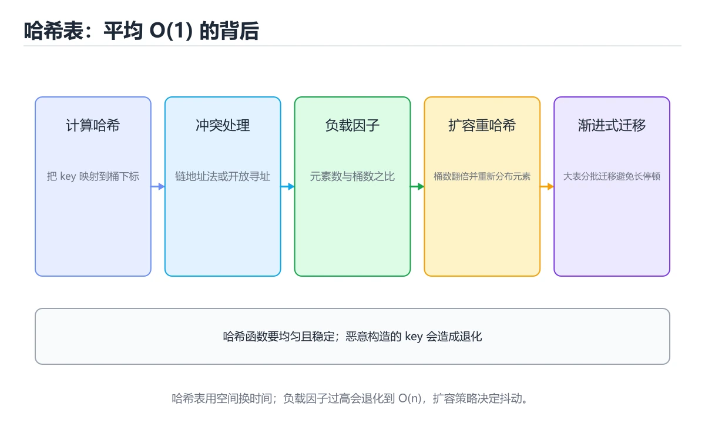
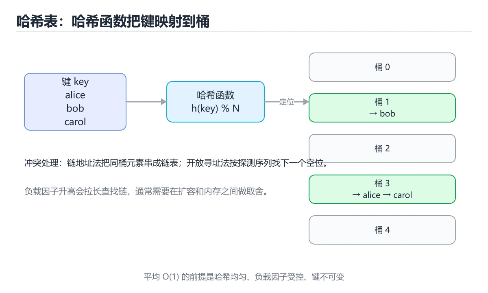
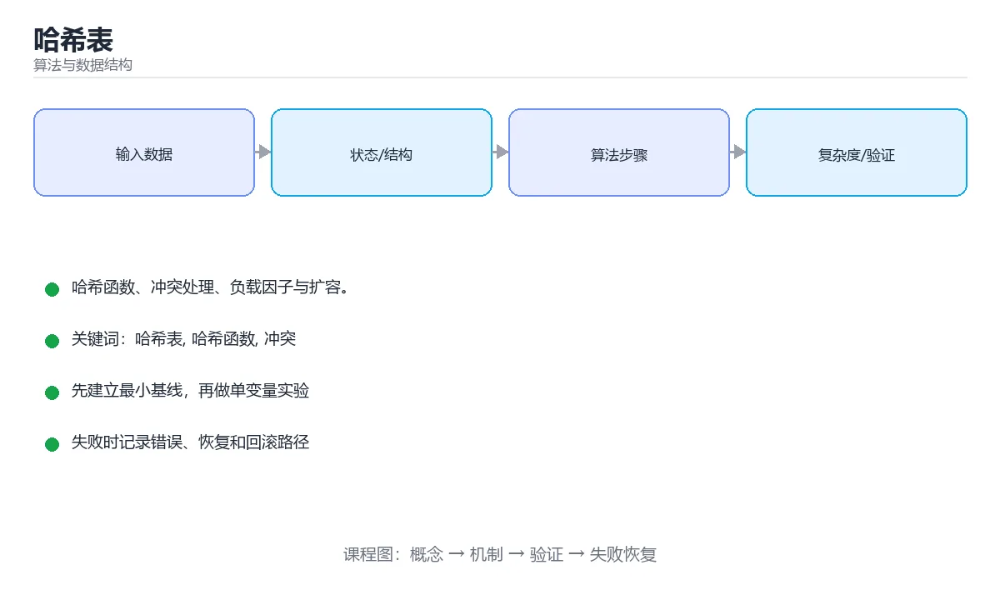

# 哈希表







> 内容更新时间：2026-10-06 · 学习阶段：基础 · 预计用时：40 分钟

## 本节知识框架

**课程定位**：所属分类 `algorithms`（算法与数据结构），课程主题 `哈希表`，学习阶段 基础，建议用时 45 分钟。

本课主线：哈希函数、冲突处理、负载因子与扩容。

**学完本课应当能够**
- 说清 `hashCode` 与 `哈希表` 的含义与区别，并各举一个正例和一个反例。
- 用本课示例验证 `负载因子` 的行为，记录输入、输出与失败条件。
- 遇到「哈希函数质量差」这类问题时，能说出触发条件与修复顺序。

### 复习清单

- [ ] 能不看正文复述本课核心术语，并指出一个边界或反例。
- [ ] 能运行或推演本课示例，记录输入、输出与失败现象。
- [ ] 能完成一次自测，并把错题对照错误表定位原因。

## 核心概念定义

| 术语 | 操作性定义 | 常见边界与风险 |
| --- | --- | --- |
| hashCode | 自定义对象要正确实现 hashCode 与 equals（Java/C#），否则查不到。 | 只在「自定义对象要正确实现 hashCode 与 equals（Java/C#），否则查不到」这一前提下成立，换输入或换环境要重新验证。 |
| 哈希表 | 哈希表 = 哈希函数 + 冲突处理 + 动态扩容。 | 易错：遍历顺序与插入不一致；正确做法是需要顺序用 `dict`（3.7+ 保序）或有序结构。 |
| 负载因子 | 负载因子 = 元素个数 / 桶数量。 | 易错：探测和链表变长；正确做法是设置阈值并触发扩容。 |
| 哈希冲突 | 不同键映射到同一个桶的现象，用链地址法或开放寻址解决，冲突率由哈希质量与负载因子决定。 | 只在「不同键映射到同一个桶的现象，用链地址法或开放寻址解决，冲突率由哈希质量与负载因子决定」这一前提下成立，换输入或换环境要重新验证。 |

## 原理与运行机制

### 机制总览

**教材衔接：哈希冲突**

不同键映射到同一位置称为冲突，两种主流解决方案：

| 方案 | 做法 | 特点 |
| --- | --- | --- |
| 链地址法 | 每个桶挂一个链表/红黑树 | Java HashMap 采用，冲突多时树化 |
| 开放寻址 | 冲突时按规则找下一个空槽 | 缓存友好，删除需标记 |

**教材衔接：使用前提**

- 键必须可哈希且**不可变**（list 不能当 dict 的键，tuple 可以）。
- 自定义对象要正确实现 `hashCode` 与 `equals`（Java/C#），否则查不到。
- 哈希表不保证顺序；需要有序要用 TreeMap/TreeSet 或排序。
- 最坏情况（全部冲突）退化为 `O(n)`。

**失败路径（来自本课错误表）**
- 哈希函数质量差 → 大量冲突导致性能退化到 O(n) → 使用经过验证的哈希并做分布测试。
- 负载因子过高不扩容 → 探测和链表变长 → 设置阈值并触发扩容。
- 开放寻址删除直接清空 → 后续查找中断 → 使用墓碑标记或重排。
- 在多线程中无锁修改 → 数据损坏或死循环 → 使用锁、分片或并发安全结构。

## 典型应用场景

- **哈希函数质量差**：典型现象是大量冲突导致性能退化到 O(n)；正确做法是使用经过验证的哈希并做分布测试。
- **负载因子过高不扩容**：典型现象是探测和链表变长；正确做法是设置阈值并触发扩容。
- **开放寻址删除直接清空**：典型现象是后续查找中断；正确做法是使用墓碑标记或重排。
- **在多线程中无锁修改**：典型现象是数据损坏或死循环；正确做法是使用锁、分片或并发安全结构。

### 最小验证场景

- 准备：保留 `text` 示例的原始输入，先记录 `哈希表` 的基线输出和完整运行命令。
- 观察：先核对 调用了 `hash()`，再改变一个与 `hashCode` 相关的条件。
- 判定：新结果与 `哈希表` 的基线不同不等于错误；只有当差异破坏了 `hashCode` 的定义或错误表中的约束，才判定为失败。

### 选择与边界

- 使用 `hashCode` 时，先满足它的定义：自定义对象要正确实现 `hashCode` 与 `equals`（Java/C#），否则查不到；只在「自定义对象要正确实现 `hashCode` 与 `equals`（Java/C#），否则查不到」这一前提下成立，换输入或换环境要重新验证。
- 使用 `哈希表` 时，先满足它的定义：哈希表 = 哈希函数 + 冲突处理 + 动态扩容；易错：遍历顺序与插入不一致；正确做法是需要顺序用 `dict`（3.7+ 保序）或有序结构。
- 使用 `负载因子` 时，先满足它的定义：负载因子 = 元素个数 / 桶数量；易错：探测和链表变长；正确做法是设置阈值并触发扩容。
- 使用 `哈希冲突` 时，先满足它的定义：不同键映射到同一个桶的现象，用链地址法或开放寻址解决，冲突率由哈希质量与负载因子决定；只在「不同键映射到同一个桶的现象，用链地址法或开放寻址解决，冲突率由哈希质量与负载因子决定」这一前提下成立，换输入或换环境要重新验证。

## 代码/协议/SQL 示例

### 最小可验证示例

```text
key = "apple"
hash("apple") = 1037  ->  1037 % 16 = 13  ->  桶 13
```

**教材衔接：核心思想**

哈希表用**哈希函数**把键映射到数组下标，实现平均 `O(1)` 的插入、查找与删除。它用空间换时间，是字典、缓存、去重的底层结构。

```text
key = "apple"
hash("apple") = 1037  ->  1037 % 16 = 13  ->  桶 13
```

**教材衔接：负载因子与扩容**

```text
负载因子 = 元素个数 / 桶数量
```

负载因子过高冲突变多，通常超过 0.75 就扩容（桶数量翻倍）并重新哈希（rehash）。

**教材衔接：代码示例**

```python
# 用字典统计词频（哈希表的典型应用）
words = "the cat the dog the".split()
counter = {}
for word in words:
    counter[word] = counter.get(word, 0) + 1
print(counter)          # {'the': 3, 'cat': 1, 'dog': 1}
```

```python
# 简化版哈希表（链地址法）
class SimpleMap:
    def __init__(self, size=16):
        self.buckets = [[] for _ in range(size)]

    def _index(self, key):
        return hash(key) % len(self.buckets)

    def put(self, key, value):
        bucket = self.buckets[self._index(key)]
        for i, (k, _) in enumerate(bucket):
            if k == key:
                bucket[i] = (key, value)
                return
        bucket.append((key, value))

    def get(self, key, default=None):
        for k, v in self.buckets[self._index(key)]:
            if k == key:
                return v
        return default
```

**教材衔接：关键参数速查**

| 参数 | 典型值 | 说明 |
| --- | --- | --- |
| 初始容量 | 16 | 太小会频繁扩容 |
| 负载因子 | 0.75 | 超过即扩容，空间与冲突的平衡 |
| 树化阈值（Java） | 链表长度 8 | 链表转红黑树 |
| 退化阈值 | 长度 6 | 红黑树转回链表 |
| 扩容倍数 | 2 倍 | 保证重哈希分布更均匀 |

```python
# Python 字典就是哈希表：判断存在性 O(1)
counts = {}
for word in words:
    counts[word] = counts.get(word, 0) + 1

# 用 set 做去重与存在性判断，比 list 快得多
seen = set()
duplicates = [x for x in items if x in seen or seen.add(x)]

# 自定义类型参与哈希：必须同时实现 __hash__ 与 __eq__
class Point:
    __slots__ = ("x", "y")

    def __init__(self, x, y):
        self.x, self.y = x, y

    def __hash__(self):
        return hash((self.x, self.y))     # 用不可变字段组合

    def __eq__(self, other):
        return isinstance(other, Point) and (self.x, self.y) == (other.x, other.y)
```

**教材衔接：深入补充：哈希表**

前面已经建立了基本概念。这一节换一个角度，把哈希表放进真实工程里，
重点回答三件事：哈希表 为什么存在、内部如何运转、什么时候会失效。

### 一、核心模型

哈希表用哈希函数把键映射到桶，以接近 O(1) 的平均时间完成查找、插入和删除；性能取决于哈希质量、冲突处理和负载因子控制。

```text
计算哈希 → 映射到桶 → 比较键 → 命中返回/冲突探测 → 插入或更新 → 超过负载因子扩容
```

### 二、关键机制拆解

1. 哈希函数应把键均匀分散，并保持相等键必须有相同哈希值。
2. 链地址法把冲突元素放入链表或红黑树，开放寻址法在表内探测下一个空位。
3. 负载因子是元素数与桶数之比，过高会增加冲突，过低会浪费空间。
4. 扩容需要重新分配元素，通常采用倍增策略把均摊成本降为 O(1)。
5. 开放寻址删除需要使用墓碑标记，不能直接把位置清空。
6. 哈希表不保证顺序；需要有序遍历时应使用有序结构或额外排序。
7. 恶意构造的键可能造成哈希碰撞攻击，必要时使用随机盐或安全哈希。

### 三、对照表：抓住容易混淆的边界

| 维度 | 一侧 | 另一侧 |
| --- | --- | --- |
| 链地址法 | 每个桶挂链表或树 | 实现简单，指针开销较大 |
| 开放寻址 | 冲突时在表内探测 | 缓存友好但删除复杂 |
| 哈希表 | 平均 O(1) 查找 | 不保证顺序，最坏可能退化 |
| 平衡树 | O(log n) 有序操作 | 稳定但常数和实现复杂度更高 |

### 四、工作示例

实现 LRU 缓存时，用哈希表保存键到链表节点，用双向链表维护访问顺序。哈希表提供 O(1) 定位，链表提供 O(1) 移动和淘汰，两者组合优于单独使用。

### 五、常见误区与失效边界

| 错误做法或假设 | 后果 | 正确做法 |
| --- | --- | --- |
| 哈希函数质量差 | 大量冲突导致性能退化到 O(n) | 使用经过验证的哈希并做分布测试 |
| 负载因子过高不扩容 | 探测和链表变长 | 设置阈值并触发扩容 |
| 开放寻址删除直接清空 | 后续查找中断 | 使用墓碑标记或重排 |
| 在多线程中无锁修改 | 数据损坏或死循环 | 使用锁、分片或并发安全结构 |

### 六、场景推演

服务在处理大量相似字符串时 CPU 飙升。分析发现哈希碰撞率高，链表退化成线性扫描。更换哈希函数并调整容量后，冲突下降、延迟恢复稳定。

### 七、自测问答

**Q1：哈希表平均 O(1) 的前提是什么？**

哈希分布均匀且负载因子受控。

**Q2：链地址法和开放寻址的取舍是什么？**

前者实现简单但指针多，后者缓存友好但删除复杂。

**Q3：为什么扩容要倍增？**

倍增让元素重新分配的均摊成本保持 O(1)。

**Q4：哈希碰撞攻击如何缓解？**

使用随机盐、安全哈希和容量限制。

### 八、小项目：把知识变成可检查的产出

实现链地址法和开放寻址法两个哈希表，使用同一组键测试插入、查找、删除和扩容；统计冲突次数、平均探测长度和不同负载因子下的耗时。

### 九、适用边界

哈希表适合等值查找，不适合范围查询和有序遍历。若需要顺序、前缀或范围能力，应选择树、跳表或专用索引。

### 十、完成检查清单

- [ ] 能设计哈希函数和冲突策略
- [ ] 能分析负载因子与扩容
- [ ] 能正确处理开放寻址删除
- [ ] 能识别最坏情况退化
- [ ] 能用哈希表组合实现缓存结构

### 十一、复习顺序

1. 用自己的话说明 SimpleMap 的作用，再说出它不适用的情况。
2. 再对照表逐行解释容易混淆的概念，每个概念补一个反例。
3. 跟着工作示例做一遍，改变一个条件并预测结果。
4. 用自测问答检查理解，错题回到对应小节重新阅读。
5. 把 哈希函数 的实现、测试与复盘整理成一份可提交的产物。

> 复习不是重读一遍，而是离开原文重新产出：复述、改写、验证、复盘。

## 时间/空间复杂度或性能分析

**复杂度证据**：本课正文出现 `O(1)`、`O(n)`、`O(n²)`、`O(log n)` 等量级表达式；使用前要同时确认输入规模、最好/平均/最坏情况以及常数项来源。

**测量方法**：以 `哈希表` 的 `哈希表` 场景为对象，固定输入跑一遍记录基线，再把规模或并发度提高一个数量级复测；两次结果的差值与波动范围才是结论依据。

## 常见误区与易错点

| 容易写错的做法 | 实际现象 | 原因与正确做法 |
| --- | --- | --- |
| 哈希函数质量差 | 大量冲突导致性能退化到 O(n) | 使用经过验证的哈希并做分布测试 |
| 负载因子过高不扩容 | 探测和链表变长 | 设置阈值并触发扩容 |
| 开放寻址删除直接清空 | 后续查找中断 | 使用墓碑标记或重排 |
| 在多线程中无锁修改 | 数据损坏或死循环 | 使用锁、分片或并发安全结构 |
| 用可变对象作键 | `TypeError: unhashable` 或查不到 | 用不可变对象作键 |
| 自定义类只实现 `__eq__` | 实例不可哈希 | 同时实现 `__hash__` |
| 哈希值随字段变化 | 放进集合后「消失」 | 哈希依赖的字段必须不可变 |
| 哈希函数总返回常量 | 全部冲突，退化成 O(n) | 让哈希均匀分布 |
| 用 `list` 做存在性判断 | 循环中 O(n²) | 改用 `set` / `dict` |
| 遍历字典时修改 | `RuntimeError: dictionary changed size` | 先收集键，再统一修改 |
| 认为哈希表有序 | 遍历顺序与插入不一致 | 需要顺序用 `dict`（3.7+ 保序）或有序结构 |
| 负载因子过高不扩容 | 冲突激增、性能骤降 | 合理设置初始容量 |
| 用哈希值判断相等 | 不同对象哈希可能相同 | 哈希相同是必要条件，还需比较值 |
| 在哈希键里用浮点 | 精度问题导致查不到 | 用整数或字符串键 |
| 自定义类只实现 __eq__ | 实例不可哈希。 | 同时实现 __hash__。 |

### 现场 1：哈希函数质量差

**症状**：大量冲突导致性能退化到 O(n)。

**根因与修复**：使用经过验证的哈希并做分布测试。

**自检**：在本课示例里复现「哈希函数质量差」，改成使用经过验证的哈希并做分布测试后重跑；如果症状消失且失败路径按预期变化，说明定位正确。

### 现场 2：负载因子过高不扩容

**症状**：探测和链表变长。

**根因与修复**：设置阈值并触发扩容。

**自检**：在本课示例里复现「负载因子过高不扩容」，改成设置阈值并触发扩容后重跑；如果症状消失且失败路径按预期变化，说明定位正确。

### 现场 3：开放寻址删除直接清空

**症状**：后续查找中断。

**根因与修复**：使用墓碑标记或重排。

**自检**：在本课示例里复现「开放寻址删除直接清空」，改成使用墓碑标记或重排后重跑；如果症状消失且失败路径按预期变化，说明定位正确。

### 现场 4：在多线程中无锁修改

**症状**：数据损坏或死循环。

**根因与修复**：使用锁、分片或并发安全结构。

**自检**：在本课示例里复现「在多线程中无锁修改」，改成使用锁、分片或并发安全结构后重跑；如果症状消失且失败路径按预期变化，说明定位正确。

### 现场 5：用可变对象作键

**症状**：`TypeError: unhashable` 或查不到。

**根因与修复**：用不可变对象作键。

**自检**：在本课示例里复现「用可变对象作键」，改成用不可变对象作键后重跑；如果症状消失且失败路径按预期变化，说明定位正确。

### 现场 6：自定义类只实现 `__eq__`

**症状**：实例不可哈希。

**根因与修复**：同时实现 `__hash__`。

**自检**：在本课示例里复现「自定义类只实现 `__eq__`」，改成同时实现 `__hash__`后重跑；如果症状消失且失败路径按预期变化，说明定位正确。

### 现场 7：哈希值随字段变化

**症状**：放进集合后「消失」。

**根因与修复**：哈希依赖的字段必须不可变。

**自检**：在本课示例里复现「哈希值随字段变化」，改成哈希依赖的字段必须不可变后重跑；如果症状消失且失败路径按预期变化，说明定位正确。

### 现场 8：哈希函数总返回常量

**症状**：全部冲突，退化成 O(n)。

**根因与修复**：让哈希均匀分布。

**自检**：在本课示例里复现「哈希函数总返回常量」，改成让哈希均匀分布后重跑；如果症状消失且失败路径按预期变化，说明定位正确。

### 现场 9：用 `list` 做存在性判断

**症状**：循环中 O(n²)。

**根因与修复**：改用 `set` / `dict`。

**自检**：在本课示例里复现「用 `list` 做存在性判断」，改成改用 `set` / `dict`后重跑；如果症状消失且失败路径按预期变化，说明定位正确。

## 与其他知识点的关系

**教材衔接：哈希冲突方案对照**

| 方案 | 做法 | 优点 | 缺点 |
| --- | --- | --- | --- |
| 链地址法 | 每个桶挂链表/红黑树 | 删除简单、负载因子可较高 | 指针开销、缓存不友好 |
| 开放寻址（线性探测） | 依次找下一个空位 | 缓存友好、无指针 | 删除需墓碑标记、易聚集 |
| 二次探测 | 按平方步长探测 | 缓解一次聚集 | 可能出现二次聚集 |
| 双重哈希 | 用第二个哈希定步长 | 分布更好 | 计算成本略高 |
| 再哈希 | 负载过高时扩容重排 | 保持性能 | 扩容瞬间开销大 |

**教材衔接：复习与迁移**

## 自测题与参考答案

> 先独立作答，再对照参考答案；答案都能在本课正文、术语表或错误表里找到依据。

### 自测 1（概念复述）

不看正文，写出 `hashCode` 的操作性定义，并说明它与 `哈希表` 的区别。

**参考答案**：自定义对象要正确实现 `hashCode` 与 `equals`（Java/C#），否则查不到。

`哈希表` 的定位是：哈希表 = 哈希函数 + 冲突处理 + 动态扩容；两者的差别要从适用对象与失败模式上说明。

### 自测 2（排错）

本课错误表记录了「哈希函数质量差」这类做法。请写出它会出现的现象、根因，以及修复顺序。

**参考答案**：现象是大量冲突导致性能退化到 O(n)；正确做法是使用经过验证的哈希并做分布测试。修复时先复现现象并保留证据，再改动一处假设重跑，确认现象消失。

### 自测 3（动手验证）

运行本课的 `text` 示例，把其中的 `"apple"` 换成一个边界值后重新运行，记录输出与错误信息。

**参考答案**：正常输入下 `text` 示例应当复现正文给出的结果；把 `"apple"` 换成边界值后，如果结果改变或报错，先核对它是否满足 `哈希表` 中`hashCode` 的适用范围，再检查错误表里是否有同类现象。

### 自测 4（代码阅读）

阅读本课开头的 `text` 示例，说明它体现了`hashCode` 的哪一条性质，并指出改动哪个输入会让这条性质不再成立。

**参考答案**：`hashCode` 的定义是 自定义对象要正确实现 `hashCode` 与 `equals`（Java/C#），否则查不到，示例正是在实现这条定义。改动与 `hashCode` 有关的一个输入后，如果结果不再符合 `哈希表` 的正文描述，就说明该性质只在当前前提成立。

### 自测 5（迁移）

把 `哈希表` 的方法迁移到自己的项目：围绕 `hashCode` 写出一个与错误表同类的风险点，并说明触发条件和检验方式。

**参考答案**：例如「自定义类只实现 __eq__」，它会导致实例不可哈希；检验方式是按同时实现 __hash__改一处再复现，确认现象消失且没有引入新的失败分支。

### 自测 6（对比）

用一个表格对比 `hashCode` 与 `哈希表`：各写一行适用场景、一行失败表现。

**参考答案**：`hashCode` 的定义是自定义对象要正确实现 `hashCode` 与 `equals`（Java/C#），否则查不到；`哈希表` 的定义是哈希表 = 哈希函数 + 冲突处理 + 动态扩容。两者的失败表现分别对应本课错误表里与本术语相关的行。

### 自测 7（排错顺序）

面对「哈希函数质量差」引发的问题，请把“复现 大量冲突导致性能退化到 O(n) → 保留证据 → 使用经过验证的哈希并做分布测试 → 回归验证”四步写成可执行的检查清单。

**参考答案**：第一步按大量冲突导致性能退化到 O(n)复现；第二步记录输入、版本与完整报错；第三步按使用经过验证的哈希并做分布测试只改一处；第四步重跑并确认失败路径也按预期变化。

### 自测 8（边界判断）

针对 `哈希冲突`，分别写出“可以使用”的条件和“结论不再成立”的条件。

**参考答案**：只在「不同键映射到同一个桶的现象，用链地址法或开放寻址解决，冲突率由哈希质量与负载因子决定」这一前提下成立，换输入或换环境要重新验证。 同时要把 `哈希冲突` 的定义 不同键映射到同一个桶的现象，用链地址法或开放寻址解决，冲突率由哈希质量与负载因子决定 与实际输入逐项对照。

### 自测 9（机制重建）

不看正文，按输入、转换、输出、验证四段重建 `hashCode` → `哈希表` → `负载因子` → `哈希冲突` 的作用链。

**参考答案**：起点是 `hashCode` 的定义 自定义对象要正确实现 `hashCode` 与 `equals`（Java/C#），否则查不到；中间每一步都保留可观察状态；终点由 `哈希冲突` 检查，失败时回到错误表定位第一个偏离定义的步骤。

### 自测 10（综合排错）

在 `哈希表` 中，现象是 实例不可哈希。请围绕 自定义类只实现 __eq__ 写出最小复现、关键证据、修复动作和回归验证，并说明为什么不能只凭一次运行下结论。

**参考答案**：先复现 自定义类只实现 __eq__，记录输入与完整错误；再按 同时实现 __hash__ 只改一处。回归时同时跑正常路径和边界路径，只有两次结果都可解释，才把修复视为完成。

### 自测 11（一分钟复述）

用每分钟约 200 字的速度复述 `哈希表`：先给主问题，再按顺序说出 `hashCode`、`哈希表`、`负载因子`、`哈希冲突`，最后给一个失败案例。

**自评标准**：主问题必须对应 哈希函数、冲突处理、负载因子与扩容；每个术语都要能接上一句定义或边界；失败案例必须写成可观察现象，不能用“可能有风险”代替证据。

## 延伸阅读

想更直观地理解本课概念？推荐参阅以下图解专题：

- [图解 B+ 树与数据库索引](visual_btree_index.md)

## 术语速查

| 术语 | 一句话说明 |
| --- | --- |
| `hashCode` | 自定义对象要正确实现 `hashCode` 与 `equals`（Java/C#），否则查不到。 |
| `哈希表` | 哈希表 = 哈希函数 + 冲突处理 + 动态扩容。 |
| `负载因子` | 负载因子 = 元素个数 / 桶数量。 |
| `哈希冲突` | 不同键映射到同一个桶的现象，用链地址法或开放寻址解决，冲突率由哈希质量与负载因子决定。 |

**术语关系**：`hashCode`（自定义对象要正确实现 `hashCode` 与 `equals`（Java/C#）） → `哈希表`（哈希表 = 哈希函数 + 冲突处理 + 动态扩容） → `负载因子`（负载因子 = 元素个数 / 桶数量） → `哈希冲突`（不同键映射到同一个桶的现象）。

## 考点精讲

`哈希表` 的题库有 6 道题，下面逐题给出题干、正确项与判断依据：先自己作答，再核对正确项，最后回到正文对应小节复核。

### 考点 1：第 1 题

- **题目**：围绕“哈希表”中的 哈希表、哈希函数、冲突，下列哪两项是本课强调的实践判断？
- **正确项**：学习 哈希表 时要同时说明输入、输出和失败路径，不能只看正常流程；验证 哈希函数 时要固定版本并覆盖边界输入，结论才可复现
- **判断依据**：本题正确项是学习 哈希表 时要同时说明输入、输出和失败路径，不能只看正常流程。术语 哈希表（哈希表）：哈希表 = 哈希函数 + 冲突处理 + 动态扩容，本题取学习 哈希表 时要同时说明输入、输出和失败路径，不能只看正常流程这条。易错点是哈希函数质量差会造成大量冲突导致性能退化到 O(n)，改法是使用经过验证的哈希并做分布测试，干扰项把 哈希函数 的单次运行结果当成所有版本和规模都成立正踩在这条上。

### 考点 2：第 2 题

- **题目**：解决哈希冲突的两种主流方案是？
- **正确项**：链地址法与开放寻址
- **判断依据**：本题正确项是链地址法与开放寻址。术语 哈希冲突（哈希表）：不同键映射到同一个桶的现象，用链地址法或开放寻址解决，冲突率由哈希质量与负载因子决定，本题取链地址法与开放寻址这条。易错点是哈希函数质量差会造成大量冲突导致性能退化到 O(n)，改法是使用经过验证的哈希并做分布测试，干扰项分治与贪心正踩在这条上。

### 考点 3：第 3 题

- **题目**：阅读 `哈希表` 的 `hashCode` 示例。它服务于哈希函数、冲突处理、负载因子与扩容。代码中实际包含下列哪一项？
- **正确项**：调用了 `hash()`
- **判断依据**：本题正确项是调用了 `hash()`。术语 hashCode（哈希表）：自定义对象要正确实现 `hashCode` 与 `equals`（Java/C#），否则查不到，本题取调用了 `hash()`这条。易错点是哈希函数质量差会造成大量冲突导致性能退化到 O(n)，改法是使用经过验证的哈希并做分布测试，干扰项调用了 `round()`正踩在这条上。

### 考点 4：第 4 题

- **题目**：哈希表装载因子过高会导致什么？
- **正确项**：冲突概率上升
- **判断依据**：本题正确项是冲突概率上升。术语 哈希表（哈希表）：哈希表 = 哈希函数 + 冲突处理 + 动态扩容，本题取冲突概率上升这条。易错点是哈希函数质量差会造成大量冲突导致性能退化到 O(n)，改法是使用经过验证的哈希并做分布测试，判断时先确认输入和适用范围，对照 `哈希表`、`哈希函数`、`冲突`、`负载因子` 复现一次，最后把错误表现与正确做法逐项对照，干扰项查找自动变快正踩在这条上。

### 考点 5：第 5 题

- **题目**：开放寻址与链地址法解决冲突的差别是？
- **正确项**：开放寻址在表内探测下一个空位
- **判断依据**：本题正确项是开放寻址在表内探测下一个空位。术语 hashCode（哈希表）：自定义对象要正确实现 `hashCode` 与 `equals`（Java/C#），否则查不到，本题取开放寻址在表内探测下一个空位这条。易错点是哈希函数质量差会造成大量冲突导致性能退化到 O(n)，改法是使用经过验证的哈希并做分布测试，干扰项开放寻址需要额外链表正踩在这条上。

### 考点 6：第 6 题

- **题目**：填空：补齐下面这段术语说明中的空缺。课程 `哈希函数、冲突处理、负载因子与扩容。`，这段说明是：`____`：不同键映射到同一个桶的现象，用链地址法或开放寻址解决，冲突率由哈希质量与负载因子决定。空缺处应填哪个术语？
- **正确项**：哈希冲突
- **判断依据**：《哈希表》这题的填空口径是「哈希冲突」，正文写法与其中任一项一致即可。术语「负载因子」在本课里的界定是负载因子 = 元素个数 / 桶数量，题干「填空：补齐下面这段术语说明中的空缺，课程 `哈希函数、冲突处理、负载」问的就是这一条。常见错法是哈希函数质量差，其后果是大量冲突导致性能退化到 O(n)。正确做法是使用经过验证的哈希并做分布测试。

### 考点 7：`hashCode`

- **要点**：自定义对象要正确实现 `hashCode` 与 `equals`（Java/C#），否则查不到。
- **hashCode 的边界**：只在「自定义对象要正确实现 `hashCode` 与 `equals`（Java/C#），否则查不到」这一前提下成立，换输入或换环境要重新验证。

### 考点 8：`哈希表`

- **要点**：哈希表 = 哈希函数 + 冲突处理 + 动态扩容。
- **哈希表 的边界**：易错：遍历顺序与插入不一致；正确做法是需要顺序用 `dict`（3.7+ 保序）或有序结构。

### 考点 9：`负载因子`

- **要点**：负载因子 = 元素个数 / 桶数量。
- **负载因子 的边界**：易错：探测和链表变长；正确做法是设置阈值并触发扩容。

### 考点 10：`哈希冲突`

- **要点**：不同键映射到同一个桶的现象，用链地址法或开放寻址解决，冲突率由哈希质量与负载因子决定。
- **哈希冲突 的边界**：只在「不同键映射到同一个桶的现象，用链地址法或开放寻址解决，冲突率由哈希质量与负载因子决定」这一前提下成立，换输入或换环境要重新验证。

### 考点 11：排错——哈希函数质量差

- **现象**：大量冲突导致性能退化到 O(n)。
- **处理**：使用经过验证的哈希并做分布测试。

### 考点 12：排错——负载因子过高不扩容

- **现象**：探测和链表变长。
- **处理**：设置阈值并触发扩容。

### 考点 13：综合辨析——`hashCode` 与 `哈希冲突`

- **辨析点**：`hashCode` 的定义是 自定义对象要正确实现 `hashCode` 与 `equals`（Java/C#），否则查不到；`哈希冲突` 的定义是 不同键映射到同一个桶的现象，用链地址法或开放寻址解决，冲突率由哈希质量与负载因子决定。
- **答题要求**：面对 `哈希表` 的题目，先判断描述的是 `hashCode` 还是 `哈希冲突`，再归到对应定义，最后写出一个会让该定义失效的边界输入。

### 考点 14：排错评分点

- **现象分**：能写出 大量冲突导致性能退化到 O(n)，而不是只写“程序有错”。
- **证据分**：保留触发 哈希函数质量差 的输入、版本和错误原文。
- **修复分**：按 使用经过验证的哈希并做分布测试 只改一处，并同时回归正常路径与边界路径。

## 内容元数据

- 内容版本：v2.0
- 最后更新：2026-10-06
- 学习阶段：基础
- 适用环境：任意主流语言（伪代码与复杂度为主）
；本课聚焦 哈希表。
- 内容来源：内置结构化课程与工程实践整理
- 相关主题：哈希表、哈希函数、冲突、负载因子、字典
- 质量版本：P0 测验标准 + P1 覆盖扩展 + P2 体验补全

## 参考资料与复核

- 最后复核：2026-10-04
- 下次复核：2027-05-24
- 复核范围：版本兼容、API 行为、安全建议与工程实践
- 来源性质：官方文档、标准或权威教材；本课核对关键词：哈希表、哈希函数、冲突、负载因子、字典。

| 参考资料 | 本课用途 |
| --- | --- |
| [CP-Algorithms](https://cp-algorithms.com/) | 算法实现与复杂度 |
| [LeetCode 学习](https://leetcode.com/explore/) | 算法题训练与模式 |
| [Princeton Algorithms](https://algs4.cs.princeton.edu/home/) | 经典算法与数据结构教材 |

| [本课术语索引：哈希表](#核心概念定义) | 按本课输入、术语边界和错误表现逐项核对 |
> 「哈希表」的链接用于离线阅读后的延伸核对；App 不会自动联网。