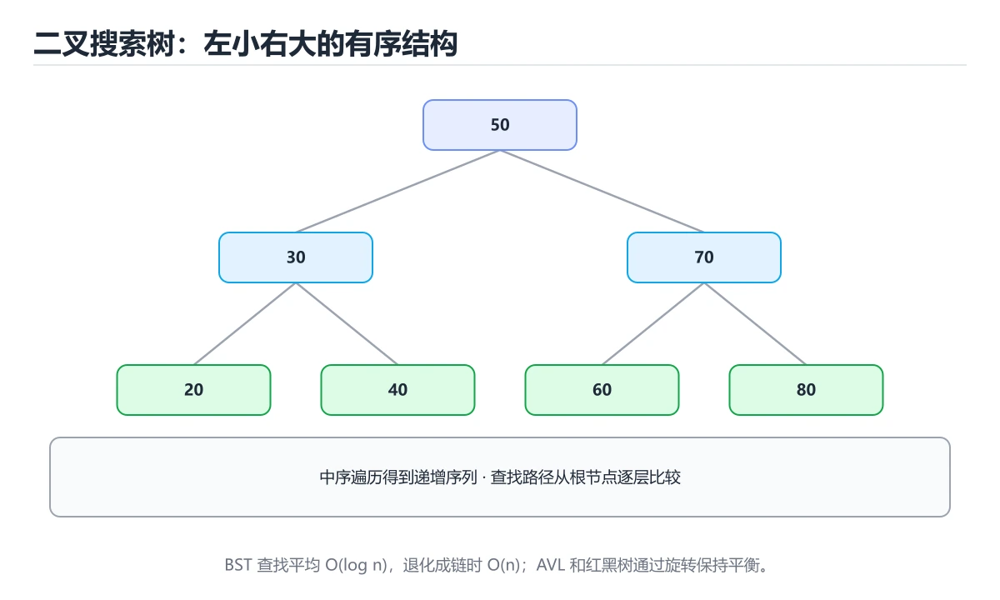
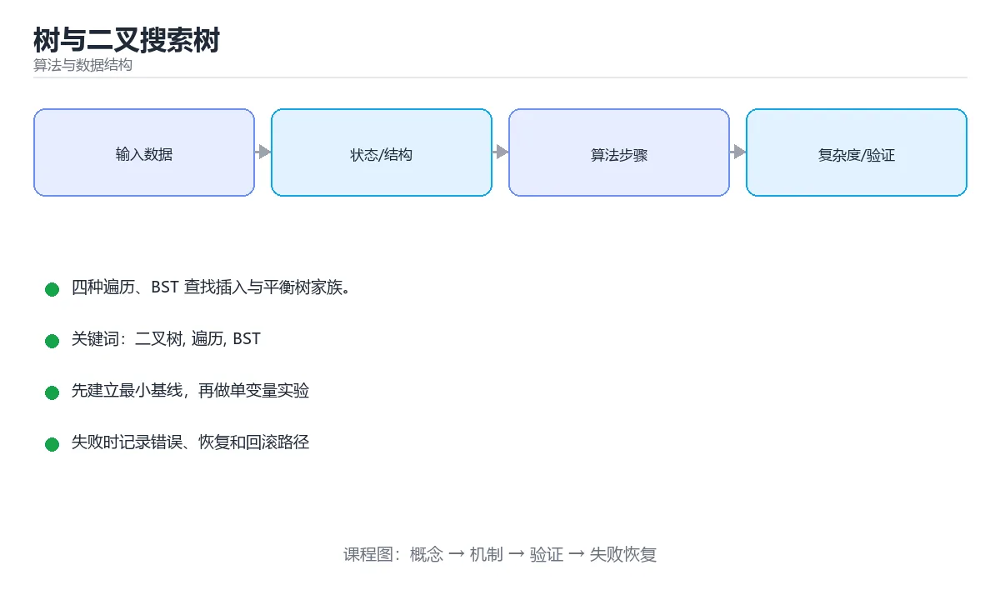

# 树与二叉搜索树

> 内容更新时间：2026-10-06 · 学习阶段：进阶 · 预计用时：30 分钟





## 本节知识框架

**课程定位**：所属分类 `algorithms`（算法与数据结构），课程主题 `树与二叉搜索树`，学习阶段 进阶，建议用时 40 分钟。

本课主线：四种遍历、BST 查找插入与平衡树家族。

**学完本课应当能够**
- 说清 `二叉树` 与 `遍历` 的含义与区别，并各举一个正例和一个反例。
- 用本课示例验证 `BST` 的行为，记录输入、输出与失败条件。
- 遇到「有序数据依次插入 BST」这类问题时，能说出触发条件与修复顺序。

### 复习清单

- [ ] 能不看正文复述本课核心术语，并指出一个边界或反例。
- [ ] 能运行或推演本课示例，记录输入、输出与失败现象。
- [ ] 能完成一次自测，并把错题对照错误表定位原因。

## 核心概念定义

| 术语 | 操作性定义 | 常见边界与风险 |
| --- | --- | --- |
| 二叉树 | 每个节点最多有两个子节点的树结构。 | 易错：稀疏树浪费大量空间；正确做法是用节点指针或哈希表。 |
| 遍历 | 按某种顺序访问数据结构中的每个元素一次。 | 易错：无法区分层级；正确做法是`for _ in range(len(queue))`。 |
| BST | 二叉搜索树：左子树键都小于根、右子树都大于根；平衡时查找 O(log n)，退化成链就是 O(n)。 | 易错：退化成链表，O(n)；正确做法是使用平衡树或先打乱插入。 |
| 红黑树 | 通过颜色约束维持近似平衡的二叉搜索树，查找、插入和删除都保持对数复杂度。 | 易错：拿 AVL 的「左右子树高度差 ≤ 1」来验收红黑树；它只按颜色约束黑高，追求查询更快要换 AVL。 |
| 堆 | 满足堆序的完全二叉树，根节点总是当前集合的最值。 | 易错：把堆当成全局有序的结构来查任意元素，它只保证取最值 O(1)；一旦节点不满足完全二叉树，就没法再用数组下标紧凑存放。 |

## 原理与运行机制

### 机制总览

**教材衔接：平衡树家族**

| 结构 | 特点 |
| --- | --- |
| AVL 树 | 严格平衡，查找快，旋转较频繁 |
| 红黑树 | 近似平衡，插入删除代价低（Java TreeMap、C++ map） |
| B / B+ 树 | 多路平衡，磁盘友好（数据库索引） |
| 堆 | 完全二叉树，取最值 O(1)，常配合优先队列 |

**教材衔接：BST 操作与平衡**

| 操作 | 平均 | 最坏（退化成链） |
| --- | --- | --- |
| 查找 | O(log n) | O(n) |
| 插入 | O(log n) | O(n) |
| 删除 | O(log n) | O(n) |
| 中序遍历 | O(n) | O(n) |

| 平衡结构 | 平衡条件 | 特点 |
| --- | --- | --- |
| AVL 树 | 左右子树高度差 ≤ 1 | 查询更快，旋转更频繁 |
| 红黑树 | 颜色性质约束黑高 | 插入删除旋转少，工程常用 |
| B+ 树 | 多路平衡 | 磁盘索引，扇出大、树矮 |

## 典型应用场景

- **有序数据依次插入 BST**：典型现象是退化成链表，O(n)；正确做法是使用平衡树或先打乱插入。
- **层序遍历不固定层长度**：典型现象是无法区分层级；正确做法是`for _ in range(len(queue))`。
- **删除双子节点直接删除**：典型现象是树结构被破坏；正确做法是用中序后继或前驱替换后再删。
- **递归遍历没有终止条件**：典型现象是无限递归；正确做法是以 `if not node: return` 开头。

### 最小验证场景

- 准备：保留 `python` 示例的原始输入，先记录 `树与二叉搜索树` 的基线输出和完整运行命令。
- 观察：先核对 调用了 `__init__()`，再改变一个与 `二叉树` 相关的条件。
- 判定：新结果与 `树与二叉搜索树` 的基线不同不等于错误；只有当差异破坏了 `二叉树` 的定义或错误表中的约束，才判定为失败。

### 选择与边界

- 使用 `二叉树` 时，先满足它的定义：每个节点最多有两个子节点的树结构；易错：稀疏树浪费大量空间；正确做法是用节点指针或哈希表。
- 使用 `遍历` 时，先满足它的定义：按某种顺序访问数据结构中的每个元素一次；易错：无法区分层级；正确做法是`for _ in range(len(queue))`。
- 使用 `BST` 时，先满足它的定义：二叉搜索树：左子树键都小于根、右子树都大于根；平衡时查找 O(log n)，退化成链就是 O(n)；易错：退化成链表，O(n)；正确做法是使用平衡树或先打乱插入。
- 使用 `红黑树` 时，先满足它的定义：通过颜色约束维持近似平衡的二叉搜索树，查找、插入和删除都保持对数复杂度；结论随输入规模变化，小规模成立不代表大规模成立，需要重新测量。
- 使用 `堆` 时，先满足它的定义：满足堆序的完全二叉树，根节点总是当前集合的最值；越界、悬垂引用与释放顺序会破坏结论，必须在边界输入下复验。

## 代码/协议/SQL 示例

### 最小可验证示例

```python
class TreeNode:
    def __init__(self, value, left=None, right=None):
        self.value = value
        self.left = left
        self.right = right
```

**教材衔接：二叉树基础**

每个节点最多两个子节点（left / right）。常见术语：根节点、叶子节点、深度、高度、子树。

**教材衔接：四种遍历**

```python
def preorder(node):        # 根 -> 左 -> 右
    if not node:
        return []
    return [node.value] + preorder(node.left) + preorder(node.right)

def inorder(node):         # 左 -> 根 -> 右：二叉搜索树得到升序
    if not node:
        return []
    return inorder(node.left) + [node.value] + inorder(node.right)

def postorder(node):       # 左 -> 右 -> 根：适合释放资源
    if not node:
        return []
    return postorder(node.left) + postorder(node.right) + [node.value]

from collections import deque

def level_order(root):     # 层序遍历（BFS）
    if not root:
        return []
    result, queue = [], deque([root])
    while queue:
        level = []
        for _ in range(len(queue)):
            node = queue.popleft()
            level.append(node.value)
            if node.left:
                queue.append(node.left)
            if node.right:
                queue.append(node.right)
        result.append(level)
    return result
```

**教材衔接：二叉搜索树（BST）**

性质：任意节点的左子树全部小于它，右子树全部大于它。

```python
def search(node, target):
    while node:
        if target == node.value:
            return node
        node = node.left if target < node.value else node.right
    return None

def insert(node, value):
    if not node:
        return TreeNode(value)
    if value < node.value:
        node.left = insert(node.left, value)
    elif value > node.value:
        node.right = insert(node.right, value)
    return node
```

平均查找 `O(log n)`，但插入有序数据会退化成链表，最坏 `O(n)`。

**教材衔接：遍历速查**

| 遍历 | 顺序 | 典型用途 | 实现方式 |
| --- | --- | --- | --- |
| 前序 | 根 → 左 → 右 | 复制树、序列化 | 递归 / 栈 |
| 中序 | 左 → 根 → 右 | BST 得到升序序列 | 递归 / 栈 |
| 后序 | 左 → 右 → 根 | 释放树、计算子树聚合 | 递归 / 栈 |
| 层序 | 逐层从左到右 | 求深度、按层处理 | 队列 |

```python
from collections import deque

class TreeNode:
    __slots__ = ("value", "left", "right")

    def __init__(self, value, left=None, right=None):
        self.value, self.left, self.right = value, left, right

def inorder(root):
    """迭代版中序遍历：BST 上得到升序序列。"""
    result, stack = [], []
    cur = root
    while cur or stack:
        while cur:              # 一路向左压栈
            stack.append(cur)
            cur = cur.left
        cur = stack.pop()
        result.append(cur.value)
        cur = cur.right
    return result

def level_order(root):
    """层序遍历，按层返回列表。"""
    if not root:
        return []
    levels, queue = [], deque([root])
    while queue:
        level = []
        for _ in range(len(queue)):     # 固定当前层长度
            node = queue.popleft()
            level.append(node.value)
            if node.left:
                queue.append(node.left)
            if node.right:
                queue.append(node.right)
        levels.append(level)
    return levels

def insert(root, value):
    """BST 插入：小于走左、大于走右，重复值不插入。"""
    if root is None:
        return TreeNode(value)
    if value < root.value:
        root.left = insert(root.left, value)
    elif value > root.value:
        root.right = insert(root.right, value)
    return root
```

**运行方式**：运行 `树与二叉搜索树` 的示例时，保存为 `.py` 文件后用 `python 文件名.py` 运行；第三方依赖先在虚拟环境里安装。

## 时间/空间复杂度或性能分析

**复杂度证据**：本课正文出现 `O(log n)`、`O(n)`、`O(1)` 等量级表达式；使用前要同时确认输入规模、最好/平均/最坏情况以及常数项来源。

**测量方法**：以 `树与二叉搜索树` 的 `二叉树` 场景为对象，固定输入跑一遍记录基线，再把规模或并发度提高一个数量级复测；两次结果的差值与波动范围才是结论依据。

## 常见误区与易错点

| 容易写错的做法 | 实际现象 | 原因与正确做法 |
| --- | --- | --- |
| 有序数据依次插入 BST | 退化成链表，O(n) | 使用平衡树或先打乱插入 |
| 层序遍历不固定层长度 | 无法区分层级 | `for _ in range(len(queue))` |
| 删除双子节点直接删除 | 树结构被破坏 | 用中序后继或前驱替换后再删 |
| 递归遍历没有终止条件 | 无限递归 | 以 `if not node: return` 开头 |
| 递归深度过大 | 栈溢出 | 树很深时改迭代或增大栈 |
| 认为 BST 一定平衡 | 最坏性能退化 | 明确是「平均」还是「保证」 |
| 用 `<=` 插入重复值 | 重复元素堆在同一侧 | 明确重复值策略（计数、丢弃、右子树） |
| 释放树用前序 | 访问已释放节点 | 用后序或迭代 |
| 遍历时修改树结构 | 行为不确定 | 先收集结果再修改 |
| 用数组下标表示任意二叉树 | 稀疏树浪费大量空间 | 用节点指针或哈希表 |

### 现场 1：有序数据依次插入 BST

**症状**：退化成链表，O(n)。

**根因与修复**：使用平衡树或先打乱插入。

**自检**：在本课示例里复现「有序数据依次插入 BST」，改成使用平衡树或先打乱插入后重跑；如果症状消失且失败路径按预期变化，说明定位正确。

### 现场 2：层序遍历不固定层长度

**症状**：无法区分层级。

**根因与修复**：`for _ in range(len(queue))`。

**自检**：在本课示例里复现「层序遍历不固定层长度」，改成`for _ in range(len(queue))`后重跑；如果症状消失且失败路径按预期变化，说明定位正确。

### 现场 3：删除双子节点直接删除

**症状**：树结构被破坏。

**根因与修复**：用中序后继或前驱替换后再删。

**自检**：在本课示例里复现「删除双子节点直接删除」，改成用中序后继或前驱替换后再删后重跑；如果症状消失且失败路径按预期变化，说明定位正确。

### 现场 4：递归遍历没有终止条件

**症状**：无限递归。

**根因与修复**：以 `if not node: return` 开头。

**自检**：在本课示例里复现「递归遍历没有终止条件」，改成以 `if not node: return` 开头后重跑；如果症状消失且失败路径按预期变化，说明定位正确。

### 现场 5：递归深度过大

**症状**：栈溢出。

**根因与修复**：树很深时改迭代或增大栈。

**自检**：在本课示例里复现「递归深度过大」，改成树很深时改迭代或增大栈后重跑；如果症状消失且失败路径按预期变化，说明定位正确。

### 现场 6：认为 BST 一定平衡

**症状**：最坏性能退化。

**根因与修复**：明确是「平均」还是「保证」。

**自检**：在本课示例里复现「认为 BST 一定平衡」，改成明确是「平均」还是「保证」后重跑；如果症状消失且失败路径按预期变化，说明定位正确。

### 现场 7：用 `<=` 插入重复值

**症状**：重复元素堆在同一侧。

**根因与修复**：明确重复值策略（计数、丢弃、右子树）。

**自检**：在本课示例里复现「用 `<=` 插入重复值」，改成明确重复值策略（计数、丢弃、右子树）后重跑；如果症状消失且失败路径按预期变化，说明定位正确。

### 现场 8：释放树用前序

**症状**：访问已释放节点。

**根因与修复**：用后序或迭代。

**自检**：在本课示例里复现「释放树用前序」，改成用后序或迭代后重跑；如果症状消失且失败路径按预期变化，说明定位正确。

### 现场 9：遍历时修改树结构

**症状**：行为不确定。

**根因与修复**：先收集结果再修改。

**自检**：在本课示例里复现「遍历时修改树结构」，改成先收集结果再修改后重跑；如果症状消失且失败路径按预期变化，说明定位正确。

## 与其他知识点的关系

**教材衔接：复习与迁移**

## 自测题与参考答案

> 先独立作答，再对照参考答案；答案都能在本课正文、术语表或错误表里找到依据。

### 自测 1（概念复述）

不看正文，写出 `二叉树` 的操作性定义，并说明它与 `遍历` 的区别。

**参考答案**：每个节点最多有两个子节点的树结构。

`遍历` 的定位是：按某种顺序访问数据结构中的每个元素一次；两者的差别要从适用对象与失败模式上说明。

### 自测 2（排错）

本课错误表记录了「有序数据依次插入 BST」这类做法。请写出它会出现的现象、根因，以及修复顺序。

**参考答案**：现象是退化成链表，O(n)；正确做法是使用平衡树或先打乱插入。修复时先复现现象并保留证据，再改动一处假设重跑，确认现象消失。

### 自测 3（动手验证）

运行本课的 `python` 示例，改动其中一个输入后重新运行，记录输出与错误信息。

**参考答案**：正常输入下 `python` 示例应当复现正文给出的结果；改动输入后，如果结果改变或报错，先核对它是否满足 `树与二叉搜索树` 中`二叉树` 的适用范围，再检查错误表里是否有同类现象。

### 自测 4（代码阅读）

阅读本课开头的 `python` 示例，说明它体现了`二叉树` 的哪一条性质，并指出改动哪个输入会让这条性质不再成立。

**参考答案**：`二叉树` 的定义是 每个节点最多有两个子节点的树结构，示例正是在实现这条定义。改动与 `二叉树` 有关的一个输入后，如果结果不再符合 `树与二叉搜索树` 的正文描述，就说明该性质只在当前前提成立。

### 自测 5（迁移）

把 `树与二叉搜索树` 的方法迁移到自己的项目：围绕 `二叉树` 写出一个与错误表同类的风险点，并说明触发条件和检验方式。

**参考答案**：例如「用数组下标表示任意二叉树」，它会导致稀疏树浪费大量空间；检验方式是按用节点指针或哈希表改一处再复现，确认现象消失且没有引入新的失败分支。

### 自测 6（对比）

用一个表格对比 `二叉树` 与 `遍历`：各写一行适用场景、一行失败表现。

**参考答案**：`二叉树` 的定义是每个节点最多有两个子节点的树结构；`遍历` 的定义是按某种顺序访问数据结构中的每个元素一次。两者的失败表现分别对应本课错误表里与本术语相关的行。

### 自测 7（排错顺序）

面对「有序数据依次插入 BST」引发的问题，请把“复现 退化成链表，O(n) → 保留证据 → 使用平衡树或先打乱插入 → 回归验证”四步写成可执行的检查清单。

**参考答案**：第一步按退化成链表，O(n)复现；第二步记录输入、版本与完整报错；第三步按使用平衡树或先打乱插入只改一处；第四步重跑并确认失败路径也按预期变化。

### 自测 8（边界判断）

针对 `堆`，分别写出“可以使用”的条件和“结论不再成立”的条件。

**参考答案**：越界、悬垂引用与释放顺序会破坏结论，必须在边界输入下复验。 同时要把 `堆` 的定义 满足堆序的完全二叉树，根节点总是当前集合的最值 与实际输入逐项对照。

### 自测 9（机制重建）

不看正文，按输入、转换、输出、验证四段重建 `二叉树` → `遍历` → `BST` → `红黑树` 的作用链。

**参考答案**：起点是 `二叉树` 的定义 每个节点最多有两个子节点的树结构；中间每一步都保留可观察状态；终点由 `堆` 检查，失败时回到错误表定位第一个偏离定义的步骤。

### 自测 10（综合排错）

在 `树与二叉搜索树` 中，现象是 稀疏树浪费大量空间。请围绕 用数组下标表示任意二叉树 写出最小复现、关键证据、修复动作和回归验证，并说明为什么不能只凭一次运行下结论。

**参考答案**：先复现 用数组下标表示任意二叉树，记录输入与完整错误；再按 用节点指针或哈希表 只改一处。回归时同时跑正常路径和边界路径，只有两次结果都可解释，才把修复视为完成。

### 自测 11（一分钟复述）

用每分钟约 200 字的速度复述 `树与二叉搜索树`：先给主问题，再按顺序说出 `二叉树`、`遍历`、`BST`、`红黑树`，最后给一个失败案例。

**自评标准**：主问题必须对应 四种遍历、BST 查找插入与平衡树家族；每个术语都要能接上一句定义或边界；失败案例必须写成可观察现象，不能用“可能有风险”代替证据。

## 延伸阅读

想更直观地理解本课概念？推荐参阅以下图解专题：

- [图解 B+ 树与数据库索引](visual_btree_index.md)

## 术语速查

| 术语 | 一句话说明 |
| --- | --- |
| `二叉树` | 每个节点最多有两个子节点的树结构。 |
| `遍历` | 按某种顺序访问数据结构中的每个元素一次。 |
| `BST` | 二叉搜索树：左子树键都小于根、右子树都大于根；平衡时查找 O(log n)，退化成链就是 O(n)。 |
| `红黑树` | 通过颜色约束维持近似平衡的二叉搜索树，查找、插入和删除都保持对数复杂度。 |
| `堆` | 满足堆序的完全二叉树，根节点总是当前集合的最值。 |

**术语关系**：`二叉树`（每个节点最多有两个子节点的树结构） → `遍历`（按某种顺序访问数据结构中的每个元素一次） → `BST`（二叉搜索树：左子树键都小于根、右子树都大于根） → `红黑树`（通过颜色约束维持近似平衡的二叉搜索树）。

## 考点精讲

`树与二叉搜索树` 的题库有 6 道题，下面逐题给出题干、正确项与判断依据：先自己作答，再核对正确项，最后回到正文对应小节复核。

### 考点 1：第 1 题

- **题目**：对二叉搜索树做哪种遍历能得到升序序列？
- **正确项**：中序
- **判断依据**：术语 遍历（树与二叉搜索树）：按某种顺序访问数据结构中的每个元素一次，本题取「中序」这条。易错点是有序数据依次插入 BST会造成退化成链表，O(n)，改法是使用平衡树或先打乱插入，判断时先确认输入和适用范围，对照 `二叉树`、`遍历`、`BST`、`红黑树` 复现一次，最后把错误表现与正确做法逐项对照。

### 考点 2：第 2 题

- **题目**：层序遍历需要借助哪种数据结构？
- **正确项**：队列
- **判断依据**：术语 遍历（树与二叉搜索树）：按某种顺序访问数据结构中的每个元素一次，本题取「队列」这条。易错点是有序数据依次插入 BST会造成退化成链表，O(n)，改法是使用平衡树或先打乱插入，判断时先确认输入和适用范围，对照 `二叉树`、`遍历`、`BST`、`红黑树` 复现一次，最后把错误表现与正确做法逐项对照。

### 考点 3：第 3 题

- **题目**：这段 `python` 代码对应 `树与二叉搜索树` 的 `二叉树`。课程要解决的是四种遍历、BST 查找插入与平衡树家族。关于代码内容，哪一项说法准确？
- **正确项**：调用了 `inorder()`
- **判断依据**：本题正确项是「调用了 `inorder()`」。术语 二叉树（树与二叉搜索树）：每个节点最多有两个子节点的树结构，本题取「调用了 `inorder()`」这条。易错点是删除双子节点直接删除，会造成树结构被破坏，改法是用中序后继或前驱替换后再删。本题干扰项「调用了 `strip()`」不成立：展示代码里找不到 `strip()`。

### 考点 4：第 4 题

- **题目**：围绕“树与二叉搜索树”中的 二叉树、遍历、BST，下列哪两项是本课强调的实践判断？
- **正确项**：学习 二叉树 时要同时说明输入、输出和失败路径，不能只看正常流程；验证 遍历 时要固定版本并覆盖边界输入，结论才可复现
- **判断依据**：按《树与二叉搜索树》的正文口径，本题要同时选中「学习 二叉树 时要同时说明输入、输出和失败路径，不能只看正常流程」、「验证 遍历 时要固定版本并覆盖边界输入，结论才可复现」，漏掉任一项都算没答全。术语 二叉树（树与二叉搜索树）：每个节点最多有两个子节点的树结构。易错点是递归遍历没有终止条件，会造成无限递归，改法是以 `if not node: return` 开头。

### 考点 5：第 5 题

- **题目**：删除二叉搜索树中「有两个孩子」的节点，常用做法是？
- **正确项**：用中序后继（右子树最小）或中序前驱替换后递归删除
- **判断依据**：本题正确项是「用中序后继（右子树最小）或中序前驱替换后递归删除」。术语 二叉树（树与二叉搜索树）：每个节点最多有两个子节点的树结构，本题取「用中序后继（右子树最小）或中序前驱替换后递归删除」这条。易错点是递归深度过大，会造成栈溢出，改法是树很深时改迭代或增大栈。

### 考点 6：第 6 题

- **题目**：填空：补齐下面这段术语说明中的空缺。课程 `四种遍历、BST 查找插入与平衡树家族。`，这段说明是：`____`：每个节点最多有两个子节点的树结构。空缺处应填哪个术语？
- **正确项**：二叉树
- **判断依据**：涉及术语 二叉树：每个节点最多有两个子节点的树结构。易错点：有序数据依次插入 BST会造成退化成链表，O(n)。正确做法：使用平衡树或先打乱插入。判断时先确认输入和适用范围，对照 `二叉树`、`遍历`、`BST`、`红黑树` 复现一次，最后把错误表现与正确做法逐项对照。

### 考点 7：`二叉树`

- **要点**：每个节点最多有两个子节点的树结构。
- **二叉树 的边界**：易错：稀疏树浪费大量空间；正确做法是用节点指针或哈希表。

### 考点 8：`遍历`

- **要点**：按某种顺序访问数据结构中的每个元素一次。
- **遍历 的边界**：易错：无法区分层级；正确做法是`for _ in range(len(queue))`。

### 考点 9：`BST`

- **要点**：二叉搜索树：左子树键都小于根、右子树都大于根；平衡时查找 O(log n)，退化成链就是 O(n)。
- **BST 的边界**：易错：退化成链表，O(n)；正确做法是使用平衡树或先打乱插入。

### 考点 10：`红黑树`

- **要点**：通过颜色约束维持近似平衡的二叉搜索树，查找、插入和删除都保持对数复杂度。
- **红黑树 的边界**：结论随输入规模变化，小规模成立不代表大规模成立，需要重新测量。

### 考点 11：`堆`

- **要点**：满足堆序的完全二叉树，根节点总是当前集合的最值。
- **堆 的边界**：越界、悬垂引用与释放顺序会破坏结论，必须在边界输入下复验。

### 考点 12：排错——有序数据依次插入 BST

- **现象**：退化成链表，O(n)。
- **处理**：使用平衡树或先打乱插入。

### 考点 13：排错——层序遍历不固定层长度

- **现象**：无法区分层级。
- **处理**：`for _ in range(len(queue))`。

### 考点 14：综合辨析——`二叉树` 与 `堆`

- **辨析点**：`二叉树` 的定义是 每个节点最多有两个子节点的树结构；`堆` 的定义是 满足堆序的完全二叉树，根节点总是当前集合的最值。
- **答题要求**：面对 `树与二叉搜索树` 的题目，先判断描述的是 `二叉树` 还是 `堆`，再归到对应定义，最后写出一个会让该定义失效的边界输入。

### 考点 15：排错评分点

- **现象分**：能写出 退化成链表，O(n)，而不是只写“程序有错”。
- **证据分**：保留触发 有序数据依次插入 BST 的输入、版本和错误原文。
- **修复分**：按 使用平衡树或先打乱插入 只改一处，并同时回归正常路径与边界路径。

## 内容元数据

- 内容版本：v2.0
- 最后更新：2026-10-06
- 学习阶段：进阶
- 适用环境：任意主流语言（伪代码与复杂度为主）；本课聚焦 二叉树。
- 内容来源：内置结构化课程与工程实践整理
- 相关主题：二叉树、遍历、BST、红黑树、堆
- 质量版本：P0 测验标准 + P1 覆盖扩展 + P2 体验补全

## 参考资料与复核

- 最后复核：2026-10-04
- 下次复核：2027-09-10
- 复核范围：版本兼容、API 行为、安全建议与工程实践
- 来源性质：官方文档、标准或权威教材；本课核对关键词：二叉树、遍历、BST、红黑树、堆。

| 参考资料 | 本课用途 |
| --- | --- |
| [Princeton Algorithms](https://algs4.cs.princeton.edu/home/) | 经典算法与数据结构教材 |
| [VisuAlgo](https://visualgo.net/en) | 算法可视化与交互 |
| [MIT 6.006](https://ocw.mit.edu/courses/6-006-introduction-to-algorithms-spring-2020/) | 算法设计与分析 |

| [本课术语索引：树与二叉搜索树](#核心概念定义) | 按本课输入、术语边界和错误表现逐项核对 |
> 「树与二叉搜索树」的链接用于离线阅读后的延伸核对；App 不会自动联网。