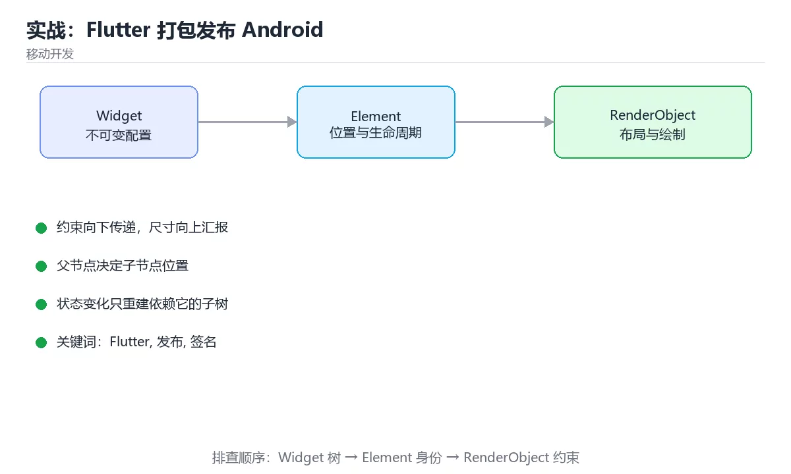

# Android 发布工程：签名、包体与上架轨道

> 内容更新时间：2026-10-06 · 学习阶段：基础 · 预计用时：55 分钟



## 本节知识框架

想象你要把自制果酱卖给全校同学：瓶身要贴一枚只有你会刻的印章，别人才能确认是谁做的（签名）；你可以整箱原样搬过去，也可以让代收点按每个人的口味只配他要的那几瓶（APK 与 AAB）；万一某批次出问题，你还得靠配方版本表倒查是哪一步配错了（mapping 文件）。Android 侧的发布工程做的就是这四件事：**定身份、定边界、定产物、留证据**。

本课专注 Android 工程本身：密钥与签名、SDK 版本的真实语义、包形态与体积、R8 混淆与还原、多渠道与版本号、商店轨道与回滚。

学完你能做到：

- 说清 keystore 里到底存了什么，以及丢失之后为什么无法更新已上架应用
- 解释 v1 与 v2/v3 签名方案的覆盖范围差异，并说出何时需要同时启用
- 用一句话分别讲清 compileSdk、minSdk、targetSdk 各自改变什么、不改变什么
- 配置 ABI 拆分、语言资源收窄，并预估它们对安装体积的影响
- 在混淆包上定位一次线上崩溃：从 mapping.txt 到 retrace 的完整链路
- 排出内部、封闭、开放、生产四条轨道的放量顺序，并写出回滚动作

**先修**：《Flutter 状态管理与性能》（flutter_state）。本课假设你能读懂工程结构与构建产物的位置。

### 复习清单

- [ ] 能画出 APK 的内部结构，并标出 v1 与 v2/v3 签名分别落在哪一段
- [ ] 能写出 keystore 的双层口令分别保护什么对象
- [ ] 能说明把 targetSdk 提高一级为什么属于行为变更而不是数字变更
- [ ] 能列出至少三种收窄包体的手段，并说出各自牺牲了什么
- [ ] 能解释 versionCode 与 versionName 的分工，并给出多渠道并行时的号段方案
- [ ] 能默写发布前检查清单里的至少六项

## 核心概念定义

| 概念 | 精确定义 | 最容易混淆的点 |
| --- | --- | --- |
| keystore | 一个加密文件，内部存放一个或多个私钥与对应证书，用别名（alias）区分。 | 它不是密码本身；口令分 storePassword 与 keyPassword 两层。 |
| signingConfigs | Gradle 里描述「用哪个 keystore、哪个别名、哪两个口令」的配置块。 | 定义了不等于生效，还要在 buildTypes.release 里引用它。 |
| v1 签名 | 沿用 JAR 签名机制，摘要写在 META-INF 里，只覆盖压缩包内的条目。 | 中央目录、对齐填充等字节不在它的保护范围内。 |
| v2/v3 签名 | APK Signature Scheme，把签名块放在 ZIP 中央目录之前，对整包字节做摘要。 | v3 与 v2 覆盖范围相同，差别在密钥算法与证书轮换支持。 |
| compileSdk | 编译期用来解析 API 的平台类库版本。 | 它不改变运行时真正加载的系统类库，后者由设备决定。 |
| minSdk | 允许安装本包的最低系统 API 级别。 | 低于它的设备在商店里直接看不到这个应用。 |
| targetSdk | 向系统声明「我已经把行为适配到这个级别」。 | 系统据此决定是否启用新限制，属于行为开关而非上限。 |
| APK | 已打包完成、可直接安装的分发产物。 | 侧载、内网分发只能用 APK。 |
| AAB | Android App Bundle，发布中间格式，需要转换成设备专用 APK 才能安装。 | adb 不能直接安装 .aab，本地要用 bundletool。 |
| R8 | 负责缩减（shrink）、优化、混淆 Java/Kotlin 字节码的构建期工具。 | 混淆只改名字，缩减会删代码，两者后果不同。 |
| mapping.txt | R8 输出的原名与混淆后名字的对照表。 | 每次构建都会变化，必须按版本号归档才能事后还原。 |
| versionCode | 整数构建号，商店与安装器唯一用于比较新旧的字段。 | 只能递增，写重了上传会被拒。 |
| 发布轨道 | Play Console 里的内部、封闭、开放、生产四档分发范围。 | 开放测试不占用生产版本号，可随时退出。 |

## 原理与运行机制

### 一、keystore：签名身份的物理载体

```bash
# 生成一把有效期约 27 年的 RSA 私钥，别名 release
keytool -genkeypair -v \
  -keystore ~/keys/campus.keystore \
  -alias campus-release -keyalg RSA -keysize 2048 -validity 10000

# 自检：确认文件里确实有这个别名，并记下证书指纹
keytool -list -v -keystore ~/keys/campus.keystore
```

一个 keystore 文件同时装着两类东西：私钥（只有你能签）和证书（公钥加身份声明，随包分发给系统去校验）。三层信息要分清：

1. **storePassword** 保护文件本身，没有它连列表都读不出来。
2. **keyPassword** 保护别名对应的那把私钥，签每个包时用的是它。
3. **证书指纹**（SHA-1 与 SHA-256）是商店、地图 SDK、登录 SDK 识别你的依据；接入 Google Play App Signing 时，你上传的是 upload key（上传密钥），真正面向用户的签名密钥由 Google 托管。

**不可逆性**是这里唯一必须背下来的结论：已上架应用的签名身份不能更换（除非走官方密钥轮换流程），keystore 和口令一旦全部丢失，这个包就永远无法覆盖更新，只能新建一个应用标识从零开始，用户、评分、安装量全部归零。做法是把 keystore 文件与两个口令分别做离线备份（加密盘 + 密码管理器），并让第二个人知道备份位置。

### 二、signingConfigs 与 v1/v2/v3 的覆盖范围

APK 本质是一个 ZIP 文件，签名可以落在不同位置：

```text
+------------------------------------------------------------------+
|  AndroidManifest.xml  classes.dex  resources.arsc  res/ assets/   |
+------------------------------------------------------------------+
|  META-INF/  MANIFEST.MF + .SF + .RSA    ← v1：逐条目的摘要清单     |
+------------------------------------------------------------------+
|  APK Signing Block                      ← v2/v3：整包字节签名+证书 |
+------------------------------------------------------------------+
|  Central Directory + End of Central Directory                     |
+------------------------------------------------------------------+
```

| 方案 | 引入系统版本 | 保护范围 | 什么时候还必须留着 |
| --- | --- | --- | --- |
| v1（JAR） | 全版本 | 仅 ZIP 内条目内容 | minSdk 低于 24 时，老设备只认它 |
| v2 | Android 7.0（API 24） | 中央目录之前的全部字节，含目录结构 | 新应用的最低要求，商店上传校验 |
| v3 | Android 9（API 28） | 与 v2 相同，换更强密钥算法 | 需要密钥轮换时必须启用 |
| v4 | Android 11（API 30） | 在 v2/v3 之上的 Merkle 树 | 只用于增量安装加速，不替代前三种 |

v1 的短板很具体：它管不到 ZIP 的中央目录和对齐填充字节，历史上就出现过改动这些「无人看守的字节」而不破坏 v1 校验的攻击。v2 之后把签名块提前并对整包做摘要，任何一字节变动都会让校验失败。

实践中不用手选：让 minSdk 与构建工具共同决定，AGP 会按需要生成多个方案。AGP 各版本提供了按方案开关的属性，但属性名随版本变化，改动前先查本机 AGP 文档；**没有特殊理由就保持默认多方案同时启用**，最省事也最不容易漏掉老设备。

签名配置必须「定义 + 引用」两步齐全，只写 signingConfigs 不绑定到 release，产物仍然是 debug 签名：

```kotlin
// android/key.properties 只放在构建机上，绝不进版本库
// storePassword=...  keyPassword=...  storeFile=...  keyAlias=...
val keystoreProps = java.util.Properties().apply {
    val f = rootProject.file("key.properties")
    if (f.exists()) f.inputStream().use { load(it) }
}

fun secret(name: String, key: String): String =
    System.getenv(name) ?: keystoreProps.getProperty(key)
        ?: error("缺少签名材料：$name")

android {
    signingConfigs {
        create("release") {
            storeFile = file(secret("KEYSTORE_PATH", "storeFile"))
            storePassword = secret("KEYSTORE_PASSWORD", "storePassword")
            keyAlias = secret("KEY_ALIAS", "keyAlias")
            keyPassword = secret("KEY_PASSWORD", "keyPassword")
        }
    }
    buildTypes {
        release {
            signingConfig = signingConfigs.getByName("release")  // 这一行常被忘记
            isMinifyEnabled = true
            isShrinkResources = true
            proguardFiles(getDefaultProguardFile("proguard-android-optimize.txt"), "proguard-rules.pro")
        }
    }
}
```

口令来源建议两条路并存：本地用 `key.properties`，CI 用环境变量或密钥管理系统注入，代码里用「环境变量优先、文件兜底」的读法，两边都不用改配置。

### 三、三个 SDK 数字各自管什么

| 字段 | 影响编译 | 影响安装 | 影响运行时行为 | 提高它的代价 |
| --- | --- | --- | --- | --- |
| compileSdk | 是（可见 API 与注解） | 否 | 否 | 需要处理新 API 的 lint 提示 |
| minSdk | 否 | 是（可安装设备集合） | 否 | 降低老设备覆盖率，包体也更小 |
| targetSdk | 否 | 否 | 是（系统限制按它生效） | 必须做行为适配与回归 |

三个数字都写在 `android/app/build.gradle(.kts)` 的 `defaultConfig`（Flutter 工程）或 `build.gradle` 顶层（纯原生工程）里。要点在于：**targetSdk 是唯一会带来行为变化的**。系统对后台启动前台服务、精确闹钟、通知运行时权限、分包 Intent 校验等限制，都是「当 targetSdk ≥ 某级别时启用」。所以提升 targetSdk 是一次需要读官方行为变更清单并回归的改动；而 Play 每年会要求新上传包达到当年的最低 targetSdk，具体数字逐年提高，请以官方政策页为准。

### 四、APK 与 AAB：一次打包还是按需下发

```text
                     直接安装                     商店转换后安装
APK（已成型产物） ──→ 用户手机 / 侧载 / 内网 MDM
                                              ┌─ arm64-v8a + xxhdpi + zh → 专用 APK
AAB（发布中间态） ──→ Play / bundletool ──────┼─ armeabi-v7a + hdpi + en  → 专用 APK
                                              └─ x86_64 + ...            → 专用 APK
```

| 维度 | APK | AAB |
| --- | --- | --- |
| 能否直接安装 | 能 | 不能，需先转换 |
| 商店支持 | 侧载、自建分发、多数国内商店 | Google Play 主推格式 |
| 用户下载体积 | 全架构全密度，最大 | 只下发匹配部分，通常最小 |
| 本地验证 | adb install | bundletool build-apks / install-apks |
| 密钥轮换 | 需要额外配置 | 平台推荐路径 |
| 动态特性模块 | 不支持 | 支持按场景下发功能 |

选 AAB 的核心理由是体积和「按设备下发」，代价是本地验证多一步：产物不是最终形态，必须用 bundletool 生成 `.apks` 再装到真机，否则商店侧的拆分问题（如缺 density 资源）在开发机上看不出来。纯内网分发或需要把包直接发给用户时，仍然要产出 APK。

### 五、体积：ABI、语言与资源收窄

体积优化的本质是「少发用户用不到的字节」，但每一步都有明确的取舍：

```kotlin
android {
    // 1) 需要自己发 APK（内网分发）时按 ABI 拆包；上架 Play 用 AAB 就不用手工拆
    splits {
        abi {
            isEnable = true
            reset()
            include("armeabi-v7a", "arm64-v8a", "x86_64")
            isUniversalApk = true   // 额外产出一个通用包兜底
        }
    }

    // 2) 走 AAB 时交给商店拆分，可按维度开关
    bundle {
        language { enableSplit = true }   // 关掉会影响运行内切换语言
        density { enableSplit = true }
        abi { enableSplit = true }
    }

    defaultConfig {
        // 3) 只保留需要的语言资源（写法随 AGP 版本变化，低版本用 resConfigs）
        resourceConfigurations += setOf("zh", "en")
    }
}
```

`resourceConfigurations`（旧写法 `resConfigs`）会把三方库带来的几十种语言翻译删掉，通常能省几 MB；风险是运行内切换语言时缺失的文案会退回默认语言。ABI 拆分省的是 native 库（`.so`），一个包含三种架构时，光是引擎与图像解码库就能占几十 MB。密度拆分对图片多的应用收益最大，但关掉 density 会让低端机加载超大图资源。**收益与牺牲要成对记忆，否则优化就变成了新的故障源。**

### 六、R8：缩减、混淆与 mapping 还原

R8 一次做三件事，很多误解来自把它们当成一件事：

```text
Java/Kotlin 字节码 + 资源引用图
        │
        ├─ 缩减 shrink：删掉可达性分析认为用不到的类、方法与资源
        ├─ 优化 optimize：内联、去虚化、合并分支
        └─ 混淆 obfuscate：类名方法名替换为 a、b、c
        ↓
产物 + mapping.txt（原名 ↔ 混淆名对照表）
```

规则文件里最常写的三类：

```text
# app/proguard-rules.pro（R8 兼容 ProGuard 规则语法）
# 保留行号与源文件名，崩溃堆栈才有定位坐标
-keepattributes SourceFile,LineNumberTable
-renamesourcefileattribute SourceFile

# 反射、JSON 序列化、JNI 都是运行时才确定引用，缩减会误删
-keep class com.campus.app.model.** { *; }
-keepclassmembers,allowobfuscation class * {
    @com.google.gson.annotations.SerializedName <fields>;
}

# 输出可追溯的 mapping，文件名带上版本号，方便归档
-printmapping build/mapping/${R.versionName}/mapping.txt
```

线上崩溃上报的堆栈是 `a.b.c`，还原要靠 retrace（Android SDK 命令行工具集里提供，安装路径随 SDK 版本略有差异）：

```bash
retrace --mapping build/mapping/1.4.0/mapping.txt crash.log | head -n 20
```

接入 Crashlytics 一类平台时，Gradle 插件会自动上传 mapping，但**仍建议本地归档一份**，因为平台的保存期有限。`isShrinkResources` 必须与 `isMinifyEnabled` 一起开，单独开资源缩减会让 R8 缺少引用信息而误删正在使用的资源。

### 七、多渠道与版本号策略

`versionCode` 是商店唯一比较的整数，`versionName` 只是给用户看的字符串。多渠道并行发版最容易出的事故是两个渠道同时占用同一个 versionCode。一种朴素可用的方案是号段分配：

```kotlin
android {
    defaultConfig {
        // 主版本 * 10000 + 次版本 * 100 + 渠道偏移，构建号永远递增
        val major = 1
        val minor = 4
        versionCode = major * 10000 + minor * 100 + (project.findProperty("CHANNEL_OFFSET") as String? ?: "0").toInt()
        versionName = "$major.$minor.0"
    }
    flavorDimensions += "channel"
    productFlavors {
        create("play") { dimension = "channel" }
        create("campus") {
            dimension = "channel"
            versionNameSuffix = "-campus"
            buildConfigField("String", "CHANNEL", "\"campus\"")
        }
    }
}
```

Flutter 工程里版本号的入口是 `pubspec.yaml` 的 `version: 1.4.0+140`（加号前是 versionName，加号后是 versionCode），构建命令也可以用参数覆盖。渠道标识建议同时写进 `buildConfigField`，让埋点和上报能区分包来源；不同渠道的 `applicationIdSuffix` 会让它们成为「不同的应用」，可同时安装、互不覆盖，这既是特性也是坑。

### 八、发布轨道与回滚

```text
生成/备份密钥 → 配置 SDK 版本 → 构建 AAB（R8）→ 本地验证产物
      ↓
内部轨道（少量自有设备，分钟级）→ 封闭轨道（名单准入）→ 开放轨道（公开报名，不占生产号）
      ↓ 崩溃率、安装成功率、关键路径达标
生产轨道（分阶段放量 1% → 10% → 50% → 100%）
```

上架 Play 需要的材料大致是：开发者账号、release 签名（或上传密钥 + Play App Signing）、应用图标与特色图、每类设备至少两张截图、标题与长短说明、联系方式、分类与定价、分发国家、隐私政策 URL、数据安全表单（声明收集了什么、是否加密、是否可删除）、内容分级与目标受众问卷。受众含儿童时要额外满足家庭政策要求。

**回滚的正确姿势**：商店不允许上传比线上更小的 versionCode，所以「回滚」不是签一个旧号重传，而是用停止发布（stop release）或把生产轨道重新指向上一版产物；放量过程中发现问题，第一时间停掉 rollout，再决定是修复重发还是退回上一版。这带来一条硬约束：数据库、接口与配置必须向后兼容，新版本不能删掉旧版本还会读的字段，否则回滚之后老版本会崩。

## 典型应用场景

- **校园服务应用首次上架**：先把 keystore 与口令备份做扎实，再走内部轨道，第一天只放自己人和社团负责人。
- **只在内网分发的教学应用**：不上架就没有商店拆分，必须产出 APK，用 `splits.abi` 按架构发多个包，并留一个通用包兜底。
- **手机与平板双形态**：density 与屏幕布局都要验证，AAB 会按密度只下发一套资源，漏配某密度会导致运行时加载失败。
- **出海多语言**：语言资源收窄与 `enableSplit` 的组合要谨慎，运行内切换语言的需求会把缺省文案暴露出来。
- **接第三方 SDK**：地图、推送、登录普遍依赖反射与 JNI，混淆规则必须先按 SDK 文档补齐再放量。

## 代码/协议/SQL 示例

### 最小示例：能签出一个包

```bash
# 1. 生成密钥（做一次，长期用）
keytool -genkeypair -v -keystore ~/keys/campus.keystore \
  -alias campus-release -keyalg RSA -keysize 2048 -validity 10000

# 2. 只验证签名是否成功，不关心包体
APKSigner="$(ls ~/Library/Android/sdk/build-tools/*/apksigner 2>/dev/null | tail -n 1)"
"$APKSigner" verify --print-certs app-release.apk
```

```properties
# android/key.properties（构建机上，不进仓库）
storeFile=/Users/name/keys/campus.keystore
storePassword=请替换为强口令
keyAlias=campus-release
keyPassword=请替换为强口令
```

预期结果：`verify` 打印出签名者证书指纹，且 `v1/v2/v3` 校验行全部为 `Verified using v2 scheme: true` 之类的肯定结论。若 v2 为 false，多半是构建时没有绑定 release 的 signingConfig。

### 完整示例：一份可交付的 release 配置

```kotlin
// android/app/build.gradle.kts（要点节选，AGP 8.x）
android {
    namespace = "com.campus.app"
    compileSdk = 35

    defaultConfig {
        applicationId = "com.campus.app"
        minSdk = 24
        targetSdk = 35
        resourceConfigurations += setOf("zh", "en")
    }

    signingConfigs { /* 见上一节的 keystore 绑定 */ }

    buildTypes {
        release {
            signingConfig = signingConfigs.getByName("release")
            isMinifyEnabled = true
            isShrinkResources = true
            proguardFiles(getDefaultProguardFile("proguard-android-optimize.txt"), "proguard-rules.pro")
        }
    }

    bundle {
        language { enableSplit = true }
        density { enableSplit = true }
        abi { enableSplit = true }
    }

    packaging {
        resources.excludes += setOf("META-INF/*.version", "DebugProbesKt.bin")
    }
}
```

```bash
# 构建 AAB，并把符号与 mapping 一起留档
./gradlew bundleRelease \
  -PversionName=1.4.0 -PversionCode=10400

# AAB 不能 adb install，本地验证走 bundletool
bundletool build-apks --bundle=app-release.aab --output=app.apks --mode=gen_split_apks
unzip -l app.apks | grep -c '\.apk$'
bundletool install-apks --apks=app.apks
```

`unzip -l app.apks | grep -c '\.apk$'` 的输出会告诉你商店会下发多少个子包，这个数量骤增通常意味着某个维度拆分过度。

### 动手练习

1. 把 `minSdk` 从 24 降到 21，重新构建后用 apksigner 的 `verify --print-certs` 观察 v1 是否被启用，并解释原因。
2. 给上例增加 `create("lab")` 渠道，偏移 50，验证两条渠道产物的 versionCode 不冲突。
3. 故意删掉 `-keep class com.campus.app.model.** { *; }`，构建 release 包并触发一次 JSON 解析，记录崩溃堆栈；再用 retrace 还原它。

## 时间/空间复杂度或性能分析

### 构建与校验成本

| 环节 | 量级 | 说明 |
| --- | --- | --- |
| 纯打包（不混淆） | 数十秒到几分钟 | 增量构建受模块数量影响最大 |
| R8 缩减 + 混淆 | 额外约 1-2 分钟 | 依赖图越大越慢，与类数量近似线性 |
| AAB 本地转 apks | 十几秒起 | 按设备维度组合生成子包，维度越多越慢 |
| 设备端签名校验 | 一次性安装成本 | v2/v3 对整包一次摘要，通常比 v1 逐条目更快 |

### 体积收益的量化直觉

| 手段 | 典型收益 | 代价 |
| --- | --- | --- |
| 按 ABI 拆分或 AAB abi 拆分 | 单包降 30%-60% | 多产物管理与验证成本 |
| 语言资源收窄 | 省 1-5 MB | 缺省语言文案回退 |
| density 拆分 | 图片密集型降 20%-40% | 运行内换设备形态需重新下发 |
| 资源缩减 + 混淆 | 降 5%-25% | 反射与动态引用需 keep 规则 |
| 移除未用依赖 | 线性下降 | 需回归确认无隐藏引用 |

体积不是越小越好：下载转化率与包体强相关，但过度收窄会让功能在特定设备上失败。合理做法是给每次发布留一条基线（例如「arm64 + zh 的专用包不超过 X MB」），把它写进流水线阈值。

### 归档成本

`mapping.txt` 通常几百 KB 到几 MB，符号与基线文件另算。按「一个版本一个目录」保存三年，占用可控，而它换来的是一次崩溃定位能力。这类文件丢了无法重建，属于必须备份的构建产物。

## 常见误区与易错点

| 误区 | 真实后果 | 正确做法 |
| --- | --- | --- |
| 只写 signingConfigs 不绑到 release | 产物仍是 debug 签名，商店拒绝或用户无法覆盖升级 | 在 buildTypes.release 显式引用签名配置 |
| keystore 只存在一台开发机 | 换机器或磁盘损坏后永久无法更新 | 文件与两处口令分别离线备份，双人知晓 |
| key.properties 提交进仓库 | 私钥泄露，他人可伪造你的更新 | 写进 .gitignore，CI 用密钥系统注入 |
| 只启用 v1 签名 | 新系统与商店校验失败，也留出整包篡改面 | 保持多方案默认启用，minSdk<24 时尤其需要 v2/v3 |
| 以为 compileSdk 会影响运行时 | 做无谓的兼容分支 | 只有 targetSdk 带来行为变化，compileSdk 只管编译期 |
| targetSdk 顺手升到最新 | 通知权限、前台服务等限制突然生效导致功能失效 | 读行为变更清单并做完整回归再提 |
| 用 adb install 装 .aab | 直接报安装失败，误判为产物损坏 | 本地用 bundletool 生成 .apks 再安装 |
| 关掉语言拆分来「省体积」 | 下发全语言资源，包更大且失去按需优势 | 用资源收窄明确列出需要的语言 |
| 混淆后只测 debug 包 | release 包反射失败、页面白屏 | 每个发布版本都跑一次混淆包回归 |
| mapping.txt 不归档 | 线上堆栈全是 a.b.c，无法定位 | printmapping 按版本号输出并备份 |
| 两个渠道共用同一 versionCode | 后上传者安装失败或被判重复 | 用号段规则或流水线自增保证唯一递增 |
| 回滚时改小 versionCode | 商店直接拒绝上传 | 停止放量或重新指向上一版，并保持向后兼容 |
| 忘记隐私政策与数据安全表单 | 审核被拒或分发范围被限制 | 上架材料按清单一次性准备齐全 |

## 与其他知识点的关系

| 关系 | 课程 | 为什么 |
| --- | --- | --- |
| 先修 | 《Flutter 状态管理与性能》（flutter_state） | 本课的真实前置：需要先具备读懂工程结构与构建入口的能力。 |
| 横向对照 | 《构建与发布产物：九种生态横向对照》（cross_build_release） | 那一课从多生态视角看产物形态与可复现构建，本课只讲 Android 一条线的细节。 |
| 延伸 | 《Kotlin 与 Android 开发》（mobile_kotlin） | 语言与架构层的细节在那里展开，本课只处理到「产物能安全交付」为止。 |

区分这三层的边界能避免术语漂移：签名与包形态是 Android 平台概念，跨端构建是生态概念，语言与框架是开发概念。复习时建议先做本课自测，再回到横向对照那一课验证「同一件事在不同生态里的名字和工具是什么」。

## 自测题与参考答案

> 先独立作答，再对照参考答案；参考答案只给要点，不替代上面的推理链。

**自测 1**：minSdk 为 21 的应用需要哪几种签名方案？为什么不能只留一个？

参考答案：需要同时具备 v1、v2、v3。Android 7.0（API 24）以下设备只识别 v1，所以 v1 必须留着；新系统与商店上传校验依赖 v2 及更高方案，只有 v1 会被拒绝，且 v1 管不到 ZIP 中央目录与对齐字节，单靠它存在整包被篡改的风险。

**自测 2**：把 compileSdk 从 34 提到 35，运行时行为会变吗？会发生什么？

参考答案：不会改变运行时行为。设备运行时加载的是本机系统类库，compileSdk 只决定编译期能引用哪些 API 与注解；提升它带来的变化是可能出现新的 lint 规则或依赖版本要求，而 targetSdk 才是行为开关。

**自测 3**：为什么 AAB 不能直接 adb install？本地怎么验证？

参考答案：AAB 是发布中间格式，没有可直接安装的最终 APK 结构，需要由商店或 bundletool 按设备指纹拆出专用 APK。本地验证用 bundletool 生成 .apks，再 install-apks 安装到真机，同时可以用它检查会下发多少个子包。

**自测 4**：一次线上崩溃的堆栈是 a.b.c，你的完整还原步骤是什么？

参考答案：先确认崩溃发生在哪个 versionCode 上，取回该版本归档的 mapping.txt，用 retrace 配合 mapping 还原堆栈中的类名与方法名；如果工程保留了 SourceFile 与行号属性，还能进一步定位到源码行。

**自测 5**：写出至少五项上架前的检查项。

参考答案：① 使用 release 签名且 keystore 已备份；② versionCode 大于线上版本；③ targetSdk 满足当年商店要求并完成行为回归；④ 权限最小化、隐私政策与数据安全表单齐全；⑤ 混淆包完整回归通过且 mapping 已归档；⑥ 用 bundletool 在真机验证过产物；⑦ 内部与封闭轨道观察指标达标后再放量。

## 考点精讲

### 考点 1

题目：APK 签名方案 v1（JAR 签名）与 v2/v3（APK Signature Scheme）最关键的差别是什么？
A. v1 只能使用 RSA 算法生成密钥对，v2 与 v3 只能使用椭圆曲线算法
B. v1 只校验压缩包内的文件条目，v2/v3 对整个 APK 字节做完整性签名
C. v1 需要把签名私钥交给商店代管，v2 与 v3 必须由发布者自行生成保管
D. v1 只出现在调试构建里，正式构建必须改用 v2 或 v3 才能通过校验
正确答案：B

解析：v1 沿用 JAR 签名，签名信息写在 META-INF 里，只覆盖压缩包内的文件内容，因此改动 ZIP 对齐填充、中央目录这些没被它看守的字节不会破坏 v1 校验；v2 把签名块放在中央目录之前，对整包字节做摘要；v3 覆盖范围与 v2 相同，但使用更强的密钥算法并支持签名证书轮换。Android 7.0（API 24）开始校验 v2，更高版本还要求 v3，所以当 minSdk 低于 24 时通常三种方案同时启用，而不是只留其中一种。

### 考点 2

题目：某模块声明 compileSdk 35、minSdk 24、targetSdk 35，关于这三个配置的实际含义，下列哪项正确？
A. minSdk 决定编译期可见的 API 级别，targetSdk 决定用户设备能否安装，compileSdk 只影响资源裁剪
B. compileSdk 会改变应用运行时真正加载的系统类库版本，minSdk 只是给人看的说明文字
C. targetSdk 声明可安装的最低系统版本，compileSdk 声明商店审核所用的模拟器版本
D. minSdk 是可安装下限，targetSdk 是行为适配声明，compileSdk 只决定编译期可见 API
正确答案：D

解析：三个数字各管一段。compileSdk 只影响编译期用哪份平台类库解析 API，产物运行时仍然使用设备自带的系统类库，所以单独提升它不会改变行为；minSdk 决定安装包能被哪些系统版本安装，低于它的设备在商店里看不到这个应用；targetSdk 是向系统声明已经把行为适配到该级别，系统据此决定是否启用新的后台、权限与通知限制。真正需要回归测试的是 targetSdk 的变化，写错的也最隐蔽，因为它不报错、只是行为突然不同。

### 考点 3

题目：关于 APK 与 AAB（Android App Bundle）这两种发布产物，下列说法正确的是？
A. AAB 可以直接用 adb install 安装到真机做上架前验收
B. APK 只适合商店上架，AAB 只适合企业内网的侧载分发
C. AAB 要先由商店或 bundletool 转换成设备专用 APK 才能安装
D. 两者内容完全一致，区别只是文件后缀名和签名算法不同
正确答案：C

解析：AAB 是发布中间格式，设备上没有包管理器能直接安装它。Google Play 收到 AAB 后，按设备指纹（CPU 架构、屏幕密度、语言）拆出专用 APK 再下发；本地验证要用 bundletool 生成 .apks 后安装。APK 才是可直接安装的成品，侧载、内网 MDM 分发只能用 APK，所以「APK 只适合商店、AAB 只适合侧载」正好说反。两者的差异是产物形态与下发方式，不是后缀名或签名算法。

### 考点 4

题目：应用开启 R8 混淆与资源裁剪之后，下列哪两项做法能降低线上事故风险？
A. 为所有第三方依赖统一加上 -dontwarn，让构建不再报缺类警告
B. 给反射、序列化和 JNI 用到的类补 -keep 规则，并重新做一轮回归
C. 只验证未混淆的调试包，因为正式包只是名字变了而行为不会变
D. 把每个发布版本的 mapping.txt 按版本号归档，供崩溃堆栈还原使用
正确答案：BD

解析：R8 在缩减阶段会删除可达性分析认为用不到的类，而反射、JSON 序列化、JNI 与注解处理的引用关系要到运行时才确定，因此这些目标必须用 -keep 显式声明，验证也只能跑混淆后的 release 包。mapping.txt 是原名与混淆名的对照表，每次构建都不同，丢了就永远无法还原上报的 a.b.c 堆栈，所以每个版本都要归档。统一加 -dontwarn 只是把警告压掉，警告常常指向真实缺失的类，问题会被推迟到运行时；调试包没有开启缩减，通过与否不能代表正式包的行为。

### 考点 5

题目：填空：Android 发布时商店用来判断能否覆盖安装的那个整数版本号叫____，它在 Google Play Console 上传时必须严格递增。
参考答案：versionCode（可接受写法：versionCode、VersionCode）

解析：Android 有两个版本号。versionName 是给用户在商店页面看到的字符串，例如 1.4.0，命名自由，系统不拿它做比较；versionCode 是内部整数，商店与安装器只用它判断新旧，只要不大于线上版本就会上传失败或提示无法覆盖。Flutter 工程里它出现在 pubspec.yaml 的 version: 1.4.0+140 中加号之后的位置，也可以在 Gradle 里直接指定；多渠道并行发版时要提前分配号段，避免两条流水线撞上同一个数字。

### 考点 6

题目：下面是 Android 应用从准备签名到商店放量的四个环节，请按实际执行顺序排列。
A. 在 Play Console 创建内部测试轨道并小范围放量
B. 生成并备份 keystore，配置 signingConfigs 与三个 SDK 版本
C. 构建 AAB，开启 R8 并核对 mapping 与产物体积
D. 上传产物，填写商店 listing、隐私政策与数据安全表单
正确答案：B → C → D → A

解析：顺序不能颠倒，因为签名身份一旦确定就不可更换：先解决 keystore 与 minSdk/targetSdk 这些边界，才谈得上产出可上传的包；随后在本地构建并开启 R8，核对 mapping.txt、体积基线，跑一遍混淆后的回归；边界与产物都稳定后再上传商店，补齐 listing、隐私政策与数据安全评分，这一步决定审核能否通过；最后才在内部轨道逐级放量，观察崩溃率与安装成功率，达标后向生产推进。反过来先放量再回头补密钥，会让同一个应用标识被错误的签名覆盖掉，属于不可逆事故。

## 术语速查

| 术语 | 一句话说明 |
| --- | --- |
| keystore | 存放私钥与证书的加密文件，用别名区分多个签名身份，丢失即无法更新应用。 |
| storePassword / keyPassword | 两层口令，分别保护 keystore 文件本身与别名对应的那把私钥。 |
| signingConfigs | Gradle 中描述用哪个 keystore 的配置块，必须在 release 构建类型里引用才生效。 |
| v1 / v2 / v3 签名 | 三种签名方案，覆盖范围从「仅条目内容」升级到「整包字节」，v3 另支持密钥轮换。 |
| apksigner | 校验产物签名方案是否齐全的命令行工具，输出每个方案的通过情况。 |
| compileSdk / minSdk / targetSdk | 编译期可见 API / 可安装下限 / 行为适配声明，只有 targetSdk 会改变运行时行为。 |
| AAB（App Bundle） | 发布中间格式，由商店或 bundletool 拆成设备专用 APK 后下发。 |
| bundletool | 在本地把 AAB 转成 .apks 并安装验证的官方工具。 |
| resourceConfigurations | 只保留指定语言的资源，删掉依赖库带入的多余翻译。 |
| R8 | 执行缩减、优化与混淆的构建期工具，ProGuard 规则的替代品。 |
| mapping.txt | 原名与混淆名的对照表，每次构建都会变化，必须按版本号归档。 |
| retrace | 用 mapping.txt 把混淆堆栈还原成可读类名与方法名的工具。 |
| versionCode / versionName | 商店唯一比较的整数构建号 / 给用户看的版本字符串。 |
| 发布轨道 | 内部、封闭、开放、生产四档分发范围，配合分阶段放量与停止发布使用。 |

## 内容元数据

- 内容版本：v2.0
- 最后更新：2026-10-06
- 学习阶段：基础
- 预计用时：55 分钟
- 适用环境：Android Gradle Plugin 8.x / JDK 17 / compileSdk 35 / bundletool 与 cmdline-tools
- 内容来源：内置结构化课程与工程实践整理
- 相关主题：keystore、签名方案、App Bundle、R8 混淆、发布轨道

## 参考资料与复核

- [本课资料锚点 android_flutter_release](https://zh.wikipedia.org/w/index.php?search=android_flutter_release)

| 参考资料 | 本课用途 |
| --- | --- |
| [为应用签名 - Android Developers](https://developer.android.com/studio/publish/app-signing) | keystore 生成、签名方案与 Play App Signing |
| [Android App Bundle - Android Developers](https://developer.android.com/guide/app-bundle) | AAB 结构、按设备下发与 bundletool 验证 |
| [缩减、混淆和优化应用 - Android Developers](https://developer.android.com/topic/performance/app-optimization/enable-app-optimization) | R8 行为、keep 规则与 mapping 文件还原 |
| [测试发布 - Play Console 帮助中心](https://support.google.com/googleplay/android-developer/answer/3131213) | 内部、封闭、开放与生产轨道的放量范围 |
| [创建应用绑定 - Play Console 帮助中心](https://support.google.com/googleplay/android-developer/answer/7384423) | versionCode、应用标识与覆盖安装规则 |

- 最后复核：2026-10-04
- 下次复核：2027-01-03
- 复核范围：AGP 版本相关的签名属性名与 DSL 写法、商店 targetSdk 当年政策、各发布轨道放量规则与密钥轮换流程
