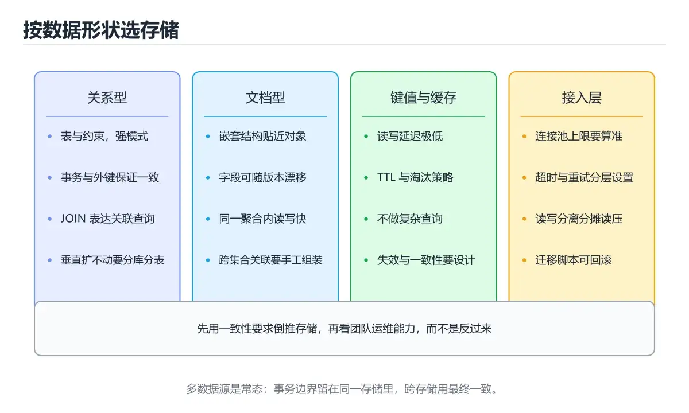

# 数据库集成（SQL/NoSQL）



> 内容更新时间：2026-10-06 · 学习阶段：进阶 · 预计用时：75 分钟

## 本节知识框架

**课程定位**：分类「backend_development」· 学习阶段 进阶 · 建议用时 55 分钟。

本课主线：学习PostgreSQL/MySQL ORM模式、MongoDB文档模型和Redis缓存策略。

### 复习清单

- [ ] 能不看正文复述 PostgreSQL，并指出 MongoDB 的一个边界或反例。
- [ ] 能推演 PostgreSQL 的示例：先写预期输出，再运行并记录差异与失败现象。
- [ ] 能完成一次自测，并把错题对照考点精讲定位原因。

## 核心概念定义

| 术语 | 一句话说明 |
| --- | --- |
| PostgreSQL | 表结构固定、带ACID事务和外键约束的关系库，本课用它存订单这类强关联数据 |
| MongoDB | 以BSON文档为记录单位的NoSQL库，集合不预定义字段，适合结构多变的嵌套内容 |
| Redis | 数据常驻内存、微秒级响应的键值库，本课用它做带TTL的缓存和会话存储 |
| ORM | 在类与表、对象与行之间做翻译的中间层，用Prisma或Sequelize的API替掉手写SQL |
| 连接池 | 预先建好并反复借还数据库连接的组件，省掉握手与认证开销，靠max限制并发 |

## 原理与运行机制

《数据库集成（SQL/NoSQL）》正文各章按「输入是什么 → 中间如何转换 → 输出到哪 → 失败时怎样表现」四问展开；复习时给每个机制补一句自己的复述，再回到对应章节核对。

### 关系型数据库基础：PostgreSQL与MySQL

#### 为什么选择关系型数据库？

想象你在图书馆工作。每本书都有唯一的ISBN编号，属于特定的分类，有作者信息，还可能与其他书籍存在引用关系。你需要快速查找某本书、统计某个作者的藏书量、找出被引用最多的书籍。这种结构化、关联性强的数据管理场景，正是关系型数据库的强项。

**关系型数据库的核心特征**：

1. **结构化数据**：数据存储在表格中，每个表有固定的列定义
2. **ACID事务**：保证原子性（Atomicity）、一致性（Consistency）、隔离性（Isolation）、持久性（Durability）
3. **SQL查询语言**：标准化的查询语法，跨数据库通用
4. **外键约束**：维护表之间的引用完整性
5. **成熟的生态系统**：丰富的工具链、ORM支持、监控方案

#### PostgreSQL vs MySQL对比

| 特性 | PostgreSQL | MySQL |
|------|-----------|-------|
| 开源协议 | PostgreSQL License（宽松） | GPL（商业使用需注意） |
| JSON支持 | 原生JSONB类型，支持索引 | JSON类型（5.7+），功能较弱 |
| 并发控制 | MVCC（多版本并发控制） | InnoDB引擎支持MVCC |
| 扩展性 | 支持自定义类型、函数、操作符 | 插件系统相对简单 |
| 地理空间 | PostGIS扩展，业界最强 | Spatial Extensions，功能有限 |
| 复制方式 | 流复制、逻辑复制 | 主从复制、组复制 |
| 适用场景 | 复杂查询、数据分析、GIS应用 | Web应用、高并发读操作 |
| 学习曲线 | 较陡峭，功能丰富 | 相对平缓，文档完善 |

#### 安装与连接

**PostgreSQL安装（Docker方式）**：
```bash
docker run --name postgres-dev \
  -e POSTGRES_PASSWORD=mysecretpassword \
  -e POSTGRES_DB=blog_db \
  -p 5432:5432 \
  -d postgres:15
```

**MySQL安装（Docker方式）**：
```bash
docker run --name mysql-dev \
  -e MYSQL_ROOT_PASSWORD=rootpassword \
  -e MYSQL_DATABASE=blog_db \
  -p 3306:3306 \
  -d mysql:8.0
```

**Node.js连接PostgreSQL**：
```javascript
const { Pool } = require('pg');

// 创建连接池
const pool = new Pool({
  host: 'localhost',
  port: 5432,
  database: 'blog_db',
  user: 'postgres',
  password: 'mysecretpassword',
  max: 20, // 最大连接数
  idleTimeoutMillis: 30000, // 空闲连接超时
  connectionTimeoutMillis: 2000, // 连接超时
});

// 测试连接
pool.query('SELECT NOW()', (err, res) => {
  if (err) {
    console.error('连接失败:', err);
  } else {
    console.log('连接成功:', res.rows[0]);
  }
});
```

**Python连接MySQL**：
```python
import mysql.connector
from mysql.connector import pooling

# 创建连接池
connection_pool = pooling.MySQLConnectionPool(
    pool_name="mypool",
    pool_size=5,
    pool_reset_session=True,
    host='localhost',
    port=3306,
    database='blog_db',
    user='root',
    password='rootpassword'
)

# 获取连接
connection = connection_pool.get_connection()
cursor = connection.cursor()

# 执行查询
cursor.execute("SELECT VERSION()")
result = cursor.fetchone()
print(f"MySQL版本: {result[0]}")

# 关闭资源
cursor.close()
connection.close()
```

#### 数据库Schema设计

**博客系统的表结构**：
```sql
-- 用户表
CREATE TABLE users (
    id SERIAL PRIMARY KEY,              -- 自增主键（PostgreSQL）
    username VARCHAR(50) UNIQUE NOT NULL,
    email VARCHAR(100) UNIQUE NOT NULL,
    password_hash VARCHAR(255) NOT NULL,
    age INTEGER CHECK (age >= 0 AND age <= 150),
    is_active BOOLEAN DEFAULT TRUE,
    created_at TIMESTAMP WITH TIME ZONE DEFAULT CURRENT_TIMESTAMP,
    updated_at TIMESTAMP WITH TIME ZONE DEFAULT CURRENT_TIMESTAMP
);

-- 文章表
CREATE TABLE posts (
    id SERIAL PRIMARY KEY,
    title VARCHAR(200) NOT NULL,
    slug VARCHAR(200) UNIQUE NOT NULL,  -- URL友好的标识符
    content TEXT NOT NULL,
    status VARCHAR(20) DEFAULT 'draft' CHECK (status IN ('draft', 'published', 'archived')),
    author_id INTEGER REFERENCES users(id) ON DELETE CASCADE,
    view_count INTEGER DEFAULT 0,
    published_at TIMESTAMP WITH TIME ZONE,
    created_at TIMESTAMP WITH TIME ZONE DEFAULT CURRENT_TIMESTAMP,
    updated_at TIMESTAMP WITH TIME ZONE DEFAULT CURRENT_TIMESTAMP
);

-- 标签表
CREATE TABLE tags (
    id SERIAL PRIMARY KEY,
    name VARCHAR(50) UNIQUE NOT NULL,
    created_at TIMESTAMP WITH TIME ZONE DEFAULT CURRENT_TIMESTAMP
);

-- 文章-标签关联表（多对多关系）
CREATE TABLE post_tags (
    post_id INTEGER REFERENCES posts(id) ON DELETE CASCADE,
    tag_id INTEGER REFERENCES tags(id) ON DELETE CASCADE,
    PRIMARY KEY (post_id, tag_id)
);

-- 评论表
CREATE TABLE comments (
    id SERIAL PRIMARY KEY,
    content TEXT NOT NULL,
    post_id INTEGER REFERENCES posts(id) ON DELETE CASCADE,
    user_id INTEGER REFERENCES users(id) ON DELETE SET NULL,
    parent_id INTEGER REFERENCES comments(id) ON DELETE CASCADE, -- 支持嵌套评论
    created_at TIMESTAMP WITH TIME ZONE DEFAULT CURRENT_TIMESTAMP
);

-- 创建索引
CREATE INDEX idx_posts_author ON posts(author_id);
CREATE INDEX idx_posts_status ON posts(status);
CREATE INDEX idx_posts_published_at ON posts(published_at DESC);
CREATE INDEX idx_comments_post ON comments(post_id);
CREATE INDEX idx_users_email ON users(email);
```

**MySQL版本的差异**：
```sql
-- MySQL使用AUTO_INCREMENT而非SERIAL
CREATE TABLE users (
    id INT AUTO_INCREMENT PRIMARY KEY,
    username VARCHAR(50) UNIQUE NOT NULL,
    email VARCHAR(100) UNIQUE NOT NULL,
    password_hash VARCHAR(255) NOT NULL,
    age INT CHECK (age >= 0 AND age <= 150),
    is_active BOOLEAN DEFAULT TRUE,
    created_at TIMESTAMP DEFAULT CURRENT_TIMESTAMP,
    updated_at TIMESTAMP DEFAULT CURRENT_TIMESTAMP ON UPDATE CURRENT_TIMESTAMP
);
```

#### CRUD操作示例

**插入数据**：
```javascript
// 使用参数化查询防止SQL注入
async function createUser(username, email, passwordHash, age) {
  const query = `
    INSERT INTO users (username, email, password_hash, age)
    VALUES ($1, $2, $3, $4)
    RETURNING id, username, email, age, created_at
  `;
  const values = [username, email, passwordHash, age];
  
  try {
    const result = await pool.query(query, values);
    return result.rows[0];
  } catch (error) {
    if (error.code === '23505') { // 唯一约束冲突
      throw new Error('用户名或邮箱已存在');
    }
    throw error;
  }
}
```

**查询数据**：
```javascript
// 获取发表的文章列表（带作者信息）
async function getPublishedPosts(limit = 10, offset = 0) {
  const query = `
    SELECT 
      p.id,
      p.title,
      p.slug,
      p.content,
      p.view_count,
      p.published_at,
      u.username as author_name,
      u.id as author_id
    FROM posts p
    JOIN users u ON p.author_id = u.id
    WHERE p.status = 'published'
    ORDER BY p.published_at DESC
    LIMIT $1 OFFSET $2
  `;
  
  const result = await pool.query(query, [limit, offset]);
  return result.rows;
}

// 获取单篇文章详情（包含标签和评论）
async function getPostBySlug(slug) {
  // 先获取文章基本信息
  const postQuery = `
    SELECT p.*, u.username as author_name
    FROM posts p
    JOIN users u ON p.author_id = u.id
    WHERE p.slug = $1
  `;
  const postResult = await pool.query(postQuery, [slug]);
  
  if (postResult.rows.length === 0) {
    return null;
  }
  
  const post = postResult.rows[0];
  
  // 获取文章标签
  const tagsQuery = `
    SELECT t.id, t.name
    FROM tags t
    JOIN post_tags pt ON t.id = pt.tag_id
    WHERE pt.post_id = $1
  `;
  const tagsResult = await pool.query(tagsQuery, [post.id]);
  post.tags = tagsResult.rows;
  
  // 获取评论（限制深度为2层）
  const commentsQuery = `
    SELECT c.*, u.username as author_name
    FROM comments c
    LEFT JOIN users u ON c.user_id = u.id
    WHERE c.post_id = $1 AND c.parent_id IS NULL
    ORDER BY c.created_at ASC
    LIMIT 50
  `;
  const commentsResult = await pool.query(commentsQuery, [post.id]);
  post.comments = commentsResult.rows;
  
  return post;
}
```

**更新数据**：
```javascript
async function updatePost(postId, updates) {
  const allowedFields = ['title', 'content', 'status'];
  const setClauses = [];
  const values = [];
  let paramIndex = 1;
  
  for (const [key, value] of Object.entries(updates)) {
    if (allowedFields.includes(key)) {
      setClauses.push(`${key} = $${paramIndex}`);
      values.push(value);
      paramIndex++;
    }
  }
  
  if (setClauses.length === 0) {
    throw new Error('没有可更新的字段');
  }
  
  setClauses.push(`updated_at = CURRENT_TIMESTAMP`);
  values.push(postId);
  
  const query = `
    UPDATE posts
    SET ${setClauses.join(', ')}
    WHERE id = $${paramIndex}
    RETURNING *
  `;
  
  const result = await pool.query(query, values);
  
  if (result.rows.length === 0) {
    throw new Error('文章不存在');
  }
  
  return result.rows[0];
}
```

**删除数据**：
```javascript
async function deletePost(postId) {
  const query = 'DELETE FROM posts WHERE id = $1';
  const result = await pool.query(query, [postId]);
  
  if (result.rowCount === 0) {
    throw new Error('文章不存在');
  }
  
  return { success: true, message: '文章已删除' };
}
```

### ORM模式：简化数据库操作

#### 什么是ORM？

ORM（Object-Relational Mapping，对象关系映射）是一种编程技术，它将数据库表映射为编程语言中的类，将行记录映射为对象实例。你可以用面向对象的方式操作数据库，而无需编写原生SQL。

**类比**：ORM就像是一个翻译官，你说"给我找张三的所有订单"，它会自动翻译成"SELECT * FROM orders WHERE user_id = (SELECT id FROM users WHERE name = '张三')"。

#### 流行的ORM框架

| 语言 | ORM框架 | 特点 |
|------|---------|------|
| JavaScript/TypeScript | Sequelize | 成熟稳定，支持多种数据库 |
| JavaScript/TypeScript | TypeORM | TypeScript友好，装饰器语法 |
| JavaScript/TypeScript | Prisma | 类型安全，自动生成客户端 |
| Python | SQLAlchemy | 灵活强大，支持两种模式 |
| Python | Django ORM | 开箱即用，与Django深度集成 |
| Java | Hibernate | JPA实现，企业级标准 |
| Go | GORM | Go语言最流行的ORM |
| Ruby | ActiveRecord | Rails默认ORM，约定优于配置 |

#### Prisma实战（TypeScript）

**安装Prisma**：
```bash
npm install prisma @prisma/client
npx prisma init
```

**定义Schema（prisma/schema.prisma）**：
```prisma
generator client {
  provider = "prisma-client-js"
}

datasource db {
  provider = "postgresql"
  url      = env("DATABASE_URL")
}

model User {
  id        Int      @id @default(autoincrement())
  username  String   @unique
  email     String   @unique
  password  String
  age       Int?
  isActive  Boolean  @default(true)
  createdAt DateTime @default(now())
  updatedAt DateTime @updatedAt
  
  posts     Post[]
  comments  Comment[]
  
  @@map("users")
}

model Post {
  id          Int      @id @default(autoincrement())
  title       String
  slug        String   @unique
  content     String
  status      String   @default("draft")
  viewCount   Int      @default(0)
  publishedAt DateTime?
  createdAt   DateTime @default(now())
  updatedAt   DateTime @updatedAt
  
  author      User     @relation(fields: [authorId], references: [id])
  authorId    Int
  
  tags        PostTag[]
  comments    Comment[]
  
  @@index([authorId])
  @@index([status])
  @@index([publishedAt(sort: Desc)])
  @@map("posts")
}

model Tag {
  id        Int      @id @default(autoincrement())
  name      String   @unique
  createdAt DateTime @default(now())
  
  posts     PostTag[]
  
  @@map("tags")
}

model PostTag {
  postId    Int
  tagId     Int
  
  post      Post     @relation(fields: [postId], references: [id], onDelete: Cascade)
  tag       Tag      @relation(fields: [tagId], references: [id], onDelete: Cascade)
  
  @@id([postId, tagId])
  @@map("post_tags")
}

model Comment {
  id        Int      @id @default(autoincrement())
  content   String
  createdAt DateTime @default(now())
  
  post      Post     @relation(fields: [postId], references: [id], onDelete: Cascade)
  postId    Int
  
  user      User?    @relation(fields: [userId], references: [id], onDelete: SetNull)
  userId    Int?
  
  parent    Comment? @relation("CommentReplies", fields: [parentId], references: [id], onDelete: Cascade)
  parentId  Int?
  
  replies   Comment[] @relation("CommentReplies")
  
  @@index([postId])
  @@map("comments")
}
```

**生成Prisma客户端**：
```bash
npx prisma generate
npx prisma db push  # 同步Schema到数据库
```

**使用Prisma Client**：
```typescript
import { PrismaClient } from '@prisma/client';

const prisma = new PrismaClient();

// 创建用户
async function createUser(data: {
  username: string;
  email: string;
  password: string;
  age?: number;
}) {
  return prisma.user.create({
    data: {
      username: data.username,
      email: data.email,
      password: data.password,
      age: data.age,
    },
  });
}

// 查询文章列表（含作者和标签）
async function getPublishedPosts(limit = 10, skip = 0) {
  return prisma.post.findMany({
    where: {
      status: 'published',
    },
    include: {
      author: {
        select: {
          id: true,
          username: true,
        },
      },
      tags: {
        include: {
          tag: {
            select: {
              id: true,
              name: true,
            },
          },
        },
      },
    },
    orderBy: {
      publishedAt: 'desc',
    },
    take: limit,
    skip: skip,
  });
}

// 创建文章并关联标签
async function createPost(data: {
  title: string;
  content: string;
  authorId: number;
  tagIds: number[];
}) {
  return prisma.post.create({
    data: {
      title: data.title,
      slug: data.title.toLowerCase().replace(/\s+/g, '-'),
      content: data.content,
      status: 'draft',
      author: {
        connect: { id: data.authorId },
      },
      tags: {
        create: data.tagIds.map(tagId => ({
          tag: {
            connect: { id: tagId },
          },
        })),
      },
    },
    include: {
      tags: {
        include: {
          tag: true,
        },
      },
    },
  });
}

// 更新文章
async function updatePost(postId: number, data: {
  title?: string;
  content?: string;
  status?: string;
}) {
  return prisma.post.update({
    where: { id: postId },
    data: {
      ...data,
      updatedAt: new Date(),
    },
  });
}

// 删除文章
async function deletePost(postId: number) {
  return prisma.post.delete({
    where: { id: postId },
  });
}

// 复杂查询：获取热门文章（按浏览量排序）
async function getPopularPosts(limit = 5) {
  return prisma.post.findMany({
    where: {
      status: 'published',
    },
    orderBy: {
      viewCount: 'desc',
    },
    take: limit,
    include: {
      author: {
        select: {
          username: true,
        },
      },
    },
  });
}

// 聚合查询：统计每个用户的文章数
async function getUserPostCounts() {
  return prisma.user.findMany({
    select: {
      id: true,
      username: true,
      _count: {
        select: {
          posts: true,
        },
      },
    },
  });
}
```

#### Sequelize示例（JavaScript）

**定义模型**：
```javascript
const { Sequelize, DataTypes } = require('sequelize');

const sequelize = new Sequelize('blog_db', 'postgres', 'password', {
  host: 'localhost',
  dialect: 'postgres',
  logging: false,
});

const User = sequelize.define('User', {
  id: {
    type: DataTypes.INTEGER,
    primaryKey: true,
    autoIncrement: true,
  },
  username: {
    type: DataTypes.STRING(50),
    unique: true,
    allowNull: false,
  },
  email: {
    type: DataTypes.STRING(100),
    unique: true,
    allowNull: false,
    validate: {
      isEmail: true,
    },
  },
  password: {
    type: DataTypes.STRING(255),
    allowNull: false,
  },
  age: {
    type: DataTypes.INTEGER,
    validate: {
      min: 0,
      max: 150,
    },
  },
  isActive: {
    type: DataTypes.BOOLEAN,
    defaultValue: true,
  },
}, {
  tableName: 'users',
  timestamps: true,
});

const Post = sequelize.define('Post', {
  id: {
    type: DataTypes.INTEGER,
    primaryKey: true,
    autoIncrement: true,
  },
  title: {
    type: DataTypes.STRING(200),
    allowNull: false,
  },
  slug: {
    type: DataTypes.STRING(200),
    unique: true,
    allowNull: false,
  },
  content: {
    type: DataTypes.TEXT,
    allowNull: false,
  },
  status: {
    type: DataTypes.ENUM('draft', 'published', 'archived'),
    defaultValue: 'draft',
  },
  viewCount: {
    type: DataTypes.INTEGER,
    defaultValue: 0,
  },
}, {
  tableName: 'posts',
  timestamps: true,
});

// 定义关联关系
User.hasMany(Post, { foreignKey: 'authorId', as: 'posts' });
Post.belongsTo(User, { foreignKey: 'authorId', as: 'author' });

// 同步数据库
await sequelize.sync();
```

**查询示例**：
```javascript
// 查找用户及其文章
const user = await User.findOne({
  where: { username: 'alice' },
  include: [{
    model: Post,
    as: 'posts',
    where: { status: 'published' },
    required: false,
  }],
});

// 分页查询文章
const posts = await Post.findAndCountAll({
  where: { status: 'published' },
  include: [{
    model: User,
    as: 'author',
    attributes: ['id', 'username'],
  }],
  order: [['createdAt', 'DESC']],
  limit: 10,
  offset: 0,
});

console.log(`总记录数: ${posts.count}`);
console.log(`当前页数据:`, posts.rows);
```

### NoSQL数据库：MongoDB与Redis

#### 何时选择NoSQL？

如果关系型数据库像图书馆的书架（结构化、有序），那么NoSQL数据库就像储物柜（灵活、快速存取）。NoSQL适用于以下场景：

1. **数据结构不固定**：字段经常变化，难以预定义Schema
2. **海量数据存储**：需要水平扩展，分布式存储
3. **高并发读写**：对性能要求极高，可以牺牲部分一致性
4. **特殊数据类型**：文档、键值对、图、时间序列等

#### MongoDB：文档数据库

**核心概念**：
- **数据库（Database）**：数据容器
- **集合（Collection）**：类似关系型数据库的表，但无固定Schema
- **文档（Document）**：BSON格式的JSON对象，类似行记录

**安装MongoDB（Docker）**：
```bash
docker run --name mongodb \
  -p 27017:27017 \
  -d mongo:6
```

**Node.js连接MongoDB（Mongoose ODM）**：
```javascript
const mongoose = require('mongoose');

// 连接数据库
mongoose.connect('mongodb://localhost:27017/blog_db', {
  useNewUrlParser: true,
  useUnifiedTopology: true,
});

// 定义Schema
const userSchema = new mongoose.Schema({
  username: {
    type: String,
    required: true,
    unique: true,
    trim: true,
  },
  email: {
    type: String,
    required: true,
    unique: true,
    lowercase: true,
  },
  password: {
    type: String,
    required: true,
  },
  profile: {
    age: Number,
    bio: String,
    avatar: String,
    socialLinks: {
      twitter: String,
      github: String,
    },
  },
  isActive: {
    type: Boolean,
    default: true,
  },
}, {
  timestamps: true, // 自动添加createdAt和updatedAt
});

// 创建索引
userSchema.index({ username: 1 });
userSchema.index({ email: 1 });

// 创建模型
const User = mongoose.model('User', userSchema);

// 创建文档
async function createUser(userData) {
  const user = new User(userData);
  return await user.save();
}

// 查询文档
async function findUserByUsername(username) {
  return await User.findOne({ username }).select('-password');
}

// 更新文档
async function updateUserProfile(userId, profileData) {
  return await User.findByIdAndUpdate(
    userId,
    { $set: { profile: profileData } },
    { new: true, runValidators: true }
  );
}

// 聚合查询：统计活跃用户数
async function getActiveUserCount() {
  const result = await User.aggregate([
    { $match: { isActive: true } },
    { $count: 'total' }
  ]);
  return result[0]?.total || 0;
}
```

**MongoDB vs PostgreSQL选择指南**：

| 场景 | 推荐数据库 | 原因 |
|------|-----------|------|
| 电商订单系统 | PostgreSQL | 需要事务保证、复杂关联查询 |
| 内容管理系统 | MongoDB | 文章内容结构多变，嵌套数据多 |
| 用户会话存储 | Redis | 高速读写，自动过期 |
| 日志收集系统 | MongoDB | 写入量大，Schema灵活 |
| 社交网络关系 | PostgreSQL + Redis | 关系用SQL，缓存用Redis |
| 实时聊天消息 | MongoDB | 文档存储，支持数组嵌套 |

#### Redis：键值存储数据库

**核心特点**：
- **内存存储**：速度极快（微秒级响应）
- **数据结构丰富**：String、List、Set、Hash、Sorted Set等
- **持久化选项**：RDB快照、AOF日志
- **应用场景**：缓存、会话存储、排行榜、消息队列

**安装Redis（Docker）**：
```bash
docker run --name redis \
  -p 6379:6379 \
  -d redis:7
```

**Node.js使用Redis**：
```javascript
const Redis = require('ioredis');

const redis = new Redis({
  host: 'localhost',
  port: 6379,
  db: 0,
  password: '', // 生产环境应设置密码
});

// 基本String操作
async function cacheExample() {
  // 设置缓存（5分钟过期）
  await redis.setex('user:123', 300, JSON.stringify({
    id: 123,
    username: 'alice',
    email: 'alice@example.com',
  }));
  
  // 获取缓存
  const cachedUser = await redis.get('user:123');
  if (cachedUser) {
    return JSON.parse(cachedUser);
  }
  
  // 缓存未命中，从数据库查询
  const user = await getUserFromDatabase(123);
  
  // 回填缓存
  await redis.setex('user:123', 300, JSON.stringify(user));
  return user;
}

// List操作：实现消息队列
async function messageQueueExample() {
  // 生产者：推送消息
  await redis.lpush('task_queue', JSON.stringify({
    taskId: 'task_001',
    type: 'send_email',
    data: { to: 'user@example.com' },
  }));
  
  // 消费者：弹出消息
  const task = await redis.rpop('task_queue');
  if (task) {
    const taskData = JSON.parse(task);
    console.log('处理任务:', taskData);
  }
}

// Hash操作：存储对象
async function hashExample() {
  // 存储用户信息
  await redis.hset('user:456', {
    username: 'bob',
    email: 'bob@example.com',
    age: '30',
  });
  
  // 获取单个字段
  const username = await redis.hget('user:456', 'username');
  
  // 获取所有字段
  const userData = await redis.hgetall('user:456');
  console.log(userData);
}

// Sorted Set操作：实现排行榜
async function leaderboardExample() {
  // 添加分数
  await redis.zadd('game_leaderboard', 1500, 'player1');
  await redis.zadd('game_leaderboard', 2300, 'player2');
  await redis.zadd('game_leaderboard', 1800, 'player3');
  
  // 获取前10名（从高到低）
  const top10 = await redis.zrevrange('game_leaderboard', 0, 9, 'WITHSCORES');
  console.log('排行榜:', top10);
  
  // 获取某个玩家的排名
  const rank = await redis.zrevrank('game_leaderboard', 'player2');
  console.log('player2排名:', rank + 1); // 排名从0开始
}

// 发布订阅：实现实时通知
async function pubSubExample() {
  // 发布者
  await redis.publish('notifications', JSON.stringify({
    userId: 123,
    message: '你有新的评论',
    timestamp: Date.now(),
  }));
  
  // 订阅者（在另一个连接中）
  const subscriber = new Redis();
  subscriber.subscribe('notifications');
  subscriber.on('message', (channel, message) => {
    console.log('收到通知:', JSON.parse(message));
  });
}
```

**Redis缓存策略**：

```javascript
class CacheManager {
  constructor(redisClient, ttl = 300) {
    this.redis = redisClient;
    this.ttl = ttl; // 默认5分钟
  }
  
  // 生成缓存键
  generateKey(prefix, ...args) {
    return `${prefix}:${args.join(':')}`;
  }
  
  // 获取缓存（带自动填充）
  async getOrSet(key, fetchFunction, ttl = this.ttl) {
    const cached = await this.redis.get(key);
    if (cached) {
      return JSON.parse(cached);
    }
    
    const data = await fetchFunction();
    await this.redis.setex(key, ttl, JSON.stringify(data));
    return data;
  }
  
  // 失效缓存
  async invalidate(pattern) {
    const keys = await this.redis.keys(pattern);
    if (keys.length > 0) {
      await this.redis.del(...keys);
    }
  }
  
  // 缓存穿透保护：布隆过滤器简化版
  async exists(key) {
    return await this.redis.exists(key) === 1;
  }
}

// 使用示例
const cache = new CacheManager(redis, 600); // 10分钟TTL

async function getPostWithCache(postId) {
  const key = cache.generateKey('post', postId);
  
  return cache.getOrSet(key, async () => {
    // 从数据库查询
    return await prisma.post.findUnique({
      where: { id: postId },
      include: {
        author: true,
        tags: { include: { tag: true } },
      },
    });
  });
}

// 更新文章时失效缓存
async function updatePost(postId, data) {
  const updatedPost = await prisma.post.update({
    where: { id: postId },
    data,
  });
  
  // 失效相关缓存
  await cache.invalidate(`post:${postId}`);
  await cache.invalidate('posts:*'); // 失效列表缓存
  
  return updatedPost;
}
```

### 连接池与事务管理

#### 连接池原理

数据库连接是昂贵的资源：每次建立连接都需要TCP三次握手、身份验证、分配内存等开销。连接池通过复用已建立的连接来减少这些开销。

**连接池工作流程**：
1. 应用启动时创建一定数量的初始连接
2. 请求到来时从池中获取空闲连接
3. 执行查询后归还连接到池（而非关闭）
4. 池维护最小/最大连接数，自动扩缩容

**连接池配置最佳实践**：
```javascript
// PostgreSQL连接池配置
const pool = new Pool({
  host: 'localhost',
  port: 5432,
  database: 'blog_db',
  user: 'postgres',
  password: 'password',
  
  // 连接池大小：通常设置为CPU核心数的2-4倍
  max: 20,
  
  // 最小空闲连接数
  min: 5,
  
  // 连接空闲超时（毫秒）
  idleTimeoutMillis: 30000,
  
  // 连接最大生命周期（毫秒），防止内存泄漏
  maxLifetimeSeconds: 3600,
  
  // 获取连接超时
  connectionTimeoutMillis: 2000,
  
  // 查询超时
  statement_timeout: 10000, // 10秒
});

// 监控连接池状态
setInterval(() => {
  console.log('连接池状态:', {
    totalCount: pool.totalCount,
    idleCount: pool.idleCount,
    waitingCount: pool.waitingCount,
  });
}, 60000);
```

#### 事务管理

事务是一组操作的原子单元：要么全部成功，要么全部失败回滚。

**ACID特性**：
- **原子性（Atomicity）**：事务中的所有操作要么全部完成，要么全部不完成
- **一致性（Consistency）**：事务执行前后，数据库保持一致状态
- **隔离性（Isolation）**：并发事务互不干扰
- **持久性（Durability）**：事务提交后，数据永久保存

**PostgreSQL事务示例**：
```javascript
async function transferMoney(fromUserId, toUserId, amount) {
  const client = await pool.connect();
  
  try {
    // 开启事务
    await client.query('BEGIN');
    
    // 检查余额
    const fromUserResult = await client.query(
      'SELECT balance FROM users WHERE id = $1 FOR UPDATE',
      [fromUserId]
    );
    
    if (fromUserResult.rows[0].balance < amount) {
      throw new Error('余额不足');
    }
    
    // 扣款
    await client.query(
      'UPDATE users SET balance = balance - $1 WHERE id = $2',
      [amount, fromUserId]
    );
    
    // 收款
    await client.query(
      'UPDATE users SET balance = balance + $1 WHERE id = $2',
      [amount, toUserId]
    );
    
    // 记录交易日志
    await client.query(
      'INSERT INTO transactions (from_user_id, to_user_id, amount, created_at) VALUES ($1, $2, $3, NOW())',
      [fromUserId, toUserId, amount]
    );
    
    // 提交事务
    await client.query('COMMIT');
    
    console.log('转账成功');
  } catch (error) {
    // 回滚事务
    await client.query('ROLLBACK');
    console.error('转账失败:', error.message);
    throw error;
  } finally {
    // 释放连接
    client.release();
  }
}
```

**Prisma事务示例**：
```typescript
// 批量操作事务
async function createPostWithTags(postData: any, tagIds: number[]) {
  return prisma.$transaction(async (tx) => {
    // 创建文章
    const post = await tx.post.create({
      data: {
        title: postData.title,
        content: postData.content,
        authorId: postData.authorId,
        status: 'draft',
      },
    });
    
    // 关联标签
    await Promise.all(
      tagIds.map(tagId =>
        tx.postTag.create({
          data: {
            postId: post.id,
            tagId,
          },
        })
      )
    );
    
    return post;
  });
}

// 隔离级别设置
async function isolatedTransaction() {
  return prisma.$transaction(
    async (tx) => {
      // 业务逻辑
    },
    {
      isolationLevel: Prisma.TransactionIsolationLevel.Serializable,
    }
  );
}
```

**事务隔离级别**：

| 隔离级别 | 脏读 | 不可重复读 | 幻读 | 性能影响 |
|---------|------|-----------|------|---------|
| Read Uncommitted | 可能 | 可能 | 可能 | 最低 |
| Read Committed（默认） | 不可能 | 可能 | 可能 | 较低 |
| Repeatable Read | 不可能 | 不可能 | 可能（PG中不可能） | 中等 |
| Serializable | 不可能 | 不可能 | 不可能 | 最高 |

### 数据库迁移与索引优化

#### 数据库迁移（Migration）

迁移是版本化数据库Schema变更的方式，类似于Git之于代码。

**Prisma Migration**：
```bash
# 创建迁移文件
npx prisma migrate dev --name add_user_avatar

# 生成的迁移文件（prisma/migrations/20240115_add_user_avatar/migration.sql）
-- ALTER TABLE "users" ADD COLUMN "avatar" TEXT;

# 应用到生产环境
npx prisma migrate deploy

# 回滚迁移
npx prisma migrate resolve --rolled-back 20240115_add_user_avatar
```

**手动迁移脚本（Node.js）**：
```javascript
const { Pool } = require('pg');
const fs = require('fs');
const path = require('path');

class DatabaseMigrator {
  constructor(pool) {
    this.pool = pool;
  }
  
  // 创建迁移历史表
  async ensureMigrationTable() {
    await this.pool.query(`
      CREATE TABLE IF NOT EXISTS schema_migrations (
        version VARCHAR(255) PRIMARY KEY,
        applied_at TIMESTAMP WITH TIME ZONE DEFAULT CURRENT_TIMESTAMP
      )
    `);
  }
  
  // 获取已应用的迁移版本
  async getAppliedMigrations() {
    const result = await this.pool.query(
      'SELECT version FROM schema_migrations ORDER BY version'
    );
    return result.rows.map(row => row.version);
  }
  
  // 应用待处理的迁移
  async migrate(migrationsDir) {
    await this.ensureMigrationTable();
    
    const applied = await this.getAppliedMigrations();
    const files = fs.readdirSync(migrationsDir)
      .filter(f => f.endsWith('.sql'))
      .sort();
    
    for (const file of files) {
      const version = path.basename(file, '.sql');
      
      if (!applied.includes(version)) {
        console.log(`应用迁移: ${version}`);
        
        const sql = fs.readFileSync(path.join(migrationsDir, file), 'utf-8');
        
        const client = await this.pool.connect();
        try {
          await client.query('BEGIN');
          await client.query(sql);
          await client.query(
            'INSERT INTO schema_migrations (version) VALUES ($1)',
            [version]
          );
          await client.query('COMMIT');
          console.log(`✓ 迁移 ${version} 成功`);
        } catch (error) {
          await client.query('ROLLBACK');
          console.error(`✗ 迁移 ${version} 失败:`, error.message);
          throw error;
        } finally {
          client.release();
        }
      }
    }
  }
}

// 使用
const migrator = new DatabaseMigrator(pool);
await migrator.migrate('./migrations');
```

#### 索引优化策略

索引是数据库的性能加速器，但并非越多越好。

**索引类型**：

| 索引类型 | 适用场景 | PostgreSQL语法 |
|---------|---------|---------------|
| B-Tree | 等值查询、范围查询（默认） | `CREATE INDEX idx ON table(column)` |
| Hash | 仅等值查询 | `CREATE INDEX idx ON table USING HASH(column)` |
| GiST | 地理空间、全文搜索 | `CREATE INDEX idx ON table USING GIST(geom)` |
| GIN | 数组、JSONB、全文搜索 | `CREATE INDEX idx ON table USING GIN(column)` |
| BRIN | 大型有序表（如时间序列） | `CREATE INDEX idx ON table USING BRIN(created_at)` |

**创建索引的最佳实践**：

```sql
-- 1. 为外键创建索引（加速JOIN）
CREATE INDEX idx_posts_author_id ON posts(author_id);

-- 2. 为WHERE条件常用字段创建索引
CREATE INDEX idx_posts_status ON posts(status);

-- 3. 复合索引：注意字段顺序（选择性高的在前）
CREATE INDEX idx_posts_author_status ON posts(author_id, status);

-- 4. 部分索引：只索引满足条件的行
CREATE INDEX idx_published_posts ON posts(published_at) 
  WHERE status = 'published';

-- 5. 表达式索引：加速函数查询
CREATE INDEX idx_lower_username ON users(LOWER(username));

-- 6. JSONB索引
CREATE INDEX idx_user_profile ON users USING GIN(profile);

-- 查看索引使用情况
SELECT 
  schemaname,
  tablename,
  indexname,
  idx_scan,      -- 索引扫描次数
  idx_tup_read,  -- 读取的元组数
  idx_tup_fetch  -- 获取的元组数
FROM pg_stat_user_indexes
ORDER BY idx_scan DESC;

-- 查找缺失索引的查询
SELECT 
  relname AS table_name,
  seq_scan,
  seq_tup_read,
  idx_scan,
  seq_tup_read / NULLIF(seq_scan, 0) AS avg_rows_per_seq_scan
FROM pg_stat_user_tables
WHERE seq_scan > 0
ORDER BY seq_tup_read DESC
LIMIT 10;
```

**索引陷阱**：

| 陷阱 | 说明 | 解决方案 |
|------|------|---------|
| 过度索引 | 每个字段都加索引 | 只为高频查询字段创建索引 |
| 索引失效 | 对索引列使用函数 | 使用表达式索引或避免函数包装 |
| 小表索引 | 数据量少时索引反而慢 | 数据量超过1000行再考虑索引 |
| 频繁更新列 | 索引导致写操作变慢 | 权衡读写比例，必要时移除索引 |
| 隐式类型转换 | 字符串与数字比较 | 确保查询参数类型与列类型一致 |

## 常见陷阱对照表

| 陷阱 | 描述 | 后果 | 解决方案 |
|------|------|------|----------|
| N+1查询问题 | ORM懒加载导致多次数据库查询 | 性能急剧下降 | 使用eager loading或JOIN |
| SQL注入攻击 | 拼接用户输入到SQL语句 | 数据泄露、数据篡改 | 使用参数化查询或ORM |
| 缺少索引 | 大表全表扫描 | 查询缓慢，CPU飙升 | 分析慢查询日志，添加合适索引 |
| 过度索引 | 为所有字段创建索引 | 写入性能下降，存储空间浪费 | 只为高频查询字段创建索引 |
| 长事务 | 事务持有锁时间过长 | 阻塞其他事务，死锁风险 | 缩短事务范围，尽快提交 |
| 连接泄漏 | 未正确释放数据库连接 | 连接池耗尽，新请求失败 | 使用try-finally确保释放连接 |
| Schema变更无迁移 | 直接修改生产数据库 | 环境不一致，部署失败 | 使用版本化迁移脚本 |
| 忽略备份 | 没有定期备份策略 | 数据丢失无法恢复 | 自动化备份+定期恢复演练 |
| 混合OLTP和OLAP | 在同一库执行分析查询 | 业务查询变慢 | 读写分离，使用专门的分析库 |
| 硬编码连接信息 | 数据库凭证写在代码中 | 安全风险，环境切换困难 | 使用环境变量或密钥管理服务 |

## 典型应用场景

- 结合「数据库集成（SQL/NoSQL）」的常见落地场景与选型边界，详见正文各章节的对比讨论。
- 迁移 PostgreSQL 前先确认新项目的规模与失败代价，再决定保留多少机制。

## 代码/协议/SQL 示例

《数据库集成（SQL/NoSQL）》正文首个示例可作为最小验证起点（原样保留在上方章节）：先跑通，再改一个输入观察输出变化。

```bash
docker run --name postgres-dev \
  -e POSTGRES_PASSWORD=mysecretpassword \
  -e POSTGRES_DB=blog_db \
  -p 5432:5432 \
  -d postgres:15
```

## 时间/空间复杂度或性能分析

- 在《数据库集成（SQL/NoSQL）》里处理规模 n 时，先估计主循环与嵌套层数，再决定优化方向；小样本上的耗时读数不能外推。
- 「数据库集成（SQL/NoSQL）」里的性能判断只对特定负载成立，换 MongoDB 的规模后要重新测量。

## 常见误区与易错点

| 错误做法 | 典型现象 | 修复方向 |
| --- | --- | --- |
| 只验证正常输入 | 边界数据触发时才暴露问题 | 为每个结论补一个空值/极值/重复值用例 |
| 背结论不跑实验 | 换个输入就失效 | 按「预测—实测—差异归因」三步复盘 |
| 忽略环境与版本差异 | 本机可用线上报错 | 把版本、配置与依赖写入复现步骤 |

## 与其他知识点的关系

本课与分类「backend_development」内相邻课程互为补充，建议按清单顺序学完再做综合练习。

## 自测题与参考答案

以下 PostgreSQL 题目与题库同源，作答后再看解析；错误项要能说出错在哪一步。

## 考点精讲

### 考点 1

关于ORM（对象关系映射）的优势，以下哪项描述是错误的？

A. ORM可以自动生成SQL语句，减少手写SQL的工作量  
B. ORM的类型检查可以在编译时发现部分错误  
C. ORM提供了数据库无关的代码抽象，便于切换数据库  
D. ORM完全消除了SQL注入的风险，无需任何额外防护 ✅  

**正确答案：** D

**解析：** 虽然大多数ORM默认使用参数化查询来防止SQL注入，但如果开发者使用ORM提供的原始SQL执行功能（如Sequelize的`sequelize.query()`或Prisma的`$queryRaw`）并拼接用户输入，仍然可能存在SQL注入风险。ORM降低了风险但不能完全消除，开发者仍需保持警惕。其他选项都是ORM的正确优势。

### 考点 2

在PostgreSQL中，以下哪种情况最适合使用GIN索引？

A. 对用户ID进行等值查询  
B. 对文章发布时间进行范围查询  
C. 对JSONB类型的用户偏好设置进行查询 ✅  
D. 对用户名进行模糊匹配  

**正确答案：** C

**解析：** GIN（Generalized Inverted Index）索引特别适合处理包含多个值的复合数据类型，如数组、JSONB和全文搜索。对于JSONB字段，GIN索引可以高效地查询嵌套属性。选项A适合B-Tree索引，选项B也适合B-Tree，选项D可以使用GIN配合pg_trgm扩展，但不是最典型的应用场景。

### 考点 3

关于Redis作为缓存的使用，以下哪种策略是正确的？

A. 永久存储所有数据，从不设置过期时间  
B. 只在缓存命中时才从数据库查询  
C. 更新数据后立即删除相关缓存，采用Cache-Aside模式 ✅  
D. 使用Redis存储所有业务逻辑数据，替代关系型数据库  

**正确答案：** C

**解析：** Cache-Aside（旁路缓存）模式是最常用的缓存策略：读取时先查缓存，未命中则查数据库并回填缓存；更新时先更新数据库，再删除缓存。这样可以保证最终一致性。选项A会导致内存溢出，选项B忽略了缓存未命中的情况，选项D混淆了缓存和持久化存储的职责。

### 考点 4

数据库事务的隔离级别中，Read Committed级别可以防止哪种现象？

A. 脏读（Dirty Read） ✅  
B. 不可重复读（Non-repeatable Read）  
C. 幻读（Phantom Read）  
D. 以上都不能防止  

**正确答案：** A

**解析：** Read Committed隔离级别可以防止脏读，即一个事务不会读取到另一个未提交事务的修改。但它不能防止不可重复读（同一事务内两次读取结果不同）和幻读（同一查询条件返回的行数变化）。要防止不可重复读需要Repeatable Read级别，要防止幻读需要Serializable级别（或在PostgreSQL中Repeatable Read也能防止幻读）。

### 考点 5

关于数据库迁移（Migration），以下说法错误的是？

A. 迁移文件应该纳入版本控制系统（如Git）  
B. 迁移应该按顺序执行，不能跳过中间版本  
C. 生产环境的迁移可以随时回滚，没有任何风险 ✅  
D. 迁移脚本应该是幂等的或记录执行状态  

**正确答案：** C

**解析：** 生产环境的迁移回滚存在风险：可能丢失迁移后产生的新数据，或者回滚脚本本身有bug。因此，生产迁移前应充分测试，制定回滚计划，并在低峰期执行。选项A正确，迁移文件需要版本管理；选项B正确，迁移依赖顺序执行；选项D正确，幂等性或状态记录可以避免重复执行。

---

### 考点 6

题目：在「数据库集成（SQL/NoSQL）」的术语表里，下列术语与解释的配对哪些是正确的？（多选）
A. 「ORM」：支持JSONB索引、MVCC与自定义扩展的关系数据库，擅长复杂查询、数据分析和GIS  
B. 「Redis」：数据常驻内存、微秒级响应的键值数据库，多结构加RDB与AOF持久化，常用作缓存  
C. 「连接池」：预先建立并复用数据库连接的组件，省掉握手与认证开销，并按最小最大值限流  
D. 「PostgreSQL」：在类与表、对象与行之间做映射的中间层，让你用面向对象写法替代手写SQL  
正确答案：BC

**解析**：本题正确项是「Redis」：数据常驻内存、微秒级响应的键值数据库，多结构加RDB与AOF持久化，常用作缓存，以及「连接池」：预先建立并复用数据库连接的组件，省掉握手与认证开销，并按最小最大值限流，这两组配对与术语表一致。另外两组把术语和解释张冠李戴：「ORM」被安上了支持JSONB索引、MVCC与自定义扩展的关系数据库，擅长复杂查询、数据分析和GIS的解释，「PostgreSQL」反而拿到了在类与表、对象与行之间做映射的中间层，让你用面向对象写法替代手写SQL的定义，所以两组都不能选。复习时回到「数据库集成（SQL/NoSQL）」的术语速查表逐条核对，配对题考的是定义里描述的对象和边界，而不是术语的字面长相。

---

## 术语速查

| 术语 | 一句话说明 |
| --- | --- |
| PostgreSQL | 支持JSONB索引、MVCC与自定义扩展的关系数据库，擅长复杂查询、数据分析和GIS |
| MongoDB | 以BSON文档为存储单元的NoSQL数据库，集合无固定Schema，便于水平扩展 |
| Redis | 数据常驻内存、微秒级响应的键值数据库，多结构加RDB与AOF持久化，常用作缓存 |
| ORM | 在类与表、对象与行之间做映射的中间层，让你用面向对象写法替代手写SQL |
| 连接池 | 预先建立并复用数据库连接的组件，省掉握手与认证开销，并按最小最大值限流 |

## 参考资料与复核

- 官方/权威资料：[HTTP 规范](https://datatracker.ietf.org/doc/html/rfc9110)
- 主题延伸：[MongoDB 官方手册](https://www.mongodb.com/docs/)
- 最后复核：2026-10-04
- 下次复核：2026-11-09

## 内容元数据

- 内容更新时间：2026-10-06

- 内容版本：v2.0
- 课程标识：backend_database_integration
- 所属分类：backend_development
- 学习阶段：进阶
- 建议用时：55 分钟
