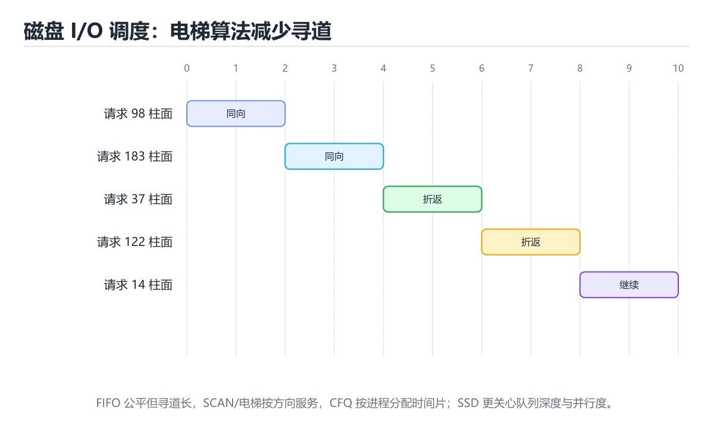

# Go语言Gin/Echo框架实战



> 内容更新时间：2026-10-06 · 学习阶段：进阶 · 预计用时：125 分钟

## 本节知识框架

**课程定位**：分类「backend_development」· 学习阶段 进阶 · 建议用时 50 分钟。

本课主线：学习Go类型系统、Goroutine并发模型和Gin/Echo框架中间件。

### 复习清单

- [ ] 能不看正文复述本课核心术语，并指出一个边界或反例。
- [ ] 能运行或推演本课示例，记录输入、输出与失败现象。
- [ ] 能完成一次自测，并把错题对照考点精讲定位原因。


## 核心概念定义

| 术语 | 一句话说明 |
| --- | --- |
| Go | 学习Go类型系统、Goroutine并发模型和Gin/Echo框架中间件。相关：正文给出可操作定义与适用边界。 |
| Gin | 学习Go类型系统、Goroutine并发模型和Gin/Echo框架中间件。相关：正文给出可操作定义与适用边界。 |
| Echo | 学习Go类型系统、Goroutine并发模型和Gin/Echo框架中间件。相关：正文给出可操作定义与适用边界。 |
| Goroutine | 学习Go类型系统、Goroutine并发模型和Gin/Echo框架中间件。相关：正文给出可操作定义与适用边界。 |
| GORM | 学习Go类型系统、Goroutine并发模型和Gin/Echo框架中间件。相关：正文给出可操作定义与适用边界。 |


## 原理与运行机制

《Go语言Gin/Echo框架实战》正文各章按「输入是什么 → 中间如何转换 → 输出到哪 → 失败时怎样表现」四问展开；复习时给每个机制补一句自己的复述，再回到对应章节核对。


### 生活类比拆解
#### Go语言是什么？

如果把编程语言比作交通工具：

- **Python**像自行车：灵活轻便，适合短途出行，但速度有限
- **Java**像公交车：功能齐全，能载很多人，但启动慢、占用资源多
- **Go**像高铁：速度快、准点率高、并发能力强，适合长途运输大量乘客

Go的设计哲学是"少即是多"：没有继承、没有泛型（早期版本）、没有异常处理。它用简单的组合代替继承，用明确的错误返回代替异常，用goroutine代替复杂的线程管理。这种简约让代码更易读、更易维护、更少bug。

#### Gin vs Echo：两种极简主义

**Gin像一把瑞士军刀**：虽然小巧，但内置了常用工具——路由、中间件、JSON绑定、验证等。它的API设计非常直观，社区庞大，文档丰富。就像你买了一把多功能刀，开箱即用。

**Echo像一套精密的手术刀**：更加轻量，只提供最核心的功能，其他都需要你自己选择。它强调高性能和可扩展性，API设计更加一致和优雅。就像外科医生根据自己的习惯挑选手术器械。

两者性能差距很小（都在微秒级别），选择主要看个人喜好和项目需求。Gin更适合快速开发，Echo更适合追求极致控制和一致性。

#### Goroutine：轻量级并发

想象一家大型呼叫中心：

**传统线程模型**：每个客服代表需要一个独立的办公室（线程），办公室需要桌椅电话等资源。如果同时有10000个客户来电，你需要10000间办公室，成本极高且管理复杂。

**Goroutine模型**：每个客服代表只需要一个工位（goroutine），所有工位共享一个大开间。创建和切换工位的成本极低，一个人可以轻松管理上千个工位。当某个客服在等待客户说话时（I/O等待），他可以立即切换到另一个工位处理其他客户。

Go的goroutine初始栈只有2KB（线程通常是1-8MB），由Go运行时调度而非操作系统，因此可以轻松创建数十万个goroutine而不会耗尽内存。

#### 中间件：请求的流水线

中间件就像工厂的装配线：

```text
原材料（HTTP请求） → [质检] → [清洗] → [加工] → [包装] → 成品（HTTP响应）
```

每个环节都可以：
- 检查数据是否符合要求（身份验证）
- 修改数据格式（日志记录、压缩）
- 拒绝不合格品（权限校验）
- 添加额外信息（请求ID追踪）

Gin和Echo的中间件机制让你可以灵活组合这些处理步骤。

---


## 典型应用场景

- 结合「Go语言Gin/Echo框架实战」的常见落地场景与选型边界，详见正文各章节的对比讨论。
- 迁移到新项目时，先明确输入规模、失败代价与可观测手段，再决定采用深度。


## 代码/协议/SQL 示例

《Go语言Gin/Echo框架实战》正文首个示例可作为最小验证起点（原样保留在上方章节）：先跑通，再改一个输入观察输出变化。

```text
原材料（HTTP请求） → [质检] → [清洗] → [加工] → [包装] → 成品（HTTP响应）
```


### 渐进式代码示例
#### 最小化Hello World

让我们从一个最简单的Gin应用开始：

```go
// main-minimal.go
package main

import "github.com/gin-gonic/gin"

func main() {
    // 创建默认引擎（包含Logger和Recovery中间件）
    r := gin.Default()

    // 定义路由
    r.GET("/", func(c *gin.Context) {
        c.JSON(200, gin.H{
            "message": "Hello World",
        })
    })

    // 启动服务器
    r.Run(":8080") // 监听并在 0.0.0.0:8080 上启动服务
}
```

运行应用：

```bash
go mod init myapp
go get github.com/gin-gonic/gin
go run main-minimal.go
```

访问 `http://localhost:8080` 看到JSON响应。就这么简单！

#### 带验证的路由

现在添加更复杂的功能，包括参数验证和错误处理：

```go
// main-validation.go
package main

import (
    "net/http"
    "github.com/gin-gonic/gin"
)

// 定义请求结构体
type CreateUserRequest struct {
    Name  string `json:"name" binding:"required,min=2,max=50"`
    Email string `json:"email" binding:"required,email"`
    Age   int    `json:"age" binding:"required,gte=18,lte=120"`
}

// 定义响应结构体
type UserResponse struct {
    ID    uint   `json:"id"`
    Name  string `json:"name"`
    Email string `json:"email"`
    Age   int    `json:"age"`
}

// 模拟数据库
var users []UserResponse
var nextID uint = 1

func main() {
    r := gin.Default()

    // POST /users - 创建用户
    r.POST("/users", func(c *gin.Context) {
        var req CreateUserRequest
        
        // 绑定并验证JSON
        if err := c.ShouldBindJSON(&req); err != nil {
            c.JSON(http.StatusBadRequest, gin.H{
                "error": "Invalid request",
                "details": err.Error(),
            })
            return
        }

        // 创建用户
        user := UserResponse{
            ID:    nextID,
            Name:  req.Name,
            Email: req.Email,
            Age:   req.Age,
        }
        nextID++
        users = append(users, user)

        c.JSON(http.StatusCreated, user)
    })

    // GET /users/:id - 获取用户
    r.GET("/users/:id", func(c *gin.Context) {
        id := c.Param("id")
        
        // 查找用户
        for _, user := range users {
            if fmt.Sprintf("%d", user.ID) == id {
                c.JSON(http.StatusOK, user)
                return
            }
        }

        c.JSON(http.StatusNotFound, gin.H{
            "error": "User not found",
        })
    })

    // GET /users - 列出所有用户
    r.GET("/users", func(c *gin.Context) {
        c.JSON(http.StatusOK, gin.H{
            "data":  users,
            "total": len(users),
        })
    })

    r.Run(":8080")
}
```

注意几个关键点：
1. **结构体标签**：`binding:"required,email"` 自动验证字段
2. **ShouldBindJSON**：解析JSON并验证，失败返回错误
3. **路由参数**：`:id` 捕获URL中的动态部分
4. **gin.H**：`map[string]interface{}` 的快捷方式，用于构建JSON

测试API：

```bash
# 创建用户
curl -X POST http://localhost:8080/users \
  -H "Content-Type: application/json" \
  -d '{
    "name": "张三",
    "email": "zhangsan@example.com",
    "age": 25
  }'

# 获取用户
curl http://localhost:8080/users/1

# 列出用户
curl http://localhost:8080/users
```

#### Echo框架实践

现在看看同样的功能用Echo如何实现：

```go
// main-echo.go
package main

import (
    "net/http"
    "github.com/labstack/echo/v4"
    "github.com/go-playground/validator/v10"
)

type CreateUserRequest struct {
    Name  string `json:"name" validate:"required,min=2,max=50"`
    Email string `json:"email" validate:"required,email"`
    Age   int    `json:"age" validate:"required,gte=18,lte=120"`
}

type UserResponse struct {
    ID    uint   `json:"id"`
    Name  string `json:"name"`
    Email string `json:"email"`
    Age   int    `json:"age"`
}

var (
    users  []UserResponse
    nextID uint = 1
)

func main() {
    e := echo.New()

    // 自定义验证器
    e.Validator = &CustomValidator{
        validator: validator.New(),
    }

    // POST /users
    e.POST("/users", func(c echo.Context) error {
        req := new(CreateUserRequest)
        
        if err := c.Bind(req); err != nil {
            return c.JSON(http.StatusBadRequest, map[string]string{
                "error": "Invalid request",
            })
        }

        if err := c.Validate(req); err != nil {
            return c.JSON(http.StatusBadRequest, map[string]string{
                "error":   "Validation failed",
                "details": err.Error(),
            })
        }

        user := UserResponse{
            ID:    nextID,
            Name:  req.Name,
            Email: req.Email,
            Age:   req.Age,
        }
        nextID++
        users = append(users, user)

        return c.JSON(http.StatusCreated, user)
    })

    // GET /users/:id
    e.GET("/users/:id", func(c echo.Context) error {
        id := c.Param("id")
        
        for _, user := range users {
            if fmt.Sprintf("%d", user.ID) == id {
                return c.JSON(http.StatusOK, user)
            }
        }

        return c.JSON(http.StatusNotFound, map[string]string{
            "error": "User not found",
        })
    })

    e.Logger.Fatal(e.Start(":8080"))
}

// 自定义验证器实现
type CustomValidator struct {
    validator *validator.Validate
}

func (cv *CustomValidator) Validate(i interface{}) error {
    return cv.validator.Struct(i)
}
```

**Gin vs Echo的关键差异**：

| 特性 | Gin | Echo |
|------|-----|------|
| 验证器 | 内置（基于go-playground/validator） | 需自行集成 |
| 中间件签名 | `func(*gin.Context)` | `func(echo.HandlerFunc) echo.HandlerFunc` |
| 错误处理 | 手动返回JSON | 返回error，由全局处理器转换 |
| 日志 | 内置Logger中间件 | 内置Logger，可自定义格式 |
| 社区规模 | 更大，更多第三方中间件 | 较小但更精简 |

#### 中间件链实践

让我们实现一个完整的中间件链，包括日志、认证、限流：

```go
// middleware/logger.go
package middleware

import (
    "log"
    "time"
    "github.com/gin-gonic/gin"
)

// LoggerMiddleware 记录请求日志
func LoggerMiddleware() gin.HandlerFunc {
    return func(c *gin.Context) {
        start := time.Now()
        path := c.Request.URL.Path
        method := c.Request.Method

        // 处理请求
        c.Next()

        // 记录日志
        latency := time.Since(start)
        statusCode := c.Writer.Status()
        
        log.Printf("[%s] %s %s %d %v",
            method,
            path,
            c.ClientIP(),
            statusCode,
            latency,
        )
    }
}
```

```go
// middleware/auth.go
package middleware

import (
    "net/http"
    "strings"
    "github.com/gin-gonic/gin"
)

// AuthMiddleware 验证JWT token
func AuthMiddleware() gin.HandlerFunc {
    return func(c *gin.Context) {
        // 从Header获取token
        authHeader := c.GetHeader("Authorization")
        
        if authHeader == "" {
            c.JSON(http.StatusUnauthorized, gin.H{
                "error": "Missing authorization header",
            })
            c.Abort()
            return
        }

        // 提取Bearer token
        parts := strings.SplitN(authHeader, " ", 2)
        if len(parts) != 2 || parts[0] != "Bearer" {
            c.JSON(http.StatusUnauthorized, gin.H{
                "error": "Invalid authorization format",
            })
            c.Abort()
            return
        }

        token := parts[1]

        // 验证token（简化版，实际应使用JWT库）
        if !validateToken(token) {
            c.JSON(http.StatusUnauthorized, gin.H{
                "error": "Invalid or expired token",
            })
            c.Abort()
            return
        }

        // 将用户信息存入上下文
        c.Set("userID", extractUserID(token))
        c.Next()
    }
}

func validateToken(token string) bool {
    // 简化验证，实际项目中应使用jwt-go库
    return token == "valid-token-123"
}

func extractUserID(token string) uint {
    // 简化实现
    return 1
}
```

```go
// middleware/ratelimit.go
package middleware

import (
    "net/http"
    "sync"
    "time"
    "github.com/gin-gonic/gin"
)

// RateLimitMiddleware 简单的基于IP的限流
func RateLimitMiddleware(maxRequests int, window time.Duration) gin.HandlerFunc {
    var mu sync.Mutex
    clients := make(map[string][]time.Time)

    return func(c *gin.Context) {
        ip := c.ClientIP()
        now := time.Now()

        mu.Lock()
        defer mu.Unlock()

        // 清理过期的请求记录
        if timestamps, exists := clients[ip]; exists {
            var valid []time.Time
            for _, t := range timestamps {
                if now.Sub(t) < window {
                    valid = append(valid, t)
                }
            }
            clients[ip] = valid
        }

        // 检查是否超过限制
        if len(clients[ip]) >= maxRequests {
            c.JSON(http.StatusTooManyRequests, gin.H{
                "error": "Rate limit exceeded",
            })
            c.Abort()
            return
        }

        // 记录当前请求
        clients[ip] = append(clients[ip], now)
        c.Next()
    }
}
```

```go
// main-middleware.go
package main

import (
    "myapp/middleware"
    "time"
    "github.com/gin-gonic/gin"
)

func main() {
    r := gin.New() // 不使用默认中间件，手动添加

    // 全局中间件
    r.Use(middleware.LoggerMiddleware())
    r.Use(gin.Recovery()) // 恢复panic
    r.Use(middleware.RateLimitMiddleware(100, time.Minute)) // 每分钟100次请求

    // 公开路由
    r.GET("/health", func(c *gin.Context) {
        c.JSON(200, gin.H{"status": "ok"})
    })

    // 受保护的路由组
    protected := r.Group("/api")
    protected.Use(middleware.AuthMiddleware())
    {
        protected.GET("/profile", func(c *gin.Context) {
            userID := c.MustGet("userID").(uint)
            c.JSON(200, gin.H{
                "message": "Your profile",
                "user_id": userID,
            })
        })

        protected.POST("/posts", func(c *gin.Context) {
            c.JSON(201, gin.H{
                "message": "Post created",
            })
        })
    }

    r.Run(":8080")
}
```

#### Goroutine并发实践

让我们看看如何用goroutine处理后台任务：

```go
// main-concurrent.go
package main

import (
    "fmt"
    "time"
    "github.com/gin-gonic/gin"
)

// 模拟耗时的后台任务
func sendEmail(email string, subject string) {
    fmt.Printf("Sending email to %s: %s\n", email, subject)
    time.Sleep(2 * time.Second) // 模拟发送邮件
    fmt.Printf("Email sent to %s\n", email)
}

func processImage(imagePath string) {
    fmt.Printf("Processing image: %s\n", imagePath)
    time.Sleep(3 * time.Second) // 模拟图像处理
    fmt.Printf("Image processed: %s\n", imagePath)
}

func main() {
    r := gin.Default()

    // 异步发送通知
    r.POST("/notify", func(c *gin.Context) {
        var req struct {
            Email   string `json:"email" binding:"required,email"`
            Message string `json:"message" binding:"required"`
        }

        if err := c.ShouldBindJSON(&req); err != nil {
            c.JSON(400, gin.H{"error": err.Error()})
            return
        }

        // 立即返回响应
        c.JSON(202, gin.H{
            "message": "Notification queued",
        })

        // 在后台goroutine中发送邮件
        go sendEmail(req.Email, req.Message)
    })

    // 批量处理图片
    r.POST("/images/process", func(c *gin.Context) {
        var req struct {
            Images []string `json:"images" binding:"required"`
        }

        if err := c.ShouldBindJSON(&req); err != nil {
            c.JSON(400, gin.H{"error": err.Error()})
            return
        }

        // 并发处理所有图片
        done := make(chan bool, len(req.Images))
        
        for _, img := range req.Images {
            go func(imagePath string) {
                processImage(imagePath)
                done <- true
            }(img)
        }

        // 等待所有任务完成
        go func() {
            for i := 0; i < len(req.Images); i++ {
                <-done
            }
            fmt.Println("All images processed")
        }()

        c.JSON(202, gin.H{
            "message":       "Processing started",
            "image_count":   len(req.Images),
        })
    })

    r.Run(":8080")
}
```

**关键理解**：
- `go` 关键字启动一个新的goroutine
- goroutine之间通过channel通信（`done` channel）
- 主goroutine不会等待后台goroutine，除非显式同步
- 避免goroutine泄漏：确保所有启动的goroutine最终都会退出

#### 完整项目结构

一个生产级的Go Web项目应该这样组织：

```text
my-go-api/
├── cmd/
│   └── server/
│       └── main.go          # 应用入口
├── internal/
│   ├── config/              # 配置管理
│   │   └── config.go
│   ├── handler/             # HTTP处理器
│   │   ├── user_handler.go
│   │   └── post_handler.go
│   ├── service/             # 业务逻辑层
│   │   ├── user_service.go
│   │   └── post_service.go
│   ├── repository/          # 数据访问层
│   │   ├── user_repo.go
│   │   └── post_repo.go
│   ├── model/               # 数据模型
│   │   ├── user.go
│   │   └── post.go
│   ├── middleware/          # 中间件
│   │   ├── auth.go
│   │   └── logger.go
│   └── router/              # 路由定义
│       └── router.go
├── pkg/
│   ├── database/            # 数据库连接
│   │   └── db.go
│   └── utils/               # 工具函数
│       └── jwt.go
├── migrations/              # 数据库迁移
├── tests/                   # 测试
├── .env                     # 环境变量
├── go.mod
├── go.sum
└── README.md
```

#### 集成GORM ORM

让我们看看如何连接真实数据库：

```go
// pkg/database/db.go
package database

import (
    "gorm.io/driver/sqlite"
    "gorm.io/gorm"
)

var DB *gorm.DB

func InitDatabase(dataSourceName string) error {
    var err error
    DB, err = gorm.Open(sqlite.Open(dataSourceName), &gorm.Config{})
    if err != nil {
        return err
    }
    
    // 自动迁移表结构
    return DB.AutoMigrate(&User{}, &Post{})
}
```

```go
// internal/model/user.go
package model

import "gorm.io/gorm"

type User struct {
    gorm.Model
    Name     string `gorm:"size:50;not null" json:"name"`
    Email    string `gorm:"size:100;uniqueIndex;not null" json:"email"`
    Password string `gorm:"size:255;not null" json:"-"` // "-" 不序列化到JSON
    IsActive bool   `gorm:"default:true" json:"is_active"`
    Posts    []Post `gorm:"foreignKey:AuthorID" json:"posts,omitempty"`
}
```

```go
// internal/model/post.go
package model

import "gorm.io/gorm"

type Post struct {
    gorm.Model
    Title   string `gorm:"size:200;not null" json:"title"`
    Content string `gorm:"type:text" json:"content"`
    AuthorID uint  `gorm:"not null" json:"author_id"`
    Author  User   `gorm:"foreignKey:AuthorID" json:"author,omitempty"`
}
```

```go
// internal/repository/user_repo.go
package repository

import (
    "myapp/internal/model"
    "myapp/pkg/database"
)

type UserRepository interface {
    Create(user *model.User) error
    GetByID(id uint) (*model.User, error)
    GetByEmail(email string) (*model.User, error)
    Update(user *model.User) error
    Delete(id uint) error
}

type userRepository struct{}

func NewUserRepository() UserRepository {
    return &userRepository{}
}

func (r *userRepository) Create(user *model.User) error {
    return database.DB.Create(user).Error
}

func (r *userRepository) GetByID(id uint) (*model.User, error) {
    var user model.User
    err := database.DB.First(&user, id).Error
    if err != nil {
        return nil, err
    }
    return &user, nil
}

func (r *userRepository) GetByEmail(email string) (*model.User, error) {
    var user model.User
    err := database.DB.Where("email = ?", email).First(&user).Error
    if err != nil {
        return nil, err
    }
    return &user, nil
}

func (r *userRepository) Update(user *model.User) error {
    return database.DB.Save(user).Error
}

func (r *userRepository) Delete(id uint) error {
    return database.DB.Delete(&model.User{}, id).Error
}
```

```go
// internal/service/user_service.go
package service

import (
    "errors"
    "myapp/internal/model"
    "myapp/internal/repository"
    "golang.org/x/crypto/bcrypt"
)

type UserService interface {
    Register(name, email, password string) (*model.User, error)
    Login(email, password string) (string, error)
    GetProfile(userID uint) (*model.User, error)
}

type userService struct {
    userRepo repository.UserRepository
}

func NewUserService() UserService {
    return &userService{
        userRepo: repository.NewUserRepository(),
    }
}

func (s *userService) Register(name, email, password string) (*model.User, error) {
    // 检查邮箱是否已存在
    existingUser, _ := s.userRepo.GetByEmail(email)
    if existingUser != nil {
        return nil, errors.New("email already registered")
    }

    // 哈希密码
    hashedPassword, err := bcrypt.GenerateFromPassword([]byte(password), bcrypt.DefaultCost)
    if err != nil {
        return nil, err
    }

    // 创建用户
    user := &model.User{
        Name:     name,
        Email:    email,
        Password: string(hashedPassword),
    }

    err = s.userRepo.Create(user)
    if err != nil {
        return nil, err
    }

    // 清除密码字段后再返回
    user.Password = ""
    return user, nil
}

func (s *userService) Login(email, password string) (string, error) {
    user, err := s.userRepo.GetByEmail(email)
    if err != nil {
        return "", errors.New("invalid credentials")
    }

    // 验证密码
    err = bcrypt.CompareHashAndPassword([]byte(user.Password), []byte(password))
    if err != nil {
        return "", errors.New("invalid credentials")
    }

    // 生成JWT token（简化版）
    token := generateJWT(user.ID)
    return token, nil
}

func (s *userService) GetProfile(userID uint) (*model.User, error) {
    user, err := s.userRepo.GetByID(userID)
    if err != nil {
        return nil, errors.New("user not found")
    }
    
    user.Password = "" // 不返回密码
    return user, nil
}

func generateJWT(userID uint) string {
    // 实际项目中应使用jwt-go库
    return "mock-jwt-token"
}
```

```go
// internal/handler/user_handler.go
package handler

import (
    "net/http"
    "myapp/internal/service"
    "github.com/gin-gonic/gin"
)

type UserHandler struct {
    userService service.UserService
}

func NewUserHandler() *UserHandler {
    return &UserHandler{
        userService: service.NewUserService(),
    }
}

func (h *UserHandler) Register(c *gin.Context) {
    var req struct {
        Name     string `json:"name" binding:"required,min=2"`
        Email    string `json:"email" binding:"required,email"`
        Password string `json:"password" binding:"required,min=8"`
    }

    if err := c.ShouldBindJSON(&req); err != nil {
        c.JSON(http.StatusBadRequest, gin.H{"error": err.Error()})
        return
    }

    user, err := h.userService.Register(req.Name, req.Email, req.Password)
    if err != nil {
        c.JSON(http.StatusBadRequest, gin.H{"error": err.Error()})
        return
    }

    c.JSON(http.StatusCreated, gin.H{
        "success": true,
        "data":    user,
    })
}

func (h *UserHandler) Login(c *gin.Context) {
    var req struct {
        Email    string `json:"email" binding:"required,email"`
        Password string `json:"password" binding:"required"`
    }

    if err := c.ShouldBindJSON(&req); err != nil {
        c.JSON(http.StatusBadRequest, gin.H{"error": err.Error()})
        return
    }

    token, err := h.userService.Login(req.Email, req.Password)
    if err != nil {
        c.JSON(http.StatusUnauthorized, gin.H{"error": err.Error()})
        return
    }

    c.JSON(http.StatusOK, gin.H{
        "success": true,
        "token":   token,
    })
}

func (h *UserHandler) GetProfile(c *gin.Context) {
    userID := c.MustGet("userID").(uint)
    
    user, err := h.userService.GetProfile(userID)
    if err != nil {
        c.JSON(http.StatusNotFound, gin.H{"error": err.Error()})
        return
    }

    c.JSON(http.StatusOK, gin.H{
        "success": true,
        "data":    user,
    })
}
```

```go
// cmd/server/main.go
package main

import (
    "myapp/internal/handler"
    "myapp/internal/middleware"
    "myapp/internal/router"
    "myapp/pkg/database"
    "log"
)

func main() {
    // 初始化数据库
    err := database.InitDatabase("app.db")
    if err != nil {
        log.Fatal("Failed to initialize database:", err)
    }

    // 创建处理器
    userHandler := handler.NewUserHandler()

    // 设置路由
    r := router.SetupRouter(userHandler)

    // 启动服务器
    log.Println("Server starting on :8080")
    r.Run(":8080")
}
```

---


## 时间/空间复杂度或性能分析

- 在《Go语言Gin/Echo框架实战》里处理规模 n 时，先估计主循环与嵌套层数，再决定优化方向；小样本上的耗时读数不能外推。
- 性能结论要绑定输入分布：换数据规模、并发度或缓存命中情况后须重新测量。


## 常见误区与易错点

| 错误做法 | 典型现象 | 修复方向 |
| --- | --- | --- |
| 只验证正常输入 | 边界数据触发时才暴露问题 | 为每个结论补一个空值/极值/重复值用例 |
| 背结论不跑实验 | 换个输入就失效 | 按「预测—实测—差异归因」三步复盘 |
| 忽略环境与版本差异 | 本机可用线上报错 | 把版本、配置与依赖写入复现步骤 |


### 常见陷阱与解决方案
| 陷阱 | 表现 | 原因 | 解决方案 |
|------|------|------|----------|
| **忽略错误返回值** | 程序行为异常但不报错 | Go没有异常，错误必须显式处理 | 始终检查error返回值，使用`if err != nil`模式 |
| **goroutine泄漏** | 内存持续增长 | 启动的goroutine永远不退出 | 确保所有goroutine有退出条件，使用context控制生命周期 |
| **竞态条件** | 偶尔出现数据不一致 | 多个goroutine同时读写共享变量 | 使用mutex、channel或atomic操作保护共享状态 |
| **空指针解引用** | panic: runtime error | 未检查nil就使用指针 | 在使用指针前检查是否为nil，或使用值类型 |
| **JSON序列化失败** | 返回空对象或错误 | 结构体字段未导出（小写开头） | JSON字段必须大写开头才能被序列化，或使用json tag |
| **数据库连接泄漏** | 连接池耗尽 | 未正确关闭数据库连接 | 使用defer关闭连接，或使用GORM的事务管理 |
| **硬编码配置** | 不同环境需要重新编译 | 配置写在代码里 | 使用viper库读取环境变量和配置文件 |
| **缺少输入验证** | 恶意数据导致错误或安全漏洞 | 仅依赖前端验证 | 在后端使用binding tag严格验证所有输入 |
| **panic未恢复** | 整个服务崩溃 | 未使用Recovery中间件 | 始终使用gin.Recovery()中间件捕获panic |
| **大文件上传阻塞** | 内存溢出或服务无响应 | 一次性加载整个文件到内存 | 使用流式处理，分块读取和写入 |

---


## 与其他知识点的关系

本课与分类「backend_development」内相邻课程互为补充，建议按清单顺序学完再做综合练习。


## 自测题与参考答案

以下题目与题库同源，作答后再看解析；错误项要能说出错在哪一步。


## 考点精讲

### 考点 1

Go语言的goroutine与传统线程的主要区别是什么？

A. goroutine只能由操作系统调度  
B. goroutine的栈空间更小，由Go运行时调度 ✅  
C. goroutine不能并发执行  
D. goroutine比线程消耗更多内存  

**正确答案：** B

**解析：** goroutine的初始栈只有2KB（线程通常是1-8MB），并且由Go运行时而非操作系统调度。这使得创建和切换goroutine的成本极低，可以轻松创建数十万个goroutine。选项A错误，因为goroutine由Go运行时调度；选项C错误，goroutine正是为了并发而设计；选项D错误，goroutine比线程节省得多内存。

### 考点 2

在Gin框架中，如何从请求体中解析JSON并同时进行验证？

A. 使用`c.Bind()`方法  
B. 使用`c.Query()`方法  
C. 手动解析`c.Request.Body`  
D. 使用`c.ShouldBindJSON()`方法 ✅  

**正确答案：** D

**解析：** `c.ShouldBindJSON()`会解析JSON请求体并根据结构体标签进行验证，如果失败会返回错误但不会自动发送响应（需要手动处理）。`c.Bind()`也会解析和验证，但在失败时会自动发送400响应。`c.Query()`用于获取查询参数，不是请求体。手动解析虽然可行，但失去了自动验证的优势。

### 考点 3

以下哪种情况会导致goroutine泄漏？

A. 使用`go func()`启动goroutine但没有退出条件 ✅  
B. 使用`defer`关闭资源  
C. 使用channel进行goroutine间通信  
D. 使用`sync.WaitGroup`等待goroutine完成  

**正确答案：** A

**解析：** 如果启动的goroutine没有退出条件（如无限循环且没有break），它将永远运行，占用内存和资源，这就是goroutine泄漏。正确的做法是确保所有goroutine都有明确的退出条件，可以使用context、channel关闭信号或超时机制。选项B、C、D都是良好的实践，不会导致泄漏。

### 考点 4

Gin和Echo在错误处理方式上的主要区别是什么？

A. Gin返回error，Echo返回JSON  
B. 两者都只能返回error  
C. 两者都只能手动返回JSON  
D. Gin手动返回JSON，Echo返回error由全局处理器转换 ✅  

**正确答案：** D

**解析：** 这是两个框架设计理念的差异。Gin的handler直接操作`*gin.Context`，需要手动调用`c.JSON()`返回响应。Echo的handler返回`error`，框架的全局错误处理器会将error转换为HTTP响应。两种方式各有优劣：Gin更灵活，Echo更统一。实际项目中可以根据团队偏好选择。

### 考点 5

在Go中，如何让结构体的某个字段不被JSON序列化？

A. 将字段名改为小写  
B. 使用`json:"-"`标签 ✅  
C. 删除该字段  
D. 使用`omitempty`标签  

**正确答案：** B

**解析：** `json:"-"`标签明确告诉JSON编码器忽略该字段，常用于密码、内部ID等不应暴露的数据。选项A错误，小写字段本身不会被导出，但这不是推荐做法（应该保持字段大写并用tag控制）。选项C不合理，字段可能需要在其他地方使用。选项D的`omitempty`只是在字段为空时省略，不为空时仍会序列化。


## 术语速查

| 术语 | 一句话说明 |
| --- | --- |
| Go | 奉行少即是多的编译型语言，用组合替代继承、用错误返回替代异常，并发能力强 |
| Gin | Go生态中功能齐全的Web框架，开箱自带路由、JSON绑定校验与常用中间件 |
| Echo | 比Gin更轻量的Go框架，只给核心能力，接口风格统一，适合追求极致控制的项目 |
| Goroutine | 由Go运行时而非操作系统调度的轻量并发单元，初始栈仅2KB，可并存数十万个 |
| GORM | Go最流行的ORM库，用结构体加标签映射数据表，支持自动迁移、关联与事务 |


## 参考资料与复核

- [本课资料锚点 backend_gin_echo](https://zh.wikipedia.org/w/index.php?search=backend_gin_echo)

- 官方/权威资料：[HTTP 规范](https://datatracker.ietf.org/doc/html/rfc9110)
- 主题延伸：[关于「Gin」的检索页](https://zh.wikipedia.org/w/index.php?search=Gin)
- 本课索引词：[锚点 backend_gin_echo](https://datatracker.ietf.org/doc/html/rfc9110#Go)
- 最后复核：2026-10-04
- 下次复核：2026-10-25


### 进阶学习资源
- **官方文档**：[Go Docs](https://go.dev/doc/)、[Gin Guide](https://gin-gonic.com/docs/)、[Echo Guide](https://echo.labstack.com/)
- **并发最佳实践**：学习`context`包控制goroutine生命周期，`sync`包处理同步，`errgroup`管理一组goroutine
- **性能优化**：使用pprof进行性能分析，优化GC参数，使用对象池减少内存分配
- **测试策略**：使用`testing`包编写单元测试，使用`testify`增强断言，Mock外部依赖
- **部署实践**：学习交叉编译、Docker多阶段构建、Kubernetes部署、健康检查端点

下一章我们将深入探讨RESTful API设计的最佳实践，学习如何构建优雅、可扩展的API接口！


## Go Language Gin/Echo Framework Practice

### 本章摘要

Go语言以其简洁的语法、出色的并发性能和快速的编译速度，成为现代后端开发的新宠。Gin和Echo是Go生态中最受欢迎的两个Web框架，它们都追求极简主义和高性能。本章将带你从零开始学习Go Web开发，掌握结构体标签验证、中间件链、路由分组、JSON序列化等核心概念。你将理解Go的goroutine并发模型如何轻松处理成千上万的并发连接，学会编写类型安全的API服务，并对比Gin和Echo的设计哲学差异。通过实战项目，你将构建一个高性能的博客系统API，体验Go语言带来的开发效率和运行性能的双重优势。

### 学习目标

完成本章后，你将能够：

1. 理解Go语言的基础语法和类型系统
2. 熟练使用Gin框架构建RESTful API服务
3. 掌握Echo框架的路由和中间件机制
4. 实现结构体标签验证和自定义错误处理
5. 使用goroutine和channel处理并发任务
6. 集成GORM ORM进行数据库操作并部署生产应用

---


## 验证命令与预期输出

完成本课后，用下面三条命令核对交付质量：

```bash
# 1) 构建或启动
cd 项目根目录 && 按 README 的安装命令准备环境
# 2) 冒烟测试
运行课程里给出的最小示例，确认输出与「预期输出」一行一致
# 3) 回归检查
对照下方交付清单逐项打勾，缺失项先补齐再提交
```

预期输出：程序正常退出（退出码 0），关键结果与正文示例一致，无未捕获异常。


## 项目专属规格

- 运行环境与版本要求以正文「环境准备」为准，跨平台需分别验证。
- 数据规模、并发量与失败率阈值由验收用例定义，不得私自放宽。
- 接口契约、错误码与日志格式在交付前冻结，变更须走评审。


## 项目交付物

- [ ] 可运行的完整源码与构建脚本
- [ ] README：安装、运行、测试三步可复现
- [ ] 验收清单逐条勾选并附运行截图或日志


## 内容元数据

- 内容更新时间：2026-10-06

- 内容版本：v2.0
- 课程标识：backend_gin_echo
- 所属分类：backend_development
- 学习阶段：进阶
- 建议用时：50 分钟


