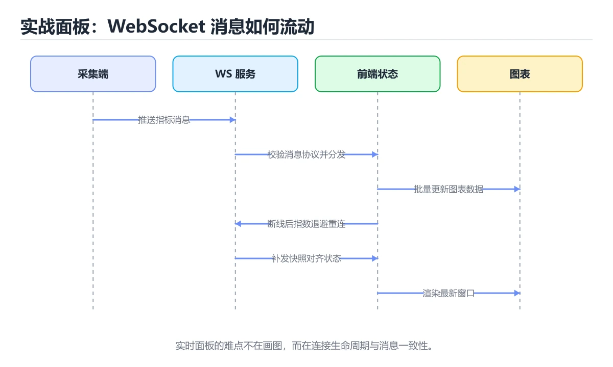

# 微服务架构模式



> 内容更新时间：2026-10-06 · 学习阶段：高级 · 预计用时：75 分钟

## 本章摘要

本章将带你深入理解现代分布式系统设计的核心——微服务架构。我们将从单体架构的局限性出发，探讨何时应该（以及何时不应该）拆分为微服务，学习领域驱动设计（DDD）指导下的服务分解策略。你将掌握多种服务间通信方式（REST、gRPC、消息队列）的选择标准，理解API Gateway如何简化客户端交互，探索服务发现机制如何实现动态扩展。此外，我们还会讨论分布式追踪在复杂调用链中的重要性，分析最终一致性的权衡，并深入讲解Saga模式如何处理跨服务的分布式事务。通过真实场景的案例分析和代码示例，你将具备设计和实现可扩展微服务系统的理论基础与实践能力。无论你是准备重构遗留系统还是从零构建新平台，这些模式都将成为你的架构工具箱中的利器。

---

## 8.1 单体 vs 微服务：架构演进的必然选择

### 单体架构的兴衰

想象一家初创餐厅，最初只有一位厨师（单体应用）负责所有菜品。顾客少时，这种模式效率极高：沟通成本低、食材共享方便、出餐速度快。但随着业务增长，问题逐渐显现：

- **耦合度高**：修改甜品配方可能意外影响主菜流程
- **扩展困难**：想增加人手只能复制整个厨房（垂直扩展）
- **部署风险**：任何小改动都需要重新培训所有厨师（全量部署）
- **技术栈锁定**：无法为特定菜品引入专业设备（技术多样性受限）

这就是单体架构的典型困境：**初期简单高效，后期难以维护**。

### 微服务的核心理念

微服务架构将应用拆分为一组小型、独立的服务，每个服务：
1. **围绕业务能力组织**：用户服务、订单服务、支付服务等
2. **独立部署**：可以单独更新而不影响其他服务
3. **去中心化治理**：不同服务可使用不同技术栈
4. **数据隔离**：每个服务拥有自己的数据库
5. **自动化运维**：依赖CI/CD和容器化技术

**类比**：微服务就像大型美食广场，每个摊位（服务）专注于特定菜系，独立运营，但共享基础设施（电力、排水）。顾客（客户端）通过统一入口（API Gateway）点餐，后台协调员（服务网格）确保订单正确流转。

### 单体 vs 微服务对比表

| 维度 | 单体架构 | 微服务架构 |
|------|---------|-----------|
| 开发速度（初期） | 快，无需考虑服务边界 | 慢，需设计服务接口 |
| 开发速度（后期） | 慢，代码库庞大复杂 | 快，团队并行开发 |
| 部署复杂度 | 简单，一次部署全部功能 | 复杂，需编排多个服务 |
| 扩展性 | 垂直扩展为主，成本高 | 水平扩展，按需扩容 |
| 故障隔离 | 单点故障影响全局 | 故障局限在单个服务 |
| 技术多样性 | 单一技术栈 | 可为不同服务选择最佳技术 |
| 数据一致性 | ACID事务，强一致性 | 最终一致性，实现复杂 |
| 测试难度 | 简单，端到端测试容易 | 复杂，需模拟依赖服务 |
| 监控调试 | 简单，日志集中 | 复杂，需分布式追踪 |
| 团队结构 | 功能团队，跨模块协作 | 特性团队，端到端负责 |

### 何时选择微服务？

**适合微服务的场景**：
- 团队规模超过10人，存在协作瓶颈
- 系统需要高可用性和弹性扩展
- 不同模块有不同的性能或技术需求
- 业务领域清晰，可自然拆分

**不适合微服务的场景**：
- 初创项目，业务模式未验证
- 团队规模小（<5人），沟通成本低
- 系统复杂度低，单体足以应对
- 缺乏DevOps能力和自动化基础设施

**Martin Fowler的建议**："从单体开始，当单体成为问题时再拆分。"

---

## 8.2 服务分解策略：领域驱动设计（DDD）指导

### 什么是领域驱动设计？

DDD是一种软件设计方法论，强调将业务领域知识直接映射到代码结构中。核心概念包括：

1. **限界上下文（Bounded Context）**：明确的业务边界，每个上下文有自己的模型和语言
2. **聚合根（Aggregate Root）**：一组相关对象的集合，作为数据修改的单元
3. **实体（Entity）**：具有唯一标识的对象
4. **值对象（Value Object）**：无身份标识，仅通过属性值区分

**类比**：想象一家医院，不同科室（限界上下文）有各自的术语和工作流程。心脏科说的"血压"和眼科说的"视力"属于不同上下文，不应混用同一数据模型。

### 战略设计：识别限界上下文

**电商系统的限界上下文划分**：

```text
┌─────────────────────────────────────────┐
│           电商系统                        │
├──────────┬──────────┬─────────┬─────────┤
│ 用户上下文│ 商品上下文│ 订单上下文│ 支付上下文│
│          │          │         │         │
│ - 注册   │ - 上架   │ - 创建  │ - 扣款  │
│ - 登录   │ - 搜索   │ - 取消  │ - 退款  │
│ - 资料   │ - 库存   │ - 物流  │ - 对账  │
└──────────┴──────────┴─────────┴─────────┘
```

**识别方法**：
1. **事件风暴（Event Storming）**：列出所有业务事件，按时间线排列
2. **通用语言（Ubiquitous Language）**：与领域专家沟通，确定术语边界
3. **康威定律**：组织结构影响系统设计，团队边界可作为参考

### 战术设计：定义服务边界

**用户服务（User Service）**：
```javascript
// 聚合根：User
class User {
  constructor(id, email, profile) {
    this.id = id;
    this.email = email;
    this.profile = profile; // 值对象
    this.roles = [];
  }
  
  changeEmail(newEmail) {
    // 业务规则验证
    if (!isValidEmail(newEmail)) {
      throw new Error('无效的邮箱格式');
    }
    this.email = newEmail;
    // 发布领域事件
    domainEvents.publish(new EmailChangedEvent(this.id, newEmail));
  }
}

// 值对象：Profile
class Profile {
  constructor(firstName, lastName, avatar) {
    this.firstName = firstName;
    this.lastName = lastName;
    this.avatar = avatar;
  }
  
  get fullName() {
    return `${this.firstName} ${this.lastName}`;
  }
}
```

**订单服务（Order Service）**：
```javascript
// 聚合根：Order
class Order {
  constructor(userId, items) {
    this.id = generateId();
    this.userId = userId;
    this.items = items; // 订单项实体
    this.status = 'CREATED';
    this.totalAmount = this.calculateTotal();
    this.createdAt = new Date();
  }
  
  addItem(product, quantity) {
    if (this.status !== 'CREATED') {
      throw new Error('订单已提交，无法修改');
    }
    this.items.push({ productId: product.id, quantity, price: product.price });
    this.totalAmount = this.calculateTotal();
  }
  
  submit() {
    if (this.items.length === 0) {
      throw new Error('订单不能为空');
    }
    this.status = 'SUBMITTED';
    domainEvents.publish(new OrderSubmittedEvent(this.id, this.userId));
  }
  
  calculateTotal() {
    return this.items.reduce((sum, item) => sum + item.price * item.quantity, 0);
  }
}
```

### 服务拆分反模式

| 反模式 | 描述 | 后果 | 正确做法 |
|--------|------|------|---------|
| 分布式单体 | 服务间紧耦合，必须同时部署 | 失去微服务优势 | 明确服务边界，异步通信 |
| 过度拆分 | 服务粒度过细（如每个表一个服务） | 运维复杂度爆炸 | 按业务能力聚合，适度合并 |
| 共享数据库 | 多个服务直接访问同一数据库 | 耦合度高，难以独立演进 | 每个服务私有数据库，通过API暴露数据 |
| 智能管道 dumb服务 | 所有逻辑集中在API Gateway | 网关成为瓶颈和单点故障 | 网关只做路由，业务逻辑在服务内 |
| 忽略团队结构 | 技术拆分不考虑组织架构 | 跨团队协调成本高 | 遵循康威定律，团队即服务 |

---

## 8.3 服务间通信：REST、gRPC与消息队列

### 同步通信：REST vs gRPC

#### REST（Representational State Transfer）

**特点**：
- 基于HTTP协议，使用标准方法（GET、POST、PUT、DELETE）
- 数据格式通常为JSON
- 易于理解和调试，浏览器原生支持
- 适合面向外部的API

**示例**：
```javascript
// 订单服务调用用户服务获取用户信息
async function getUserInfo(userId) {
  const response = await fetch(`http://user-service:3000/api/users/${userId}`, {
    method: 'GET',
    headers: {
      'Content-Type': 'application/json',
      'Authorization': `Bearer ${serviceToken}`,
    },
  });
  
  if (!response.ok) {
    throw new Error(`用户服务返回错误: ${response.status}`);
  }
  
  return await response.json();
}

// 创建订单时验证用户存在
async function createOrder(orderData) {
  // 1. 验证用户
  const user = await getUserInfo(orderData.userId);
  if (!user) {
    throw new Error('用户不存在');
  }
  
  // 2. 检查库存（调用商品服务）
  const stockCheck = await checkStock(orderData.items);
  if (!stockCheck.available) {
    throw new Error('库存不足');
  }
  
  // 3. 创建订单
  const order = await db.orders.create({
    userId: orderData.userId,
    items: orderData.items,
    status: 'CREATED',
  });
  
  return order;
}
```

**REST优缺点**：
- ✅ 人类可读，易于调试
- ✅ 广泛支持，生态成熟
- ❌ 文本格式，体积较大
- ❌ 无强类型约束，易出错
- ❌ HTTP开销大，延迟较高

#### gRPC（Google Remote Procedure Call）

**特点**：
- 基于HTTP/2和Protocol Buffers（二进制序列化）
- 强类型接口定义（.proto文件）
- 支持双向流式传输
- 高性能，适合内部服务通信

**定义.proto文件**：
```protobuf
// user_service.proto
syntax = "proto3";

package userservice;

service UserService {
  rpc GetUser (GetUserRequest) returns (GetUserResponse);
  rpc ListUsers (ListUsersRequest) returns (stream User);
}

message GetUserRequest {
  string user_id = 1;
}

message GetUserResponse {
  User user = 1;
}

message ListUsersRequest {
  int32 page_size = 1;
  string page_token = 2;
}

message User {
  string id = 1;
  string username = 2;
  string email = 3;
  repeated string roles = 4;
}
```

**Node.js gRPC服务端**：
```javascript
const grpc = require('@grpc/grpc-js');
const protoLoader = require('@grpc/proto-loader');

const packageDefinition = protoLoader.loadSync('user_service.proto');
const userServiceProto = grpc.loadPackageDefinition(packageDefinition).userservice;

class UserServiceImpl {
  async GetUser(call, callback) {
    try {
      const { user_id } = call.request;
      const user = await db.users.findById(user_id);
      
      if (!user) {
        callback({
          code: grpc.status.NOT_FOUND,
          details: '用户不存在',
        });
        return;
      }
      
      callback(null, {
        user: {
          id: user.id,
          username: user.username,
          email: user.email,
          roles: user.roles,
        },
      });
    } catch (error) {
      callback({
        code: grpc.status.INTERNAL,
        details: error.message,
      });
    }
  }
}

const server = new grpc.Server();
server.addService(userServiceProto.UserService.service, new UserServiceImpl());
server.bindAsync('0.0.0.0:50051', grpc.ServerCredentials.createInsecure(), () => {
  console.log('gRPC服务器启动于端口 50051');
  server.start();
});
```

**Node.js gRPC客户端**：
```javascript
const client = new userServiceProto.UserService(
  'user-service:50051',
  grpc.credentials.createInsecure()
);

client.GetUser({ user_id: '123' }, (error, response) => {
  if (error) {
    console.error('gRPC调用失败:', error.details);
    return;
  }
  console.log('用户信息:', response.user);
});
```

**gRPC优缺点**：
- ✅ 二进制序列化，体积小，速度快
- ✅ 强类型，编译时检查
- ✅ 支持流式传输
- ❌ 不易调试，需要专用工具
- ❌ 浏览器支持有限（需grpc-web）
- ❌ 学习曲线陡峭

#### REST vs gRPC选择指南

| 场景 | 推荐协议 | 原因 |
|------|---------|------|
| 对外公开API | REST | 通用性强，易于集成 |
| 内部服务通信 | gRPC | 高性能，类型安全 |
| 移动端后端 | gRPC | 节省流量，提升响应速度 |
| 浏览器前端调用 | REST | 原生支持，无需额外库 |
| 实时数据流 | gRPC Streaming | 双向流式传输支持 |
| 快速原型开发 | REST | 开发效率高，调试方便 |

### 异步通信：消息队列

**适用场景**：
- 解耦服务，降低依赖
- 削峰填谷，处理突发流量
- 最终一致性，允许短暂延迟
- 事件驱动架构

**常见消息队列**：
- RabbitMQ：成熟稳定，路由灵活
- Apache Kafka：高吞吐，适合日志流
- AWS SQS：托管服务，免运维
- Redis Pub/Sub：轻量级，适合简单场景

**RabbitMQ示例**：

**生产者（订单服务）**：
```javascript
const amqp = require('amqplib');

async function publishOrderCreated(order) {
  const connection = await amqp.connect('amqp://localhost');
  const channel = await connection.createChannel();
  
  const exchange = 'order_events';
  const routingKey = 'order.created';
  
  await channel.assertExchange(exchange, 'topic', { durable: true });
  
  channel.publish(exchange, routingKey, Buffer.from(JSON.stringify({
    orderId: order.id,
    userId: order.userId,
    totalAmount: order.totalAmount,
    createdAt: order.createdAt,
  })));
  
  console.log('订单创建事件已发布');
  
  await channel.close();
  await connection.close();
}
```

**消费者（库存服务）**：
```javascript
async function consumeOrderEvents() {
  const connection = await amqp.connect('amqp://localhost');
  const channel = await connection.createChannel();
  
  const exchange = 'order_events';
  const queue = 'inventory_order_queue';
  
  await channel.assertExchange(exchange, 'topic', { durable: true });
  await channel.assertQueue(queue, { durable: true });
  await channel.bindQueue(queue, exchange, 'order.created');
  
  channel.consume(queue, async (msg) => {
    if (msg) {
      const event = JSON.parse(msg.content.toString());
      
      try {
        // 扣减库存
        await deductStock(event.orderId, event.items);
        
        // 发布库存扣减成功事件
        await publishStockReserved(event.orderId);
        
        channel.ack(msg);
      } catch (error) {
        console.error('处理订单事件失败:', error);
        channel.nack(msg, false, true); // 重新入队
      }
    }
  });
  
  console.log('开始监听订单事件...');
}
```

**消息队列优缺点**：
- ✅ 完全解耦，服务独立演进
- ✅ 异步处理，提升响应速度
- ✅ 缓冲流量，提高系统韧性
- ❌ 复杂性增加，需处理消息丢失、重复消费
- ❌ 调试困难，调用链不直观
- ❌ 最终一致性，数据可能有延迟

---

## 8.4 API Gateway：统一入口与流量管理

### 为什么需要API Gateway？

在微服务架构中，客户端可能需要调用多个服务：

**没有API Gateway**：
```text
移动端 → 用户服务:3001
       → 商品服务:3002
       → 订单服务:3003
       → 支付服务:3004
```
问题：客户端需知道所有服务地址，认证逻辑重复实现，跨域配置复杂。

**有API Gateway**：
```text
移动端 → API Gateway:8080 → 用户服务:3001
                         → 商品服务:3002
                         → 订单服务:3003
                         → 支付服务:3004
```
优势：统一入口，集中认证，请求聚合，负载均衡。

### API Gateway核心功能

1. **路由转发**：根据路径将请求分发到对应服务
2. **认证授权**：统一验证JWT令牌
3. **限流熔断**：防止雪崩效应
4. **请求聚合**：合并多个服务调用
5. **日志监控**：集中记录访问日志
6. **缓存**：减少后端压力
7. **SSL终止**：统一管理HTTPS证书

### Kong Gateway示例

**安装Kong（Docker）**：
```bash
docker run -d --name kong \
  -e "KONG_DATABASE=postgres" \
  -e "KONG_PG_HOST=kong-database" \
  -p 8000:8000 \
  -p 8443:8443 \
  -p 8001:8001 \
  kong:latest
```

**配置路由和服务**：
```bash
# 添加用户服务
curl -i -X POST http://localhost:8001/services \
  --data name=user-service \
  --data url='http://user-service:3001'

# 为用户服务添加路由
curl -i -X POST http://localhost:8001/services/user-service/routes \
  --data 'paths[]=/api/users'

# 添加商品服务
curl -i -X POST http://localhost:8001/services \
  --data name=product-service \
  --data url='http://product-service:3002'

# 为商品服务添加路由
curl -i -X POST http://localhost:8001/services/product-service/routes \
  --data 'paths[]=/api/products'
```

**启用JWT认证插件**：
```bash
curl -i -X POST http://localhost:8001/services/user-service/plugins \
  --data name=jwt

# 为消费者创建JWT凭证
curl -i -X POST http://localhost:8001/consumers/alice/jwt \
  --data key=alice-key \
  --data secret=alice-secret
```

### Node.js自定义API Gateway

```javascript
const express = require('express');
const axios = require('axios');
const jwt = require('jsonwebtoken');

const app = express();
app.use(express.json());

// 服务注册表
const services = {
  'user-service': 'http://user-service:3001',
  'product-service': 'http://product-service:3002',
  'order-service': 'http://order-service:3003',
};

// JWT验证中间件
function authenticate(req, res, next) {
  const token = req.headers.authorization?.split(' ')[1];
  
  if (!token) {
    return res.status(401).json({ error: '缺少认证令牌' });
  }
  
  try {
    const decoded = jwt.verify(token, process.env.JWT_SECRET);
    req.user = decoded;
    next();
  } catch (error) {
    return res.status(403).json({ error: '无效的令牌' });
  }
}

// 限流中间件
const rateLimitMap = new Map();
function rateLimiter(maxRequests = 100, windowMs = 60000) {
  return (req, res, next) => {
    const ip = req.ip;
    const now = Date.now();
    
    if (!rateLimitMap.has(ip)) {
      rateLimitMap.set(ip, []);
    }
    
    const timestamps = rateLimitMap.get(ip).filter(t => now - t < windowMs);
    
    if (timestamps.length >= maxRequests) {
      return res.status(429).json({ error: '请求过于频繁' });
    }
    
    timestamps.push(now);
    rateLimitMap.set(ip, timestamps);
    
    next();
  };
}

// 路由代理
app.all('/api/users/*', authenticate, rateLimiter(), async (req, res) => {
  try {
    const targetUrl = `${services['user-service']}${req.originalUrl}`;
    const response = await axios({
      method: req.method,
      url: targetUrl,
      headers: {
        ...req.headers,
        'X-User-Id': req.user.id,
      },
      data: req.body,
    });
    
    res.status(response.status).json(response.data);
  } catch (error) {
    res.status(error.response?.status || 500).json({
      error: error.response?.data?.error || '服务不可用',
    });
  }
});

app.all('/api/products/*', rateLimiter(), async (req, res) => {
  try {
    const targetUrl = `${services['product-service']}${req.originalUrl}`;
    const response = await axios(targetUrl);
    res.json(response.data);
  } catch (error) {
    res.status(500).json({ error: '商品服务不可用' });
  }
});

// 请求聚合：一次性获取用户信息和订单列表
app.get('/api/dashboard/:userId', authenticate, async (req, res) => {
  try {
    const [userInfo, orders] = await Promise.all([
      axios.get(`${services['user-service']}/api/users/${req.params.userId}`),
      axios.get(`${services['order-service']}/api/orders?userId=${req.params.userId}`),
    ]);
    
    res.json({
      user: userInfo.data,
      orders: orders.data,
    });
  } catch (error) {
    res.status(500).json({ error: '获取仪表盘数据失败' });
  }
});

app.listen(8080, () => {
  console.log('API Gateway运行于端口 8080');
});
```

---

## 8.5 服务发现与分布式追踪

### 服务发现：动态注册与查找

在云环境中，服务实例可能随时启动或停止，硬编码IP地址不可行。服务发现机制允许服务动态注册自己，并通过名称查找其他服务。

**两种模式**：

1. **客户端发现**：客户端查询服务注册中心，直接调用目标实例
   - 优点：简单，无额外跳转
   - 缺点：客户端需集成发现逻辑

2. **服务端发现**：通过负载均衡器或服务网格代理请求
   - 优点：客户端透明，集中管理
   - 缺点：增加一跳延迟

**Consul服务发现示例**：

**注册服务**：
```javascript
const Consul = require('consul');
const consul = new Consul({ host: 'consul-server', port: 8500 });

async function registerService(name, address, port) {
  await consul.agent.service.register({
    name: name,
    address: address,
    port: port,
    check: {
      http: `http://${address}:${port}/health`,
      interval: '10s',
      timeout: '5s',
    },
  });
  
  console.log(`服务 ${name} 已注册`);
}

// 启动时注册
registerService('user-service', '192.168.1.100', 3001);
```

**查找服务**：
```javascript
async function discoverService(name) {
  const result = await consul.health.service(name);
  
  // 返回健康的服务实例
  return result
    .filter(s => s.Checks.every(c => c.Status === 'passing'))
    .map(s => ({
      address: s.Service.Address,
      port: s.Service.Port,
    }));
}

// 使用
const instances = await discoverService('user-service');
const target = instances[Math.floor(Math.random() * instances.length)];
const response = await fetch(`http://${target.address}:${target.port}/api/users/123`);
```

### 分布式追踪：可视化调用链

在微服务系统中，一个请求可能经过多个服务。分布式追踪帮助开发者理解请求流向，定位性能瓶颈。

**OpenTelemetry + Jaeger示例**：

**安装依赖**：
```bash
npm install @opentelemetry/sdk-node @opentelemetry/auto-instrumentations-node @opentelemetry/exporter-jaeger
```

**配置追踪**：
```javascript
const { NodeSDK } = require('@opentelemetry/sdk-node');
const { JaegerExporter } = require('@opentelemetry/exporter-jaeger');
const { getNodeAutoInstrumentations } = require('@opentelemetry/auto-instrumentations-node');

const sdk = new NodeSDK({
  instrumentations: [getNodeAutoInstrumentations()],
  traceExporter: new JaegerExporter({
    endpoint: 'http://jaeger:14268/api/traces',
  }),
});

sdk.start();

// 在Express应用中自动注入追踪
const { diag, trace } = require('@opentelemetry/api');

app.use((req, res, next) => {
  const span = trace.getTracer('api-gateway').startSpan('handle-request', {
    attributes: {
      'http.method': req.method,
      'http.url': req.url,
    },
  });
  
  // 将trace ID添加到响应头
  res.setHeader('X-Trace-Id', span.spanContext().traceId);
  
  res.on('finish', () => {
    span.setAttribute('http.status_code', res.statusCode);
    span.end();
  });
  
  next();
});
```

**手动创建Span**：
```javascript
async function processOrder(orderId) {
  const tracer = trace.getTracer('order-service');
  
  return tracer.startActiveSpan('process-order', async (span) => {
    span.setAttribute('order.id', orderId);
    
    try {
      // 验证订单
      await tracer.startActiveSpan('validate-order', async (validateSpan) => {
        await validateOrder(orderId);
        validateSpan.end();
      });
      
      // 扣减库存
      await tracer.startActiveSpan('deduct-stock', async (stockSpan) => {
        await deductStock(orderId);
        stockSpan.end();
      });
      
      // 发起支付
      await tracer.startActiveSpan('initiate-payment', async (paymentSpan) => {
        await initiatePayment(orderId);
        paymentSpan.end();
      });
      
      span.setStatus({ code: 1 }); // OK
    } catch (error) {
      span.setStatus({ code: 2, message: error.message }); // ERROR
      span.recordException(error);
      throw error;
    } finally {
      span.end();
    }
  });
}
```

**Jaeger UI查看追踪**：
访问 `http://localhost:16686` 可以看到完整的调用链瀑布图，包括每个服务的耗时、错误信息等。

---

## 8.6 最终一致性与Saga模式

### CAP定理与一致性权衡

CAP定理指出，分布式系统最多同时满足以下三个特性中的两个：

- **一致性（Consistency）**：所有节点看到相同的数据
- **可用性（Availability）**：每个请求都能得到响应
- **分区容错性（Partition Tolerance）**：网络分区时系统仍能工作

微服务架构通常选择**AP**（可用性+分区容错性），接受**最终一致性**：数据在短时间内可能不一致，但最终会达到一致状态。

**类比**：想象多个城市的连锁店库存同步。北京店卖出最后一件商品后，上海店的库存显示可能还有1件（短暂不一致），但几秒后同步完成，两地显示都为0（最终一致）。

### Saga模式：分布式事务解决方案

传统ACID事务在跨服务场景中不可行（每个服务有自己的数据库）。Saga通过将长事务拆分为一系列本地事务，并为每个步骤定义补偿操作来实现最终一致性。

**两种实现方式**：

#### 1. 编排式（Orchestration）

由中央协调器（Orchestrator）控制流程。

```javascript
class OrderSagaOrchestrator {
  async execute(orderData) {
    const sagaLog = [];
    
    try {
      // 步骤1：创建订单（PENDING状态）
      const order = await this.createOrder(orderData);
      sagaLog.push({ step: 'createOrder', data: order });
      
      // 步骤2：预留库存
      await this.reserveStock(order.items);
      sagaLog.push({ step: 'reserveStock' });
      
      // 步骤3：发起支付
      const payment = await this.initiatePayment(order.totalAmount);
      sagaLog.push({ step: 'initiatePayment', data: payment });
      
      // 步骤4：确认订单
      await this.confirmOrder(order.id);
      sagaLog.push({ step: 'confirmOrder' });
      
      return { success: true, orderId: order.id };
      
    } catch (error) {
      console.error('Saga执行失败，开始回滚:', error);
      await this.compensate(sagaLog, error);
      throw error;
    }
  }
  
  async compensate(sagaLog, originalError) {
    // 按相反顺序执行补偿操作
    for (let i = sagaLog.length - 1; i >= 0; i--) {
      const step = sagaLog[i];
      
      try {
        switch (step.step) {
          case 'confirmOrder':
            await this.cancelOrder(step.data.id);
            break;
          case 'initiatePayment':
            await this.refundPayment(step.data.paymentId);
            break;
          case 'reserveStock':
            await this.releaseStock(step.data.orderId);
            break;
          case 'createOrder':
            await this.deleteOrder(step.data.id);
            break;
        }
      } catch (compensationError) {
        console.error(`补偿操作失败 (${step.step}):`, compensationError);
        // 记录到死信队列，人工干预
      }
    }
  }
  
  async createOrder(data) { /* ... */ }
  async reserveStock(items) { /* ... */ }
  async initiatePayment(amount) { /* ... */ }
  async confirmOrder(orderId) { /* ... */ }
  
  async cancelOrder(orderId) { /* ... */ }
  async refundPayment(paymentId) { /* ... */ }
  async releaseStock(orderId) { /* ... */ }
  async deleteOrder(orderId) { /* ... */ }
}
```

#### 2.  choreography（编舞式）

各服务通过事件自主协调，无中央控制器。

```javascript
// 订单服务
class OrderService {
  async createOrder(orderData) {
    const order = await db.orders.create({
      ...orderData,
      status: 'PENDING',
    });
    
    // 发布订单创建事件
    await eventBus.publish('order.created', {
      orderId: order.id,
      items: order.items,
      totalAmount: order.totalAmount,
    });
  }
  
  // 监听库存预留成功事件
  async handleStockReserved(event) {
    await db.orders.update(event.orderId, {
      status: 'STOCK_RESERVED',
    });
    
    // 发布支付请求事件
    await eventBus.publish('payment.requested', {
      orderId: event.orderId,
      amount: event.totalAmount,
    });
  }
  
  // 监听支付成功事件
  async handlePaymentCompleted(event) {
    await db.orders.update(event.orderId, {
      status: 'CONFIRMED',
    });
    
    await eventBus.publish('order.confirmed', {
      orderId: event.orderId,
    });
  }
  
  // 监听失败事件，触发补偿
  async handlePaymentFailed(event) {
    await db.orders.update(event.orderId, {
      status: 'FAILED',
    });
    
    // 发布库存释放事件
    await eventBus.publish('stock.release', {
      orderId: event.orderId,
    });
  }
}

// 库存服务
class InventoryService {
  async handleOrderCreated(event) {
    try {
      await this.reserveStock(event.items);
      
      await eventBus.publish('stock.reserved', {
        orderId: event.orderId,
      });
    } catch (error) {
      await eventBus.publish('stock.reservation.failed', {
        orderId: event.orderId,
        reason: error.message,
      });
    }
  }
  
  async handleStockRelease(event) {
    await this.releaseStock(event.orderId);
    
    await eventBus.publish('stock.released', {
      orderId: event.orderId,
    });
  }
}
```

**Saga模式优缺点**：

| 优点 | 缺点 |
|------|------|
| 支持跨服务事务 | 实现复杂，需精心设计补偿逻辑 |
| 保持服务独立性 | 无法实现真正的隔离性（可能出现脏读） |
| 最终一致性保证 | 调试困难，需完善的日志和监控 |
| 适用于长业务流程 | 补偿操作可能失败，需人工干预机制 |

### 其他一致性模式

**Outbox模式**：确保数据库更新和事件发布的原子性。

```sql
-- Outbox表
CREATE TABLE outbox_events (
  id SERIAL PRIMARY KEY,
  aggregate_id VARCHAR(255) NOT NULL,
  event_type VARCHAR(100) NOT NULL,
  payload JSONB NOT NULL,
  published BOOLEAN DEFAULT FALSE,
  created_at TIMESTAMP DEFAULT CURRENT_TIMESTAMP
);
```

```javascript
// 在同一个事务中写入业务数据和outbox
async function createOrderWithOutbox(orderData) {
  const client = await pool.connect();
  
  try {
    await client.query('BEGIN');
    
    // 创建订单
    const order = await client.query(
      'INSERT INTO orders (...) VALUES (...) RETURNING *',
      [...]
    );
    
    // 写入outbox
    await client.query(
      'INSERT INTO outbox_events (aggregate_id, event_type, payload) VALUES ($1, $2, $3)',
      [order.rows[0].id, 'order.created', JSON.stringify(order.rows[0])]
    );
    
    await client.query('COMMIT');
  } catch (error) {
    await client.query('ROLLBACK');
    throw error;
  } finally {
    client.release();
  }
}

// 独立的Outbox处理器，定期发布未发送的事件
async function processOutbox() {
  const events = await pool.query(
    'SELECT * FROM outbox_events WHERE published = FALSE ORDER BY created_at LIMIT 100'
  );
  
  for (const event of events.rows) {
    try {
      await eventBus.publish(event.event_type, event.payload);
      
      await pool.query(
        'UPDATE outbox_events SET published = TRUE WHERE id = $1',
        [event.id]
      );
    } catch (error) {
      console.error('发布事件失败:', error);
      // 重试或标记为死信
    }
  }
}

// 每5秒执行一次
setInterval(processOutbox, 5000);
```

---

## 常见陷阱对照表

| 陷阱 | 描述 | 后果 | 解决方案 |
|------|------|------|----------|
| 分布式单体 | 服务间同步调用过多，紧密耦合 | 失去微服务弹性，级联故障 | 优先异步通信，设置超时和熔断 |
| 忽略网络延迟 | 假设服务调用和本地调用一样快 | 响应时间长，用户体验差 | 批量请求，缓存热点数据 |
| 共享数据库 | 多服务直接访问同一数据库 | 耦合度高，难以独立演进 | 每个服务私有数据库，通过API交互 |
| 缺乏监控 | 未实施分布式追踪和日志聚合 | 故障排查困难，MTTR长 | 集成OpenTelemetry、ELK栈 |
| 过度拆分 | 服务粒度过细 | 运维成本指数增长 | 按业务能力聚合，适度合并 |
| 忽略版本管理 | API变更未向后兼容 | 破坏现有客户端 | 使用版本号，deprecation策略 |
| 无熔断机制 | 下游服务故障导致雪崩 | 整个系统不可用 | 实施断路器模式（Hystrix/Resilience4j） |
| 硬编码服务地址 | IP地址写死在配置中 | 无法动态扩缩容 | 使用服务发现机制 |
| 忽略数据一致性 | 假设分布式事务是原子的 | 数据不一致，业务错误 | 实现Saga模式，幂等性设计 |
| 安全配置缺失 | 服务间通信未加密 | 数据泄露风险 | mTLS加密，最小权限原则 |

---

## 自我测试

### 问题1

关于单体架构和微服务架构的比较，以下哪项说法是正确的？

A. 微服务架构在所有情况下都优于单体架构  
B. 单体架构无法实现水平扩展  
C. 微服务架构增加了运维复杂度和分布式系统挑战  
D. 单体架构不支持多团队并行开发  

**正确答案：C**

**详细解释：** 微服务架构虽然提供了更好的可扩展性和团队独立性，但也引入了分布式系统的固有复杂性：服务发现、网络延迟、数据一致性、分布式追踪等。选项A错误，微服务并非银弹，小规模项目用单体更合适；选项B错误，单体也可以水平扩展（复制整个应用）；选项D错误，单体也可以通过模块化支持多团队协作，只是耦合度更高。

### 问题2

在领域驱动设计（DDD）中，限界上下文（Bounded Context）的主要作用是？

A. 定义数据库表结构  
B. 明确业务模型的边界和适用范围  
C. 指定服务间通信协议  
D. 确定部署拓扑  

**正确答案：B**

**详细解释：** 限界上下文是DDD的核心概念，它定义了某个业务模型的有效范围。在不同上下文中，同一术语可能有不同含义（如"产品"在销售上下文和库存上下文中属性不同）。明确边界有助于合理拆分微服务，避免模型污染。其他选项属于技术实现细节，不是限界上下文的直接作用。

### 问题3

关于REST和gRPC的选择，以下哪种场景最适合使用gRPC？

A. 面向公众的开放API，供第三方开发者集成  
B. 浏览器前端直接调用的API  
C. 内部微服务之间的高性能通信  
D. 需要人类可读的请求/响应格式进行调试  

**正确答案：C**

**详细解释：** gRPC基于HTTP/2和Protocol Buffers，提供二进制序列化、强类型接口和高性能，非常适合内部服务间通信。选项A和B更适合REST，因为通用性和浏览器支持更好；选项D也是REST的优势，gRPC的二进制格式不易直接阅读。

### 问题4

Saga模式用于解决微服务架构中的什么问题？

A. 服务发现的问题  
B. 负载均衡策略  
C. API版本兼容性  
D. 跨服务的分布式事务一致性  

**正确答案：D**

**详细解释：** Saga模式通过将长事务拆分为一系列本地事务，并为每个步骤定义补偿操作，来解决跨多个服务（每个服务有自己的数据库）的分布式事务问题。它实现了最终一致性，而非传统ACID事务的强一致性。其他选项由不同的模式或机制解决。

### 问题5

关于API Gateway的功能，以下哪项不属于其典型职责？

A. 统一认证和授权  
B. 请求路由和负载均衡  
C. 业务逻辑处理和数据转换  
D. 限流熔断和监控  

**正确答案：C**

**详细解释：** API Gateway应专注于横切关注点（认证、路由、限流、监控等），而不应包含业务逻辑。业务逻辑应在各个微服务内部实现，保持Gateway轻量和通用。如果Gateway包含业务逻辑，会成为智能管道反模式，导致耦合和单点故障。其他选项都是Gateway的标准功能。

## 本节知识框架

**课程定位**：分类「backend_development」· 学习阶段 高级 · 建议用时 55 分钟。

本课主线：掌握服务分解、API Gateway、分布式追踪、Saga模式和最终一致性。

### 复习清单

- [ ] 能不看正文复述本课核心术语，并指出一个边界或反例。
- [ ] 能运行或推演本课示例，记录输入、输出与失败现象。
- [ ] 能完成一次自测，并把错题对照考点精讲定位原因。

## 核心概念定义

| 术语 | 一句话说明 |
| --- | --- |
| 微服务 | 掌握服务分解、API Gateway、分布式追踪、Saga模式和最终一致性。相关：正文给出可操作定义与适用边界。 |
| API Gateway | 掌握服务分解、API Gateway、分布式追踪、Saga模式和最终一致性。相关：正文给出可操作定义与适用边界。 |
| Saga | 掌握服务分解、API Gateway、分布式追踪、Saga模式和最终一致性。相关：正文给出可操作定义与适用边界。 |
| 分布式追踪 | 掌握服务分解、API Gateway、分布式追踪、Saga模式和最终一致性。相关：正文给出可操作定义与适用边界。 |
| CAP定理 | 掌握服务分解、API Gateway、分布式追踪、Saga模式和最终一致性。相关：正文给出可操作定义与适用边界。 |

## 原理与运行机制

正文各章按「输入是什么 → 中间如何转换 → 输出到哪 → 失败时怎样表现」四问展开；复习时给每个机制补一句自己的复述，再回到对应章节核对。

## 典型应用场景

- 结合「微服务架构模式」的常见落地场景与选型边界，详见正文各章节的对比讨论。
- 迁移到新项目时，先明确输入规模、失败代价与可观测手段，再决定采用深度。

## 代码/协议/SQL 示例

正文首个示例可作为最小验证起点（原样保留在上方章节）：先跑通，再改一个输入观察输出变化。

```text
┌─────────────────────────────────────────┐
│           电商系统                        │
├──────────┬──────────┬─────────┬─────────┤
│ 用户上下文│ 商品上下文│ 订单上下文│ 支付上下文│
│          │          │         │         │
│ - 注册   │ - 上架   │ - 创建  │ - 扣款  │
│ - 登录   │ - 搜索   │ - 取消  │ - 退款  │
│ - 资料   │ - 库存   │ - 物流  │ - 对账  │
└──────────┴──────────┴─────────┴─────────┘
```

## 时间/空间复杂度或性能分析

- 用本课方案处理规模 n 时，先估计主循环与嵌套层数，再决定优化方向；小样本上的耗时读数不能外推。
- 性能结论要绑定输入分布：换数据规模、并发度或缓存命中情况后须重新测量。

## 常见误区与易错点

| 错误做法 | 典型现象 | 修复方向 |
| --- | --- | --- |
| 只验证正常输入 | 边界数据触发时才暴露问题 | 为每个结论补一个空值/极值/重复值用例 |
| 背结论不跑实验 | 换个输入就失效 | 按「预测—实测—差异归因」三步复盘 |
| 忽略环境与版本差异 | 本机可用线上报错 | 把版本、配置与依赖写入复现步骤 |

## 与其他知识点的关系

本课与分类「backend_development」内相邻课程互为补充，建议按清单顺序学完再做综合练习。

## 自测题与参考答案

以下题目与题库同源，作答后再看解析；错误项要能说出错在哪一步。

## 考点精讲

### 考点 1

关于单体架构和微服务架构的比较，以下哪项说法是正确的？

A. 微服务架构在所有情况下都优于单体架构  
B. 单体架构无法实现水平扩展  
C. 微服务架构增加了运维复杂度和分布式系统挑战 ✅  
D. 单体架构不支持多团队并行开发  

**正确答案：** C

**解析：** 微服务架构虽然提供了更好的可扩展性和团队独立性，但也引入了分布式系统的固有复杂性：服务发现、网络延迟、数据一致性、分布式追踪等。选项A错误，微服务并非银弹，小规模项目用单体更合适；选项B错误，单体也可以水平扩展（复制整个应用）；选项D错误，单体也可以通过模块化支持多团队协作，只是耦合度更高。

### 考点 2

在领域驱动设计（DDD）中，限界上下文（Bounded Context）的主要作用是？

A. 定义数据库表结构  
B. 明确业务模型的边界和适用范围 ✅  
C. 指定服务间通信协议  
D. 确定部署拓扑  

**正确答案：** B

**解析：** 限界上下文是DDD的核心概念，它定义了某个业务模型的有效范围。在不同上下文中，同一术语可能有不同含义（如"产品"在销售上下文和库存上下文中属性不同）。明确边界有助于合理拆分微服务，避免模型污染。其他选项属于技术实现细节，不是限界上下文的直接作用。

### 考点 3

关于REST和gRPC的选择，以下哪种场景最适合使用gRPC？

A. 面向公众的开放API，供第三方开发者集成  
B. 浏览器前端直接调用的API  
C. 内部微服务之间的高性能通信 ✅  
D. 需要人类可读的请求/响应格式进行调试  

**正确答案：** C

**解析：** gRPC 用 HTTP/2 多路复用 + Protocol Buffers 二进制序列化，配合 .proto 强类型契约和代码生成，适合内部服务之间吞吐高、延迟敏感的双向通信。它不适合面向第三方开放（文档与生态仍以 REST 为主）、浏览器直连（需 grpc-web 转译）、以及要求人类可读报文的调试场景。选型看三点：调用方是谁、是否需要流式、契约管理成本。

### 考点 4

Saga模式用于解决微服务架构中的什么问题？

A. 服务发现的问题  
B. 负载均衡策略  
C. API版本兼容性  
D. 跨服务的分布式事务一致性 ✅  

**正确答案：** D

**解析：** Saga 把跨服务的长事务拆成一串各有本地 ACID 保证的小事务，每步配一个补偿动作，失败时按逆序补偿，达成最终一致性，解决「每个服务各管一个数据库、无法用两阶段提交」的问题。服务发现注册中心负责，API 版本兼容用契约管理与网关路由，负载均衡在传输层/网格层。Saga 代价是隔离性弱，需处理脏读与补偿失败。

### 考点 5

关于API Gateway的功能，以下哪项不属于其典型职责？

A. 统一认证和授权  
B. 请求路由和负载均衡  
C. 业务逻辑处理和数据转换 ✅  
D. 限流熔断和监控  

**正确答案：** C

**解析：** API Gateway应专注于横切关注点（认证、路由、限流、监控等），而不应包含业务逻辑。业务逻辑应在各个微服务内部实现，保持Gateway轻量和通用。如果Gateway包含业务逻辑，会成为智能管道反模式，导致耦合和单点故障。其他选项都是Gateway的标准功能。

## 术语速查

| 术语 | 一句话说明 |
| --- | --- |
| 微服务 | 定位线索见正文小节；速查表只保留名称，避免脱离上下文使用。 |
| API Gateway | 定位线索见正文小节；速查表只保留名称，避免脱离上下文使用。 |
| Saga | 定位线索见正文小节；速查表只保留名称，避免脱离上下文使用。 |
| 分布式追踪 | 定位线索见正文小节；速查表只保留名称，避免脱离上下文使用。 |
| CAP定理 | 定位线索见正文小节；速查表只保留名称，避免脱离上下文使用。 |

## 参考资料与复核

- [本课资料锚点 backend_microservices_patterns](https://zh.wikipedia.org/w/index.php?search=backend_microservices_patterns)

- 官方/权威资料：[HTTP 规范](https://datatracker.ietf.org/doc/html/rfc9110)
- 主题延伸：[关于「API Gateway」的检索页](https://zh.wikipedia.org/w/index.php?search=API%20Gateway)
- 本课索引词：[锚点 backend_microservices_patterns](https://datatracker.ietf.org/doc/html/rfc9110#%E5%BE%AE%E6%9C%8D%E5%8A%A1)
- 最后复核：2026-10-04
- 下次复核：2026-11-14

## 内容元数据

- 内容更新时间：2026-10-06

- 内容版本：v2.0
- 课程标识：backend_microservices_patterns
- 所属分类：backend_development
- 学习阶段：高级
- 建议用时：55 分钟

