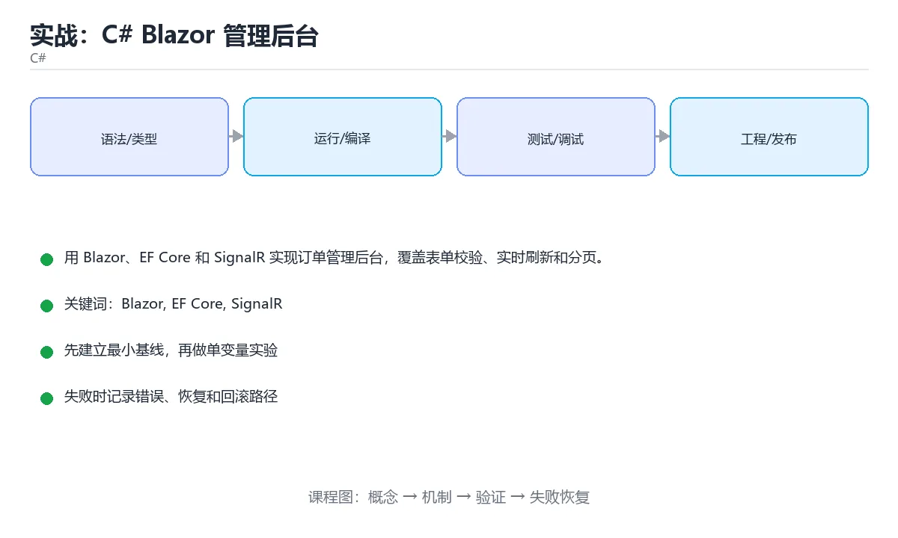

# Node.js与Express/Koa框架实战



## Node.js & Express/Koa Framework Practice

### 本章摘要

后端开发就像开一家餐厅：Node.js是厨房里的厨师，Express和Koa则是标准化的工作流程手册。本章带你从零开始搭建基于Node.js的后端服务，深入理解异步非阻塞IO的核心机制，掌握Express的中间件链和Koa的洋葱模型。你将学会如何设计路由、处理请求响应、集成数据库，并构建一个完整的RESTful API服务。通过真实案例演练，你不仅能写出可运行的代码，更能理解为什么这些框架如此流行，以及如何在生产环境中优化性能。

### 学习目标

完成本章后，你将能够：

1. 理解Node.js事件驱动架构与非阻塞IO的工作原理
2. 熟练使用Express框架构建RESTful API服务
3. 掌握Koa框架的洋葱模型与async/await中间件机制
4. 实现请求参数验证、错误处理和日志记录
5. 设计合理的目录结构并实现模块化路由
6. 部署Node.js应用到生产环境并进行性能调优

---

## 核心概念与生活类比

### Node.js是什么？

想象你去一家传统餐厅吃饭（同步阻塞模式）：服务员点完你的菜后，就站在厨房门口等着厨师做完这道菜，期间什么都不干。如果厨师需要10分钟，服务员就被卡住10分钟。

而Node.js就像一个超级高效的服务员（异步非阻塞模式）：他点完你的菜后，立刻去接待下一位客人，同时告诉厨房"这道菜好了叫我"。当厨师喊"3号桌的菜好了"，服务员才回来取餐。这样一个人就能同时服务几十个客人。

Node.js的核心优势就是**单线程+事件循环**，让它特别适合处理大量并发连接但每个连接计算量不大的场景，比如Web服务器、实时聊天、API网关等。

### Express vs Koa：两种不同的哲学

**Express像一份详细的操作手册**：它提供了丰富的内置功能，包括路由、模板引擎、静态文件服务等。你按照手册一步步做，很快就能搭出一个能用的网站。优点是上手快、生态丰富；缺点是历史包袱重，有些设计不够优雅。

**Koa像一个极简的工具箱**：它只提供最核心的功能，其他一切都需要你自己组装。Koa最大的创新是**洋葱模型**——中间件像一层层洋葱皮包裹着核心逻辑，请求从外到内穿过每一层，响应再从内到外穿出来。这种设计让代码更清晰、更易维护。

可以把Express比作瑞士军刀（功能齐全），Koa比作乐高积木（自由组合）。

### 中间件（Middleware）的本质

中间件就像快递分拣中心的传送带系统：

```text
包裹进来 → [安检扫描] → [称重贴标] → [区域分拣] → [装车发货]
```

每个环节都是一个中间件函数，它们按顺序处理请求对象（req），可以选择：
- 修改请求数据（比如解析JSON body）
- 提前返回响应（比如权限校验失败）
- 调用`next()`传递给下一个中间件
- 捕获错误并统一处理

理解了中间件，你就理解了Express和Koa的灵魂。

---

## 渐进式代码示例

### 最小化Hello World

让我们从一个最基础的HTTP服务器开始，不使用任何框架：

```javascript
// server-minimal.js
const http = require('http');

const server = http.createServer((req, res) => {
  if (req.url === '/' && req.method === 'GET') {
    res.writeHead(200, { 'Content-Type': 'text/plain' });
    res.end('Hello World');
  } else {
    res.writeHead(404, { 'Content-Type': 'text/plain' });
    res.end('Not Found');
  }
});

server.listen(3000, () => {
  console.log('Server running on http://localhost:3000');
});
```

这个例子展示了Node.js原生HTTP模块的工作方式，但你会发现手动处理URL解析、方法判断、状态码设置非常繁琐。这就是框架存在的意义。

### Express基础应用

现在用Express重写上面的例子：

```javascript
// server-express-basic.js
const express = require('express');
const app = express();

// 中间件：解析JSON请求体
app.use(express.json());

// 路由：GET /
app.get('/', (req, res) => {
  res.json({ message: 'Hello World' });
});

// 路由：POST /users
app.post('/users', (req, res) => {
  const { name, email } = req.body;
  
  // 简单验证
  if (!name || !email) {
    return res.status(400).json({ error: 'Name and email are required' });
  }
  
  res.status(201).json({ 
    message: 'User created', 
    user: { name, email } 
  });
});

// 全局错误处理中间件
app.use((err, req, res, next) => {
  console.error(err.stack);
  res.status(500).json({ error: 'Something went wrong!' });
});

const PORT = process.env.PORT || 3000;
app.listen(PORT, () => {
  console.log(`Server running on port ${PORT}`);
});
```

运行前需要安装依赖：

```bash
npm init -y
npm install express
node server-express-basic.js
```

测试API：

```bash
# GET请求
curl http://localhost:3000/

# POST请求
curl -X POST http://localhost:3000/users \
  -H "Content-Type: application/json" \
  -d '{"name":"张三","email":"zhangsan@example.com"}'
```

### 完整的项目结构

一个生产级的Express项目应该有清晰的目录结构：

```text
my-api/
├── src/
│   ├── config/          # 配置文件
│   │   └── database.js
│   ├── controllers/     # 控制器（业务逻辑）
│   │   ├── userController.js
│   │   └── productController.js
│   ├── middleware/      # 自定义中间件
│   │   ├── auth.js
│   │   └── validator.js
│   ├── models/          # 数据模型
│   │   └── User.js
│   ├── routes/          # 路由定义
│   │   ├── userRoutes.js
│   │   └── productRoutes.js
│   ├── services/        # 业务服务层
│   │   └── userService.js
│   ├── utils/           # 工具函数
│   │   └── logger.js
│   └── app.js           # Express应用入口
├── tests/               # 测试文件
├── .env                 # 环境变量
├── package.json
└── README.md
```

### 模块化路由实现

将路由拆分到独立文件，保持代码整洁：

```javascript
// src/routes/userRoutes.js
const express = require('express');
const router = express.Router();
const userController = require('../controllers/userController');
const { validateUser } = require('../middleware/validator');
const { authenticate } = require('../middleware/auth');

// 公开路由：无需认证
router.post('/register', validateUser, userController.register);
router.post('/login', userController.login);

// 受保护路由：需要认证
router.get('/profile', authenticate, userController.getProfile);
router.put('/profile', authenticate, validateUser, userController.updateProfile);

module.exports = router;
```

```javascript
// src/controllers/userController.js
const userService = require('../services/userService');

class UserController {
  async register(req, res, next) {
    try {
      const user = await userService.createUser(req.body);
      res.status(201).json({
        success: true,
        data: user
      });
    } catch (error) {
      next(error);
    }
  }

  async login(req, res, next) {
    try {
      const { email, password } = req.body;
      const result = await userService.authenticateUser(email, password);
      
      res.json({
        success: true,
        token: result.token,
        user: result.user
      });
    } catch (error) {
      next(error);
    }
  }

  async getProfile(req, res, next) {
    try {
      const user = await userService.getUserById(req.user.id);
      res.json({
        success: true,
        data: user
      });
    } catch (error) {
      next(error);
    }
  }

  async updateProfile(req, res, next) {
    try {
      const updatedUser = await userService.updateUser(req.user.id, req.body);
      res.json({
        success: true,
        data: updatedUser
      });
    } catch (error) {
      next(error);
    }
  }
}

module.exports = new UserController();
```

```javascript
// src/app.js
const express = require('express');
const cors = require('cors');
const helmet = require('helmet');
const morgan = require('morgan');
const userRoutes = require('./routes/userRoutes');
const productRoutes = require('./routes/productRoutes');

const app = express();

// 安全中间件
app.use(helmet());

// CORS配置
app.use(cors({
  origin: process.env.ALLOWED_ORIGINS?.split(',') || '*',
  credentials: true
}));

// 日志中间件
app.use(morgan('combined'));

// 解析请求体
app.use(express.json({ limit: '10mb' }));
app.use(express.urlencoded({ extended: true }));

// 健康检查端点
app.get('/health', (req, res) => {
  res.json({ status: 'ok', timestamp: new Date().toISOString() });
});

// 挂载路由
app.use('/api/users', userRoutes);
app.use('/api/products', productRoutes);

// 404处理
app.use((req, res) => {
  res.status(404).json({
    success: false,
    message: 'Route not found'
  });
});

// 全局错误处理
app.use((err, req, res, next) => {
  console.error('Error:', err);
  
  const statusCode = err.statusCode || 500;
  const message = err.message || 'Internal Server Error';
  
  res.status(statusCode).json({
    success: false,
    message,
    ...(process.env.NODE_ENV === 'development' && { stack: err.stack })
  });
});

module.exports = app;
```

### Koa洋葱模型实践

现在看看Koa如何实现同样的功能，体会洋葱模型的优雅：

```javascript
// server-koa.js
const Koa = require('koa');
const Router = require('@koa/router');
const bodyParser = require('koa-bodyparser');
const cors = require('@koa/cors');

const app = new Koa();
const router = new Router();

// 第一层洋葱皮：日志记录
app.use(async (ctx, next) => {
  const start = Date.now();
  console.log(`[${new Date().toISOString()}] ${ctx.method} ${ctx.path}`);
  
  await next(); // 等待内层处理完成
  
  const ms = Date.now() - start;
  console.log(`Response time: ${ms}ms`);
});

// 第二层洋葱皮：CORS
app.use(cors());

// 第三层洋葱皮：解析请求体
app.use(bodyParser());

// 第四层洋葱皮：路由处理
router.get('/', async (ctx) => {
  ctx.body = { message: 'Hello from Koa' };
});

router.post('/users', async (ctx) => {
  const { name, email } = ctx.request.body;
  
  if (!name || !email) {
    ctx.status = 400;
    ctx.body = { error: 'Name and email are required' };
    return;
  }
  
  ctx.status = 201;
  ctx.body = { 
    message: 'User created', 
    user: { name, email } 
  };
});

// 第五层洋葱皮：错误处理（最外层，最后执行）
app.use(async (ctx, next) => {
  try {
    await next();
  } catch (err) {
    ctx.status = err.status || 500;
    ctx.body = { 
      error: err.message || 'Internal Server Error' 
    };
    ctx.app.emit('error', err, ctx);
  }
});

app.use(router.routes()).use(router.allowedMethods());

const PORT = process.env.PORT || 3000;
app.listen(PORT, () => {
  console.log(`Koa server running on port ${PORT}`);
});
```

**洋葱模型的关键理解**：

```text
请求进入 → [日志:开始计时] → [CORS] → [BodyParser] → [路由处理]
响应返回 ← [日志:输出耗时] ← [CORS] ← [BodyParser] ← [路由处理]
```

注意`await next()`的位置：在它之前的代码在请求阶段执行，之后的代码在响应阶段执行。这就是"洋葱"的含义——你可以精确控制何时进入内层、何时返回外层。

### 实战练习：构建博客API

现在让我们综合运用所学知识，构建一个简单的博客API：

```javascript
// src/models/BlogPost.js
class BlogPost {
  constructor({ id, title, content, authorId, createdAt, updatedAt }) {
    this.id = id;
    this.title = title;
    this.content = content;
    this.authorId = authorId;
    this.createdAt = createdAt || new Date();
    this.updatedAt = updatedAt || new Date();
  }

  toJSON() {
    return {
      id: this.id,
      title: this.title,
      content: this.content,
      authorId: this.authorId,
      createdAt: this.createdAt,
      updatedAt: this.updatedAt
    };
  }
}

module.exports = BlogPost;
```

```javascript
// src/services/blogService.js
const BlogPost = require('../models/BlogPost');

// 模拟数据库（实际项目中替换为真实数据库）
const posts = [];
let nextId = 1;

class BlogService {
  async createPost(data) {
    const post = new BlogPost({
      id: nextId++,
      ...data
    });
    posts.push(post);
    return post;
  }

  async getAllPosts({ page = 1, limit = 10 } = {}) {
    const start = (page - 1) * limit;
    const end = start + limit;
    const paginatedPosts = posts.slice(start, end);
    
    return {
      data: paginatedPosts,
      pagination: {
        page,
        limit,
        total: posts.length,
        totalPages: Math.ceil(posts.length / limit)
      }
    };
  }

  async getPostById(id) {
    const post = posts.find(p => p.id === parseInt(id));
    if (!post) {
      throw new Error('Post not found');
    }
    return post;
  }

  async updatePost(id, data) {
    const post = await this.getPostById(id);
    Object.assign(post, data, { updatedAt: new Date() });
    return post;
  }

  async deletePost(id) {
    const index = posts.findIndex(p => p.id === parseInt(id));
    if (index === -1) {
      throw new Error('Post not found');
    }
    posts.splice(index, 1);
  }
}

module.exports = new BlogService();
```

```javascript
// src/controllers/blogController.js
const blogService = require('../services/blogService');

class BlogController {
  async createPost(req, res, next) {
    try {
      const { title, content } = req.body;
      
      if (!title || !content) {
        return res.status(400).json({
          success: false,
          message: 'Title and content are required'
        });
      }

      const post = await blogService.createPost({
        title,
        content,
        authorId: req.user.id // 从认证中间件获取
      });

      res.status(201).json({
        success: true,
        data: post
      });
    } catch (error) {
      next(error);
    }
  }

  async getPosts(req, res, next) {
    try {
      const { page, limit } = req.query;
      const result = await blogService.getAllPosts({
        page: parseInt(page) || 1,
        limit: parseInt(limit) || 10
      });

      res.json({
        success: true,
        ...result
      });
    } catch (error) {
      next(error);
    }
  }

  async getPost(req, res, next) {
    try {
      const post = await blogService.getPostById(req.params.id);
      res.json({
        success: true,
        data: post
      });
    } catch (error) {
      if (error.message === 'Post not found') {
        return res.status(404).json({
          success: false,
          message: error.message
        });
      }
      next(error);
    }
  }

  async updatePost(req, res, next) {
    try {
      const post = await blogService.updatePost(req.params.id, req.body);
      res.json({
        success: true,
        data: post
      });
    } catch (error) {
      if (error.message === 'Post not found') {
        return res.status(404).json({
          success: false,
          message: error.message
        });
      }
      next(error);
    }
  }

  async deletePost(req, res, next) {
    try {
      await blogService.deletePost(req.params.id);
      res.status(204).send();
    } catch (error) {
      if (error.message === 'Post not found') {
        return res.status(404).json({
          success: false,
          message: error.message
        });
      }
      next(error);
    }
  }
}

module.exports = new BlogController();
```

```javascript
// src/routes/blogRoutes.js
const express = require('express');
const router = express.Router();
const blogController = require('../controllers/blogController');
const { authenticate } = require('../middleware/auth');

// 公开路由
router.get('/', blogController.getPosts);
router.get('/:id', blogController.getPost);

// 受保护路由
router.post('/', authenticate, blogController.createPost);
router.put('/:id', authenticate, blogController.updatePost);
router.delete('/:id', authenticate, blogController.deletePost);

module.exports = router;
```

---

## 常见陷阱与解决方案

| 陷阱 | 表现 | 原因 | 解决方案 |
|------|------|------|----------|
| **回调地狱** | 多层嵌套回调，代码难以阅读 | 未使用Promise或async/await | 始终使用async/await，避免嵌套回调 |
| **忘记await** | 异步操作未完成就继续执行 | 对async函数返回值理解不清 | 所有async函数调用前加await，启用ESLint规则 |
| **内存泄漏** | 服务器运行一段时间后崩溃 | 全局变量积累、未关闭的连接 | 定期监控内存使用，及时清理定时器/事件监听器 |
| **阻塞事件循环** | 高并发时响应变慢 | 同步CPU密集型操作 | 将计算密集型任务移到Worker Thread或微服务 |
| **未处理的Promise拒绝** | 进程意外退出 | catch块遗漏 | 使用`process.on('unhandledRejection')`全局捕获 |
| **硬编码配置** | 不同环境需要改代码 | 配置写在代码里 | 使用dotenv管理环境变量，区分dev/staging/prod |
| **缺少输入验证** | 恶意数据导致错误或安全漏洞 | 信任用户输入 | 使用joi或express-validator进行严格验证 |
| **N+1查询问题** | 列表接口响应极慢 | 循环中逐个查询数据库 | 使用批量查询或JOIN，添加缓存层 |
| **跨域问题** | 前端无法调用API | CORS配置缺失或错误 | 正确配置CORS中间件，明确允许的源和方法 |
| **错误信息泄露** | 生产环境暴露堆栈跟踪 | 错误处理不完善 | 生产环境隐藏详细错误，仅返回通用消息 |

---

## 自测题

### 问题1

Node.js的事件循环机制最适合处理哪种类型的任务？

A. 大规模矩阵运算和图像处理  
B. 大量并发I/O操作如HTTP请求和数据库查询  
C. 复杂的机器学习模型训练  
D. 视频编码和解码  

**正确答案：B**

**详细解释：** Node.js采用单线程事件驱动架构，擅长处理大量并发但每个任务计算量较小的I/O操作。对于CPU密集型任务（如矩阵运算、图像/视频处理、机器学习），应该使用Worker Threads或将任务交给专门的服务。选项B描述的HTTP请求和数据库查询正是Node.js的优势场景。

### 问题2

在Express中，中间件的执行顺序由什么决定？

A. 中间件函数的名称字母顺序  
B. 随机顺序  
C. 中间件函数的复杂度  
D. 中间件注册的先后顺序  

**正确答案：D**

**详细解释：** Express中间件严格按照`app.use()`或`router.use()`调用的顺序依次执行。先注册的先执行，这是中间件链的核心特性。如果需要调整执行顺序，必须改变注册顺序，不能依赖其他因素。

### 问题3

Koa的洋葱模型中，`await next()`之后的代码在什么时候执行？

A. 请求刚到达时  
B. 与`await next()`之前的代码同时执行  
C. 永远不会执行  
D. 所有内层中间件处理完成后，响应返回时  

**正确答案：D**

**详细解释：** 这是洋葱模型的关键特征。`await next()`之前的代码在请求阶段（从外向内）执行，`await next()`之后的代码在所有内层中间件处理完毕、响应开始返回时（从内向外）执行。这使得你可以在同一函数中处理请求和响应的逻辑，比如记录请求开始时间和结束时间来计算耗时。

### 问题4

以下哪个做法会导致Express应用出现内存泄漏？

A. 使用`express.json()`中间件  
B. 配置CORS中间件  
C. 使用路由参数验证  
D. 在全局作用域创建数组并不断push数据  

**正确答案：D**

**详细解释：** 在全局作用域（模块级别）创建的数组如果不断增长且从未清理，会导致内存持续增长最终耗尽。正确做法是使用有上限的数据结构（如LRU缓存）、定期清理过期数据，或将数据持久化到数据库。其他选项都是正常的中间件使用，不会导致内存泄漏。

### 问题5

在生产环境中，如何处理未捕获的异常和未处理的Promise拒绝？

A. 忽略它们，让进程自然退出  
B. 使用try-catch包裹所有代码  
C. 注册`process.on('uncaughtException')`和`process.on('unhandledRejection')`监听器  
D. 只在开发环境中处理  

**正确答案：C**

**详细解释：** 虽然应该尽量用try-catch和async/await正确处理错误，但总可能有遗漏。在生产环境中，必须注册全局监听器来捕获这些意外错误，记录日志，并优雅地重启进程（使用cluster模块或PM2等进程管理器）。直接忽略（A）会导致静默失败，只靠try-catch（B）无法覆盖所有情况，只在开发环境处理（D）会让生产环境更脆弱。

---

## 进阶学习资源

- **官方文档**：[Node.js Docs](https://nodejs.org/docs/)、[Express Guide](https://expressjs.com/en/guide/routing.html)、[Koa Wiki](https://github.com/koajs/koa/wiki)
- **性能优化**：学习使用`cluster`模块利用多核CPU，配置反向代理（Nginx），启用Gzip压缩
- **测试策略**：使用Jest + Supertest编写单元测试和集成测试
- **部署实践**：学习Docker容器化、PM2进程管理、CI/CD流水线配置

下一章我们将探索Python FastAPI的异步Web开发，体验类型提示带来的开发效率提升！

## 验证命令与预期输出

完成本课后，用下面三条命令核对交付质量：

```bash
# 1) 构建或启动
cd 项目根目录 && 按 README 的安装命令准备环境
# 2) 冒烟测试
运行课程里给出的最小示例，确认输出与「预期输出」一行一致
# 3) 回归检查
对照下方交付清单逐项打勾，缺失项先补齐再提交
```

预期输出：程序正常退出（退出码 0），关键结果与正文示例一致，无未捕获异常。

## 项目专属规格

- 运行环境与版本要求以正文「环境准备」为准，跨平台需分别验证。
- 数据规模、并发量与失败率阈值由验收用例定义，不得私自放宽。
- 接口契约、错误码与日志格式在交付前冻结，变更须走评审。

## 项目交付物

- [ ] 可运行的完整源码与构建脚本
- [ ] README：安装、运行、测试三步可复现
- [ ] 验收清单逐条勾选并附运行截图或日志

## 本节知识框架

**课程定位**：分类「backend_development」· 学习阶段 入门 · 建议用时 50 分钟。

本课主线：掌握Node.js事件驱动架构、非阻塞I/O和Express中间件链。

### 复习清单

- [ ] 能不看正文复述本课核心术语，并指出一个边界或反例。
- [ ] 能运行或推演本课示例，记录输入、输出与失败现象。
- [ ] 能完成一次自测，并把错题对照考点精讲定位原因。

## 核心概念定义

| 术语 | 一句话说明 |
| --- | --- |
| Node.js | 掌握Node.js事件驱动架构、非阻塞I/O和Express中间件链。相关：正文给出可操作定义与适用边界。 |
| Express | 掌握Node.js事件驱动架构、非阻塞I/O和Express中间件链。相关：正文给出可操作定义与适用边界。 |
| Koa | 掌握Node.js事件驱动架构、非阻塞I/O和Express中间件链。相关：正文给出可操作定义与适用边界。 |
| 中间件 | 掌握Node.js事件驱动架构、非阻塞I/O和Express中间件链。相关：正文给出可操作定义与适用边界。 |
| 事件驱动 | 掌握Node.js事件驱动架构、非阻塞I/O和Express中间件链。相关：正文给出可操作定义与适用边界。 |

## 原理与运行机制

正文各章按「输入是什么 → 中间如何转换 → 输出到哪 → 失败时怎样表现」四问展开；复习时给每个机制补一句自己的复述，再回到对应章节核对。

## 典型应用场景

- 结合「Node.js与Express/Koa框架实战」的常见落地场景与选型边界，详见正文各章节的对比讨论。
- 迁移到新项目时，先明确输入规模、失败代价与可观测手段，再决定采用深度。

## 代码/协议/SQL 示例

正文首个示例可作为最小验证起点（原样保留在上方章节）：先跑通，再改一个输入观察输出变化。

```text
包裹进来 → [安检扫描] → [称重贴标] → [区域分拣] → [装车发货]
```

## 时间/空间复杂度或性能分析

- 用本课方案处理规模 n 时，先估计主循环与嵌套层数，再决定优化方向；小样本上的耗时读数不能外推。
- 性能结论要绑定输入分布：换数据规模、并发度或缓存命中情况后须重新测量。

## 常见误区与易错点

| 错误做法 | 典型现象 | 修复方向 |
| --- | --- | --- |
| 只验证正常输入 | 边界数据触发时才暴露问题 | 为每个结论补一个空值/极值/重复值用例 |
| 背结论不跑实验 | 换个输入就失效 | 按「预测—实测—差异归因」三步复盘 |
| 忽略环境与版本差异 | 本机可用线上报错 | 把版本、配置与依赖写入复现步骤 |

## 与其他知识点的关系

本课与分类「backend_development」内相邻课程互为补充，建议按清单顺序学完再做综合练习。

## 自测题与参考答案

以下题目与题库同源，作答后再看解析；错误项要能说出错在哪一步。

## 考点精讲

### 考点 1

Node.js的事件循环机制最适合处理哪种类型的任务？

A. 大规模矩阵运算和图像处理  
B. 大量并发I/O操作如HTTP请求和数据库查询 ✅  
C. 复杂的机器学习模型训练  
D. 视频编码和解码  

**正确答案：** B

**解析：** Node.js采用单线程事件驱动架构，擅长处理大量并发但每个任务计算量较小的I/O操作。对于CPU密集型任务（如矩阵运算、图像/视频处理、机器学习），应该使用Worker Threads或将任务交给专门的服务。选项B描述的HTTP请求和数据库查询正是Node.js的优势场景。

### 考点 2

在Express中，中间件的执行顺序由什么决定？

A. 中间件函数的名称字母顺序  
B. 随机顺序  
C. 中间件函数的复杂度  
D. 中间件注册的先后顺序 ✅  

**正确答案：** D

**解析：** Express 维护一条按注册顺序排列的中间件栈，请求进来后依次调用，只有调用 next()（或结束响应）才会进入下一个；名称字母顺序、函数复杂度都不参与调度，随机更无从谈起。因此鉴权中间件必须注册在受保护路由之前，错误处理中间件（四参数签名）要放在最后。调试顺序问题用 morgan 或自加 console 打点，比猜测更可靠。

### 考点 3

Koa的洋葱模型中，`await next()`之后的代码在什么时候执行？

A. 请求刚到达时  
B. 与`await next()`之前的代码同时执行  
C. 永远不会执行  
D. 所有内层中间件处理完成后，响应返回时 ✅  

**正确答案：** D

**解析：** 这是洋葱模型的关键特征。`await next()`之前的代码在请求阶段（从外向内）执行，`await next()`之后的代码在所有内层中间件处理完毕、响应开始返回时（从内向外）执行。这使得你可以在同一函数中处理请求和响应的逻辑，比如记录请求开始时间和结束时间来计算耗时。

### 考点 4

以下哪个做法会导致Express应用出现内存泄漏？

A. 使用`express.json()`中间件  
B. 配置CORS中间件  
C. 使用路由参数验证  
D. 在全局作用域创建数组并不断push数据 ✅  

**正确答案：** D

**解析：** 模块级数组随请求不断 push 且没有清理逻辑，堆内存只增不减，进程最终 OOM，这是典型泄漏。express.json()、路由参数校验、CORS 配置都是标准中间件用法，本身不累积状态。防泄漏的常规手段：给缓存设上限（LRU 或 TTL）、用 WeakRef/WeakMap 持有临时对象、把会话数据外置到 Redis，并用 process.memoryUsage 与堆快照定期观测增长趋势。

### 考点 5

在生产环境中，如何处理未捕获的异常和未处理的Promise拒绝？

A. 忽略它们，让进程自然退出  
B. 使用try-catch包裹所有代码  
C. 注册`process.on('uncaughtException')`和`process.on('unhandledRejection')`监听器 ✅  
D. 只在开发环境中处理  

**正确答案：** C

**解析：** 虽然应该尽量用try-catch和async/await正确处理错误，但总可能有遗漏。在生产环境中，必须注册全局监听器来捕获这些意外错误，记录日志，并优雅地重启进程（使用cluster模块或PM2等进程管理器）。直接忽略（A）会导致静默失败，只靠try-catch（B）无法覆盖所有情况，只在开发环境处理（D）会让生产环境更脆弱。

## 术语速查

| 术语 | 一句话说明 |
| --- | --- |
| Node.js | 定位线索见正文小节；速查表只保留名称，避免脱离上下文使用。 |
| Express | 定位线索见正文小节；速查表只保留名称，避免脱离上下文使用。 |
| Koa | 定位线索见正文小节；速查表只保留名称，避免脱离上下文使用。 |
| 中间件 | 定位线索见正文小节；速查表只保留名称，避免脱离上下文使用。 |
| 事件驱动 | 定位线索见正文小节；速查表只保留名称，避免脱离上下文使用。 |

## 参考资料与复核

- [本课资料锚点 backend_nodejs_express](https://zh.wikipedia.org/w/index.php?search=backend_nodejs_express)

- 官方/权威资料：[HTTP 规范](https://datatracker.ietf.org/doc/html/rfc9110)
- 主题延伸：[关于「Express」的检索页](https://zh.wikipedia.org/w/index.php?search=Express)
- 本课索引词：[锚点 backend_nodejs_express](https://datatracker.ietf.org/doc/html/rfc9110#Node.js)
- 最后复核：2026-10-04
- 下次复核：2026-10-15

## 内容元数据

- 内容更新时间：2026-10-06

- 内容版本：v2.0
- 课程标识：backend_nodejs_express
- 所属分类：backend_development
- 学习阶段：入门
- 建议用时：50 分钟

