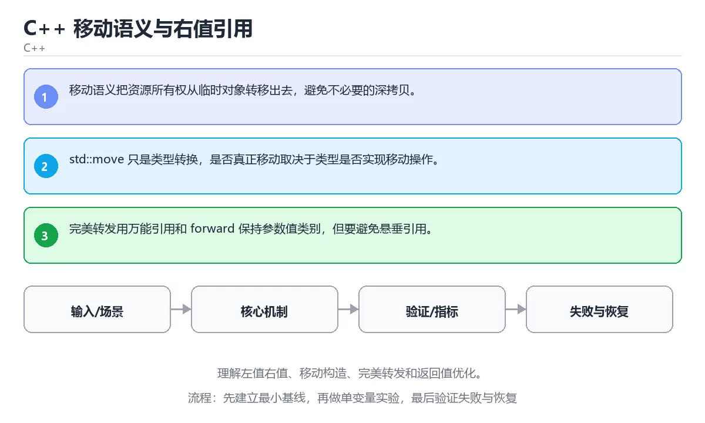

# RESTful API设计最佳实践



> 内容更新时间：2026-10-06 · 学习阶段：入门 · 预计用时：55 分钟

## RESTful API Design Best Practices

### 本章摘要

RESTful API是现代Web开发的基石，它定义了一套清晰、一致的接口设计规范，让不同系统之间能够高效协作。本章将带你深入理解REST架构风格的核心原则，掌握资源建模、HTTP方法语义、状态码使用、版本控制、分页过滤等关键技能。你将学会如何设计直观易用的API端点，如何处理复杂的业务场景如嵌套资源、批量操作、部分更新，以及如何编写清晰的API文档。通过对比优秀和糟糕的API设计案例，你将建立起判断API质量的标准，并能够在实际项目中应用这些最佳实践，构建出既符合规范又满足业务需求的RESTful服务。

### 学习目标

完成本章后，你将能够：

1. 理解REST架构风格的六大约束条件及其实际意义
2. 正确设计资源URI和使用HTTP方法语义
3. 合理使用HTTP状态码和错误响应格式
4. 实现API版本控制、分页、过滤和排序功能
5. 处理复杂场景如嵌套资源、批量操作和部分更新
6. 编写清晰完整的API文档并进行安全性设计

---

## 核心概念与生活类比

### 什么是REST？

REST（Representational State Transfer）听起来很学术，但其实它的思想非常朴素。想象你去图书馆借书：

**传统RPC风格**：你需要记住一堆命令——"调用borrowBook函数，传入参数userId=123, bookId=456"。这就像你要告诉图书管理员具体的操作步骤。

**REST风格**：你只需要说"我要借这本书"，然后指向那本书。图书馆有一套标准流程：查看书籍→填写借书卡→管理员盖章→你拿走书。REST就是这套"标准流程"在Web上的体现。

REST的核心思想是：**用统一的接口操作资源，而不是调用特定的函数**。

### REST的六大约束

**1. 客户端-服务器分离**：前端和后端各司其职，就像餐厅的顾客和厨师。顾客只关心点菜和吃饭，不关心厨房怎么运作；厨师只关心做菜，不关心顾客怎么吃。

**2. 无状态**：每次请求都包含完整信息，服务器不保存会话状态。就像自动售货机：你投币、选商品、取货，每一步都是独立的，机器不记得你是谁。好处是服务器可以轻松扩展，坏处是每次都要重新验证身份（所以有了JWT）。

**3. 可缓存**：响应可以标记为可缓存，减少不必要的网络请求。就像超市的商品标价牌：价格不会每分钟变，顾客看一眼就知道，不用每次都问店员。

**4. 统一接口**：所有资源都用相同的方式访问（URI + HTTP方法）。就像邮政系统：无论寄信、寄包裹还是寄明信片，都遵循相同的地址格式和邮寄流程。

**5. 分层系统**：可以在客户端和服务器之间插入代理、负载均衡器等中间层，双方无需知道对方的存在。就像快递系统：你交给快递员，快递员交给分拣中心，分拣中心交给运输公司，层层传递但你只关心最终收到包裹。

**6. 按需代码（可选）**：服务器可以发送代码给客户端执行（如JavaScript），这在Web浏览器中很常见。

### 资源 vs 动作

这是REST设计的核心思维转变：

**错误的思维方式（面向动作）**：
- `/getUserById?id=123` - 获取用户
- `/createUser` - 创建用户
- `/deleteUser?id=123` - 删除用户

**正确的思维方式（面向资源）**：
- `GET /users/123` - 获取ID为123的用户资源
- `POST /users` - 在用户集合中创建一个新用户
- `DELETE /users/123` - 删除ID为123的用户资源

关键区别：**URL描述的是"什么"（资源），而不是"怎么做"（动作）**。动作由HTTP方法（GET、POST、PUT、DELETE等）表达。

### HTTP方法的语义

把HTTP方法想象成对资源的操作指令：

| 方法 | 含义 | 生活类比 | 幂等性 |
|------|------|----------|--------|
| GET | 获取资源 | 看书（不改变书的内容） | 是 |
| POST | 创建资源 | 在笔记本上写新笔记 | 否 |
| PUT | 完整替换资源 | 用新版本覆盖旧文件 | 是 |
| PATCH | 部分更新资源 | 修改文档中的几处错误 | 否 |
| DELETE | 删除资源 | 撕掉一页纸 | 是 |
| HEAD | 获取元数据 | 看书的目录而不读内容 | 是 |
| OPTIONS | 查询支持的方法 | 问"这个资源能做什么操作" | 是 |

**幂等性**很重要：多次执行相同请求应该产生相同结果。GET、PUT、DELETE都是幂等的，POST不是（多次提交会创建多个资源）。

---

## 渐进式代码示例

### 基础资源设计

让我们从一个简单的博客系统开始，设计合理的URI结构：

```javascript
// 优秀的RESTful设计
GET    /posts           // 获取文章列表
POST   /posts           // 创建新文章
GET    /posts/123       // 获取ID为123的文章
PUT    /posts/123       // 完整更新文章123
PATCH  /posts/123       // 部分更新文章123
DELETE /posts/123       // 删除文章123

// 嵌套资源：文章的评论
GET    /posts/123/comments          // 获取文章123的所有评论
POST   /posts/123/comments          // 在文章123下创建评论
GET    /posts/123/comments/456      // 获取特定评论
DELETE /posts/123/comments/456      // 删除特定评论

// 子资源：用户的文章
GET    /users/789/posts             // 获取用户789发布的所有文章
```

**设计原则**：
1. **使用名词复数**：`/posts` 而非 `/post`，表示资源集合
2. **避免动词**：不用 `/getPosts`、`/deletePost`
3. **层级不超过3层**：过深的嵌套难以维护
4. **使用连字符而非下划线**：`/user-profiles` 优于 `/user_profiles`

### Express实现完整RESTful API

```javascript
// routes/posts.js
const express = require('express');
const router = express.Router();
const postController = require('../controllers/postController');
const { validatePost } = require('../middleware/validator');
const { authenticate } = require('../middleware/auth');

// GET /posts - 获取文章列表（支持分页、过滤、排序）
router.get('/', postController.listPosts);

// POST /posts - 创建文章（需要认证）
router.post('/', authenticate, validatePost, postController.createPost);

// GET /posts/:id - 获取单篇文章
router.get('/:id', postController.getPost);

// PUT /posts/:id - 完整更新文章（需要认证且是作者）
router.put('/:id', authenticate, validatePost, postController.updatePost);

// PATCH /posts/:id - 部分更新文章（需要认证且是作者）
router.patch('/:id', authenticate, postController.partialUpdatePost);

// DELETE /posts/:id - 删除文章（需要认证且是作者或管理员）
router.delete('/:id', authenticate, postController.deletePost);

module.exports = router;
```

```javascript
// controllers/postController.js
const Post = require('../models/Post');
const Comment = require('../models/Comment');

class PostController {
  // 获取文章列表
  async listPosts(req, res, next) {
    try {
      const { 
        page = 1, 
        limit = 10, 
        sort = '-createdAt', 
        status = 'published',
        category,
        search 
      } = req.query;

      // 构建查询条件
      const query = { status };
      
      if (category) {
        query.category = category;
      }
      
      if (search) {
        query.$or = [
          { title: { $regex: search, $options: 'i' } },
          { content: { $regex: search, $options: 'i' } }
        ];
      }

      // 计算总数
      const total = await Post.countDocuments(query);

      // 解析排序字段
      const sortField = sort.startsWith('-') ? sort.substring(1) : sort;
      const sortOrder = sort.startsWith('-') ? -1 : 1;

      // 执行查询
      const posts = await Post.find(query)
        .sort({ [sortField]: sortOrder })
        .skip((page - 1) * limit)
        .limit(parseInt(limit))
        .populate('author', 'name avatar')
        .select('title excerpt createdAt views');

      res.json({
        success: true,
        data: posts,
        pagination: {
          page: parseInt(page),
          limit: parseInt(limit),
          total,
          totalPages: Math.ceil(total / limit)
        }
      });
    } catch (error) {
      next(error);
    }
  }

  // 创建文章
  async createPost(req, res, next) {
    try {
      const postData = {
        ...req.body,
        author: req.user.id,
        status: req.body.status || 'draft'
      };

      const post = await Post.create(postData);
      
      // 填充作者信息后返回
      await post.populate('author', 'name avatar');

      res.status(201).json({
        success: true,
        data: post
      });
    } catch (error) {
      next(error);
    }
  }

  // 获取单篇文章
  async getPost(req, res, next) {
    try {
      const post = await Post.findById(req.params.id)
        .populate('author', 'name avatar bio')
        .populate({
          path: 'comments',
          populate: { path: 'author', select: 'name avatar' },
          options: { sort: { createdAt: -1 }, limit: 10 }
        });

      if (!post) {
        return res.status(404).json({
          success: false,
          message: 'Post not found'
        });
      }

      // 增加浏览次数
      post.views += 1;
      await post.save();

      res.json({
        success: true,
        data: post
      });
    } catch (error) {
      if (error.name === 'CastError') {
        return res.status(400).json({
          success: false,
          message: 'Invalid post ID format'
        });
      }
      next(error);
    }
  }

  // 完整更新文章
  async updatePost(req, res, next) {
    try {
      const post = await Post.findById(req.params.id);

      if (!post) {
        return res.status(404).json({
          success: false,
          message: 'Post not found'
        });
      }

      // 权限检查：只有作者可以更新
      if (post.author.toString() !== req.user.id) {
        return res.status(403).json({
          success: false,
          message: 'Not authorized to update this post'
        });
      }

      const updatedPost = await Post.findByIdAndUpdate(
        req.params.id,
        req.body,
        { new: true, runValidators: true }
      ).populate('author', 'name avatar');

      res.json({
        success: true,
        data: updatedPost
      });
    } catch (error) {
      next(error);
    }
  }

  // 部分更新文章
  async partialUpdatePost(req, res, next) {
    try {
      const post = await Post.findById(req.params.id);

      if (!post) {
        return res.status(404).json({
          success: false,
          message: 'Post not found'
        });
      }

      // 权限检查
      if (post.author.toString() !== req.user.id) {
        return res.status(403).json({
          success: false,
          message: 'Not authorized to update this post'
        });
      }

      // 只更新提供的字段
      const allowedUpdates = ['title', 'content', 'status', 'category', 'tags'];
      const updates = {};
      
      for (const field of allowedUpdates) {
        if (req.body[field] !== undefined) {
          updates[field] = req.body[field];
        }
      }

      const updatedPost = await Post.findByIdAndUpdate(
        req.params.id,
        updates,
        { new: true, runValidators: true }
      ).populate('author', 'name avatar');

      res.json({
        success: true,
        data: updatedPost
      });
    } catch (error) {
      next(error);
    }
  }

  // 删除文章
  async deletePost(req, res, next) {
    try {
      const post = await Post.findById(req.params.id);

      if (!post) {
        return res.status(404).json({
          success: false,
          message: 'Post not found'
        });
      }

      // 权限检查：作者或管理员
      if (post.author.toString() !== req.user.id && !req.user.isAdmin) {
        return res.status(403).json({
          success: false,
          message: 'Not authorized to delete this post'
        });
      }

      // 级联删除评论
      await Comment.deleteMany({ post: post._id });
      await post.deleteOne();

      res.status(204).send();
    } catch (error) {
      next(error);
    }
  }
}

module.exports = new PostController();
```

### 正确的HTTP状态码使用

很多开发者滥用200和500，其实HTTP提供了丰富的状态码来表达不同的情况：

```javascript
// 状态码使用指南

// 2xx 成功
200 OK                    // GET/PUT/PATCH成功
201 Created               // POST创建资源成功
204 No Content            // DELETE成功（无返回内容）

// 4xx 客户端错误
400 Bad Request           // 请求格式错误或参数验证失败
401 Unauthorized          // 未认证或token无效
403 Forbidden             // 已认证但无权限
404 Not Found             // 资源不存在
405 Method Not Allowed    // 不支持的HTTP方法
409 Conflict              // 资源冲突（如邮箱已注册）
422 Unprocessable Entity  // 语义错误（格式正确但业务规则不满足）
429 Too Many Requests     // 请求频率超限

// 5xx 服务器错误
500 Internal Server Error // 未预期的服务器错误
502 Bad Gateway           // 上游服务错误
503 Service Unavailable   // 服务暂时不可用（维护或过载）
```

实现统一的错误响应格式：

```javascript
// middleware/errorHandler.js
class AppError extends Error {
  constructor(message, statusCode) {
    super(message);
    this.statusCode = statusCode;
    this.status = `${statusCode}`.startsWith('4') ? 'fail' : 'error';
    this.isOperational = true;
    
    Error.captureStackTrace(this, this.constructor);
  }
}

const errorHandler = (err, req, res, next) => {
  err.statusCode = err.statusCode || 500;
  err.status = err.status || 'error';

  // 开发环境：返回详细错误信息
  if (process.env.NODE_ENV === 'development') {
    return res.status(err.statusCode).json({
      status: err.status,
      message: err.message,
      stack: err.stack,
      error: err
    });
  }

  // 生产环境：返回简洁的错误信息
  if (err.isOperational) {
    return res.status(err.statusCode).json({
      status: err.status,
      message: err.message
    });
  }

  // 编程错误：不泄露细节
  console.error('ERROR 💥', err);
  return res.status(500).json({
    status: 'error',
    message: 'Something went wrong!'
  });
};

module.exports = { AppError, errorHandler };
```

使用示例：

```javascript
// 在控制器中抛出错误
if (!post) {
  throw new AppError('Post not found', 404);
}

if (post.author.toString() !== req.user.id) {
  throw new AppError('Not authorized', 403);
}

if (!isValidEmail(email)) {
  throw new AppError('Invalid email format', 400);
}
```

### API版本控制策略

随着业务发展，API需要演进，但不能破坏现有客户端。常见的版本控制策略：

**1. URL路径版本（最常用）**：
```text
/api/v1/posts
/api/v2/posts
```

**2. 请求头版本**：
```text
GET /posts
Header: API-Version: 2023-10-01
```

**3. 查询参数版本**：
```text
GET /posts?version=2
```

推荐使用URL路径版本，因为它最直观、易于缓存、便于文档化。

实现多版本路由：

```javascript
// app.js
const express = require('express');
const app = express();

// V1路由
const v1PostsRouter = require('./routes/v1/posts');
const v1UsersRouter = require('./routes/v1/users');
app.use('/api/v1/posts', v1PostsRouter);
app.use('/api/v1/users', v1UsersRouter);

// V2路由
const v2PostsRouter = require('./routes/v2/posts');
const v2UsersRouter = require('./routes/v2/users');
app.use('/api/v2/posts', v2PostsRouter);
app.use('/api/v2/users', v2UsersRouter);

// 默认版本重定向
app.use('/api/posts', (req, res) => {
  res.redirect(301, `/api/v2${req.originalUrl}`);
});
```

### 高级查询功能

实现强大的过滤、排序、分页功能：

```javascript
// utils/apiFeatures.js
class APIFeatures {
  constructor(query, queryString) {
    this.query = query;
    this.queryString = queryString;
  }

  // 过滤
  filter() {
    const queryObj = { ...this.queryString };
    const excludedFields = ['page', 'sort', 'limit', 'fields'];
    excludedFields.forEach(field => delete queryObj[field]);

    // 高级过滤：gte, gt, lte, lt
    let queryStr = JSON.stringify(queryObj);
    queryStr = queryStr.replace(/\b(gte|gt|lte|lt)\b/g, match => `$${match}`);
    
    this.query = this.query.find(JSON.parse(queryStr));
    return this;
  }

  // 排序
  sort() {
    if (this.queryString.sort) {
      const sortBy = this.queryString.sort.split(',').join(' ');
      this.query = this.query.sort(sortBy);
    } else {
      this.query = this.query.sort('-createdAt');
    }
    return this;
  }

  // 字段选择
  limitFields() {
    if (this.queryString.fields) {
      const fields = this.queryString.fields.split(',').join(' ');
      this.query = this.query.select(fields);
    } else {
      this.query = this.query.select('-__v');
    }
    return this;
  }

  // 分页
  paginate() {
    const page = this.queryString.page * 1 || 1;
    const limit = this.queryString.limit * 1 || 10;
    const skip = (page - 1) * limit;

    this.query = this.query.skip(skip).limit(limit);
    return this;
  }
}

module.exports = APIFeatures;
```

使用示例：

```javascript
// 支持以下查询
// GET /posts?page=2&limit=5&sort=-createdAt,title&fields=title,author&category=tech&views[gte]=100

async function getPosts(req, res) {
  const features = new APIFeatures(Post.find(), req.query)
    .filter()
    .sort()
    .limitFields()
    .paginate();

  const posts = await features.query;
  
  res.json({
    success: true,
    results: posts.length,
    data: posts
  });
}
```

### 批量操作和部分更新

有时客户端需要一次性操作多个资源：

```javascript
// POST /posts/bulk - 批量创建
router.post('/bulk', authenticate, async (req, res, next) => {
  try {
    const { posts } = req.body;
    
    if (!Array.isArray(posts) || posts.length === 0) {
      throw new AppError('Posts array is required', 400);
    }

    if (posts.length > 100) {
      throw new AppError('Maximum 100 posts per batch', 400);
    }

    // 添加作者信息
    const postsWithAuthor = posts.map(post => ({
      ...post,
      author: req.user.id
    }));

    const createdPosts = await Post.insertMany(postsWithAuthor);

    res.status(201).json({
      success: true,
      count: createdPosts.length,
      data: createdPosts
    });
  } catch (error) {
    next(error);
  }
});

// DELETE /posts/bulk - 批量删除
router.delete('/bulk', authenticate, async (req, res, next) => {
  try {
    const { ids } = req.body;
    
    if (!Array.isArray(ids) || ids.length === 0) {
      throw new AppError('IDs array is required', 400);
    }

    // 权限检查：只能删除自己的文章
    const result = await Post.deleteMany({
      _id: { $in: ids },
      author: req.user.id
    });

    res.json({
      success: true,
      deletedCount: result.deletedCount
    });
  } catch (error) {
    next(error);
  }
});
```

---

## 常见陷阱与解决方案

| 陷阱 | 表现 | 原因 | 解决方案 |
|------|------|------|----------|
| **在URL中使用动词** | `/getUser`、`/deleteItem` | 未理解REST的资源导向思维 | URL只描述资源，动作用HTTP方法表达 |
| **滥用POST代替所有操作** | 所有请求都用POST | 不了解HTTP方法语义 | 正确使用GET/POST/PUT/PATCH/DELETE |
| **返回不一致的错误格式** | 不同接口错误结构不同 | 缺少统一的错误处理机制 | 实现全局错误中间件，统一错误响应格式 |
| **过度嵌套资源** | `/users/1/posts/2/comments/3/replies/4` | 试图完全反映数据关系 | 嵌套不超过2-3层，深层资源提供扁平端点 |
| **忽略分页** | 一次性返回成千上万条记录 | 未考虑性能和用户体验 | 始终实现分页，设置合理的默认值和最大值 |
| **暴露内部数据结构** | 返回数据库字段如`_id`、`__v` | 直接序列化ORM对象 | 使用DTO或序列化器转换响应数据 |
| **缺少速率限制** | API被恶意刷请求导致服务崩溃 | 未保护公共资源 | 实现基于IP或用户的速率限制 |
| **硬编码API域名** | 客户端写死`api.example.com` | 不利于迁移和多环境部署 | 使用环境变量配置API基础URL |
| **未处理并发更新** | 多人同时编辑导致数据覆盖 | 缺少乐观锁或版本控制 | 使用版本号或时间戳检测冲突 |
| **文档与实现不同步** | 文档描述的接口与实际不符 | 手动维护文档容易遗漏 | 使用Swagger/OpenAPI自动生成文档 |

---

## 自测题

### 问题1

以下哪个URL设计符合RESTful规范？

A. `/api/getUserById?id=123`  
B. `/api/users/123`  
C. `/api/deleteUser/123`  
D. `/api/users?action=get&id=123`  

**正确答案：B**

**详细解释：** RESTful API的URL应该描述资源而非动作。`/api/users/123`清晰地表达了"ID为123的用户资源"，配合不同的HTTP方法（GET获取、PUT更新、DELETE删除）可以执行各种操作。选项A、C、D都在URL中包含了动作或查询逻辑，违反了REST的资源导向原则。

### 问题2

当客户端尝试创建一个已存在的资源（如重复的邮箱注册）时，应该返回哪个HTTP状态码？

A. 400 Bad Request  
B. 401 Unauthorized  
C. 409 Conflict  
D. 500 Internal Server Error  

**正确答案：C**

**详细解释：** 409 Conflict表示请求与服务器的当前状态冲突，适合用于资源唯一性约束违反的场景（如重复邮箱、重复用户名）。400用于格式错误或参数验证失败，401用于未认证，500用于服务器内部错误。虽然有些API也使用400或422，但409在语义上更准确。

### 问题3

关于PUT和PATCH的区别，以下说法正确的是？

A. PUT用于创建资源，PATCH用于更新资源  
B. PUT必须发送完整资源，PATCH可以只发送变化的字段  
C. PUT是幂等的，PATCH不是幂等的  
D. 两者没有区别，可以互换使用  

**正确答案：B**

**详细解释：** PUT要求客户端发送资源的完整表示，服务器用它替换整个资源。PATCH允许客户端只发送需要修改的字段，服务器将这些变更应用到现有资源上。两者都是更新操作，但粒度不同。PUT是幂等的（多次执行结果相同），PATCH通常也是幂等的（取决于具体实现）。选项A错误，创建资源用POST；选项C不完全准确；选项D明显错误。

### 问题4

在设计API分页时，以下哪种做法最不推荐？

A. 使用`page`和`limit`参数  
B. 使用`offset`和`limit`参数  
C. 使用游标（cursor-based）分页  
D. 不使用分页，一次性返回所有数据  

**正确答案：D**

**详细解释：** 对于可能包含大量数据的资源，必须实现分页。一次性返回所有数据会导致：响应体过大、内存消耗高、网络传输慢、用户体验差。选项A和B是传统的偏移量分页，简单易用但在大数据集上性能下降。选项C的游标分页性能更好，适合大规模数据，但实现稍复杂。无论如何，选项D是绝对不可接受的。

### 问题5

API版本控制的最佳实践是什么？

A. 永远不要改变API，保持向后兼容  
B. 直接在原有端点上修改，通知所有客户端  
C. 使用URL路径版本（如/api/v1/、/api/v2/）  
D. 只在请求头中指定版本，URL保持不变  

**正确答案：C**

**详细解释：** URL路径版本是最常用的API版本控制策略，因为它直观、易于缓存、便于文档化、方便客户端选择版本。选项A不现实，业务需求必然导致API演进。选项B会破坏现有客户端，是严重的反模式。选项D的请求头版本也可行，但不如URL路径版本直观和易用。实际项目中，通常会结合多种策略，但URL路径版本是首选。

---

## 进阶学习资源

- **官方规范**：[RFC 7231](https://tools.ietf.org/html/rfc7231)（HTTP语义）、[OpenAPI Specification](https://swagger.io/specification/)
- **设计指南**：[Microsoft REST API Guidelines](https://github.com/microsoft/api-guidelines)、[Google API Design Guide](https://cloud.google.com/apis/design)
- **工具推荐**：Swagger UI生成交互式文档，Postman测试API，Insomnia替代方案
- **安全最佳实践**：HTTPS强制、CORS配置、输入验证、SQL注入防护、XSS防护
- **性能优化**：响应压缩（Gzip/Brotli）、缓存策略（ETag、Cache-Control）、CDN集成

下一章我们将探索GraphQL和Apollo Server，学习另一种强大的API设计风格！

## 本节知识框架

**课程定位**：分类「backend_development」· 学习阶段 入门 · 建议用时 45 分钟。

本课主线：掌握资源建模、HTTP方法语义、状态码使用和API版本化策略。

### 复习清单

- [ ] 能不看正文复述本课核心术语，并指出一个边界或反例。
- [ ] 能运行或推演本课示例，记录输入、输出与失败现象。
- [ ] 能完成一次自测，并把错题对照考点精讲定位原因。

## 核心概念定义

| 术语 | 一句话说明 |
| --- | --- |
| RESTful | 掌握资源建模、HTTP方法语义、状态码使用和API版本化策略。相关：正文给出可操作定义与适用边界。 |
| API设计 | 掌握资源建模、HTTP方法语义、状态码使用和API版本化策略。相关：正文给出可操作定义与适用边界。 |
| HTTP | 掌握资源建模、HTTP方法语义、状态码使用和API版本化策略。相关：正文给出可操作定义与适用边界。 |
| 版本化 | 掌握资源建模、HTTP方法语义、状态码使用和API版本化策略。相关：正文给出可操作定义与适用边界。 |
| 最佳实践 | 掌握资源建模、HTTP方法语义、状态码使用和API版本化策略。相关：正文给出可操作定义与适用边界。 |

## 原理与运行机制

正文各章按「输入是什么 → 中间如何转换 → 输出到哪 → 失败时怎样表现」四问展开；复习时给每个机制补一句自己的复述，再回到对应章节核对。

## 典型应用场景

- 结合「RESTful API设计最佳实践」的常见落地场景与选型边界，详见正文各章节的对比讨论。
- 迁移到新项目时，先明确输入规模、失败代价与可观测手段，再决定采用深度。

## 代码/协议/SQL 示例

正文首个示例可作为最小验证起点（原样保留在上方章节）：先跑通，再改一个输入观察输出变化。

```javascript
// 优秀的RESTful设计
GET    /posts           // 获取文章列表
POST   /posts           // 创建新文章
GET    /posts/123       // 获取ID为123的文章
PUT    /posts/123       // 完整更新文章123
PATCH  /posts/123       // 部分更新文章123
DELETE /posts/123       // 删除文章123

// 嵌套资源：文章的评论
GET    /posts/123/comments          // 获取文章123的所有评论
POST   /posts/123/comments          // 在文章123下创建评论
GET    /posts/123/comments/456      // 获取特定评论
DELETE /posts/123/comments/456      // 删除特定评论

// 子资源：用户的文章
GET    /users/789/posts             // 获取用户789发布的所有文章
```

## 时间/空间复杂度或性能分析

- 用本课方案处理规模 n 时，先估计主循环与嵌套层数，再决定优化方向；小样本上的耗时读数不能外推。
- 性能结论要绑定输入分布：换数据规模、并发度或缓存命中情况后须重新测量。

## 常见误区与易错点

| 错误做法 | 典型现象 | 修复方向 |
| --- | --- | --- |
| 只验证正常输入 | 边界数据触发时才暴露问题 | 为每个结论补一个空值/极值/重复值用例 |
| 背结论不跑实验 | 换个输入就失效 | 按「预测—实测—差异归因」三步复盘 |
| 忽略环境与版本差异 | 本机可用线上报错 | 把版本、配置与依赖写入复现步骤 |

## 与其他知识点的关系

本课与分类「backend_development」内相邻课程互为补充，建议按清单顺序学完再做综合练习。

## 自测题与参考答案

以下题目与题库同源，作答后再看解析；错误项要能说出错在哪一步。

## 考点精讲

### 考点 1

以下哪个URL设计符合RESTful规范？

A. `/api/getUserById?id=123`  
B. `/api/users/123` ✅  
C. `/api/deleteUser/123`  
D. `/api/users?action=get&id=123`  

**正确答案：** B

**解析：** RESTful API的URL应该描述资源而非动作。`/api/users/123`清晰地表达了"ID为123的用户资源"，配合不同的HTTP方法（GET获取、PUT更新、DELETE删除）可以执行各种操作。选项A、C、D都在URL中包含了动作或查询逻辑，违反了REST的资源导向原则。

### 考点 2

当客户端尝试创建一个已存在的资源（如重复的邮箱注册）时，应该返回哪个HTTP状态码？

A. 400 Bad Request  
B. 401 Unauthorized  
C. 409 Conflict ✅  
D. 500 Internal Server Error  

**正确答案：** C

**解析：** 409 Conflict表示请求与服务器的当前状态冲突，适合用于资源唯一性约束违反的场景（如重复邮箱、重复用户名）。400用于格式错误或参数验证失败，401用于未认证，500用于服务器内部错误。虽然有些API也使用400或422，但409在语义上更准确。

### 考点 3

关于PUT和PATCH的区别，以下说法正确的是？

A. PUT用于创建资源，PATCH用于更新资源  
B. PUT必须发送完整资源，PATCH可以只发送变化的字段 ✅  
C. PUT是幂等的，PATCH不是幂等的  
D. 两者没有区别，可以互换使用  

**正确答案：** B

**解析：** PUT要求客户端发送资源的完整表示，服务器用它替换整个资源。PATCH允许客户端只发送需要修改的字段，服务器将这些变更应用到现有资源上。两者都是更新操作，但粒度不同。PUT是幂等的（多次执行结果相同），PATCH通常也是幂等的（取决于具体实现）。选项A错误，创建资源用POST；选项C不完全准确；选项D明显错误。

### 考点 4

在设计API分页时，以下哪种做法最不推荐？

A. 使用`page`和`limit`参数  
B. 使用`offset`和`limit`参数  
C. 使用游标（cursor-based）分页  
D. 不使用分页，一次性返回所有数据 ✅  

**正确答案：** D

**解析：** 对于可能包含大量数据的资源，必须实现分页。一次性返回所有数据会导致：响应体过大、内存消耗高、网络传输慢、用户体验差。选项A和B是传统的偏移量分页，简单易用但在大数据集上性能下降。选项C的游标分页性能更好，适合大规模数据，但实现稍复杂。无论如何，选项D是绝对不可接受的。

### 考点 5

API版本控制的最佳实践是什么？

A. 永远不要改变API，保持向后兼容  
B. 直接在原有端点上修改，通知所有客户端  
C. 使用URL路径版本（如/api/v1/、/api/v2/） ✅  
D. 只在请求头中指定版本，URL保持不变  

**正确答案：** C

**解析：** URL路径版本是最常用的API版本控制策略，因为它直观、易于缓存、便于文档化、方便客户端选择版本。选项A不现实，业务需求必然导致API演进。选项B会破坏现有客户端，是严重的反模式。选项D的请求头版本也可行，但不如URL路径版本直观和易用。实际项目中，通常会结合多种策略，但URL路径版本是首选。

## 术语速查

| 术语 | 一句话说明 |
| --- | --- |
| RESTful | 定位线索见正文小节；速查表只保留名称，避免脱离上下文使用。 |
| API设计 | 定位线索见正文小节；速查表只保留名称，避免脱离上下文使用。 |
| HTTP | 定位线索见正文小节；速查表只保留名称，避免脱离上下文使用。 |
| 版本化 | 定位线索见正文小节；速查表只保留名称，避免脱离上下文使用。 |
| 最佳实践 | 定位线索见正文小节；速查表只保留名称，避免脱离上下文使用。 |

## 参考资料与复核

- [本课资料锚点 backend_restful_api](https://zh.wikipedia.org/w/index.php?search=backend_restful_api)

- 官方/权威资料：[HTTP 规范](https://datatracker.ietf.org/doc/html/rfc9110)
- 主题延伸：[关于「API设计」的检索页](https://zh.wikipedia.org/w/index.php?search=API%E8%AE%BE%E8%AE%A1)
- 本课索引词：[锚点 backend_restful_api](https://datatracker.ietf.org/doc/html/rfc9110#RESTful)
- 最后复核：2026-10-04
- 下次复核：2026-10-10

## 内容元数据

- 内容更新时间：2026-10-06

- 内容版本：v2.0
- 课程标识：backend_restful_api
- 所属分类：backend_development
- 学习阶段：入门
- 建议用时：45 分钟

