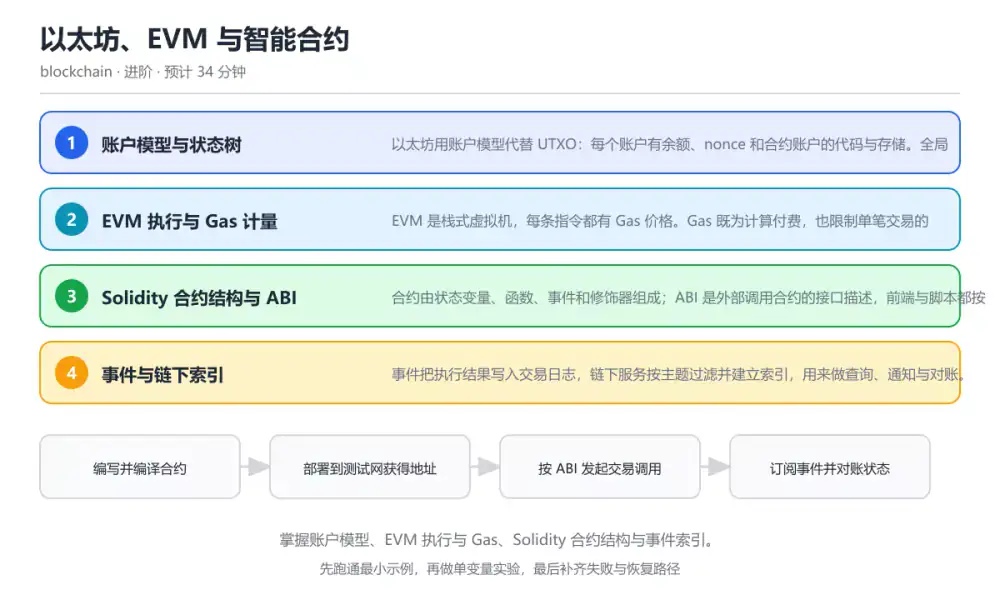
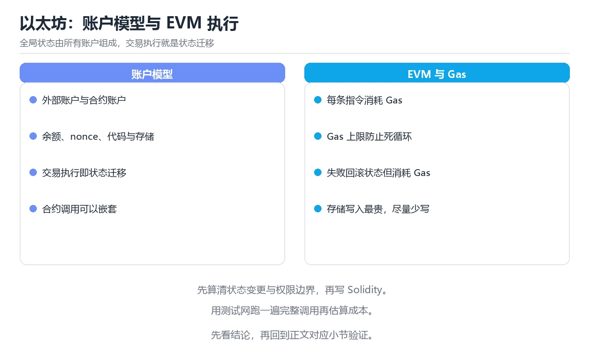

# 以太坊、EVM 与智能合约

> 内容更新时间：2026-10-06 · 学习阶段：进阶 · 预计用时：35 分钟

分类：blockchain。关键词：EVM、Solidity、Gas、ABI、事件。掌握账户模型、EVM 执行与 Gas、Solidity 合约结构与事件索引。



## 本节知识框架

**课程定位**：所属分类 `blockchain`（区块链与 Web3），课程主题 `以太坊、EVM 与智能合约`，学习阶段 进阶，建议用时 45 分钟。

本课主线：掌握账户模型、EVM 执行与 Gas、Solidity 合约结构与事件索引。

**学完本课应当能够**
- 说清 `EVM` 与 `Gas` 的含义与区别，并各举一个正例和一个反例。
- 用本课示例验证 `ABI` 的行为，记录输入、输出与失败条件。
- 遇到「权限校验缺失」这类问题时，能说出触发条件与修复顺序。

### 复习清单

- [ ] 能不看正文复述本课核心术语，并指出一个边界或反例。
- [ ] 能运行或推演本课示例，记录输入、输出与失败现象。
- [ ] 能完成一次自测，并把错题对照错误表定位原因。

**本课配图**



## 核心概念定义

| 术语 | 操作性定义 | 常见边界与风险 |
| --- | --- | --- |
| EVM | 以太坊的栈式虚拟机，按 Gas 计量执行合约字节码。 | 换编码、换字节序或换平台都可能改变结果，处理前先固定输入编码。 |
| Gas | 衡量计算与存储开销的计量单位，也是防止滥用的付费机制。 | 易错：在一个函数里遍历可能无限增长的数组；正确做法是限制单次处理数量，或改用分批任务与链下计算，避免交易超出 Gas 上限。 |
| ABI | 描述合约函数与参数编码方式的接口定义，供链下调用使用。 | 换编码、换字节序或换平台都可能改变结果，处理前先固定输入编码。 |
| 事件日志 | 合约执行时写入的日志记录，供链下服务索引和通知。 | 索引命中与数据分布决定实际开销，判断前先看执行计划而不是只看结果是否正确。 |
| nonce | 账户已发送交易的数量计数，用于排序并防止重放。 | 只在「账户已发送交易的数量计数，用于排序并防止重放」这一前提下成立，换输入或换环境要重新验证。 |
| 事件 | 事件把执行结果写入交易日志，链下服务按主题过滤并建立索引，用来做查询、通知与对账 | 易错：链下索引只做插入，不记录区块高度与哈希；正确做法是索引服务保存处理进度，检测到重组时回滚并重放到最新高度。 |

## 原理与运行机制

### 机制总览

**教材衔接：核心知识**

### 1. 账户模型与状态树

以太坊用账户模型代替 UTXO：每个账户有余额、nonce 和合约账户的代码与存储。全局状态由所有账户组成，交易执行就是状态迁移。

外部账户由私钥控制，合约账户由代码控制。nonce 保证同一账户的交易不会被重复执行，也决定交易顺序。

在以太坊、EVM 与智能合约里可以这样验证：对比两种模型：UTXO 需要选择输出，以太坊只需指定 from、to、value 与 data，余额不足或 nonce 冲突都会直接拒绝。

边界：账户模型更容易表达复杂状态，但也带来重放与授权风险；一次授权可能长期有效，必须显式撤销。

工程视角：合约里记录关键状态时要同时记录版本与所有者；升级或迁移前先冻结写入，避免状态不一致。

### 2. EVM 执行与 Gas 计量

EVM 是栈式虚拟机，每条指令都有 Gas 价格。Gas 既为计算付费，也限制单笔交易的执行步数，防止死循环拖垮全网。

交易先按 gas limit 预扣，执行结束后按实际消耗结算，剩余退还；如果中途失败，状态回滚但已消耗的 Gas 不退。

在以太坊、EVM 与智能合约里可以这样验证：写一个循环写入 storage 的函数，逐步增加循环次数，观察 Gas 消耗随存储写入线性上升。

边界：Gas 价格随网络拥堵波动，同样的调用成本可能差很多；把关键逻辑放在链上循环里会迅速变得不可用。

工程视角：把批量逻辑拆成可分批执行的任务，避免单笔交易超过区块 Gas 上限；用事件记录结果，把重计算放到链下。

### 3. Solidity 合约结构与 ABI

合约由状态变量、函数、事件和修饰器组成；ABI 是外部调用合约的接口描述，前端与脚本都按 ABI 编码调用数据。

函数可见性决定谁能调用，状态可变性决定是否写入链上。ABI 把函数选择器与参数编码成 calldata，返回值再解码回调用方。

在以太坊、EVM 与智能合约里可以这样验证：部署一个带计数器的合约，先调用 increment 写入状态，再调用 count 读取，对比两次调用的成本与返回方式。

边界：可见性写错会让内部函数暴露给任何人；ABI 变化会让已部署的前端调用失败，需要版本管理。

工程视角：合约接口一旦上线就难以更改，发布前冻结 ABI 并生成类型化客户端；升级用代理模式时明确存储布局兼容规则。

### 4. 事件与链下索引

事件把执行结果写入交易日志，链下服务按主题过滤并建立索引，用来做查询、通知与对账。

事件参数分为可索引与不可索引两类，索引字段进入主题列表，便于按地址或编号过滤；日志不参与合约状态读取。

在以太坊、EVM 与智能合约里可以这样验证：为转账事件加上发送方与接收方索引字段，链下服务按接收方订阅，实时把到账记录写入数据库。

边界：日志不是状态，合约无法读取历史事件；链重组时链下索引也要回滚重放，否则数据会与链上不一致。

工程视角：索引服务要记录处理到的区块高度与哈希，支持重组回滚；关键对账要用链上状态复核事件结果。

**教材衔接：关键流程**

```text
编写并编译合约 → 部署到测试网获得地址 → 按 ABI 发起交易调用 → 订阅事件并对账状态
```

1. 编写并编译合约
2. 部署到测试网获得地址
3. 按 ABI 发起交易调用
4. 订阅事件并对账状态

## 典型应用场景

**教材衔接：深度拓展与实战**

### 机制对照表

| 概念 | 解决什么问题 | 关键前提 | 失败信号 |
| --- | --- | --- | --- |
| 账户模型与状态树 | 以太坊用账户模型代替 UTXO：每个账户有余额、nonce 和合约账户的代码与存 | 账户模型更容易表达复杂状态，但也带来重放与授权风险；一次授权可能长期有效 | 合约里记录关键状态时要同时记录版本与所有者；升级或迁移前先冻结写入，避免 |
| EVM 执行与 Gas 计量 | EVM 是栈式虚拟机，每条指令都有 Gas 价格。Gas 既为计算付费，也限制单 | Gas 价格随网络拥堵波动，同样的调用成本可能差很多；把关键逻辑放在链上 | 把批量逻辑拆成可分批执行的任务，避免单笔交易超过区块 Gas 上限；用事 |
| Solidity 合约结构与 ABI | 合约由状态变量、函数、事件和修饰器组成；ABI 是外部调用合约的接口描述，前端与 | 可见性写错会让内部函数暴露给任何人；ABI 变化会让已部署的前端调用失败 | 合约接口一旦上线就难以更改，发布前冻结 ABI 并生成类型化客户端；升级 |
| 事件与链下索引 | 事件把执行结果写入交易日志，链下服务按主题过滤并建立索引，用来做查询、通知与对账 | 日志不是状态，合约无法读取历史事件；链重组时链下索引也要回滚重放，否则数 | 索引服务要记录处理到的区块高度与哈希，支持重组回滚；关键对账要用链上状态 |

### 自测问答

**问 1**：以太坊交易执行失败时，Gas 会怎样处理？

**答**：状态回滚，但已消耗的 Gas 不退。执行失败会回滚状态变更，已消耗的计算资源仍需付费，因此 Gas 不退；这条规则让攻击者无法用失败交易免费占用网络资源。 正确选项「状态回滚，但已消耗的 Gas 不退」对应《以太坊、EVM 与智能合约》的要点「账户模型与状态树」：以太坊用账户模型代替 UTXO：每个账户有余额、nonce 和合约账户的代码与存储。全局状态由所有账户组成，交易执行就是状态迁移。判断「账户模型与状态树」时先确认前提是否成立，再回到《以太坊、EVM 与智能合约》的示例核对一次；把别的语言或框架的默认做法直接搬到账户模型与状态树上，往往会在本课的边界条件里失效。

**问 2**：nonce 在账户模型里的主要作用是什么？

**答**：标记交易顺序并防止重放。每个账户的 nonce 随交易递增，节点据此排序并拒绝重复交易；它不负责加密，也不直接表示余额或存储状态。 正确选项「标记交易顺序并防止重放」对应《以太坊、EVM 与智能合约》的要点「EVM 执行与 Gas 计量」：EVM 是栈式虚拟机，每条指令都有 Gas 价格。Gas 既为计算付费，也限制单笔交易的执行步数，防止死循环拖垮全网。判断「EVM 执行与 Gas 计量」时先确认前提是否成立，再回到《以太坊、EVM 与智能合约》的示例核对一次；借鉴相邻主题的经验之前，先核对EVM 执行与 Gas 计量的前提是否成立。

**问 3**：以下哪些做法能降低合约的 Gas 成本？（多选）

**答**：减少不必要的存储写入；把重计算移到链下并用事件记录结果；用批量任务代替单笔大循环。存储写入与循环最耗 Gas，减少写入、链下计算、分批处理都能显著降本；而放开循环上限会让交易更容易超出区块 Gas 上限直接失败。 正确选项「减少不必要的存储写入；把重计算移到链下并用事件记录结果；用批量任务代替单笔大循环」对应《以太坊、EVM 与智能合约》的要点「Solidity 合约结构与 ABI」：合约由状态变量、函数、事件和修饰器组成；ABI 是外部调用合约的接口描述，前端与脚本都按 ABI 编码调用数据。判断「Solidity 合约结构与 ABI」时先确认前提是否成立，再回到《以太坊、EVM 与智能合约》的示例核对一次；记住Solidity 合约结构与 ABI的结论之外还要记住适用条件，换一个输入往往就不成立了。

**问 4**：请按合约从开发到对账的顺序排列步骤。

**答**：订阅事件并写入链下索引。先写合约并编译，再部署拿地址，然后按 ABI 调用，最后订阅事件做链下索引；没有地址就无法调用，没有交易也不会产生可索引的事件。 正确选项「编写并编译 Solidity 合约；部署到测试网获得合约地址；按 ABI 发起交易调用；订阅事件并写入链下索引」对应《以太坊、EVM 与智能合约》的要点「事件与链下索引」：事件把执行结果写入交易日志，链下服务按主题过滤并建立索引，用来做查询、通知与对账。判断「事件与链下索引」时先确认前提是否成立，再回到《以太坊、EVM 与智能合约》的示例核对一次；干扰项常常是相邻主题里成立的结论，只有按事件与链下索引的输入与约束判断才能排除。

**问 5**：阅读合约片段，哪项判断正确？

**答**：只有 owner 能调用 reset，increment 任何人可调用。构造函数记录部署者，reset 用 require 校验调用者，increment 没有任何限制；public 状态变量会自动生成读取函数，链下可以查询 count 值。 正确选项「只有 owner 能调用 reset，increment 任何人可调用」对应《以太坊、EVM 与智能合约》的要点「账户模型与状态树」：以太坊用账户模型代替 UTXO：每个账户有余额、nonce 和合约账户的代码与存储。全局状态由所有账户组成，交易执行就是状态迁移。判断「账户模型与状态树」时先确认前提是否成立，再回到《以太坊、EVM 与智能合约》的示例核对一次；把账户模型与状态树的做法换到别的约束下未必成立，先确认边界再决定答案。

### 工程检查表

- [ ] 编写并编译合约
- [ ] 部署到测试网获得地址
- [ ] 按 ABI 发起交易调用
- [ ] 订阅事件并对账状态
- [ ] 【账户模型与状态树】合约里记录关键状态时要同时记录版本与所有者；升级或迁移前先冻结写入，避免状态不一致。
- [ ] 【EVM 执行与 Gas 计量】把批量逻辑拆成可分批执行的任务，避免单笔交易超过区块 Gas 上限；用事件记录结果，把重计算放到链下。
- [ ] 【Solidity 合约结构与 ABI】合约接口一旦上线就难以更改，发布前冻结 ABI 并生成类型化客户端；升级用代理模式时明确存储布局兼容规则。
- [ ] 【事件与链下索引】索引服务要记录处理到的区块高度与哈希，支持重组回滚；关键对账要用链上状态复核事件结果。

### 结论与下一步

- **权限校验缺失**：典型现象是把所有写函数都设为 public 且不校验调用者；正确做法是用 owner 或角色控制限制关键函数，并在链上校验而不是依赖前端隐藏入口。
- **在链上做重循环**：典型现象是在一个函数里遍历可能无限增长的数组；正确做法是限制单次处理数量，或改用分批任务与链下计算，避免交易超出 Gas 上限。
- **忽略事件重组回滚**：典型现象是链下索引只做插入，不记录区块高度与哈希；正确做法是索引服务保存处理进度，检测到重组时回滚并重放到最新高度。

### 最小验证场景

- 准备：保留 `text` 示例的原始输入，先记录 `以太坊、EVM 与智能合约` 的基线输出和完整运行命令。
- 判定：新结果与 `以太坊、EVM 与智能合约` 的基线不同不等于错误；只有当差异破坏了 `EVM` 的定义或错误表中的约束，才判定为失败。

### 选择与边界

- 使用 `EVM` 时，先满足它的定义：以太坊的栈式虚拟机，按 Gas 计量执行合约字节码；换编码、换字节序或换平台都可能改变结果，处理前先固定输入编码。
- 使用 `Gas` 时，先满足它的定义：衡量计算与存储开销的计量单位，也是防止滥用的付费机制；易错：在一个函数里遍历可能无限增长的数组；正确做法是限制单次处理数量，或改用分批任务与链下计算，避免交易超出 Gas 上限。
- 使用 `ABI` 时，先满足它的定义：描述合约函数与参数编码方式的接口定义，供链下调用使用；换编码、换字节序或换平台都可能改变结果，处理前先固定输入编码。
- 使用 `事件日志` 时，先满足它的定义：合约执行时写入的日志记录，供链下服务索引和通知；索引命中与数据分布决定实际开销，判断前先看执行计划而不是只看结果是否正确。
- 使用 `nonce` 时，先满足它的定义：账户已发送交易的数量计数，用于排序并防止重放。

## 代码/协议/SQL 示例

### 最小可验证示例

```text
编写并编译合约 → 部署到测试网获得地址 → 按 ABI 发起交易调用 → 订阅事件并对账状态
```

**教材衔接：原文最小示例**

```text
编写并编译合约 → 部署到测试网获得地址 → 按 ABI 发起交易调用 → 订阅事件并对账状态
```

```solidity
// SPDX-License-Identifier: MIT
pragma solidity ^0.8.20;

contract Counter {
    uint256 public count;
    address public immutable owner;

    event Incremented(address indexed by, uint256 newValue);

    constructor() {
        owner = msg.sender;
    }

    function increment() external {
        count += 1;
        emit Incremented(msg.sender, count);
    }

    function reset() external {
        require(msg.sender == owner, "not owner");
        count = 0;
    }
}
```

## 时间/空间复杂度或性能分析

**性能关注点（以太坊、EVM 与智能合约）**：链上操作受确认时间与手续费约束：记录确认延迟、Gas 消耗与存储增长。

**本课特有开销（以太坊、EVM 与智能合约 · EVM）**：索引能减少扫描行数，但会增加写入与存储开销，需要同时记录读、写两侧代价。

**测量方法**：以 `以太坊、EVM 与智能合约` 的 `EVM` 场景为对象，固定输入跑一遍记录基线，再把规模或并发度提高一个数量级复测；两次结果的差值与波动范围才是结论依据。

## 常见误区与易错点

| 容易写错的做法 | 实际现象 | 原因与正确做法 |
| --- | --- | --- |
| 权限校验缺失 | 把所有写函数都设为 public 且不校验调用者。 | 用 owner 或角色控制限制关键函数，并在链上校验而不是依赖前端隐藏入口。 |
| 在链上做重循环 | 在一个函数里遍历可能无限增长的数组。 | 限制单次处理数量，或改用分批任务与链下计算，避免交易超出 Gas 上限。 |
| 忽略事件重组回滚 | 链下索引只做插入，不记录区块高度与哈希。 | 索引服务保存处理进度，检测到重组时回滚并重放到最新高度。 |

### 现场 1：权限校验缺失

**症状**：把所有写函数都设为 public 且不校验调用者。

**根因与修复**：用 owner 或角色控制限制关键函数，并在链上校验而不是依赖前端隐藏入口。

**自检**：在本课示例里复现「权限校验缺失」，改成用 owner 或角色控制限制关键函数，并在链上校验而不是依赖前端隐藏入口后重跑；如果症状消失且失败路径按预期变化，说明定位正确。

### 现场 2：在链上做重循环

**症状**：在一个函数里遍历可能无限增长的数组。

**根因与修复**：限制单次处理数量，或改用分批任务与链下计算，避免交易超出 Gas 上限。

**自检**：在本课示例里复现「在链上做重循环」，改成限制单次处理数量，或改用分批任务与链下计算，避免交易超出 Gas 上限后重跑；如果症状消失且失败路径按预期变化，说明定位正确。

### 现场 3：忽略事件重组回滚

**症状**：链下索引只做插入，不记录区块高度与哈希。

**根因与修复**：索引服务保存处理进度，检测到重组时回滚并重放到最新高度。

**自检**：在本课示例里复现「忽略事件重组回滚」，改成索引服务保存处理进度，检测到重组时回滚并重放到最新高度后重跑；如果症状消失且失败路径按预期变化，说明定位正确。

## 与其他知识点的关系

**教材衔接：复习与迁移**

## 自测题与参考答案

> 先独立作答，再对照参考答案；答案都能在本课正文、术语表或错误表里找到依据。

### 自测 1（概念复述）

不看正文，写出 `EVM` 的操作性定义，并说明它与 `Gas` 的区别。

**参考答案**：以太坊的栈式虚拟机，按 Gas 计量执行合约字节码。

`Gas` 的定位是：衡量计算与存储开销的计量单位，也是防止滥用的付费机制；两者的差别要从适用对象与失败模式上说明。

### 自测 2（排错）

本课错误表记录了「权限校验缺失」这类做法。请写出它会出现的现象、根因，以及修复顺序。

**参考答案**：现象是把所有写函数都设为 public 且不校验调用者；正确做法是用 owner 或角色控制限制关键函数，并在链上校验而不是依赖前端隐藏入口。修复时先复现现象并保留证据，再改动一处假设重跑，确认现象消失。

### 自测 3（动手验证）

运行本课的 `text` 示例，改动其中一个输入后重新运行，记录输出与错误信息。

**参考答案**：正常输入下 `text` 示例应当复现正文给出的结果；改动输入后，如果结果改变或报错，先核对它是否满足 `以太坊、EVM 与智能合约` 中`EVM` 的适用范围，再检查错误表里是否有同类现象。

### 自测 4（代码阅读）

阅读本课开头的 `text` 示例，说明它体现了`EVM` 的哪一条性质，并指出改动哪个输入会让这条性质不再成立。

**参考答案**：`EVM` 的定义是 以太坊的栈式虚拟机，按 Gas 计量执行合约字节码，示例正是在实现这条定义。改动与 `EVM` 有关的一个输入后，如果结果不再符合 `以太坊、EVM 与智能合约` 的正文描述，就说明该性质只在当前前提成立。

### 自测 5（迁移）

把 `以太坊、EVM 与智能合约` 的方法迁移到自己的项目：围绕 `EVM` 写出一个与错误表同类的风险点，并说明触发条件和检验方式。

**参考答案**：例如「忽略事件重组回滚」，它会导致链下索引只做插入，不记录区块高度与哈希；检验方式是按索引服务保存处理进度，检测到重组时回滚并重放到最新高度改一处再复现，确认现象消失且没有引入新的失败分支。

### 自测 6（对比）

用一个表格对比 `EVM` 与 `Gas`：各写一行适用场景、一行失败表现。

**参考答案**：`EVM` 的定义是以太坊的栈式虚拟机，按 Gas 计量执行合约字节码；`Gas` 的定义是衡量计算与存储开销的计量单位，也是防止滥用的付费机制。两者的失败表现分别对应本课错误表里与本术语相关的行。

### 自测 7（排错顺序）

面对「权限校验缺失」引发的问题，请把“复现 把所有写函数都设为 public 且不校验调用者 → 保留证据 → 用 owner 或角色控制限制关键函数，并在链上校验而不是依赖前端隐藏入口 → 回归验证”四步写成可执行的检查清单。

**参考答案**：第一步按把所有写函数都设为 public 且不校验调用者复现；第二步记录输入、版本与完整报错；第三步按用 owner 或角色控制限制关键函数，并在链上校验而不是依赖前端隐藏入口只改一处；第四步重跑并确认失败路径也按预期变化。

### 自测 8（边界判断）

针对 `事件`，分别写出“可以使用”的条件和“结论不再成立”的条件。

**参考答案**：易错：链下索引只做插入，不记录区块高度与哈希；正确做法是索引服务保存处理进度，检测到重组时回滚并重放到最新高度。 同时要把 `事件` 的定义 事件把执行结果写入交易日志，链下服务按主题过滤并建立索引，用来做查询、通知与对账 与实际输入逐项对照。

### 自测 9（机制重建）

不看正文，按输入、转换、输出、验证四段重建 `EVM` → `Gas` → `ABI` → `事件日志` 的作用链。

**参考答案**：起点是 `EVM` 的定义 以太坊的栈式虚拟机，按 Gas 计量执行合约字节码；中间每一步都保留可观察状态；终点由 `事件` 检查，失败时回到错误表定位第一个偏离定义的步骤。

### 自测 10（综合排错）

在 `以太坊、EVM 与智能合约` 中，现象是 链下索引只做插入，不记录区块高度与哈希。请围绕 忽略事件重组回滚 写出最小复现、关键证据、修复动作和回归验证，并说明为什么不能只凭一次运行下结论。

**参考答案**：先复现 忽略事件重组回滚，记录输入与完整错误；再按 索引服务保存处理进度，检测到重组时回滚并重放到最新高度 只改一处。回归时同时跑正常路径和边界路径，只有两次结果都可解释，才把修复视为完成。

### 自测 11（一分钟复述）

用每分钟约 200 字的速度复述 `以太坊、EVM 与智能合约`：先给主问题，再按顺序说出 `EVM`、`Gas`、`ABI`、`事件日志`，最后给一个失败案例。

**自评标准**：主问题必须对应 掌握账户模型、EVM 执行与 Gas、Solidity 合约结构与事件索引；每个术语都要能接上一句定义或边界；失败案例必须写成可观察现象，不能用“可能有风险”代替证据。

## 术语速查

| 术语 | 一句话说明 |
| --- | --- |
| `EVM` | 以太坊的栈式虚拟机，按 Gas 计量执行合约字节码。 |
| `Gas` | 衡量计算与存储开销的计量单位，也是防止滥用的付费机制。 |
| `ABI` | 描述合约函数与参数编码方式的接口定义，供链下调用使用。 |
| `事件日志` | 合约执行时写入的日志记录，供链下服务索引和通知。 |
| `nonce` | 账户已发送交易的数量计数，用于排序并防止重放。 |
| `事件` | 事件把执行结果写入交易日志，链下服务按主题过滤并建立索引，用来做查询、通知与对账。 |

**术语关系**：`EVM`（以太坊的栈式虚拟机） → `Gas`（衡量计算与存储开销的计量单位） → `ABI`（描述合约函数与参数编码方式的接口定义） → `事件日志`（合约执行时写入的日志记录）。

## 考点精讲

`以太坊、EVM 与智能合约` 的题库有 5 道题，下面逐题给出题干、正确项与判断依据：先自己作答，再核对正确项，最后回到正文对应小节复核。

### 考点 1：第 1 题

- **题目**：以太坊交易执行失败时，Gas 会怎样处理？
- **正确项**：状态回滚，但已消耗的 Gas 不退
- **判断依据**：本题正确项是「状态回滚，但已消耗的 Gas 不退」。术语 Gas（以太坊、EVM 与智能合约）：衡量计算与存储开销的计量单位，也是防止滥用的付费机制，本题取「状态回滚，但已消耗的 Gas 不退」这条。易错点是权限校验缺失，会造成把所有写函数都设为 public 且不校验调用者，改法是用 owner 或角色控制限制关键函数，并在链上校验而不是依赖前端隐藏入口。

### 考点 2：第 2 题

- **题目**：nonce 在账户模型里的主要作用是什么？
- **正确项**：标记交易顺序并防止重放
- **判断依据**：本题正确项是「标记交易顺序并防止重放」。术语 nonce（以太坊、EVM 与智能合约）：账户已发送交易的数量计数，用于排序并防止重放，本题取「标记交易顺序并防止重放」这条。易错点是在链上做重循环，会造成在一个函数里遍历可能无限增长的数组，改法是限制单次处理数量，或改用分批任务与链下计算，避免交易超出 Gas 上限。

### 考点 3：第 3 题

- **题目**：以下哪些做法能降低合约的 Gas 成本？（多选）
- **正确项**：减少不必要的存储写入；把重计算移到链下并用事件记录结果；用批量任务代替单笔大循环
- **判断依据**：按《以太坊、EVM 与智能合约》的正文口径，本题要同时选中「减少不必要的存储写入」、「把重计算移到链下并用事件记录结果」、「用批量任务代替单笔大循环」，漏掉任一项都算没答全。术语 Gas（以太坊、EVM 与智能合约）：衡量计算与存储开销的计量单位，也是防止滥用的付费机制。易错点是忽略事件重组回滚，会造成链下索引只做插入，不记录区块高度与哈希，改法是索引服务保存处理进度，检测到重组时回滚并重放到最新高度。

### 考点 4：第 4 题

- **题目**：请按合约从开发到对账的顺序排列步骤。
- **正确项**：编写并编译 Solidity 合约 → 部署到测试网获得合约地址 → 按 ABI 发起交易调用 → 订阅事件并写入链下索引
- **判断依据**：按《以太坊、EVM 与智能合约》正文的先后，本题顺序是「编写并编译 Solidity 合约」 → 「部署到测试网获得合约地址」 → 「按 ABI 发起交易调用」 → 「订阅事件并写入链下索引」。术语 ABI（以太坊、EVM 与智能合约）：描述合约函数与参数编码方式的接口定义，供链下调用使用。易错点是权限校验缺失会造成把所有写函数都设为 public 且不校验调用者，改法是用 owner 或角色控制限制关键函数，并在链上校验而不是依赖前端隐藏入口。

### 考点 5：第 5 题

- **题目**：阅读合约片段，哪项判断正确？
- **正确项**：只有 owner 能调用 reset，increment 任何人可调用
- **判断依据**：本题正确项是「只有 owner 能调用 reset，increment 任何人可调用」。术语 EVM（以太坊、EVM 与智能合约）：以太坊的栈式虚拟机，按 Gas 计量执行合约字节码，本题取「只有 owner 能调用 reset，increment 任何人可调用」这条。易错点是在链上做重循环，会造成在一个函数里遍历可能无限增长的数组，改法是限制单次处理数量，或改用分批任务与链下计算，避免交易超出 Gas 上限。

### 考点 6：`EVM`

- **要点**：以太坊的栈式虚拟机，按 Gas 计量执行合约字节码。
- **EVM 的边界**：换编码、换字节序或换平台都可能改变结果，处理前先固定输入编码。

### 考点 7：`Gas`

- **要点**：衡量计算与存储开销的计量单位，也是防止滥用的付费机制。
- **Gas 的边界**：易错：在一个函数里遍历可能无限增长的数组；正确做法是限制单次处理数量，或改用分批任务与链下计算，避免交易超出 Gas 上限。

### 考点 8：`ABI`

- **要点**：描述合约函数与参数编码方式的接口定义，供链下调用使用。
- **ABI 的边界**：换编码、换字节序或换平台都可能改变结果，处理前先固定输入编码。

### 考点 9：`事件日志`

- **要点**：合约执行时写入的日志记录，供链下服务索引和通知。
- **事件日志 的边界**：索引命中与数据分布决定实际开销，判断前先看执行计划而不是只看结果是否正确。

### 考点 10：`nonce`

- **要点**：账户已发送交易的数量计数，用于排序并防止重放。

### 考点 11：`事件`

- **要点**：事件把执行结果写入交易日志，链下服务按主题过滤并建立索引，用来做查询、通知与对账
- **事件 的边界**：易错：链下索引只做插入，不记录区块高度与哈希；正确做法是索引服务保存处理进度，检测到重组时回滚并重放到最新高度。

### 考点 12：排错——权限校验缺失

- **现象**：把所有写函数都设为 public 且不校验调用者。
- **处理**：用 owner 或角色控制限制关键函数，并在链上校验而不是依赖前端隐藏入口。

### 考点 13：排错——在链上做重循环

- **现象**：在一个函数里遍历可能无限增长的数组。
- **处理**：限制单次处理数量，或改用分批任务与链下计算，避免交易超出 Gas 上限。

### 考点 14：综合辨析——`EVM` 与 `事件`

- **辨析点**：`EVM` 的定义是 以太坊的栈式虚拟机，按 Gas 计量执行合约字节码；`事件` 的定义是 事件把执行结果写入交易日志，链下服务按主题过滤并建立索引，用来做查询、通知与对账。
- **答题要求**：面对 `以太坊、EVM 与智能合约` 的题目，先判断描述的是 `EVM` 还是 `事件`，再归到对应定义，最后写出一个会让该定义失效的边界输入。

### 考点 15：排错评分点

- **现象分**：能写出 把所有写函数都设为 public 且不校验调用者，而不是只写“程序有错”。
- **证据分**：保留触发 权限校验缺失 的输入、版本和错误原文。
- **修复分**：按 用 owner 或角色控制限制关键函数，并在链上校验而不是依赖前端隐藏入口 只改一处，并同时回归正常路径与边界路径。

## 内容元数据

- 内容版本：v2.0
- 最后更新：2026-10-06
- 学习阶段：进阶

| 字段 | 值 |
| --- | --- |
| 课程 ID | `blockchain_ethereum_smart_contract` |
| 所属分类 | `blockchain` |
| 难度 | 进阶 |
| 预计用时 | 34 分钟 |
| 关键词 | EVM、Solidity、Gas、ABI、事件 |
| 配图 | `images/lesson_blockchain_ethereum_smart_contract.webp` |
| 参考资料 | 3 条 |
| 内容更新时间 | 2026-10-06 |

## 参考资料与复核

- 来源性质：官方文档、标准或权威教材；本课核对关键词：EVM、Solidity、Gas、ABI、事件。
- 最后复核：2026-10-04
- 下次复核：2027-01-17
- 复核范围：版本兼容、API 行为与工程实践

下面列出的资料用于核对本课结论，复习时可以对照阅读：
- [Ethereum 开发者文档](https://ethereum.org/zh/developers/docs/)
- [Solidity 官方文档](https://docs.soliditylang.org/)
- [Ethereum EVM 说明](https://ethereum.org/zh/developers/docs/evm/)

| [本课术语索引：以太坊、EVM 与智能合约](#核心概念定义) | 按本课输入、术语边界和错误表现逐项核对 |
> 复核提示：《以太坊、EVM 与智能合约》的结论如与资料冲突，以资料中的规范文本为准，并在笔记里记录差异与日期。