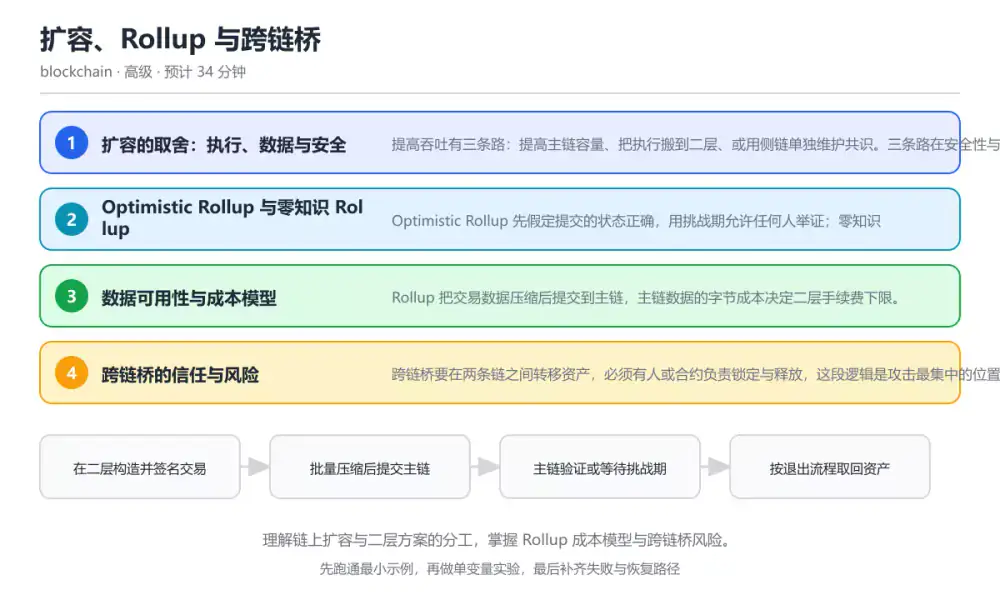
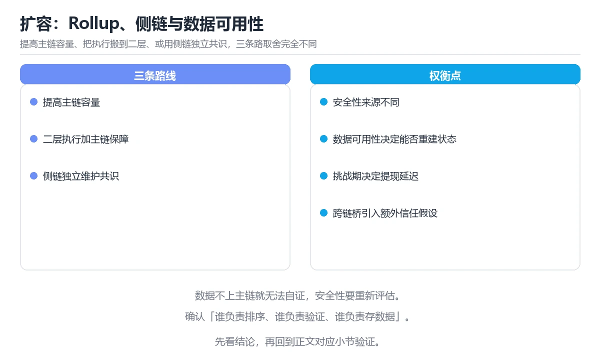

# 扩容、Rollup 与跨链桥

> 内容更新时间：2026-10-06 · 学习阶段：高级 · 预计用时：35 分钟

分类：blockchain。关键词：Rollup、数据可用性、跨链桥、扩容、手续费。理解链上扩容与二层方案的分工，掌握 Rollup 成本模型与跨链桥风险。



## 本节知识框架

**课程定位**：所属分类 `blockchain`（区块链与 Web3），课程主题 `扩容、Rollup 与跨链桥`，学习阶段 高级，建议用时 45 分钟。

本课主线：理解链上扩容与二层方案的分工，掌握 Rollup 成本模型与跨链桥风险。

**学完本课应当能够**
- 说清 `Rollup` 与 `数据可用性` 的含义与区别，并各举一个正例和一个反例。
- 用本课示例验证 `欺诈证明` 的行为，记录输入、输出与失败条件。
- 遇到「把侧链当作二层」这类问题时，能说出触发条件与修复顺序。

### 复习清单

- [ ] 能不看正文复述本课核心术语，并指出一个边界或反例。
- [ ] 能运行或推演本课示例，记录输入、输出与失败现象。
- [ ] 能完成一次自测，并把错题对照错误表定位原因。

**本课配图**



## 核心概念定义

| 术语 | 操作性定义 | 常见边界与风险 |
| --- | --- | --- |
| Rollup | 把执行移到二层、把数据提交主链的扩容方案，分乐观与零知识两类。 | 隔离级别与并发事务会影响可见性，换级别或换存储引擎后要重新验证。 |
| 数据可用性 | 交易数据可被任何人获取并重建状态的性质，是二层安全的前提。 | 权限与密钥策略变化会让结论失效，按最小权限并用真实凭据流程复验。 |
| 欺诈证明 | 允许参与者在挑战期内证明某个状态转换错误的机制。 | 缓存与状态残留会让结果过期，先明确失效策略再判断正确性。 |
| 跨链桥 | 在两条链之间转移资产或消息的中介系统，通常是攻击重点目标。 | 易错：不设单笔与单日额度、不校验消息唯一性；桥里锁定的资产越多，重放一条消息的收益越大。 |
| 挑战期 | 乐观方案中允许提交欺诈证明的等待窗口，提现需要等其结束。 | 易错：按主链确认时间规划二层提现，导致资金周转计划落空；正确做法是把挑战期写进资金计划，大额提现提前安排或使用可信的流动性通道。 |

## 原理与运行机制

### 机制总览

**教材衔接：核心知识**

### 1. 扩容的取舍：执行、数据与安全

提高吞吐有三条路：提高主链容量、把执行搬到二层、或用侧链单独维护共识。三条路在安全性与成本上的取舍完全不同。

主链扩容受节点硬件约束，二层把执行移出主链但保留主链的数据与争议解决能力，侧链则自己维护验证者集合，安全性取决于那组验证者。

在扩容、Rollup 与跨链桥里可以这样验证：对比同一笔转账在主链、Rollup 和侧链上的手续费、确认时间与信任假设，列出三者的差异表。

边界：二层降低手续费的前提是批量提交，交易量不足时单笔成本可能反而更高。

工程视角：选型时先写清安全假设与退出路径，再比较费用；不要把侧链当成与主链同等安全的方案。

### 2. Optimistic Rollup 与零知识 Rollup

Optimistic Rollup 先假定提交的状态正确，用挑战期允许任何人举证；零知识 Rollup 为每批交易生成有效性证明，主链验证通过才接受状态。

前者依赖欺诈证明与挑战窗口，提现要等待挑战期结束；后者依赖证明系统，提现更快但证明生成成本更高。

在扩容、Rollup 与跨链桥里可以这样验证：对比两类方案的提现时间、证明成本与信任假设，说明各自更适合的场景。

边界：零知识证明保证计算正确，但数据不可用时用户仍无法自行重建状态，因此数据可用性同样关键。

工程视角：接入二层时优先使用官方桥，记录挑战期与提现流程；大额资金分批次跨链并保留凭证。

### 3. 数据可用性与成本模型

Rollup 把交易数据压缩后提交到主链，主链数据的字节成本决定二层手续费下限。

手续费大致等于压缩后字节数乘以数据单价，再加上二层执行成本；批量越大，单笔分摊的数据成本越低。

在扩容、Rollup 与跨链桥里可以这样验证：给定数据单价与批量大小，估算把一笔转账打包进批次的成本，并比较批量翻倍后的变化。

边界：只优化计算成本而忽略数据成本会误判收益；数据单价随主链拥堵波动，估算要用区间而不是单点。

工程视角：监控数据单价与批次大小，按成本波动调整提交策略；对用户费用做上限保护，避免极端行情下亏损。

### 4. 跨链桥的信任与风险

跨链桥要在两条链之间转移资产，必须有人或合约负责锁定与释放，这段逻辑是攻击最集中的位置。

常见模式是锁定-铸造与销毁-释放，验证方式包括多签、轻客户端验证与外部验证者；验证集合越大、越去中心，信任假设越弱。

在扩容、Rollup 与跨链桥里可以这样验证：列出一次跨链转账的完整步骤，标注每一步的信任假设与失败后的资金位置。

边界：桥的资产总量往往超过其验证成本，攻击收益极高；跨链消息重放与验证缺失是历史损失的主要原因。

工程视角：限制单笔与单日跨链额度，验证消息唯一性，桥接资产与原生资产分开记账，并准备暂停开关。

**教材衔接：关键流程**

```text
在二层构造并签名交易 → 批量压缩后提交主链 → 主链验证或等待挑战期 → 按退出流程取回资产
```

1. 在二层构造并签名交易
2. 批量压缩后提交主链
3. 主链验证或等待挑战期
4. 按退出流程取回资产

## 典型应用场景

**教材衔接：深度拓展与实战**

### 机制对照表

| 概念 | 解决什么问题 | 关键前提 | 失败信号 |
| --- | --- | --- | --- |
| 扩容的取舍：执行、数据与安全 | 提高吞吐有三条路：提高主链容量、把执行搬到二层、或用侧链单独维护共识。三条路在安 | 二层降低手续费的前提是批量提交，交易量不足时单笔成本可能反而更高。 | 选型时先写清安全假设与退出路径，再比较费用；不要把侧链当成与主链同等安全 |
| Optimistic Rollup 与零知识 Rollup | Optimistic Rollup 先假定提交的状态正确，用挑战期允许任何人举证 | 零知识证明保证计算正确，但数据不可用时用户仍无法自行重建状态，因此数据可 | 接入二层时优先使用官方桥，记录挑战期与提现流程；大额资金分批次跨链并保留 |
| 数据可用性与成本模型 | Rollup 把交易数据压缩后提交到主链，主链数据的字节成本决定二层手续费下限。 | 只优化计算成本而忽略数据成本会误判收益；数据单价随主链拥堵波动，估算要用 | 监控数据单价与批次大小，按成本波动调整提交策略；对用户费用做上限保护，避 |
| 跨链桥的信任与风险 | 跨链桥要在两条链之间转移资产，必须有人或合约负责锁定与释放，这段逻辑是攻击最集中 | 桥的资产总量往往超过其验证成本，攻击收益极高；跨链消息重放与验证缺失是历 | 限制单笔与单日跨链额度，验证消息唯一性，桥接资产与原生资产分开记账，并准 |

### 自测问答

**问 1**：Rollup 手续费更低的主要原因是什么？

**答**：大量交易压缩后共享同一份主链数据成本。Rollup 把执行搬到二层，只把压缩数据提交主链；批量越大，单笔分摊的数据成本越低，这才是费用下降的来源，而二层仍然需要验证与数据可用性。 正确选项「大量交易压缩后共享同一份主链数据成本」对应《扩容、Rollup 与跨链桥》的要点「扩容的取舍：执行、数据与安全」：提高吞吐有三条路：提高主链容量、把执行搬到二层、或用侧链单独维护共识。三条路在安全性与成本上的取舍完全不同。判断「扩容的取舍：执行、数据与安全」时先确认前提是否成立，再回到《扩容、Rollup 与跨链桥》的示例核对一次；把别的语言或框架的默认做法直接搬到扩容的取舍：执行、数据与安全上，往往会在本课的边界条件里失效。

**问 2**：乐观 Rollup 与零知识 Rollup 在提现上的典型差别是？

**答**：乐观方案要等挑战期结束，零知识方案验证证明后即可提现。乐观方案假定状态正确，必须先度过挑战期才能确保没有欺诈证明；零知识方案在上链时已验证有效性证明，因此提现流程更快。 正确选项「乐观方案要等挑战期结束，零知识方案验证证明后即可提现」对应《扩容、Rollup 与跨链桥》的要点「Optimistic Rollup 与零知识 Rollup」：Optimistic Rollup 先假定提交的状态正确，用挑战期允许任何人举证；零知识 Rollup 为每批交易生成有效性证明，主链验证通过才接受状态。判断「Optimistic Rollup 与零知识 Rollup」时先确认前提是否成立，再回到《扩容、Rollup 与跨链桥》的示例核对一次；借鉴相邻主题的经验之前，先核对Optimistic Rollup 与零知识 Rollup的前提是否成立。

**问 3**：以下哪些会显著增加跨链桥风险？（多选）

**答**：验证者集合过小且可被收买；跨链消息缺少唯一性校验；单笔与单日额度没有上限。验证者过小、消息可重放、缺少额度限制都会放大损失；而桥接资产与原生资产分开记账是降低风险的常见做法，不属于风险来源。 正确选项「验证者集合过小且可被收买；跨链消息缺少唯一性校验；单笔与单日额度没有上限」对应《扩容、Rollup 与跨链桥》的要点「数据可用性与成本模型」：Rollup 把交易数据压缩后提交到主链，主链数据的字节成本决定二层手续费下限。判断「数据可用性与成本模型」时先确认前提是否成立，再回到《扩容、Rollup 与跨链桥》的示例核对一次；记住数据可用性与成本模型的结论之外还要记住适用条件，换一个输入往往就不成立了。

**问 4**：请按用户把资产从二层取回主链的顺序排列步骤。

**答**：主链合约释放资产。先在二层发起提现，再经过挑战期或证明验证，主链确认状态后才释放资产；顺序颠倒会出现未确认状态就放款的漏洞。 正确选项「在二层发起提现交易；等待挑战期或生成有效性证明；二层状态被主链确认；主链合约释放资产」对应《扩容、Rollup 与跨链桥》的要点「跨链桥的信任与风险」：跨链桥要在两条链之间转移资产，必须有人或合约负责锁定与释放，这段逻辑是攻击最集中的位置。判断「跨链桥的信任与风险」时先确认前提是否成立，再回到《扩容、Rollup 与跨链桥》的示例核对一次；干扰项常常是相邻主题里成立的结论，只有按跨链桥的信任与风险的输入与约束判断才能排除。

**问 5**：阅读成本估算代码，哪项判断正确？

**答**：数据成本按字节数乘以单价计算，可与二层执行成本相加。代码明确把数据成本与执行成本分开计算再相加，因此字节数越大数据成本越高；压缩的目标是减少提交字节数，从而降低这一部分成本。 正确选项「数据成本按字节数乘以单价计算，可与二层执行成本相加」对应《扩容、Rollup 与跨链桥》的要点「扩容的取舍：执行、数据与安全」：提高吞吐有三条路：提高主链容量、把执行搬到二层、或用侧链单独维护共识。三条路在安全性与成本上的取舍完全不同。判断「扩容的取舍：执行、数据与安全」时先确认前提是否成立，再回到《扩容、Rollup 与跨链桥》的示例核对一次；把扩容的取舍：执行、数据与安全的做法换到别的约束下未必成立，先确认边界再决定答案。

### 工程检查表

- [ ] 在二层构造并签名交易
- [ ] 批量压缩后提交主链
- [ ] 主链验证或等待挑战期
- [ ] 按退出流程取回资产
- [ ] 【扩容的取舍：执行、数据与安全】选型时先写清安全假设与退出路径，再比较费用；不要把侧链当成与主链同等安全的方案。
- [ ] 【Optimistic Rollup 与零知识 Rollup】接入二层时优先使用官方桥，记录挑战期与提现流程；大额资金分批次跨链并保留凭证。
- [ ] 【数据可用性与成本模型】监控数据单价与批次大小，按成本波动调整提交策略；对用户费用做上限保护，避免极端行情下亏损。
- [ ] 【跨链桥的信任与风险】限制单笔与单日跨链额度，验证消息唯一性，桥接资产与原生资产分开记账，并准备暂停开关。

### 结论与下一步

- **把侧链当作二层**：典型现象是认为侧链与主链享有同样的安全保障，大额资产直接长期停留；正确做法是先写清验证者集合与退出路径，把侧链资产按更高风险额度管理。
- **忽略提现挑战期**：典型现象是按主链确认时间规划二层提现，导致资金周转计划落空；正确做法是把挑战期写进资金计划，大额提现提前安排或使用可信的流动性通道。
- **只估算计算成本**：典型现象是压缩数据单元价格变化后，手续费模型完全失效；正确做法是同时跟踪数据单价与批量大小，按区间估算并给用户费用设置上限。

### 最小验证场景

- 准备：保留 `text` 示例的原始输入，先记录 `扩容、Rollup 与跨链桥` 的基线输出和完整运行命令。
- 判定：新结果与 `扩容、Rollup 与跨链桥` 的基线不同不等于错误；只有当差异破坏了 `Rollup` 的定义或错误表中的约束，才判定为失败。

### 选择与边界

- 使用 `Rollup` 时，先满足它的定义：把执行移到二层、把数据提交主链的扩容方案，分乐观与零知识两类；隔离级别与并发事务会影响可见性，换级别或换存储引擎后要重新验证。
- 使用 `数据可用性` 时，先满足它的定义：交易数据可被任何人获取并重建状态的性质，是二层安全的前提；权限与密钥策略变化会让结论失效，按最小权限并用真实凭据流程复验。
- 使用 `欺诈证明` 时，先满足它的定义：允许参与者在挑战期内证明某个状态转换错误的机制；缓存与状态残留会让结果过期，先明确失效策略再判断正确性。
- 使用 `跨链桥` 时，先满足它的定义：在两条链之间转移资产或消息的中介系统，通常是攻击重点目标。
- 使用 `挑战期` 时，先满足它的定义：乐观方案中允许提交欺诈证明的等待窗口，提现需要等其结束；易错：按主链确认时间规划二层提现，导致资金周转计划落空；正确做法是把挑战期写进资金计划，大额提现提前安排或使用可信的流动性通道。

## 代码/协议/SQL 示例

### 最小可验证示例

```text
在二层构造并签名交易 → 批量压缩后提交主链 → 主链验证或等待挑战期 → 按退出流程取回资产
```

**教材衔接：原文最小示例**

```text
在二层构造并签名交易 → 批量压缩后提交主链 → 主链验证或等待挑战期 → 按退出流程取回资产
```

```javascript
// 估算把一笔交易放进 Rollup 批次的数据成本
function batchCost({ bytesPerTx, dataPricePerByte, l2ExecutionCost }) {
  const dataCost = bytesPerTx * dataPricePerByte;
  return { dataCost, total: dataCost + l2ExecutionCost };
}

const single = batchCost({ bytesPerTx: 120, dataPricePerByte: 0.00002, l2ExecutionCost: 0.0004 });
const amortized = batchCost({ bytesPerTx: 12, dataPricePerByte: 0.00002, l2ExecutionCost: 0.0004 });
console.log('single tx', single);
console.log('amortized', amortized);
console.log('saving', (single.total - amortized.total).toFixed(6));
```

## 时间/空间复杂度或性能分析

**性能关注点（扩容、Rollup 与跨链桥）**：链上操作受确认时间与手续费约束：记录确认延迟、Gas 消耗与存储增长。

**测量方法**：以 `扩容、Rollup 与跨链桥` 的 `Rollup` 场景为对象，固定输入跑一遍记录基线，再把规模或并发度提高一个数量级复测；两次结果的差值与波动范围才是结论依据。

## 常见误区与易错点

| 容易写错的做法 | 实际现象 | 原因与正确做法 |
| --- | --- | --- |
| 把侧链当作二层 | 认为侧链与主链享有同样的安全保障，大额资产直接长期停留。 | 先写清验证者集合与退出路径，把侧链资产按更高风险额度管理。 |
| 忽略提现挑战期 | 按主链确认时间规划二层提现，导致资金周转计划落空。 | 把挑战期写进资金计划，大额提现提前安排或使用可信的流动性通道。 |
| 只估算计算成本 | 压缩数据单元价格变化后，手续费模型完全失效。 | 同时跟踪数据单价与批量大小，按区间估算并给用户费用设置上限。 |

### 现场 1：把侧链当作二层

**症状**：认为侧链与主链享有同样的安全保障，大额资产直接长期停留。

**根因与修复**：先写清验证者集合与退出路径，把侧链资产按更高风险额度管理。

**自检**：在本课示例里复现「把侧链当作二层」，改成先写清验证者集合与退出路径，把侧链资产按更高风险额度管理后重跑；如果症状消失且失败路径按预期变化，说明定位正确。

### 现场 2：忽略提现挑战期

**症状**：按主链确认时间规划二层提现，导致资金周转计划落空。

**根因与修复**：把挑战期写进资金计划，大额提现提前安排或使用可信的流动性通道。

**自检**：在本课示例里复现「忽略提现挑战期」，改成把挑战期写进资金计划，大额提现提前安排或使用可信的流动性通道后重跑；如果症状消失且失败路径按预期变化，说明定位正确。

### 现场 3：只估算计算成本

**症状**：压缩数据单元价格变化后，手续费模型完全失效。

**根因与修复**：同时跟踪数据单价与批量大小，按区间估算并给用户费用设置上限。

**自检**：在本课示例里复现「只估算计算成本」，改成同时跟踪数据单价与批量大小，按区间估算并给用户费用设置上限后重跑；如果症状消失且失败路径按预期变化，说明定位正确。

## 与其他知识点的关系

| 关系 | 课程 | 为什么 |
| --- | --- | --- |
| 先修 | 《以太坊、EVM 与智能合约》 | 本课会直接使用它的概念或操作前提。 |
| 前置顺序 | 《DeFi 风险与智能合约审计》 | 同分类中安排在本课之前，建议先完成其自测。 |

**教材衔接：复习与迁移**

## 自测题与参考答案

> 先独立作答，再对照参考答案；答案都能在本课正文、术语表或错误表里找到依据。

### 自测 1（概念复述）

不看正文，写出 `Rollup` 的操作性定义，并说明它与 `数据可用性` 的区别。

**参考答案**：把执行移到二层、把数据提交主链的扩容方案，分乐观与零知识两类。

`数据可用性` 的定位是：交易数据可被任何人获取并重建状态的性质，是二层安全的前提；两者的差别要从适用对象与失败模式上说明。

### 自测 2（排错）

本课错误表记录了「把侧链当作二层」这类做法。请写出它会出现的现象、根因，以及修复顺序。

**参考答案**：现象是认为侧链与主链享有同样的安全保障，大额资产直接长期停留；正确做法是先写清验证者集合与退出路径，把侧链资产按更高风险额度管理。修复时先复现现象并保留证据，再改动一处假设重跑，确认现象消失。

### 自测 3（动手验证）

运行本课的 `text` 示例，改动其中一个输入后重新运行，记录输出与错误信息。

**参考答案**：正常输入下 `text` 示例应当复现正文给出的结果；改动输入后，如果结果改变或报错，先核对它是否满足 `扩容、Rollup 与跨链桥` 中`Rollup` 的适用范围，再检查错误表里是否有同类现象。

### 自测 4（代码阅读）

阅读本课开头的 `text` 示例，说明它体现了`Rollup` 的哪一条性质，并指出改动哪个输入会让这条性质不再成立。

**参考答案**：`Rollup` 的定义是 把执行移到二层、把数据提交主链的扩容方案，分乐观与零知识两类，示例正是在实现这条定义。改动与 `Rollup` 有关的一个输入后，如果结果不再符合 `扩容、Rollup 与跨链桥` 的正文描述，就说明该性质只在当前前提成立。

### 自测 5（迁移）

把 `扩容、Rollup 与跨链桥` 的方法迁移到自己的项目：围绕 `Rollup` 写出一个与错误表同类的风险点，并说明触发条件和检验方式。

**参考答案**：例如「只估算计算成本」，它会导致压缩数据单元价格变化后，手续费模型完全失效；检验方式是按同时跟踪数据单价与批量大小，按区间估算并给用户费用设置上限改一处再复现，确认现象消失且没有引入新的失败分支。

### 自测 6（对比）

用一个表格对比 `Rollup` 与 `数据可用性`：各写一行适用场景、一行失败表现。

**参考答案**：`Rollup` 的定义是把执行移到二层、把数据提交主链的扩容方案，分乐观与零知识两类；`数据可用性` 的定义是交易数据可被任何人获取并重建状态的性质，是二层安全的前提。两者的失败表现分别对应本课错误表里与本术语相关的行。

### 自测 7（排错顺序）

面对「把侧链当作二层」引发的问题，请把“复现 认为侧链与主链享有同样的安全保障，大额资产直接长期停留 → 保留证据 → 先写清验证者集合与退出路径，把侧链资产按更高风险额度管理 → 回归验证”四步写成可执行的检查清单。

**参考答案**：第一步按认为侧链与主链享有同样的安全保障，大额资产直接长期停留复现；第二步记录输入、版本与完整报错；第三步按先写清验证者集合与退出路径，把侧链资产按更高风险额度管理只改一处；第四步重跑并确认失败路径也按预期变化。

### 自测 8（边界判断）

针对 `挑战期`，分别写出“可以使用”的条件和“结论不再成立”的条件。

**参考答案**：易错：按主链确认时间规划二层提现，导致资金周转计划落空；正确做法是把挑战期写进资金计划，大额提现提前安排或使用可信的流动性通道。 同时要把 `挑战期` 的定义 乐观方案中允许提交欺诈证明的等待窗口，提现需要等其结束 与实际输入逐项对照。

### 自测 9（机制重建）

不看正文，按输入、转换、输出、验证四段重建 `Rollup` → `数据可用性` → `欺诈证明` → `跨链桥` 的作用链。

**参考答案**：起点是 `Rollup` 的定义 把执行移到二层、把数据提交主链的扩容方案，分乐观与零知识两类；中间每一步都保留可观察状态；终点由 `挑战期` 检查，失败时回到错误表定位第一个偏离定义的步骤。

### 自测 10（综合排错）

在 `扩容、Rollup 与跨链桥` 中，现象是 压缩数据单元价格变化后，手续费模型完全失效。请围绕 只估算计算成本 写出最小复现、关键证据、修复动作和回归验证，并说明为什么不能只凭一次运行下结论。

**参考答案**：先复现 只估算计算成本，记录输入与完整错误；再按 同时跟踪数据单价与批量大小，按区间估算并给用户费用设置上限 只改一处。回归时同时跑正常路径和边界路径，只有两次结果都可解释，才把修复视为完成。

### 自测 11（一分钟复述）

用每分钟约 200 字的速度复述 `扩容、Rollup 与跨链桥`：先给主问题，再按顺序说出 `Rollup`、`数据可用性`、`欺诈证明`、`跨链桥`，最后给一个失败案例。

**自评标准**：主问题必须对应 理解链上扩容与二层方案的分工，掌握 Rollup 成本模型与跨链桥风险；每个术语都要能接上一句定义或边界；失败案例必须写成可观察现象，不能用“可能有风险”代替证据。

## 术语速查

| 术语 | 一句话说明 |
| --- | --- |
| `Rollup` | 把执行移到二层、把数据提交主链的扩容方案，分乐观与零知识两类。 |
| `数据可用性` | 交易数据可被任何人获取并重建状态的性质，是二层安全的前提。 |
| `欺诈证明` | 允许参与者在挑战期内证明某个状态转换错误的机制。 |
| `跨链桥` | 在两条链之间转移资产或消息的中介系统，通常是攻击重点目标。 |
| `挑战期` | 乐观方案中允许提交欺诈证明的等待窗口，提现需要等其结束。 |

**术语关系**：`Rollup`（把执行移到二层、把数据提交主链的扩容方案） → `数据可用性`（交易数据可被任何人获取并重建状态的性质） → `欺诈证明`（允许参与者在挑战期内证明某个状态转换错误的机制） → `跨链桥`（在两条链之间转移资产或消息的中介系统）。

## 考点精讲

`扩容、Rollup 与跨链桥` 的题库有 5 道题，下面逐题给出题干、正确项与判断依据：先自己作答，再核对正确项，最后回到正文对应小节复核。

### 考点 1：第 1 题

- **题目**：Rollup 手续费更低的主要原因是什么？
- **正确项**：大量交易压缩后共享同一份主链数据成本
- **判断依据**：本题正确项是「大量交易压缩后共享同一份主链数据成本」。术语 Rollup（扩容、Rollup 与跨链桥）：把执行移到二层、把数据提交主链的扩容方案，分乐观与零知识两类，本题取「大量交易压缩后共享同一份主链数据成本」这条。易错点是把侧链当作二层，会造成认为侧链与主链享有同样的安全保障，大额资产直接长期停留，改法是先写清验证者集合与退出路径，把侧链资产按更高风险额度管理。

### 考点 2：第 2 题

- **题目**：乐观 Rollup 与零知识 Rollup 在提现上的典型差别是？
- **正确项**：乐观方案要等挑战期结束，零知识方案验证证明后即可提现
- **判断依据**：本题正确项是「乐观方案要等挑战期结束，零知识方案验证证明后即可提现」。术语 Rollup（扩容、Rollup 与跨链桥）：把执行移到二层、把数据提交主链的扩容方案，分乐观与零知识两类，本题取「乐观方案要等挑战期结束，零知识方案验证证明后即可提现」这条。易错点是忽略提现挑战期，会造成按主链确认时间规划二层提现，导致资金周转计划落空，改法是把挑战期写进资金计划，大额提现提前安排或使用可信的流动性通道。

### 考点 3：第 3 题

- **题目**：以下哪些会显著增加跨链桥风险？（多选）
- **正确项**：验证者集合过小且可被收买；跨链消息缺少唯一性校验；单笔与单日额度没有上限
- **判断依据**：按《扩容、Rollup 与跨链桥》的正文口径，本题要同时选中「验证者集合过小且可被收买」、「跨链消息缺少唯一性校验」、「单笔与单日额度没有上限」，漏掉任一项都算没答全。术语 跨链桥（扩容、Rollup 与跨链桥）：在两条链之间转移资产或消息的中介系统，通常是攻击重点目标。易错点是只估算计算成本，会造成压缩数据单元价格变化后，手续费模型完全失效，改法是同时跟踪数据单价与批量大小，按区间估算并给用户费用设置上限。

### 考点 4：第 4 题

- **题目**：请按用户把资产从二层取回主链的顺序排列步骤。
- **正确项**：在二层发起提现交易 → 等待挑战期或生成有效性证明 → 二层状态被主链确认 → 主链合约释放资产
- **判断依据**：按《扩容、Rollup 与跨链桥》正文的先后，本题顺序是「在二层发起提现交易」 → 「等待挑战期或生成有效性证明」 → 「二层状态被主链确认」 → 「主链合约释放资产」。术语 挑战期（扩容、Rollup 与跨链桥）：乐观方案中允许提交欺诈证明的等待窗口，提现需要等其结束。易错点是把侧链当作二层会造成认为侧链与主链享有同样的安全保障，大额资产直接长期停留，改法是先写清验证者集合与退出路径，把侧链资产按更高风险额度管理。

### 考点 5：第 5 题

- **题目**：阅读成本估算代码，哪项判断正确？
- **正确项**：数据成本按字节数乘以单价计算，可与二层执行成本相加
- **判断依据**：本题正确项是「数据成本按字节数乘以单价计算，可与二层执行成本相加」。术语 Rollup（扩容、Rollup 与跨链桥）：把执行移到二层、把数据提交主链的扩容方案，分乐观与零知识两类，本题取「数据成本按字节数乘以单价计算，可与二层执行成本相加」这条。易错点是忽略提现挑战期，会造成按主链确认时间规划二层提现，导致资金周转计划落空，改法是把挑战期写进资金计划，大额提现提前安排或使用可信的流动性通道。

### 考点 6：`Rollup`

- **要点**：把执行移到二层、把数据提交主链的扩容方案，分乐观与零知识两类。
- **Rollup 的边界**：隔离级别与并发事务会影响可见性，换级别或换存储引擎后要重新验证。

### 考点 7：`数据可用性`

- **要点**：交易数据可被任何人获取并重建状态的性质，是二层安全的前提。
- **数据可用性 的边界**：权限与密钥策略变化会让结论失效，按最小权限并用真实凭据流程复验。

### 考点 8：`欺诈证明`

- **要点**：允许参与者在挑战期内证明某个状态转换错误的机制。
- **欺诈证明 的边界**：缓存与状态残留会让结果过期，先明确失效策略再判断正确性。

### 考点 9：`跨链桥`

- **要点**：在两条链之间转移资产或消息的中介系统，通常是攻击重点目标。

### 考点 10：`挑战期`

- **要点**：乐观方案中允许提交欺诈证明的等待窗口，提现需要等其结束。
- **挑战期 的边界**：易错：按主链确认时间规划二层提现，导致资金周转计划落空；正确做法是把挑战期写进资金计划，大额提现提前安排或使用可信的流动性通道。

### 考点 11：排错——把侧链当作二层

- **现象**：认为侧链与主链享有同样的安全保障，大额资产直接长期停留。
- **处理**：先写清验证者集合与退出路径，把侧链资产按更高风险额度管理。

### 考点 12：排错——忽略提现挑战期

- **现象**：按主链确认时间规划二层提现，导致资金周转计划落空。
- **处理**：把挑战期写进资金计划，大额提现提前安排或使用可信的流动性通道。

### 考点 13：综合辨析——`Rollup` 与 `挑战期`

- **辨析点**：`Rollup` 的定义是 把执行移到二层、把数据提交主链的扩容方案，分乐观与零知识两类；`挑战期` 的定义是 乐观方案中允许提交欺诈证明的等待窗口，提现需要等其结束。
- **答题要求**：面对 `扩容、Rollup 与跨链桥` 的题目，先判断描述的是 `Rollup` 还是 `挑战期`，再归到对应定义，最后写出一个会让该定义失效的边界输入。

### 考点 14：排错评分点

- **现象分**：能写出 认为侧链与主链享有同样的安全保障，大额资产直接长期停留，而不是只写“程序有错”。
- **证据分**：保留触发 把侧链当作二层 的输入、版本和错误原文。
- **修复分**：按 先写清验证者集合与退出路径，把侧链资产按更高风险额度管理 只改一处，并同时回归正常路径与边界路径。

## 内容元数据

- 内容版本：v2.0
- 最后更新：2026-10-06
- 学习阶段：高级

| 字段 | 值 |
| --- | --- |
| 课程 ID | `blockchain_scaling_layer2` |
| 所属分类 | `blockchain` |
| 难度 | 高级 |
| 预计用时 | 34 分钟 |
| 关键词 | Rollup、数据可用性、跨链桥、扩容、手续费 |
| 配图 | `images/lesson_blockchain_scaling_layer2.webp` |
| 参考资料 | 3 条 |
| 内容更新时间 | 2026-10-06 |

## 参考资料与复核

- 来源性质：官方文档、标准或权威教材；本课核对关键词：Rollup、数据可用性、跨链桥、扩容、手续费。
- 最后复核：2026-10-04
- 下次复核：2027-01-17
- 复核范围：版本兼容、API 行为与工程实践

下面列出的资料用于核对本课结论，复习时可以对照阅读：
- [Ethereum 扩容方案总览](https://ethereum.org/zh/developers/docs/scaling/)
- [Optimistic Rollup 说明](https://ethereum.org/zh/developers/docs/scaling/optimistic-rollups/)
- [EIP-4844 数据块提案](https://eips.ethereum.org/EIPS/eip-4844)

| [本课术语索引：扩容、Rollup 与跨链桥](#核心概念定义) | 按本课输入、术语边界和错误表现逐项核对 |
> 复核提示：《扩容、Rollup 与跨链桥》的结论如与资料冲突，以资料中的规范文本为准，并在笔记里记录差异与日期。