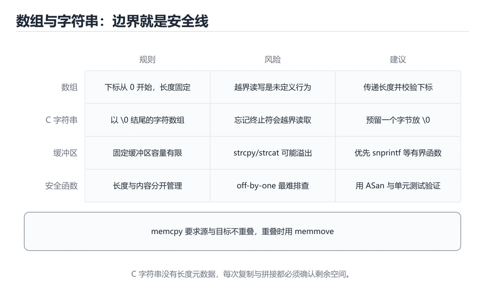
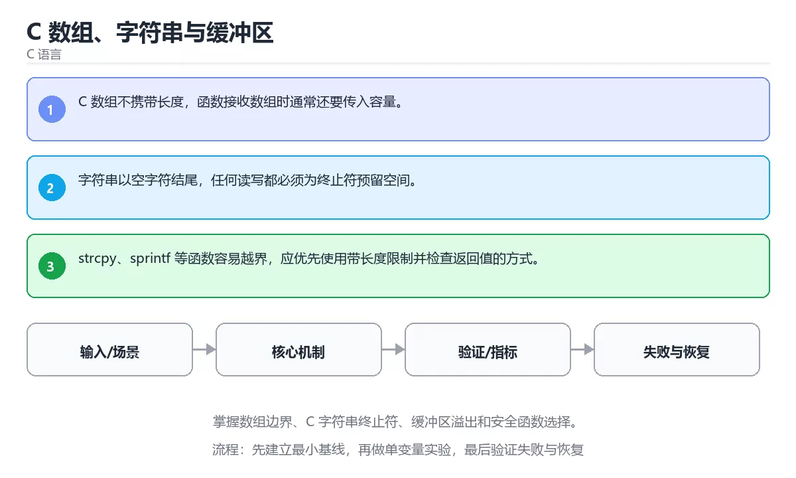

# C 数组、字符串与缓冲区





> 内容更新时间：2026-10-06 · 学习阶段：进阶 · 预计用时：35 分钟

## 本节知识框架

**课程定位**：所属分类 `c`（C 语言），课程主题 `C 数组、字符串与缓冲区`，学习阶段 进阶，建议用时 45 分钟。

本课主线：掌握数组边界、C 字符串终止符、缓冲区溢出和安全函数选择。

**学完本课应当能够**
- 说清 `数组` 与 `缓冲区` 的含义与区别，并各举一个正例和一个反例。
- 用本课示例验证 `越界访问` 的行为，记录输入、输出与失败条件。
- 遇到「把数组长度当成可用上界」这类问题时，能说出触发条件与修复顺序。

### 复习清单

- [ ] 能复述 数组 的职责，并给出一个输入越界时的反例。
- [ ] 能用「C 数组、字符串与缓冲区」的示例复现结果，并说明字符串出错时输出的第一条信息。
- [ ] 能完成一次自测，并把错题对照错误表定位原因。

## 核心概念定义

| 术语 | 操作性定义 | 常见边界与风险 |
| --- | --- | --- |
| 数组 | 参考判断：学习 数组 时要同时说明输入、输出和失败路径，不能只看正常流程、验证 字符串 时要固定版本并覆盖边界输入，结论才可复现。 | 易错：越界写入覆盖相邻内存；正确做法是容量与已用长度分开记录，写入前检查剩余空间。 |
| 缓冲区 | 二、运行时与内存模型：围绕「数组、字符串、缓冲区、越界」说明变量生命周期、资源释放、并发模型和错误传播。 | 易错：把缓冲区容量当成长度用，没为终止符留那一字节，打印与复制就一直读到随机内存；容量与已用长度要分开记。 |
| 越界访问 | 下标超出数组范围时读到相邻内存，是 C 里最常见的内存错误来源，编译器通常不会拦。 | 易错：编译期告警看不到运行期传来的下标，越界照样读相邻内存；下标进函数前先校验范围，再用内存检查工具复核。 |
| 字符串终止符 | C 字符串以 \0 结尾，长度靠扫描终止符得到，忘记留这一位就会越界或截断。 | 易错：数组没留终止符那一字节，靠扫描求长度的函数会一路越过边界读到随机内存，补零必须由写入方自己做。 |

## 原理与运行机制

### 机制总览

**教材衔接：核心知识**

### 1. C 数组不携带长度，函数接收数组时通常还要传入容量。

- 关键做法：先用 printf 建立 数组 的基线，再逐步加入边界与失败条件。
- 验证标准：字符串 的异常路径有明确错误信息与恢复动作。

### 2. 字符串以空字符结尾，任何读写都必须为终止符预留空间。

把这条结论放回「C 数组、字符串与缓冲区」的完整流程里展开：

- 正文依据：能用自己的话解释：C 数组不携带长度，函数接收数组时通常还要传入容量。
- 落地检查：把「2. 字符串以空字符结尾，任何读写都必须为终止符预留空间。」改写成一条可执行的核对项，逐条验证输入、超时与失败路径。

### 3. strcpy、sprintf 等函数容易越界，应优先使用带长度限制并检查返回值的方式。

把这条结论放回「C 数组、字符串与缓冲区」的完整流程里展开：

- 正文依据：能用自己的话解释：字符串以空字符结尾，任何读写都必须为终止符预留空间。
- 落地检查：把「3. strcpy、sprintf 等函数容易越界，应优先使用带长度限制并检查返回值的方式。」改写成一条可执行的核对项，逐条验证输入、超时与失败路径。

**教材衔接：关键流程**

**教材衔接：实践路径**

**教材衔接：语言专项实践：C 数组、字符串与缓冲区**

### 一、工具链

| 阶段 | 推荐工具 | 验收标准 |
| --- | --- | --- |
| 编译 | gcc/clang -Wall -Wextra -Werror | 命令可复现且错误能被定位 |
| 调试 | gdb + core dump | 命令可复现且错误能被定位 |
| 内存检查 | AddressSanitizer / Valgrind | 命令可复现且错误能被定位 |
| 构建发布 | Makefile/CMake + 静态或动态链接 | 命令可复现且错误能被定位 |

### 四、发布检查

**教材衔接：版本与时效**

- C23 已被主流编译器逐步支持，C17 仍是兼容性最好的基线；数组 的写法要按目标标准选择。
- 编译器对未定义行为、严格别名与对齐的优化越来越激进
- 升级时重点回归位域、可变参数、内联汇编与结构体布局
- 语言参考：https://en.cppreference.com/w/c

### 先建立一个直觉

本课的摘要可以当作一张地图：掌握数组边界、C 字符串终止符、缓冲区溢出和安全函数选择。

### 逐步拆解

1. 澄清输入与目标。先写清「C 数组、字符串与缓冲区」要解决的问题、合法输入范围和成功标准，再进入后续步骤。
2. 描述处理过程。把「数组、字符串、缓冲区、越界」映射到具体步骤，每步都要求能单独验证。
3. 定义输出。数组 的输出不仅包括正常结果，还包括错误码、日志和资源释放状态。
4. 把 printf 的输入换成空值、极值或类型不符的形式，记录第一条错误信息、发生位置和修复动作。
5. 选一个只有两三步的数组例子，先写出预期输出，再运行确认；不一致时先怀疑前提而不是代码。

### 把正文串成一条执行链

- **1. C 数组不携带长度，函数接收数组时通常还要传入容量。**：在「C 数组、字符串与缓冲区」里，「1. C 数组不携带长度，函数接收数组时通常还要传入容量。」这一步要先写清输入与预期，再记录实际结果和差异；结果不符时回到对应小节核对前提。
- **2. 字符串以空字符结尾，任何读写都必须为终止符预留空间。**：在「C 数组、字符串与缓冲区」里，「2. 字符串以空字符结尾，任何读写都必须为终止符预留空间。」这一步要先写清输入与预期，再记录实际结果和差异；结果不符时回到对应小节核对前提。
- **3. strcpy、sprintf 等函数容易越界，应优先使用带长度限制并检查返回值的方式。**：在「C 数组、字符串与缓冲区」里，「3. strcpy、sprintf 等函数容易越界，应优先使用带长度限制并检查返回值的方式。」这一步要先写清输入与预期，再记录实际结果和差异；结果不符时回到对应小节核对前提。
- 一、工具链：实现 printf 所需的阶段与验收标准
- **二、运行时与内存模型**：围绕「数组、字符串、缓冲区、越界」说明变量生命周期、资源释放、并发模型和错误传播
- **三、测试策略**：- 单元测试覆盖核心规则和边界

### 从测验反推易错点

- 参考判断：函数返回了局部变量的引用，调用结束后对象已销毁，读取属于未定义行为。
- 自问：如果去掉题干里的一个限定词，结论还成立吗？

**检查点 2：围绕C 数组、字符串与缓冲区中的 数组、字符串、缓冲区，下列哪两项是本课强调的实践判断？**

- 参考判断：学习 数组 时要同时说明输入、输出和失败路径，不能只看正常流程、验证 字符串 时要固定版本并覆盖边界输入，结论才可复现
- 解析：本课把C 数组、字符串与缓冲区拆成概念、示例与故障现场三部分，因此判断 数组 时必须同时交代输入、输出和失败路径，这使“学习 数组 时要同时说明输入、输出和失败路径，不能只看正常流程”成立；在C 数组、字符串与缓冲区里，判断 字符串 时要固定版本与边界输入，所以“验证 字符串 时要固定版本并覆盖边界输入，结论才可复现”才可复现。相反，“只要 数组 的常规示例通过，就可以跳过边界与异常路径”把一次正常示例当成全部情况，会漏掉本课的边界缺陷；“把 字符串 的单次运行结果当成所有版本和规模都成立”把单次结果外推成普遍结论，在C 数组、字符串与缓冲区里忽略了版本和规模变化。对照本课的故障现场与自测清单，就能用证据区分这两种判断。

- 参考判断：strcpy、sprintf 等函数容易越界，应优先使用带长度限制并检查返回值的方式。

**检查点 4：本课的核心学习目标是什么？**

- 参考判断：掌握数组边界、C 字符串终止符、缓冲区溢出和安全函数选择。

- 参考判断：printf

### 变式训练

1. 把 数组 放进一个只有单机、没有额外依赖的小项目，先保证正确再扩展。
2. 扩大 字符串 的规模，记录本课结论在哪一个量级开始不成立。
3. 把 字符串 换成失败输入，记录错误信息与恢复动作。
5. 把 printf 的执行顺序调换一次，记录哪个中间结果先错；顺序敏感的地方就是本课的关键约束。
6. 限制 CPU 与内存上限后重跑 printf，观察哪一项参数需要重新设定。

### 迁移案例库

围绕 printf 重复同一套方法，每完成一轮就把差异写进笔记。

#### 迁移案例 1：围绕「数组」做一次小实验

**验收**：数组的结论要有证据、差异可解释、失败可恢复；做不到时回到「核心知识」缩小问题范围。

#### 迁移案例 2：围绕「字符串」做一次小实验

**步骤**：
1. 复述当前方案对「字符串」的假设，写成一句可证伪的话。

#### 迁移案例 3：围绕「缓冲区」做一次小实验

**步骤**：
1. 复述当前方案对「缓冲区」的假设，写成一句可证伪的话。

#### 迁移案例 4：围绕「越界」做一次小实验

**步骤**：
1. 复述当前方案对「越界」的假设，写成一句可证伪的话。

#### 迁移案例 5：围绕「数组」做一次小实验

**步骤**：

#### 迁移案例 6：围绕「字符串」做一次小实验

**步骤**：

#### 迁移案例 7：围绕「缓冲区」做一次小实验

**步骤**：

#### 迁移案例 8：围绕「越界」做一次小实验

**步骤**：

#### 迁移案例 9：围绕「数组」做一次小实验

**步骤**：

#### 迁移案例 10：围绕「字符串」做一次小实验

**步骤**：

#### 迁移案例 11：围绕「缓冲区」做一次小实验

**步骤**：

#### 迁移案例 12：围绕「越界」做一次小实验

**步骤**：

#### 迁移案例 13：围绕「数组」做一次小实验

**步骤**：

#### 迁移案例 14：围绕「字符串」做一次小实验

**步骤**：

#### 迁移案例 15：围绕「缓冲区」做一次小实验

**步骤**：

#### 迁移案例 16：围绕「越界」做一次小实验

**步骤**：

<!-- p0-depth-v2:end -->

**教材衔接：验证步骤**

## 典型应用场景

- **把数组长度当成可用上界**：典型现象是越界写入覆盖相邻内存；正确做法是容量与已用长度分开记录，写入前检查剩余空间。
- **字符串忘记结尾的空字符**：典型现象是打印与复制一直读到随机内存；正确做法是为终止符预留一字节，用带长度上限的函数并手动补零。
- **用等号比较字符串内容**：典型现象是实际比较的是两个地址；正确做法是用 strcmp 系列比较内容，并处理返回值的正负含义。

### 最小验证场景

- 准备：保留 `text` 示例的原始输入，先记录 `C 数组、字符串与缓冲区` 的基线输出和完整运行命令。
- 观察：先核对 调用了 `main()`，再改变一个与 `数组` 相关的条件。
- 判定：新结果与 `C 数组、字符串与缓冲区` 的基线不同不等于错误；只有当差异破坏了 `数组` 的定义或错误表中的约束，才判定为失败。

### 选择与边界

- 使用 `数组` 时，参考判断：学习 数组 时要同时说明输入、输出和失败路径，不能只看正常流程、验证 字符串 时要固定版本并覆盖边界输入，结论才可复现；易错：越界写入覆盖相邻内存；正确做法是容量与已用长度分开记录，写入前检查剩余空间。
- 使用 `缓冲区` 时，二、运行时与内存模型：围绕「数组、字符串、缓冲区、越界」说明变量生命周期、资源释放、并发模型和错误传播；共享状态与调度顺序会改变结论，单线程或串行测试通过不等于并发下成立。
- 使用 `越界访问` 时，下标超出数组范围时读到相邻内存，是 C 里最常见的内存错误来源，编译器通常不会拦；静态检查只在编译期成立，运行期输入仍需校验。
- 使用 `字符串终止符` 时，C 字符串以 \0 结尾，长度靠扫描终止符得到，忘记留这一位就会越界或截断；索引命中与数据分布决定实际开销，判断前先看执行计划而不是只看结果是否正确。

## 代码/协议/SQL 示例

### 最小可验证示例

**教材衔接：最小可运行示例**

下面示例用于验证 数组 的最小输入、处理和输出。先原样运行，再只修改一个值：

```c
#include <stdio.h>
#include <string.h>

int main(void) {
    char name[8] = "ada";
    printf("name=%s len=%zu\n", name, strlen(name));
    return 0;
}
```

**教材衔接：预期输出**

```text
name=ada len=3
```

## 时间/空间复杂度或性能分析

**性能关注点（C 数组、字符串与缓冲区）**：内存布局与系统调用是主要成本：记录运行时间、内存占用与系统调用次数。

**本课特有开销（C 数组、字符串与缓冲区 · 数组）**：并发度提高后要观察是否出现拐点：延迟上升而吞吐不增，说明瓶颈已转移。

**测量方法**：以 `C 数组、字符串与缓冲区` 的 `数组` 场景为对象，固定输入跑一遍记录基线，再把规模或并发度提高一个数量级复测；两次结果的差值与波动范围才是结论依据。

## 常见误区与易错点

| 容易写错的做法 | 实际现象 | 原因与正确做法 |
| --- | --- | --- |
| 把数组长度当成可用上界 | 越界写入覆盖相邻内存。 | 容量与已用长度分开记录，写入前检查剩余空间。 |
| 字符串忘记结尾的空字符 | 打印与复制一直读到随机内存。 | 为终止符预留一字节，用带长度上限的函数并手动补零。 |
| 用等号比较字符串内容 | 实际比较的是两个地址。 | 用 strcmp 系列比较内容，并处理返回值的正负含义。 |

### 现场 1：把数组长度当成可用上界

**症状**：越界写入覆盖相邻内存。

**根因与修复**：容量与已用长度分开记录，写入前检查剩余空间。

**自检**：在本课示例里复现「把数组长度当成可用上界」，改成容量与已用长度分开记录，写入前检查剩余空间后重跑；如果症状消失且失败路径按预期变化，说明定位正确。

### 现场 2：字符串忘记结尾的空字符

**症状**：打印与复制一直读到随机内存。

**根因与修复**：为终止符预留一字节，用带长度上限的函数并手动补零。

**自检**：在本课示例里复现「字符串忘记结尾的空字符」，改成为终止符预留一字节，用带长度上限的函数并手动补零后重跑；如果症状消失且失败路径按预期变化，说明定位正确。

### 现场 3：用等号比较字符串内容

**症状**：实际比较的是两个地址。

**根因与修复**：用 strcmp 系列比较内容，并处理返回值的正负含义。

**自检**：在本课示例里复现「用等号比较字符串内容」，改成用 strcmp 系列比较内容，并处理返回值的正负含义后重跑；如果症状消失且失败路径按预期变化，说明定位正确。

## 与其他知识点的关系

**教材衔接：复习与迁移**

### 测验回顾

1. 阅读「C 数组、字符串与缓冲区」中的这段 C 代码，下面哪项判断最准确？
   - 依据：在「C 数组、字符串与缓冲区」里，这段 C 代码来自本课的本地示例，主要用来核对 数组、字符串、缓冲区、越界 之间的输入、处理和输出关系，掌握数组边界、C 字符串终止符、缓冲区溢出和安全函数选择。“字符串与缓冲区中的这段”与「C 数组、字符串与缓冲区」的术语表相呼应，只有符合数组、字符串、缓冲区约束的“掌握数组边界、C 字符串终止符”才是正文支持的结论。
2. 围绕“C 数组、字符串与缓冲区”中的 数组、字符串、缓冲区，下列哪两项是本课强调的实践判断？
   - 依据：本课把C 数组、字符串与缓冲区拆成概念、示例与故障现场三部分，因此判断 数组 时必须同时交代输入、输出和失败路径，这使“学习 数组 时要同时说明输入、输出和失败路径，不能只看正常流程”成立。在C 数组、字符串与缓冲区里，判断 字符串 时要固定版本与边界输入，所以“验证 字符串 时要固定版本并覆盖边界输入，结论才可复现”才可复现。
3. 关于「strcpy、sprintf 等函数容易越界，应优先使用带长度限制并检查返回值的方式。」，下列说法正确的是？
   - 依据：在「C 数组、字符串与缓冲区」里，strcpy、sprintf 等函数容易越界，应优先使用带长度限制并检查返回值的方式。在「C 数组、字符串与缓冲区」里，如果只凭关键词作答，很容易把隐式转换会改变符号和宽度，比较和算术前要明确期望类型。把“strcpy”代回「C 数组、字符串与缓冲区」里“strcpy、sprintf 等函数容易越界”的例子核对，条件一旦改变，结论就要用数组、字符串、缓冲区重新推导。
4. 「C 数组、字符串与缓冲区」的核心学习目标是什么？
   - 依据：在「C 数组、字符串与缓冲区」里，结论应落在「掌握数组边界、C 字符串终止符、缓冲区溢出和安全函数选择」。在「C 数组、字符串与缓冲区」里，结论应落在掌握数组边界、C 字符串终止符、缓冲区溢出和安全函数选择。在「C 数组、字符串与缓冲区」里，这道题要求区分概念与边界，掌握数组边界、C 字符串终止符、缓冲区溢出和安全函数选择。
5. 补全代码：「C 数组、字符串与缓冲区」示例中，下面这行代码缺少哪个关键字或函数名？请填入 ____。

## 自测题与参考答案

> 先独立作答，再对照参考答案；答案都能在本课正文、术语表或错误表里找到依据。

### 自测 1（概念复述）

不看正文，写出 `数组` 的操作性定义，并说明它与 `缓冲区` 的区别。

**参考答案**：参考判断：学习 数组 时要同时说明输入、输出和失败路径，不能只看正常流程、验证 字符串 时要固定版本并覆盖边界输入，结论才可复现。

`缓冲区` 的定位是：二、运行时与内存模型：围绕「数组、字符串、缓冲区、越界」说明变量生命周期、资源释放、并发模型和错误传播；两者的差别要从适用对象与失败模式上说明。

### 自测 2（排错）

本课错误表记录了「把数组长度当成可用上界」这类做法。请写出它会出现的现象、根因，以及修复顺序。

**参考答案**：现象是越界写入覆盖相邻内存；正确做法是容量与已用长度分开记录，写入前检查剩余空间。修复时先复现现象并保留证据，再改动一处假设重跑，确认现象消失。

### 自测 3（动手验证）

运行本课的 `text` 示例，把 字符串 相关的一个值换成边界值，记录输出差异与错误信息。

**参考答案**：正常输入下 `text` 示例应当复现正文给出的结果；改动输入后，如果结果改变或报错，先核对它是否满足 `C 数组、字符串与缓冲区` 中`数组` 的适用范围，再检查错误表里是否有同类现象。

### 自测 4（代码阅读）

阅读本课开头的 `text` 示例，说明它体现了`数组` 的哪一条性质，并指出改动哪个输入会让这条性质不再成立。

**参考答案**：`数组` 的定义是 参考判断：学习 数组 时要同时说明输入、输出和失败路径，不能只看正常流程、验证 字符串 时要固定版本并覆盖边界输入，结论才可复现，示例正是在实现这条定义。改动与 `数组` 有关的一个输入后，如果结果不再符合 `C 数组、字符串与缓冲区` 的正文描述，就说明该性质只在当前前提成立。

### 自测 5（迁移）

把 `C 数组、字符串与缓冲区` 的方法迁移到自己的项目：围绕 `数组` 写出一个与错误表同类的风险点，并说明触发条件和检验方式。

**参考答案**：例如「用等号比较字符串内容」，它会导致实际比较的是两个地址；检验方式是按用 strcmp 系列比较内容，并处理返回值的正负含义改一处再复现，确认现象消失且没有引入新的失败分支。

### 自测 6（对比）

用一个表格对比 `数组` 与 `缓冲区`：各写一行适用场景、一行失败表现。

**参考答案**：`数组` 的定义是参考判断：学习 数组 时要同时说明输入、输出和失败路径，不能只看正常流程、验证 字符串 时要固定版本并覆盖边界输入，结论才可复现；`缓冲区` 的定义是二、运行时与内存模型：围绕「数组、字符串、缓冲区、越界」说明变量生命周期、资源释放、并发模型和错误传播。两者的失败表现分别对应本课错误表里与本术语相关的行。

### 自测 7（排错顺序）

面对「把数组长度当成可用上界」引发的问题，请把“复现 越界写入覆盖相邻内存 → 保留证据 → 容量与已用长度分开记录，写入前检查剩余空间 → 回归验证”四步写成可执行的检查清单。

**参考答案**：第一步按越界写入覆盖相邻内存复现；第二步记录输入、版本与完整报错；第三步按容量与已用长度分开记录，写入前检查剩余空间只改一处；第四步重跑并确认失败路径也按预期变化。

### 自测 8（边界判断）

针对 `字符串终止符`，分别写出“可以使用”的条件和“结论不再成立”的条件。

**参考答案**：索引命中与数据分布决定实际开销，判断前先看执行计划而不是只看结果是否正确。 同时要把 `字符串终止符` 的定义 C 字符串以 \0 结尾，长度靠扫描终止符得到，忘记留这一位就会越界或截断 与实际输入逐项对照。

### 自测 9（机制重建）

不看正文，按输入、转换、输出、验证四段重建 `数组` → `缓冲区` → `越界访问` → `字符串终止符` 的作用链。

**参考答案**：起点是 `数组` 的定义 参考判断：学习 数组 时要同时说明输入、输出和失败路径，不能只看正常流程、验证 字符串 时要固定版本并覆盖边界输入，结论才可复现；中间每一步都保留可观察状态；终点由 `字符串终止符` 检查，失败时回到错误表定位第一个偏离定义的步骤。

### 自测 10（综合排错）

在 `C 数组、字符串与缓冲区` 中，现象是 实际比较的是两个地址。请围绕 用等号比较字符串内容 写出最小复现、关键证据、修复动作和回归验证，并说明为什么不能只凭一次运行下结论。

**参考答案**：先复现 用等号比较字符串内容，记录输入与完整错误；再按 用 strcmp 系列比较内容，并处理返回值的正负含义 只改一处。回归时同时跑正常路径和边界路径，只有两次结果都可解释，才把修复视为完成。

### 自测 11（一分钟复述）

用每分钟约 200 字的速度复述 `C 数组、字符串与缓冲区`：先给主问题，再按顺序说出 `数组`、`缓冲区`、`越界访问`、`字符串终止符`，最后给一个失败案例。

**自评标准**：主问题必须对应 掌握数组边界、C 字符串终止符、缓冲区溢出和安全函数选择；每个术语都要能接上一句定义或边界；失败案例必须写成可观察现象，不能用“可能有风险”代替证据。

## 延伸阅读

想更直观地理解本课概念？推荐参阅以下图解专题：

- [图解内存布局：栈、堆与引用](visual_memory_layout.md)

## 术语速查

| 术语 | 一句话说明 |
| --- | --- |
| `数组` | 参考判断：学习 数组 时要同时说明输入、输出和失败路径，不能只看正常流程、验证 字符串 时要固定版本并覆盖边界输入，结论才可复现。 |
| `缓冲区` | 二、运行时与内存模型：围绕「数组、字符串、缓冲区、越界」说明变量生命周期、资源释放、并发模型和错误传播。 |
| `越界访问` | 下标超出数组范围时读到相邻内存，是 C 里最常见的内存错误来源，编译器通常不会拦。 |
| `字符串终止符` | C 字符串以 \0 结尾，长度靠扫描终止符得到，忘记留这一位就会越界或截断。 |

**术语关系**：`数组`（参考判断：学习 数组 时要同时说明输入、输出和失败路径） → `缓冲区`（二、运行时与内存模型：围绕「数组、字符串、缓冲区、越界」说明变量生命周期、资源释放、并发模型和错误传播） → `越界访问`（下标超出数组范围时读到相邻内存） → `字符串终止符`（C 字符串以 \0 结尾）。

## 考点精讲

`C 数组、字符串与缓冲区` 的题库有 6 道题，下面逐题给出题干、正确项与判断依据：先自己作答，再核对正确项，最后回到正文对应小节复核。

### 考点 1：第 1 题

- **题目**：阅读 `C 数组、字符串与缓冲区` 中围绕 `数组` 的代码；课程主线是掌握数组边界、C 字符串终止符、缓冲区溢出和安全函数选择。下面哪项判断最准确？
- **正确项**：掌握数组边界、C 字符串终止符、缓冲区溢出和安全函数选择。
- **判断依据**：本题正确项是「掌握数组边界、C 字符串终止符、缓冲区溢出和安全函数选择」。术语 数组（C 数组、字符串与缓冲区）：参考判断：学习 数组 时要同时说明输入、输出和失败路径，不能只看正常流程、验证 字符串 时要固定版本并覆盖边界输入，结论才可复现，本题取「掌握数组边界、C 字符串终止符、缓冲区溢出和安全函数选择」这条。易错点是把数组长度当成可用上界，会造成越界写入覆盖相邻内存，改法是容量与已用长度分开记录，写入前检查剩余空间。

### 考点 2：第 2 题

- **题目**：围绕“C 数组、字符串与缓冲区”中的 数组、字符串、缓冲区，下列哪两项是本课强调的实践判断？
- **正确项**：学习 数组 时要同时说明输入、输出和失败路径，不能只看正常流程；验证 字符串 时要固定版本并覆盖边界输入，结论才可复现
- **判断依据**：按《C 数组、字符串与缓冲区》的正文口径，本题要同时选中「学习 数组 时要同时说明输入、输出和失败路径，不能只看正常流程」、「验证 字符串 时要固定版本并覆盖边界输入，结论才可复现」，漏掉任一项都算没答全。术语 数组（C 数组、字符串与缓冲区）：参考判断：学习 数组 时要同时说明输入、输出和失败路径，不能只看正常流程、验证 字符串 时要固定版本并覆盖边界输入，结论才可复现。易错点是字符串忘记结尾的空字符，会造成打印与复制一直读到随机内存，改法是为终止符预留一字节，用带长度上限的函数并手动补零。

### 考点 3：第 3 题

- **题目**：在 `C 数组、字符串与缓冲区` 里，与 `数组` 有关的说法中，哪一项最符合掌握数组边界、C 字符串终止符、缓冲区溢出和安全函数选择？
- **正确项**：strcpy、sprintf 等函数容易越界，应优先使用带长度限制并检查返回值的方式。
- **判断依据**：本题正确项是「strcpy、sprintf 等函数容易越界，应优先使用带长度限制并检查返回值的方式」。术语 数组（C 数组、字符串与缓冲区）：参考判断：学习 数组 时要同时说明输入、输出和失败路径，不能只看正常流程、验证 字符串 时要固定版本并覆盖边界输入，结论才可复现，本题取「strcpy、sprintf 等函数容易越界，应优先使用带长度限制并检查返回值的方式」这条。易错点是用等号比较字符串内容，会造成实际比较的是两个地址，改法是用 strcmp 系列比较内容，并处理返回值的正负含义。

### 考点 4：第 4 题

- **题目**：`C 数组、字符串与缓冲区` 的主线是：掌握数组边界、C 字符串终止符、缓冲区溢出和安全函数选择。下面哪一项与这条主线一致？
- **正确项**：掌握数组边界、C 字符串终止符、缓冲区溢出和安全函数选择。
- **判断依据**：本题正确项是「掌握数组边界、C 字符串终止符、缓冲区溢出和安全函数选择」。术语 数组（C 数组、字符串与缓冲区）：参考判断：学习 数组 时要同时说明输入、输出和失败路径，不能只看正常流程、验证 字符串 时要固定版本并覆盖边界输入，结论才可复现，本题取「掌握数组边界、C 字符串终止符、缓冲区溢出和安全函数选择」这条。易错点是把数组长度当成可用上界，会造成越界写入覆盖相邻内存，改法是容量与已用长度分开记录，写入前检查剩余空间。

### 考点 5：第 5 题

- **题目**：填空：补齐下面这段术语说明中的空缺。课程 `掌握数组边界、C 字符串终止符、缓冲区溢出和安全函数选择。`，这段说明是：`____`：C 字符串以 \0 结尾，长度靠扫描终止符得到，忘记留这一位就会越界或截断。空缺处应填哪个术语？
- **正确项**：字符串终止符
- **判断依据**：《C 数组、字符串与缓冲区》这题的填空口径是「字符串终止符」，正文写法与其中任一项一致即可。术语「数组」在本课里的界定是参考判断：学习 数组 时要同时说明输入、输出和失败路径，不能只看正常流程、验证 字符串 时要固定版本并覆盖边界输入，结论才可复现，题干问的就是这一条。常见错法是把数组长度当成可用上界，其后果是越界写入覆盖相邻内存。正确做法是容量与已用长度分开记录，写入前检查剩余空间。

### 考点 6：第 6 题

- **题目**：下面几项都与 `数组` 有关，请按 `C 数组、字符串与缓冲区` 的正文顺序排列；该课主线是掌握数组边界、C 字符串终止符、缓冲区溢出和安全函数选择。
- **正确项**：数组 → 字符串 → 缓冲区 → 越界
- **判断依据**：按《C 数组、字符串与缓冲区》正文首次出现的先后，本题顺序是「数组」 → 「字符串」 → 「缓冲区」 → 「越界」。术语「数组」在本课里的界定是参考判断：学习 数组 时要同时说明输入、输出和失败路径，不能只看正常流程、验证 字符串 时要固定版本并覆盖边界输入，结论才可复现，题干「下面几项都与 `数组` 有关，请按 `C 数组、字符串与缓冲区` 的正文顺序排列；该课主线是掌握数组边界、C 字符串终止符、缓冲区溢出和安全函数选择。」问的就是这一条。常见错法是把数组长度当成可用上界，其后果是越界写入覆盖相邻内存。正确做法是容量与已用长度分开记录，写入前检查剩余空间。

### 考点 7：`数组`

- **要点**：参考判断：学习 数组 时要同时说明输入、输出和失败路径，不能只看正常流程、验证 字符串 时要固定版本并覆盖边界输入，结论才可复现。
- **数组 的边界**：易错：越界写入覆盖相邻内存；正确做法是容量与已用长度分开记录，写入前检查剩余空间。

### 考点 8：`缓冲区`

- **要点**：二、运行时与内存模型：围绕「数组、字符串、缓冲区、越界」说明变量生命周期、资源释放、并发模型和错误传播。
- **缓冲区 的边界**：共享状态与调度顺序会改变结论，单线程或串行测试通过不等于并发下成立。

### 考点 9：`越界访问`

- **要点**：下标超出数组范围时读到相邻内存，是 C 里最常见的内存错误来源，编译器通常不会拦。
- **越界访问 的边界**：静态检查只在编译期成立，运行期输入仍需校验。

### 考点 10：`字符串终止符`

- **要点**：C 字符串以 \0 结尾，长度靠扫描终止符得到，忘记留这一位就会越界或截断。
- **字符串终止符 的边界**：索引命中与数据分布决定实际开销，判断前先看执行计划而不是只看结果是否正确。

### 考点 11：排错——把数组长度当成可用上界

- **现象**：越界写入覆盖相邻内存。
- **处理**：容量与已用长度分开记录，写入前检查剩余空间。

### 考点 12：排错——字符串忘记结尾的空字符

- **现象**：打印与复制一直读到随机内存。
- **处理**：为终止符预留一字节，用带长度上限的函数并手动补零。

### 考点 13：综合辨析——`数组` 与 `字符串终止符`

- **辨析点**：`数组` 的定义是 参考判断：学习 数组 时要同时说明输入、输出和失败路径，不能只看正常流程、验证 字符串 时要固定版本并覆盖边界输入，结论才可复现；`字符串终止符` 的定义是 C 字符串以 \0 结尾，长度靠扫描终止符得到，忘记留这一位就会越界或截断。
- **答题要求**：面对 `C 数组、字符串与缓冲区` 的题目，先判断描述的是 `数组` 还是 `字符串终止符`，再归到对应定义，最后写出一个会让该定义失效的边界输入。

### 考点 14：排错评分点

- **现象分**：能写出 越界写入覆盖相邻内存，而不是只写“程序有错”。
- **证据分**：保留触发 把数组长度当成可用上界 的输入、版本和错误原文。
- **修复分**：按 容量与已用长度分开记录，写入前检查剩余空间 只改一处，并同时回归正常路径与边界路径。

## 内容元数据

- 内容版本：v2.0
- 最后更新：2026-10-06
- 学习阶段：进阶
- 适用环境：C11 / GCC 或 Clang；本课聚焦 数组。
- 内容来源：内置结构化课程与工程实践整理
- 相关主题：数组、字符串、缓冲区、越界
- 质量版本：P0 测验标准 + P1 覆盖扩展 + P2 体验补全

## 参考资料与复核

- 最后复核：2026-10-04
- 下次复核：2026-11-17
- 复核范围：版本兼容、API 行为、安全建议与工程实践
- 来源性质：官方文档、标准或权威教材；本课核对关键词：数组、字符串、缓冲区、越界。

| 参考资料 | 本课用途 |
| --- | --- |
| [cppreference C 标准库](https://en.cppreference.com/w/c) | C 标准库 API |
| [cppreference C 语言](https://en.cppreference.com/w/c/language) | C 语言规则与语义 |
| [GNU C Library](https://www.gnu.org/software/libc/manual/) | POSIX 与 GNU C 接口 |

| [本课术语索引：C 数组、字符串与缓冲区](#核心概念定义) | 按本课输入、术语边界和错误表现逐项核对 |
> 「C 数组、字符串与缓冲区」的链接用于离线阅读后的延伸核对；App 不会自动联网。