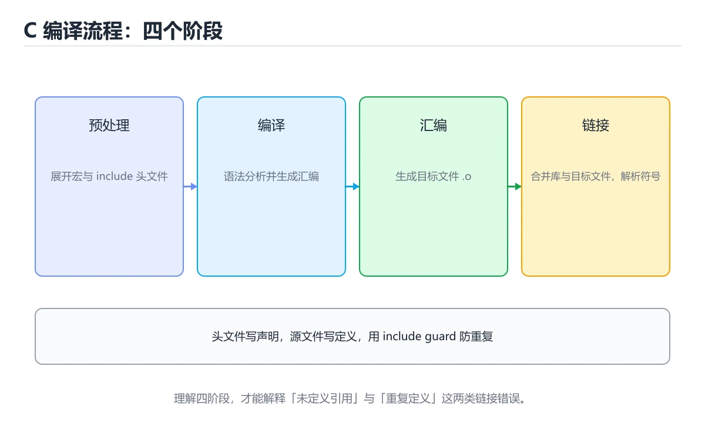
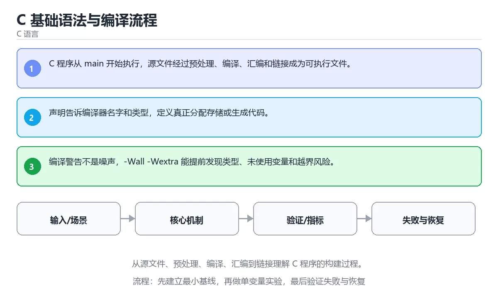

# C 基础语法与编译流程





> 内容更新时间：2026-10-06 · 学习阶段：基础 · 预计用时：25 分钟

## 本节知识框架

**课程定位**：所属分类 `c`（C 语言），课程主题 `C 基础语法与编译流程`，学习阶段 基础，建议用时 50 分钟。

本课主线：从源文件、预处理、编译、汇编到链接理解 C 程序的构建过程。

**学完本课应当能够**
- 说清 `C` 与 `编译` 的含义与区别，并各举一个正例和一个反例。
- 用本课示例验证 `链接` 的行为，记录输入、输出与失败条件。
- 遇到「只编译不打开警告」这类问题时，能说出触发条件与修复顺序。

### 复习清单

- [ ] 能不看正文复述本课核心术语，并指出一个边界或反例。
- [ ] 能运行或推演本课示例，记录输入、输出与失败现象。
- [ ] 能完成一次自测，并把错题对照错误表定位原因。

## 核心概念定义

| 术语 | 操作性定义 | 常见边界与风险 |
| --- | --- | --- |
| C | 一种接近硬件、强调手动内存管理和可移植性的编译型语言。 | 静态检查只在编译期成立，运行期输入仍需校验。 |
| 编译 | 把源代码转换成目标机器代码或中间表示，并在此过程中检查语法和类型。 | 易错：隐式转换与未初始化变量被放过；正确做法是打开 -Wall -Wextra，并把警告当错误处理。 |
| 链接 | 「C、编译、链接、main」说明变量生命周期、资源释放、并发模型和错误传播。 | 易错：多个编译单元重复定义导致链接失败；正确做法是头文件只放声明，定义集中在一个源文件里。 |
| main | 「C 程序从 main 开始执行，源文件经过预处理、编译、汇编和链接成为可执行文件。 | 静态检查只在编译期成立，运行期输入仍需校验。 |

## 原理与运行机制

### 机制总览

| 阶段 | 关注对象 | 失败时应检查 |
| --- | --- | --- |
| 输入 | C | 类型、范围、编码、版本或前置状态是否满足定义。 |
| 处理 | 编译 | 顺序、可见性、锁、路由、事务或调度规则是否被破坏。 |
| 输出 | 链接 | 结果是否可复现，错误是否被正确传播而不是被吞掉。 |

**教材衔接：核心知识**

### 1. C 程序从 main 开始执行，源文件经过预处理、编译、汇编和链接成为可执行文件。

- 关键做法：先让 C 的最小示例可复现，再加入并发或规模条件。
- 验证标准：编译 的异常路径有明确错误信息与恢复动作。

### 2. 声明告诉编译器名字和类型，定义真正分配存储或生成代码。

把这条结论放回「C 基础语法与编译流程」的完整流程里展开：

- 正文依据：能用自己的话解释：C 程序从 main 开始执行，源文件经过预处理、编译、汇编和链接成为可执行文件。
- 落地检查：把「2. 声明告诉编译器名字和类型，定义真正分配存储或生成代码。」改写成一条可执行的核对项，逐条验证输入、超时与失败路径。

### 3. 编译警告不是噪声，-Wall -Wextra 能提前发现类型、未使用变量和越界风险。

把这条结论放回「C 基础语法与编译流程」的完整流程里展开：

- 正文依据：能用自己的话解释：声明告诉编译器名字和类型，定义真正分配存储或生成代码。
- 落地检查：把「3. 编译警告不是噪声，-Wall -Wextra 能提前发现类型、未使用变量和越界风险。」改写成一条可执行的核对项，逐条验证输入、超时与失败路径。

**教材衔接：关键流程**

**教材衔接：实践路径**

**教材衔接：版本与时效**

- C23 已被主流编译器逐步支持，C17 仍是兼容性最好的基线；C 的写法要按目标标准选择。
- 编译器对未定义行为、严格别名与对齐的优化越来越激进
- 升级时重点回归位域、可变参数、内联汇编与结构体布局
- 语言参考：https://en.cppreference.com/w/c

## 典型应用场景

| 场景 | 典型输入或前提 | 期望产物 |
| --- | --- | --- |
| 学习验证 | 使用本课最小示例和 C、编译 | 能复现正文结论，并解释每一步。 |
| 工程落地 | 把「C 基础语法与编译流程」放入真实模块或服务边界 | 输出可观测、失败可定位、参数可配置。 |
| 故障排查 | 只改一个版本、规模、输入或依赖条件 | 能区分概念错误、实现错误和环境差异。 |

- **只编译不打开警告**：典型现象是隐式转换与未初始化变量被放过；正确做法是打开 -Wall -Wextra，并把警告当错误处理。
- **忽略函数返回值**：典型现象是错误被静默吞掉，故障在更远处爆发；正确做法是检查可能失败的调用，至少记录错误码并确定处理策略。
- **在头文件里定义变量**：典型现象是多个编译单元重复定义导致链接失败；正确做法是头文件只放声明，定义集中在一个源文件里。

### 最小验证场景

- 准备：保留 `text` 示例的原始输入，先记录 `C 基础语法与编译流程` 的基线输出和完整运行命令。
- 观察：先核对 调用了 `main()`，再改变一个与 `C` 相关的条件。
- 判定：新结果与 `C 基础语法与编译流程` 的基线不同不等于错误；只有当差异破坏了 `C` 的定义或错误表中的约束，才判定为失败。

### 选择与边界

- 使用 `C` 时，先满足它的定义：一种接近硬件、强调手动内存管理和可移植性的编译型语言；静态检查只在编译期成立，运行期输入仍需校验。
- 使用 `编译` 时，先满足它的定义：把源代码转换成目标机器代码或中间表示，并在此过程中检查语法和类型；易错：隐式转换与未初始化变量被放过；正确做法是打开 -Wall -Wextra，并把警告当错误处理。
- 使用 `链接` 时，先满足它的定义：「C、编译、链接、main」说明变量生命周期、资源释放、并发模型和错误传播；易错：多个编译单元重复定义导致链接失败；正确做法是头文件只放声明，定义集中在一个源文件里。
- 使用 `main` 时，先满足它的定义：「C 程序从 main 开始执行，源文件经过预处理、编译、汇编和链接成为可执行文件；静态检查只在编译期成立，运行期输入仍需校验。

## 代码/协议/SQL 示例

### 最小可验证示例

**教材衔接：语言专项实践：C 基础语法与编译流程**

### 一、工具链

| 阶段 | 推荐工具 | 验收标准 |
| --- | --- | --- |
| 编译 | gcc/clang -Wall -Wextra -Werror | 命令可复现且错误能被定位 |
| 调试 | gdb + core dump | 命令可复现且错误能被定位 |
| 内存检查 | AddressSanitizer / Valgrind | 命令可复现且错误能被定位 |
| 构建发布 | Makefile/CMake + 静态或动态链接 | 命令可复现且错误能被定位 |

### 四、发布检查

**教材衔接：最小可运行示例**

下面示例用于验证 C 的最小输入、处理和输出。先原样运行，再只修改一个值：

```c
#include <stdio.h>

int main(void) {
    int value = 7;
    printf("%d squared is %d\n", value, value * value);
    return 0;
}
```

**教材衔接：预期输出**

```text
7 squared is 49
```

## 时间/空间复杂度或性能分析

**性能关注点（C 基础语法与编译流程）**：内存布局与系统调用是主要成本：记录运行时间、内存占用与系统调用次数。

**本课特有开销（C 基础语法与编译流程 · C）**：并发度提高后要观察是否出现拐点：延迟上升而吞吐不增，说明瓶颈已转移。

**测量方法**：以 `C 基础语法与编译流程` 的 `C` 场景为对象，固定输入跑一遍记录基线，再把规模或并发度提高一个数量级复测；两次结果的差值与波动范围才是结论依据。

## 常见误区与易错点

| 容易写错的做法 | 实际现象 | 原因与正确做法 |
| --- | --- | --- |
| 只编译不打开警告 | 隐式转换与未初始化变量被放过。 | 打开 -Wall -Wextra，并把警告当错误处理。 |
| 忽略函数返回值 | 错误被静默吞掉，故障在更远处爆发。 | 检查可能失败的调用，至少记录错误码并确定处理策略。 |
| 在头文件里定义变量 | 多个编译单元重复定义导致链接失败。 | 头文件只放声明，定义集中在一个源文件里。 |

### 现场 1：只编译不打开警告

**症状**：隐式转换与未初始化变量被放过。

**根因与修复**：打开 -Wall -Wextra，并把警告当错误处理。

**自检**：在本课示例里复现「只编译不打开警告」，改成打开 -Wall -Wextra，并把警告当错误处理后重跑；如果症状消失且失败路径按预期变化，说明定位正确。

### 现场 2：忽略函数返回值

**症状**：错误被静默吞掉，故障在更远处爆发。

**根因与修复**：检查可能失败的调用，至少记录错误码并确定处理策略。

**自检**：在本课示例里复现「忽略函数返回值」，改成检查可能失败的调用，至少记录错误码并确定处理策略后重跑；如果症状消失且失败路径按预期变化，说明定位正确。

### 现场 3：在头文件里定义变量

**症状**：多个编译单元重复定义导致链接失败。

**根因与修复**：头文件只放声明，定义集中在一个源文件里。

**自检**：在本课示例里复现「在头文件里定义变量」，改成头文件只放声明，定义集中在一个源文件里后重跑；如果症状消失且失败路径按预期变化，说明定位正确。

## 与其他知识点的关系

| 关系 | 课程 | 为什么 |
| --- | --- | --- |
| 关联 | 《C 类型、运算符与转换》 | 用于横向比较或把本课结论迁移到相邻主题。 |
| 关联 | 《环境与编译流程》 | 用于横向比较或把本课结论迁移到相邻主题。 |
| 关联 | 《编译与程序运行原理》 | 用于横向比较或把本课结论迁移到相邻主题。 |
| 关联 | 《实战：追踪程序的全生命周期》 | 用于横向比较或把本课结论迁移到相邻主题。 |
| 前置顺序 | 《C 函数入门》 | 同分类中安排在本课之前，建议先完成其自测。 |
| 后续顺序 | 《C 类型、运算符与转换》 | 同分类中安排在本课之后，会继续使用本课术语。 |

**教材衔接：复习与迁移**

## 自测题与参考答案

> 先独立作答，再对照参考答案；答案都能在本课正文、术语表或错误表里找到依据。

### 自测 1（概念复述）

不看正文，写出 `C` 的操作性定义，并说明它与 `编译` 的区别。

**参考答案**：一种接近硬件、强调手动内存管理和可移植性的编译型语言。

`编译` 的定位是：把源代码转换成目标机器代码或中间表示，并在此过程中检查语法和类型；两者的差别要从适用对象与失败模式上说明。

### 自测 2（排错）

本课错误表记录了「只编译不打开警告」这类做法。请写出它会出现的现象、根因，以及修复顺序。

**参考答案**：现象是隐式转换与未初始化变量被放过；正确做法是打开 -Wall -Wextra，并把警告当错误处理。修复时先复现现象并保留证据，再改动一处假设重跑，确认现象消失。

### 自测 3（动手验证）

运行本课的 `text` 示例，改动其中一个输入后重新运行，记录输出与错误信息。

**参考答案**：正常输入下 `text` 示例应当复现正文给出的结果；改动输入后，如果结果改变或报错，先核对它是否满足 `C 基础语法与编译流程` 中`C` 的适用范围，再检查错误表里是否有同类现象。

### 自测 4（代码阅读）

阅读本课开头的 `text` 示例，说明它体现了`C` 的哪一条性质，并指出改动哪个输入会让这条性质不再成立。

**参考答案**：`C` 的定义是 一种接近硬件、强调手动内存管理和可移植性的编译型语言，示例正是在实现这条定义。改动与 `C` 有关的一个输入后，如果结果不再符合 `C 基础语法与编译流程` 的正文描述，就说明该性质只在当前前提成立。

### 自测 5（迁移）

把 `C 基础语法与编译流程` 的方法迁移到自己的项目：围绕 `C` 写出一个与错误表同类的风险点，并说明触发条件和检验方式。

**参考答案**：例如「在头文件里定义变量」，它会导致多个编译单元重复定义导致链接失败；检验方式是按头文件只放声明，定义集中在一个源文件里改一处再复现，确认现象消失且没有引入新的失败分支。

### 自测 6（对比）

用一个表格对比 `C` 与 `编译`：各写一行适用场景、一行失败表现。

**参考答案**：`C` 的定义是一种接近硬件、强调手动内存管理和可移植性的编译型语言；`编译` 的定义是把源代码转换成目标机器代码或中间表示，并在此过程中检查语法和类型。两者的失败表现分别对应本课错误表里与本术语相关的行。

### 自测 7（排错顺序）

面对「只编译不打开警告」引发的问题，请把“复现 隐式转换与未初始化变量被放过 → 保留证据 → 打开 -Wall -Wextra，并把警告当错误处理 → 回归验证”四步写成可执行的检查清单。

**参考答案**：第一步按隐式转换与未初始化变量被放过复现；第二步记录输入、版本与完整报错；第三步按打开 -Wall -Wextra，并把警告当错误处理只改一处；第四步重跑并确认失败路径也按预期变化。

### 自测 8（边界判断）

针对 `main`，分别写出“可以使用”的条件和“结论不再成立”的条件。

**参考答案**：静态检查只在编译期成立，运行期输入仍需校验。 同时要把 `main` 的定义 「C 程序从 main 开始执行，源文件经过预处理、编译、汇编和链接成为可执行文件 与实际输入逐项对照。

### 自测 9（机制重建）

不看正文，按输入、转换、输出、验证四段重建 `C` → `编译` → `链接` → `main` 的作用链。

**参考答案**：起点是 `C` 的定义 一种接近硬件、强调手动内存管理和可移植性的编译型语言；中间每一步都保留可观察状态；终点由 `main` 检查，失败时回到错误表定位第一个偏离定义的步骤。

### 自测 10（综合排错）

在 `C 基础语法与编译流程` 中，现象是 多个编译单元重复定义导致链接失败。请围绕 在头文件里定义变量 写出最小复现、关键证据、修复动作和回归验证，并说明为什么不能只凭一次运行下结论。

**参考答案**：先复现 在头文件里定义变量，记录输入与完整错误；再按 头文件只放声明，定义集中在一个源文件里 只改一处。回归时同时跑正常路径和边界路径，只有两次结果都可解释，才把修复视为完成。

### 自测 11（一分钟复述）

用每分钟约 200 字的速度复述 `C 基础语法与编译流程`：先给主问题，再按顺序说出 `C`、`编译`、`链接`、`main`，最后给一个失败案例。

**自评标准**：主问题必须对应 从源文件、预处理、编译、汇编到链接理解 C 程序的构建过程；每个术语都要能接上一句定义或边界；失败案例必须写成可观察现象，不能用“可能有风险”代替证据。

## 延伸阅读

想更直观地理解本课概念？推荐参阅以下图解专题：

- [图解内存布局：栈、堆与引用](visual_memory_layout.md)

## 术语速查

| 术语 | 一句话说明 |
| --- | --- |
| `C` | 一种接近硬件、强调手动内存管理和可移植性的编译型语言。 |
| `编译` | 把源代码转换成目标机器代码或中间表示，并在此过程中检查语法和类型。 |
| `链接` | 「C、编译、链接、main」说明变量生命周期、资源释放、并发模型和错误传播。 |
| `main` | 「C 程序从 main 开始执行，源文件经过预处理、编译、汇编和链接成为可执行文件。 |

**术语关系**：`C`（一种接近硬件、强调手动内存管理和可移植性的编译型语言） → `编译`（把源代码转换成目标机器代码或中间表示） → `链接`（「C、编译、链接、main」说明变量生命周期、资源释放、并发模型和错误传播） → `main`（「C 程序从 main 开始执行）。

## 考点精讲

`C 基础语法与编译流程` 的题库有 6 道题，下面逐题给出题干、正确项与判断依据：先自己作答，再核对正确项，最后回到正文对应小节复核。

### 考点 1：第 1 题

- **题目**：在 `C 基础语法与编译流程` 里，与 `C` 有关的说法中，哪一项最符合从源文件、预处理、编译、汇编到链接理解 C 程序的构建过程。？
- **正确项**：C 程序从 main 开始执行，源文件经过预处理，编译
- **判断依据**：本题正确项是「C 程序从 main 开始执行，源文件经过预处理，编译」。术语 C（C 基础语法与编译流程）：一种接近硬件、强调手动内存管理和可移植性的编译型语言，本题取「C 程序从 main 开始执行，源文件经过预处理，编译」这条。易错点是只编译不打开警告，会造成隐式转换与未初始化变量被放过，改法是打开 -Wall -Wextra，并把警告当错误处理。

### 考点 2：第 2 题

- **题目**：阅读 `C 基础语法与编译流程` 中围绕 `C` 的代码；课程主线是从源文件、预处理、编译、汇编到链接理解 C 程序的构建过程。下面哪项判断最准确？
- **正确项**：从源文件、预处理、编译、汇编到链接理解 C 程序的构建过程。
- **判断依据**：本题正确项是「从源文件、预处理、编译、汇编到链接理解 C 程序的构建过程」。术语 C（C 基础语法与编译流程）：一种接近硬件、强调手动内存管理和可移植性的编译型语言，本题取「从源文件、预处理、编译、汇编到链接理解 C 程序的构建过程」这条。易错点是忽略函数返回值，会造成错误被静默吞掉，故障在更远处爆发，改法是检查可能失败的调用，至少记录错误码并确定处理策略。

### 考点 3：第 3 题

- **题目**：在 `C 基础语法与编译流程` 里，与 `C` 有关的说法中，哪一项最符合从源文件、预处理、编译、汇编到链接理解 C 程序的构建过程。？（C 基础语法与编译流程·C 语言 第 3 题）
- **正确项**：编译警告不是噪声，-Wall -Wextra 能提前发现类型
- **判断依据**：本题正确项是「编译警告不是噪声，-Wall -Wextra 能提前发现类型」。术语 C（C 基础语法与编译流程）：一种接近硬件、强调手动内存管理和可移植性的编译型语言，本题取「编译警告不是噪声，-Wall -Wextra 能提前发现类型」这条。易错点是在头文件里定义变量，会造成多个编译单元重复定义导致链接失败，改法是头文件只放声明，定义集中在一个源文件里。

### 考点 4：第 4 题

- **题目**：`C 基础语法与编译流程` 的主线是：从源文件、预处理、编译、汇编到链接理解 C 程序的构建过程。下面哪一项与这条主线一致？
- **正确项**：从源文件、预处理、编译、汇编到链接理解 C 程序的构建过程。
- **判断依据**：本题正确项是「从源文件、预处理、编译、汇编到链接理解 C 程序的构建过程」。术语 C（C 基础语法与编译流程）：一种接近硬件、强调手动内存管理和可移植性的编译型语言，本题取「从源文件、预处理、编译、汇编到链接理解 C 程序的构建过程」这条。易错点是只编译不打开警告，会造成隐式转换与未初始化变量被放过，改法是打开 -Wall -Wextra，并把警告当错误处理。

### 考点 5：第 5 题

- **题目**：填空：补齐下面这段术语说明中的空缺。课程 `从源文件、预处理、编译、汇编到链接理解 C 程序的构建过程。`，这段说明是：「C 程序从 `____` 开始执行，源文件经过预处理、编译、汇编和链接成为可执行文件。空缺处应填哪个术语？
- **正确项**：main
- **判断依据**：涉及术语 C：一种接近硬件、强调手动内存管理和可移植性的编译型语言。易错点：只编译不打开警告会造成隐式转换与未初始化变量被放过。正确做法：打开 -Wall -Wextra，并把警告当错误处理。判断时先确认输入和适用范围，对照 `C`、`编译`、`链接`、`main` 复现一次，最后把错误表现与正确做法逐项对照。

### 考点 6：第 6 题

- **题目**：关于 `C`，下列哪些说法与 `C 基础语法与编译流程` 的正文一致？判断时以从源文件、预处理、编译、汇编到链接理解 C 程序的构建过程。为主线。（多选）
- **正确项**：C 程序从 main 开始执行，源文件经过预处理、编译、汇编和链接成为可执行文件；声明告诉编译器名字和类型，定义真正分配存储或生成代码
- **判断依据**：按《C 基础语法与编译流程》的正文口径，本题要同时选中「C 程序从 main 开始执行，源文件经过预处理、编译、汇编和链接成为可执行文件。」、「声明告诉编译器名字和类型，定义真正分配存储或生成代码。」，漏掉任一项都算没答全。术语 C（C 基础语法与编译流程）：一种接近硬件、强调手动内存管理和可移植性的编译型语言。易错点是在头文件里定义变量，会造成多个编译单元重复定义导致链接失败，改法是头文件只放声明，定义集中在一个源文件里。

### 考点 7：`C`

- **要点**：一种接近硬件、强调手动内存管理和可移植性的编译型语言。
- **C 的边界**：静态检查只在编译期成立，运行期输入仍需校验。

### 考点 8：`编译`

- **要点**：把源代码转换成目标机器代码或中间表示，并在此过程中检查语法和类型。
- **编译 的边界**：易错：隐式转换与未初始化变量被放过；正确做法是打开 -Wall -Wextra，并把警告当错误处理。

### 考点 9：`链接`

- **要点**：「C、编译、链接、main」说明变量生命周期、资源释放、并发模型和错误传播。
- **链接 的边界**：易错：多个编译单元重复定义导致链接失败；正确做法是头文件只放声明，定义集中在一个源文件里。

### 考点 10：`main`

- **要点**：「C 程序从 main 开始执行，源文件经过预处理、编译、汇编和链接成为可执行文件。
- **main 的边界**：静态检查只在编译期成立，运行期输入仍需校验。

### 考点 11：排错——只编译不打开警告

- **现象**：隐式转换与未初始化变量被放过。
- **处理**：打开 -Wall -Wextra，并把警告当错误处理。

### 考点 12：排错——忽略函数返回值

- **现象**：错误被静默吞掉，故障在更远处爆发。
- **处理**：检查可能失败的调用，至少记录错误码并确定处理策略。

### 考点 13：综合辨析——`C` 与 `main`

- **辨析点**：`C` 的定义是 一种接近硬件、强调手动内存管理和可移植性的编译型语言；`main` 的定义是 「C 程序从 main 开始执行，源文件经过预处理、编译、汇编和链接成为可执行文件。
- **答题要求**：面对 `C 基础语法与编译流程` 的题目，先判断描述的是 `C` 还是 `main`，再归到对应定义，最后写出一个会让该定义失效的边界输入。

### 考点 14：排错评分点

- **现象分**：能写出 隐式转换与未初始化变量被放过，而不是只写“程序有错”。
- **证据分**：保留触发 只编译不打开警告 的输入、版本和错误原文。
- **修复分**：按 打开 -Wall -Wextra，并把警告当错误处理 只改一处，并同时回归正常路径与边界路径。

## 内容元数据

- 内容版本：v2.0
- 最后更新：2026-10-06
- 学习阶段：基础
- 适用环境：C11 / GCC 或 Clang；本课聚焦 C。
- 内容来源：内置结构化课程与工程实践整理
- 相关主题：C、编译、链接、main
- 质量版本：P0 测验标准 + P1 覆盖扩展 + P2 体验补全

## 参考资料与复核

- 最后复核：2026-10-04
- 下次复核：2026-11-17
- 复核范围：版本兼容、API 行为、安全建议与工程实践
- 来源性质：官方文档、标准或权威教材；本课核对关键词：C、编译、链接、main。

| 参考资料 | 本课用途 |
| --- | --- |
| [GCC 文档](https://gcc.gnu.org/onlinedocs/) | 编译、链接与警告选项 |
| [GNU Make](https://www.gnu.org/software/make/manual/) | Makefile 与构建依赖 |
| [cppreference C 标准库](https://en.cppreference.com/w/c) | C 标准库 API |

| [本课术语索引：C 基础语法与编译流程](#核心概念定义) | 按本课输入、术语边界和错误表现逐项核对 |
> 「C 基础语法与编译流程」的链接用于离线阅读后的延伸核对；App 不会自动联网。