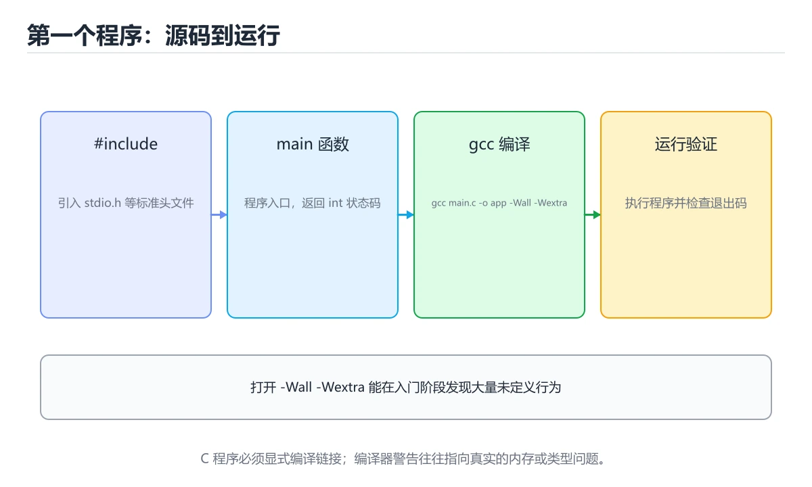
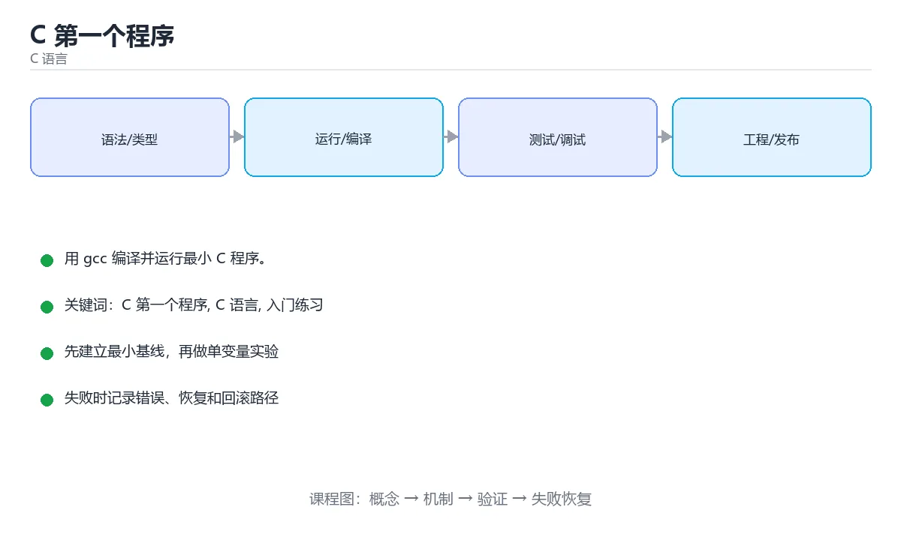

# C 第一个程序

> 内容更新时间：2026-10-06 · 学习阶段：入门 · 预计用时：30 分钟





## 本节知识框架

**课程定位**：所属分类 `c`（C 语言），课程主题 `C 第一个程序`，学习阶段 入门，建议用时 50 分钟。

本课主线：用 gcc 编译并运行最小 C 程序。

**学完本课应当能够**
- 说清 `main 函数` 与 `编译` 的含义与区别，并各举一个正例和一个反例。
- 用本课示例验证 `printf` 的行为，记录输入、输出与失败条件。
- 遇到「分号缺失或括号不配对」这类问题时，能说出触发条件与修复顺序。

### 复习清单

- [ ] 能不看正文复述本课核心术语，并指出一个边界或反例。
- [ ] 能运行或推演本课示例，记录输入、输出与失败现象。
- [ ] 能完成一次自测，并把错题对照错误表定位原因。

## 核心概念定义

| 术语 | 操作性定义 | 常见边界与风险 |
| --- | --- | --- |
| main 函数 | C 程序的入口，操作系统从这里开始执行。 | 入口名区分大小写，写成 mian 或 Main 会在链接阶段报找不到入口；返回值随意还会让脚本判断不出成败。 |
| 编译 | 把 .c 源文件翻译成机器码可执行文件的过程，如 gcc hello.c -o hello。 | 易错：编译错误指向的位置与实际错误不一致；正确做法是从第一条错误开始改，按代码块检查括号配对。 |
| printf | 按格式串把内容输出到标准输出。 | 忘了 `#include <stdio.h>` 会报 implicit declaration；格式化参数与实参不匹配属未定义行为，漏掉 `\n` 则光标停在行尾。 |
| 语句与分号 | C 的每条语句以分号结束，漏写分号会直接编译报错。 | 静态检查只在编译期成立，运行期输入仍需校验。 |
| 数组 | 数组名在大多数表达式中退化为首元素指针，但 sizeof 和取地址时不是 | 越界、悬垂引用与释放顺序会破坏结论，必须在边界输入下复验。 |
| 字符串 | 字符串函数要保证目标缓冲区足够大，优先使用带长度限制的函数，防止溢出 | 长度不会随数组传进函数，因为参数里的数组声明等价于指针；不额外传长度就判断不出边界，还要给结尾的 `\0` 留一个字节。 |

## 原理与运行机制

### 机制总览

**教材衔接：一句话入门**

用 gcc 编译并运行最小 C 程序。

**教材衔接：C 语言基础机制速览**

### 编译、链接与程序结构

C 源码经过预处理、编译、汇编和链接生成可执行文件。`#include` 引入声明，函数定义提供实现，链接器负责解析外部符号。`main` 返回 0 表示成功，非 0 表示失败。理解头文件、声明与定义的区别，能区分“找不到函数声明”的编译错误和“找不到符号”的链接错误。

### 类型、变量与内存表示

C 是静态类型语言，基本类型的大小依赖平台，使用 `sizeof` 而不是硬编码字节数。整数分为有符号和无符号两类，混合运算会发生转换；无符号回绕有定义，有符号溢出通常是未定义行为。浮点数遵循 IEEE 754 近似表示，比较时使用容差。字符类型、字符串和数组的关系需要清楚：字符串以 `\0` 结尾，`char` 数组不一定是字符串。

### 指针、数组与字符串

指针保存地址，`*` 解引用，`&` 取地址；指针算术按所指类型大小移动。数组名在大多数表达式中退化为首元素指针，但 `sizeof` 和取地址时不是。函数参数中的数组声明等价于指针，长度信息会丢失，必须额外传长度。字符串函数要保证目标缓冲区足够大，优先使用带长度限制的函数，防止溢出。

### 函数、结构体与内存管理

函数原型要在调用前可见，参数按值传递；要修改调用方变量就传指针。结构体可以按值复制，较大结构体通常传指针；`struct` 的内存可能有填充，`sizeof` 不一定等于成员大小之和。`malloc/free`、`calloc`、`realloc` 必须成对使用，释放后指针置空，不能访问已释放内存。栈内存自动回收但生命周期受作用域限制，返回局部数组地址是典型错误。

### 预处理器、未定义行为与调试

宏在预处理阶段替换文本，要加括号并避免多次求值副作用；`#include` 保护防止重复包含。未定义行为包括越界访问、解引用空指针、未初始化读取、有符号溢出和不匹配的格式化参数，编译器优化后可能产生难以预测的结果。使用编译器警告、静态分析、sanitizer 和调试器定位内存问题；测试要覆盖空输入、边界长度、内存分配失败和错误路径。

**教材衔接：版本与时效**

- 把标准版本写进构建配置，避免 C 语言 在不同环境下编译结果不一致。
- 编译器对未定义行为、严格别名与对齐的优化越来越激进
- 升级时重点回归位域、可变参数、内联汇编与结构体布局
- 语言参考：https://en.cppreference.com/w/c

### 一、工具链

| 阶段 | 推荐工具 | 验收标准 |
| --- | --- | --- |
| 编译 | gcc/clang -Wall -Wextra -Werror | 命令可复现且错误能被定位 |
| 调试 | gdb + core dump | 命令可复现且错误能被定位 |
| 内存检查 | AddressSanitizer / Valgrind | 命令可复现且错误能被定位 |
| 构建发布 | Makefile/CMake + 静态或动态链接 | 命令可复现且错误能被定位 |

### 二、运行时与内存模型

「C 第一个程序」的「二、运行时与内存模型」一节补全如下：

- 定位：这一节说明二、运行时与内存模型在「C 第一个程序」知识体系里的位置。
- 检查点：固定版本与输入重跑《C 第一个程序》，记录两次差异并定位不稳定条件。
- 自检：能否用一个最小例子解释二、运行时与内存模型？

## 典型应用场景

**教材衔接：代码实验：把示例跑成证据**

### 实验一：建立基线

```c
#include <stdio.h>

int main(void) {
    printf("hello from C\n");
    return 0;
}
```

### 实验二：只改一个输入

沿用「C 第一个程序」的最小示例做一次单变量实验：

做完后用一句话写出「C 第一个程序」的结论：输入怎么变，结果才怎么变。

### 实验三：制造一个可控错误

删掉 C 语言 相关的一处必要写法，观察错误在哪一层出现，再恢复代码确认基线仍然可运行。

### 实验四：用三句话复述

1. 在「C 第一个程序」里，printf 接受哪些输入，非法输入应该在哪里被挡住？
2. C 第一个程序 按什么顺序处理输入，在哪一步产生了状态变化或副作用？
3. 输出如何验证，失败时第一条可观察证据是什么？

- **分号缺失或括号不配对**：典型现象是编译错误指向的位置与实际错误不一致；正确做法是从第一条错误开始改，按代码块检查括号配对。
- **main 返回值随意**：典型现象是脚本与流水线无法判断成功还是失败；正确做法是正常结束返回 0，失败返回非零并写入错误输出。
- **改完不重新编译就运行**：典型现象是运行的还是上一次生成的可执行文件；正确做法是固定编译命令与输出路径，每次改动后重新构建。

### 最小验证场景

- 准备：保留 `c` 示例的原始输入，先记录 `C 第一个程序` 的基线输出和完整运行命令。
- 观察：先核对 调用了 `main()`，再改变一个与 `main 函数` 相关的条件。
- 判定：新结果与 `C 第一个程序` 的基线不同不等于错误；只有当差异破坏了 `main 函数` 的定义或错误表中的约束，才判定为失败。

### 选择与边界

- 使用 `main 函数` 时，先满足它的定义：C 程序的入口，操作系统从这里开始执行。
- 使用 `编译` 时，先满足它的定义：把 .c 源文件翻译成机器码可执行文件的过程，如 gcc hello.c -o hello；易错：编译错误指向的位置与实际错误不一致；正确做法是从第一条错误开始改，按代码块检查括号配对。
- 使用 `printf` 时，先满足它的定义：按格式串把内容输出到标准输出。
- 使用 `语句与分号` 时，先满足它的定义：C 的每条语句以分号结束，漏写分号会直接编译报错；静态检查只在编译期成立，运行期输入仍需校验。
- 使用 `数组` 时，先满足它的定义：数组名在大多数表达式中退化为首元素指针，但 sizeof 和取地址时不是；越界、悬垂引用与释放顺序会破坏结论，必须在边界输入下复验。

## 代码/协议/SQL 示例

### 最小可验证示例

**教材衔接：最小示例**

**教材衔接：预期输出**

```text
hello from C
```

**教材衔接：零基础通俗讲：C 语言第一个程序**

### 一句话说清它是什么

一个 C 程序必须有一个 main 函数，程序从它开始执行；#include 把工具说明书提前拿进来，printf 负责往屏幕写字。

### 用生活比喻理解

把 main 想成大楼唯一的正门：不管楼里有多少房间，进程每次都是从这道门进来、从这道门出去。include 则是开工前先领的工具箱，没领到工具箱，后面的螺丝刀就用不了。

### 完整可运行代码

```c
#include <stdio.h>

int main(void) {
    printf("你好，C 语言\n");
    return 0;
}
```

### 逐行拆开看

- `#include <stdio.h>` 是预处理指令，在真正编译前把标准输入输出库的声明贴进来，`printf` 的用法就来自这里。
- `int main(void)` 定义主函数：`int` 表示它会给操作系统返回一个整数，`void` 表示它不接受参数。
- `{` 和 `}` 圈出函数体，所有属于 main 的语句都写在这对花括号之间。
- `printf("你好，C 语言\n");` 把引号里的内容打印出来；`\n` 是换行符，不加它光标会停在行尾。
- 每个语句结尾的分号不能省，它是 C 用来判断「这句话说完了」的标记。
- `return 0;` 把 0 交还给操作系统，惯例上 0 表示程序正常结束，非 0 表示出错。

### 把程序跑一遍

- 编译：`gcc hello.c -o hello`，把源码翻译成可执行文件；编译失败会直接报错行号和原因。
- 运行：Linux 或 macOS 执行 `./hello`，Windows 执行 `hello.exe`。
- 程序进入 main，执行 printf，屏幕出现 `你好，C 语言` 并换行。
- main 返回 0，进程结束；在 Linux 终端可以用 echo 加问号查看上一条命令的退出码，Windows 用 echo %ERRORLEVEL%。

### 新手最容易踩的坑

- 忘记 `#include <stdio.h>`：编译器会警告 `implicit declaration of printf`，新标准下直接报错。
- 把 `main` 拼成 `mian` 或 `Main`：C 区分大小写，链接阶段会报找不到入口。
- 语句末尾漏分号：报错行通常指向下一行，实际错误在上一行结尾。
- 忘了 `return 0;`：现代标准会默认返回 0，但显式写出来更清楚，也能避免老编译器告警。
- 用中文标点写代码：全角分号、全角括号都不是合法符号，编译器会给出难以理解的报错。

### 动手练一练

- 把输出的文字换成自我介绍，重新编译运行，确认输出变化。
- 在 printf 后面再加一行 printf，观察两次输出是否会换行。
- 故意删掉第一行的 `#include`，记录完整的编译错误，体会「报错要看第一条」。

### 本课速查卡

把下面八行抄进自己的笔记，复习时只看这一页就能回忆整课：

| 复习项 | 本课要点 |
| --- | --- |
| 核心结论 | 一个 C 程序必须有一个 main 函数，程序从它开始执行；#include 把工具说明书提前拿进来，printf 负责往屏幕写字。 |
| 最少要写的代码 | `int main(void) {` |
| 正确做法 | 编译：`gcc hello.c -o hello`，把源码翻译成可执行文件；编译失败会直接报错行号和原因。 |
| 最常见的错误 | 忘记 `#include <stdio.h>`：编译器会警告 `implicit declaration of printf`，新标准下直接报错。 |
| 出错先查什么 | 先读第一条报错信息，再回到最小示例只改一个地方 |
| 怎么确认学会了 | 把输出的文字换成自我介绍，重新编译运行，确认输出变化。 |
| 和别的知识点的关系 | 本课打下的语法与思维方式会被后面每一课反复用到 |
| 接下来做什么 | 合上教程，凭记忆把上面的最小代码重写一遍再运行 |

**运行方式**：运行 `C 第一个程序` 的示例时，用 `gcc 文件名.c -o demo` 编译后运行；注意返回值与内存检查。

## 时间/空间复杂度或性能分析

**性能关注点（C 第一个程序）**：内存布局与系统调用是主要成本：记录运行时间、内存占用与系统调用次数。

**本课特有开销（C 第一个程序 · C 第一个程序）**：小文件看元数据开销，大文件看吞吐，两者要分别测量。

**测量方法**：以 `C 第一个程序` 的 `C 第一个程序` 场景为对象，固定输入跑一遍记录基线，再把规模或并发度提高一个数量级复测；两次结果的差值与波动范围才是结论依据。

## 常见误区与易错点

| 容易写错的做法 | 实际现象 | 原因与正确做法 |
| --- | --- | --- |
| 分号缺失或括号不配对 | 编译错误指向的位置与实际错误不一致。 | 从第一条错误开始改，按代码块检查括号配对。 |
| main 返回值随意 | 脚本与流水线无法判断成功还是失败。 | 正常结束返回 0，失败返回非零并写入错误输出。 |
| 改完不重新编译就运行 | 运行的还是上一次生成的可执行文件。 | 固定编译命令与输出路径，每次改动后重新构建。 |

### 现场 1：分号缺失或括号不配对

**症状**：编译错误指向的位置与实际错误不一致。

**根因与修复**：从第一条错误开始改，按代码块检查括号配对。

**自检**：在本课示例里复现「分号缺失或括号不配对」，改成从第一条错误开始改，按代码块检查括号配对后重跑；如果症状消失且失败路径按预期变化，说明定位正确。

### 现场 2：main 返回值随意

**症状**：脚本与流水线无法判断成功还是失败。

**根因与修复**：正常结束返回 0，失败返回非零并写入错误输出。

**自检**：在本课示例里复现「main 返回值随意」，改成正常结束返回 0，失败返回非零并写入错误输出后重跑；如果症状消失且失败路径按预期变化，说明定位正确。

### 现场 3：改完不重新编译就运行

**症状**：运行的还是上一次生成的可执行文件。

**根因与修复**：固定编译命令与输出路径，每次改动后重新构建。

**自检**：在本课示例里复现「改完不重新编译就运行」，改成固定编译命令与输出路径，每次改动后重新构建后重跑；如果症状消失且失败路径按预期变化，说明定位正确。

## 与其他知识点的关系

**教材衔接：复习与迁移**

## 自测题与参考答案

> 先独立作答，再对照参考答案；答案都能在本课正文、术语表或错误表里找到依据。

### 自测 1（概念复述）

不看正文，写出 `main 函数` 的操作性定义，并说明它与 `编译` 的区别。

**参考答案**：C 程序的入口，操作系统从这里开始执行。

`编译` 的定位是：把 .c 源文件翻译成机器码可执行文件的过程，如 gcc hello.c -o hello；两者的差别要从适用对象与失败模式上说明。

### 自测 2（排错）

本课错误表记录了「分号缺失或括号不配对」这类做法。请写出它会出现的现象、根因，以及修复顺序。

**参考答案**：现象是编译错误指向的位置与实际错误不一致；正确做法是从第一条错误开始改，按代码块检查括号配对。修复时先复现现象并保留证据，再改动一处假设重跑，确认现象消失。

### 自测 3（动手验证）

运行本课的 `c` 示例，把其中的 `"hello from C\n"` 换成一个边界值后重新运行，记录输出与错误信息。

**参考答案**：正常输入下 `c` 示例应当复现正文给出的结果；把 `"hello from C\n"` 换成边界值后，如果结果改变或报错，先核对它是否满足 `C 第一个程序` 中`main 函数` 的适用范围，再检查错误表里是否有同类现象。

### 自测 4（代码阅读）

阅读本课开头的 `c` 示例，说明它体现了`main 函数` 的哪一条性质，并指出改动哪个输入会让这条性质不再成立。

**参考答案**：`main 函数` 的定义是 C 程序的入口，操作系统从这里开始执行，示例正是在实现这条定义。改动与 `main 函数` 有关的一个输入后，如果结果不再符合 `C 第一个程序` 的正文描述，就说明该性质只在当前前提成立。

### 自测 5（迁移）

把 `C 第一个程序` 的方法迁移到自己的项目：围绕 `main 函数` 写出一个与错误表同类的风险点，并说明触发条件和检验方式。

**参考答案**：例如「改完不重新编译就运行」，它会导致运行的还是上一次生成的可执行文件；检验方式是按固定编译命令与输出路径，每次改动后重新构建改一处再复现，确认现象消失且没有引入新的失败分支。

### 自测 6（对比）

用一个表格对比 `main 函数` 与 `编译`：各写一行适用场景、一行失败表现。

**参考答案**：`main 函数` 的定义是C 程序的入口，操作系统从这里开始执行；`编译` 的定义是把 .c 源文件翻译成机器码可执行文件的过程，如 gcc hello.c -o hello。两者的失败表现分别对应本课错误表里与本术语相关的行。

### 自测 7（排错顺序）

面对「分号缺失或括号不配对」引发的问题，请把“复现 编译错误指向的位置与实际错误不一致 → 保留证据 → 从第一条错误开始改，按代码块检查括号配对 → 回归验证”四步写成可执行的检查清单。

**参考答案**：第一步按编译错误指向的位置与实际错误不一致复现；第二步记录输入、版本与完整报错；第三步按从第一条错误开始改，按代码块检查括号配对只改一处；第四步重跑并确认失败路径也按预期变化。

### 自测 8（边界判断）

针对 `字符串`，分别写出“可以使用”的条件和“结论不再成立”的条件。

**参考答案**：要把 `字符串` 的定义 字符串函数要保证目标缓冲区足够大，优先使用带长度限制的函数，防止溢出 与实际输入逐项对照。

### 自测 9（机制重建）

不看正文，按输入、转换、输出、验证四段重建 `main 函数` → `编译` → `printf` → `语句与分号` 的作用链。

**参考答案**：起点是 `main 函数` 的定义 C 程序的入口，操作系统从这里开始执行；中间每一步都保留可观察状态；终点由 `字符串` 检查，失败时回到错误表定位第一个偏离定义的步骤。

### 自测 10（综合排错）

在 `C 第一个程序` 中，现象是 运行的还是上一次生成的可执行文件。请围绕 改完不重新编译就运行 写出最小复现、关键证据、修复动作和回归验证，并说明为什么不能只凭一次运行下结论。

**参考答案**：先复现 改完不重新编译就运行，记录输入与完整错误；再按 固定编译命令与输出路径，每次改动后重新构建 只改一处。回归时同时跑正常路径和边界路径，只有两次结果都可解释，才把修复视为完成。

### 自测 11（一分钟复述）

用每分钟约 200 字的速度复述 `C 第一个程序`：先给主问题，再按顺序说出 `main 函数`、`编译`、`printf`、`语句与分号`，最后给一个失败案例。

**自评标准**：主问题必须对应 用 gcc 编译并运行最小 C 程序；每个术语都要能接上一句定义或边界；失败案例必须写成可观察现象，不能用“可能有风险”代替证据。

## 术语速查

| 术语 | 一句话说明 |
| --- | --- |
| `main 函数` | C 程序的入口，操作系统从这里开始执行。 |
| `编译` | 把 .c 源文件翻译成机器码可执行文件的过程，如 gcc hello.c -o hello。 |
| `printf` | 按格式串把内容输出到标准输出。 |
| `语句与分号` | C 的每条语句以分号结束，漏写分号会直接编译报错。 |
| `数组` | 数组名在大多数表达式中退化为首元素指针，但 sizeof 和取地址时不是。 |
| `字符串` | 字符串函数要保证目标缓冲区足够大，优先使用带长度限制的函数，防止溢出。 |

**术语关系**：`main 函数`（C 程序的入口） → `编译`（把 .c 源文件翻译成机器码可执行文件的过程） → `printf`（按格式串把内容输出到标准输出） → `语句与分号`（C 的每条语句以分号结束）。

## 考点精讲

`C 第一个程序` 的题库有 5 道题，下面逐题给出题干、正确项与判断依据：先自己作答，再核对正确项，最后回到正文对应小节复核。

### 考点 1：第 1 题

- **题目**：#include <stdio.h> 这行代码在 C 程序里起什么作用？
- **正确项**：引入标准输入输出的函数声明，例如 printf
- **判断依据**：本题正确项是「引入标准输入输出的函数声明，例如 printf」。术语 printf（C 第一个程序）：按格式串把内容输出到标准输出，本题取「引入标准输入输出的函数声明，例如 printf」这条。易错点是分号缺失或括号不配对，会造成编译错误指向的位置与实际错误不一致，改法是从第一条错误开始改，按代码块检查括号配对。

### 考点 2：第 2 题

- **题目**：阅读 `C 第一个程序` 中围绕 `main 函数` 的代码；课程主线是用 gcc 编译并运行最小 C 程序。下面哪项判断最准确？
- **正确项**：用 gcc 编译并运行最小 C 程序。
- **判断依据**：本题正确项是「用 gcc 编译并运行最小 C 程序」。术语 main 函数（C 第一个程序）：C 程序的入口，操作系统从这里开始执行，本题取「用 gcc 编译并运行最小 C 程序」这条。易错点是main 返回值随意，会造成脚本与流水线无法判断成功还是失败，改法是正常结束返回 0，失败返回非零并写入错误输出。

### 考点 3：第 3 题

- **题目**：围绕“C 第一个程序”中的 C 第一个程序、C 语言、入门练习，下列哪两项是本课强调的实践判断？
- **正确项**：学习 C 第一个程序 时要同时说明输入、输出和失败路径，不能只看正常流程；验证 C 语言 时要固定版本并覆盖边界输入，结论才可复现
- **判断依据**：按《C 第一个程序》的正文口径，本题要同时选中「学习 C 第一个程序 时要同时说明输入、输出和失败路径，不能只看正常流程」、「验证 C 语言 时要固定版本并覆盖边界输入，结论才可复现」，漏掉任一项都算没答全。术语 main 函数（C 第一个程序）：C 程序的入口，操作系统从这里开始执行。易错点是改完不重新编译就运行，会造成运行的还是上一次生成的可执行文件，改法是固定编译命令与输出路径，每次改动后重新构建。

### 考点 4：第 4 题

- **题目**：printf("hello from C\n"); 中 \n 的作用是？
- **正确项**：输出一个换行符，让后续内容从下一行开始
- **判断依据**：本题正确项是「输出一个换行符，让后续内容从下一行开始」。术语 printf（C 第一个程序）：按格式串把内容输出到标准输出，本题取「输出一个换行符，让后续内容从下一行开始」这条。易错点是分号缺失或括号不配对，会造成编译错误指向的位置与实际错误不一致，改法是从第一条错误开始改，按代码块检查括号配对。

### 考点 5：第 5 题

- **题目**：填空：补齐下面这段术语说明中的空缺。课程 `用 gcc 编译并运行最小 C 程序。`，这段说明是：`____`函数要保证目标缓冲区足够大，优先使用带长度限制的函数，防止溢出。空缺处应填哪个术语？
- **正确项**：字符串
- **判断依据**：《C 第一个程序》这题的填空口径是「字符串」，正文写法与其中任一项一致即可。术语「编译」在本课里的界定是把 .c 源文件翻译成机器码可执行文件的过程，如 gcc hello.c -o hello，题干问的就是这一条。常见错法是分号缺失或括号不配对，其后果是编译错误指向的位置与实际错误不一致。正确做法是从第一条错误开始改，按代码块检查括号配对。

### 考点 6：`main 函数`

- **要点**：C 程序的入口，操作系统从这里开始执行。

### 考点 7：`编译`

- **要点**：把 .c 源文件翻译成机器码可执行文件的过程，如 gcc hello.c -o hello。
- **编译 的边界**：易错：编译错误指向的位置与实际错误不一致；正确做法是从第一条错误开始改，按代码块检查括号配对。

### 考点 8：`printf`

- **要点**：按格式串把内容输出到标准输出。

### 考点 9：`语句与分号`

- **要点**：C 的每条语句以分号结束，漏写分号会直接编译报错。
- **语句与分号 的边界**：静态检查只在编译期成立，运行期输入仍需校验。

### 考点 10：`数组`

- **要点**：数组名在大多数表达式中退化为首元素指针，但 sizeof 和取地址时不是
- **数组 的边界**：越界、悬垂引用与释放顺序会破坏结论，必须在边界输入下复验。

### 考点 11：`字符串`

- **要点**：字符串函数要保证目标缓冲区足够大，优先使用带长度限制的函数，防止溢出

### 考点 12：排错——分号缺失或括号不配对

- **现象**：编译错误指向的位置与实际错误不一致。
- **处理**：从第一条错误开始改，按代码块检查括号配对。

### 考点 13：排错——main 返回值随意

- **现象**：脚本与流水线无法判断成功还是失败。
- **处理**：正常结束返回 0，失败返回非零并写入错误输出。

### 考点 14：综合辨析——`main 函数` 与 `字符串`

- **辨析点**：`main 函数` 的定义是 C 程序的入口，操作系统从这里开始执行；`字符串` 的定义是 字符串函数要保证目标缓冲区足够大，优先使用带长度限制的函数，防止溢出。
- **答题要求**：面对 `C 第一个程序` 的题目，先判断描述的是 `main 函数` 还是 `字符串`，再归到对应定义，最后写出一个会让该定义失效的边界输入。

### 考点 15：排错评分点

- **现象分**：能写出 编译错误指向的位置与实际错误不一致，而不是只写“程序有错”。
- **证据分**：保留触发 分号缺失或括号不配对 的输入、版本和错误原文。
- **修复分**：按 从第一条错误开始改，按代码块检查括号配对 只改一处，并同时回归正常路径与边界路径。

## 内容元数据

- 内容版本：v2.0
- 最后更新：2026-10-06
- 学习阶段：入门
- 适用环境：C11 / GCC 或 Clang；本课聚焦 C 第一个程序。
- 内容来源：内置结构化课程与工程实践整理
- 相关主题：C 第一个程序、C 语言、入门练习
- 质量版本：P0 测验标准 + P1 覆盖扩展 + P2 体验补全

## 参考资料与复核

- 最后复核：2026-10-04
- 下次复核：2026-11-17
- 复核范围：版本兼容、API 行为、安全建议与工程实践
- 来源性质：官方文档、标准或权威教材；本课核对关键词：C 第一个程序、C 语言、入门练习。

| 参考资料 | 本课用途 |
| --- | --- |
| [GCC 文档](https://gcc.gnu.org/onlinedocs/) | 编译、链接与警告选项 |
| [GDB 文档](https://sourceware.org/gdb/documentation/) | C 程序调试与崩溃定位 |
| [GNU C Library](https://www.gnu.org/software/libc/manual/) | POSIX 与 GNU C 接口 |

| [本课术语索引：C 第一个程序](#核心概念定义) | 按本课输入、术语边界和错误表现逐项核对 |
> 「C 第一个程序」的链接用于离线阅读后的延伸核对；App 不会自动联网。