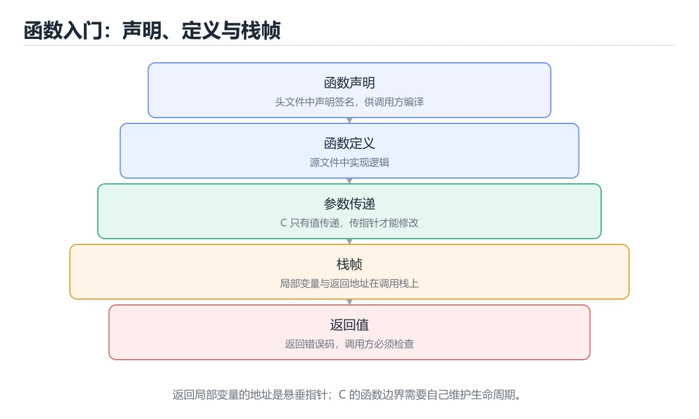
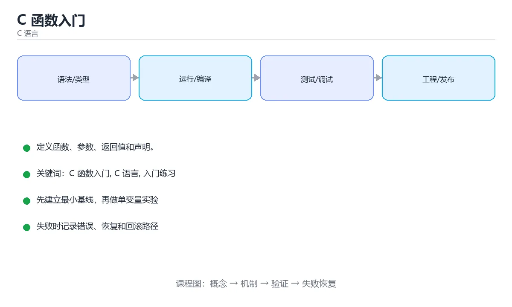

# C 函数入门

> 内容更新时间：2026-10-06 · 学习阶段：基础 · 预计用时：30 分钟





## 本节知识框架

**课程定位**：所属分类 `c`（C 语言），课程主题 `C 函数入门`，学习阶段 基础，建议用时 50 分钟。

本课主线：定义函数、参数、返回值和声明。

**学完本课应当能够**
- 说清 `函数原型` 与 `参数与返回值` 的含义与区别，并各举一个正例和一个反例。
- 用本课示例验证 `void` 的行为，记录输入、输出与失败条件。
- 遇到「按值传参却期望改外部变量」这类问题时，能说出触发条件与修复顺序。

### 复习清单

- [ ] 能不看正文复述本课核心术语，并指出一个边界或反例。
- [ ] 能运行或推演本课示例，记录输入、输出与失败现象。
- [ ] 能完成一次自测，并把错题对照错误表定位原因。

## 核心概念定义

| 术语 | 操作性定义 | 常见边界与风险 |
| --- | --- | --- |
| 函数原型 | 在调用前声明函数的参数与返回类型，让编译器能做类型检查。 | 原型放在调用前才有效：定义写在 main 之后又不声明会报隐式声明，实参类型写错还只靠隐式转换悄悄丢精度。 |
| 参数与返回值 | 参数是输入，return 把结果交回调用方。 | 易错：声明了返回类型却没有 return，调用者拿到的是无意义的随机值；每条分支都要返回值。 |
| void | 表示函数没有返回值。 | 没有 return 可检查，失败只能靠输出参数或全局状态传出，调用方最容易在这里漏判。 |
| 值传递 | C 的参数默认按值传递，函数内修改形参不影响实参。 | 函数拿到的只是副本，改形参对外无效；要改动调用方的变量必须传指针并在函数内解引用赋值。 |
| 函数定义与分离编译 | 函数体可以放在其他源文件，通过头文件共享声明。 | 头文件只给声明、实现等链接器解析外部符号：声明与定义签名不一致时报的是链接失败或参数被错误解释。 |
| 数组 | 数组名在大多数表达式中退化为首元素指针，但 sizeof 和取地址时不是 | 数组声明作参数时等价于指针、长度信息丢失，必须额外传长度；返回局部数组地址就是一例悬空指针。 |

## 原理与运行机制

### 机制总览

**教材衔接：一句话入门**

定义函数、参数、返回值和声明。

**教材衔接：C 语言基础机制速览**

### 编译、链接与程序结构

C 源码经过预处理、编译、汇编和链接生成可执行文件。`#include` 引入声明，函数定义提供实现，链接器负责解析外部符号。`main` 返回 0 表示成功，非 0 表示失败。理解头文件、声明与定义的区别，能区分“找不到函数声明”的编译错误和“找不到符号”的链接错误。

### 类型、变量与内存表示

C 是静态类型语言，基本类型的大小依赖平台，使用 `sizeof` 而不是硬编码字节数。整数分为有符号和无符号两类，混合运算会发生转换；无符号回绕有定义，有符号溢出通常是未定义行为。浮点数遵循 IEEE 754 近似表示，比较时使用容差。字符类型、字符串和数组的关系需要清楚：字符串以 `\0` 结尾，`char` 数组不一定是字符串。

### 指针、数组与字符串

指针保存地址，`*` 解引用，`&` 取地址；指针算术按所指类型大小移动。数组名在大多数表达式中退化为首元素指针，但 `sizeof` 和取地址时不是。函数参数中的数组声明等价于指针，长度信息会丢失，必须额外传长度。字符串函数要保证目标缓冲区足够大，优先使用带长度限制的函数，防止溢出。

### 函数、结构体与内存管理

函数原型要在调用前可见，参数按值传递；要修改调用方变量就传指针。结构体可以按值复制，较大结构体通常传指针；`struct` 的内存可能有填充，`sizeof` 不一定等于成员大小之和。`malloc/free`、`calloc`、`realloc` 必须成对使用，释放后指针置空，不能访问已释放内存。栈内存自动回收但生命周期受作用域限制，返回局部数组地址是典型错误。

### 预处理器、未定义行为与调试

宏在预处理阶段替换文本，要加括号并避免多次求值副作用；`#include` 保护防止重复包含。未定义行为包括越界访问、解引用空指针、未初始化读取、有符号溢出和不匹配的格式化参数，编译器优化后可能产生难以预测的结果。使用编译器警告、静态分析、sanitizer 和调试器定位内存问题；测试要覆盖空输入、边界长度、内存分配失败和错误路径。

**教材衔接：版本与时效**

- 先确认编译器支持的标准版本，再决定 square 能否使用新特性。
- 编译器对未定义行为、严格别名与对齐的优化越来越激进
- 升级时重点回归位域、可变参数、内联汇编与结构体布局
- 语言参考：https://en.cppreference.com/w/c

### 一、工具链

| 阶段 | 推荐工具 | 验收标准 |
| --- | --- | --- |
| 编译 | gcc/clang -Wall -Wextra -Werror | 命令可复现且错误能被定位 |
| 调试 | gdb + core dump | 命令可复现且错误能被定位 |
| 内存检查 | AddressSanitizer / Valgrind | 命令可复现且错误能被定位 |
| 构建发布 | Makefile/CMake + 静态或动态链接 | 命令可复现且错误能被定位 |

### 二、运行时与内存模型

「C 函数入门」的「二、运行时与内存模型」一节补全如下：

- 定位：这一节说明二、运行时与内存模型在「C 函数入门」知识体系里的位置。
- 检查点：固定版本与输入重跑《C 函数入门》，记录两次差异并定位不稳定条件。
- 自检：能否用一个最小例子解释二、运行时与内存模型？

## 典型应用场景

**教材衔接：代码实验：把示例跑成证据**

### 实验一：建立基线

```c
#include <stdio.h>

int square(int n) { return n * n; }

int main(void) {
    printf("square(7)=%d\n", square(7));
    return 0;
}
```

### 实验二：只改一个输入

沿用「C 函数入门」的最小示例做一次单变量实验：

做完后用一句话写出「C 函数入门」的结论：输入怎么变，结果才怎么变。

### 实验三：制造一个可控错误

把 square 的一个参数换成不兼容的类型，先预测报错位置再实际运行；预测与实际的差异就是本课的考点。

### 实验四：用三句话复述

1. 在「C 函数入门」里，square 接受哪些输入，非法输入应该在哪里被挡住？
2. square 的执行顺序里，哪一步会写数据或产生外部副作用？
3. 输出如何验证，失败时第一条可观察证据是什么？

- **按值传参却期望改外部变量**：典型现象是函数内的修改对调用方无效；正确做法是需要修改时传指针，并在函数内解引用赋值。
- **声明与定义签名不一致**：典型现象是链接失败或参数被错误解释；正确做法是头文件声明与源文件定义保持完全一致的签名。
- **一个函数承担多件事**：典型现象是难测试也难复用，改动容易牵连；正确做法是按单一职责拆分，并把输入输出写进注释。

### 最小验证场景

- 准备：保留 `c` 示例的原始输入，先记录 `C 函数入门` 的基线输出和完整运行命令。
- 观察：先核对 调用了 `square()`，再改变一个与 `函数原型` 相关的条件。
- 判定：新结果与 `C 函数入门` 的基线不同不等于错误；只有当差异破坏了 `函数原型` 的定义或错误表中的约束，才判定为失败。

### 选择与边界

- 使用 `函数原型` 时，在调用前声明函数的参数与返回类型，让编译器能做类型检查；静态检查只在编译期成立，运行期输入仍需校验。
- 使用 `参数与返回值` 时，参数是输入，return 把结果交回调用方；结果依赖数据分布、模型版本与算力预算，换数据集或换硬件都要重新评估。
- 使用 `void` 时，表示函数没有返回值。
- 使用 `值传递` 时，C 的参数默认按值传递，函数内修改形参不影响实参；结果依赖数据分布、模型版本与算力预算，换数据集或换硬件都要重新评估。
- 使用 `函数定义与分离编译` 时，函数体可以放在其他源文件，通过头文件共享声明；共享状态与调度顺序会改变结论，单线程或串行测试通过不等于并发下成立。

## 代码/协议/SQL 示例

### 最小可验证示例

**教材衔接：最小示例**

**教材衔接：预期输出**

```text
square(7)=49
```

**教材衔接：零基础通俗讲：C 语言函数入门**

### 一句话说清它是什么

函数把一段可复用的逻辑封起来，调用者只关心「传什么进去、拿什么回来」，不必知道内部怎么实现。

### 用生活比喻理解

函数像自动售货机：你投币、按键，它吐饮料。你不需要知道里面的机械结构，只要记住投什么、按什么、出什么，就能反复使用。

### 完整可运行代码

```c
#include <stdio.h>

int add(int a, int b) {
    return a + b;
}

void print_result(int value) {
    printf("结果是 %d\n", value);
}

int main(void) {
    int sum = add(3, 4);
    print_result(sum);
    print_result(add(10, 20));
    return 0;
}
```

### 逐行拆开看

- `int add(int a, int b)` 定义一个返回整数的函数，接受两个整型参数 a 和 b。
- 函数体里的 `return a + b;` 把计算结果交回给调用处，同时结束这次函数调用。
- `void print_result(int value)` 的返回类型是 void，表示它只做事、不返回值。
- `int sum = add(3, 4);` 调用 add，把实参 3 和 4 分别复制给形参 a 和 b，返回值 7 存入 sum。
- `print_result(sum)` 把 7 传进去打印；函数内部拿到的是一份副本，改动它不会影响外面的 sum。
- 函数必须在使用前声明或定义，否则编译器不知道该函数存在。

### 把程序跑一遍

- 程序从 main 开始，先执行 `add(3, 4)`，控制权跳到 add 函数内部。
- a 和 b 临时得到值 3 和 4，计算出 7 并返回，这两个参数随函数结束自动销毁。
- 7 被赋给 sum，再传给 print_result，屏幕输出「结果是 7」。
- 第二次调用直接把 `add(10, 20)` 的结果交给 print_result，输出「结果是 30」。

### 新手最容易踩的坑

- 参数写错类型或个数：C 会做隐式转换，可能悄悄丢失精度而不报错。
- 声明了返回类型却没有 return：调用者拿到的是无意义的随机值。
- 以为函数能直接改外部的局部变量：C 的参数按值传递，要改必须传指针。
- 函数定义放在 main 之后却不写声明：编译器在调用处看不到它，报隐式声明错误。
- 返回局部数组的地址：函数一结束这块内存就失效，属于典型的悬空指针。

### 动手练一练

- 增加一个 `int multiply(int a, int b)`，先猜结果再调用验证。
- 写一个没有返回值的函数，打印一行固定文字，观察 void 的用法。
- 把 `add(3, 4)` 的参数改成 `add(3.9, 4.1)`，解释为什么结果不是你预期的 8。

### 本课速查卡

把下面八行抄进自己的笔记，复习时只看这一页就能回忆整课：

| 复习项 | 本课要点 |
| --- | --- |
| 核心结论 | 函数把一段可复用的逻辑封起来，调用者只关心「传什么进去、拿什么回来」，不必知道内部怎么实现。 |
| 最少要写的代码 | `int add(int a, int b) {` |
| 正确做法 | 程序从 main 开始，先执行 `add(3, 4)`，控制权跳到 add 函数内部。 |
| 最常见的错误 | 参数写错类型或个数：C 会做隐式转换，可能悄悄丢失精度而不报错。 |
| 出错先查什么 | 先读第一条报错信息，再回到最小示例只改一个地方 |
| 怎么确认学会了 | 增加一个 `int multiply(int a, int b)`，先猜结果再调用验证。 |
| 和别的知识点的关系 | 本课打下的语法与思维方式会被后面每一课反复用到 |
| 接下来做什么 | 合上教程，凭记忆把上面的最小代码重写一遍再运行 |

**运行方式**：运行 `C 函数入门` 的示例时，用 `gcc 文件名.c -o demo` 编译后运行；注意返回值与内存检查。

## 时间/空间复杂度或性能分析

**性能关注点（C 函数入门）**：内存布局与系统调用是主要成本：记录运行时间、内存占用与系统调用次数。

**本课特有开销（C 函数入门 · C 函数入门）**：小文件看元数据开销，大文件看吞吐，两者要分别测量。

**测量方法**：以 `C 函数入门` 的 `C 函数入门` 场景为对象，固定输入跑一遍记录基线，再把规模或并发度提高一个数量级复测；两次结果的差值与波动范围才是结论依据。

## 常见误区与易错点

| 容易写错的做法 | 实际现象 | 原因与正确做法 |
| --- | --- | --- |
| 按值传参却期望改外部变量 | 函数内的修改对调用方无效。 | 需要修改时传指针，并在函数内解引用赋值。 |
| 声明与定义签名不一致 | 链接失败或参数被错误解释。 | 头文件声明与源文件定义保持完全一致的签名。 |
| 一个函数承担多件事 | 难测试也难复用，改动容易牵连。 | 按单一职责拆分，并把输入输出写进注释。 |

### 现场 1：按值传参却期望改外部变量

**症状**：函数内的修改对调用方无效。

**根因与修复**：需要修改时传指针，并在函数内解引用赋值。

**自检**：在本课示例里复现「按值传参却期望改外部变量」，改成需要修改时传指针，并在函数内解引用赋值后重跑；如果症状消失且失败路径按预期变化，说明定位正确。

### 现场 2：声明与定义签名不一致

**症状**：链接失败或参数被错误解释。

**根因与修复**：头文件声明与源文件定义保持完全一致的签名。

**自检**：在本课示例里复现「声明与定义签名不一致」，改成头文件声明与源文件定义保持完全一致的签名后重跑；如果症状消失且失败路径按预期变化，说明定位正确。

### 现场 3：一个函数承担多件事

**症状**：难测试也难复用，改动容易牵连。

**根因与修复**：按单一职责拆分，并把输入输出写进注释。

**自检**：在本课示例里复现「一个函数承担多件事」，改成按单一职责拆分，并把输入输出写进注释后重跑；如果症状消失且失败路径按预期变化，说明定位正确。

## 与其他知识点的关系

**教材衔接：复习与迁移**

## 自测题与参考答案

> 先独立作答，再对照参考答案；答案都能在本课正文、术语表或错误表里找到依据。

### 自测 1（概念复述）

不看正文，写出 `函数原型` 的操作性定义，并说明它与 `参数与返回值` 的区别。

**参考答案**：在调用前声明函数的参数与返回类型，让编译器能做类型检查。

`参数与返回值` 的定位是：参数是输入，return 把结果交回调用方；两者的差别要从适用对象与失败模式上说明。

### 自测 2（排错）

本课错误表记录了「按值传参却期望改外部变量」这类做法。请写出它会出现的现象、根因，以及修复顺序。

**参考答案**：现象是函数内的修改对调用方无效；正确做法是需要修改时传指针，并在函数内解引用赋值。修复时先复现现象并保留证据，再改动一处假设重跑，确认现象消失。

### 自测 3（动手验证）

运行本课的 `c` 示例，把其中的 `"square(7)=%d\n"` 换成一个边界值后重新运行，记录输出与错误信息。

**参考答案**：正常输入下 `c` 示例应当复现正文给出的结果；把 `"square(7)=%d\n"` 换成边界值后，如果结果改变或报错，先核对它是否满足 `C 函数入门` 中`函数原型` 的适用范围，再检查错误表里是否有同类现象。

### 自测 4（代码阅读）

阅读本课开头的 `c` 示例，说明它体现了`函数原型` 的哪一条性质，并指出改动哪个输入会让这条性质不再成立。

**参考答案**：`函数原型` 的定义是 在调用前声明函数的参数与返回类型，让编译器能做类型检查，示例正是在实现这条定义。改动与 `函数原型` 有关的一个输入后，如果结果不再符合 `C 函数入门` 的正文描述，就说明该性质只在当前前提成立。

### 自测 5（迁移）

把 `C 函数入门` 的方法迁移到自己的项目：围绕 `函数原型` 写出一个与错误表同类的风险点，并说明触发条件和检验方式。

**参考答案**：例如「一个函数承担多件事」，它会导致难测试也难复用，改动容易牵连；检验方式是按单一职责拆分，并把输入输出写进注释改一处再复现，确认现象消失且没有引入新的失败分支。

### 自测 6（对比）

用一个表格对比 `函数原型` 与 `参数与返回值`：各写一行适用场景、一行失败表现。

**参考答案**：`函数原型` 的定义是在调用前声明函数的参数与返回类型，让编译器能做类型检查；`参数与返回值` 的定义是参数是输入，return 把结果交回调用方。两者的失败表现分别对应本课错误表里与本术语相关的行。

### 自测 7（排错顺序）

面对「按值传参却期望改外部变量」引发的问题，请把“复现 函数内的修改对调用方无效 → 保留证据 → 需要修改时传指针，并在函数内解引用赋值 → 回归验证”四步写成可执行的检查清单。

**参考答案**：第一步按函数内的修改对调用方无效复现；第二步记录输入、版本与完整报错；第三步按需要修改时传指针，并在函数内解引用赋值只改一处；第四步重跑并确认失败路径也按预期变化。

### 自测 8（边界判断）

针对 `数组`，分别写出“可以使用”的条件和“结论不再成立”的条件。

**参考答案**：越界、悬垂引用与释放顺序会破坏结论，必须在边界输入下复验。 同时要把 `数组` 的定义 数组名在大多数表达式中退化为首元素指针，但 sizeof 和取地址时不是 与实际输入逐项对照。

### 自测 9（机制重建）

不看正文，按输入、转换、输出、验证四段重建 `函数原型` → `参数与返回值` → `void` → `值传递` 的作用链。

**参考答案**：起点是 `函数原型` 的定义 在调用前声明函数的参数与返回类型，让编译器能做类型检查；中间每一步都保留可观察状态；终点由 `数组` 检查，失败时回到错误表定位第一个偏离定义的步骤。

### 自测 10（综合排错）

在 `C 函数入门` 中，现象是 难测试也难复用，改动容易牵连。请围绕 一个函数承担多件事 写出最小复现、关键证据、修复动作和回归验证，并说明为什么不能只凭一次运行下结论。

**参考答案**：先复现 一个函数承担多件事，记录输入与完整错误；再按 按单一职责拆分，并把输入输出写进注释 只改一处。回归时同时跑正常路径和边界路径，只有两次结果都可解释，才把修复视为完成。

### 自测 11（一分钟复述）

用每分钟约 200 字的速度复述 `C 函数入门`：先给主问题，再按顺序说出 `函数原型`、`参数与返回值`、`void`、`值传递`，最后给一个失败案例。

**自评标准**：主问题必须对应 定义函数、参数、返回值和声明；每个术语都要能接上一句定义或边界；失败案例必须写成可观察现象，不能用“可能有风险”代替证据。

## 术语速查

| 术语 | 一句话说明 |
| --- | --- |
| `函数原型` | 在调用前声明函数的参数与返回类型，让编译器能做类型检查。 |
| `参数与返回值` | 参数是输入，return 把结果交回调用方。 |
| `void` | 表示函数没有返回值。 |
| `值传递` | C 的参数默认按值传递，函数内修改形参不影响实参。 |
| `函数定义与分离编译` | 函数体可以放在其他源文件，通过头文件共享声明。 |
| `数组` | 数组名在大多数表达式中退化为首元素指针，但 sizeof 和取地址时不是。 |

**术语关系**：`函数原型`（在调用前声明函数的参数与返回类型） → `参数与返回值`（参数是输入） → `void`（表示函数没有返回值） → `值传递`（C 的参数默认按值传递）。

## 考点精讲

`C 函数入门` 的题库有 5 道题，下面逐题给出题干、正确项与判断依据：先自己作答，再核对正确项，最后回到正文对应小节复核。

### 考点 1：第 1 题

- **题目**：围绕“C 函数入门”中的 C 函数入门、C 语言、入门练习，下列哪两项是本课强调的实践判断？
- **正确项**：验证 C 语言 时要固定版本并覆盖边界输入，结论才可复现；学习 C 函数入门 时要同时说明输入、输出和失败路径，不能只看正常流程
- **判断依据**：按《C 函数入门》的正文口径，本题要同时选中「验证 C 语言 时要固定版本并覆盖边界输入，结论才可复现」、「学习 C 函数入门 时要同时说明输入、输出和失败路径，不能只看正常流程」，漏掉任一项都算没答全。术语 函数原型（C 函数入门）：在调用前声明函数的参数与返回类型，让编译器能做类型检查。易错点是按值传参却期望改外部变量，会造成函数内的修改对调用方无效，改法是需要修改时传指针，并在函数内解引用赋值。

### 考点 2：第 2 题

- **题目**：C 语言中参数默认的传递方式是？
- **正确项**：按值传递，函数得到实参的副本
- **判断依据**：本题正确项是「按值传递，函数得到实参的副本」。术语 值传递（C 函数入门）：C 的参数默认按值传递，函数内修改形参不影响实参，本题取「按值传递，函数得到实参的副本」这条。易错点是声明与定义签名不一致，会造成链接失败或参数被错误解释，改法是头文件声明与源文件定义保持完全一致的签名。

### 考点 3：第 3 题

- **题目**：函数返回类型写成 void 表示什么？
- **正确项**：函数不返回任何值
- **判断依据**：本题正确项是「函数不返回任何值」。术语 void（C 函数入门）：表示函数没有返回值，本题取「函数不返回任何值」这条。易错点是一个函数承担多件事，会造成难测试也难复用，改动容易牵连，改法是按单一职责拆分，并把输入输出写进注释。易错点是按值传参却期望改外部变量，会造成函数内的修改对调用方无效，改法是需要修改时传指针，并在函数内解引用赋值。

### 考点 4：第 4 题

- **题目**：阅读 `C 函数入门` 中围绕 `函数原型` 的代码；课程主线是定义函数、参数、返回值和声明。下面哪项判断最准确？
- **正确项**：定义函数、参数、返回值和声明。
- **判断依据**：本题正确项是「定义函数、参数、返回值和声明」。术语 函数原型（C 函数入门）：在调用前声明函数的参数与返回类型，让编译器能做类型检查，本题取「定义函数、参数、返回值和声明」这条。易错点是按值传参却期望改外部变量，会造成函数内的修改对调用方无效，改法是需要修改时传指针，并在函数内解引用赋值。

### 考点 5：第 5 题

- **题目**：填空：补齐下面这段术语说明中的空缺。课程 `定义函数、参数、返回值和声明。`，这段说明是：`____`：表示函数没有返回值。空缺处应填哪个术语？
- **正确项**：void
- **判断依据**：涉及术语 void：表示函数没有返回值。易错点：按值传参却期望改外部变量会造成函数内的修改对调用方无效。正确做法：需要修改时传指针，并在函数内解引用赋值。判断时先确认输入和适用范围，对照 `C 函数入门`、`C 语言`、`入门练习` 复现一次，最后把错误表现与正确做法逐项对照。

### 考点 6：`函数原型`

- **要点**：在调用前声明函数的参数与返回类型，让编译器能做类型检查。
- **函数原型 的边界**：静态检查只在编译期成立，运行期输入仍需校验。

### 考点 7：`参数与返回值`

- **要点**：参数是输入，return 把结果交回调用方。
- **参数与返回值 的边界**：结果依赖数据分布、模型版本与算力预算，换数据集或换硬件都要重新评估。

### 考点 8：`void`

- **要点**：表示函数没有返回值。

### 考点 9：`值传递`

- **要点**：C 的参数默认按值传递，函数内修改形参不影响实参。
- **值传递 的边界**：结果依赖数据分布、模型版本与算力预算，换数据集或换硬件都要重新评估。

### 考点 10：`函数定义与分离编译`

- **要点**：函数体可以放在其他源文件，通过头文件共享声明。
- **函数定义与分离编译 的边界**：共享状态与调度顺序会改变结论，单线程或串行测试通过不等于并发下成立。

### 考点 11：`数组`

- **要点**：数组名在大多数表达式中退化为首元素指针，但 sizeof 和取地址时不是
- **数组 的边界**：越界、悬垂引用与释放顺序会破坏结论，必须在边界输入下复验。

### 考点 12：排错——按值传参却期望改外部变量

- **现象**：函数内的修改对调用方无效。
- **处理**：需要修改时传指针，并在函数内解引用赋值。

### 考点 13：排错——声明与定义签名不一致

- **现象**：链接失败或参数被错误解释。
- **处理**：头文件声明与源文件定义保持完全一致的签名。

### 考点 14：综合辨析——`函数原型` 与 `数组`

- **辨析点**：`函数原型` 的定义是 在调用前声明函数的参数与返回类型，让编译器能做类型检查；`数组` 的定义是 数组名在大多数表达式中退化为首元素指针，但 sizeof 和取地址时不是。
- **答题要求**：面对 `C 函数入门` 的题目，先判断描述的是 `函数原型` 还是 `数组`，再归到对应定义，最后写出一个会让该定义失效的边界输入。

### 考点 15：排错评分点

- **现象分**：能写出 函数内的修改对调用方无效，而不是只写“程序有错”。
- **证据分**：保留触发 按值传参却期望改外部变量 的输入、版本和错误原文。
- **修复分**：按 需要修改时传指针，并在函数内解引用赋值 只改一处，并同时回归正常路径与边界路径。

## 内容元数据

- 内容版本：v2.0
- 最后更新：2026-10-06
- 学习阶段：基础
- 适用环境：C11 / GCC 或 Clang；本课聚焦 C 函数入门。
- 内容来源：内置结构化课程与工程实践整理
- 相关主题：C 函数入门、C 语言、入门练习
- 质量版本：P0 测验标准 + P1 覆盖扩展 + P2 体验补全

## 参考资料与复核

- 最后复核：2026-10-04
- 下次复核：2026-11-17
- 复核范围：版本兼容、API 行为、安全建议与工程实践
- 来源性质：官方文档、标准或权威教材；本课核对关键词：C 函数入门、C 语言、入门练习。

| 参考资料 | 本课用途 |
| --- | --- |
| [cppreference C 语言](https://en.cppreference.com/w/c/language) | C 语言规则与语义 |
| [GNU C Library](https://www.gnu.org/software/libc/manual/) | POSIX 与 GNU C 接口 |
| [Valgrind 文档](https://valgrind.org/docs/manual/manual.html) | 内存错误与泄漏检测 |

| [本课术语索引：C 函数入门](#核心概念定义) | 按本课输入、术语边界和错误表现逐项核对 |
> 「C 函数入门」的链接用于离线阅读后的延伸核对；App 不会自动联网。