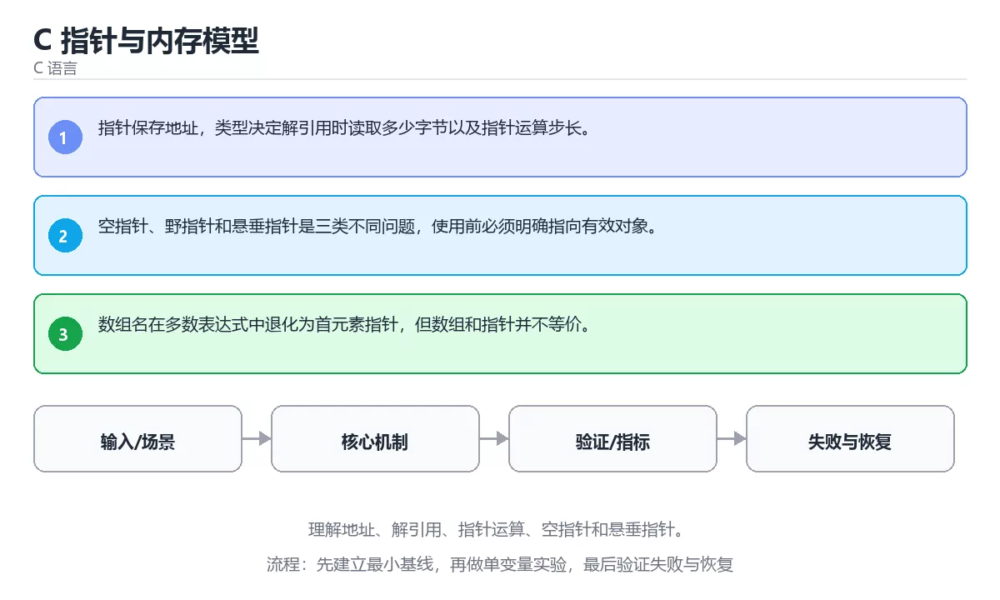

# C 指针与内存模型




> 内容更新时间：2026-10-06 · 学习阶段：进阶 · 预计用时：25 分钟

## 本节知识框架

**课程定位**：所属分类 `c`（C 语言），课程主题 `C 指针与内存模型`，学习阶段 进阶，建议用时 45 分钟。

本课主线：理解地址、解引用、指针运算、空指针和悬垂指针。

**学完本课应当能够**
- 说清 `指针` 与 `地址` 的含义与区别，并各举一个正例和一个反例。
- 用本课示例验证 `解引用` 的行为，记录输入、输出与失败条件。
- 遇到「解引用未初始化的指针」这类问题时，能说出触发条件与修复顺序。

### 复习清单

- [ ] 能不看正文复述本课核心术语，并指出一个边界或反例。
- [ ] 能运行或推演本课示例，记录输入、输出与失败现象。
- [ ] 能完成一次自测，并把错题对照错误表定位原因。

## 核心概念定义

| 术语 | 操作性定义 | 常见边界与风险 |
| --- | --- | --- |
| 指针 | 保存内存地址并可通过解引用访问目标对象的变量。 | 易错：写入随机地址导致崩溃或数据损坏；正确做法是指针声明即初始化，使用前确认指向有效对象。 |
| 地址 | 内存中某个字节位置的编号，指针保存的就是地址值。 | 易错：写入随机地址导致崩溃或数据损坏；正确做法是指针声明即初始化，使用前确认指向有效对象。 |
| 解引用 | 用 * 运算符按地址读写目标内存；指针为空或已释放时解引用是未定义行为。 | 易错：写入随机地址导致崩溃或数据损坏；正确做法是指针声明即初始化，使用前确认指向有效对象。 |
| 悬垂指针 | 「指针、地址、解引用、悬垂指针」说明变量生命周期、资源释放、并发模型和错误传播。 | 易错：调用方拿到悬垂指针；正确做法是返回堆内存或让调用方提供缓冲区，并写清所有权。 |
| 编译 | gcc/clang -Wall -Wextra -Werror | 只在「gcc/clang -Wall -Wextra -Werror」这一前提下成立，换输入或换环境要重新验证。 |
| 调试 | gdb + core dump | 只在「gdb + core dump」这一前提下成立，换输入或换环境要重新验证。 |
| 内存检查 | AddressSanitizer / Valgrind | 只在「AddressSanitizer / Valgrind」这一前提下成立，换输入或换环境要重新验证。 |
| 构建发布 | Makefile/CMake + 静态或动态链接 | 静态检查只在编译期成立，运行期输入仍需校验。 |

## 原理与运行机制

### 机制总览

**教材衔接：核心知识**

### 1. 指针保存地址，类型决定解引用时读取多少字节以及指针运算步长。

- 关键做法：基线只保留 地址 必需的部分，其余条件一次加一个。
- 验证标准：地址 的异常路径有明确错误信息与恢复动作。

### 2. 空指针、野指针和悬垂指针是三类不同问题，使用前必须明确指向有效对象。

把这条结论放回「C 指针与内存模型」的完整流程里展开：

- 正文依据：能用自己的话解释：指针保存地址，类型决定解引用时读取多少字节以及指针运算步长。
- 落地检查：把「2. 空指针、野指针和悬垂指针是三类不同问题，使用前必须明确指向有效对象。」改写成一条可执行的核对项，逐条验证输入、超时与失败路径。

### 3. 数组名在多数表达式中退化为首元素指针，但数组和指针并不等价。

把这条结论放回「C 指针与内存模型」的完整流程里展开：

- 正文依据：能用自己的话解释：空指针、野指针和悬垂指针是三类不同问题，使用前必须明确指向有效对象。
- 落地检查：把「3. 数组名在多数表达式中退化为首元素指针，但数组和指针并不等价。」改写成一条可执行的核对项，逐条验证输入、超时与失败路径。

**教材衔接：关键流程**

**教材衔接：实践路径**

**教材衔接：版本与时效**

- C23 已被主流编译器逐步支持，C17 仍是兼容性最好的基线；指针 的写法要按目标标准选择。
- 编译器对未定义行为、严格别名与对齐的优化越来越激进
- 升级时重点回归位域、可变参数、内联汇编与结构体布局
- 语言参考：https://en.cppreference.com/w/c

## 典型应用场景

- **解引用未初始化的指针**：典型现象是写入随机地址导致崩溃或数据损坏；正确做法是指针声明即初始化，使用前确认指向有效对象。
- **返回栈上变量的地址**：典型现象是调用方拿到悬垂指针；正确做法是返回堆内存或让调用方提供缓冲区，并写清所有权。
- **指针运算越出数组范围**：典型现象是越界访问属于未定义行为；正确做法是只在同一数组内运算，结束位置取最后一个元素之后。

### 最小验证场景

- 准备：保留 `text` 示例的原始输入，先记录 `C 指针与内存模型` 的基线输出和完整运行命令。
- 观察：先核对 调用了 `main()`，再改变一个与 `指针` 相关的条件。
- 判定：新结果与 `C 指针与内存模型` 的基线不同不等于错误；只有当差异破坏了 `指针` 的定义或错误表中的约束，才判定为失败。

### 选择与边界

- 使用 `指针` 时，先满足它的定义：保存内存地址并可通过解引用访问目标对象的变量；易错：写入随机地址导致崩溃或数据损坏；正确做法是指针声明即初始化，使用前确认指向有效对象。
- 使用 `地址` 时，先满足它的定义：内存中某个字节位置的编号，指针保存的就是地址值；易错：写入随机地址导致崩溃或数据损坏；正确做法是指针声明即初始化，使用前确认指向有效对象。
- 使用 `解引用` 时，先满足它的定义：用 * 运算符按地址读写目标内存；指针为空或已释放时解引用是未定义行为；易错：写入随机地址导致崩溃或数据损坏；正确做法是指针声明即初始化，使用前确认指向有效对象。
- 使用 `悬垂指针` 时，先满足它的定义：「指针、地址、解引用、悬垂指针」说明变量生命周期、资源释放、并发模型和错误传播；易错：调用方拿到悬垂指针；正确做法是返回堆内存或让调用方提供缓冲区，并写清所有权。

## 代码/协议/SQL 示例

### 最小可验证示例

**教材衔接：最小可运行示例**

下面的示例覆盖「C 指针与内存模型」中 指针 的核心路径。先原样运行，再按注释改一处：

```c
#include <stdio.h>

int main(void) {
    int value = 42;
    int *pointer = &value;
    *pointer += 1;
    printf("value=%d\n", value);
    return 0;
}
```

**教材衔接：预期输出**

```text
value=43
```

## 时间/空间复杂度或性能分析

**性能关注点（C 指针与内存模型）**：内存布局与系统调用是主要成本：记录运行时间、内存占用与系统调用次数。

**本课特有开销（C 指针与内存模型 · 指针）**：并发度提高后要观察是否出现拐点：延迟上升而吞吐不增，说明瓶颈已转移。

**测量方法**：以 `C 指针与内存模型` 的 `指针` 场景为对象，固定输入跑一遍记录基线，再把规模或并发度提高一个数量级复测；两次结果的差值与波动范围才是结论依据。

## 常见误区与易错点

| 容易写错的做法 | 实际现象 | 原因与正确做法 |
| --- | --- | --- |
| 解引用未初始化的指针 | 写入随机地址导致崩溃或数据损坏。 | 指针声明即初始化，使用前确认指向有效对象。 |
| 返回栈上变量的地址 | 调用方拿到悬垂指针。 | 返回堆内存或让调用方提供缓冲区，并写清所有权。 |
| 指针运算越出数组范围 | 越界访问属于未定义行为。 | 只在同一数组内运算，结束位置取最后一个元素之后。 |

### 现场 1：解引用未初始化的指针

**症状**：写入随机地址导致崩溃或数据损坏。

**根因与修复**：指针声明即初始化，使用前确认指向有效对象。

**自检**：在本课示例里复现「解引用未初始化的指针」，改成指针声明即初始化，使用前确认指向有效对象后重跑；如果症状消失且失败路径按预期变化，说明定位正确。

### 现场 2：返回栈上变量的地址

**症状**：调用方拿到悬垂指针。

**根因与修复**：返回堆内存或让调用方提供缓冲区，并写清所有权。

**自检**：在本课示例里复现「返回栈上变量的地址」，改成返回堆内存或让调用方提供缓冲区，并写清所有权后重跑；如果症状消失且失败路径按预期变化，说明定位正确。

### 现场 3：指针运算越出数组范围

**症状**：越界访问属于未定义行为。

**根因与修复**：只在同一数组内运算，结束位置取最后一个元素之后。

**自检**：在本课示例里复现「指针运算越出数组范围」，改成只在同一数组内运算，结束位置取最后一个元素之后后重跑；如果症状消失且失败路径按预期变化，说明定位正确。

## 与其他知识点的关系

**教材衔接：复习与迁移**

## 自测题与参考答案

> 先独立作答，再对照参考答案；答案都能在本课正文、术语表或错误表里找到依据。

### 自测 1（概念复述）

不看正文，写出 `指针` 的操作性定义，并说明它与 `地址` 的区别。

**参考答案**：保存内存地址并可通过解引用访问目标对象的变量。

`地址` 的定位是：内存中某个字节位置的编号，指针保存的就是地址值；两者的差别要从适用对象与失败模式上说明。

### 自测 2（排错）

本课错误表记录了「解引用未初始化的指针」这类做法。请写出它会出现的现象、根因，以及修复顺序。

**参考答案**：现象是写入随机地址导致崩溃或数据损坏；正确做法是指针声明即初始化，使用前确认指向有效对象。修复时先复现现象并保留证据，再改动一处假设重跑，确认现象消失。

### 自测 3（动手验证）

运行本课的 `text` 示例，改动其中一个输入后重新运行，记录输出与错误信息。

**参考答案**：正常输入下 `text` 示例应当复现正文给出的结果；改动输入后，如果结果改变或报错，先核对它是否满足 `C 指针与内存模型` 中`指针` 的适用范围，再检查错误表里是否有同类现象。

### 自测 4（代码阅读）

阅读本课开头的 `text` 示例，说明它体现了`指针` 的哪一条性质，并指出改动哪个输入会让这条性质不再成立。

**参考答案**：`指针` 的定义是 保存内存地址并可通过解引用访问目标对象的变量，示例正是在实现这条定义。改动与 `指针` 有关的一个输入后，如果结果不再符合 `C 指针与内存模型` 的正文描述，就说明该性质只在当前前提成立。

### 自测 5（迁移）

把 `C 指针与内存模型` 的方法迁移到自己的项目：围绕 `指针` 写出一个与错误表同类的风险点，并说明触发条件和检验方式。

**参考答案**：例如「指针运算越出数组范围」，它会导致越界访问属于未定义行为；检验方式是按只在同一数组内运算，结束位置取最后一个元素之后改一处再复现，确认现象消失且没有引入新的失败分支。

### 自测 6（对比）

用一个表格对比 `指针` 与 `地址`：各写一行适用场景、一行失败表现。

**参考答案**：`指针` 的定义是保存内存地址并可通过解引用访问目标对象的变量；`地址` 的定义是内存中某个字节位置的编号，指针保存的就是地址值。两者的失败表现分别对应本课错误表里与本术语相关的行。

### 自测 7（排错顺序）

面对「解引用未初始化的指针」引发的问题，请把“复现 写入随机地址导致崩溃或数据损坏 → 保留证据 → 指针声明即初始化，使用前确认指向有效对象 → 回归验证”四步写成可执行的检查清单。

**参考答案**：第一步按写入随机地址导致崩溃或数据损坏复现；第二步记录输入、版本与完整报错；第三步按指针声明即初始化，使用前确认指向有效对象只改一处；第四步重跑并确认失败路径也按预期变化。

### 自测 8（边界判断）

针对 `悬垂指针`，分别写出“可以使用”的条件和“结论不再成立”的条件。

**参考答案**：易错：调用方拿到悬垂指针；正确做法是返回堆内存或让调用方提供缓冲区，并写清所有权。 同时要把 `悬垂指针` 的定义 「指针、地址、解引用、悬垂指针」说明变量生命周期、资源释放、并发模型和错误传播 与实际输入逐项对照。

### 自测 9（机制重建）

不看正文，按输入、转换、输出、验证四段重建 `指针` → `地址` → `解引用` → `悬垂指针` 的作用链。

**参考答案**：起点是 `指针` 的定义 保存内存地址并可通过解引用访问目标对象的变量；中间每一步都保留可观察状态；终点由 `悬垂指针` 检查，失败时回到错误表定位第一个偏离定义的步骤。

### 自测 10（综合排错）

在 `C 指针与内存模型` 中，现象是 越界访问属于未定义行为。请围绕 指针运算越出数组范围 写出最小复现、关键证据、修复动作和回归验证，并说明为什么不能只凭一次运行下结论。

**参考答案**：先复现 指针运算越出数组范围，记录输入与完整错误；再按 只在同一数组内运算，结束位置取最后一个元素之后 只改一处。回归时同时跑正常路径和边界路径，只有两次结果都可解释，才把修复视为完成。

### 自测 11（一分钟复述）

用每分钟约 200 字的速度复述 `C 指针与内存模型`：先给主问题，再按顺序说出 `指针`、`地址`、`解引用`、`悬垂指针`，最后给一个失败案例。

**自评标准**：主问题必须对应 理解地址、解引用、指针运算、空指针和悬垂指针；每个术语都要能接上一句定义或边界；失败案例必须写成可观察现象，不能用“可能有风险”代替证据。

## 延伸阅读

想更直观地理解本课概念？推荐参阅以下图解专题：

- [图解内存布局：栈、堆与引用](visual_memory_layout.md)

## 术语速查

| 术语 | 一句话说明 |
| --- | --- |
| `指针` | 保存内存地址并可通过解引用访问目标对象的变量。 |
| `地址` | 内存中某个字节位置的编号，指针保存的就是地址值。 |
| `解引用` | 用 * 运算符按地址读写目标内存；指针为空或已释放时解引用是未定义行为。 |
| `悬垂指针` | 「指针、地址、解引用、悬垂指针」说明变量生命周期、资源释放、并发模型和错误传播。 |

**术语关系**：`指针`（保存内存地址并可通过解引用访问目标对象的变量） → `地址`（内存中某个字节位置的编号） → `解引用`（用 * 运算符按地址读写目标内存） → `悬垂指针`（「指针、地址、解引用、悬垂指针」说明变量生命周期、资源释放、并发模型和错误传播）。

## 考点精讲

`C 指针与内存模型` 的题库有 6 道题，下面逐题给出题干、正确项与判断依据：先自己作答，再核对正确项，最后回到正文对应小节复核。

### 考点 1：第 1 题

- **题目**：在 `C 指针与内存模型` 里，与 `指针` 有关的说法中，哪一项最符合理解地址、解引用、指针运算、空指针和悬垂指针。？
- **正确项**：指针保存地址，类型决定解引用时读取多少字节以及指针运算步长。
- **判断依据**：本题正确项是指针保存地址，类型决定解引用时读取多少字节以及指针运算步长。术语 指针（C 指针与内存模型）：保存内存地址并可通过解引用访问目标对象的变量，本题取指针保存地址，类型决定解引用时读取多少字节以及指针运算步长这条。易错点是解引用未初始化的指针会造成写入随机地址导致崩溃或数据损坏，改法是指针声明即初始化，使用前确认指向有效对象，干扰项C 程序从 main 开始执行，源文件经过预处理、编译、汇编和链接成为可执行文件正踩在这条上。

### 考点 2：第 2 题

- **题目**：阅读 `C 指针与内存模型` 中围绕 `指针` 的代码；课程主线是理解地址、解引用、指针运算、空指针和悬垂指针。下面哪项判断最准确？
- **正确项**：理解地址、解引用、指针运算、空指针和悬垂指针。
- **判断依据**：本题正确项是理解地址、解引用、指针运算、空指针和悬垂指针。术语 指针（C 指针与内存模型）：保存内存地址并可通过解引用访问目标对象的变量，本题取理解地址、解引用、指针运算、空指针和悬垂指针这条。易错点是解引用未初始化的指针会造成写入随机地址导致崩溃或数据损坏，改法是指针声明即初始化，使用前确认指向有效对象，干扰项指针、地址、解引用 的结论只取决于关键字数量，与代码的控制流和边界条件无关正踩在这条上。

### 考点 3：第 3 题

- **题目**：围绕“C 指针与内存模型”中的 指针、地址、解引用，下列哪两项是本课强调的实践判断？
- **正确项**：学习 指针 时要同时说明输入、输出和失败路径，不能只看正常流程；验证 地址 时要固定版本并覆盖边界输入，结论才可复现
- **判断依据**：本题正确项是学习 指针 时要同时说明输入、输出和失败路径，不能只看正常流程。术语 指针（C 指针与内存模型）：保存内存地址并可通过解引用访问目标对象的变量，本题取学习 指针 时要同时说明输入、输出和失败路径，不能只看正常流程这条。易错点是解引用未初始化的指针会造成写入随机地址导致崩溃或数据损坏，改法是指针声明即初始化，使用前确认指向有效对象，干扰项只要 指针 的常规示例通过，就可以跳过边界与异常路径正踩在这条上。

### 考点 4：第 4 题

- **题目**：`C 指针与内存模型` 的主线是：理解地址、解引用、指针运算、空指针和悬垂指针。下面哪一项与这条主线一致？
- **正确项**：理解地址、解引用、指针运算、空指针和悬垂指针。
- **判断依据**：本题正确项是理解地址、解引用、指针运算、空指针和悬垂指针。术语 指针（C 指针与内存模型）：保存内存地址并可通过解引用访问目标对象的变量，本题取理解地址、解引用、指针运算、空指针和悬垂指针这条。易错点是解引用未初始化的指针会造成写入随机地址导致崩溃或数据损坏，改法是指针声明即初始化，使用前确认指向有效对象，干扰项从源文件、预处理、编译、汇编到链接理解 C 程序的构建过程正踩在这条上。

### 考点 5：第 5 题

- **题目**：填空：补齐下面这段术语说明中的空缺。课程 `理解地址、解引用、指针运算、空指针和悬垂指针。`，这段说明是：「指针、地址、解引用、`____`」说明变量生命周期、资源释放、并发模型和错误传播。空缺处应填哪个术语？
- **正确项**：悬垂指针
- **判断依据**：涉及术语 指针：保存内存地址并可通过解引用访问目标对象的变量。易错点：解引用未初始化的指针会造成写入随机地址导致崩溃或数据损坏。正确做法：指针声明即初始化，使用前确认指向有效对象。判断时先确认输入和适用范围，对照 `指针`、`地址`、`解引用`、`悬垂指针` 复现一次，最后把错误表现与正确做法逐项对照。

### 考点 6：第 6 题

- **题目**：下面几项都与 `指针` 有关，请按 `C 指针与内存模型` 的正文顺序排列；该课主线是理解地址、解引用、指针运算、空指针和悬垂指针。
- **正确项**：核心知识 → 关键流程 → 实践路径 → 常见误区
- **判断依据**：按《C 指针与内存模型》正文的先后，本题顺序是「核心知识」。术语「指针」在本课里的界定是保存内存地址并可通过解引用访问目标对象的变量，题干「下面几项都与 `指针` 有关，请按 `C 指针与内存模型` 的正文顺」问的就是这一条。常见错法是解引用未初始化的指针，其后果是写入随机地址导致崩溃或数据损坏。正确做法是指针声明即初始化，使用前确认指向有效对象。

### 考点 7：`指针`

- **要点**：保存内存地址并可通过解引用访问目标对象的变量。
- **指针 的边界**：易错：写入随机地址导致崩溃或数据损坏；正确做法是指针声明即初始化，使用前确认指向有效对象。

### 考点 8：`地址`

- **要点**：内存中某个字节位置的编号，指针保存的就是地址值。
- **地址 的边界**：易错：写入随机地址导致崩溃或数据损坏；正确做法是指针声明即初始化，使用前确认指向有效对象。

### 考点 9：`解引用`

- **要点**：用 * 运算符按地址读写目标内存；指针为空或已释放时解引用是未定义行为。
- **解引用 的边界**：易错：写入随机地址导致崩溃或数据损坏；正确做法是指针声明即初始化，使用前确认指向有效对象。

### 考点 10：`悬垂指针`

- **要点**：「指针、地址、解引用、悬垂指针」说明变量生命周期、资源释放、并发模型和错误传播。
- **悬垂指针 的边界**：易错：调用方拿到悬垂指针；正确做法是返回堆内存或让调用方提供缓冲区，并写清所有权。

### 考点 11：排错——解引用未初始化的指针

- **现象**：写入随机地址导致崩溃或数据损坏。
- **处理**：指针声明即初始化，使用前确认指向有效对象。

### 考点 12：排错——返回栈上变量的地址

- **现象**：调用方拿到悬垂指针。
- **处理**：返回堆内存或让调用方提供缓冲区，并写清所有权。

### 考点 13：综合辨析——`指针` 与 `悬垂指针`

- **辨析点**：`指针` 的定义是 保存内存地址并可通过解引用访问目标对象的变量；`悬垂指针` 的定义是 「指针、地址、解引用、悬垂指针」说明变量生命周期、资源释放、并发模型和错误传播。
- **答题要求**：面对 `C 指针与内存模型` 的题目，先判断描述的是 `指针` 还是 `悬垂指针`，再归到对应定义，最后写出一个会让该定义失效的边界输入。

### 考点 14：排错评分点

- **现象分**：能写出 写入随机地址导致崩溃或数据损坏，而不是只写“程序有错”。
- **证据分**：保留触发 解引用未初始化的指针 的输入、版本和错误原文。
- **修复分**：按 指针声明即初始化，使用前确认指向有效对象 只改一处，并同时回归正常路径与边界路径。

## 内容元数据

- 内容版本：v2.0
- 最后更新：2026-10-06
- 学习阶段：进阶
- 适用环境：C11 / GCC 或 Clang；本课聚焦 指针。
- 内容来源：内置结构化课程与工程实践整理
- 相关主题：指针、地址、解引用、悬垂指针
- 质量版本：P0 测验标准 + P1 覆盖扩展 + P2 体验补全

## 参考资料与复核

- [本课资料锚点 c_pointers](https://zh.wikipedia.org/w/index.php?search=c_pointers)

- 最后复核：2026-10-04
- 下次复核：2026-11-17
- 复核范围：版本兼容、API 行为、安全建议与工程实践
- 来源性质：官方文档、标准或权威教材；本课核对关键词：指针、地址、解引用、悬垂指针。

| 参考资料 | 本课用途 |
| --- | --- |
| [GDB 文档](https://sourceware.org/gdb/documentation/) | C 程序调试与崩溃定位 |
| [cppreference C 语言](https://en.cppreference.com/w/c/language) | C 语言规则与语义 |
| [POSIX 标准](https://pubs.opengroup.org/onlinepubs/9799919799/) | 可移植系统接口标准 |

| [本课术语索引：C 指针与内存模型](#核心概念定义) | 按本课输入、术语边界和错误表现逐项核对 |
> 「C 指针与内存模型」的链接用于离线阅读后的延伸核对；App 不会自动联网。