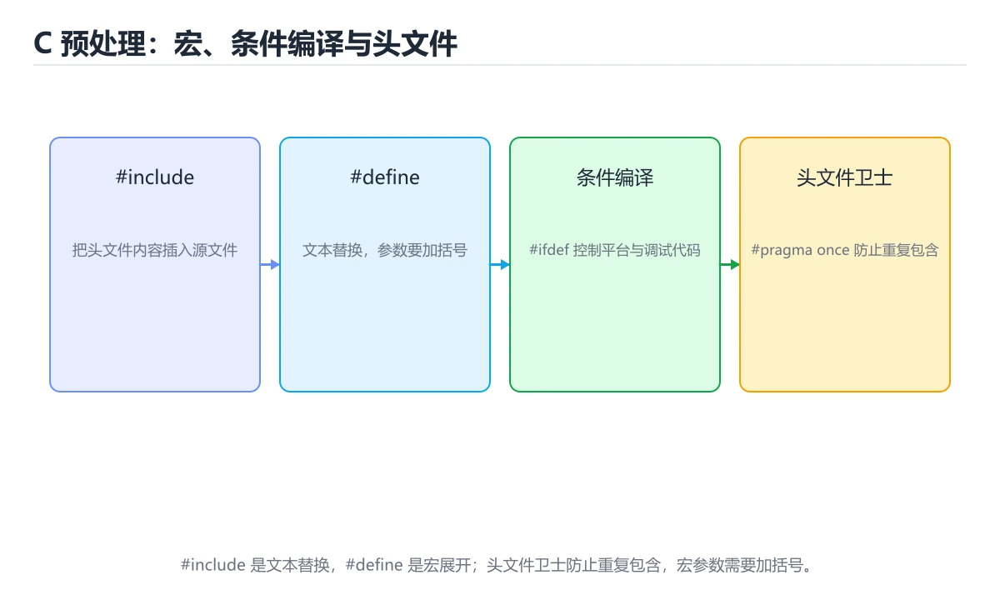
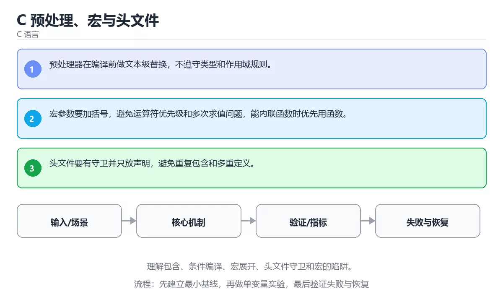

# C 预处理、宏与头文件





> 内容更新时间：2026-10-06 · 学习阶段：进阶 · 预计用时：30 分钟

## 本节知识框架

**课程定位**：所属分类 `c`（C 语言），课程主题 `C 预处理、宏与头文件`，学习阶段 进阶，建议用时 45 分钟。

本课主线：理解包含、条件编译、宏展开、头文件守卫和宏的陷阱。

**学完本课应当能够**
- 说清 `预处理器` 与 `宏` 的含义与区别，并各举一个正例和一个反例。
- 用本课示例验证 `头文件` 的行为，记录输入、输出与失败条件。
- 遇到「宏参数不加括号」这类问题时，能说出触发条件与修复顺序。

### 复习清单

- [ ] 能不看正文复述 预处理器，并指出 宏 的一个边界或反例。
- [ ] 能推演 预处理器 的示例：先写预期输出，再运行并记录差异与失败现象。
- [ ] 能完成一次自测，并把错题对照错误表定位原因。

## 核心概念定义

| 术语 | 操作性定义 | 常见边界与风险 |
| --- | --- | --- |
| 预处理器 | 在正式编译前执行宏展开、条件编译和文件包含的工具。 | 它只做文本替换，不遵守类型和作用域规则；出错时报的是展开后的位置，要先看展开结果才能定位到宏本身。 |
| 宏 | 在编译或预处理阶段展开的代码模板，可复用语法结构，但会降低可调试性。 | 易错：参数不加括号让展开后优先级算错，带副作用的实参被多次求值；参数与整体都加括号，能写成函数就不用宏。 |
| 头文件 | 二、运行时与内存模型：围绕「预处理器、宏、头文件、守卫」说明变量生命周期、资源释放、并发模型和错误传播。 | 易错：重复包含导致重复定义；正确做法是用包含卫士或 #pragma once 包住整个头文件。 |
| 条件编译 | 用 #ifdef、#ifndef 让同一份源码在不同平台或配置下编译出不同代码，头文件守卫也靠它。 | 易错：条件名拼错或宏没定义时整段分支被静默剔除，这段代码从没进过编译，换平台配置后才会暴露问题。 |

## 原理与运行机制

### 机制总览

| 阶段 | 关注对象 | 失败时应检查 |
| --- | --- | --- |
| 输入 | 预处理器 | 类型、范围、编码、版本或前置状态是否满足定义。 |
| 处理 | 宏 | 顺序、可见性、锁、路由、事务或调度规则是否被破坏。 |
| 输出 | 头文件 | 结果是否可复现，错误是否被正确传播而不是被吞掉。 |

**教材衔接：核心知识**

### 1. 预处理器在编译前做文本级替换，不遵守类型和作用域规则。

- 关键做法：先用 SQUARE 建立 预处理器 的基线，再逐步加入边界与失败条件。
- 验证标准：预处理器 的结果可复现、错误可解释、失败能恢复。

### 2. 宏参数要加括号，避免运算符优先级和多次求值问题，能内联函数时优先用函数。

把这条结论放回「C 预处理、宏与头文件」的完整流程里展开：

- 正文依据：能用自己的话解释：预处理器在编译前做文本级替换，不遵守类型和作用域规则。
- 落地检查：把「2. 宏参数要加括号，避免运算符优先级和多次求值问题，能内联函数时优先用函数。」改写成一条可执行的核对项，逐条验证输入、超时与失败路径。

### 3. 头文件要有守卫并只放声明，避免重复包含和多重定义。

把这条结论放回「C 预处理、宏与头文件」的完整流程里展开：

- 正文依据：能用自己的话解释：头文件要有守卫并只放声明，避免重复包含和多重定义。
- 落地检查：把「3. 头文件要有守卫并只放声明，避免重复包含和多重定义。」改写成一条可执行的核对项，逐条验证输入、超时与失败路径。

**教材衔接：关键流程**

**教材衔接：实践路径**

**教材衔接：语言专项实践：C 预处理、宏与头文件**

### 一、工具链

| 阶段 | 推荐工具 | 验收标准 |
| --- | --- | --- |
| 编译 | gcc/clang -Wall -Wextra -Werror | 命令可复现且错误能被定位 |
| 调试 | gdb + core dump | 命令可复现且错误能被定位 |
| 内存检查 | AddressSanitizer / Valgrind | 命令可复现且错误能被定位 |
| 构建发布 | Makefile/CMake + 静态或动态链接 | 命令可复现且错误能被定位 |

### 四、发布检查

**教材衔接：版本与时效**

- C23 已被主流编译器逐步支持，C17 仍是兼容性最好的基线；预处理器 的写法要按目标标准选择。
- 编译器对未定义行为、严格别名与对齐的优化越来越激进
- 升级时重点回归位域、可变参数、内联汇编与结构体布局
- 语言参考：https://en.cppreference.com/w/c

### 先建立一个直觉

本课的摘要可以当作一张地图：理解包含、条件编译、宏展开、头文件守卫和宏的陷阱。

### 逐步拆解

1. 澄清输入与目标。先写清「C 预处理、宏与头文件」要解决的问题、合法输入范围和成功标准，再进入后续步骤。
2. 描述处理过程。把「预处理器、宏、头文件、守卫」映射到具体步骤，每步都要求能单独验证。
3. 定义输出。明确 预处理器 与 宏 各自的产物，以及失败时留下什么证据。
4. 关掉一个看似必要的检查（宏相关），观察哪个测试或指标先失败，用证据说明它为什么不能省。
5. 用同一个预处理器输入跑两遍：一遍按正文步骤，一遍故意跳过一步，比较输出并解释为什么必须按顺序执行。

### 把正文串成一条执行链

- **三、测试策略**：- 单元测试覆盖核心规则和边界

### 从测验反推易错点

- 参考判断：预处理器在编译前做文本级替换，不遵守类型和作用域规则。
- 自问：如果去掉题干里的一个限定词，结论还成立吗？

- 参考判断：宏参数要加括号，避免运算符优先级和多次求值问题，能内联函数时优先用函数。

- 参考判断：头文件要有守卫并只放声明，避免重复包含和多重定义。

**检查点 4：本课的核心学习目标是什么？**

- 参考判断：理解包含、条件编译、宏展开、头文件守卫和宏的陷阱。

- 参考判断：main

### 变式训练

1. 把 预处理器 的实现压缩到一个进程内，去掉所有外部依赖后再谈扩展。
2. 把 SQUARE 的数据量提高一个数量级，观察延迟与内存的变化拐点。
3. 让 SQUARE 的外部依赖超时，确认系统能回滚或补偿，而不是留下脏数据。
5. 删掉一个看似必要的步骤（例如 预处理器 相关的校验），观察哪个测试或指标先失败，用证据说明它为什么不能省。
6. 限制 CPU 与内存上限后重跑 SQUARE，观察哪一项参数需要重新设定。

### 迁移案例库

下面用不同约束重复同一套方法，每轮只改变 预处理器 的一个取值并记录结论。

#### 迁移案例 1：围绕「预处理器」做一次小实验

**验收**：预处理器 的正常、边界、失败三条路径都要有结论；失败路径要写清恢复动作与「C 预处理、宏与头文件」里仍然存在的剩余风险。

#### 迁移案例 2：围绕「宏」做一次小实验

**步骤**：
1. 复述当前方案对「宏」的假设，写成一句可证伪的话。

#### 迁移案例 3：围绕「头文件」做一次小实验

**步骤**：
1. 复述当前方案对「头文件」的假设，写成一句可证伪的话。

#### 迁移案例 4：围绕「守卫」做一次小实验

**步骤**：
1. 复述当前方案对「守卫」的假设，写成一句可证伪的话。

#### 迁移案例 5：围绕「预处理器」做一次小实验

**步骤**：

#### 迁移案例 6：围绕「宏」做一次小实验

**步骤**：

#### 迁移案例 7：围绕「头文件」做一次小实验

**步骤**：

#### 迁移案例 8：围绕「守卫」做一次小实验

**步骤**：

#### 迁移案例 9：围绕「预处理器」做一次小实验

**步骤**：

#### 迁移案例 10：围绕「宏」做一次小实验

**步骤**：

#### 迁移案例 11：围绕「头文件」做一次小实验

**步骤**：

#### 迁移案例 12：围绕「守卫」做一次小实验

**步骤**：

#### 迁移案例 13：围绕「预处理器」做一次小实验

**步骤**：

#### 迁移案例 14：围绕「宏」做一次小实验

**步骤**：

#### 迁移案例 15：围绕「头文件」做一次小实验

**步骤**：

#### 迁移案例 16：围绕「守卫」做一次小实验

**步骤**：

<!-- p0-depth-v2:end -->

**教材衔接：验证步骤**

## 典型应用场景

| 场景 | 典型输入或前提 | 期望产物 |
| --- | --- | --- |
| 学习验证 | 使用本课最小示例和 预处理器、宏 | 能复现正文结论，并解释每一步。 |
| 工程落地 | 把「C 预处理、宏与头文件」放入真实模块或服务边界 | 输出可观测、失败可定位、参数可配置。 |
| 故障排查 | 只改一个版本、规模、输入或依赖条件 | 能区分概念错误、实现错误和环境差异。 |

**教材衔接：深度拓展与实战**

这一节把 预处理器 的定义、SQUARE 的代码与常见失败串成一条复习路线。

### 边界条件与常见反例

「C 预处理、宏与头文件」的边界不只包括最大最小值，还要覆盖空、重复和失败：

| 条件 | 常见反例 | 处理方式 |
| --- | --- | --- |
| 空输入 | 预处理器 没有任何取值 | 先判空，给出明确错误而不是继续执行 |
| 边界值 | 宏 取最小或最大 | 用最小值、最大值和越界值各跑一次 |
| 重复执行 | 同一输入被执行两次 | 保证结果可重复，必要时加锁或去重 |
| 失败路径 | 预处理器 相关步骤报错 | 保留原始错误，确认回滚或重试行为 |

### 工程检查表

- [ ] 能否用自己的话说明C 预处理、宏与头文件解决什么问题，以及它不负责什么？
- [ ] 能否说明 预处理器 的正常输出，以及失败时留下的错误信息？
- [ ] 能否解释本课关键词在真实项目中的边界与取舍？
- [ ] 换一个输入后，SQUARE 的判断依据是否仍然成立？

### 最小验证场景

- 准备：保留 `text` 示例的原始输入，先记录 `C 预处理、宏与头文件` 的基线输出和完整运行命令。
- 观察：先核对 调用了 `SQUARE()`，再改变一个与 `预处理器` 相关的条件。
- 判定：新结果与 `C 预处理、宏与头文件` 的基线不同不等于错误；只有当差异破坏了 `预处理器` 的定义或错误表中的约束，才判定为失败。

### 选择与边界

- 使用 `预处理器` 时，在正式编译前执行宏展开、条件编译和文件包含的工具；静态检查只在编译期成立，运行期输入仍需校验。
- 使用 `宏` 时，在编译或预处理阶段展开的代码模板，可复用语法结构，但会降低可调试性；静态检查只在编译期成立，运行期输入仍需校验。
- 使用 `头文件` 时，二、运行时与内存模型：围绕「预处理器、宏、头文件、守卫」说明变量生命周期、资源释放、并发模型和错误传播；易错：重复包含导致重复定义；正确做法是用包含卫士或 #pragma once 包住整个头文件。
- 使用 `条件编译` 时，用 #ifdef、#ifndef 让同一份源码在不同平台或配置下编译出不同代码，头文件守卫也靠它；静态检查只在编译期成立，运行期输入仍需校验。

## 代码/协议/SQL 示例

### 最小可验证示例

**教材衔接：最小可运行示例**

下面示例用于验证 预处理器 的最小输入、处理和输出。先原样运行，再只修改一个值：

```c
#include <stdio.h>

#define SQUARE(x) ((x) * (x))

int main(void) {
    printf("SQUARE(7)=%d\n", SQUARE(7));
    return 0;
}
```

**教材衔接：预期输出**

```text
SQUARE(7)=49
```

## 时间/空间复杂度或性能分析

**性能关注点（C 预处理、宏与头文件）**：内存布局与系统调用是主要成本：记录运行时间、内存占用与系统调用次数。

**本课特有开销（C 预处理、宏与头文件 · 预处理器）**：并发度提高后要观察是否出现拐点：延迟上升而吞吐不增，说明瓶颈已转移。

**测量方法**：以 `C 预处理、宏与头文件` 的 `预处理器` 场景为对象，固定输入跑一遍记录基线，再把规模或并发度提高一个数量级复测；两次结果的差值与波动范围才是结论依据。

## 常见误区与易错点

| 容易写错的做法 | 实际现象 | 原因与正确做法 |
| --- | --- | --- |
| 宏参数不加括号 | 展开后运算优先级出错。 | 参数与整体都加括号，能写成函数就不用宏。 |
| 头文件没有包含卫士 | 重复包含导致重复定义。 | 用包含卫士或 #pragma once 包住整个头文件。 |
| 宏里多次求值参数 | 带副作用的参数被计算多次。 | 改用内联函数，或先把参数存进临时变量。 |

### 现场 1：宏参数不加括号

**症状**：展开后运算优先级出错。

**根因与修复**：参数与整体都加括号，能写成函数就不用宏。

**自检**：在本课示例里复现「宏参数不加括号」，改成参数与整体都加括号，能写成函数就不用宏后重跑；如果症状消失且失败路径按预期变化，说明定位正确。

### 现场 2：头文件没有包含卫士

**症状**：重复包含导致重复定义。

**根因与修复**：用包含卫士或 #pragma once 包住整个头文件。

**自检**：在本课示例里复现「头文件没有包含卫士」，改成用包含卫士或 #pragma once 包住整个头文件后重跑；如果症状消失且失败路径按预期变化，说明定位正确。

### 现场 3：宏里多次求值参数

**症状**：带副作用的参数被计算多次。

**根因与修复**：改用内联函数，或先把参数存进临时变量。

**自检**：在本课示例里复现「宏里多次求值参数」，改成改用内联函数，或先把参数存进临时变量后重跑；如果症状消失且失败路径按预期变化，说明定位正确。

## 与其他知识点的关系

**教材衔接：复习与迁移**

### 测验回顾

1. 围绕“C 预处理、宏与头文件”中的 预处理器、宏、头文件，下列哪两项是本课强调的实践判断？
   - 依据：本课把C 预处理、宏与头文件拆成概念、示例与故障现场三部分，因此判断 预处理器 时必须同时交代输入、输出和失败路径，这使“学习 预处理器 时要同时说明输入、输出和失败路径，不能只看正常流程”成立。在C 预处理、宏与头文件里，判断 宏 时要固定版本与边界输入，所以“验证 宏 时要固定版本并覆盖边界输入，结论才可复现”才可复现。
2. 关于「宏参数要加括号，避免运算符优先级和多次求值问题，能内联函数时优先用函数。」，下列说法正确的是？
   - 依据：在「C 预处理、宏与头文件」里，宏参数要加括号，避免运算符优先级和多次求值问题，能内联函数时优先用函数。「C 预处理、宏与头文件」要求先交代预处理器、宏、头文件的前提再下结论，所以“宏参数要加括号”只在题干“宏参数要加括号”给定的条件下成立。把“宏参数要加括号”代回「C 预处理、宏与头文件」里“宏参数要加括号”的例子核对，条件一旦改变，结论就要用预处理器、宏、头文件重新推导。
3. 关于「头文件要有守卫并只放声明，避免重复包含和多重定义。」，下列说法正确的是？
   - 依据：在「C 预处理、宏与头文件」里，头文件要有守卫并只放声明，避免重复包含和多重定义。「C 预处理、宏与头文件」要求先交代预处理器、宏、头文件的前提再下结论，所以“头文件要有守卫并只放声明”只在题干“头文件要有守卫并只放声明”给定的条件下成立。把“头文件要有守卫并只放声明”代回「C 预处理、宏与头文件」里“头文件要有守卫并只放声明”的例子核对，条件一旦改变，结论就要用预处理器、宏、头文件重新推导。
4. 「C 预处理、宏与头文件」的核心学习目标是什么？
   - 依据：在「C 预处理、宏与头文件」里，结论应落在「理解包含、条件编译、宏展开、头文件守卫和宏的陷阱」。在「C 预处理、宏与头文件」里，结论应落在理解包含、条件编译、宏展开、头文件守卫和宏的陷阱。在「C 预处理、宏与头文件」里，这道题要求区分概念与边界，理解包含、条件编译、宏展开、头文件守卫和宏的陷阱。
5. 补全代码：「C 预处理、宏与头文件」示例中，下面这行代码缺少哪个关键字或函数名？请填入 ____。

## 自测题与参考答案

> 先独立作答，再对照参考答案；答案都能在本课正文、术语表或错误表里找到依据。

### 自测 1（概念复述）

不看正文，写出 `预处理器` 的操作性定义，并说明它与 `宏` 的区别。

**参考答案**：在正式编译前执行宏展开、条件编译和文件包含的工具。

`宏` 的定位是：在编译或预处理阶段展开的代码模板，可复用语法结构，但会降低可调试性；两者的差别要从适用对象与失败模式上说明。

### 自测 2（排错）

本课错误表记录了「宏参数不加括号」这类做法。请写出它会出现的现象、根因，以及修复顺序。

**参考答案**：现象是展开后运算优先级出错；正确做法是参数与整体都加括号，能写成函数就不用宏。修复时先复现现象并保留证据，再改动一处假设重跑，确认现象消失。

### 自测 3（动手验证）

运行本课的 `text` 示例，改动一个与 预处理器 有关的输入后重跑，记录输出与错误信息。

**参考答案**：正常输入下 `text` 示例应当复现正文给出的结果；改动输入后，如果结果改变或报错，先核对它是否满足 `C 预处理、宏与头文件` 中`预处理器` 的适用范围，再检查错误表里是否有同类现象。

### 自测 4（代码阅读）

阅读本课开头的 `text` 示例，说明它体现了`预处理器` 的哪一条性质，并指出改动哪个输入会让这条性质不再成立。

**参考答案**：`预处理器` 的定义是 在正式编译前执行宏展开、条件编译和文件包含的工具，示例正是在实现这条定义。改动与 `预处理器` 有关的一个输入后，如果结果不再符合 `C 预处理、宏与头文件` 的正文描述，就说明该性质只在当前前提成立。

### 自测 5（迁移）

把 `C 预处理、宏与头文件` 的方法迁移到自己的项目：围绕 `预处理器` 写出一个与错误表同类的风险点，并说明触发条件和检验方式。

**参考答案**：例如「宏里多次求值参数」，它会导致带副作用的参数被计算多次；检验方式是按改用内联函数，或先把参数存进临时变量改一处再复现，确认现象消失且没有引入新的失败分支。

### 自测 6（对比）

用一个表格对比 `预处理器` 与 `宏`：各写一行适用场景、一行失败表现。

**参考答案**：`预处理器` 的定义是在正式编译前执行宏展开、条件编译和文件包含的工具；`宏` 的定义是在编译或预处理阶段展开的代码模板，可复用语法结构，但会降低可调试性。两者的失败表现分别对应本课错误表里与本术语相关的行。

### 自测 7（排错顺序）

面对「宏参数不加括号」引发的问题，请把“复现 展开后运算优先级出错 → 保留证据 → 参数与整体都加括号，能写成函数就不用宏 → 回归验证”四步写成可执行的检查清单。

**参考答案**：第一步按展开后运算优先级出错复现；第二步记录输入、版本与完整报错；第三步按参数与整体都加括号，能写成函数就不用宏只改一处；第四步重跑并确认失败路径也按预期变化。

### 自测 8（边界判断）

针对 `条件编译`，分别写出“可以使用”的条件和“结论不再成立”的条件。

**参考答案**：静态检查只在编译期成立，运行期输入仍需校验。 同时要把 `条件编译` 的定义 用 #ifdef、#ifndef 让同一份源码在不同平台或配置下编译出不同代码，头文件守卫也靠它 与实际输入逐项对照。

### 自测 9（机制重建）

不看正文，按输入、转换、输出、验证四段重建 `预处理器` → `宏` → `头文件` → `条件编译` 的作用链。

**参考答案**：起点是 `预处理器` 的定义 在正式编译前执行宏展开、条件编译和文件包含的工具；中间每一步都保留可观察状态；终点由 `条件编译` 检查，失败时回到错误表定位第一个偏离定义的步骤。

### 自测 10（综合排错）

在 `C 预处理、宏与头文件` 中，现象是 带副作用的参数被计算多次。请围绕 宏里多次求值参数 写出最小复现、关键证据、修复动作和回归验证，并说明为什么不能只凭一次运行下结论。

**参考答案**：先复现 宏里多次求值参数，记录输入与完整错误；再按 改用内联函数，或先把参数存进临时变量 只改一处。回归时同时跑正常路径和边界路径，只有两次结果都可解释，才把修复视为完成。

### 自测 11（一分钟复述）

用每分钟约 200 字的速度复述 `C 预处理、宏与头文件`：先给主问题，再按顺序说出 `预处理器`、`宏`、`头文件`、`条件编译`，最后给一个失败案例。

**自评标准**：主问题必须对应 理解包含、条件编译、宏展开、头文件守卫和宏的陷阱；每个术语都要能接上一句定义或边界；失败案例必须写成可观察现象，不能用“可能有风险”代替证据。

## 术语速查

| 术语 | 一句话说明 |
| --- | --- |
| `预处理器` | 在正式编译前执行宏展开、条件编译和文件包含的工具。 |
| `宏` | 在编译或预处理阶段展开的代码模板，可复用语法结构，但会降低可调试性。 |
| `头文件` | 二、运行时与内存模型：围绕「预处理器、宏、头文件、守卫」说明变量生命周期、资源释放、并发模型和错误传播。 |
| `条件编译` | 用 #ifdef、#ifndef 让同一份源码在不同平台或配置下编译出不同代码，头文件守卫也靠它。 |

**术语关系**：`预处理器`（在正式编译前执行宏展开、条件编译和文件包含的工具） → `宏`（在编译或预处理阶段展开的代码模板） → `头文件`（二、运行时与内存模型：围绕「预处理器、宏、头文件、守卫」说明变量生命周期、资源释放、并发模型和错误传播） → `条件编译`（用 #ifdef、#ifndef 让同一份源码在不同平台或配置下编译出不同代码）。

## 考点精讲

`C 预处理、宏与头文件` 的题库有 6 道题，下面逐题给出题干、正确项与判断依据：先自己作答，再核对正确项，最后回到正文对应小节复核。

### 考点 1：第 1 题

- **题目**：围绕“C 预处理、宏与头文件”中的 预处理器、宏、头文件，下列哪两项是本课强调的实践判断？
- **正确项**：验证 宏 时要固定版本并覆盖边界输入，结论才可复现；学习 预处理器 时要同时说明输入、输出和失败路径，不能只看正常流程
- **判断依据**：按《C 预处理、宏与头文件》的正文口径，本题要同时选中「验证 宏 时要固定版本并覆盖边界输入，结论才可复现」、「学习 预处理器 时要同时说明输入、输出和失败路径，不能只看正常流程」，漏掉任一项都算没答全。术语 预处理器（C 预处理、宏与头文件）：在正式编译前执行宏展开、条件编译和文件包含的工具。易错点是宏参数不加括号，会造成展开后运算优先级出错，改法是参数与整体都加括号，能写成函数就不用宏。

### 考点 2：第 2 题

- **题目**：在 `C 预处理、宏与头文件` 里，与 `预处理器` 有关的说法中，哪一项最符合理解包含、条件编译、宏展开、头文件守卫和宏的陷阱？
- **正确项**：宏参数要加括号，避免运算符优先级和多次求值问题
- **判断依据**：本题正确项是「宏参数要加括号，避免运算符优先级和多次求值问题」。术语 预处理器（C 预处理、宏与头文件）：在正式编译前执行宏展开、条件编译和文件包含的工具，本题取「宏参数要加括号，避免运算符优先级和多次求值问题」这条。易错点是头文件没有包含卫士，会造成重复包含导致重复定义，改法是用包含卫士或 #pragma once 包住整个头文件。

### 考点 3：第 3 题

- **题目**：在 `C 预处理、宏与头文件` 里，与 `预处理器` 有关的说法中，哪一项最符合理解包含、条件编译、宏展开、头文件守卫和宏的陷阱？（C 预处理、宏与头文件·C 语言 第 3 题）
- **正确项**：头文件要有守卫并只放声明，避免重复包含和多重定义。
- **判断依据**：本题正确项是「头文件要有守卫并只放声明，避免重复包含和多重定义」。术语 预处理器（C 预处理、宏与头文件）：在正式编译前执行宏展开、条件编译和文件包含的工具，本题取「头文件要有守卫并只放声明，避免重复包含和多重定义」这条。易错点是宏里多次求值参数，会造成带副作用的参数被计算多次，改法是改用内联函数，或先把参数存进临时变量。

### 考点 4：第 4 题

- **题目**：`C 预处理、宏与头文件` 的主线是：理解包含、条件编译、宏展开、头文件守卫和宏的陷阱。下面哪一项与这条主线一致？
- **正确项**：理解包含、条件编译、宏展开、头文件守卫和宏的陷阱。
- **判断依据**：本题正确项是「理解包含、条件编译、宏展开、头文件守卫和宏的陷阱」。术语 宏（C 预处理、宏与头文件）：在编译或预处理阶段展开的代码模板，可复用语法结构，但会降低可调试性，本题取「理解包含、条件编译、宏展开、头文件守卫和宏的陷阱」这条。易错点是宏参数不加括号，会造成展开后运算优先级出错，改法是参数与整体都加括号，能写成函数就不用宏。

### 考点 5：第 5 题

- **题目**：填空：补齐下面这段术语说明中的空缺。课程 `理解包含、条件编译、宏展开、头文件守卫和宏的陷阱。`，这段说明是：`____`：用 #ifdef、#ifndef 让同一份源码在不同平台或配置下编译出不同代码，头文件守卫也靠它。空缺处应填哪个术语？
- **正确项**：条件编译
- **判断依据**：《C 预处理、宏与头文件》这题的填空口径是「条件编译」，正文写法与其中任一项一致即可。术语「宏」在本课里的界定是在编译或预处理阶段展开的代码模板，可复用语法结构，但会降低可调试性，题干问的就是这一条。常见错法是宏参数不加括号，其后果是展开后运算优先级出错。正确做法是参数与整体都加括号，能写成函数就不用宏。

### 考点 6：第 6 题

- **题目**：`C 预处理、宏与头文件` 的示例代码服务于“理解包含、条件编译、宏展开、头文件守卫和宏的陷阱。”哪一条判断是正确的？
- **正确项**：预处理器在编译前做文本级替换，不遵守类型和作用域规则。
- **判断依据**：本题正确项是「预处理器在编译前做文本级替换，不遵守类型和作用域规则」。术语 预处理器（C 预处理、宏与头文件）：在正式编译前执行宏展开、条件编译和文件包含的工具，本题取「预处理器在编译前做文本级替换，不遵守类型和作用域规则」这条。易错点是宏里多次求值参数，会造成带副作用的参数被计算多次，改法是改用内联函数，或先把参数存进临时变量。

### 考点 7：`预处理器`

- **要点**：在正式编译前执行宏展开、条件编译和文件包含的工具。
- **预处理器 的边界**：静态检查只在编译期成立，运行期输入仍需校验。

### 考点 8：`宏`

- **要点**：在编译或预处理阶段展开的代码模板，可复用语法结构，但会降低可调试性。
- **宏 的边界**：静态检查只在编译期成立，运行期输入仍需校验。

### 考点 9：`头文件`

- **要点**：二、运行时与内存模型：围绕「预处理器、宏、头文件、守卫」说明变量生命周期、资源释放、并发模型和错误传播。
- **头文件 的边界**：易错：重复包含导致重复定义；正确做法是用包含卫士或 #pragma once 包住整个头文件。

### 考点 10：`条件编译`

- **要点**：用 #ifdef、#ifndef 让同一份源码在不同平台或配置下编译出不同代码，头文件守卫也靠它。
- **条件编译 的边界**：静态检查只在编译期成立，运行期输入仍需校验。

### 考点 11：排错——宏参数不加括号

- **现象**：展开后运算优先级出错。
- **处理**：参数与整体都加括号，能写成函数就不用宏。

### 考点 12：排错——头文件没有包含卫士

- **现象**：重复包含导致重复定义。
- **处理**：用包含卫士或 #pragma once 包住整个头文件。

### 考点 13：综合辨析——`预处理器` 与 `条件编译`

- **辨析点**：`预处理器` 的定义是 在正式编译前执行宏展开、条件编译和文件包含的工具；`条件编译` 的定义是 用 #ifdef、#ifndef 让同一份源码在不同平台或配置下编译出不同代码，头文件守卫也靠它。
- **答题要求**：面对 `C 预处理、宏与头文件` 的题目，先判断描述的是 `预处理器` 还是 `条件编译`，再归到对应定义，最后写出一个会让该定义失效的边界输入。

### 考点 14：排错评分点

- **现象分**：能写出 展开后运算优先级出错，而不是只写“程序有错”。
- **证据分**：保留触发 宏参数不加括号 的输入、版本和错误原文。
- **修复分**：按 参数与整体都加括号，能写成函数就不用宏 只改一处，并同时回归正常路径与边界路径。

## 内容元数据

- 内容版本：v2.0
- 最后更新：2026-10-06
- 学习阶段：进阶
- 适用环境：C11 / GCC 或 Clang；本课聚焦 预处理器。
- 内容来源：内置结构化课程与工程实践整理
- 相关主题：预处理器、宏、头文件、守卫
- 质量版本：P0 测验标准 + P1 覆盖扩展 + P2 体验补全

## 参考资料与复核

- 最后复核：2026-10-04
- 下次复核：2026-11-17
- 复核范围：版本兼容、API 行为、安全建议与工程实践
- 来源性质：官方文档、标准或权威教材；本课核对关键词：预处理器、宏、头文件、守卫。

| 参考资料 | 本课用途 |
| --- | --- |
| [GCC 文档](https://gcc.gnu.org/onlinedocs/) | 编译、链接与警告选项 |
| [GDB 文档](https://sourceware.org/gdb/documentation/) | C 程序调试与崩溃定位 |
| [POSIX 标准](https://pubs.opengroup.org/onlinepubs/9799919799/) | 可移植系统接口标准 |

| [本课术语索引：C 预处理、宏与头文件](#核心概念定义) | 按本课输入、术语边界和错误表现逐项核对 |
> 「C 预处理、宏与头文件」的链接用于离线阅读后的延伸核对；App 不会自动联网。