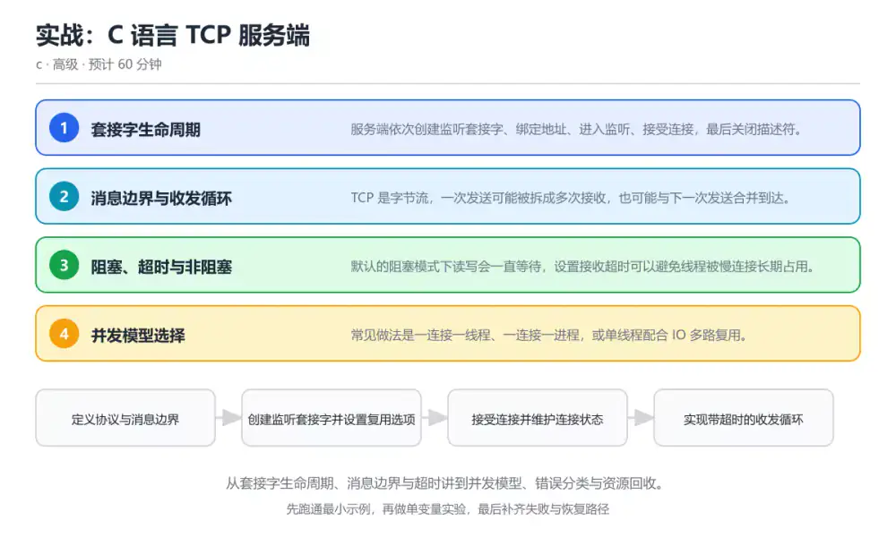
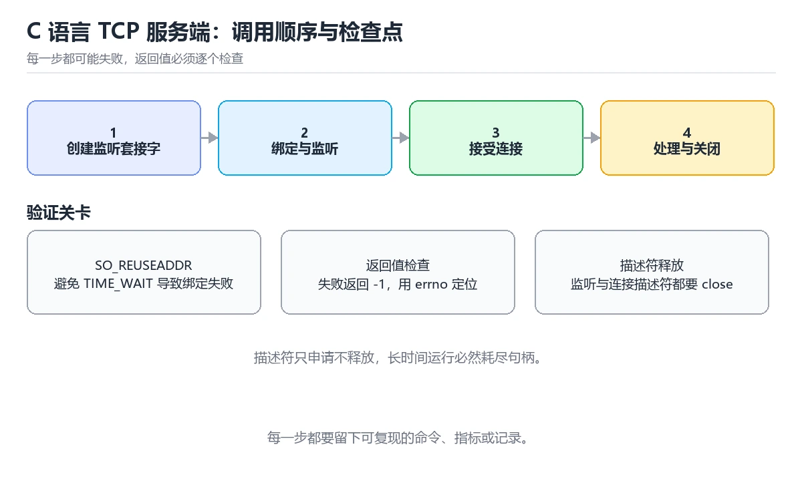

# 实战：C 语言 TCP 服务端

> 内容更新时间：2026-10-06 · 学习阶段：高级 · 预计用时：60 分钟

分类：c。关键词：socket、TCP、文件描述符、IO 多路复用、资源回收。从套接字生命周期、消息边界与超时讲到并发模型、错误分类与资源回收。



## 本节知识框架

**课程定位**：所属分类 `c`（C 语言），课程主题 `实战：C 语言 TCP 服务端`，学习阶段 高级，建议用时 60 分钟。

本课主线：从套接字生命周期、消息边界与超时讲到并发模型、错误分类与资源回收。

**学完本课应当能够**
- 说清 `监听套接字` 与 `文件描述符` 的含义与区别，并各举一个正例和一个反例。
- 用本课示例验证 `消息边界` 的行为，记录输入、输出与失败条件。
- 遇到「把一次 read 当成一条完整消息」这类问题时，能说出触发条件与修复顺序。

### 复习清单

- [ ] 能不看正文复述本课核心术语，并指出一个边界或反例。
- [ ] 能运行或推演本课示例，记录输入、输出与失败现象。
- [ ] 能完成一次自测，并把错题对照错误表定位原因。

**本课配图**



## 核心概念定义

| 术语 | 操作性定义 | 常见边界与风险 |
| --- | --- | --- |
| 监听套接字 | 只用于接受新连接的套接字，不承载业务数据。 | 业务读写要落在 accept 返回的新描述符上，对着它收发会绕过连接约定，回收时也分不清该关哪一个。 |
| 文件描述符 | 进程访问套接字、文件等资源的整数句柄。 | 易错：异常路径直接 return 跳过 close 造成描述符泄漏，耗尽上限后 accept 持续失败；要用统一清理出口回收每个已获取的描述符。 |
| 消息边界 | 描述一条完整消息从哪开始到哪结束的约定。 | 字节流本身不带分隔符：把一次 read 当成一条完整消息，高负载或大消息时会随机切错、协议时好时坏。 |
| IO 多路复用 | 在单线程中同时等待多个描述符事件的机制。 | 单线程扛大量空闲连接的代价是业务不能阻塞事件循环：在里面解析大文件或密集计算会让所有连接一起变慢，耗时要交给工作线程。 |
| 可重试错误 | 被信号打断等可以安全重做的错误类型。 | 易错：把致命错误也当可重试，结果忙等不停；示例里只对 `EINTR` 继续循环，其余错误交给调用方按对端关闭与致命分类处置。 |
| TCP | TCP 是字节流，没有消息边界 | 一次发送可能被拆成多次接收、也可能与下条合并到达，所以长度字段与上限校验要自己定；本课用 4 字节前缀，`len` 超 4096 直接拒绝。 |

## 原理与运行机制

### 机制总览

**教材衔接：核心知识**

### 1. 套接字生命周期

服务端依次创建监听套接字、绑定地址、进入监听、接受连接，最后关闭描述符。

监听套接字只负责接收新连接，每次 accept 会返回一个新的已连接描述符，读写与关闭都针对这个新描述符。

在实战：C 语言 TCP 服务端里可以这样验证：打印监听描述符与每个连接描述符的值，观察它们在多次连接中的复用情况。

边界：忘记关闭已连接描述符会耗尽进程可用的描述符上限，表现为 accept 开始持续失败。

工程视角：把描述符的获取与释放写在同一处，配合集中式的错误处理标签统一回收。

### 2. 消息边界与收发循环

TCP 是字节流，一次发送可能被拆成多次接收，也可能与下一次发送合并到达。

接收方通常先读固定长度的长度字段，再按长度读取剩余字节；写入时则要循环直到全部字节发出。

在实战：C 语言 TCP 服务端里可以这样验证：连续发送两条小消息，用很小的接收缓冲区观察它们被合并成一次读取。

边界：假设一次 read 就是一条消息会让协议在高负载或大消息时随机出错。

工程视角：把编解码抽成独立函数，并给消息长度设置上限以防恶意超长字段。

### 3. 阻塞、超时与非阻塞

默认的阻塞模式下读写会一直等待，设置接收超时可以避免线程被慢连接长期占用。

通过套接字选项设置超时，超时后读写返回错误码并置位可重试标记，程序据此决定重试还是关闭连接。

在实战：C 语言 TCP 服务端里可以这样验证：连接一个只建立连接却不发数据的客户端，观察服务端在超时后是否主动关闭。

边界：把超时当成致命错误会让正常的长连接被误杀，把致命错误当成超时重试则会造成忙等。

工程视角：把错误码分类成可重试、对端关闭与致命三类，并为每类定义明确动作。

### 4. 并发模型选择

常见做法是一连接一线程、一连接一进程，或单线程配合 IO 多路复用。

多路复用把多个描述符的读写事件集中到一次等待，单线程即可处理大量空闲连接，代价是业务逻辑不能阻塞事件循环。

在实战：C 语言 TCP 服务端里可以这样验证：用多路复用实现回声服务，接入一千个空闲连接观察内存与 CPU 占用。

边界：在事件循环里执行耗时计算或阻塞磁盘读写，会让所有连接一起变慢。

工程视角：把耗时任务交给工作线程或进程，事件循环只负责收发事件与状态机推进。

**教材衔接：关键流程**

```text
定义协议与消息边界 → 创建监听套接字并设置复用选项 → 接受连接并维护连接状态 → 实现带超时的收发循环 → 压测后统一回收资源并复盘
```

1. 定义协议与消息边界
2. 创建监听套接字并设置复用选项
3. 接受连接并维护连接状态
4. 实现带超时的收发循环
5. 压测后统一回收资源并复盘

**教材衔接：交付评审：评分表、决策记录与证据链**

### 一、「实战：C 语言 TCP 服务端」的交付物评分表

| 交付物 | 权重 | 合格线 | 需要的证据 |
| --- | ---: | --- | --- |
| 可运行代码：包含c源文件、依赖说明与启动入口。 | 25% | 能在干净环境复现，且失败路径有明确处理 | 命令与输出、对应测试、一次失败与恢复记录 |
| README：环境版本、启动命令、目录结构与已知限制。 | 25% | 能在干净环境复现，且失败路径有明确处理 | 命令与输出、对应测试、一次失败与恢复记录 |
| 测试记录：正常、边界与失败路径各至少一条，附命令与输出。 | 25% | 能在干净环境复现，且失败路径有明确处理 | 命令与输出、对应测试、一次失败与恢复记录 |
| 复盘记录：本次实现推翻了哪个假设，下一步验证动作是什么。 | 25% | 能在干净环境复现，且失败路径有明确处理 | 命令与输出、对应测试、一次失败与恢复记录 |

### 二、需要写下来的决策（ADR）

| 决策点 | 本课给出的做法 | 备选方案 | 代价与回滚 |
| --- | --- | --- | --- |
| 2. 消息边界与收发循环 | TCP 是字节流，一次发送可能被拆成多次接收，也可能与下一次发送合并到达。 | 不做「2. 消息边界与收发循环」，沿用最朴素的实现（需要额外补一次对照实验） | 若「2. 消息边界与收发循环」出问题，回到上一版本并按本课验收场景重跑 |
| 4. 并发模型选择 | 常见做法是一连接一线程、一连接一进程，或单线程配合 IO 多路复用。 | 不做「4. 并发模型选择」，沿用最朴素的实现（需要额外补一次对照实验） | 若「4. 并发模型选择」出问题，回到上一版本并按本课验收场景重跑 |
| 里程碑 | 1. 定义协议与消息边界 | 不做「里程碑」，沿用最朴素的实现（需要额外补一次对照实验） | 若「里程碑」出问题，回到上一版本并按本课验收场景重跑 |

### 三、「实战：C 语言 TCP 服务端」的交付证据链

本课未给出可执行命令，用下面的最小证据集代替：

### 四、「实战：C 语言 TCP 服务端」的验收指标

| 指标 | 目标值 | 测量方式 | 不达标时的动作 |
| --- | --- | --- | --- |
| 消息还原正确性 | 分片与合并到达的报文都按 4 字节长度前缀原样回显，`len` 超过 4096 的被拒绝 | 用 `nc` 连 9000 端口先后发两条小消息和一条超长消息，比对回显字节数与长度上限 | 检查 `read_full` 是否在 `got < need` 时循环读满，先修头部解析再重发同一组报文 |
| 描述符回收 | 每次连接结束后进程持有的描述符数回到基线 | 反复建立并关闭连接，盯 `close(conn_fd)` 之后的描述符计数以及 `accept` 是否开始持续失败 | 找出异常路径上直接 return 而跳过 close 的分支，改为集中式清理出口后重压一轮 |
| 错误分类完整度 | 可重试（`EINTR`）、对端关闭（`read` 返回 0）与致命三类各有明确动作 | 分别注入信号打断、客户端正常断开、非法描述符，核对日志走的是重试、关闭还是上报 | 补齐缺的那一类，既防止致命错误被当成超时而忙等，也防止超时被当成致命错误误杀长连接 |
| 空闲连接承载量 | 单线程多路复用回声服务稳定接住 1000 个空闲连接 | 接入 1000 个连接记录内存与 CPU，再提高一个数量级找延迟上升而吞吐不增的拐点 | 把收发循环里的耗时计算与阻塞磁盘读写交给工作线程，事件循环只推进状态机 |
| 重启可绑定性 | kill 后立刻重启仍能在 9000 端口 `bind` 成功 | 连续停止并重启服务三次，记下 `bind` 返回值与 perror 输出 | 确认 `SO_REUSEADDR` 在 bind 之前设置，并核对 `listen(listen_fd, 128)` 的队列长度 |

### 五、评审记录模板

| 记录项 | 填写要求 |
| --- | --- |
| 项目标识 | `c_project_tcp_server` |
| 本次范围 | 说明这一轮交付了「实战：C 语言 TCP 服务端」的哪些部分 |
| 未完成项 | 列出与 socket 相关但本轮未做的内容 |
| 证据位置 | 指向 evidence/ 目录下的具体文件 |
| 风险与回滚 | 写清剩余风险、回滚步骤和验证方式 |
| 结论 | 通过 / 有条件通过 / 不通过，三者选一 |

## 典型应用场景

**教材衔接：项目专属规格**

### 交付目标

从套接字生命周期、消息边界与超时讲到并发模型、错误分类与资源回收。

### 里程碑

1. 定义协议与消息边界
2. 创建监听套接字并设置复用选项
3. 接受连接并维护连接状态
4. 实现带超时的收发循环
5. 压测后统一回收资源并复盘

### 输入与约束

- 输入：用 nc 或自写客户端验证长度前缀协议，确认大消息与分片发送都能正确还原。
- 约束：忘记关闭已连接描述符会耗尽进程可用的描述符上限，表现为 accept 开始持续失败。
- 失败预算：先读固定长度的头部，再循环读满消息体

### 验收场景

1. 正常路径：跑通「可运行练习」里的最小示例并保存输出。
2. 边界路径：打印监听描述符与每个连接描述符的值，观察它们在多次连接中的复用情况。
3. 失败路径：出现「读一次就认为拿到了客户端发送的全部内容」时按上面的失败预算恢复。

**教材衔接：项目交付物**

- 可运行代码：包含c源文件、依赖说明与启动入口。
- README：环境版本、启动命令、目录结构与已知限制。
- 测试记录：socket 的正常、边界与失败路径各至少一条，附命令与输出。
- 复盘记录：写下 SO_REUSEADDR 的哪条假设被推翻，以及下一次验证怎么做。

### 交付验收清单

- [ ] 能写出包含创建、绑定、监听、接受与关闭的完整套接字流程。
- [ ] 能设计消息边界，避免把两次发送当成一条完整消息。
- [ ] 能为连接设置超时并区分可重试错误与致命错误。

- **把一次 read 当成一条完整消息**：典型现象是读一次就认为拿到了客户端发送的全部内容；正确做法是先读固定长度的头部，再循环读满消息体。
- **连接描述符泄漏**：典型现象是异常路径直接 return，跳过了 close；正确做法是用统一的清理出口回收所有已获取的描述符。
- **在事件循环里执行耗时任务**：典型现象是在收发循环里解析大文件或做密集计算；正确做法是把耗时任务交给工作线程，事件循环只推进状态机。

### 最小验证场景

- 准备：保留 `text` 示例的原始输入，先记录 `实战：C 语言 TCP 服务端` 的基线输出和完整运行命令。
- 判定：新结果与 `实战：C 语言 TCP 服务端` 的基线不同不等于错误；只有当差异破坏了 `监听套接字` 的定义或错误表中的约束，才判定为失败。

### 选择与边界

- 使用 `监听套接字` 时，先满足它的定义：只用于接受新连接的套接字，不承载业务数据。
- 使用 `文件描述符` 时，先满足它的定义：进程访问套接字、文件等资源的整数句柄；共享状态与调度顺序会改变结论，单线程或串行测试通过不等于并发下成立。
- 使用 `消息边界` 时，先满足它的定义：描述一条完整消息从哪开始到哪结束的约定。
- 使用 `IO 多路复用` 时，先满足它的定义：在单线程中同时等待多个描述符事件的机制；共享状态与调度顺序会改变结论，单线程或串行测试通过不等于并发下成立。
- 使用 `可重试错误` 时，先满足它的定义：被信号打断等可以安全重做的错误类型；静态检查只在编译期成立，运行期输入仍需校验。

## 代码/协议/SQL 示例

### 最小可验证示例

**教材衔接：验证命令与预期输出**

| 步骤 | 命令 | 预期输出 |
| --- | --- | --- |
| 准备环境 | 按 README 安装依赖 | 依赖安装完成且没有版本冲突 |
| 运行示例 | 运行「可运行练习」中的入口 | 用 nc 或自写客户端按长度前缀发送数据，服务端原样回显；发送超过长度上限的消息会被拒绝；停止客户端后服务端不报错，进程继续接受新连接。 |
| 边界输入 | 替换一个输入后重跑 | 结果仍能被正文机制解释 |
| 失败演练 | 按「故障现场」制造一次失败 | 能定位根因并恢复到正常输出 |

### 验收证据

- [ ] 保存一次成功运行的完整输出。
- [ ] 保存一次边界输入的输出与解释。
- [ ] 记录一次失败现象、根因与修复动作。

> 项目目标：实战：C 语言 TCP 服务端 的每一步都要能复现，做不到复现就先缩小范围。

**教材衔接：原文最小示例**

```c
#include <arpa/inet.h>
#include <errno.h>
#include <stdio.h>
#include <string.h>
#include <sys/socket.h>
#include <unistd.h>

static int read_full(int fd, char *buf, size_t need) {
    size_t got = 0;
    while (got < need) {
        const ssize_t n = read(fd, buf + got, need - got);
        if (n == 0) return 0;                       // 对端正常关闭
        if (n < 0) {
            if (errno == EINTR) continue;           // 被信号打断，可重试
            return -1;                              // 其它错误交给调用方分类
        }
        got += (size_t)n;
    }
    return 1;
}

int main(void) {
    const int listen_fd = socket(AF_INET, SOCK_STREAM, 0);
    if (listen_fd < 0) { perror("socket"); return 1; }
    int reuse = 1;
    setsockopt(listen_fd, SOL_SOCKET, SO_REUSEADDR, &reuse, sizeof(reuse));

    struct sockaddr_in addr;
    memset(&addr, 0, sizeof(addr));
    addr.sin_family = AF_INET;
    addr.sin_addr.s_addr = htonl(INADDR_ANY);
    addr.sin_port = htons(9000);

    if (bind(listen_fd, (struct sockaddr *)&addr, sizeof(addr)) < 0) {
        perror("bind");
        close(listen_fd);
        return 1;
    }
    if (listen(listen_fd, 128) < 0) { perror("listen"); close(listen_fd); return 1; }

    for (;;) {
        const int conn_fd = accept(listen_fd, NULL, NULL);
        if (conn_fd < 0) {
            if (errno == EINTR) continue;
            perror("accept");
            break;
        }
        char header[4];
        const int ok = read_full(conn_fd, header, sizeof(header));
        if (ok == 1) {
            const unsigned len = ((unsigned char)header[0] << 24) |
                                 ((unsigned char)header[1] << 16) |
                                 ((unsigned char)header[2] << 8) |
                                 (unsigned char)header[3];
            if (len <= 4096) {
                char body[4097] = {0};
                if (read_full(conn_fd, body, len) == 1) write(conn_fd, body, len);
            }
        }
        close(conn_fd);            // 每个连接描述符都必须显式关闭
    }
    close(listen_fd);
    return 0;
}
```

## 时间/空间复杂度或性能分析

**性能关注点（实战：C 语言 TCP 服务端）**：内存布局与系统调用是主要成本：记录运行时间、内存占用与系统调用次数。

**本课特有开销（实战：C 语言 TCP 服务端 · socket）**：并发度提高后要观察是否出现拐点：延迟上升而吞吐不增，说明瓶颈已转移。

**测量方法**：以 `实战：C 语言 TCP 服务端` 的 `socket` 场景为对象，固定输入跑一遍记录基线，再把规模或并发度提高一个数量级复测；两次结果的差值与波动范围才是结论依据。

## 常见误区与易错点

| 容易写错的做法 | 实际现象 | 原因与正确做法 |
| --- | --- | --- |
| 把一次 read 当成一条完整消息 | 读一次就认为拿到了客户端发送的全部内容。 | 先读固定长度的头部，再循环读满消息体。 |
| 连接描述符泄漏 | 异常路径直接 return，跳过了 close。 | 用统一的清理出口回收所有已获取的描述符。 |
| 在事件循环里执行耗时任务 | 在收发循环里解析大文件或做密集计算。 | 把耗时任务交给工作线程，事件循环只推进状态机。 |

### 现场 1：把一次 read 当成一条完整消息

**症状**：读一次就认为拿到了客户端发送的全部内容。

**根因与修复**：先读固定长度的头部，再循环读满消息体。

**自检**：在本课示例里复现「把一次 read 当成一条完整消息」，改成先读固定长度的头部，再循环读满消息体后重跑；如果症状消失且失败路径按预期变化，说明定位正确。

### 现场 2：连接描述符泄漏

**症状**：异常路径直接 return，跳过了 close。

**根因与修复**：用统一的清理出口回收所有已获取的描述符。

**自检**：在本课示例里复现「连接描述符泄漏」，改成用统一的清理出口回收所有已获取的描述符后重跑；如果症状消失且失败路径按预期变化，说明定位正确。

### 现场 3：在事件循环里执行耗时任务

**症状**：在收发循环里解析大文件或做密集计算。

**根因与修复**：把耗时任务交给工作线程，事件循环只推进状态机。

**自检**：在本课示例里复现「在事件循环里执行耗时任务」，改成把耗时任务交给工作线程，事件循环只推进状态机后重跑；如果症状消失且失败路径按预期变化，说明定位正确。

## 与其他知识点的关系

| 关系 | 课程 | 为什么 |
| --- | --- | --- |
| 先修 | 《C 调试、Sanitizer 与性能》 | 本课会直接使用它的概念或操作前提。 |
| 前置顺序 | 《实战：C 命令行任务管理器》 | 同分类中安排在本课之前，建议先完成其自测。 |

**教材衔接：复习与迁移**

## 自测题与参考答案

> 先独立作答，再对照参考答案；答案都能在本课正文、术语表或错误表里找到依据。

### 自测 1（概念复述）

不看正文，写出 `监听套接字` 的操作性定义，并说明它与 `文件描述符` 的区别。

**参考答案**：只用于接受新连接的套接字，不承载业务数据。

`文件描述符` 的定位是：进程访问套接字、文件等资源的整数句柄；两者的差别要从适用对象与失败模式上说明。

### 自测 2（排错）

本课错误表记录了「把一次 read 当成一条完整消息」这类做法。请写出它会出现的现象、根因，以及修复顺序。

**参考答案**：现象是读一次就认为拿到了客户端发送的全部内容；正确做法是先读固定长度的头部，再循环读满消息体。修复时先复现现象并保留证据，再改动一处假设重跑，确认现象消失。

### 自测 3（动手验证）

运行本课的 `text` 示例，改动其中一个输入后重新运行，记录输出与错误信息。

**参考答案**：正常输入下 `text` 示例应当复现正文给出的结果；改动输入后，如果结果改变或报错，先核对它是否满足 `实战：C 语言 TCP 服务端` 中`监听套接字` 的适用范围，再检查错误表里是否有同类现象。

### 自测 4（代码阅读）

阅读本课开头的 `text` 示例，说明它体现了`监听套接字` 的哪一条性质，并指出改动哪个输入会让这条性质不再成立。

**参考答案**：`监听套接字` 的定义是 只用于接受新连接的套接字，不承载业务数据，示例正是在实现这条定义。改动与 `监听套接字` 有关的一个输入后，如果结果不再符合 `实战：C 语言 TCP 服务端` 的正文描述，就说明该性质只在当前前提成立。

### 自测 5（迁移）

把 `实战：C 语言 TCP 服务端` 的方法迁移到自己的项目：围绕 `监听套接字` 写出一个与错误表同类的风险点，并说明触发条件和检验方式。

**参考答案**：例如「在事件循环里执行耗时任务」，它会导致在收发循环里解析大文件或做密集计算；检验方式是按把耗时任务交给工作线程，事件循环只推进状态机改一处再复现，确认现象消失且没有引入新的失败分支。

### 自测 6（对比）

用一个表格对比 `监听套接字` 与 `文件描述符`：各写一行适用场景、一行失败表现。

**参考答案**：`监听套接字` 的定义是只用于接受新连接的套接字，不承载业务数据；`文件描述符` 的定义是进程访问套接字、文件等资源的整数句柄。两者的失败表现分别对应本课错误表里与本术语相关的行。

### 自测 7（排错顺序）

面对「把一次 read 当成一条完整消息」引发的问题，请把“复现 读一次就认为拿到了客户端发送的全部内容 → 保留证据 → 先读固定长度的头部，再循环读满消息体 → 回归验证”四步写成可执行的检查清单。

**参考答案**：第一步按读一次就认为拿到了客户端发送的全部内容复现；第二步记录输入、版本与完整报错；第三步按先读固定长度的头部，再循环读满消息体只改一处；第四步重跑并确认失败路径也按预期变化。

### 自测 8（边界判断）

针对 `TCP`，分别写出“可以使用”的条件和“结论不再成立”的条件。

**参考答案**：换编码、换字节序或换平台都可能改变结果，处理前先固定输入编码。 同时要把 `TCP` 的定义 TCP 是字节流，没有消息边界 与实际输入逐项对照。

### 自测 9（机制重建）

不看正文，按输入、转换、输出、验证四段重建 `监听套接字` → `文件描述符` → `消息边界` → `IO 多路复用` 的作用链。

**参考答案**：起点是 `监听套接字` 的定义 只用于接受新连接的套接字，不承载业务数据；中间每一步都保留可观察状态；终点由 `TCP` 检查，失败时回到错误表定位第一个偏离定义的步骤。

### 自测 10（综合排错）

在 `实战：C 语言 TCP 服务端` 中，现象是 在收发循环里解析大文件或做密集计算。请围绕 在事件循环里执行耗时任务 写出最小复现、关键证据、修复动作和回归验证，并说明为什么不能只凭一次运行下结论。

**参考答案**：先复现 在事件循环里执行耗时任务，记录输入与完整错误；再按 把耗时任务交给工作线程，事件循环只推进状态机 只改一处。回归时同时跑正常路径和边界路径，只有两次结果都可解释，才把修复视为完成。

### 自测 11（一分钟复述）

用每分钟约 200 字的速度复述 `实战：C 语言 TCP 服务端`：先给主问题，再按顺序说出 `监听套接字`、`文件描述符`、`消息边界`、`IO 多路复用`，最后给一个失败案例。

**自评标准**：主问题必须对应 从套接字生命周期、消息边界与超时讲到并发模型、错误分类与资源回收；每个术语都要能接上一句定义或边界；失败案例必须写成可观察现象，不能用“可能有风险”代替证据。

## 延伸阅读

想更直观地理解本课概念？推荐参阅以下图解专题：

- [图解 TCP 握手、挥手与拥塞控制](visual_tcp_handshake.md)

## 术语速查

| 术语 | 一句话说明 |
| --- | --- |
| `监听套接字` | 只用于接受新连接的套接字，不承载业务数据。 |
| `文件描述符` | 进程访问套接字、文件等资源的整数句柄。 |
| `消息边界` | 描述一条完整消息从哪开始到哪结束的约定。 |
| `IO 多路复用` | 在单线程中同时等待多个描述符事件的机制。 |
| `可重试错误` | 被信号打断等可以安全重做的错误类型。 |
| `TCP` | TCP 是字节流，没有消息边界。 |

**术语关系**：`监听套接字`（只用于接受新连接的套接字） → `文件描述符`（进程访问套接字、文件等资源的整数句柄） → `消息边界`（描述一条完整消息从哪开始到哪结束的约定） → `IO 多路复用`（在单线程中同时等待多个描述符事件的机制）。

## 考点精讲

`实战：C 语言 TCP 服务端` 的题库有 5 道题，下面逐题给出题干、正确项与判断依据：先自己作答，再核对正确项，最后回到正文对应小节复核。

### 考点 1：第 1 题

- **题目**：服务端每次 accept 之后拿到的描述符代表什么？
- **正确项**：一条已建立的连接
- **判断依据**：本题正确项是「一条已建立的连接」。术语 监听套接字（实战：C 语言 TCP 服务端）：只用于接受新连接的套接字，不承载业务数据，本题取「一条已建立的连接」这条。易错点是把一次 read 当成一条完整消息，会造成读一次就认为拿到了客户端发送的全部内容，改法是先读固定长度的头部，再循环读满消息体。

### 考点 2：第 2 题

- **题目**：为什么不能假设一次 read 就是一条完整消息？
- **正确项**：TCP 是字节流
- **判断依据**：本题正确项是「TCP 是字节流」。术语 TCP（实战：C 语言 TCP 服务端）：TCP 是字节流，没有消息边界，本题取「TCP 是字节流」这条。易错点是连接描述符泄漏，会造成异常路径直接 return，跳过了 close，改法是用统一的清理出口回收所有已获取的描述符。

### 考点 3：第 3 题

- **题目**：以下哪些做法有助于避免资源泄漏？（多选）
- **正确项**：把清理逻辑集中到统一出口；对每个连接显式 close；设置监听套接字复用选项并记录描述符数量
- **判断依据**：按《实战：C 语言 TCP 服务端》的正文口径，本题要同时选中「把清理逻辑集中到统一出口」、「对每个连接显式 close」、「设置监听套接字复用选项并记录描述符数量」，漏掉任一项都算没答全。术语 监听套接字（实战：C 语言 TCP 服务端）：只用于接受新连接的套接字，不承载业务数据。易错点是在事件循环里执行耗时任务，会造成在收发循环里解析大文件或做密集计算，改法是把耗时任务交给工作线程，事件循环只推进状态机。

### 考点 4：第 4 题

- **题目**：请按 TCP 服务端启动与处理一次连接的顺序排列。
- **正确项**：创建套接字并绑定地址 → 进入监听状态 → accept 得到连接描述符 → 收发数据并关闭连接描述符
- **判断依据**：按《实战：C 语言 TCP 服务端》正文的先后，本题顺序是「创建套接字并绑定地址」 → 「进入监听状态」 → 「accept 得到连接描述符」 → 「收发数据并关闭连接描述符」。术语 TCP（实战：C 语言 TCP 服务端）：TCP 是字节流，没有消息边界。易错点是把一次 read 当成一条完整消息会造成读一次就认为拿到了客户端发送的全部内容，改法是先读固定长度的头部，再循环读满消息体。

### 考点 5：第 5 题

- **题目**：阅读这段收发代码，下面哪项判断是正确的？
- **正确项**：EINTR 属于可重试错误，其它错误应交给调用方分类处理
- **判断依据**：本题正确项是「EINTR 属于可重试错误，其它错误应交给调用方分类处理」。术语 可重试错误（实战：C 语言 TCP 服务端）：被信号打断等可以安全重做的错误类型，本题取「EINTR 属于可重试错误，其它错误应交给调用方分类处理」这条。易错点是连接描述符泄漏，会造成异常路径直接 return，跳过了 close，改法是用统一的清理出口回收所有已获取的描述符。

### 考点 6：`监听套接字`

- **要点**：只用于接受新连接的套接字，不承载业务数据。

### 考点 7：`文件描述符`

- **要点**：进程访问套接字、文件等资源的整数句柄。
- **文件描述符 的边界**：共享状态与调度顺序会改变结论，单线程或串行测试通过不等于并发下成立。

### 考点 8：`消息边界`

- **要点**：描述一条完整消息从哪开始到哪结束的约定。

### 考点 9：`IO 多路复用`

- **要点**：在单线程中同时等待多个描述符事件的机制。
- **IO 多路复用 的边界**：共享状态与调度顺序会改变结论，单线程或串行测试通过不等于并发下成立。

### 考点 10：`可重试错误`

- **要点**：被信号打断等可以安全重做的错误类型。
- **可重试错误 的边界**：静态检查只在编译期成立，运行期输入仍需校验。

### 考点 11：`TCP`

- **要点**：TCP 是字节流，没有消息边界
- **TCP 的边界**：换编码、换字节序或换平台都可能改变结果，处理前先固定输入编码。

### 考点 12：排错——把一次 read 当成一条完整消息

- **现象**：读一次就认为拿到了客户端发送的全部内容。
- **处理**：先读固定长度的头部，再循环读满消息体。

### 考点 13：排错——连接描述符泄漏

- **现象**：异常路径直接 return，跳过了 close。
- **处理**：用统一的清理出口回收所有已获取的描述符。

### 考点 14：综合辨析——`监听套接字` 与 `TCP`

- **辨析点**：`监听套接字` 的定义是 只用于接受新连接的套接字，不承载业务数据；`TCP` 的定义是 TCP 是字节流，没有消息边界。
- **答题要求**：面对 `实战：C 语言 TCP 服务端` 的题目，先判断描述的是 `监听套接字` 还是 `TCP`，再归到对应定义，最后写出一个会让该定义失效的边界输入。

### 考点 15：排错评分点

- **现象分**：能写出 读一次就认为拿到了客户端发送的全部内容，而不是只写“程序有错”。
- **证据分**：保留触发 把一次 read 当成一条完整消息 的输入、版本和错误原文。
- **修复分**：按 先读固定长度的头部，再循环读满消息体 只改一处，并同时回归正常路径与边界路径。

## 内容元数据

- 内容版本：v2.0
- 最后更新：2026-10-06
- 学习阶段：高级

| 字段 | 值 |
| --- | --- |
| 课程 ID | `c_project_tcp_server` |
| 所属分类 | `c` |
| 难度 | 高级 |
| 预计用时 | 60 分钟 |
| 关键词 | socket、TCP、文件描述符、IO 多路复用、资源回收 |
| 配图 | `images/lesson_c_project_tcp_server.webp` |
| 参考资料 | 3 条 |
| 内容更新时间 | 2026-10-06 |

## 参考资料与复核

- 来源性质：官方文档、标准或权威教材；本课核对关键词：socket、TCP、文件描述符、IO 多路复用、资源回收。
- 最后复核：2026-10-04
- 下次复核：2026-11-17
- 复核范围：版本兼容、API 行为与工程实践

下面列出的资料用于核对本课结论，复习时可以对照阅读：
- [Linux man-pages：socket](https://man7.org/linux/man-pages/man2/socket.2.html)
- [Linux man-pages：accept](https://man7.org/linux/man-pages/man2/accept.2.html)
- [Beej 网络编程指南](https://beej.us/guide/bgnet/)

| [本课术语索引：实战：C 语言 TCP 服务端](#核心概念定义) | 按本课输入、术语边界和错误表现逐项核对 |
> 复核提示：《实战：C 语言 TCP 服务端》的结论如与资料冲突，以资料中的规范文本为准，并在笔记里记录差异与日期。