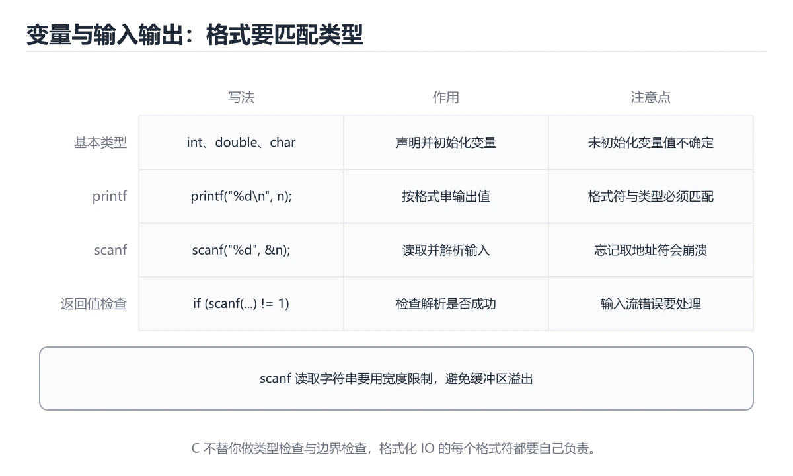
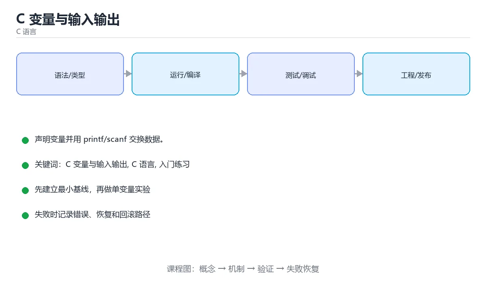

# C 变量与输入输出

> 内容更新时间：2026-10-06 · 学习阶段：入门 · 预计用时：30 分钟





## 本节知识框架

**课程定位**：所属分类 `c`（C 语言），课程主题 `C 变量与输入输出`，学习阶段 入门，建议用时 50 分钟。

本课主线：声明变量并用 printf/scanf 交换数据。

**学完本课应当能够**
- 说清 `数据类型` 与 `变量声明与初始化` 的含义与区别，并各举一个正例和一个反例。
- 用本课示例验证 `scanf` 的行为，记录输入、输出与失败条件。
- 遇到「scanf 不检查返回值」这类问题时，能说出触发条件与修复顺序。

### 复习清单

- [ ] 能讲清 C 变量与输入输出 与 C 语言 的分工，并指出其中一个前提失效的边界。
- [ ] 能运行「C 变量与输入输出」的示例，记录输入、输出与第一次失败的现象。
- [ ] 能完成一次自测，并把错题对照错误表定位原因。

## 核心概念定义

| 术语 | 操作性定义 | 常见边界与风险 |
| --- | --- | --- |
| 数据类型 | int、double、char 等决定变量占用的字节数与可表示范围。 | 易错：把 `int` 当成永远占 4 字节写死进代码；基本类型的大小依赖平台，字节数要用 `sizeof` 取。 |
| 变量声明与初始化 | 声明给出类型和名字，初始化在声明时给初值。 | 声明只确定类型这个契约；漏掉初值就读取仍是未初始化读取，属未定义行为，值进入分支前必须显式给。 |
| scanf | 按格式串从标准输入读取数据，参数要传变量地址。 | 易错：输入失败后继续使用未初始化变量；正确做法是检查返回值，失败时清空缓冲并重新提示。 |
| 格式化占位符 | %d、%f、%c 分别对应整数、浮点数、字符，类型不匹配会读错数据。 | 占位符与实参类型对不上多能在编译期看到警告，但 `%c` 读走缓冲里残留的换行只能运行时才暴露。 |
| 输入缓冲区 | 输入先进入缓冲区再被读取，残留换行符常导致后续读取被跳过。 | 前面用 `%d` 读过一行，紧跟的 `%c` 会把留在缓冲里的换行当成数据拿走；清空缓冲要在失败分支里做。 |
| 数组 | 数组名在大多数表达式中退化为首元素指针，但 sizeof 和取地址时不是 | 退化成指针后 `sizeof` 拿到的是指针字节数、长度信息丢失，必须额外传长度；返回局部数组地址更是直接悬垂。 |
| 编译 | gcc/clang -Wall -Wextra -Werror | 把警告提成错误后，未初始化读取、格式化参数不匹配这类问题多在编译期就被拦下；运行期进来的超长输入它管不到。 |
| 调试 | gdb + core dump | 它拿的是已经崩溃的现场；未初始化读取这类问题不崩时只给出错乱数值，得先稳定复现才挂得上调试器。 |
| 内存检查 | AddressSanitizer / Valgrind | 它只覆盖真正执行到的路径，空输入、边界长度和内存分配失败这些分支要专门造出来跑一遍，否则查不到。 |
| 构建发布 | Makefile/CMake + 静态或动态链接 | 标准版本与编译选项要写进构建配置；只在本机 `gcc` 过一遍，换 `clang` 或换 `-std` 后结果未必一致。 |
| 核心结论 | C 的变量必须先声明类型再用，类型决定它能装什么、占几个字节；scanf 负责读入数据，而给变量地址才能把读到的值写进去。 | 类型声明写对还不够：`scanf` 的参数漏掉 `&`，值就被写进别的地址，程序不报错只是变量里的数不对。 |
| 最少要写的代码 | `int main(void) {` | 光有入口不够：用了 printf 却不写 `#include <stdio.h>`，属编译期找不到声明，与链接期找不到符号不是一类。 |
| 正确做法 | 程序先把四个变量写进内存：整数 18、小数 1.75、字符 A、字符串 小明。 | 最后那项要按字符串存就得额外留出结尾的 `\0`，数组只按字符个数开长度会在写入时越界。 |
| 最常见的错误 | 占位符和参数类型不匹配：把 double 交给 `%d` 会打印出完全无关的数字，这是未定义行为。 | 它通常不崩，只打印出一个无关数字，优化后表现还会变；靠 `-Wall -Wextra -Werror` 才多在编译期被拦下。 |
| 出错先查什么 | 先读第一条报错信息，再回到最小示例只改一个地方 | 读第一条报错前先预测出错位置，再分清是占位符不匹配还是没检查返回值；一次只改一处才认得出谁起作用。 |
| 怎么确认学会了 | 把年龄改成自己的年龄，把身高改成两位小数，确认输出跟着变。 | 输出跟着变只证明变量被读到了；把小数交给 `%d` 打印、看它给出无关数字，才是本课要的失败案例。 |
| 和别的知识点的关系 | 本课打下的语法与思维方式会被后面每一课反复用到 | 后面的指针、数组退化都默认你会写声明和 `sizeof`；跳过这课直接按类型大小做指针算术，越界会来得很隐蔽。 |
| 接下来做什么 | 合上教程，凭记忆把上面的最小代码重写一遍再运行 | 默写只测得出声明与格式符记没记住；scanf 失败后继续用未初始化变量这条，得真喂一个空输入才复现得了。 |

## 原理与运行机制

### 机制总览

**教材衔接：一句话入门**

声明变量并用 printf/scanf 交换数据。

**教材衔接：C 语言基础机制速览**

### 编译、链接与程序结构

C 源码经过预处理、编译、汇编和链接生成可执行文件。`#include` 引入声明，函数定义提供实现，链接器负责解析外部符号。`main` 返回 0 表示成功，非 0 表示失败。理解头文件、声明与定义的区别，能区分“找不到函数声明”的编译错误和“找不到符号”的链接错误。

### 类型、变量与内存表示

C 是静态类型语言，基本类型的大小依赖平台，使用 `sizeof` 而不是硬编码字节数。整数分为有符号和无符号两类，混合运算会发生转换；无符号回绕有定义，有符号溢出通常是未定义行为。浮点数遵循 IEEE 754 近似表示，比较时使用容差。字符类型、字符串和数组的关系需要清楚：字符串以 `\0` 结尾，`char` 数组不一定是字符串。

### 指针、数组与字符串

指针保存地址，`*` 解引用，`&` 取地址；指针算术按所指类型大小移动。数组名在大多数表达式中退化为首元素指针，但 `sizeof` 和取地址时不是。函数参数中的数组声明等价于指针，长度信息会丢失，必须额外传长度。字符串函数要保证目标缓冲区足够大，优先使用带长度限制的函数，防止溢出。

### 函数、结构体与内存管理

函数原型要在调用前可见，参数按值传递；要修改调用方变量就传指针。结构体可以按值复制，较大结构体通常传指针；`struct` 的内存可能有填充，`sizeof` 不一定等于成员大小之和。`malloc/free`、`calloc`、`realloc` 必须成对使用，释放后指针置空，不能访问已释放内存。栈内存自动回收但生命周期受作用域限制，返回局部数组地址是典型错误。

### 预处理器、未定义行为与调试

宏在预处理阶段替换文本，要加括号并避免多次求值副作用；`#include` 保护防止重复包含。未定义行为包括越界访问、解引用空指针、未初始化读取、有符号溢出和不匹配的格式化参数，编译器优化后可能产生难以预测的结果。使用编译器警告、静态分析、sanitizer 和调试器定位内存问题；测试要覆盖空输入、边界长度、内存分配失败和错误路径。

**教材衔接：版本与时效**

- 把标准版本写进构建配置，避免 C 语言 在不同环境下编译结果不一致。
- 编译器对未定义行为、严格别名与对齐的优化越来越激进
- 升级时重点回归位域、可变参数、内联汇编与结构体布局
- 语言参考：https://en.cppreference.com/w/c

## 典型应用场景

**教材衔接：代码实验：把示例跑成证据**

### 实验一：建立基线

```c
#include <stdio.h>

int main(void) {
    int count = 3;
    double price = 2.5;
    printf("count=%d total=%.2f\n", count, count * price);
    return 0;
}
```

### 实验二：只改一个输入

沿用「C 变量与输入输出」的最小示例做一次单变量实验：

做完后用一句话写出「C 变量与输入输出」的结论：输入怎么变，结果才怎么变。

### 实验三：制造一个可控错误

把 printf 的一个参数换成不兼容的类型，先预测报错位置再实际运行；预测与实际的差异就是本课的考点。

### 实验四：用三句话复述

1. 先写清 C 变量与输入输出 的输入契约：类型、范围、缺省值与非法值分别怎么处理？
2. 在 代码实验：把示例跑成证据 里，C 语言 的状态是在什么条件下被改变的？
3. 输出如何验证，失败时第一条可观察证据是什么？

- **scanf 不检查返回值**：典型现象是输入失败后继续使用未初始化变量；正确做法是检查返回值，失败时清空缓冲并重新提示。
- **格式符与变量类型不匹配**：典型现象是读取越界或结果错乱；正确做法是格式符严格对应变量类型，长度修饰符写全。
- **输入没有长度限制**：典型现象是超长输入造成缓冲区溢出；正确做法是用带宽度限制的格式符或整行读取，并处理多余字符。

### 最小验证场景

- 准备：保留 `c` 示例的原始输入，先记录 `C 变量与输入输出` 的基线输出和完整运行命令。
- 观察：先核对 调用了 `main()`，再改变一个与 `数据类型` 相关的条件。
- 判定：新结果与 `C 变量与输入输出` 的基线不同不等于错误；只有当差异破坏了 `数据类型` 的定义或错误表中的约束，才判定为失败。

### 选择与边界

- 使用 `数据类型` 时，int、double、char 等决定变量占用的字节数与可表示范围；换编码、换字节序或换平台都可能改变结果，处理前先固定输入编码。
- 使用 `变量声明与初始化` 时，声明给出类型和名字，初始化在声明时给初值；静态检查只在编译期成立，运行期输入仍需校验。
- 使用 `scanf` 时，按格式串从标准输入读取数据，参数要传变量地址；易错：输入失败后继续使用未初始化变量；正确做法是检查返回值，失败时清空缓冲并重新提示。
- 使用 `格式化占位符` 时，%d、%f、%c 分别对应整数、浮点数、字符，类型不匹配会读错数据；静态检查只在编译期成立，运行期输入仍需校验。
- 使用 `输入缓冲区` 时，输入先进入缓冲区再被读取，残留换行符常导致后续读取被跳过。

## 代码/协议/SQL 示例

### 最小可验证示例

**教材衔接：最小示例**

**教材衔接：预期输出**

```text
count=3 total=7.50
```

**运行方式**：运行 `C 变量与输入输出` 的示例时，用 `gcc 文件名.c -o demo` 编译后运行；注意返回值与内存检查。

## 时间/空间复杂度或性能分析

**性能关注点（C 变量与输入输出）**：内存布局与系统调用是主要成本：记录运行时间、内存占用与系统调用次数。

**本课特有开销（C 变量与输入输出 · C 变量与输入输出）**：小文件看元数据开销，大文件看吞吐，两者要分别测量。

**测量方法**：以 `C 变量与输入输出` 的 `C 变量与输入输出` 场景为对象，固定输入跑一遍记录基线，再把规模或并发度提高一个数量级复测；两次结果的差值与波动范围才是结论依据。

## 常见误区与易错点

| 容易写错的做法 | 实际现象 | 原因与正确做法 |
| --- | --- | --- |
| scanf 不检查返回值 | 输入失败后继续使用未初始化变量。 | 检查返回值，失败时清空缓冲并重新提示。 |
| 格式符与变量类型不匹配 | 读取越界或结果错乱。 | 格式符严格对应变量类型，长度修饰符写全。 |
| 输入没有长度限制 | 超长输入造成缓冲区溢出。 | 用带宽度限制的格式符或整行读取，并处理多余字符。 |

### 现场 1：scanf 不检查返回值

**症状**：输入失败后继续使用未初始化变量。

**根因与修复**：检查返回值，失败时清空缓冲并重新提示。

**自检**：在本课示例里复现「scanf 不检查返回值」，改成检查返回值，失败时清空缓冲并重新提示后重跑；如果症状消失且失败路径按预期变化，说明定位正确。

### 现场 2：格式符与变量类型不匹配

**症状**：读取越界或结果错乱。

**根因与修复**：格式符严格对应变量类型，长度修饰符写全。

**自检**：在本课示例里复现「格式符与变量类型不匹配」，改成格式符严格对应变量类型，长度修饰符写全后重跑；如果症状消失且失败路径按预期变化，说明定位正确。

### 现场 3：输入没有长度限制

**症状**：超长输入造成缓冲区溢出。

**根因与修复**：用带宽度限制的格式符或整行读取，并处理多余字符。

**自检**：在本课示例里复现「输入没有长度限制」，改成用带宽度限制的格式符或整行读取，并处理多余字符后重跑；如果症状消失且失败路径按预期变化，说明定位正确。

## 与其他知识点的关系

**教材衔接：复习与迁移**

## 自测题与参考答案

> 先独立作答，再对照参考答案；答案都能在本课正文、术语表或错误表里找到依据。

### 自测 1（概念复述）

不看正文，写出 `数据类型` 的操作性定义，并说明它与 `变量声明与初始化` 的区别。

**参考答案**：int、double、char 等决定变量占用的字节数与可表示范围。

`变量声明与初始化` 的定位是：声明给出类型和名字，初始化在声明时给初值；两者的差别要从适用对象与失败模式上说明。

### 自测 2（排错）

本课错误表记录了「scanf 不检查返回值」这类做法。请写出它会出现的现象、根因，以及修复顺序。

**参考答案**：现象是输入失败后继续使用未初始化变量；正确做法是检查返回值，失败时清空缓冲并重新提示。修复时先复现现象并保留证据，再改动一处假设重跑，确认现象消失。

### 自测 3（动手验证）

运行本课的 `c` 示例，把其中的 `'A'` 换成一个边界值后重新运行，记录输出与错误信息。

**参考答案**：正常输入下 `c` 示例应当复现正文给出的结果；把 `'A'` 换成边界值后，如果结果改变或报错，先核对它是否满足 `C 变量与输入输出` 中`数据类型` 的适用范围，再检查错误表里是否有同类现象。

### 自测 4（代码阅读）

阅读本课开头的 `c` 示例，说明它体现了`数据类型` 的哪一条性质，并指出改动哪个输入会让这条性质不再成立。

**参考答案**：`数据类型` 的定义是 int、double、char 等决定变量占用的字节数与可表示范围，示例正是在实现这条定义。改动与 `数据类型` 有关的一个输入后，如果结果不再符合 `C 变量与输入输出` 的正文描述，就说明该性质只在当前前提成立。

### 自测 5（迁移）

把 `C 变量与输入输出` 的方法迁移到自己的项目：围绕 `数据类型` 写出一个与错误表同类的风险点，并说明触发条件和检验方式。

**参考答案**：例如「输入没有长度限制」，它会导致超长输入造成缓冲区溢出；检验方式是按用带宽度限制的格式符或整行读取，并处理多余字符改一处再复现，确认现象消失且没有引入新的失败分支。

### 自测 6（对比）

用一个表格对比 `数据类型` 与 `变量声明与初始化`：各写一行适用场景、一行失败表现。

**参考答案**：`数据类型` 的定义是int、double、char 等决定变量占用的字节数与可表示范围；`变量声明与初始化` 的定义是声明给出类型和名字，初始化在声明时给初值。两者的失败表现分别对应本课错误表里与本术语相关的行。

### 自测 7（排错顺序）

面对「scanf 不检查返回值」引发的问题，请把“复现 输入失败后继续使用未初始化变量 → 保留证据 → 检查返回值，失败时清空缓冲并重新提示 → 回归验证”四步写成可执行的检查清单。

**参考答案**：第一步按输入失败后继续使用未初始化变量复现；第二步记录输入、版本与完整报错；第三步按检查返回值，失败时清空缓冲并重新提示只改一处；第四步重跑并确认失败路径也按预期变化。

### 自测 8（边界判断）

针对 `数组`，分别写出“可以使用”的条件和“结论不再成立”的条件。

**参考答案**：越界、悬垂引用与释放顺序会破坏结论，必须在边界输入下复验。 同时要把 `数组` 的定义 数组名在大多数表达式中退化为首元素指针，但 sizeof 和取地址时不是 与实际输入逐项对照。

### 自测 9（机制重建）

不看正文，按输入、转换、输出、验证四段重建 `数据类型` → `变量声明与初始化` → `scanf` → `格式化占位符` 的作用链。

**参考答案**：起点是 `数据类型` 的定义 int、double、char 等决定变量占用的字节数与可表示范围；中间每一步都保留可观察状态；终点由 `数组` 检查，失败时回到错误表定位第一个偏离定义的步骤。

### 自测 10（综合排错）

在 `C 变量与输入输出` 中，现象是 超长输入造成缓冲区溢出。请围绕 输入没有长度限制 写出最小复现、关键证据、修复动作和回归验证，并说明为什么不能只凭一次运行下结论。

**参考答案**：先复现 输入没有长度限制，记录输入与完整错误；再按 用带宽度限制的格式符或整行读取，并处理多余字符 只改一处。回归时同时跑正常路径和边界路径，只有两次结果都可解释，才把修复视为完成。

### 自测 11（一分钟复述）

用每分钟约 200 字的速度复述 `C 变量与输入输出`：先给主问题，再按顺序说出 `数据类型`、`变量声明与初始化`、`scanf`、`格式化占位符`，最后给一个失败案例。

**自评标准**：主问题必须对应 声明变量并用 printf/scanf 交换数据；每个术语都要能接上一句定义或边界；失败案例必须写成可观察现象，不能用“可能有风险”代替证据。

## 术语速查

| 术语 | 一句话说明 |
| --- | --- |
| `数据类型` | int、double、char 等决定变量占用的字节数与可表示范围。 |
| `变量声明与初始化` | 声明给出类型和名字，初始化在声明时给初值。 |
| `scanf` | 按格式串从标准输入读取数据，参数要传变量地址。 |
| `格式化占位符` | %d、%f、%c 分别对应整数、浮点数、字符，类型不匹配会读错数据。 |
| `输入缓冲区` | 输入先进入缓冲区再被读取，残留换行符常导致后续读取被跳过。 |
| `数组` | 数组名在大多数表达式中退化为首元素指针，但 sizeof 和取地址时不是。 |

**术语关系**：`数据类型`（int、double、char 等决定变量占用的字节数与可表示范围） → `变量声明与初始化`（声明给出类型和名字） → `scanf`（按格式串从标准输入读取数据） → `格式化占位符`（%d、%f、%c 分别对应整数、浮点数、字符）。

## 考点精讲

`C 变量与输入输出` 的题库有 5 道题，下面逐题给出题干、正确项与判断依据：先自己作答，再核对正确项，最后回到正文对应小节复核。

### 考点 1：第 1 题

- **题目**：围绕“C 变量与输入输出”中的 C 变量与输入输出、C 语言、入门练习，下列哪两项是本课强调的实践判断？
- **正确项**：学习 C 变量与输入输出 时要同时说明输入、输出和失败路径，不能只看正常流程；验证 C 语言 时要固定版本并覆盖边界输入，结论才可复现
- **判断依据**：按《C 变量与输入输出》的正文口径，本题要同时选中「学习 C 变量与输入输出 时要同时说明输入、输出和失败路径，不能只看正常流程」、「验证 C 语言 时要固定版本并覆盖边界输入，结论才可复现」，漏掉任一项都算没答全。术语 数据类型（C 变量与输入输出）：int、double、char 等决定变量占用的字节数与可表示范围。易错点是scanf 不检查返回值，会造成输入失败后继续使用未初始化变量，改法是检查返回值，失败时清空缓冲并重新提示。

### 考点 2：第 2 题

- **题目**：阅读 `C 变量与输入输出` 中围绕 `数据类型` 的代码；课程主线是声明变量并用 printf/scanf 交换数据。下面哪项判断最准确？
- **正确项**：声明变量并用 printf/scanf 交换数据。
- **判断依据**：本题正确项是「声明变量并用 printf/scanf 交换数据」。术语 数据类型（C 变量与输入输出）：int、double、char 等决定变量占用的字节数与可表示范围，本题取「声明变量并用 printf/scanf 交换数据」这条。易错点是格式符与变量类型不匹配，会造成读取越界或结果错乱，改法是格式符严格对应变量类型，长度修饰符写全。

### 考点 3：第 3 题

- **题目**：使用 scanf 读取整数时，为什么参数前要加 &？
- **正确项**：传入变量地址，让函数把解析结果写回该变量
- **判断依据**：本题正确项是「传入变量地址，让函数把解析结果写回该变量」。术语 scanf（C 变量与输入输出）：按格式串从标准输入读取数据，参数要传变量地址，本题取「传入变量地址，让函数把解析结果写回该变量」这条。易错点是输入没有长度限制，会造成超长输入造成缓冲区溢出，改法是用带宽度限制的格式符或整行读取，并处理多余字符。

### 考点 4：第 4 题

- **题目**：示例中 count 为 3、price 为 2.5，输出结果是什么？
- **正确项**：count=3 total=7.50，按格式串计算并保留两位小数
- **判断依据**：本题正确项是「count=3 total=7.50，按格式串计算并保留两位小数」。术语 数据类型（C 变量与输入输出）：int、double、char 等决定变量占用的字节数与可表示范围，本题取「count=3 total=7.50，按格式串计算并保留两位小数」这条。易错点是scanf 不检查返回值，会造成输入失败后继续使用未初始化变量，改法是检查返回值，失败时清空缓冲并重新提示。

### 考点 5：第 5 题

- **题目**：填空：补齐下面这段术语说明中的空缺。课程 `声明变量并用 printf/scanf 交换数据。`，这段说明是：`____`：按格式串从标准输入读取数据，参数要传变量地址。空缺处应填哪个术语？
- **正确项**：scanf
- **判断依据**：涉及术语 scanf：按格式串从标准输入读取数据，参数要传变量地址。易错点：scanf 不检查返回值会造成输入失败后继续使用未初始化变量。正确做法：检查返回值，失败时清空缓冲并重新提示。判断时先确认输入和适用范围，对照 `C 变量与输入输出`、`C 语言`、`入门练习` 复现一次，最后把错误表现与正确做法逐项对照。

### 考点 6：`数据类型`

- **要点**：int、double、char 等决定变量占用的字节数与可表示范围。
- **数据类型 的边界**：换编码、换字节序或换平台都可能改变结果，处理前先固定输入编码。

### 考点 7：`变量声明与初始化`

- **要点**：声明给出类型和名字，初始化在声明时给初值。
- **变量声明与初始化 的边界**：静态检查只在编译期成立，运行期输入仍需校验。

### 考点 8：`scanf`

- **要点**：按格式串从标准输入读取数据，参数要传变量地址。
- **scanf 的边界**：易错：输入失败后继续使用未初始化变量；正确做法是检查返回值，失败时清空缓冲并重新提示。

### 考点 9：`格式化占位符`

- **要点**：%d、%f、%c 分别对应整数、浮点数、字符，类型不匹配会读错数据。
- **格式化占位符 的边界**：静态检查只在编译期成立，运行期输入仍需校验。

### 考点 10：`输入缓冲区`

- **要点**：输入先进入缓冲区再被读取，残留换行符常导致后续读取被跳过。

### 考点 11：`数组`

- **要点**：数组名在大多数表达式中退化为首元素指针，但 sizeof 和取地址时不是
- **数组 的边界**：越界、悬垂引用与释放顺序会破坏结论，必须在边界输入下复验。

### 考点 12：排错——scanf 不检查返回值

- **现象**：输入失败后继续使用未初始化变量。
- **处理**：检查返回值，失败时清空缓冲并重新提示。

### 考点 13：排错——格式符与变量类型不匹配

- **现象**：读取越界或结果错乱。
- **处理**：格式符严格对应变量类型，长度修饰符写全。

### 考点 14：综合辨析——`数据类型` 与 `数组`

- **辨析点**：`数据类型` 的定义是 int、double、char 等决定变量占用的字节数与可表示范围；`数组` 的定义是 数组名在大多数表达式中退化为首元素指针，但 sizeof 和取地址时不是。
- **答题要求**：面对 `C 变量与输入输出` 的题目，先判断描述的是 `数据类型` 还是 `数组`，再归到对应定义，最后写出一个会让该定义失效的边界输入。

### 考点 15：排错评分点

- **现象分**：能写出 输入失败后继续使用未初始化变量，而不是只写“程序有错”。
- **证据分**：保留触发 scanf 不检查返回值 的输入、版本和错误原文。
- **修复分**：按 检查返回值，失败时清空缓冲并重新提示 只改一处，并同时回归正常路径与边界路径。

## 内容元数据

- 内容版本：v2.0
- 最后更新：2026-10-06
- 学习阶段：入门
- 适用环境：C11 / GCC 或 Clang；本课聚焦 C 变量与输入输出。
- 内容来源：内置结构化课程与工程实践整理
- 相关主题：C 变量与输入输出、C 语言、入门练习
- 质量版本：P0 测验标准 + P1 覆盖扩展 + P2 体验补全

## 参考资料与复核

- 最后复核：2026-10-04
- 下次复核：2026-11-17
- 复核范围：版本兼容、API 行为、安全建议与工程实践
- 来源性质：官方文档、标准或权威教材；本课核对关键词：C 变量与输入输出、C 语言、入门练习。

| 参考资料 | 本课用途 |
| --- | --- |
| [cppreference C 语言](https://en.cppreference.com/w/c/language) | C 语言规则与语义 |
| [GDB 文档](https://sourceware.org/gdb/documentation/) | C 程序调试与崩溃定位 |
| [GNU C Library](https://www.gnu.org/software/libc/manual/) | POSIX 与 GNU C 接口 |

| [本课术语索引：C 变量与输入输出](#核心概念定义) | 按本课输入、术语边界和错误表现逐项核对 |
> 「C 变量与输入输出」的链接用于离线阅读后的延伸核对；App 不会自动联网。