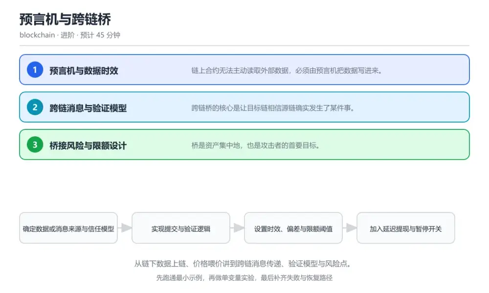
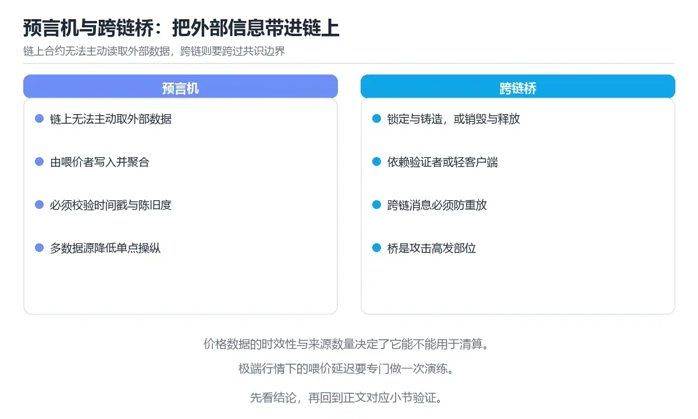

# 预言机与跨链桥

> 内容更新时间：2026-10-06 · 学习阶段：进阶 · 预计用时：30 分钟

分类：blockchain。关键词：预言机、喂价、跨链桥、消息验证、去中心化。从链下数据上链、价格喂价讲到跨链消息传递、验证模型与风险点。



## 本节知识框架

**课程定位**：所属分类 `blockchain`（区块链与 Web3），课程主题 `预言机与跨链桥`，学习阶段 进阶，建议用时 40 分钟。

本课主线：从链下数据上链、价格喂价讲到跨链消息传递、验证模型与风险点。

**学完本课应当能够**
- 说清 `预言机` 与 `喂价` 的含义与区别，并各举一个正例和一个反例。
- 用本课示例验证 `轻客户端验证` 的行为，记录输入、输出与失败条件。
- 遇到「极端行情下被套利」这类问题时，能说出触发条件与修复顺序。

### 复习清单

- [ ] 能不看正文复述本课核心术语，并指出一个边界或反例。
- [ ] 能运行或推演本课示例，记录输入、输出与失败现象。
- [ ] 能完成一次自测，并把错题对照错误表定位原因。

**本课配图**



## 核心概念定义

| 术语 | 操作性定义 | 常见边界与风险 |
| --- | --- | --- |
| 预言机 | 把链下数据提交到链上供合约使用的服务。 | 易错：链上合约以为能主动取外部数据；预言机只能被动写入，喂价中断或滞后时拿到的是旧值，必须配时效校验。 |
| 喂价 | 预言机周期性提交的价格数据。 | 易错：合约直接读取喂价，不检查更新时间；正确做法是读取时校验时间戳与偏差阈值，超限暂停业务并要求人工确认后恢复。 |
| 轻客户端验证 | 在目标链验证源链共识与状态证明的方式。 | 易错：桥的安全依赖少数几个集中管理的密钥；正确做法是扩大并分散验证者集合，或改用轻客户端验证，公开验证者变更记录。 |
| 延迟提现 | 提取请求需要等待一段时间才能执行。 | 易错：提取请求立即放行，资金秒退无法追回；延迟提现要设等待窗口，让异常在窗口内还能被暂停开关拦下。 |
| 暂停开关 | 发现异常时停止关键操作的应急机制。 | 易错：桥没有暂停开关，发现异常只能眼看资金持续流出；暂停开关要由多方共同控制停止关键操作，且记录公开可审计。 |
| 验证模型 | 对问题的结构化表示：验证者集合过于集中会让桥的安全等价于这几个密钥，一旦失守可无限铸币 | 易错：验证者集合过于集中，桥的安全就等价于这几个密钥，一旦失守可无限铸币；要分散验证者或改用轻客户端验证。 |

## 原理与运行机制

### 机制总览

**教材衔接：核心知识**

### 1. 预言机与数据时效

链上合约无法主动读取外部数据，必须由预言机把数据写进来。

多个数据源聚合出价格并定期提交上链，合约读取最新值并检查更新时间戳，超时则暂停依赖该价格的业务。

在预言机与跨链桥里可以这样验证：在本课示例里读取一次喂价并检查时间戳，观察超时后业务被暂停。

边界：只读价格不看时间戳会在极端行情下用过时数据成交，造成无风险套利。

工程视角：关键业务设置心跳与偏差双阈值，超限即暂停并通知，恢复需人工确认。

### 2. 跨链消息与验证模型

跨链桥的核心是让目标链相信源链确实发生了某件事。

常见模型包括外部验证者多签、轻客户端验证与乐观验证，各自在信任假设、成本与延迟之间取舍。

在预言机与跨链桥里可以这样验证：在本课示例里对比多签与轻客户端两种模型的验证步骤与信任前提。

边界：验证者集合过于集中会让桥的安全等价于这几个密钥，一旦失守可无限铸币。

工程视角：限制单次铸币上限、加入延迟提现窗口与监控报警，给异常留出反应时间。

### 3. 桥接风险与限额设计

桥是资产集中地，也是攻击者的首要目标。

通过限额、延迟提现、多级审批与暂停开关限制单点故障的损失范围，链上监控对异常铸造与提取实时告警。

在预言机与跨链桥里可以这样验证：在本课示例里触发一次超额提取，观察限额与延迟窗口如何阻止资金立即流出。

边界：没有暂停开关的桥在发现异常后只能眼睁睁看着资金被持续提取。

工程视角：限额与暂停开关由多方共同控制，操作记录公开可审计，并定期演练应急流程。

**教材衔接：关键流程**

```text
确定数据或消息来源与信任模型 → 实现提交与验证逻辑 → 设置时效、偏差与限额阈值 → 加入延迟提现与暂停开关 → 监控异常并演练应急响应
```

1. 确定数据或消息来源与信任模型
2. 实现提交与验证逻辑
3. 设置时效、偏差与限额阈值
4. 加入延迟提现与暂停开关
5. 监控异常并演练应急响应

## 典型应用场景

**教材衔接：深度拓展与实战**

### 机制对照表

| 概念 | 解决什么问题 | 关键前提 | 失败信号 |
| --- | --- | --- | --- |
| 预言机与数据时效 | 链上合约无法主动读取外部数据，必须由预言机把数据写进来。 | 只读价格不看时间戳会在极端行情下用过时数据成交，造成无风险套利。 | 关键业务设置心跳与偏差双阈值，超限即暂停并通知，恢复需人工确认。 |
| 跨链消息与验证模型 | 跨链桥的核心是让目标链相信源链确实发生了某件事。 | 验证者集合过于集中会让桥的安全等价于这几个密钥，一旦失守可无限铸币。 | 限制单次铸币上限、加入延迟提现窗口与监控报警，给异常留出反应时间。 |
| 桥接风险与限额设计 | 桥是资产集中地，也是攻击者的首要目标。 | 没有暂停开关的桥在发现异常后只能眼睁睁看着资金被持续提取。 | 限额与暂停开关由多方共同控制，操作记录公开可审计，并定期演练应急流程。 |

### 自测问答

**问 1**：合约读取喂价时为什么必须检查时间戳？

**答**：避免在极端行情下用过时价格成交。喂价可能因为网络或维护中断而停止更新，用过时价格成交会给套利者可乘之机，超时拒绝是基本防线。 正确选项「避免在极端行情下用过时价格成交」对应《预言机与跨链桥》的要点「预言机与数据时效」：链上合约无法主动读取外部数据，必须由预言机把数据写进来。判断「预言机与数据时效」时先确认前提是否成立，再回到《预言机与跨链桥》的示例核对一次；把别的语言或框架的默认做法直接搬到预言机与数据时效上，往往会在本课的边界条件里失效。

**问 2**：跨链桥安全性的根本取决于？

**答**：验证模型的信任假设是否足够分散与可验证。桥的本质是让目标链相信源链发生的事，验证者集合的分散程度与验证方式决定了它的安全上限。 正确选项「验证模型的信任假设是否足够分散与可验证」对应《预言机与跨链桥》的要点「跨链消息与验证模型」：跨链桥的核心是让目标链相信源链确实发生了某件事。判断「跨链消息与验证模型」时先确认前提是否成立，再回到《预言机与跨链桥》的示例核对一次；借鉴相邻主题的经验之前，先核对跨链消息与验证模型的前提是否成立。

**问 3**：限制桥风险可以采取哪些措施？（多选）

**答**：设置单笔与单日提取限额；加入延迟提现窗口；提供多方可控的暂停开关。限额控制单次损失，延迟与暂停争取反应时间；取消监控等于放弃发现异常的机会。 正确选项「设置单笔与单日提取限额；加入延迟提现窗口；提供多方可控的暂停开关」对应《预言机与跨链桥》的要点「桥接风险与限额设计」：桥是资产集中地，也是攻击者的首要目标。判断「桥接风险与限额设计」时先确认前提是否成立，再回到《预言机与跨链桥》的示例核对一次；记住桥接风险与限额设计的结论之外还要记住适用条件，换一个输入往往就不成立了。

**问 4**：请按一次跨链转移的顺序排列。

**答**：源链锁定或销毁资产。源链先锁定，验证者生成证明，目标链验证后释放资产，最后对账确认两侧总量一致。 正确选项「源链锁定或销毁资产；验证者观察并生成证明；目标链校验证明；按证明铸造或释放资产；监控确认并对账」对应《预言机与跨链桥》的要点「预言机与数据时效」：链上合约无法主动读取外部数据，必须由预言机把数据写进来。判断「预言机与数据时效」时先确认前提是否成立，再回到《预言机与跨链桥》的示例核对一次；干扰项常常是相邻主题里成立的结论，只有按预言机与数据时效的输入与约束判断才能排除。

**问 5**：阅读这段跨链出口代码，风险是什么？

**答**：缺少验证与限额，任何人构造调用都能提取资产。释放函数既不校验调用者身份也不验证跨链证明与限额，任何人调用都能把桥内资产转走，属于典型的验证缺失漏洞。 正确选项「缺少验证与限额，任何人构造调用都能提取资产」对应《预言机与跨链桥》的要点「跨链消息与验证模型」：跨链桥的核心是让目标链相信源链确实发生了某件事。判断「跨链消息与验证模型」时先确认前提是否成立，再回到《预言机与跨链桥》的示例核对一次；把跨链消息与验证模型的做法换到别的约束下未必成立，先确认边界再决定答案。

### 工程检查表

- [ ] 确定数据或消息来源与信任模型
- [ ] 实现提交与验证逻辑
- [ ] 设置时效、偏差与限额阈值
- [ ] 加入延迟提现与暂停开关
- [ ] 监控异常并演练应急响应
- [ ] 【预言机与数据时效】关键业务设置心跳与偏差双阈值，超限即暂停并通知，恢复需人工确认。
- [ ] 【跨链消息与验证模型】限制单次铸币上限、加入延迟提现窗口与监控报警，给异常留出反应时间。
- [ ] 【桥接风险与限额设计】限额与暂停开关由多方共同控制，操作记录公开可审计，并定期演练应急流程。

### 结论与下一步

- **极端行情下被套利**：典型现象是合约直接读取喂价，不检查更新时间；正确做法是读取时校验时间戳与偏差阈值，超限暂停业务并要求人工确认后恢复。
- **桥被攻破后资金持续流出**：典型现象是没有限额、延迟与暂停机制；正确做法是加入单笔与单日限额、延迟提现窗口和多方可控的暂停开关。
- **验证者集中导致单点失守**：典型现象是桥的安全依赖少数几个集中管理的密钥；正确做法是扩大并分散验证者集合，或改用轻客户端验证，公开验证者变更记录。

### 最小验证场景

- 准备：保留 `text` 示例的原始输入，先记录 `预言机与跨链桥` 的基线输出和完整运行命令。
- 判定：新结果与 `预言机与跨链桥` 的基线不同不等于错误；只有当差异破坏了 `预言机` 的定义或错误表中的约束，才判定为失败。

### 选择与边界

- 使用 `预言机` 时，先满足它的定义：把链下数据提交到链上供合约使用的服务；隔离级别与并发事务会影响可见性，换级别或换存储引擎后要重新验证。
- 使用 `喂价` 时，先满足它的定义：预言机周期性提交的价格数据；易错：合约直接读取喂价，不检查更新时间；正确做法是读取时校验时间戳与偏差阈值，超限暂停业务并要求人工确认后恢复。
- 使用 `轻客户端验证` 时，先满足它的定义：在目标链验证源链共识与状态证明的方式；易错：桥的安全依赖少数几个集中管理的密钥；正确做法是扩大并分散验证者集合，或改用轻客户端验证，公开验证者变更记录。
- 使用 `延迟提现` 时，先满足它的定义：提取请求需要等待一段时间才能执行；易错：没有限额、延迟与暂停机制；正确做法是加入单笔与单日限额、延迟提现窗口和多方可控的暂停开关。
- 使用 `暂停开关` 时，先满足它的定义：发现异常时停止关键操作的应急机制；易错：没有限额、延迟与暂停机制；正确做法是加入单笔与单日限额、延迟提现窗口和多方可控的暂停开关。

## 代码/协议/SQL 示例

### 最小可验证示例

**教材衔接：原文最小示例**

```solidity
// 喂价消费方：只接受足够新鲜的价格，过期即暂停业务
contract PriceConsumer {
    AggregatorV3Interface internal feed;
    uint256 public constant MAX_STALENESS = 90;   // 价格最多允许 90 秒旧

    function currentPrice() public view returns (int256) {
        (, int256 answer, , uint256 updatedAt, ) = feed.latestRoundData();
        require(answer > 0, "invalid price");
        require(block.timestamp - updatedAt <= MAX_STALENESS, "stale price");  // 超时拒绝使用
        return answer;
    }

    function executeTrade(uint256 amount) external {
        int256 price = currentPrice();     // 过期直接回退，交易不会成交
        _settle(amount, price);
    }
}

// 桥接出口：限额加延迟，异常时有时间暂停
contract BridgeOutlet {
    uint256 public constant DAILY_LIMIT = 1000 ether;
    uint256 public constant DELAY = 30 minutes;
    mapping(address => uint256) public pending;

    function requestWithdraw(uint256 amount) external {
        require(amount <= DAILY_LIMIT, "exceeds daily limit");
        pending[msg.sender] = block.timestamp + DELAY;   // 延迟窗口内可被暂停
        emit WithdrawRequested(msg.sender, amount, pending[msg.sender]);
    }
}
```

## 时间/空间复杂度或性能分析

**性能关注点（预言机与跨链桥）**：链上操作受确认时间与手续费约束：记录确认延迟、Gas 消耗与存储增长。

**测量方法**：以 `预言机与跨链桥` 的 `预言机` 场景为对象，固定输入跑一遍记录基线，再把规模或并发度提高一个数量级复测；两次结果的差值与波动范围才是结论依据。

## 常见误区与易错点

| 容易写错的做法 | 实际现象 | 原因与正确做法 |
| --- | --- | --- |
| 极端行情下被套利 | 合约直接读取喂价，不检查更新时间。 | 读取时校验时间戳与偏差阈值，超限暂停业务并要求人工确认后恢复。 |
| 桥被攻破后资金持续流出 | 没有限额、延迟与暂停机制。 | 加入单笔与单日限额、延迟提现窗口和多方可控的暂停开关。 |
| 验证者集中导致单点失守 | 桥的安全依赖少数几个集中管理的密钥。 | 扩大并分散验证者集合，或改用轻客户端验证，公开验证者变更记录。 |

### 现场 1：极端行情下被套利

**症状**：合约直接读取喂价，不检查更新时间。

**根因与修复**：读取时校验时间戳与偏差阈值，超限暂停业务并要求人工确认后恢复。

**自检**：在本课示例里复现「极端行情下被套利」，改成读取时校验时间戳与偏差阈值，超限暂停业务并要求人工确认后恢复后重跑；如果症状消失且失败路径按预期变化，说明定位正确。

### 现场 2：桥被攻破后资金持续流出

**症状**：没有限额、延迟与暂停机制。

**根因与修复**：加入单笔与单日限额、延迟提现窗口和多方可控的暂停开关。

**自检**：在本课示例里复现「桥被攻破后资金持续流出」，改成加入单笔与单日限额、延迟提现窗口和多方可控的暂停开关后重跑；如果症状消失且失败路径按预期变化，说明定位正确。

### 现场 3：验证者集中导致单点失守

**症状**：桥的安全依赖少数几个集中管理的密钥。

**根因与修复**：扩大并分散验证者集合，或改用轻客户端验证，公开验证者变更记录。

**自检**：在本课示例里复现「验证者集中导致单点失守」，改成扩大并分散验证者集合，或改用轻客户端验证，公开验证者变更记录后重跑；如果症状消失且失败路径按预期变化，说明定位正确。

## 与其他知识点的关系

**教材衔接：复习与迁移**

## 自测题与参考答案

> 先独立作答，再对照参考答案；答案都能在本课正文、术语表或错误表里找到依据。

### 自测 1（概念复述）

不看正文，写出 `预言机` 的操作性定义，并说明它与 `喂价` 的区别。

**参考答案**：把链下数据提交到链上供合约使用的服务。

`喂价` 的定位是：预言机周期性提交的价格数据；两者的差别要从适用对象与失败模式上说明。

### 自测 2（排错）

本课错误表记录了「极端行情下被套利」这类做法。请写出它会出现的现象、根因，以及修复顺序。

**参考答案**：现象是合约直接读取喂价，不检查更新时间；正确做法是读取时校验时间戳与偏差阈值，超限暂停业务并要求人工确认后恢复。修复时先复现现象并保留证据，再改动一处假设重跑，确认现象消失。

### 自测 3（动手验证）

运行本课的 `text` 示例，改动其中一个输入后重新运行，记录输出与错误信息。

**参考答案**：正常输入下 `text` 示例应当复现正文给出的结果；改动输入后，如果结果改变或报错，先核对它是否满足 `预言机与跨链桥` 中`预言机` 的适用范围，再检查错误表里是否有同类现象。

### 自测 4（代码阅读）

阅读本课开头的 `text` 示例，说明它体现了`预言机` 的哪一条性质，并指出改动哪个输入会让这条性质不再成立。

**参考答案**：`预言机` 的定义是 把链下数据提交到链上供合约使用的服务，示例正是在实现这条定义。改动与 `预言机` 有关的一个输入后，如果结果不再符合 `预言机与跨链桥` 的正文描述，就说明该性质只在当前前提成立。

### 自测 5（迁移）

把 `预言机与跨链桥` 的方法迁移到自己的项目：围绕 `预言机` 写出一个与错误表同类的风险点，并说明触发条件和检验方式。

**参考答案**：例如「验证者集中导致单点失守」，它会导致桥的安全依赖少数几个集中管理的密钥；检验方式是按扩大并分散验证者集合，或改用轻客户端验证，公开验证者变更记录改一处再复现，确认现象消失且没有引入新的失败分支。

### 自测 6（对比）

用一个表格对比 `预言机` 与 `喂价`：各写一行适用场景、一行失败表现。

**参考答案**：`预言机` 的定义是把链下数据提交到链上供合约使用的服务；`喂价` 的定义是预言机周期性提交的价格数据。两者的失败表现分别对应本课错误表里与本术语相关的行。

### 自测 7（排错顺序）

面对「极端行情下被套利」引发的问题，请把“复现 合约直接读取喂价，不检查更新时间 → 保留证据 → 读取时校验时间戳与偏差阈值，超限暂停业务并要求人工确认后恢复 → 回归验证”四步写成可执行的检查清单。

**参考答案**：第一步按合约直接读取喂价，不检查更新时间复现；第二步记录输入、版本与完整报错；第三步按读取时校验时间戳与偏差阈值，超限暂停业务并要求人工确认后恢复只改一处；第四步重跑并确认失败路径也按预期变化。

### 自测 8（边界判断）

针对 `验证模型`，分别写出“可以使用”的条件和“结论不再成立”的条件。

**参考答案**：权限与密钥策略变化会让结论失效，按最小权限并用真实凭据流程复验。 同时要把 `验证模型` 的定义 对问题的结构化表示：验证者集合过于集中会让桥的安全等价于这几个密钥，一旦失守可无限铸币 与实际输入逐项对照。

### 自测 9（机制重建）

不看正文，按输入、转换、输出、验证四段重建 `预言机` → `喂价` → `轻客户端验证` → `延迟提现` 的作用链。

**参考答案**：起点是 `预言机` 的定义 把链下数据提交到链上供合约使用的服务；中间每一步都保留可观察状态；终点由 `验证模型` 检查，失败时回到错误表定位第一个偏离定义的步骤。

### 自测 10（综合排错）

在 `预言机与跨链桥` 中，现象是 桥的安全依赖少数几个集中管理的密钥。请围绕 验证者集中导致单点失守 写出最小复现、关键证据、修复动作和回归验证，并说明为什么不能只凭一次运行下结论。

**参考答案**：先复现 验证者集中导致单点失守，记录输入与完整错误；再按 扩大并分散验证者集合，或改用轻客户端验证，公开验证者变更记录 只改一处。回归时同时跑正常路径和边界路径，只有两次结果都可解释，才把修复视为完成。

### 自测 11（一分钟复述）

用每分钟约 200 字的速度复述 `预言机与跨链桥`：先给主问题，再按顺序说出 `预言机`、`喂价`、`轻客户端验证`、`延迟提现`，最后给一个失败案例。

**自评标准**：主问题必须对应 从链下数据上链、价格喂价讲到跨链消息传递、验证模型与风险点；每个术语都要能接上一句定义或边界；失败案例必须写成可观察现象，不能用“可能有风险”代替证据。

## 术语速查

| 术语 | 一句话说明 |
| --- | --- |
| `预言机` | 把链下数据提交到链上供合约使用的服务。 |
| `喂价` | 预言机周期性提交的价格数据。 |
| `轻客户端验证` | 在目标链验证源链共识与状态证明的方式。 |
| `延迟提现` | 提取请求需要等待一段时间才能执行。 |
| `暂停开关` | 发现异常时停止关键操作的应急机制。 |
| `验证模型` | 对问题的结构化表示：验证者集合过于集中会让桥的安全等价于这几个密钥，一旦失守可无限铸币。 |

**术语关系**：`预言机`（把链下数据提交到链上供合约使用的服务） → `喂价`（预言机周期性提交的价格数据） → `轻客户端验证`（在目标链验证源链共识与状态证明的方式） → `延迟提现`（提取请求需要等待一段时间才能执行）。

## 考点精讲

`预言机与跨链桥` 的题库有 5 道题，下面逐题给出题干、正确项与判断依据：先自己作答，再核对正确项，最后回到正文对应小节复核。

### 考点 1：第 1 题

- **题目**：合约读取喂价时为什么必须检查时间戳？
- **正确项**：避免在极端行情下用过时价格成交
- **判断依据**：本题正确项是「避免在极端行情下用过时价格成交」。术语 喂价（预言机与跨链桥）：预言机周期性提交的价格数据，本题取「避免在极端行情下用过时价格成交」这条。易错点是极端行情下被套利，会造成合约直接读取喂价，不检查更新时间，改法是读取时校验时间戳与偏差阈值，超限暂停业务并要求人工确认后恢复。

### 考点 2：第 2 题

- **题目**：跨链桥安全性的根本取决于？
- **正确项**：验证模型的信任假设是否足够分散与可验证
- **判断依据**：本题正确项是「验证模型的信任假设是否足够分散与可验证」。术语 验证模型（预言机与跨链桥）：对问题的结构化表示：验证者集合过于集中会让桥的安全等价于这几个密钥，一旦失守可无限铸币，本题取「验证模型的信任假设是否足够分散与可验证」这条。易错点是桥被攻破后资金持续流出，会造成没有限额、延迟与暂停机制，改法是加入单笔与单日限额、延迟提现窗口和多方可控的暂停开关。

### 考点 3：第 3 题

- **题目**：限制桥风险可以采取哪些措施？（多选）
- **正确项**：设置单笔与单日提取限额；加入延迟提现窗口；提供多方可控的暂停开关
- **判断依据**：按《预言机与跨链桥》的正文口径，本题要同时选中「设置单笔与单日提取限额」、「加入延迟提现窗口」、「提供多方可控的暂停开关」，漏掉任一项都算没答全。术语 延迟提现（预言机与跨链桥）：提取请求需要等待一段时间才能执行。易错点是验证者集中导致单点失守，会造成桥的安全依赖少数几个集中管理的密钥，改法是扩大并分散验证者集合，或改用轻客户端验证，公开验证者变更记录。

### 考点 4：第 4 题

- **题目**：请按一次跨链转移的顺序排列。
- **正确项**：源链锁定或销毁资产 → 验证者观察并生成证明 → 目标链校验证明 → 按证明铸造或释放资产 → 监控确认并对账
- **判断依据**：按《预言机与跨链桥》正文的先后，本题顺序是「源链锁定或销毁资产」 → 「验证者观察并生成证明」 → 「目标链校验证明」 → 「按证明铸造或释放资产」 → 「监控确认并对账」。术语 预言机（预言机与跨链桥）：把链下数据提交到链上供合约使用的服务。易错点是极端行情下被套利会造成合约直接读取喂价，不检查更新时间，改法是读取时校验时间戳与偏差阈值，超限暂停业务并要求人工确认后恢复。

### 考点 5：第 5 题

- **题目**：阅读这段跨链出口代码，风险是什么？
- **正确项**：缺少验证与限额，任何人构造调用都能提取资产
- **判断依据**：本题正确项是「缺少验证与限额，任何人构造调用都能提取资产」。术语 预言机（预言机与跨链桥）：把链下数据提交到链上供合约使用的服务，本题取「缺少验证与限额，任何人构造调用都能提取资产」这条。易错点是桥被攻破后资金持续流出，会造成没有限额、延迟与暂停机制，改法是加入单笔与单日限额、延迟提现窗口和多方可控的暂停开关。

### 考点 6：`预言机`

- **要点**：把链下数据提交到链上供合约使用的服务。
- **预言机 的边界**：隔离级别与并发事务会影响可见性，换级别或换存储引擎后要重新验证。

### 考点 7：`喂价`

- **要点**：预言机周期性提交的价格数据。
- **喂价 的边界**：易错：合约直接读取喂价，不检查更新时间；正确做法是读取时校验时间戳与偏差阈值，超限暂停业务并要求人工确认后恢复。

### 考点 8：`轻客户端验证`

- **要点**：在目标链验证源链共识与状态证明的方式。
- **轻客户端验证 的边界**：易错：桥的安全依赖少数几个集中管理的密钥；正确做法是扩大并分散验证者集合，或改用轻客户端验证，公开验证者变更记录。

### 考点 9：`延迟提现`

- **要点**：提取请求需要等待一段时间才能执行。
- **延迟提现 的边界**：易错：没有限额、延迟与暂停机制；正确做法是加入单笔与单日限额、延迟提现窗口和多方可控的暂停开关。

### 考点 10：`暂停开关`

- **要点**：发现异常时停止关键操作的应急机制。
- **暂停开关 的边界**：易错：没有限额、延迟与暂停机制；正确做法是加入单笔与单日限额、延迟提现窗口和多方可控的暂停开关。

### 考点 11：`验证模型`

- **要点**：对问题的结构化表示：验证者集合过于集中会让桥的安全等价于这几个密钥，一旦失守可无限铸币
- **验证模型 的边界**：权限与密钥策略变化会让结论失效，按最小权限并用真实凭据流程复验。

### 考点 12：排错——极端行情下被套利

- **现象**：合约直接读取喂价，不检查更新时间。
- **处理**：读取时校验时间戳与偏差阈值，超限暂停业务并要求人工确认后恢复。

### 考点 13：排错——桥被攻破后资金持续流出

- **现象**：没有限额、延迟与暂停机制。
- **处理**：加入单笔与单日限额、延迟提现窗口和多方可控的暂停开关。

### 考点 14：综合辨析——`预言机` 与 `验证模型`

- **辨析点**：`预言机` 的定义是 把链下数据提交到链上供合约使用的服务；`验证模型` 的定义是 对问题的结构化表示：验证者集合过于集中会让桥的安全等价于这几个密钥，一旦失守可无限铸币。
- **答题要求**：面对 `预言机与跨链桥` 的题目，先判断描述的是 `预言机` 还是 `验证模型`，再归到对应定义，最后写出一个会让该定义失效的边界输入。

### 考点 15：排错评分点

- **现象分**：能写出 合约直接读取喂价，不检查更新时间，而不是只写“程序有错”。
- **证据分**：保留触发 极端行情下被套利 的输入、版本和错误原文。
- **修复分**：按 读取时校验时间戳与偏差阈值，超限暂停业务并要求人工确认后恢复 只改一处，并同时回归正常路径与边界路径。

## 内容元数据

- 内容版本：v2.0
- 最后更新：2026-10-06
- 学习阶段：进阶

| 字段 | 值 |
| --- | --- |
| 课程 ID | `chain_oracle_bridge` |
| 所属分类 | `blockchain` |
| 难度 | 进阶 |
| 预计用时 | 45 分钟 |
| 关键词 | 预言机、喂价、跨链桥、消息验证、去中心化 |
| 配图 | `images/lesson_chain_oracle_bridge.webp` |
| 参考资料 | 2 条 |
| 内容更新时间 | 2026-10-06 |

## 参考资料与复核

- 来源性质：官方文档、标准或权威教材；本课核对关键词：预言机、喂价、跨链桥、消息验证、去中心化。
- 最后复核：2026-10-04
- 下次复核：2027-01-17
- 复核范围：版本兼容、API 行为与工程实践

下面列出的资料用于核对本课结论，复习时可以对照阅读：
- [Chainlink 官方文档：数据喂价](https://docs.chain.link/data-feeds)
- [以太坊官方文档：跨链桥](https://ethereum.org/en/developers/docs/bridges/)

| [本课术语索引：预言机与跨链桥](#核心概念定义) | 按本课输入、术语边界和错误表现逐项核对 |
> 复核提示：《预言机与跨链桥》的结论如与资料冲突，以资料中的规范文本为准，并在笔记里记录差异与日期。