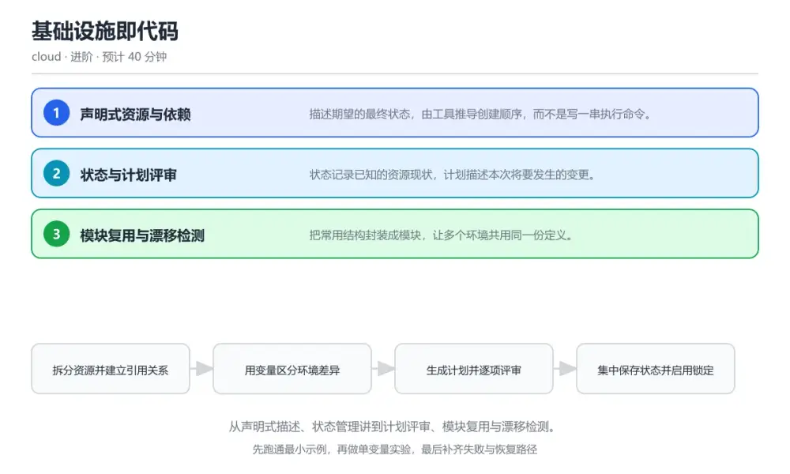
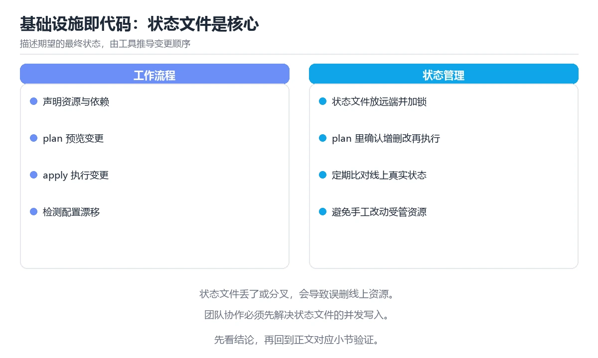

# 基础设施即代码

> 内容更新时间：2026-10-06 · 学习阶段：进阶 · 预计用时：30 分钟

分类：cloud。关键词：Terraform、基础设施即代码、状态文件、计划评审、漂移。从声明式描述、状态管理讲到计划评审、模块复用与漂移检测。



## 本节知识框架

**课程定位**：所属分类 `cloud`（云计算与云原生），课程主题 `基础设施即代码`，学习阶段 进阶，建议用时 35 分钟。

本课主线：从声明式描述、状态管理讲到计划评审、模块复用与漂移检测。

**学完本课应当能够**
- 说清 `声明式` 与 `状态文件` 的含义与区别，并各举一个正例和一个反例。
- 用本课示例验证 `计划` 的行为，记录输入、输出与失败条件。
- 遇到「并发执行导致状态损坏」这类问题时，能说出触发条件与修复顺序。

### 复习清单

- [ ] 能用自己的话说明「基础设施即代码」里的 Terraform，再举一个它不成立的场景。
- [ ] 能运行「基础设施即代码」的示例，记录输入、输出与第一次失败的现象。
- [ ] 能完成一次自测，并把错题对照错误表定位原因。

**本课配图**



## 核心概念定义

| 术语 | 操作性定义 | 常见边界与风险 |
| --- | --- | --- |
| 声明式 | 描述期望状态，由工具推导执行步骤的方式。 | 只在依赖可由工具推导时成立：跨资源引用未写成显式引用，一次重新创建就可能因顺序错误而失败。 |
| 状态文件 | 记录工具已知资源属性与依赖的持久化数据。 | 易错：状态文件放在本地且多人同时执行；正确做法是把状态集中存储并开启锁定，流水线串行执行变更。 |
| 计划 | 执行前生成的资源变更差异清单。 | 易错：直接执行应用，没有评审计划里的替换标记；正确做法是变更前生成计划并逐项评审，出现替换标记时先备份数据并确认影响范围。 |
| 模块 | 可复用的资源配置集合，通过变量与输出对外交互。 | 易错：把环境差异写死在模块内部，测试与生产被迫接受同一套参数；引用时要固定版本号。 |
| 漂移 | 实际资源与代码描述之间的差异。 | 易错：有人直接控制台手工修改且无人发现；正确做法是定时执行只读检测比对代码与实际，发现漂移后要么修正代码要么回收手工改动。 |

## 原理与运行机制

### 机制总览

**教材衔接：核心知识**

### 1. 声明式资源与依赖

描述期望的最终状态，由工具推导创建顺序，而不是写一串执行命令。

资源之间通过引用建立隐式依赖，工具据此构建依赖图并决定创建、更新或删除顺序。

在基础设施即代码里可以这样验证：在本课示例里让子网引用虚拟网络标识，观察计划里两个资源的先后顺序。

边界：依赖靠人工保证顺序时，一次重新创建就可能因为顺序错误而失败。

工程视角：凡是跨资源引用都写成显式引用，让依赖关系可以由工具推导并校验。

### 2. 状态与计划评审

状态记录已知的资源现状，计划描述本次将要发生的变更。

执行时先读取状态与远端实际配置，生成差异计划，评审通过后再应用；状态文件需集中存储并加锁防止并发写坏。

在基础设施即代码里可以这样验证：在本课示例里改一个实例规格，观察计划中显示的属性差异与替换或更新标记。

边界：看到计划里出现「替换」就意味着资源会被销毁重建，数据未备份就会丢失。

工程视角：计划在流水线中生成并归档，破坏性变更需要明确审批并附上备份与回滚方案。

### 3. 模块复用与漂移检测

把常用结构封装成模块，让多个环境共用同一份定义。

模块接收变量并输出结果，环境通过版本号引用模块；定期执行只读检测比对代码与实际资源，发现手工修改造成的漂移。

在基础设施即代码里可以这样验证：在本课示例里把网络配置抽成模块，被测试与生产两个环境同时引用。

边界：模块直接写死环境差异会让所有环境被迫接受同一套参数，失去复用意义。

工程视角：模块版本固定并写入变更记录，漂移检测纳入定时任务并把结果通知到负责人。

## 典型应用场景

| 场景 | 典型输入或前提 | 期望产物 |
| --- | --- | --- |
| 学习验证 | 使用本课最小示例和 Terraform、基础设施即代码 | 能复现正文结论，并解释每一步。 |
| 工程落地 | 把「基础设施即代码」放入真实模块或服务边界 | 输出可观测、失败可定位、参数可配置。 |
| 故障排查 | 只改一个版本、规模、输入或依赖条件 | 能区分概念错误、实现错误和环境差异。 |

**教材衔接：深度拓展与实战**

### 机制对照表

| 概念 | 解决什么问题 | 关键前提 | 失败信号 |
| --- | --- | --- | --- |
| 声明式资源与依赖 | 描述期望的最终状态，由工具推导创建顺序，而不是写一串执行命令。 | 依赖靠人工保证顺序时，一次重新创建就可能因为顺序错误而失败。 | 凡是跨资源引用都写成显式引用，让依赖关系可以由工具推导并校验。 |
| 状态与计划评审 | 状态记录已知的资源现状，计划描述本次将要发生的变更。 | 看到计划里出现「替换」就意味着资源会被销毁重建，数据未备份就会丢失。 | 计划在流水线中生成并归档，破坏性变更需要明确审批并附上备份与回滚方案。 |
| 模块复用与漂移检测 | 把常用结构封装成模块，让多个环境共用同一份定义。 | 模块直接写死环境差异会让所有环境被迫接受同一套参数，失去复用意义。 | 模块版本固定并写入变更记录，漂移检测纳入定时任务并把结果通知到负责人。 |

### 自测问答

**问 1**：计划里出现替换标记意味着什么？

**答**：资源会被销毁并重新创建。替换会先销毁旧资源再创建新资源，对有状态服务可能造成数据丢失与中断，必须提前确认并准备备份。 正确选项「资源会被销毁并重新创建」对应《基础设施即代码》的要点「声明式资源与依赖」：描述期望的最终状态，由工具推导创建顺序，而不是写一串执行命令。判断「声明式资源与依赖」时先确认前提是否成立，再回到《基础设施即代码》的示例核对一次；把别的语言或框架的默认做法直接搬到声明式资源与依赖上，往往会在本课的边界条件里失效。

**问 2**：状态文件集中存储并加锁的主要目的是？

**答**：防止多人并发执行导致状态损坏。状态是变更决策的依据，并发写入会产生冲突与丢失记录，集中存储加锁是多人协作的基本要求。 正确选项「防止多人并发执行导致状态损坏」对应《基础设施即代码》的要点「状态与计划评审」：状态记录已知的资源现状，计划描述本次将要发生的变更。判断「状态与计划评审」时先确认前提是否成立，再回到《基础设施即代码》的示例核对一次；借鉴相邻主题的经验之前，先核对状态与计划评审的前提是否成立。

**问 3**：把手工改动纳入代码管理，可以采取哪些做法？（多选）

**答**：定时执行漂移检测；把手工调整回填为代码；在评审中对比计划与实际差异。检测、回填与评审让代码保持权威；直接手工修改会制造新的漂移，让代码不可信。 正确选项「定时执行漂移检测；把手工调整回填为代码；在评审中对比计划与实际差异」对应《基础设施即代码》的要点「模块复用与漂移检测」：把常用结构封装成模块，让多个环境共用同一份定义。判断「模块复用与漂移检测」时先确认前提是否成立，再回到《基础设施即代码》的示例核对一次；记住模块复用与漂移检测的结论之外还要记住适用条件，换一个输入往往就不成立了。

**问 4**：请按一次基础设施变更的流程排列。

**答**：修改代码并提交评审。先改代码再生成计划，评审通过后应用，随后验证结果并归档记录，形成可追溯的变更闭环。 正确选项「修改代码并提交评审；生成计划并逐项检查；执行应用完成变更；验证资源与输出是否符合预期；归档计划与变更记录」对应《基础设施即代码》的要点「声明式资源与依赖」：描述期望的最终状态，由工具推导创建顺序，而不是写一串执行命令。判断「声明式资源与依赖」时先确认前提是否成立，再回到《基础设施即代码》的示例核对一次；干扰项常常是相邻主题里成立的结论，只有按声明式资源与依赖的输入与约束判断才能排除。

**问 5**：阅读这段资源定义，潜在问题是什么？

**答**：数据库资源没有保留策略，变更时可能直接销毁数据。数据库这类有状态资源在变更时默认可能被销毁重建，应配置保留策略与删除保护，并在评审中确认替换影响。 正确选项「数据库资源没有保留策略，变更时可能直接销毁数据」对应《基础设施即代码》的要点「状态与计划评审」：状态记录已知的资源现状，计划描述本次将要发生的变更。判断「状态与计划评审」时先确认前提是否成立，再回到《基础设施即代码》的示例核对一次；把状态与计划评审的做法换到别的约束下未必成立，先确认边界再决定答案。

### 工程检查表

- [ ] 拆分资源并建立引用关系
- [ ] 用变量区分环境差异
- [ ] 生成计划并逐项评审
- [ ] 集中保存状态并启用锁定
- [ ] 定时检测漂移并修正
- [ ] 【声明式资源与依赖】凡是跨资源引用都写成显式引用，让依赖关系可以由工具推导并校验。
- [ ] 【状态与计划评审】计划在流水线中生成并归档，破坏性变更需要明确审批并附上备份与回滚方案。
- [ ] 【模块复用与漂移检测】模块版本固定并写入变更记录，漂移检测纳入定时任务并把结果通知到负责人。

### 结论与下一步

- **并发执行导致状态损坏**：典型现象是状态文件放在本地且多人同时执行；正确做法是把状态集中存储并开启锁定，流水线串行执行变更。
- **一次变更意外删除资源**：典型现象是直接执行应用，没有评审计划里的替换标记；正确做法是变更前生成计划并逐项评审，出现替换标记时先备份数据并确认影响范围。
- **代码与实际资源不一致**：典型现象是有人直接控制台手工修改且无人发现；正确做法是定时执行只读检测比对代码与实际，发现漂移后要么修正代码要么回收手工改动。

### 最小验证场景

- 准备：保留 `text` 示例的原始输入，先记录 `基础设施即代码` 的基线输出和完整运行命令。
- 观察：先核对 出现字面量 `env`，再改变一个与 `声明式` 相关的条件。
- 判定：新结果与 `基础设施即代码` 的基线不同不等于错误；只有当差异破坏了 `声明式` 的定义或错误表中的约束，才判定为失败。

### 选择与边界

- 使用 `声明式` 时，描述期望状态，由工具推导执行步骤的方式；缓存与状态残留会让结果过期，先明确失效策略再判断正确性。
- 使用 `状态文件` 时，记录工具已知资源属性与依赖的持久化数据；易错：状态文件放在本地且多人同时执行；正确做法是把状态集中存储并开启锁定，流水线串行执行变更。
- 使用 `计划` 时，执行前生成的资源变更差异清单；易错：直接执行应用，没有评审计划里的替换标记；正确做法是变更前生成计划并逐项评审，出现替换标记时先备份数据并确认影响范围。
- 使用 `模块` 时，可复用的资源配置集合，通过变量与输出对外交互。
- 使用 `漂移` 时，实际资源与代码描述之间的差异；易错：有人直接控制台手工修改且无人发现；正确做法是定时执行只读检测比对代码与实际，发现漂移后要么修正代码要么回收手工改动。

## 代码/协议/SQL 示例

**教材衔接：关键流程**

```text
拆分资源并建立引用关系 → 用变量区分环境差异 → 生成计划并逐项评审 → 集中保存状态并启用锁定 → 定时检测漂移并修正
```

1. 拆分资源并建立引用关系
2. 用变量区分环境差异
3. 生成计划并逐项评审
4. 集中保存状态并启用锁定
5. 定时检测漂移并修正

```hcl
variable "env" { type = string }
variable "instance_type" { type = string, default = "small" }

resource "cloud_network" "main" {
  name = "app-${var.env}"
  cidr = "10.20.0.0/16"
}

resource "cloud_subnet" "app" {
  name       = "app-${var.env}"
  network_id = cloud_network.main.id      # 引用建立隐式依赖
  cidr       = "10.20.1.0/24"
}

resource "cloud_instance" "app" {
  name      = "app-${var.env}-01"
  subnet_id = cloud_subnet.app.id
  size      = var.instance_type            # 环境差异由变量注入
  tags      = { env = var.env, managed_by = "iac" }
}

output "instance_id" { value = cloud_instance.app.id }
```

## 时间/空间复杂度或性能分析

**性能关注点（基础设施即代码）**：成本与弹性是核心指标：记录实例规格、伸缩延迟与单位请求成本。

**本课特有开销（基础设施即代码 · Terraform）**：小文件看元数据开销，大文件看吞吐，两者要分别测量。

**测量方法**：以 `基础设施即代码` 的 `Terraform` 场景为对象，固定输入跑一遍记录基线，再把规模或并发度提高一个数量级复测；两次结果的差值与波动范围才是结论依据。

## 常见误区与易错点

| 容易写错的做法 | 实际现象 | 原因与正确做法 |
| --- | --- | --- |
| 并发执行导致状态损坏 | 状态文件放在本地且多人同时执行。 | 把状态集中存储并开启锁定，流水线串行执行变更。 |
| 一次变更意外删除资源 | 直接执行应用，没有评审计划里的替换标记。 | 变更前生成计划并逐项评审，出现替换标记时先备份数据并确认影响范围。 |
| 代码与实际资源不一致 | 有人直接控制台手工修改且无人发现。 | 定时执行只读检测比对代码与实际，发现漂移后要么修正代码要么回收手工改动。 |

### 现场 1：并发执行导致状态损坏

**症状**：状态文件放在本地且多人同时执行。

**根因与修复**：把状态集中存储并开启锁定，流水线串行执行变更。

**自检**：在本课示例里复现「并发执行导致状态损坏」，改成把状态集中存储并开启锁定，流水线串行执行变更后重跑；如果症状消失且失败路径按预期变化，说明定位正确。

### 现场 2：一次变更意外删除资源

**症状**：直接执行应用，没有评审计划里的替换标记。

**根因与修复**：变更前生成计划并逐项评审，出现替换标记时先备份数据并确认影响范围。

**自检**：在本课示例里复现「一次变更意外删除资源」，改成变更前生成计划并逐项评审，出现替换标记时先备份数据并确认影响范围后重跑；如果症状消失且失败路径按预期变化，说明定位正确。

### 现场 3：代码与实际资源不一致

**症状**：有人直接控制台手工修改且无人发现。

**根因与修复**：定时执行只读检测比对代码与实际，发现漂移后要么修正代码要么回收手工改动。

**自检**：在本课示例里复现「代码与实际资源不一致」，改成定时执行只读检测比对代码与实际，发现漂移后要么修正代码要么回收手工改动后重跑；如果症状消失且失败路径按预期变化，说明定位正确。

## 与其他知识点的关系

**教材衔接：复习与迁移**

## 自测题与参考答案

> 先独立作答，再对照参考答案；答案都能在本课正文、术语表或错误表里找到依据。

### 自测 1（概念复述）

不看正文，写出 `声明式` 的操作性定义，并说明它与 `状态文件` 的区别。

**参考答案**：描述期望状态，由工具推导执行步骤的方式。

`状态文件` 的定位是：记录工具已知资源属性与依赖的持久化数据；两者的差别要从适用对象与失败模式上说明。

### 自测 2（排错）

本课错误表记录了「并发执行导致状态损坏」这类做法。请写出它会出现的现象、根因，以及修复顺序。

**参考答案**：现象是状态文件放在本地且多人同时执行；正确做法是把状态集中存储并开启锁定，流水线串行执行变更。修复时先复现现象并保留证据，再改动一处假设重跑，确认现象消失。

### 自测 3（动手验证）

运行本课的 `text` 示例，只改 Terraform 的一个输入并比较两次输出，抄下第一条错误信息。

**参考答案**：正常输入下 `text` 示例应当复现正文给出的结果；改动输入后，如果结果改变或报错，先核对它是否满足 `基础设施即代码` 中`声明式` 的适用范围，再检查错误表里是否有同类现象。

### 自测 4（代码阅读）

阅读本课开头的 `text` 示例，说明它体现了`声明式` 的哪一条性质，并指出改动哪个输入会让这条性质不再成立。

**参考答案**：`声明式` 的定义是 描述期望状态，由工具推导执行步骤的方式，示例正是在实现这条定义。改动与 `声明式` 有关的一个输入后，如果结果不再符合 `基础设施即代码` 的正文描述，就说明该性质只在当前前提成立。

### 自测 5（迁移）

把 `基础设施即代码` 的方法迁移到自己的项目：围绕 `声明式` 写出一个与错误表同类的风险点，并说明触发条件和检验方式。

**参考答案**：例如「代码与实际资源不一致」，它会导致有人直接控制台手工修改且无人发现；检验方式是按定时执行只读检测比对代码与实际，发现漂移后要么修正代码要么回收手工改动改一处再复现，确认现象消失且没有引入新的失败分支。

### 自测 6（对比）

用一个表格对比 `声明式` 与 `状态文件`：各写一行适用场景、一行失败表现。

**参考答案**：`声明式` 的定义是描述期望状态，由工具推导执行步骤的方式；`状态文件` 的定义是记录工具已知资源属性与依赖的持久化数据。两者的失败表现分别对应本课错误表里与本术语相关的行。

### 自测 7（排错顺序）

面对「并发执行导致状态损坏」引发的问题，请把“复现 状态文件放在本地且多人同时执行 → 保留证据 → 把状态集中存储并开启锁定，流水线串行执行变更 → 回归验证”四步写成可执行的检查清单。

**参考答案**：第一步按状态文件放在本地且多人同时执行复现；第二步记录输入、版本与完整报错；第三步按把状态集中存储并开启锁定，流水线串行执行变更只改一处；第四步重跑并确认失败路径也按预期变化。

### 自测 8（边界判断）

针对 `漂移`，分别写出“可以使用”的条件和“结论不再成立”的条件。

**参考答案**：易错：有人直接控制台手工修改且无人发现；正确做法是定时执行只读检测比对代码与实际，发现漂移后要么修正代码要么回收手工改动。 同时要把 `漂移` 的定义 实际资源与代码描述之间的差异 与实际输入逐项对照。

### 自测 9（机制重建）

不看正文，按输入、转换、输出、验证四段重建 `声明式` → `状态文件` → `计划` → `模块` 的作用链。

**参考答案**：起点是 `声明式` 的定义 描述期望状态，由工具推导执行步骤的方式；中间每一步都保留可观察状态；终点由 `漂移` 检查，失败时回到错误表定位第一个偏离定义的步骤。

### 自测 10（综合排错）

在 `基础设施即代码` 中，现象是 有人直接控制台手工修改且无人发现。请围绕 代码与实际资源不一致 写出最小复现、关键证据、修复动作和回归验证，并说明为什么不能只凭一次运行下结论。

**参考答案**：先复现 代码与实际资源不一致，记录输入与完整错误；再按 定时执行只读检测比对代码与实际，发现漂移后要么修正代码要么回收手工改动 只改一处。回归时同时跑正常路径和边界路径，只有两次结果都可解释，才把修复视为完成。

### 自测 11（一分钟复述）

用每分钟约 200 字的速度复述 `基础设施即代码`：先给主问题，再按顺序说出 `声明式`、`状态文件`、`计划`、`模块`，最后给一个失败案例。

**自评标准**：主问题必须对应 从声明式描述、状态管理讲到计划评审、模块复用与漂移检测；每个术语都要能接上一句定义或边界；失败案例必须写成可观察现象，不能用“可能有风险”代替证据。

## 术语速查

| 术语 | 一句话说明 |
| --- | --- |
| `声明式` | 描述期望状态，由工具推导执行步骤的方式。 |
| `状态文件` | 记录工具已知资源属性与依赖的持久化数据。 |
| `计划` | 执行前生成的资源变更差异清单。 |
| `模块` | 可复用的资源配置集合，通过变量与输出对外交互。 |
| `漂移` | 实际资源与代码描述之间的差异。 |

**术语关系**：`声明式`（描述期望状态） → `状态文件`（记录工具已知资源属性与依赖的持久化数据） → `计划`（执行前生成的资源变更差异清单） → `模块`（可复用的资源配置集合）。

## 考点精讲

`基础设施即代码` 的题库有 5 道题，下面逐题给出题干、正确项与判断依据：先自己作答，再核对正确项，最后回到正文对应小节复核。

### 考点 1：第 1 题

- **题目**：计划里出现替换标记意味着什么？
- **正确项**：资源会被销毁并重新创建
- **判断依据**：本题正确项是「资源会被销毁并重新创建」。术语 计划（基础设施即代码）：执行前生成的资源变更差异清单，本题取「资源会被销毁并重新创建」这条。易错点是并发执行导致状态损坏，会造成状态文件放在本地且多人同时执行，改法是把状态集中存储并开启锁定，流水线串行执行变更。

### 考点 2：第 2 题

- **题目**：状态文件集中存储并加锁的主要目的是？
- **正确项**：防止多人并发执行导致状态损坏
- **判断依据**：本题正确项是「防止多人并发执行导致状态损坏」。术语 状态文件（基础设施即代码）：记录工具已知资源属性与依赖的持久化数据，本题取「防止多人并发执行导致状态损坏」这条。易错点是一次变更意外删除资源，会造成直接执行应用，没有评审计划里的替换标记，改法是变更前生成计划并逐项评审，出现替换标记时先备份数据并确认影响范围。

### 考点 3：第 3 题

- **题目**：把手工改动纳入代码管理，可以采取哪些做法？（多选）
- **正确项**：定时执行漂移检测；把手工调整回填为代码；在评审中对比计划与实际差异
- **判断依据**：按《基础设施即代码》的正文口径，本题要同时选中「定时执行漂移检测」、「把手工调整回填为代码」、「在评审中对比计划与实际差异」，漏掉任一项都算没答全。术语 计划（基础设施即代码）：执行前生成的资源变更差异清单。易错点是代码与实际资源不一致，会造成有人直接控制台手工修改且无人发现，改法是定时执行只读检测比对代码与实际，发现漂移后要么修正代码要么回收手工改动。

### 考点 4：第 4 题

- **题目**：请按一次基础设施变更的流程排列。
- **正确项**：修改代码并提交评审 → 生成计划并逐项检查 → 执行应用完成变更 → 验证资源与输出是否符合预期 → 归档计划与变更记录
- **判断依据**：按《基础设施即代码》正文的先后，本题顺序是「修改代码并提交评审」 → 「生成计划并逐项检查」 → 「执行应用完成变更」 → 「验证资源与输出是否符合预期」 → 「归档计划与变更记录」。术语 计划（基础设施即代码）：执行前生成的资源变更差异清单。易错点是并发执行导致状态损坏会造成状态文件放在本地且多人同时执行，改法是把状态集中存储并开启锁定，流水线串行执行变更。

### 考点 5：第 5 题

- **题目**：阅读这段资源定义，潜在问题是什么？
- **正确项**：数据库资源没有保留策略，变更时可能直接销毁数据
- **判断依据**：本题正确项是「数据库资源没有保留策略，变更时可能直接销毁数据」。术语 声明式（基础设施即代码）：描述期望状态，由工具推导执行步骤的方式，本题取「数据库资源没有保留策略，变更时可能直接销毁数据」这条。易错点是一次变更意外删除资源，会造成直接执行应用，没有评审计划里的替换标记，改法是变更前生成计划并逐项评审，出现替换标记时先备份数据并确认影响范围。

### 考点 6：`声明式`

- **要点**：描述期望状态，由工具推导执行步骤的方式。
- **声明式 的边界**：缓存与状态残留会让结果过期，先明确失效策略再判断正确性。

### 考点 7：`状态文件`

- **要点**：记录工具已知资源属性与依赖的持久化数据。
- **状态文件 的边界**：易错：状态文件放在本地且多人同时执行；正确做法是把状态集中存储并开启锁定，流水线串行执行变更。

### 考点 8：`计划`

- **要点**：执行前生成的资源变更差异清单。
- **计划 的边界**：易错：直接执行应用，没有评审计划里的替换标记；正确做法是变更前生成计划并逐项评审，出现替换标记时先备份数据并确认影响范围。

### 考点 9：`模块`

- **要点**：可复用的资源配置集合，通过变量与输出对外交互。

### 考点 10：`漂移`

- **要点**：实际资源与代码描述之间的差异。
- **漂移 的边界**：易错：有人直接控制台手工修改且无人发现；正确做法是定时执行只读检测比对代码与实际，发现漂移后要么修正代码要么回收手工改动。

### 考点 11：排错——并发执行导致状态损坏

- **现象**：状态文件放在本地且多人同时执行。
- **处理**：把状态集中存储并开启锁定，流水线串行执行变更。

### 考点 12：排错——一次变更意外删除资源

- **现象**：直接执行应用，没有评审计划里的替换标记。
- **处理**：变更前生成计划并逐项评审，出现替换标记时先备份数据并确认影响范围。

### 考点 13：综合辨析——`声明式` 与 `漂移`

- **辨析点**：`声明式` 的定义是 描述期望状态，由工具推导执行步骤的方式；`漂移` 的定义是 实际资源与代码描述之间的差异。
- **答题要求**：面对 `基础设施即代码` 的题目，先判断描述的是 `声明式` 还是 `漂移`，再归到对应定义，最后写出一个会让该定义失效的边界输入。

### 考点 14：排错评分点

- **现象分**：能写出 状态文件放在本地且多人同时执行，而不是只写“程序有错”。
- **证据分**：保留触发 并发执行导致状态损坏 的输入、版本和错误原文。
- **修复分**：按 把状态集中存储并开启锁定，流水线串行执行变更 只改一处，并同时回归正常路径与边界路径。

## 内容元数据

- 内容版本：v2.0
- 最后更新：2026-10-06
- 学习阶段：进阶

| 字段 | 值 |
| --- | --- |
| 课程 ID | `cloud_iac_terraform` |
| 所属分类 | `cloud` |
| 难度 | 进阶 |
| 预计用时 | 40 分钟 |
| 关键词 | Terraform、基础设施即代码、状态文件、计划评审、漂移 |
| 配图 | `images/lesson_cloud_iac_terraform.webp` |
| 参考资料 | 2 条 |
| 内容更新时间 | 2026-10-06 |

## 参考资料与复核

- 来源性质：官方文档、标准或权威教材；本课核对关键词：Terraform、基础设施即代码、状态文件、计划评审、漂移。
- 最后复核：2026-10-04
- 下次复核：2027-03-24
- 复核范围：版本兼容、API 行为与工程实践

下面列出的资料用于核对本课结论，复习时可以对照阅读：
- [Terraform 官方文档：语言与工作流](https://developer.hashicorp.com/terraform/docs)
- [OpenTofu 官方文档](https://opentofu.org/docs/)

| [本课术语索引：基础设施即代码](#核心概念定义) | 按本课输入、术语边界和错误表现逐项核对 |
> 复核提示：《基础设施即代码》的结论如与资料冲突，以资料中的规范文本为准，并在笔记里记录差异与日期。