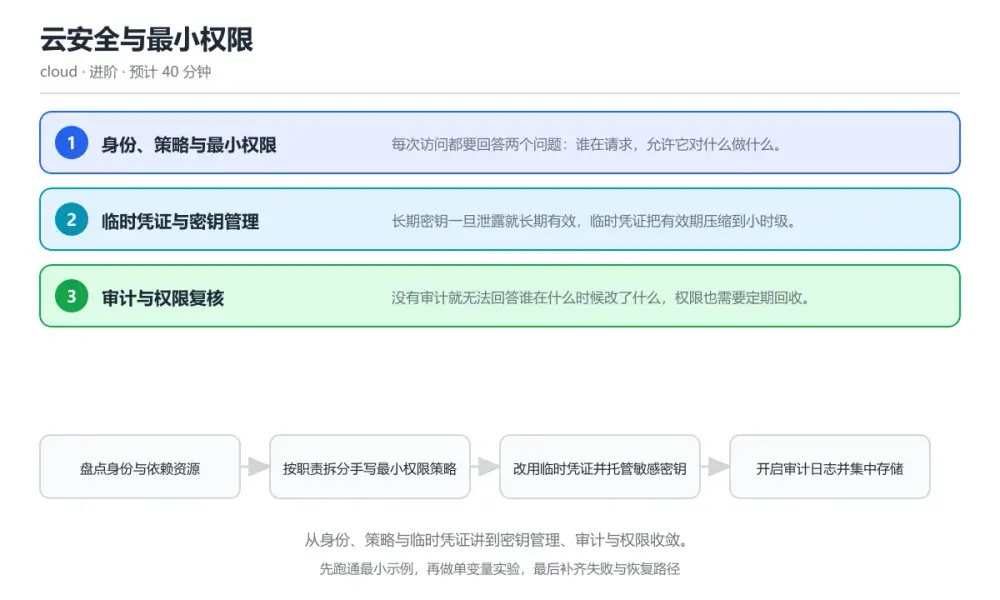
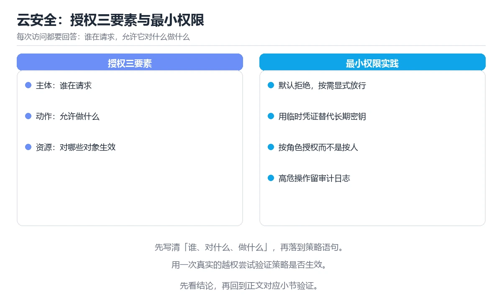

# 云安全与最小权限

> 内容更新时间：2026-10-06 · 学习阶段：进阶 · 预计用时：30 分钟

分类：cloud。关键词：IAM、最小权限、临时凭证、密钥管理、审计。从身份、策略与临时凭证讲到密钥管理、审计与权限收敛。



## 本节知识框架

**课程定位**：所属分类 `cloud`（云计算与云原生），课程主题 `云安全与最小权限`，学习阶段 进阶，建议用时 40 分钟。

本课主线：从身份、策略与临时凭证讲到密钥管理、审计与权限收敛。

**学完本课应当能够**
- 说清 `最小权限` 与 `显式拒绝` 的含义与区别，并各举一个正例和一个反例。
- 用本课示例验证 `临时凭证` 的行为，记录输入、输出与失败条件。
- 遇到「一次凭证泄露影响整个账号」这类问题时，能说出触发条件与修复顺序。

### 复习清单

- [ ] 能不看正文复述本课核心术语，并指出一个边界或反例。
- [ ] 能运行或推演本课示例，记录输入、输出与失败现象。
- [ ] 能完成一次自测，并把错题对照错误表定位原因。

**本课配图**



## 核心概念定义

| 术语 | 操作性定义 | 常见边界与风险 |
| --- | --- | --- |
| 最小权限 | 只授予完成任务所必需的最小动作与资源范围。 | 只在「只授予完成任务所必需的最小动作与资源范围」这一前提下成立，换输入或换环境要重新验证。 |
| 显式拒绝 | 优先级最高的拒绝语句，覆盖任何允许。 | 易错：给服务授予带通配符的全部动作权限；正确做法是按服务职责拆分策略，动作与资源都收窄到实际需要，并加显式拒绝对关键操作兜底。 |
| 临时凭证 | 带有效期的访问凭证，过期自动失效。 | 易错：把长期密钥写进配置文件并分发到多台机器；正确做法是改用受信任身份换取临时凭证，敏感数据交由密钥管理服务托管并定期轮换。 |
| 审计日志 | 记录谁在何时对什么资源执行了操作。 | 只在「记录谁在何时对什么资源执行了操作」这一前提下成立，换输入或换环境要重新验证。 |
| 权限复核 | 定期比对应有权限与实际使用并回收多余部分。 | 权限与密钥策略变化会让结论失效，按最小权限并用真实凭据流程复验。 |
| 身份 | 身份被授予策略，策略由动作、资源与条件组成；显式拒绝优先于允许，最终结果按优先级合并 | 易错：把长期密钥写进配置文件并分发到多台机器；正确做法是改用受信任身份换取临时凭证，敏感数据交由密钥管理服务托管并定期轮换。 |

## 原理与运行机制

### 机制总览

**教材衔接：核心知识**

### 1. 身份、策略与最小权限

每次访问都要回答两个问题：谁在请求，允许它对什么做什么。

身份被授予策略，策略由动作、资源与条件组成；显式拒绝优先于允许，最终结果按优先级合并。

在云安全与最小权限里可以这样验证：在本课示例里把策略范围从全部资源收窄到单一存储桶前缀，验证越界访问被拒绝。

边界：用通配符授予全部动作会让一次凭证泄露影响整个账号，损失面远大于单个服务。

工程视角：权限按服务与职责拆分，先在测试环境验证拒绝路径再上线，并记录每次扩权的原因。

### 2. 临时凭证与密钥管理

长期密钥一旦泄露就长期有效，临时凭证把有效期压缩到小时级。

工作负载通过可信身份换取带有效期的凭证，敏感数据用密钥管理服务加密，应用只持有密钥标识而非明文。

在云安全与最小权限里可以这样验证：在本课示例里用工作负载身份换取临时凭证访问存储，再验证凭证过期后自动失效。

边界：把长期密钥写进配置文件或代码仓库，泄露后需要在所有环境中同步轮换，代价高昂。

工程视角：禁用长期密钥或设置轮换周期，密钥与凭证的使用记录接入审计并在异常时自动吊销。

### 3. 审计与权限复核

没有审计就无法回答谁在什么时候改了什么，权限也需要定期回收。

管理操作写入审计日志并集中存储，定期用实际访问记录比对应有权限，收敛长期未使用的高危权限。

在云安全与最小权限里可以这样验证：在本课示例里查询近三十天的访问记录，找出从未被使用的管理员权限并回收。

边界：只在上线时配一次权限，人员与职责变化后权限会持续膨胀，形成隐形风险。

工程视角：按季度执行权限复核，把复核结论与回收动作记录在案，异常检测规则覆盖高危操作。

## 典型应用场景

**教材衔接：深度拓展与实战**

### 机制对照表

| 概念 | 解决什么问题 | 关键前提 | 失败信号 |
| --- | --- | --- | --- |
| 身份、策略与最小权限 | 每次访问都要回答两个问题：谁在请求，允许它对什么做什么。 | 用通配符授予全部动作会让一次凭证泄露影响整个账号，损失面远大于单个服务。 | 权限按服务与职责拆分，先在测试环境验证拒绝路径再上线，并记录每次扩权的原 |
| 临时凭证与密钥管理 | 长期密钥一旦泄露就长期有效，临时凭证把有效期压缩到小时级。 | 把长期密钥写进配置文件或代码仓库，泄露后需要在所有环境中同步轮换，代价高 | 禁用长期密钥或设置轮换周期，密钥与凭证的使用记录接入审计并在异常时自动吊 |
| 审计与权限复核 | 没有审计就无法回答谁在什么时候改了什么，权限也需要定期回收。 | 只在上线时配一次权限，人员与职责变化后权限会持续膨胀，形成隐形风险。 | 按季度执行权限复核，把复核结论与回收动作记录在案，异常检测规则覆盖高危操 |

### 自测问答

**问 1**：策略中显式拒绝的作用是？

**答**：优先级最高，覆盖任何允许语句。显式拒绝的优先级高于允许，常用于给关键操作加一道无法绕过的保护。 正确选项「优先级最高，覆盖任何允许语句」对应《云安全与最小权限》的要点「身份、策略与最小权限」：每次访问都要回答两个问题：谁在请求，允许它对什么做什么。判断「身份、策略与最小权限」时先确认前提是否成立，再回到《云安全与最小权限》的示例核对一次；把别的语言或框架的默认做法直接搬到身份、策略与最小权限上，往往会在本课的边界条件里失效。

**问 2**：用临时凭证替代长期密钥的主要收益是？

**答**：泄露后影响时间被压缩到凭证有效期。临时凭证到期自动失效，即使被窃取，攻击窗口也被限制在有效期内，且获取过程本身可审计。 正确选项「泄露后影响时间被压缩到凭证有效期」对应《云安全与最小权限》的要点「临时凭证与密钥管理」：长期密钥一旦泄露就长期有效，临时凭证把有效期压缩到小时级。判断「临时凭证与密钥管理」时先确认前提是否成立，再回到《云安全与最小权限》的示例核对一次；借鉴相邻主题的经验之前，先核对临时凭证与密钥管理的前提是否成立。

**问 3**：权限复核通常包含哪些动作？（多选）

**答**：导出实际访问记录；比对授予权限与实际使用；回收长期未使用的高危权限。复核的本质是用事实比对授权并回收多余部分；统一放宽权限会让风险面持续扩大。 正确选项「导出实际访问记录；比对授予权限与实际使用；回收长期未使用的高危权限」对应《云安全与最小权限》的要点「审计与权限复核」：没有审计就无法回答谁在什么时候改了什么，权限也需要定期回收。判断「审计与权限复核」时先确认前提是否成立，再回到《云安全与最小权限》的示例核对一次；记住审计与权限复核的结论之外还要记住适用条件，换一个输入往往就不成立了。

**问 4**：请按一次最小权限落地的顺序排列。

**答**：盘点服务与资源依赖。先盘点再收窄，验证拒绝路径确保业务不受影响，随后替换凭证方式，最后把复核变成常态化流程。 正确选项「盘点服务与资源依赖；编写收窄后的策略；在测试环境验证拒绝路径；替换长期密钥为临时凭证；按周期复核并回收权限」对应《云安全与最小权限》的要点「身份、策略与最小权限」：每次访问都要回答两个问题：谁在请求，允许它对什么做什么。判断「身份、策略与最小权限」时先确认前提是否成立，再回到《云安全与最小权限》的示例核对一次；干扰项常常是相邻主题里成立的结论，只有按身份、策略与最小权限的输入与约束判断才能排除。

**问 5**：阅读这段策略，风险是什么？

**答**：动作与资源都使用通配符，权限过大。对所有资源允许所有动作，一旦该身份被利用，攻击者可以读取、修改甚至删除账号内的任意资源，应逐项收窄。 正确选项「动作与资源都使用通配符，权限过大」对应《云安全与最小权限》的要点「临时凭证与密钥管理」：长期密钥一旦泄露就长期有效，临时凭证把有效期压缩到小时级。判断「临时凭证与密钥管理」时先确认前提是否成立，再回到《云安全与最小权限》的示例核对一次；把临时凭证与密钥管理的做法换到别的约束下未必成立，先确认边界再决定答案。

### 工程检查表

- [ ] 盘点身份与依赖资源
- [ ] 按职责拆分手写最小权限策略
- [ ] 改用临时凭证并托管敏感密钥
- [ ] 开启审计日志并集中存储
- [ ] 按周期复核并回收多余权限
- [ ] 【身份、策略与最小权限】权限按服务与职责拆分，先在测试环境验证拒绝路径再上线，并记录每次扩权的原因。
- [ ] 【临时凭证与密钥管理】禁用长期密钥或设置轮换周期，密钥与凭证的使用记录接入审计并在异常时自动吊销。
- [ ] 【审计与权限复核】按季度执行权限复核，把复核结论与回收动作记录在案，异常检测规则覆盖高危操作。

### 结论与下一步

- **一次凭证泄露影响整个账号**：典型现象是给服务授予带通配符的全部动作权限；正确做法是按服务职责拆分策略，动作与资源都收窄到实际需要，并加显式拒绝对关键操作兜底。
- **密钥轮换成本高**：典型现象是把长期密钥写进配置文件并分发到多台机器；正确做法是改用受信任身份换取临时凭证，敏感数据交由密钥管理服务托管并定期轮换。
- **离职后权限仍在**：典型现象是上线时配一次权限，之后从不复核；正确做法是按周期用实际访问记录复核权限，回收长期未使用的高危权限并留痕。

### 最小验证场景

- 准备：保留 `text` 示例的原始输入，先记录 `云安全与最小权限` 的基线输出和完整运行命令。
- 观察：先核对 出现字面量 `Version`，再改变一个与 `最小权限` 相关的条件。
- 判定：新结果与 `云安全与最小权限` 的基线不同不等于错误；只有当差异破坏了 `最小权限` 的定义或错误表中的约束，才判定为失败。

### 选择与边界

- 使用 `最小权限` 时，先满足它的定义：只授予完成任务所必需的最小动作与资源范围；只在「只授予完成任务所必需的最小动作与资源范围」这一前提下成立，换输入或换环境要重新验证。
- 使用 `显式拒绝` 时，先满足它的定义：优先级最高的拒绝语句，覆盖任何允许；易错：给服务授予带通配符的全部动作权限；正确做法是按服务职责拆分策略，动作与资源都收窄到实际需要，并加显式拒绝对关键操作兜底。
- 使用 `临时凭证` 时，先满足它的定义：带有效期的访问凭证，过期自动失效；易错：把长期密钥写进配置文件并分发到多台机器；正确做法是改用受信任身份换取临时凭证，敏感数据交由密钥管理服务托管并定期轮换。
- 使用 `审计日志` 时，先满足它的定义：记录谁在何时对什么资源执行了操作；只在「记录谁在何时对什么资源执行了操作」这一前提下成立，换输入或换环境要重新验证。
- 使用 `权限复核` 时，先满足它的定义：定期比对应有权限与实际使用并回收多余部分；权限与密钥策略变化会让结论失效，按最小权限并用真实凭据流程复验。

## 代码/协议/SQL 示例

**教材衔接：关键流程**

```text
盘点身份与依赖资源 → 按职责拆分手写最小权限策略 → 改用临时凭证并托管敏感密钥 → 开启审计日志并集中存储 → 按周期复核并回收多余权限
```

1. 盘点身份与依赖资源
2. 按职责拆分手写最小权限策略
3. 改用临时凭证并托管敏感密钥
4. 开启审计日志并集中存储
5. 按周期复核并回收多余权限

```json
{
  "Version": "2026-10-01",
  "Statement": [
    {
      "Sid": "ReadOnlyAppBucketPrefix",
      "Effect": "Allow",
      "Action": ["storage:GetObject", "storage:ListBucket"],
      "Resource": [
        "arn:cloud:storage:::app-bucket",
        "arn:cloud:storage:::app-bucket/configs/*"   // 只允许读取配置前缀
      ],
      "Condition": {
        "Bool": { "cloud:SecureTransport": "true" },   // 必须使用加密传输
        "IpAddress": { "cloud:SourceIp": "10.20.0.0/16" }  // 限定来源网段
      }
    },
    {
      "Sid": "DenyDelete",
      "Effect": "Deny",
      "Action": ["storage:DeleteObject", "storage:DeleteBucket"],
      "Resource": "arn:cloud:storage:::app-bucket/*"   // 显式拒绝优先
    }
  ]
}
```

## 时间/空间复杂度或性能分析

**性能关注点（云安全与最小权限）**：成本与弹性是核心指标：记录实例规格、伸缩延迟与单位请求成本。

**测量方法**：以 `云安全与最小权限` 的 `IAM` 场景为对象，固定输入跑一遍记录基线，再把规模或并发度提高一个数量级复测；两次结果的差值与波动范围才是结论依据。

## 常见误区与易错点

| 容易写错的做法 | 实际现象 | 原因与正确做法 |
| --- | --- | --- |
| 一次凭证泄露影响整个账号 | 给服务授予带通配符的全部动作权限。 | 按服务职责拆分策略，动作与资源都收窄到实际需要，并加显式拒绝对关键操作兜底。 |
| 密钥轮换成本高 | 把长期密钥写进配置文件并分发到多台机器。 | 改用受信任身份换取临时凭证，敏感数据交由密钥管理服务托管并定期轮换。 |
| 离职后权限仍在 | 上线时配一次权限，之后从不复核。 | 按周期用实际访问记录复核权限，回收长期未使用的高危权限并留痕。 |

### 现场 1：一次凭证泄露影响整个账号

**症状**：给服务授予带通配符的全部动作权限。

**根因与修复**：按服务职责拆分策略，动作与资源都收窄到实际需要，并加显式拒绝对关键操作兜底。

**自检**：在本课示例里复现「一次凭证泄露影响整个账号」，改成按服务职责拆分策略，动作与资源都收窄到实际需要，并加显式拒绝对关键操作兜底后重跑；如果症状消失且失败路径按预期变化，说明定位正确。

### 现场 2：密钥轮换成本高

**症状**：把长期密钥写进配置文件并分发到多台机器。

**根因与修复**：改用受信任身份换取临时凭证，敏感数据交由密钥管理服务托管并定期轮换。

**自检**：在本课示例里复现「密钥轮换成本高」，改成改用受信任身份换取临时凭证，敏感数据交由密钥管理服务托管并定期轮换后重跑；如果症状消失且失败路径按预期变化，说明定位正确。

### 现场 3：离职后权限仍在

**症状**：上线时配一次权限，之后从不复核。

**根因与修复**：按周期用实际访问记录复核权限，回收长期未使用的高危权限并留痕。

**自检**：在本课示例里复现「离职后权限仍在」，改成按周期用实际访问记录复核权限，回收长期未使用的高危权限并留痕后重跑；如果症状消失且失败路径按预期变化，说明定位正确。

## 与其他知识点的关系

**教材衔接：复习与迁移**

## 自测题与参考答案

> 先独立作答，再对照参考答案；答案都能在本课正文、术语表或错误表里找到依据。

### 自测 1（概念复述）

不看正文，写出 `最小权限` 的操作性定义，并说明它与 `显式拒绝` 的区别。

**参考答案**：只授予完成任务所必需的最小动作与资源范围。

`显式拒绝` 的定位是：优先级最高的拒绝语句，覆盖任何允许；两者的差别要从适用对象与失败模式上说明。

### 自测 2（排错）

本课错误表记录了「一次凭证泄露影响整个账号」这类做法。请写出它会出现的现象、根因，以及修复顺序。

**参考答案**：现象是给服务授予带通配符的全部动作权限；正确做法是按服务职责拆分策略，动作与资源都收窄到实际需要，并加显式拒绝对关键操作兜底。修复时先复现现象并保留证据，再改动一处假设重跑，确认现象消失。

### 自测 3（动手验证）

运行本课的 `text` 示例，改动其中一个输入后重新运行，记录输出与错误信息。

**参考答案**：正常输入下 `text` 示例应当复现正文给出的结果；改动输入后，如果结果改变或报错，先核对它是否满足 `云安全与最小权限` 中`最小权限` 的适用范围，再检查错误表里是否有同类现象。

### 自测 4（代码阅读）

阅读本课开头的 `text` 示例，说明它体现了`最小权限` 的哪一条性质，并指出改动哪个输入会让这条性质不再成立。

**参考答案**：`最小权限` 的定义是 只授予完成任务所必需的最小动作与资源范围，示例正是在实现这条定义。改动与 `最小权限` 有关的一个输入后，如果结果不再符合 `云安全与最小权限` 的正文描述，就说明该性质只在当前前提成立。

### 自测 5（迁移）

把 `云安全与最小权限` 的方法迁移到自己的项目：围绕 `最小权限` 写出一个与错误表同类的风险点，并说明触发条件和检验方式。

**参考答案**：例如「离职后权限仍在」，它会导致上线时配一次权限，之后从不复核；检验方式是按按周期用实际访问记录复核权限，回收长期未使用的高危权限并留痕改一处再复现，确认现象消失且没有引入新的失败分支。

### 自测 6（对比）

用一个表格对比 `最小权限` 与 `显式拒绝`：各写一行适用场景、一行失败表现。

**参考答案**：`最小权限` 的定义是只授予完成任务所必需的最小动作与资源范围；`显式拒绝` 的定义是优先级最高的拒绝语句，覆盖任何允许。两者的失败表现分别对应本课错误表里与本术语相关的行。

### 自测 7（排错顺序）

面对「一次凭证泄露影响整个账号」引发的问题，请把“复现 给服务授予带通配符的全部动作权限 → 保留证据 → 按服务职责拆分策略，动作与资源都收窄到实际需要，并加显式拒绝对关键操作兜底 → 回归验证”四步写成可执行的检查清单。

**参考答案**：第一步按给服务授予带通配符的全部动作权限复现；第二步记录输入、版本与完整报错；第三步按按服务职责拆分策略，动作与资源都收窄到实际需要，并加显式拒绝对关键操作兜底只改一处；第四步重跑并确认失败路径也按预期变化。

### 自测 8（边界判断）

针对 `身份`，分别写出“可以使用”的条件和“结论不再成立”的条件。

**参考答案**：易错：把长期密钥写进配置文件并分发到多台机器；正确做法是改用受信任身份换取临时凭证，敏感数据交由密钥管理服务托管并定期轮换。 同时要把 `身份` 的定义 身份被授予策略，策略由动作、资源与条件组成；显式拒绝优先于允许，最终结果按优先级合并 与实际输入逐项对照。

### 自测 9（机制重建）

不看正文，按输入、转换、输出、验证四段重建 `最小权限` → `显式拒绝` → `临时凭证` → `审计日志` 的作用链。

**参考答案**：起点是 `最小权限` 的定义 只授予完成任务所必需的最小动作与资源范围；中间每一步都保留可观察状态；终点由 `身份` 检查，失败时回到错误表定位第一个偏离定义的步骤。

### 自测 10（综合排错）

在 `云安全与最小权限` 中，现象是 上线时配一次权限，之后从不复核。请围绕 离职后权限仍在 写出最小复现、关键证据、修复动作和回归验证，并说明为什么不能只凭一次运行下结论。

**参考答案**：先复现 离职后权限仍在，记录输入与完整错误；再按 按周期用实际访问记录复核权限，回收长期未使用的高危权限并留痕 只改一处。回归时同时跑正常路径和边界路径，只有两次结果都可解释，才把修复视为完成。

### 自测 11（一分钟复述）

用每分钟约 200 字的速度复述 `云安全与最小权限`：先给主问题，再按顺序说出 `最小权限`、`显式拒绝`、`临时凭证`、`审计日志`，最后给一个失败案例。

**自评标准**：主问题必须对应 从身份、策略与临时凭证讲到密钥管理、审计与权限收敛；每个术语都要能接上一句定义或边界；失败案例必须写成可观察现象，不能用“可能有风险”代替证据。

## 术语速查

| 术语 | 一句话说明 |
| --- | --- |
| `最小权限` | 只授予完成任务所必需的最小动作与资源范围。 |
| `显式拒绝` | 优先级最高的拒绝语句，覆盖任何允许。 |
| `临时凭证` | 带有效期的访问凭证，过期自动失效。 |
| `审计日志` | 记录谁在何时对什么资源执行了操作。 |
| `权限复核` | 定期比对应有权限与实际使用并回收多余部分。 |
| `身份` | 身份被授予策略，策略由动作、资源与条件组成；显式拒绝优先于允许，最终结果按优先级合并。 |

**术语关系**：`最小权限`（只授予完成任务所必需的最小动作与资源范围） → `显式拒绝`（优先级最高的拒绝语句） → `临时凭证`（带有效期的访问凭证） → `审计日志`（记录谁在何时对什么资源执行了操作）。

## 考点精讲

`云安全与最小权限` 的题库有 5 道题，下面逐题给出题干、正确项与判断依据：先自己作答，再核对正确项，最后回到正文对应小节复核。

### 考点 1：第 1 题

- **题目**：策略中显式拒绝的作用是？
- **正确项**：优先级最高，覆盖任何允许语句
- **判断依据**：本题正确项是优先级最高，覆盖任何允许语句。术语 显式拒绝（云安全与最小权限）：优先级最高的拒绝语句，覆盖任何允许，本题取优先级最高，覆盖任何允许语句这条。易错点是一次凭证泄露影响整个账号会造成给服务授予带通配符的全部动作权限，改法是按服务职责拆分策略，动作与资源都收窄到实际需要，并加显式拒绝对关键操作兜底，干扰项仅在调试时生效正踩在这条上。

### 考点 2：第 2 题

- **题目**：用临时凭证替代长期密钥的主要收益是？
- **正确项**：泄露后影响时间被压缩到凭证有效期
- **判断依据**：本题正确项是泄露后影响时间被压缩到凭证有效期。术语 临时凭证（云安全与最小权限）：带有效期的访问凭证，过期自动失效，本题取泄露后影响时间被压缩到凭证有效期这条。易错点是一次凭证泄露影响整个账号会造成给服务授予带通配符的全部动作权限，改法是按服务职责拆分策略，动作与资源都收窄到实际需要，并加显式拒绝对关键操作兜底，干扰项不需要审计正踩在这条上。

### 考点 3：第 3 题

- **题目**：权限复核通常包含哪些动作？（多选）
- **正确项**：导出实际访问记录；比对授予权限与实际使用；回收长期未使用的高危权限
- **判断依据**：本题正确项是导出实际访问记录。术语 权限复核（云安全与最小权限）：定期比对应有权限与实际使用并回收多余部分，本题取导出实际访问记录这条。易错点是一次凭证泄露影响整个账号会造成给服务授予带通配符的全部动作权限，改法是按服务职责拆分策略，动作与资源都收窄到实际需要，并加显式拒绝对关键操作兜底，干扰项比对授予权限与实际使用正踩在这条上。

### 考点 4：第 4 题

- **题目**：请按一次最小权限落地的顺序排列。
- **正确项**：盘点服务与资源依赖 → 编写收窄后的策略 → 在测试环境验证拒绝路径 → 替换长期密钥为临时凭证 → 按周期复核并回收权限
- **判断依据**：本题正确项是盘点服务与资源依赖。术语 最小权限（云安全与最小权限）：只授予完成任务所必需的最小动作与资源范围，本题取盘点服务与资源依赖这条。易错点是一次凭证泄露影响整个账号会造成给服务授予带通配符的全部动作权限，改法是按服务职责拆分策略，动作与资源都收窄到实际需要，并加显式拒绝对关键操作兜底，干扰项编写收窄后的策略正踩在这条上。

### 考点 5：第 5 题

- **题目**：阅读这段策略，风险是什么？
- **正确项**：动作与资源都使用通配符，权限过大
- **判断依据**：本题正确项是动作与资源都使用通配符，权限过大。术语 最小权限（云安全与最小权限）：只授予完成任务所必需的最小动作与资源范围，本题取动作与资源都使用通配符，权限过大这条。易错点是一次凭证泄露影响整个账号会造成给服务授予带通配符的全部动作权限，改法是按服务职责拆分策略，动作与资源都收窄到实际需要，并加显式拒绝对关键操作兜底，干扰项条件限制过严正踩在这条上。

### 考点 6：`最小权限`

- **要点**：只授予完成任务所必需的最小动作与资源范围。
- **最小权限 的边界**：只在「只授予完成任务所必需的最小动作与资源范围」这一前提下成立，换输入或换环境要重新验证。

### 考点 7：`显式拒绝`

- **要点**：优先级最高的拒绝语句，覆盖任何允许。
- **显式拒绝 的边界**：易错：给服务授予带通配符的全部动作权限；正确做法是按服务职责拆分策略，动作与资源都收窄到实际需要，并加显式拒绝对关键操作兜底。

### 考点 8：`临时凭证`

- **要点**：带有效期的访问凭证，过期自动失效。
- **临时凭证 的边界**：易错：把长期密钥写进配置文件并分发到多台机器；正确做法是改用受信任身份换取临时凭证，敏感数据交由密钥管理服务托管并定期轮换。

### 考点 9：`审计日志`

- **要点**：记录谁在何时对什么资源执行了操作。
- **审计日志 的边界**：只在「记录谁在何时对什么资源执行了操作」这一前提下成立，换输入或换环境要重新验证。

### 考点 10：`权限复核`

- **要点**：定期比对应有权限与实际使用并回收多余部分。
- **权限复核 的边界**：权限与密钥策略变化会让结论失效，按最小权限并用真实凭据流程复验。

### 考点 11：`身份`

- **要点**：身份被授予策略，策略由动作、资源与条件组成；显式拒绝优先于允许，最终结果按优先级合并
- **身份 的边界**：易错：把长期密钥写进配置文件并分发到多台机器；正确做法是改用受信任身份换取临时凭证，敏感数据交由密钥管理服务托管并定期轮换。

### 考点 12：排错——一次凭证泄露影响整个账号

- **现象**：给服务授予带通配符的全部动作权限。
- **处理**：按服务职责拆分策略，动作与资源都收窄到实际需要，并加显式拒绝对关键操作兜底。

### 考点 13：排错——密钥轮换成本高

- **现象**：把长期密钥写进配置文件并分发到多台机器。
- **处理**：改用受信任身份换取临时凭证，敏感数据交由密钥管理服务托管并定期轮换。

### 考点 14：综合辨析——`最小权限` 与 `身份`

- **辨析点**：`最小权限` 的定义是 只授予完成任务所必需的最小动作与资源范围；`身份` 的定义是 身份被授予策略，策略由动作、资源与条件组成；显式拒绝优先于允许，最终结果按优先级合并。
- **答题要求**：面对 `云安全与最小权限` 的题目，先判断描述的是 `最小权限` 还是 `身份`，再归到对应定义，最后写出一个会让该定义失效的边界输入。

### 考点 15：排错评分点

- **现象分**：能写出 给服务授予带通配符的全部动作权限，而不是只写“程序有错”。
- **证据分**：保留触发 一次凭证泄露影响整个账号 的输入、版本和错误原文。
- **修复分**：按 按服务职责拆分策略，动作与资源都收窄到实际需要，并加显式拒绝对关键操作兜底 只改一处，并同时回归正常路径与边界路径。

## 内容元数据

- 内容版本：v2.0
- 最后更新：2026-10-06
- 学习阶段：进阶

| 字段 | 值 |
| --- | --- |
| 课程 ID | `cloud_security_iam` |
| 所属分类 | `cloud` |
| 难度 | 进阶 |
| 预计用时 | 40 分钟 |
| 关键词 | IAM、最小权限、临时凭证、密钥管理、审计 |
| 配图 | `images/lesson_cloud_security_iam.webp` |
| 参考资料 | 2 条 |
| 内容更新时间 | 2026-10-06 |

## 参考资料与复核

- 来源性质：官方文档、标准或权威教材；本课核对关键词：IAM、最小权限、临时凭证、密钥管理、审计。
- 最后复核：2026-10-04
- 下次复核：2027-03-24
- 复核范围：版本兼容、API 行为与工程实践

下面列出的资料用于核对本课结论，复习时可以对照阅读：
- [AWS IAM 官方文档：策略与最佳实践](https://docs.aws.amazon.com/IAM/latest/UserGuide/best-practices.html)
- [Google Cloud IAM 官方文档](https://cloud.google.com/iam/docs/overview)

| [本课术语索引：云安全与最小权限](#核心概念定义) | 按本课输入、术语边界和错误表现逐项核对 |
> 复核提示：《云安全与最小权限》的结论如与资料冲突，以资料中的规范文本为准，并在笔记里记录差异与日期。